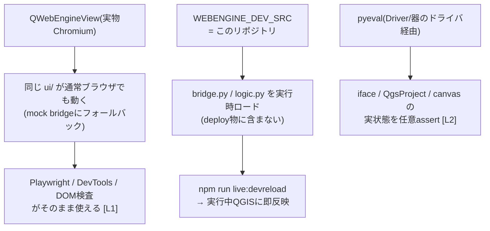

# QGIS Live Harness

**QGISプロセスをAI/外部スクリプトから自律駆動するための開発・制御・検証の基盤(ハーネス)。**
このリポジトリは単体のプラグイン製品ではなく、QGISに「取り付けて操縦する外側の装具」そのもの。
(リポジトリ/ディレクトリ名: `qgis_live_harness`)

## 構成(2層)

| 層 | 名前 | 役割 |
|---|---|---|
| QGIS側の手 | **QGIS Live Driver** (`qgis_live_driver`) | QGIS内で動く制御専用プラグイン。**このリポジトリに依存しない汎用部品**で、任意のQGISへ単独導入して遠隔操作面を得られる |
| 外側の装具 | **QGIS Live Harness** (このリポジトリ全体) | Driverの操作面の上に乗る、クライアントAPI・セッション管理・ホットリロード・検証の基盤。**リポジトリがあって初めて成り立つ** |

さらに `qgis-plugin/webengine_plugin/` を、Harness上で育てる開発対象プラグインの
「器」(Qt WebEngineベースのテンプレート)として同梱する。

- **Driverだけ使う**: `python/plugins/` へのコピーで成立。ファイルJSONL・REST・MCPの
  操作面を持ち、リポジトリもNodeも不要
- **Harnessとして使う**: このリポジトリを開けば、高水準クライアント・
  ensure/reload/devreload・L1/L2テスト・MCPアダプタが揃う

この上で回るのは **エージェンティックループ**: AIが「書く→devreloadで実機反映→
eval/pyeval/スクショで観測→test:liveで検証」を人間なしで反復する。

```mermaid
flowchart TB
    subgraph TOP["利用者: AIエージェント / CI / 人間"]
        MCPC["MCPクライアント(Devin等)"]
        CLIC["CLI / 自作スクリプト"]
        HTTPC["任意HTTPクライアント"]
    end

    subgraph HARNESS["QGIS Live Harness = このリポジトリ(基盤)"]
        ADAPT["MCPアダプタ<br/>scripts/qgis-mcp.mjs(stdio)"]
        NODE["クライアント層<br/>LivePage / qgis-session<br/>live:* / test:live"]
    end

    subgraph Q["常駐QGISプロセス"]
        DRIVER["QGIS Live Driver(汎用部品)<br/>pyeval / 地図スクショ<br/>ファイルJSONL + 内蔵HTTP(/mcp,/api/*)"]
        VESSEL["webengine_plugin(器)<br/>view/channel + view用LiveDriver"]
        PROD["開発対象(repo側)<br/>bridge.py / logic.py / ui/<br/>WEBENGINE_DEV_SRCから別名import"]
        VESSEL --> PROD
    end

    MCPC -->|stdio| ADAPT --> NODE
    MCPC -.->|mcp_stdio.py / HTTP /mcp<br/>(Harness不要)| DRIVER
    HTTPC -.->|/api/*(Harness不要)| DRIVER
    CLIC --> NODE
    NODE -->|ファイルJSONL| DRIVER
    NODE -->|ファイルJSONL| VESSEL
```

破線 = **Driver単体でも成立する経路**(Harnessに依存しない)。
実線 = Harnessが提供する層。

---

## 1. QGIS Live Driver — Harnessから独立した汎用制御プラグイン

[`qgis-plugin/qgis_live_driver/`](qgis-plugin/qgis_live_driver/README.md) は
**UIを持たない制御専用プラグイン**で、実行中QGISを外部から遠隔操作する面を提供する。
`QWebEngineView` を持たないため、**WebEngineを使わない任意のQGIS環境・
任意の他プラグイン**に対しても使える汎用部品。

`pyeval` でQGISプロセス内の任意Pythonを同期実行できるため、
**PyQGISで書ける操作は全て制御可能**: レイヤー/プロジェクト操作、
キャンバス、メニュー/アクション、`qgis.utils.plugins` 経由の他プラグイン、
Processing、QgsSettings、任意widgetの `grab()` による画像化 等。

### 接続面(4系統・全て同じdispatchへ)

- **ファイルJSONL** — `commands.jsonl` 追記 → QTimerが実行 → `results.jsonl` 返却。
  **言語非依存の最下位輸送層**
- **HTTP REST** — `POST 127.0.0.1:<port>/api/pyeval` `{"code":"..."}` 等。
  MCPを知らないfunction calling系AI・curl・自作エージェント向け
- **MCP Streamable HTTP** — `POST 127.0.0.1:<port>/mcp`(JSON-RPC)
- **MCP stdio** — 同梱 `mcp_stdio.py` をspawnするだけ(stdlibのみ、spawn側にQGIS/Node不要)

②③はプラグイン内蔵の `http.server`(stdlibのみ・`127.0.0.1`・空きポート自動選択)が提供。
ワーカースレッドが受けた命令は `driver.submit()` でメモリキューに入り、
GUIスレッドのQTimerがファイルJSONLと同じ要領で実行する(dispatchは1本に統一)。
ポート番号等の接続情報は **`~/.qgis-live/<pid>-qgis_live_driver.json`** に書き出され、
クライアントはここから自動検出できる(`QGIS_LIVE_REGISTRY`で変更可)。

```mermaid
flowchart TB
    subgraph EXT["外部クライアント(Harnessでも第三者アプリでも)"]
        APP["任意言語のアプリ"]
        LP["Harness: LivePage<br/>(live-drive.mjs)"]
        HTTP["MCP/RESTクライアント<br/>(curl・AIエージェント等)"]
    end

    subgraph TR["輸送層"]
        CMD["commands.jsonl"]
        RES["results.jsonl"]
        SRV["http.server 127.0.0.1:&lt;auto&gt;<br/>/mcp + /api/*"]
    end

    subgraph QGIS["常駐QGISプロセス"]
        LD["LiveDriver<br/>QTimer poll + メモリキュー"]
        CORE["iface / QgsProject /<br/>他プラグイン / widget全般"]
        LD --> CORE
    end

    APP & LP --> CMD
    HTTP --> SRV
    CMD --> LD
    SRV -->|submit()| LD
    LD --> RES
    RES --> APP & LP
```

### Harnessなしでの単独導入

Driverの利用にこのリポジトリは要らない:

```powershell
# このリポジトリからなら一括deploy(任意)
powershell -ExecutionPolicy Bypass -File scripts/deploy-plugin.ps1 -Copy

# 手動でも可: qgis-plugin/qgis_live_driver/ を
# python/plugins/qgis_live_driver/ へコピーし、QGISのプラグイン管理で有効化
```

あとは `WEBENGINE_LIVE_DIR` を設定した状態でQGISを起動するだけで、
live dir(`<WEBENGINE_LIVE_DIR>/qgis-<pid>/qgis_live_driver/`)と
レジストリJSONが作られ、上記4系統のいずれでも接続できる
(未設定なら何もしない無害なプラグイン)。

> **セキュリティ**: `pyeval` は任意コード実行。**開発専用**であり
> エンドユーザーへの配布物に含めてはいけない。
> HTTPサーバは `127.0.0.1` のみにバインドする。詳細・制御範囲・制約は
> [qgis_live_driver/README.md](qgis-plugin/qgis_live_driver/README.md) を参照。

---

## 2. QGIS Live Harness — Driverの上に乗る基盤(このリポジトリ)

Driverが「QGIS側の手」なら、Harnessは「操縦席+管制塔」。
生のファイルJSONL/HTTPを直接読み書きする代わりに、
プラグイン開発の全工程を無人化する層を提供する。

HarnessがDriverに対して追加するもの:

| 要素 | 役割 |
|---|---|
| `scripts/live-drive.mjs` (`LivePage`) | Nodeからの高水準API。`evaluate`/`pyeval`/`click`/`waitFor`/`screenshot`/`devreload`。使い勝手はPlaywright相当 |
| `scripts/qgis-session.mjs` | セッション管理。`ensure`=起動中へアタッチ/自動deploy+起動、`reload`=器のホットリロード、`devreload`=repo側コード即反映 |
| `scripts/qgis-live-check.mjs` | L2検証ランナー(`npm run test:live`)。QGIS未起動でも内部でensureする |
| `scripts/qgis-mcp.mjs` | Harness側MCPアダプタ(stdio)。Driverの操作面を `qgis_pyeval` 等のtoolとして公開(後述) |
| `tests/e2e` + Playwright | L1検証。UIが実物Chromiumで動くことを利用したブラウザ単体テスト |
| `WEBENGINE_DEV_SRC` 機構 | 開発対象コードをリポジトリに置いたままQGIS内で実行 → `devreload`で即反映 |

### MCPによるAI連携

AIの接続方式はクライアントごとに異なるため、Driver側・Harness側で**全方式を並列提供**する:

| AIの種類 | 使う面 | 実装 | 提供元 |
|---|---|---|---|
| MCP(stdio) — Devin/Claude Desktop/IDE系 | MCP stdio | `qgis_live_driver/mcp_stdio.py`(stdlibのみ) または `scripts/qgis-mcp.mjs`(Node版・ツール豊富) | Driver / Harness |
| MCP(HTTP) — リモート/マルチクライアント系 | MCP Streamable HTTP | `POST /mcp` | Driver |
| 汎用HTTPのみ — function calling/自作エージェント | plain REST | `POST /api/*` + `GET /api/tools` | Driver |
| シェル/ファイルのみ — 制限環境 | 生ファイルプロトコル | `commands.jsonl`/`results.jsonl` | Driver |
| Nodeライブラリ/CLI | LivePage・`npm run live:*` | `scripts/` 内 | Harness |

MCPクライアント設定例(stdioの場合、Driver同梱shimを直接使う):

```json
{
  "mcpServers": {
    "qgis-live": {
      "command": "python",
      "args": ["C:/Users/<user>/AppData/Roaming/QGIS/QGIS4/profiles/<profile>/python/plugins/qgis_live_driver/mcp_stdio.py"]
    }
  }
}
```

このリポジトリをDevin等で開く場合は `.devin/mcp_config.json` で
`qgis-live`(`scripts/qgis-mcp.mjs`)が登録済み。
tools: `qgis_ensure` / `qgis_pyeval` / `qgis_eval` / `qgis_bridge_call` /
`qgis_screenshot` / `qgis_devreload` / `qgis_reload`。
各toolは内部でensureするためQGIS未起動でも自動で立ち上がり、
`qgis_screenshot` はPNGをMCP **image content**で返すためエージェントが画像として見られる。

```mermaid
flowchart LR
    CLIENT["MCPクライアント<br/>(Devin等)"]
    subgraph SURF["接続面(全て同じdispatchへ)"]
        MCP["Harness: qgis-mcp.mjs<br/>stdio JSON-RPC"]
        SHIM["Driver: mcp_stdio.py<br/>stdio shim(stdlibのみ)"]
        HTTP["Driver内蔵HTTP<br/>/mcp + /api/*"]
    end
    API["Harness: LivePage / ensure"]
    QGIS["常駐QGISプロセス<br/>(Driver + 器)"]

    CLIENT -->|tools/call| MCP --> API -->|ファイルJSONL| QGIS
    CLIENT -->|stdio| SHIM -->|ファイルJSONL| QGIS
    CLIENT -->|HTTP| HTTP -->|submit()| QGIS
    QGIS -->|image content等| MCP --> CLIENT
```

### プラグイン自動化環境(開発対象 = `webengine_plugin`)

Harnessは「任意QGISを操る」だけでなく、**Qt WebEngineプラグインの開発ループ自体を無人化**する。
`webengine_plugin` がその器であり、deployするのは固定の器
(QWebEngineView + view用ドライバ)だけで、開発対象のロジック/UIは
リポジトリに置いたまま**実QGIS内で動作・観測・即時反映**できる。



| 要素 | 面 | 役割 |
|---|---|---|
| **QWebEngineView** | 製品 | UIを実物Chromiumにする → Web標準自動化の適用が可能になる**核** |
| `bridge.py`/`logic.py`/`ui/` | 製品 | 操作対象であり、配布物そのもの |
| `WEBENGINE_DEV_SRC` | 器 | 製品コードをリポジトリに置いたままQGIS内で実行する機構 |
| `devreload` | 器 | 編集→即反映(deploy/reloadPlugin/再起動 全て不要) |
| `pyeval` | 器/Driver | UIの外側・QGIS内部状態まで踏み込む検証手段 |

要素の「面」について: **製品** = 配布プラグインに同梱、
**器** = deployされるが配布物からは除去、**Driver** = 単独導入できる汎用部品、
**Harness** = リポジトリ側にのみ存在。

## ディレクトリ構成

```
qgis-plugin/          プラグイン群のルート(複数プラグインをここに並べる)
  webengine_plugin/   プラグイン1つ分。フォルダ名=QGISのプラグインID
    metadata.txt      プラグイン定義(name=はQGIS上の表示名)
    __init__.py       エントリポイント(classFactory)
    main_plugin.py    ダイアログ/view/channel/ドライバ起動 + dev source loader
    live_driver.py    view用ファイルドライバ(eval/pyeval/screenshot/devreload)
    bridge.py         ★開発対象: WebChannel経由でJSに公開するAPI
    logic.py          ★開発対象: QGIS非依存の純粋ロジック(pytest対象)
    ui/               ★開発対象: HTML/CSS/JS (mockでブラウザ単体動作も可)
  qgis_live_driver/   QGIS Live Driver。制御専用プラグイン(UIなし・汎用部品)
    live_driver.py    pyeval/screenshotの実行体(ファイル+メモリキューdispatch)
    mcp_http.py       内蔵HTTPサーバ(/mcp=MCP Streamable HTTP, /api/*=REST)
    mcp_stdio.py      stdio↔ファイルJSONLブリッジ(同梱・stdlibのみ)
                      詳細: qgis_live_driver/README.md
plugin.config.json    開発対象のプラグインID(qgis-plugin/下のフォルダ名)
scripts/
  live-drive.mjs      LivePage: クライアント側API(evaluate/pyeval/devreload等)
  qgis-session.mjs    ensure/reload/devreloadのオーケストレーション
  qgis-live-check.mjs L2検証ランナー(npm run test:live)
  qgis-mcp.mjs        MCPサーバ(stdio)。tools: pyeval/eval/screenshot/...
  scan-ini.js         QGIS4.iniの肥大化/破損診断
  repair-ini.js       QGIS4.iniの破損エントリ修復(backup付き)
tests/e2e/            Playwright (L1 = mock使用)
tests/unit/           pytest
```

### プラグインの追加・複数開発

`qgis-plugin/` の下に **プラグインIDと同じ名前のフォルダ** で管理する。
複数フォルダを並べると **1つのQGISインスタンスで全プラグインを同時起動**
でき、live dirは `qgis-<pid>/<plugin_id>/` で分離されるため各プラグインを
独立にeval/pyeval/testできる。deployはqgis-plugin/直下の全プラグインを
一括配置し、`test:live` は検出した全プラグインに対してチェックを回す。

`plugin.config.json` の `id` はserve-uiやMCPのデフォルト対象を指す
(`metadata.txt` の `name=` は表示名)。

## セットアップ

```powershell
npm install
npm run deploy:copy    # 器をQGISプラグインディレクトリへ配置(初回のみ)
```

## 使い方

### 開発ループ

```powershell
npm run live:ensure     # 常駐QGISを用意(初回は自動でdeploy+起動)
# → bridge.py / logic.py / ui/* を編集
npm run live:devreload  # repo側コードを即反映(deploy不要)
npm run test:live       # 実QGIS内で検証(pyevalで内部状態assert含む)
```

器側(`main_plugin.py`/`live_driver.py`等)を変更した時だけ:

```powershell
npm run live:reload     # deploy -Copy + 実行中QGISでホットリロード
```

### テスト

```powershell
npm test               # L1: UI単体E2E(ブラウザ+mock)
npm run test:unit      # Pythonロジックのpytest
npm run test:live      # L2: 実QGIS内検証(QGIS未起動でも自動起動)
```

### 外部API(接続面まとめ)

| 面 | 形態 | 対象クライアント例 | 提供元 |
|---|---|---|---|
| ファイルプロトコル | `commands.jsonl` に `{id,type:eval\|pyeval\|screenshot\|devreload}` を追記、結果は `results.jsonl` | 任意言語(最下位の基底) | Driver/器 |
| HTTP REST | `POST 127.0.0.1:<port>/api/pyeval` `{"code":"..."}` 等。ポートは `~/.qgis-live/` で自動検出 | curl・function calling系AI・自作エージェント | Driver |
| MCP Streamable HTTP | `POST 127.0.0.1:<port>/mcp` (JSON-RPC) | HTTP transport対応MCPクライアント | Driver |
| MCP stdio | `python <profile>/python/plugins/qgis_live_driver/mcp_stdio.py` をspawn | stdio型MCPクライアント全般 | Driver |
| Nodeライブラリ | `new LivePage(dir)` → `evaluate/pyeval/devreload/waitFor/screenshot` | `scripts/` 内実装参照 | Harness |
| CLI | `npm run live:*` | シェル/CI | Harness |
| MCP(Harness側) | `.devin/mcp_config.json` の `qgis-live` サーバ(`qgis-mcp.mjs`) | Devin等のMCPクライアント | Harness |

### MCPツール(Harness側)

`qgis_ensure` / `qgis_pyeval` / `qgis_eval` / `qgis_bridge_call` /
`qgis_screenshot` / `qgis_devreload` / `qgis_reload`

どのツールも内部でensureするため、QGIS未起動でも自動で立ち上がる。

```powershell
npm run mcp:qgis       # 手動でMCPサーバ(stdio)を起動する場合
```

## プラグイン配布

**配布物は単独プラグインとして完結する**(このリポジトリやNode環境は不要)。

### 配布物の構成

```
webengine_plugin/     (plugin.config.json の id 名でpython/plugins/へdeployされる)
  metadata.txt        QGISプラグインのIDカード
  __init__.py         エントリポイント(classFactory)
  main_plugin.py      ダイアログ/view/channelの器
  bridge.py           製品コード: WebChannel API
  logic.py            製品コード: 純粋ロジック
  ui/                 製品コード: フロントエンド(パッケージ内に同梱済み)
```

- `deploy -Copy` で生成されるフォルダがほぼ配布形態。
  ui/はパッケージ内にあるためjunction deployでも同梱される
- `metadata.txt` の `name=` はQGIS上の表示名。`plugin.config.json` の
  `id` がdeploy先ディレクトリ名(=QGISのプラグインID)になる
- `WEBENGINE_LIVE_DIR`/`WEBENGINE_DEV_SRC` 未設定では
  同梱bridgeと同梱ui/で普通に動作する(env-gated機構は全て無効化される)

### 配布時に除去するもの

| 対象 | 理由 |
|---|---|
| `live_driver.py` | `pyeval`/`eval` = 任意コード実行。同梱すると環境変数を立てた誰でもQGIS内でコード実行可能になる |
| `main_plugin.py` のDEV_SRCローダ部(`load_dev_bridge_class`等) | 外部パスからコードをimportする機構。無害だが配布物に残すべきではない |

除去しても環境変数を立てられても `ImportError` がキャッチされるだけで
正常動作する設計だが、任意コード実行の扉を物理的に残さないため除去を推奨。

## 環境要件

- QGIS 4.0.1 (`C:\Program Files\QGIS 4.0.1`)、Qt6/PyQt6
- Node.js 24+ (Harness側クライアント用。Driver単体利用なら不要)
- Python 3.13+ (ユニットテスト用)
- Windowsデスクトップセッション(常駐QGISモデルのため)

## 注意

- `pyeval`/`devreload` は任意コード実行を含む **開発専用機能**。
  `WEBENGINE_LIVE_DIR`/`WEBENGINE_DEV_SRC` 設定時のみ有効。
  配布手順は上記「プラグイン配布」節を参照
- 重いQGIS操作(大きなプロジェクトでのレイヤーアクティブ化等)の直後は
  JS側evalが一時的に飢餓することがある。その場合はpyevalで確認する
- 詳細な仕組み・制約は [AGENTS.md](AGENTS.md) を参照
