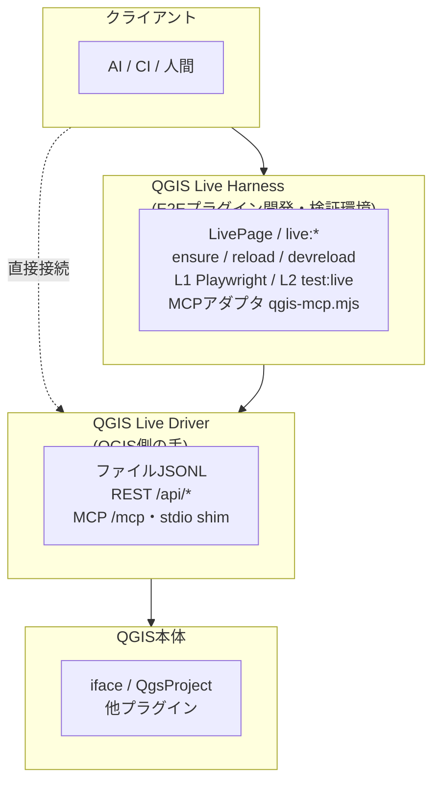

# QGIS Live Harness

**QGISプロセスをAI/外部スクリプトから自律駆動するための開発・制御・検証の基盤(ハーネス)。**
このリポジトリは単体のプラグイン製品ではなく、QGISに「取り付けて操縦する外側の装具」そのもの。

> **ドキュメントは GitHub Pages で公開しています:**
> **https://yamamoto-ryuzo.github.io/qgis_live_harness/**

## 概要



| 層 | 名前 | 役割 |
|---|---|---|
| QGIS側の手 | **QGIS Live Driver** (`qgis_live_driver`) | QGIS内で動く制御専用プラグイン。**このリポジトリに依存しない汎用部品**で、任意のQGISへ単独導入して遠隔操作面を得られる |
| E2Eプラグイン開発・検証環境 | **QGIS Live Harness** (このリポジトリ全体) | Driverの操作面の上に乗る、クライアントAPI・セッション管理・ホットリロード・検証の基盤 |

この上で回るのは **エージェンティックループ**: AIが「書く→devreloadで実機反映→
eval/pyeval/スクショで観測→test:liveで検証」を人間なしで反復する。

## ドキュメント(GitHub Pages)

| ページ | 内容 |
|---|---|
| [概要](https://yamamoto-ryuzo.github.io/qgis_live_harness/) | システム全体像・2層構成 |
| [使い方・セットアップ](https://yamamoto-ryuzo.github.io/qgis_live_harness/usage.html) | Driver単体利用 / Harnessでのプラグイン開発・テスト・外部API一覧 |
| [セキュリティ](https://yamamoto-ryuzo.github.io/qgis_live_harness/security.html) | 脅威モデル・認証方式・防御の限界 |
| [QGIS Live Driver](https://yamamoto-ryuzo.github.io/qgis_live_harness/driver.html) | 汎用制御プラグイン。pyeval・REST・MCP・plugin_id転送(hub) |
| [QGIS Live Harness](https://yamamoto-ryuzo.github.io/qgis_live_harness/harness.html) | LivePage・ensure/devreload・MCP連携・プラグイン自動化環境 |
| [プラグイン配布](https://yamamoto-ryuzo.github.io/qgis_live_harness/distribution.html) | 配布物の構成と配布時に除去するもの |
| [Harnessのプラグイン化](https://yamamoto-ryuzo.github.io/qgis_live_harness/internals.html) | 構造解析:何がDriver側に吸収済みで何が外に残るか |

サイト本体は `docs/` 内のHTMLを直接編集して更新する。
AIエージェント向け開発手順は [AGENTS.md](AGENTS.md)、
変更履歴は [CHANGELOG.md](CHANGELOG.md) を参照。

## クイックスタート

初回クローン直後は、セットアップスクリプトが前提ツールの確認・不足分の
インストール(winget経由)から `npm install`・プラグイン配置までを一括で行う:

```powershell
powershell -ExecutionPolicy Bypass -File scripts\setup.ps1
#   -Yes            確認プロンプトなしで全てインストール
#   -CheckOnly      確認のみ(何もインストールしない)
#   -SkipPlaywright L1テスト用ブラウザの取得を省略
#   -SkipDeploy     QGISへのプラグイン配置を省略
```

手動でセットアップする場合(スクリプトと等価):

```powershell
npm install
npx playwright install   # L1テスト(npm test)を回す場合のみ
npm run deploy:copy      # 器をQGISプラグインディレクトリへ配置(初回のみ)
```

セットアップ後の開発ループ:

```powershell
npm run live:ensure     # 常駐QGISを用意(初回は自動でdeploy+起動)
# → bridge.py / logic.py / ui/* を編集
npm run live:devreload  # repo側コードを即反映(deploy不要)
npm run test:live       # 実QGIS内で検証(pyevalで内部状態assert含む)
```

## 自分のプラグイン開発に使う

`qgis-plugin/` 直下がプラグイン単位の管理単位(フォルダ名=プラグインID)。
WebEngineプラグインを新規に作る場合は `qgis-plugin/<id>/` に
`metadata.txt`(`supportsQt6=yes` 必須)・`__init__.py`・`bridge.py`・
`ui/`・`live_driver.py` を配置する。旧サンプル `webengine_plugin` は
削除済みだが構成の参考にはgit履歴を参照できる。

あとはクイックスタートと同じ手順で、repo側の `bridge.py`/`logic.py`/`ui/` を
`live:devreload` で即反映しながら開発できる(deploy・QGIS再起動は不要)。
開発対象を切り替えたい時は `plugin.config.json` の `id` を書き換える。
`qgis-plugin/` に複数プラグインを置いても、live dirは `qgis-<pid>/<id>` で分離される。

`qgis_live_driver` はこのリポジトリに依存しない汎用制御プラグインなので、
遠隔操作だけ使いたい場合は QGISプラグインリポジトリから単体インストールすればよい
(クローンもNodeも不要)。

## 環境要件

- **Windows 10/11 専用**(deploy/起動スクリプトがPowerShell実装。
  Linux/macOSは未対応)
- QGIS 4.0.x、Qt6/PyQt6。`C:\Program Files\QGIS*` から最新版を自動検出
  (別場所・別バージョンは `QGIS_EXE` 環境変数で指定)
- Node.js 24+ (Harness側クライアント用。Driver単体利用なら不要)
- Python 3.13+ (ユニットテスト用。`pip install pytest`)

いずれも `scripts\setup.ps1` が確認し、不足分はwinget経由で
インストールできる(上記クイックスタート参照)。

## ライセンス

GPL-2.0-or-later ([LICENSE](LICENSE))。
QGISプラグイン部分はQGIS(GPL-2.0+)/PyQt6(GPLv3)へのリンクを伴うため
GPL系が実質必須。使用コンポーネントの一覧は
[THIRD_PARTY_LICENSES.md](THIRD_PARTY_LICENSES.md)。

## 注意

- `pyeval`/`devreload` は任意コード実行を含むため、Driver側は
  **localhost限定・セッショントークン認証必須**で保護される
  (トークンはユーザ限定ACLの `<live_dir>/token`・レジストリJSONにのみ保存)。
  Driverの有効化は `WEBENGINE_LIVE_DIR` env または
  `プラグイン > QGIS Live Driver > リモート制御 (localhostのみ)` トグル。
  配布手順は[プラグイン配布](https://yamamoto-ryuzo.github.io/qgis_live_harness/distribution.html)を参照
