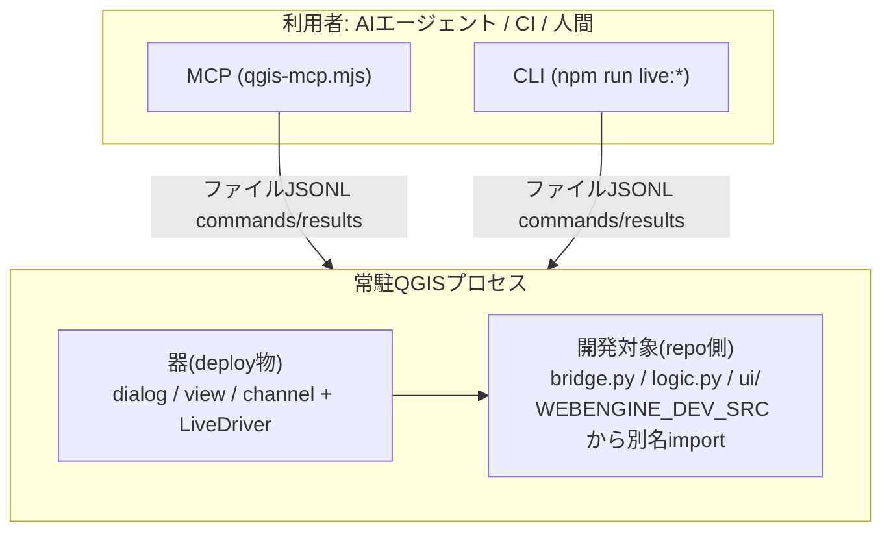
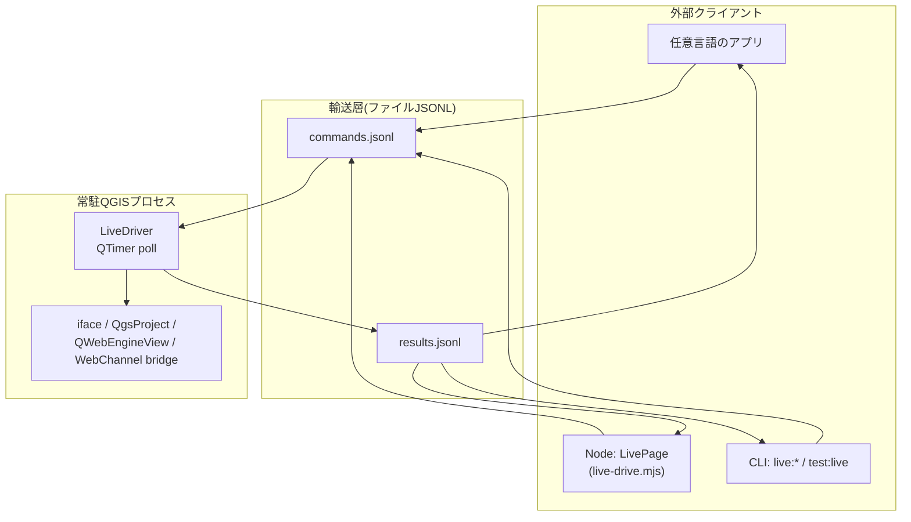
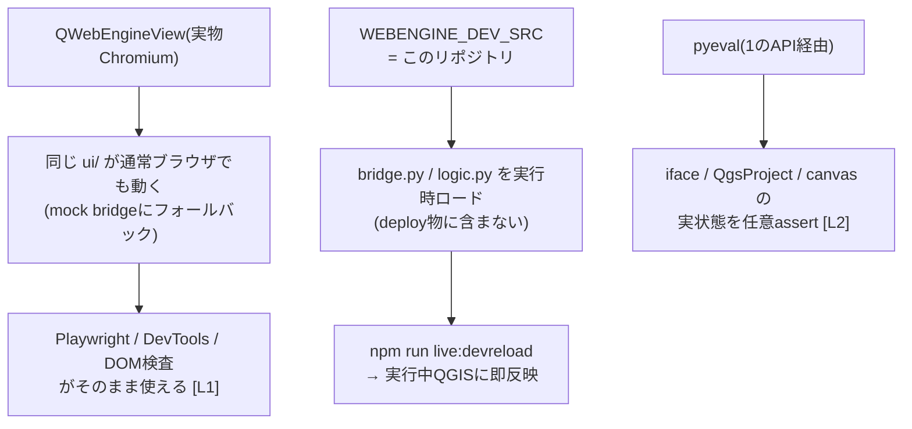
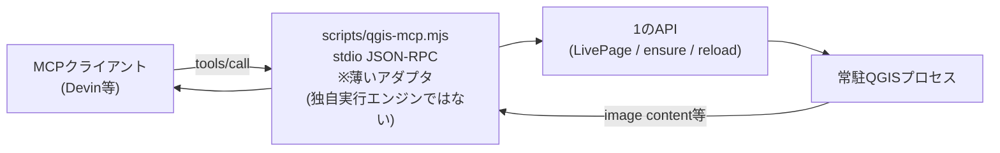

# qgis-webengine-plugin

**QGISプロセスをAI/外部スクリプトから自律駆動する制御基盤** +
Qt WebEngine ベースのプラグイン開発テンプレート。

## 概要

deployするのは固定の「器」(QWebEngineView + ファイル経由ドライバ)だけで、
開発対象のロジック/UIはリポジトリに置いたまま**実QGIS内で動作・観測・即時反映**できる。
ブラウザにおける Chrome DevTools Protocol + Playwright に相当するものを
QGISプロセスに対して実現するシステム。



全体は「遠隔操作API」を土台に、その上へ「プラグイン自動化環境」と
「MCP連携」が乗る3段構成。

## 主な機能

### 1. APIによる各種アプリからの遠隔操作(基盤)

実行中QGISの `iface`/`QgsProject`/プラグインUIを外部から観測・操作する基盤。
このビルドのQtWebEngineはCDP非応答のため、輸送層は**ファイルJSONLプロトコル**
(言語非依存)を独自実装している。



要素:

| 要素 | 役割 |
|---|---|
| `commands.jsonl`→`results.jsonl` | 輸送層。`eval`/`pyeval`/`screenshot`/`devreload` を中継 |
| `live_driver.py`(QGIS側) | JS評価・任意Python(`iface`直アクセス)・スクショ・再読込の実行体 |
| `live-drive.mjs`(LivePage) | Nodeからの高水準API。`evaluate`/`pyeval`/`click`/`waitFor`/`screenshot` |
| `qgis-session.mjs` | セッション管理。`ensure`=起動中へアタッチ/自動起動、`reload`=器のホットリロード |

### 2. AIによるプラグイン完全自動化環境



要素:

| 要素 | 役割 |
|---|---|
| **QWebEngineView** | UIを実物Chromiumにする → Web標準自動化の適用が可能になる**核** |
| `WEBENGINE_DEV_SRC` | 製品コードをリポジトリに置いたままQGIS内で実行する機構 |
| `devreload` | 編集→即反映(deploy/reloadPlugin/再起動 全て不要) |
| `pyeval` | UIの外側・QGIS内部状態まで踏み込む検証手段 |

開発ループ: **編集 → `live:devreload` → `npm run test:live`**(全て無人化可能)

### 3. MCPによるAI連携



要素:

| 要素 | 役割 |
|---|---|
| `qgis_ensure` / `qgis_devreload` / `qgis_reload` | セッション・リロードのtool化 |
| `qgis_pyeval` / `qgis_eval` / `qgis_bridge_call` | 実行系。実QGIS内部・UI・bridgeへ |
| `qgis_screenshot` | PNGをMCP **image content**で返却 → エージェントが画像として見られる |
| `.devin/mcp_config.json` | `qgis-live` として登録。このリポジトリを開けば自動認識 |

## ディレクトリ構成

```
webengine_plugin/     プラグイン器( deployするのは基本的にこれだけ )
  main_plugin.py      ダイアログ/view/channel/ドライバ起動 + dev source loader
  live_driver.py      ファイル経由ドライバ(eval/pyeval/screenshot/devreload)
  bridge.py           ★開発対象: WebChannel経由でJSに公開するAPI
  logic.py            ★開発対象: QGIS非依存の純粋ロジック(pytest対象)
ui/                   ★開発対象: HTML/CSS/JS (mockでブラウザ単体動作も可)
scripts/
  live-drive.mjs      LivePage: クライアント側API(evaluate/pyeval/devreload等)
  qgis-session.mjs    ensure/reload/devreloadのオーケストレーション
  qgis-live-check.mjs L2検証ランナー(npm run test:live)
  qgis-mcp.mjs        MCPサーバ(stdio)。tools: pyeval/eval/screenshot/...
tests/e2e/            Playwright (L1 = mock使用)
tests/unit/           pytest
```

## セットアップ

```powershell
npm install
npm run deploy:copy    # 器をQGISプラグインディレクトリへ配置(初回のみ)
```

## 使い方

### 開発ループ

```powershell
npm run live:ensure     # 常駐QGISを用意(初回は自動でdeploy+起動)
# → bridge.py / logic.py / ui/* を編集
npm run live:devreload  # repo側コードを即反映(deploy不要)
npm run test:live       # 実QGIS内で検証(pyevalで内部状態assert含む)
```

器側(`main_plugin.py`/`live_driver.py`等)を変更した時だけ:

```powershell
npm run live:reload     # deploy -Copy + 実行中QGISでホットリロード
```

### テスト

```powershell
npm test               # L1: UI単体E2E(ブラウザ+mock)
npm run test:unit      # Pythonロジックのpytest
npm run test:live      # L2: 実QGIS内検証(QGIS未起動でも自動起動)
```

### 外部API(4段)

| 段 | 形態 | 例 |
|---|---|---|
| ファイルプロトコル | `commands.jsonl` に `{id,type:eval\|pyeval\|screenshot\|devreload}` を追記、結果は `results.jsonl` | 任意言語 |
| Nodeライブラリ | `new LivePage(dir)` → `evaluate/pyeval/devreload/waitFor/screenshot` | `scripts/` 内実装参照 |
| CLI | `npm run live:*` | シェル/CI |
| MCP | `.devin/mcp_config.json` の `qgis-live` サーバ | Devin等のMCPクライアント |

### MCPツール

`qgis_ensure` / `qgis_pyeval` / `qgis_eval` / `qgis_bridge_call` /
`qgis_screenshot` / `qgis_devreload` / `qgis_reload`

どのツールも内部でensureするため、QGIS未起動でも自動で立ち上がる。

```powershell
npm run mcp:qgis       # 手動でMCPサーバ(stdio)を起動する場合
```

## 環境要件

- QGIS 4.0.1 (`C:\Program Files\QGIS 4.0.1`)、Qt6/PyQt6
- Node.js 24+
- Python 3.13+ (ユニットテスト用)
- Windowsデスクトップセッション(常駐QGISモデルのため)

## 注意

- `pyeval`/`devreload` は任意コード実行を含む **開発専用機能**。
  `WEBENGINE_LIVE_DIR`/`WEBENGINE_DEV_SRC` 設定時のみ有効。
  **エンドユーザーへの配布物にはlive_driver周りを含めないこと**
- 重いQGIS操作(大きなプロジェクトでのレイヤーアクティブ化等)の直後は
  JS側evalが一時的に飢餓することがある。その場合はpyevalで確認する
- 詳細な仕組み・制約は [AGENTS.md](AGENTS.md) を参照
