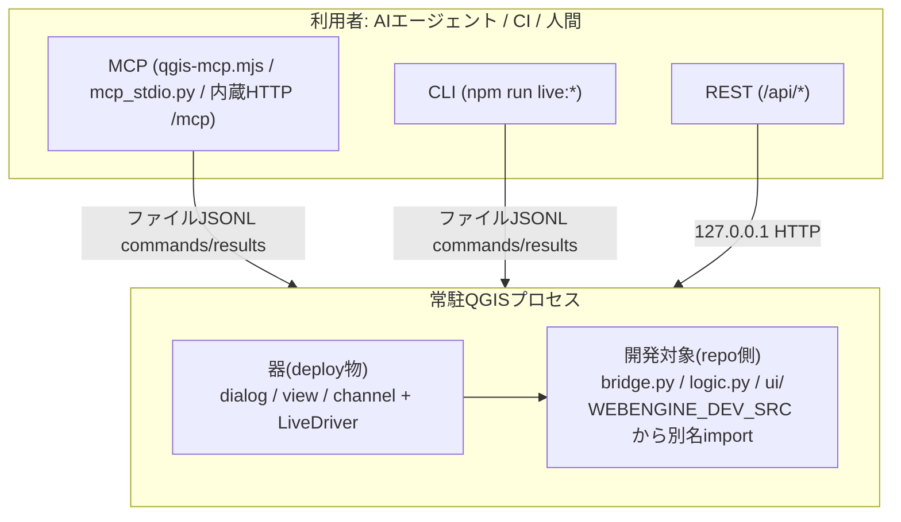
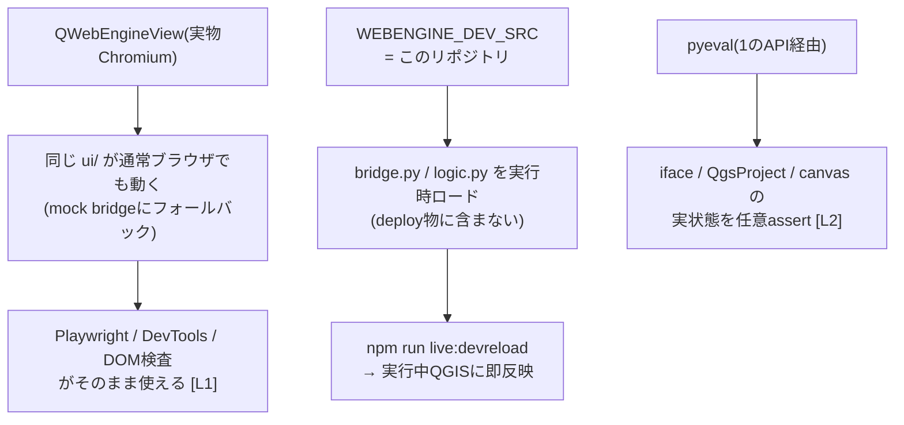

# QGIS Live Harness

**QGISプロセスをAI/外部スクリプトから自律駆動する制御基盤(ハーネス)** +
Qt WebEngine ベースのプラグイン開発テンプレート。
(リポジトリ/ディレクトリ名: `qgis-webengine-plugin`)

## 命名

| 名前 | 指すもの |
|---|---|
| **QGIS Live Harness** | このリポジトリ全体。開発・制御・観測・検証の環境(基盤)。QGISに「取り付けて操縦する外側の装具」 |
| **QGIS Live Driver** (`qgis_live_driver`) | QGIS内にdeployされる制御プラグイン。ファイルJSONL・HTTP REST・MCP HTTP/stdioの接続面を持つ実行部品。ハーネスの「QGIS側の手」 |

この上で回るのは **エージェンティックループ**: AIが「書く→devreloadで実機反映→eval/pyeval/スクショで観測→test:liveで検証」を人間なしで反復する。

## 概要

このシステムは2つの面を持つ:

- **プラグイン(製品)**: `qgis-plugin/<id>/` の器 + `bridge.py`/`logic.py`/`ui/`。
  `live_driver.py` と dev loader を剥がせば、そのまま配布できる普通のQGISプラグイン。
  **リポジトリが無くても動く**
- **基盤(QGIS Live Harness = このリポジトリ)**: そのプラグインを育て・観測・
  外部操作するための開発・制御環境。ファイルプロトコル経由のLiveDriver、
  セッション管理、devreload、テスト、MCPアダプタを含む。**リポジトリがあって初めて成り立つ**

`qgis-plugin/<id>/` は境界をまたぐ部品で、LiveDriver等を載せれば基盤側の
操縦装置になり、剥がせば配布用の製品になる。

deployするのは固定の「器」(QWebEngineView + ファイル経由ドライバ)だけで、
開発対象のロジック/UIはリポジトリに置いたまま**実QGIS内で動作・観測・即時反映**できる。
ブラウザにおける Chrome DevTools Protocol + Playwright に相当するものを
QGISプロセスに対して実現するシステム。



全体は「遠隔操作API」を土台に、その上へ「MCP連携」と
「プラグイン自動化環境」が乗る3段構成。

## 主な機能

以下の3機能は全て**基盤側**(このリポジトリが必要)の機能。
プラグイン(製品)はこれらの**操作対象**として登場する。
要素表の「面」列の意味:

- **製品** — 配布プラグインに同梱されるもの
- **開発版の器** — deployされるが配布物からは除去するもの
- **リポジトリ** — 基盤側にのみ存在するもの

### 1. APIによる各種アプリからの遠隔操作(基盤) — `qgis_live_driver`プラグイン

実行中QGISの `iface`/`QgsProject`/プラグインUIを外部から観測・操作する基盤。
このビルドのQtWebEngineはCDP非応答のため、輸送層は**ファイルJSONLプロトコル**
(言語非依存)を独自実装している。

このAPIは**プラグインとしても配備できる**:
[`qgis-plugin/qgis_live_driver/`](qgis-plugin/qgis_live_driver/README.md) は制御面だけを
切り出したUIなしプラグインで、WebEngineを持たない任意のQGIS環境・
他プラグインに対しても `pyeval` + 地図キャンバススクショの遠隔操作を提供する
(開発専用。任意コード実行のため配布物には含めない)。

`qgis_live_driver` はファイルJSONLの他に、**QGISプロセス内蔵のHTTPサーバ**も持つ
(標準ライブラリのみ・`127.0.0.1`・空きポート自動選択):

- `POST /mcp` — **MCP Streamable HTTP**(initialize/tools/list/tools/call/ping)
- `POST /api/pyeval` / `POST /api/eval` / `POST /api/screenshot` — **plain REST**
  (MCPを知らないfunction calling系AI・自作エージェント・curlから直接操作)
- `GET /api/tools` / `GET /api/health` — ツール仕様JSON / 生存確認

ポート番号は `~/.qgis-live/<pid>-qgis_live_driver.json` に書き出され、
クライアント側はこれを読んで**自動検出**できる(QGIS_LIVE_REGISTRYで変更可)。
HTTPワーカースレッドが受けた命令は `driver.submit()` でメモリキューに入り、
GUIスレッドのQTimerがファイルJSONLと同じ要領で実行する(dispatchは1本に統一)。

```mermaid
flowchart TB
    subgraph EXT["外部クライアント"]
        APP["任意言語のアプリ"]
        LP["Node: LivePage<br/>(live-drive.mjs)"]
        CLI["CLI: live:* / test:live"]
        HTTP["MCP/RESTクライアント<br/>(curl・function calling系AI等)"]
    end

    subgraph TR["輸送層"]
        CMD["commands.jsonl"]
        RES["results.jsonl"]
        SRV["http.server 127.0.0.1:&lt;auto&gt;<br/>/mcp + /api/*"]
    end

    subgraph QGIS["常駐QGISプロセス"]
        LD["LiveDriver<br/>QTimer poll + メモリキュー"]
        CORE["iface / QgsProject /<br/>QWebEngineView / WebChannel bridge"]
        LD --> CORE
    end

    APP --> CMD
    LP --> CMD
    CLI --> CMD
    HTTP --> SRV
    CMD --> LD
    SRV -->|submit()| LD
    LD --> RES
    RES --> APP & LP & CLI
```

要素:

| 要素 | 面 | 役割 |
|---|---|---|
| `commands.jsonl`→`results.jsonl` | 開発版の器 | 輸送層。`eval`/`pyeval`/`screenshot`/`devreload` を中継 |
| `live_driver.py`(QGIS側) | 開発版の器 | JS評価・任意Python(`iface`直アクセス)・スクショ・再読込の実行体 |
| `mcp_http.py` | 開発版の器 | QGIS内蔵HTTPサーバ。MCP `/mcp` と REST `/api/*` を同一ポートで提供 |
| `mcp_stdio.py` | 開発版の器 | stdio↔ファイルJSONLのブリッジ。MCPクライアントから `python .../mcp_stdio.py` でspawnするだけ |
| `~/.qgis-live/<pid>-<plugin>.json` | 開発版の器 | 接続情報レジストリ(http_port/live_dir)。クライアントの自動検出用 |
| [`qgis_live_driver`プラグイン](qgis-plugin/qgis_live_driver/README.md) | 開発版の器 | このAPIを単独プラグイン化したもの。view不要で他プラグイン含めQGIS全体を `pyeval` 操作可能にする |
| `live-drive.mjs`(LivePage) | リポジトリ | Nodeからの高水準API。`evaluate`/`pyeval`/`click`/`waitFor`/`screenshot` |
| `qgis-session.mjs` | リポジトリ | セッション管理。`ensure`=起動中へアタッチ/自動起動、`reload`=器のホットリロード |

### 2. MCPによるAI連携 — `qgis_live_driver`プラグイン(+`qgis-mcp.mjs`)

AIの接続方式はクライアントごとに異なるため、**全方式を並列提供**する:

| AIの種類 | 使う面 | 実装 |
|---|---|---|
| MCP(stdio) — Devin/Claude Desktop/IDE系 | MCP stdio | `qgis_live_driver/mcp_stdio.py`(プラグイン同梱・stdlibのみ)または `scripts/qgis-mcp.mjs`(Node版) |
| MCP(HTTP) — リモート/マルチクライアント系 | MCP Streamable HTTP | `qgis_live_driver` 内蔵 `POST /mcp` |
| 汎用HTTPのみ — function calling/自作エージェント | plain REST | `qgis_live_driver` 内蔵 `POST /api/*` + `GET /api/tools` |
| シェル/ファイルのみ — 制限環境 | 生ファイルプロトコル | `commands.jsonl`/`results.jsonl`(言語非依存) |

> **プラグイン名**: 上記のプラグイン側実装は全て **`qgis_live_driver`** プラグイン
> (表示名: `QGIS Live Driver`、deploy先 `python/plugins/qgis_live_driver/`)に
> 内蔵されている。`webengine_plugin` 側はWebEngine UI用のドライバのみ持ち、
> MCP/REST面は `qgis_live_driver` が担当する。

MCPクライアント設定例(stdioの場合):

```json
{
  "mcpServers": {
    "qgis-live": {
      "command": "python",
      "args": ["C:/Users/<user>/AppData/Roaming/QGIS/QGIS4/profiles/<profile>/python/plugins/qgis_live_driver/mcp_stdio.py"]
    }
  }
}
```

HTTP transport対応クライアントの場合は `http://127.0.0.1:<port>/mcp`
(portは `~/.qgis-live/<pid>-qgis_live_driver.json` の `http_port` を参照)。

```mermaid
flowchart LR
    CLIENT["MCPクライアント<br/>(Devin等)"]
    subgraph SURF["接続面(全て同じdispatchへ)"]
        MCP["scripts/qgis-mcp.mjs<br/>stdio JSON-RPC<br/>※薄いアダプタ"]
        SHIM["qgis_live_driver/mcp_stdio.py<br/>stdio shim(stdlibのみ)"]
        HTTP["qgis_live_driver内蔵HTTP<br/>/mcp + /api/*"]
    end
    API["1のAPI<br/>(LivePage / ensure / reload)"]
    QGIS["常駐QGISプロセス"]

    CLIENT -->|tools/call| MCP --> API --> QGIS
    CLIENT -->|stdio| SHIM -->|ファイルJSONL| QGIS
    CLIENT -->|HTTP| HTTP -->|submit()| QGIS
    QGIS -->|image content等| MCP --> CLIENT
```

要素:

| 要素 | 面 | 役割 |
|---|---|---|
| `qgis_ensure` / `qgis_devreload` / `qgis_reload` | リポジトリ | セッション・リロードのtool化 |
| `qgis_pyeval` / `qgis_eval` / `qgis_bridge_call` | リポジトリ | 実行系。実QGIS内部・UI・bridgeへ |
| `qgis_screenshot` | リポジトリ | PNGをMCP **image content**で返却 → エージェントが画像として見られる |
| `.devin/mcp_config.json` | リポジトリ | `qgis-live` として登録。このリポジトリを開けば自動認識 |
| `qgis_live_driver/mcp_stdio.py` | 開発版の器 | stdioブリッジ。QGIS無しのspawn側でもstdlibだけで動き、`~/.qgis-live/` レジストリからlive dirを自動検出 |
| `qgis_live_driver` 内蔵 `/mcp` `/api/*` | 開発版の器 | HTTP面。MCP未対応のAIでも `POST /api/pyeval {"code":"..."}` だけで操作できる |

### 3. AIによるプラグイン完全自動化環境 — リポジトリ基盤(器: `webengine_plugin`)



要素:

| 要素 | 面 | 役割 |
|---|---|---|
| **QWebEngineView** | 製品 | UIを実物Chromiumにする → Web標準自動化の適用が可能になる**核** |
| `bridge.py`/`logic.py`/`ui/` | 製品 | 操作対象であり、配布物そのもの |
| `WEBENGINE_DEV_SRC` | 開発版の器 | 製品コードをリポジトリに置いたままQGIS内で実行する機構 |
| `devreload` | 開発版の器 | 編集→即反映(deploy/reloadPlugin/再起動 全て不要) |
| `pyeval` | 開発版の器 | UIの外側・QGIS内部状態まで踏み込む検証手段 |

開発ループ: **編集 → `live:devreload` → `npm run test:live`**(全て無人化可能)

## ディレクトリ構成

```
qgis-plugin/          プラグイン群のルート(複数プラグインをここに並べる)
  webengine_plugin/   プラグイン1つ分。フォルダ名=QGISのプラグインID
    metadata.txt      プラグイン定義(name=はQGIS上の表示名)
    __init__.py       エントリポイント(classFactory)
    main_plugin.py    ダイアログ/view/channel/ドライバ起動 + dev source loader
    live_driver.py    ファイル経由ドライバ(eval/pyeval/screenshot/devreload)
    bridge.py         ★開発対象: WebChannel経由でJSに公開するAPI
    logic.py          ★開発対象: QGIS非依存の純粋ロジック(pytest対象)
    ui/               ★開発対象: HTML/CSS/JS (mockでブラウザ単体動作も可)
  qgis_live_driver/          制御専用プラグイン(UIなし)。遠隔操作APIを単独配備する形
    live_driver.py    pyeval/screenshotの実行体(ファイル+メモリキューdispatch)
    mcp_http.py       内蔵HTTPサーバ(/mcp=MCP Streamable HTTP, /api/*=REST)
    mcp_stdio.py      stdio↔ファイルJSONLブリッジ(同梱・stdlibのみ)
                      詳細: qgis_live_driver/README.md
plugin.config.json    開発対象のプラグインID(qgis-plugin/下のフォルダ名)
scripts/
  live-drive.mjs      LivePage: クライアント側API(evaluate/pyeval/devreload等)
  qgis-session.mjs    ensure/reload/devreloadのオーケストレーション
  qgis-live-check.mjs L2検証ランナー(npm run test:live)
  qgis-mcp.mjs        MCPサーバ(stdio)。tools: pyeval/eval/screenshot/...
  scan-ini.js         QGIS4.iniの肥大化/破損診断
  repair-ini.js       QGIS4.iniの破損エントリ修復(backup付き)
tests/e2e/            Playwright (L1 = mock使用)
tests/unit/           pytest
```

### プラグインの追加・複数開発

`qgis-plugin/` の下に **プラグインIDと同じ名前のフォルダ** で管理する。
複数フォルダを並べると **1つのQGISインスタンスで全プラグインを同時起動**
でき、live dirは `qgis-<pid>/<plugin_id>/` で分離されるため各プラグインを
独立にeval/pyeval/testできる。deployはqgis-plugin/直下の全プラグインを
一括配置し、`test:live` は検出した全プラグインに対してチェックを回す。

`plugin.config.json` の `id` はserve-uiやMCPのデフォルト対象を指す
(`metadata.txt` の `name=` は表示名)。

## セットアップ

```powershell
npm install
npm run deploy:copy    # 器をQGISプラグインディレクトリへ配置(初回のみ)
```

## 使い方

### 開発ループ

```powershell
npm run live:ensure     # 常駐QGISを用意(初回は自動でdeploy+起動)
# → bridge.py / logic.py / ui/* を編集
npm run live:devreload  # repo側コードを即反映(deploy不要)
npm run test:live       # 実QGIS内で検証(pyevalで内部状態assert含む)
```

器側(`main_plugin.py`/`live_driver.py`等)を変更した時だけ:

```powershell
npm run live:reload     # deploy -Copy + 実行中QGISでホットリロード
```

### テスト

```powershell
npm test               # L1: UI単体E2E(ブラウザ+mock)
npm run test:unit      # Pythonロジックのpytest
npm run test:live      # L2: 実QGIS内検証(QGIS未起動でも自動起動)
```

### 外部API(接続面)

| 面 | 形態 | 対象クライアント例 |
|---|---|---|
| ファイルプロトコル | `commands.jsonl` に `{id,type:eval\|pyeval\|screenshot\|devreload}` を追記、結果は `results.jsonl` | 任意言語(最下位の基底) |
| HTTP REST | `POST 127.0.0.1:<port>/api/pyeval` `{"code":"..."}` 等。ポートは `~/.qgis-live/` で自動検出 | curl・function calling系AI・自作エージェント |
| MCP Streamable HTTP | `POST 127.0.0.1:<port>/mcp` (JSON-RPC) | HTTP transport対応MCPクライアント |
| MCP stdio | `python <profile>/python/plugins/qgis_live_driver/mcp_stdio.py` をspawn | stdio型MCPクライアント全般 |
| Nodeライブラリ | `new LivePage(dir)` → `evaluate/pyeval/devreload/waitFor/screenshot` | `scripts/` 内実装参照 |
| CLI | `npm run live:*` | シェル/CI |
| MCP(リポジトリ側) | `.devin/mcp_config.json` の `qgis-live` サーバ(`qgis-mcp.mjs`) | Devin等のMCPクライアント |

### MCPツール

`qgis_ensure` / `qgis_pyeval` / `qgis_eval` / `qgis_bridge_call` /
`qgis_screenshot` / `qgis_devreload` / `qgis_reload`

どのツールも内部でensureするため、QGIS未起動でも自動で立ち上がる。

```powershell
npm run mcp:qgis       # 手動でMCPサーバ(stdio)を起動する場合
```

## プラグイン配布

**配布物は単独プラグインとして完結する**(このリポジトリやNode環境は不要)。

### 配布物の構成

```
webengine_plugin/     (plugin.config.json の id 名でpython/plugins/へdeployされる)
  metadata.txt        QGISプラグインのIDカード
  __init__.py         エントリポイント(classFactory)
  main_plugin.py      ダイアログ/view/channelの器
  bridge.py           製品コード: WebChannel API
  logic.py            製品コード: 純粋ロジック
  ui/                 製品コード: フロントエンド(パッケージ内に同梱済み)
```

- `deploy -Copy` で生成されるフォルダがほぼ配布形態。
  ui/はパッケージ内にあるためjunction deployでも同梱される
- `metadata.txt` の `name=` はQGIS上の表示名。`plugin.config.json` の
  `id` がdeploy先ディレクトリ名(=QGISのプラグインID)になる
- `WEBENGINE_LIVE_DIR`/`WEBENGINE_DEV_SRC` 未設定では
  同梱bridgeと同梱ui/で普通に動作する(env-gated機構は全て無効化される)

### 配布時に除去するもの

| 対象 | 理由 |
|---|---|
| `live_driver.py` | `pyeval`/`eval` = 任意コード実行。同梱すると環境変数を立てた誰でもQGIS内でコード実行可能になる |
| `main_plugin.py` のDEV_SRCローダ部(`load_dev_bridge_class`等) | 外部パスからコードをimportする機構。無害だが配布物に残すべきではない |

除去しても環境変数を立てられても `ImportError` がキャッチされるだけで
正常動作する設計だが、任意コード実行の扉を物理的に残さないため除去を推奨。

## 環境要件

- QGIS 4.0.1 (`C:\Program Files\QGIS 4.0.1`)、Qt6/PyQt6
- Node.js 24+
- Python 3.13+ (ユニットテスト用)
- Windowsデスクトップセッション(常駐QGISモデルのため)

## 注意

- `pyeval`/`devreload` は任意コード実行を含む **開発専用機能**。
  `WEBENGINE_LIVE_DIR`/`WEBENGINE_DEV_SRC` 設定時のみ有効。
  配布手順は上記「プラグイン配布」節を参照
- 重いQGIS操作(大きなプロジェクトでのレイヤーアクティブ化等)の直後は
  JS側evalが一時的に飢餓することがある。その場合はpyevalで確認する
- 詳細な仕組み・制約は [AGENTS.md](AGENTS.md) を参照
