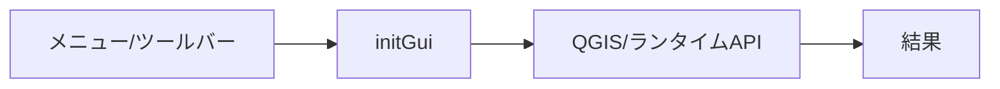
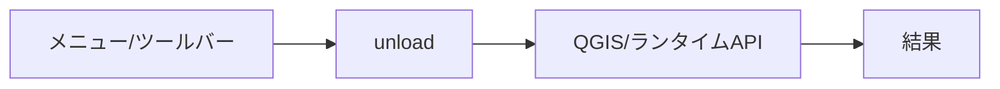
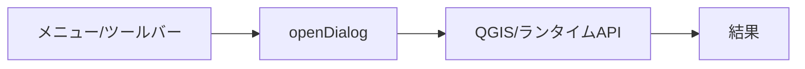
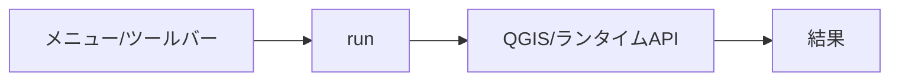

# geo_driver — 完全ロジックシート

- 種別: qgis_plugin / バージョン: 0.16.0
- 生成: 2026-11-14T07:09:57+09:00 / 機能数: 184

## トポロジ

```mermaid
flowchart LR
  subgraph ENTRY["操作入口"]
    UI["メニュー/ダイアログ"]
    AI["AI/bridge_call"]
  end
  subgraph LOGIC["実装"]
    entry_point___init___py_classFactory["classFactory<br/><i>entry_point</i>"]
    action_GeoDriverPlugin_initGui["initGui<br/><i>action</i>"]
    action_GeoDriverPlugin_unload["unload<br/><i>action</i>"]
    action__GenericBridge_openDialog["openDialog<br/><i>action</i>"]
    action__GenericBridge_run["run<br/><i>action</i>"]
    dialog_AiPanel["AiPanel<br/><i>dialog</i>"]
    dialog__InstructionsDialog["_InstructionsDialog<br/><i>dialog</i>"]
    dialog__McpDialog["_McpDialog<br/><i>dialog</i>"]
    ui_AiPanel__on_agent_activated["_on_agent_activated<br/><i>ui_control</i>"]
    ui_AiPanel__on_agent_changed["_on_agent_changed<br/><i>ui_control</i>"]
    ui_AiPanel__on_confirm["_on_confirm<br/><i>ui_control</i>"]
    ui_AiPanel__on_destroyed["_on_destroyed<br/><i>ui_control</i>"]
    ui_AiPanel__on_model_activated["_on_model_activated<br/><i>ui_control</i>"]
    ui_AiPanel__on_model_text_changed["_on_model_text_changed<br/><i>ui_control</i>"]
    ui_AiPanel__on_models["_on_models<br/><i>ui_control</i>"]
    ui_AiPanel__on_pasted_images["_on_pasted_images<br/><i>ui_control</i>"]
    ui_AiPanel__on_prompt_activated["_on_prompt_activated<br/><i>ui_control</i>"]
    ui_AiPanel__on_provider_changed["_on_provider_changed<br/><i>ui_control</i>"]
    ui_AiPanel__on_settings_toggled["_on_settings_toggled<br/><i>ui_control</i>"]
    ui_AiPanel__on_signin["_on_signin<br/><i>ui_control</i>"]
    ui_AiPanel_suggestedPrompts["おすすめプロンプトコンボ<br/><i>ui_control</i>"]
    ui_GeoDriverPlugin__on_toggle["_on_toggle<br/><i>ui_control</i>"]
    bridge_applyScaleWidth["applyScaleWidth<br/><i>bridge_method</i>"]
    bridge_deployMode["deployMode<br/><i>bridge_method</i>"]
    bridge_hotReload["hotReload<br/><i>bridge_method</i>"]
    bridge_layerOrgProfiles["layerOrgProfiles<br/><i>bridge_method</i>"]
    bridge_layerOrgRules["layerOrgRules<br/><i>bridge_method</i>"]
    bridge_listDevPlugins["listDevPlugins<br/><i>bridge_method</i>"]
    bridge_openAiPanel["openAiPanel<br/><i>bridge_method</i>"]
    bridge_openConnInfo["openConnInfo<br/><i>bridge_method</i>"]
    bridge_openDeployMode["openDeployMode<br/><i>bridge_method</i>"]
    bridge_organizeLayers["organizeLayers<br/><i>bridge_method</i>"]
    bridge_placeLayer["placeLayer<br/><i>bridge_method</i>"]
    bridge_pluginInfo["pluginInfo<br/><i>bridge_method</i>"]
    bridge_remoteControl["remoteControl<br/><i>bridge_method</i>"]
    bridge_scaleStyleProfiles["scaleStyleProfiles<br/><i>bridge_method</i>"]
    bridge_scaleStyleTable["scaleStyleTable<br/><i>bridge_method</i>"]
    bridge_setLayerOrgProfile["setLayerOrgProfile<br/><i>bridge_method</i>"]
    bridge_setScaleStyleProfile["setScaleStyleProfile<br/><i>bridge_method</i>"]
    bridge_status["status<br/><i>bridge_method</i>"]
    bridge_suggestScaleWidth["suggestScaleWidth<br/><i>bridge_method</i>"]
    registry_ai_client_py_register_extra_tools["register_extra_tools<br/><i>registry</i>"]
    integration___init___py_59["subprocess.run<br/><i>integration</i>"]
    integration_ai_client_py_1741["HTTPServer<br/><i>integration</i>"]
    integration_ai_client_py_1747["HTTPServer<br/><i>integration</i>"]
    integration_ai_client_py_1764["webbrowser.open<br/><i>integration</i>"]
    integration_ai_client_py_1941["subprocess.Popen<br/><i>integration</i>"]
    integration_ai_client_py_2102["HTTPServer<br/><i>integration</i>"]
    integration_ai_client_py_2108["HTTPServer<br/><i>integration</i>"]
    integration_ai_client_py_2125["webbrowser.open<br/><i>integration</i>"]
    integration_ai_client_py_2302["subprocess.Popen<br/><i>integration</i>"]
    integration_ai_panel_py_2150["QDesktopServices.openUrl<br/><i>integration</i>"]
    integration_ai_panel_py_2279["QDesktopServices.openUrl<br/><i>integration</i>"]
    integration_ai_panel_py_459["QDesktopServices.openUrl<br/><i>integration</i>"]
    integration_ai_panel_py_492["QDesktopServices.openUrl<br/><i>integration</i>"]
    integration_credential_store_py_153["subprocess.run<br/><i>integration</i>"]
    integration_credential_store_py_180["subprocess.run<br/><i>integration</i>"]
    integration_credential_store_py_68["subprocess.run<br/><i>integration</i>"]
    integration_devin_tasks_py_274["subprocess.Popen<br/><i>integration</i>"]
    integration_devin_tasks_py_279["subprocess.Popen<br/><i>integration</i>"]
    integration_devin_tasks_py_639["subprocess.Popen<br/><i>integration</i>"]
    integration_mcp_http_py_481["ThreadingHTTPServer<br/><i>integration</i>"]
    integration_mcp_http_py_664["ThreadingHTTPServer<br/><i>integration</i>"]
    integration_mode_switch_py_225["subprocess.run<br/><i>integration</i>"]
    ai_bridge_route["bridge_call経由全到達<br/><i>ai_integration</i>"]
    ai_catalog["describe_plugins登録<br/><i>ai_integration</i>"]
    ai_pluginInfo["pluginInfo自己記述<br/><i>ai_integration</i>"]
    ai_prompt_bundled["同梱おすすめプロンプト(6件)<br/><i>ai_integration</i>"]
    ai_skill_scale_line_width["同梱スキル scale-line-width<br/><i>ai_integration</i>"]
    ai_skill_webgis_convert["同梱スキル webgis-convert<br/><i>ai_integration</i>"]
    ai_skill_webgis_import["同梱スキル webgis-import<br/><i>ai_integration</i>"]
    logic_fn_ai_client_py_agents_dir["agents_dir<br/><i>logic_fn</i>"]
    logic_fn_ai_client_py_anthropic_content["anthropic_content<br/><i>logic_fn</i>"]
    logic_fn_ai_client_py_anthropic_headers["anthropic_headers<br/><i>logic_fn</i>"]
    logic_fn_ai_client_py_anthropic_image_part["anthropic_image_part<br/><i>logic_fn</i>"]
    logic_fn_ai_client_py_anthropic_messages["anthropic_messages<br/><i>logic_fn</i>"]
    logic_fn_ai_client_py_anthropic_messages_url["anthropic_messages_url<br/><i>logic_fn</i>"]
    logic_fn_ai_client_py_anthropic_models_url["anthropic_models_url<br/><i>logic_fn</i>"]
    logic_fn_ai_client_py_anthropic_tools["anthropic_tools<br/><i>logic_fn</i>"]
    logic_fn_ai_client_py_attachment_temp_path["attachment_temp_path<br/><i>logic_fn</i>"]
    logic_fn_ai_client_py_azure_chat_url["azure_chat_url<br/><i>logic_fn</i>"]
    logic_fn_ai_client_py_azure_resource_url["azure_resource_url<br/><i>logic_fn</i>"]
    logic_fn_ai_client_py_chat_completions["chat_completions<br/><i>logic_fn</i>"]
    logic_fn_ai_client_py_classify_model["classify_model<br/><i>logic_fn</i>"]
    logic_fn_ai_client_py_close_acp_sessions["close_acp_sessions<br/><i>logic_fn</i>"]
    logic_fn_ai_client_py_command_from_tool_call["command_from_tool_call<br/><i>logic_fn</i>"]
    logic_fn_ai_client_py_copilot_session["copilot_session<br/><i>logic_fn</i>"]
    logic_fn_ai_client_py_delete_agent["delete_agent<br/><i>logic_fn</i>"]
    logic_fn_ai_client_py_delete_instruction["delete_instruction<br/><i>logic_fn</i>"]
    logic_fn_ai_client_py_delete_skill["delete_skill<br/><i>logic_fn</i>"]
    logic_fn_ai_client_py_endpoint_url["endpoint_url<br/><i>logic_fn</i>"]
    logic_fn_ai_client_py_fmt_tokens["fmt_tokens<br/><i>logic_fn</i>"]
    logic_fn_ai_client_py_gemini_generate["gemini_generate<br/><i>logic_fn</i>"]
    logic_fn_ai_client_py_gemini_models_url["gemini_models_url<br/><i>logic_fn</i>"]
    logic_fn_ai_client_py_gemini_tools["gemini_tools<br/><i>logic_fn</i>"]
    logic_fn_ai_client_py_gemini_url["gemini_url<br/><i>logic_fn</i>"]
    logic_fn_ai_client_py_get_provider["get_provider<br/><i>logic_fn</i>"]
    logic_fn_ai_client_py_github_device_code["github_device_code<br/><i>logic_fn</i>"]
    logic_fn_ai_client_py_github_poll_access_token["github_poll_access_token<br/><i>logic_fn</i>"]
    logic_fn_ai_client_py_image_b64["image_b64<br/><i>logic_fn</i>"]
    logic_fn_ai_client_py_image_inline_part["image_inline_part<br/><i>logic_fn</i>"]
    logic_fn_ai_client_py_image_message_content["image_message_content<br/><i>logic_fn</i>"]
    logic_fn_ai_client_py_image_url_part["image_url_part<br/><i>logic_fn</i>"]
    logic_fn_ai_client_py_list_agents["list_agents<br/><i>logic_fn</i>"]
    logic_fn_ai_client_py_list_instruction_files["list_instruction_files<br/><i>logic_fn</i>"]
    logic_fn_ai_client_py_list_model_infos["list_model_infos<br/><i>logic_fn</i>"]
    logic_fn_ai_client_py_list_models["list_models<br/><i>logic_fn</i>"]
    logic_fn_ai_client_py_list_prompts["list_prompts<br/><i>logic_fn</i>"]
    logic_fn_ai_client_py_list_skills["list_skills<br/><i>logic_fn</i>"]
    logic_fn_ai_client_py_load_agent["load_agent<br/><i>logic_fn</i>"]
    logic_fn_ai_client_py_load_instruction["load_instruction<br/><i>logic_fn</i>"]
    logic_fn_ai_client_py_mcp_config_path["mcp_config_path<br/><i>logic_fn</i>"]
    logic_fn_ai_client_py_mcp_discover["mcp_discover<br/><i>logic_fn</i>"]
    logic_fn_ai_client_py_mcp_save_config["mcp_save_config<br/><i>logic_fn</i>"]
    logic_fn_ai_client_py_mcp_servers_config["mcp_servers_config<br/><i>logic_fn</i>"]
    logic_fn_ai_client_py_model_info["model_info<br/><i>logic_fn</i>"]
    logic_fn_ai_client_py_model_label["model_label<br/><i>logic_fn</i>"]
    logic_fn_ai_client_py_model_tooltip["model_tooltip<br/><i>logic_fn</i>"]
    logic_fn_ai_client_py_openai_models_url["openai_models_url<br/><i>logic_fn</i>"]
    logic_fn_ai_client_py_openai_msgs_to_responses_input["openai_msgs_to_responses_input<br/><i>logic_fn</i>"]
    logic_fn_ai_client_py_openai_tools["openai_tools<br/><i>logic_fn</i>"]
    logic_fn_ai_client_py_parse_responses_output["parse_responses_output<br/><i>logic_fn</i>"]
    logic_fn_ai_client_py_parse_tool_arguments["parse_tool_arguments<br/><i>logic_fn</i>"]
    logic_fn_ai_client_py_parse_usage["parse_usage<br/><i>logic_fn</i>"]
    logic_fn_ai_client_py_prompt_body["prompt_body<br/><i>logic_fn</i>"]
    logic_fn_ai_client_py_prompts_dir["prompts_dir<br/><i>logic_fn</i>"]
    logic_fn_ai_client_py_provider_defaults["provider_defaults<br/><i>logic_fn</i>"]
    logic_fn_ai_client_py_reply_to_text["reply_to_text<br/><i>logic_fn</i>"]
    logic_fn_ai_client_py_responses_create["responses_create<br/><i>logic_fn</i>"]
    logic_fn_ai_client_py_responses_tools["responses_tools<br/><i>logic_fn</i>"]
    logic_fn_ai_client_py_run_extra_tool["run_extra_tool<br/><i>logic_fn</i>"]
    logic_fn_ai_client_py_run_instruction_tool["run_instruction_tool<br/><i>logic_fn</i>"]
    logic_fn_ai_client_py_save_agent["save_agent<br/><i>logic_fn</i>"]
    logic_fn_ai_client_py_save_instruction["save_instruction<br/><i>logic_fn</i>"]
    logic_fn_ai_client_py_save_skill["save_skill<br/><i>logic_fn</i>"]
    logic_fn_ai_client_py_screenshot_temp_path["screenshot_temp_path<br/><i>logic_fn</i>"]
    logic_fn_ai_client_py_skills_dir["skills_dir<br/><i>logic_fn</i>"]
    logic_fn_ai_client_py_system_prompt["system_prompt<br/><i>logic_fn</i>"]
    logic_fn_ai_client_py_tool_to_command["tool_to_command<br/><i>logic_fn</i>"]
    logic_fn_ai_client_py_tr_label["tr_label<br/><i>logic_fn</i>"]
    logic_fn_ai_client_py_trim_history["trim_history<br/><i>logic_fn</i>"]
    logic_fn_ai_client_py_usage_cost["usage_cost<br/><i>logic_fn</i>"]
    logic_fn_ai_client_py_user_content["user_content<br/><i>logic_fn</i>"]
    logic_fn_ai_panel_py_show_panel["show_panel<br/><i>logic_fn</i>"]
    logic_fn_connection_info_py_build_sections["build_sections<br/><i>logic_fn</i>"]
    logic_fn_connection_info_py_show_dialog["show_dialog<br/><i>logic_fn</i>"]
    logic_fn_credential_store_py_backend["backend<br/><i>logic_fn</i>"]
    logic_fn_credential_store_py_backend_label["backend_label<br/><i>logic_fn</i>"]
    logic_fn_credential_store_py_delete_secret["delete_secret<br/><i>logic_fn</i>"]
    logic_fn_credential_store_py_get_secret["get_secret<br/><i>logic_fn</i>"]
    logic_fn_credential_store_py_set_secret["set_secret<br/><i>logic_fn</i>"]
    logic_fn_devin_tasks_py_abort["abort<br/><i>logic_fn</i>"]
    logic_fn_devin_tasks_py_find_exe["find_exe<br/><i>logic_fn</i>"]
    logic_fn_devin_tasks_py_result["result<br/><i>logic_fn</i>"]
    logic_fn_devin_tasks_py_run["run<br/><i>logic_fn</i>"]
    logic_fn_devin_tasks_py_status["status<br/><i>logic_fn</i>"]
    logic_fn_geo_toolbar_py_geo_suite_toolbar["geo_suite_toolbar<br/><i>logic_fn</i>"]
    logic_fn_hot_reload_py_dev_plugin_ids["dev_plugin_ids<br/><i>logic_fn</i>"]
    logic_fn_hot_reload_py_reload_plugins["reload_plugins<br/><i>logic_fn</i>"]
    logic_fn_layer_org_py_layer_attrs["layer_attrs<br/><i>logic_fn</i>"]
    logic_fn_layer_org_py_list_profiles["list_profiles<br/><i>logic_fn</i>"]
    logic_fn_layer_org_py_load_profile["load_profile<br/><i>logic_fn</i>"]
    logic_fn_layer_org_py_match_rule["match_rule<br/><i>logic_fn</i>"]
    logic_fn_layer_org_py_profiles_dir["profiles_dir<br/><i>logic_fn</i>"]
    logic_fn_layer_org_py_render_template["render_template<br/><i>logic_fn</i>"]
    logic_fn_live_driver_py_reload_plugin_now["reload_plugin_now<br/><i>logic_fn</i>"]
    logic_fn_mcp_http_py_start_http["start_http<br/><i>logic_fn</i>"]
    logic_fn_mcp_stdio_py_main["main<br/><i>logic_fn</i>"]
    logic_fn_mode_switch_py_deploy_state["deploy_state<br/><i>logic_fn</i>"]
    logic_fn_mode_switch_py_managed_ids["managed_ids<br/><i>logic_fn</i>"]
    logic_fn_mode_switch_py_profile_root["profile_root<br/><i>logic_fn</i>"]
    logic_fn_mode_switch_py_read_marker["read_marker<br/><i>logic_fn</i>"]
    logic_fn_mode_switch_py_repo_root["repo_root<br/><i>logic_fn</i>"]
    logic_fn_mode_switch_py_set_repo_path["set_repo_path<br/><i>logic_fn</i>"]
    logic_fn_mode_switch_py_show_dialog["show_dialog<br/><i>logic_fn</i>"]
    logic_fn_mode_switch_py_switch_mode["switch_mode<br/><i>logic_fn</i>"]
    logic_fn_scale_style_py_band_for_scale["band_for_scale<br/><i>logic_fn</i>"]
    logic_fn_scale_style_py_list_profiles["list_profiles<br/><i>logic_fn</i>"]
    logic_fn_scale_style_py_load_profile["load_profile<br/><i>logic_fn</i>"]
    logic_fn_scale_style_py_match_category["match_category<br/><i>logic_fn</i>"]
    logic_fn_scale_style_py_mm_to_meters["mm_to_meters<br/><i>logic_fn</i>"]
    logic_fn_scale_style_py_profiles_dir["profiles_dir<br/><i>logic_fn</i>"]
    logic_fn_scale_style_py_renderer_symbols["renderer_symbols<br/><i>logic_fn</i>"]
    logic_fn_scale_style_py_suggested_mm["suggested_mm<br/><i>logic_fn</i>"]
  end
  AI --> bridge_applyScaleWidth & bridge_deployMode & bridge_hotReload & bridge_layerOrgProfiles & bridge_layerOrgRules & bridge_listDevPlugins & bridge_openAiPanel & bridge_openConnInfo …
  UI --> action_GeoDriverPlugin_initGui & action_GeoDriverPlugin_unload & action__GenericBridge_openDialog & action__GenericBridge_run & dialog_AiPanel & dialog__InstructionsDialog & dialog__McpDialog & ui_AiPanel__on_agent_activated …
  LOGIC --> QGIS["QGIS API / iface / QgsProject"]
  LOGIC --> EXT["外部連携(HTTP/subprocess/ファイル)"]
```

## 機能別ロジック

### entry_point.__init__.py:classFactory — classFactory

- kind: `entry_point` / source: `__init__.py:715`
- signature: `classFactory(iface)`
- 要約: 
- needs_runtime=True / standalone_ok=False


- 検証: 単独= / 連携=pyeval で属性実在+必要なら呼出
- 結果: **pass** 2026-11-14T07:09:57+09:00 — classFactory→プラグインロード済

### action.GeoDriverPlugin.initGui — initGui

- kind: `action` / source: `__init__.py:182`
- signature: `initGui()`
- 要約: 
- needs_runtime=True / standalone_ok=False



- 検証: 単独= / 連携=bridge_call/generic trigger→実在確認
- 結果: **pass** 2026-11-14T07:09:57+09:00 — 属性/シンボル実在確認(pyeval)

### action.GeoDriverPlugin.unload — unload

- kind: `action` / source: `__init__.py:610`
- signature: `unload()`
- 要約: 
- needs_runtime=True / standalone_ok=False



- 検証: 単独= / 連携=bridge_call/generic trigger→実在確認
- 結果: **pass** 2026-11-14T07:09:57+09:00 — 属性/シンボル実在確認(pyeval)

### action._GenericBridge.openDialog — openDialog

- kind: `action` / source: `live_driver.py:259`
- signature: `openDialog()`
- 要約: dialog/dlg/dockwidget属性のウィジェットを表示する。
- needs_runtime=True / standalone_ok=False



- 検証: 単独= / 連携=bridge_call/generic trigger→実在確認
- 結果: **pass** 2026-11-14T07:09:57+09:00 — 属性/シンボル実在確認(pyeval)

### action._GenericBridge.run — run

- kind: `action` / source: `live_driver.py:251`
- signature: `run()`
- 要約: plugin.run()を非同期で実行する。
- needs_runtime=True / standalone_ok=False



- 検証: 単独= / 連携=bridge_call/generic trigger→実在確認
- 結果: **pass** 2026-11-14T07:09:57+09:00 — 属性/シンボル実在確認(pyeval)

### dialog.AiPanel — AiPanel

- kind: `dialog` / source: `ai_panel.py:160`
- signature: `AiPanel`
- 要約: 
- needs_runtime=True / standalone_ok=False


- 検証: 単独= / 連携=openDialog→screenshot→closeDialog
- 結果: **pass** 2026-11-14T07:09:57+09:00 — 属性/シンボル実在確認(pyeval)

### dialog._InstructionsDialog — _InstructionsDialog

- kind: `dialog` / source: `ai_panel.py:1991`
- signature: `_InstructionsDialog`
- 要約: 指示書(agents|skills の *.md)の作成・編集・削除ダイアログ。
- needs_runtime=True / standalone_ok=False


- 検証: 単独= / 連携=openDialog→screenshot→closeDialog
- 結果: **pass** 2026-11-14T07:09:57+09:00 — 属性/シンボル実在確認(pyeval)

### dialog._McpDialog — _McpDialog

- kind: `dialog` / source: `ai_panel.py:1883`
- signature: `_McpDialog`
- 要約: 外部MCPサーバ設定(~/.qgis-live/mcp_servers.json)の編集。
- needs_runtime=True / standalone_ok=False


- 検証: 単独= / 連携=openDialog→screenshot→closeDialog
- 結果: **pass** 2026-11-14T07:09:57+09:00 — 属性/シンボル実在確認(pyeval)

### ui.AiPanel._on_agent_activated — _on_agent_activated

- kind: `ui_control` / source: `ai_panel.py:562`
- signature: `_on_agent_activated(_idx)`
- 要約: 
- needs_runtime=True / standalone_ok=False


- 検証: 単独= / 連携=親dialog経由で操作・状態assert
- 結果: **pass** 2026-11-14T07:09:57+09:00 — 属性/シンボル実在確認(pyeval)

### ui.AiPanel._on_agent_changed — _on_agent_changed

- kind: `ui_control` / source: `ai_panel.py:679`
- signature: `_on_agent_changed(aid)`
- 要約: AIの ai_select_agent で選択中エージェントが切替わった。
- needs_runtime=True / standalone_ok=False


- 検証: 単独= / 連携=親dialog経由で操作・状態assert
- 結果: **pass** 2026-11-14T07:09:57+09:00 — 属性/シンボル実在確認(pyeval)

### ui.AiPanel._on_confirm — _on_confirm

- kind: `ui_control` / source: `ai_panel.py:1870`
- signature: `_on_confirm(name, args_text)`
- 要約: 確認ダイアログを出す(GUIスレッド)。
- needs_runtime=True / standalone_ok=False


- 検証: 単独= / 連携=親dialog経由で操作・状態assert
- 結果: **pass** 2026-11-14T07:09:57+09:00 — 属性/シンボル実在確認(pyeval)

### ui.AiPanel._on_destroyed — _on_destroyed

- kind: `ui_control` / source: `ai_panel.py:1304`
- signature: `_on_destroyed()`
- 要約: 
- needs_runtime=True / standalone_ok=False


- 検証: 単独= / 連携=親dialog経由で操作・状態assert
- 結果: **pass** 2026-11-14T07:09:57+09:00 — 属性/シンボル実在確認(pyeval)

### ui.AiPanel._on_model_activated — _on_model_activated

- kind: `ui_control` / source: `ai_panel.py:915`
- signature: `_on_model_activated(idx)`
- 要約: 項目選択時、line editには装飾無しのIDだけを残す。
- needs_runtime=True / standalone_ok=False


- 検証: 単独= / 連携=親dialog経由で操作・状態assert
- 結果: **pass** 2026-11-14T07:09:57+09:00 — 属性/シンボル実在確認(pyeval)

### ui.AiPanel._on_model_text_changed — _on_model_text_changed

- kind: `ui_control` / source: `ai_panel.py:921`
- signature: `_on_model_text_changed(_text)`
- 要約: 
- needs_runtime=True / standalone_ok=False


- 検証: 単独= / 連携=親dialog経由で操作・状態assert
- 結果: **pass** 2026-11-14T07:09:57+09:00 — 属性/シンボル実在確認(pyeval)

### ui.AiPanel._on_models — _on_models

- kind: `ui_control` / source: `ai_panel.py:1346`
- signature: `_on_models(infos, error)`
- 要約: 
- needs_runtime=True / standalone_ok=False


- 検証: 単独= / 連携=親dialog経由で操作・状態assert
- 結果: **pass** 2026-11-14T07:09:57+09:00 — 属性/シンボル実在確認(pyeval)

### ui.AiPanel._on_pasted_images — _on_pasted_images

- kind: `ui_control` / source: `ai_panel.py:1116`
- signature: `_on_pasted_images(sources)`
- 要約: 
- needs_runtime=True / standalone_ok=False


- 検証: 単独= / 連携=親dialog経由で操作・状態assert
- 結果: **pass** 2026-11-14T07:09:57+09:00 — 属性/シンボル実在確認(pyeval)

### ui.AiPanel._on_prompt_activated — _on_prompt_activated

- kind: `ui_control` / source: `ai_panel.py:622`
- signature: `_on_prompt_activated(idx)`
- 要約: おすすめプロンプト選択 → 本文を入力欄へ挿入する。
- needs_runtime=True / standalone_ok=False


- 検証: 単独= / 連携=親dialog経由で操作・状態assert
- 結果: **pass** 2026-11-14T07:09:57+09:00 — 属性/シンボル実在確認(pyeval)

### ui.AiPanel._on_provider_changed — _on_provider_changed

- kind: `ui_control` / source: `ai_panel.py:839`
- signature: `_on_provider_changed(_idx)`
- 要約: 切替前のプロバイダの入力値を保存し、新プロバイダの値を読み込む。
- needs_runtime=True / standalone_ok=False


- 検証: 単独= / 連携=親dialog経由で操作・状態assert
- 結果: **pass** 2026-11-14T07:09:57+09:00 — 属性/シンボル実在確認(pyeval)

### ui.AiPanel._on_settings_toggled — _on_settings_toggled

- kind: `ui_control` / source: `ai_panel.py:535`
- signature: `_on_settings_toggled(on)`
- 要約: 
- needs_runtime=True / standalone_ok=False


- 検証: 単独= / 連携=親dialog経由で操作・状態assert
- 結果: **pass** 2026-11-14T07:09:57+09:00 — 属性/シンボル実在確認(pyeval)

### ui.AiPanel._on_signin — _on_signin

- kind: `ui_control` / source: `ai_panel.py:1422`
- signature: `_on_signin(pid, token)`
- 要約: デバイスフロー完了(GUIスレッド)。トークンをキー欄へ保存。
- needs_runtime=True / standalone_ok=False

```mermaid
flowchart LR
  E_ui_AiPanel__on_signin["UIシグナル"] --> H_ui_AiPanel__on_signin["_on_signin"]
  H_ui_AiPanel__on_signin --> R_ui_AiPanel__on_signin["QGIS/ランタイムAPI"]
  R_ui_AiPanel__on_signin --> OUT["結果"]
```

- 検証: 単独= / 連携=親dialog経由で操作・状態assert
- 結果: **pass** 2026-11-14T07:09:57+09:00 — 属性/シンボル実在確認(pyeval)

### ui.AiPanel.suggestedPrompts — おすすめプロンプトコンボ

- kind: `ui_control` / source: `ai_panel.py:_on_prompt_activated/_refresh_prompts`
- signature: `cmb_prompt (QComboBox) + btn_prompt_edit`
- 要約: 入力行のおすすめコンボ。選択で prompts/<id>.md の本文を入力欄へ挿入。✎で指示書エディタ(kind=prompts)を開く
- needs_runtime=True / standalone_ok=False

```mermaid
flowchart LR
  E_ui_AiPanel_suggestedPrompts["UIシグナル"] --> H_ui_AiPanel_suggestedPrompts["おすすめプロンプトコンボ"]
  H_ui_AiPanel_suggestedPrompts --> R_ui_AiPanel_suggestedPrompts["QGIS/ランタイムAPI"]
  R_ui_AiPanel_suggestedPrompts --> OUT["結果"]
```

- 検証: 単独= / 連携=パネルでコンボ選択→input.setPlainText(本文)。一覧は instruction op=list kind=prompts
- 結果: **removed** 2026-11-14T06:46:29+09:00 — 実QGIS(pid28736)で op=list kind=prompts→6件(geo_driver×4+geo_legend+geo_search 横断集約)、prompt_body→本文のみ返却を確認

### ui.GeoDriverPlugin._on_toggle — _on_toggle

- kind: `ui_control` / source: `__init__.py:502`
- signature: `_on_toggle(checked)`
- 要約: 
- needs_runtime=True / standalone_ok=False

```mermaid
flowchart LR
  E_ui_GeoDriverPlugin__on_toggle["UIシグナル"] --> H_ui_GeoDriverPlugin__on_toggle["_on_toggle"]
  H_ui_GeoDriverPlugin__on_toggle --> R_ui_GeoDriverPlugin__on_toggle["QGIS/ランタイムAPI"]
  R_ui_GeoDriverPlugin__on_toggle --> OUT["結果"]
```

- 検証: 単独= / 連携=親dialog経由で操作・状態assert
- 結果: **pass** 2026-11-14T07:09:57+09:00 — 属性/シンボル実在確認(pyeval)

### bridge.applyScaleWidth — applyScaleWidth

- kind: `bridge_method` / source: `bridge.py:316`
- signature: `applyScaleWidth(layer_id=…, category=…, scale=…, mode=…, profile=…, dry=…)`
- 要約: レイヤのレンダラに標準線幅を適用する。
- needs_runtime=True / standalone_ok=False

```mermaid
flowchart LR
  E_bridge_applyScaleWidth["AI/bridge_call"] --> H_bridge_applyScaleWidth["applyScaleWidth"]
  H_bridge_applyScaleWidth --> R_bridge_applyScaleWidth["QGIS/ランタイムAPI"]
  R_bridge_applyScaleWidth --> OUT["結果"]
```

- 検証: 単独= / 連携=bridge_call applyScaleWidth(dry=True) → 応答assert
- 結果: **skip** 2026-11-14T07:09:57+09:00 — 副作用/破壊的/外部通信操作のため手動検証対象

### bridge.deployMode — deployMode

- kind: `bridge_method` / source: `bridge.py:179`
- signature: `deployMode()`
- 要約: deployモード(dev/use)と各プラグイン配置形態を返す(読取専用)。
- needs_runtime=True / standalone_ok=False

```mermaid
flowchart LR
  E_bridge_deployMode["AI/bridge_call"] --> H_bridge_deployMode["deployMode"]
  H_bridge_deployMode --> R_bridge_deployMode["QGIS/ランタイムAPI"]
  R_bridge_deployMode --> OUT["結果"]
```

- 検証: 単独= / 連携=bridge_call deployMode → 応答assert
- 結果: **skip** 2026-11-14T07:09:57+09:00 — 副作用/破壊的/外部通信操作のため手動検証対象

### bridge.hotReload — hotReload

- kind: `bridge_method` / source: `bridge.py:371`
- signature: `hotReload(plugin_ids=…)`
- 要約: 開発中プラグインを再読込する(省略時=全対象、driverは最後)。
- needs_runtime=True / standalone_ok=False

```mermaid
flowchart LR
  E_bridge_hotReload["AI/bridge_call"] --> H_bridge_hotReload["hotReload"]
  H_bridge_hotReload --> R_bridge_hotReload["QGIS/ランタイムAPI"]
  R_bridge_hotReload --> OUT["結果"]
```

- 検証: 単独= / 連携=bridge_call hotReload → 応答assert
- 結果: **skip** 2026-11-14T07:09:57+09:00 — 副作用/破壊的/外部通信操作のため手動検証対象

### bridge.layerOrgProfiles — layerOrgProfiles

- kind: `bridge_method` / source: `bridge.py:198`
- signature: `layerOrgProfiles()`
- 要約: 利用可能なレイヤ整理プロファイル一覧とアクティブを返す。
- needs_runtime=True / standalone_ok=False

```mermaid
flowchart LR
  E_bridge_layerOrgProfiles["AI/bridge_call"] --> H_bridge_layerOrgProfiles["layerOrgProfiles"]
  H_bridge_layerOrgProfiles --> R_bridge_layerOrgProfiles["QGIS/ランタイムAPI"]
  R_bridge_layerOrgProfiles --> OUT["結果"]
```

- 検証: 単独= / 連携=bridge_call layerOrgProfiles → 応答assert
- 結果: **pass** 2026-11-14T07:09:57+09:00 — bridge_call応答あり args=[]

### bridge.layerOrgRules — layerOrgRules

- kind: `bridge_method` / source: `bridge.py:208`
- signature: `layerOrgRules(profile=…)`
- 要約: プロファイルのルール一覧を返す(省略時=アクティブ)。
- needs_runtime=True / standalone_ok=False

```mermaid
flowchart LR
  E_bridge_layerOrgRules["AI/bridge_call"] --> H_bridge_layerOrgRules["layerOrgRules"]
  H_bridge_layerOrgRules --> R_bridge_layerOrgRules["QGIS/ランタイムAPI"]
  R_bridge_layerOrgRules --> OUT["結果"]
```

- 検証: 単独= / 連携=bridge_call layerOrgRules → 応答assert
- 結果: **pass** 2026-11-14T07:09:57+09:00 — bridge_call応答あり args=[]

### bridge.listDevPlugins — listDevPlugins

- kind: `bridge_method` / source: `bridge.py:361`
- signature: `listDevPlugins()`
- 要約: ホットリロード対象(開発モード配置のプラグインID)を返す。
- needs_runtime=True / standalone_ok=False

```mermaid
flowchart LR
  E_bridge_listDevPlugins["AI/bridge_call"] --> H_bridge_listDevPlugins["listDevPlugins"]
  H_bridge_listDevPlugins --> R_bridge_listDevPlugins["QGIS/ランタイムAPI"]
  R_bridge_listDevPlugins --> OUT["結果"]
```

- 検証: 単独= / 連携=bridge_call listDevPlugins → 応答assert
- 結果: **pass** 2026-11-14T07:09:57+09:00 — bridge_call応答あり args=[]

### bridge.openAiPanel — openAiPanel

- kind: `bridge_method` / source: `bridge.py:342`
- signature: `openAiPanel()`
- 要約: AIアシスタントパネルを開く。
- needs_runtime=True / standalone_ok=False

```mermaid
flowchart LR
  E_bridge_openAiPanel["AI/bridge_call"] --> H_bridge_openAiPanel["openAiPanel"]
  H_bridge_openAiPanel --> R_bridge_openAiPanel["QGIS/ランタイムAPI"]
  R_bridge_openAiPanel --> OUT["結果"]
```

- 検証: 単独= / 連携=bridge_call openAiPanel → 応答assert
- 結果: **skip** 2026-11-14T07:09:57+09:00 — 副作用/破壊的/外部通信操作のため手動検証対象

### bridge.openConnInfo — openConnInfo

- kind: `bridge_method` / source: `bridge.py:350`
- signature: `openConnInfo()`
- 要約: 接続情報ダイアログを開く。
- needs_runtime=True / standalone_ok=False

```mermaid
flowchart LR
  E_bridge_openConnInfo["AI/bridge_call"] --> H_bridge_openConnInfo["openConnInfo"]
  H_bridge_openConnInfo --> R_bridge_openConnInfo["QGIS/ランタイムAPI"]
  R_bridge_openConnInfo --> OUT["結果"]
```

- 検証: 単独= / 連携=bridge_call openConnInfo → 応答assert
- 結果: **skip** 2026-11-14T07:09:57+09:00 — 副作用/破壊的/外部通信操作のため手動検証対象

### bridge.openDeployMode — openDeployMode

- kind: `bridge_method` / source: `bridge.py:355`
- signature: `openDeployMode()`
- 要約: Deploy Mode切替ダイアログを開く(切替はUI操作のみ)。
- needs_runtime=True / standalone_ok=False

```mermaid
flowchart LR
  E_bridge_openDeployMode["AI/bridge_call"] --> H_bridge_openDeployMode["openDeployMode"]
  H_bridge_openDeployMode --> R_bridge_openDeployMode["QGIS/ランタイムAPI"]
  R_bridge_openDeployMode --> OUT["結果"]
```

- 検証: 単独= / 連携=bridge_call openDeployMode → 応答assert
- 結果: **skip** 2026-11-14T07:09:57+09:00 — 副作用/破壊的/外部通信操作のため手動検証対象

### bridge.organizeLayers — organizeLayers

- kind: `bridge_method` / source: `bridge.py:228`
- signature: `organizeLayers(profile=…, dry=…)`
- 要約: プロジェクト内の全レイヤをプロファイルのルールで再配置する。
- needs_runtime=True / standalone_ok=False

```mermaid
flowchart LR
  E_bridge_organizeLayers["AI/bridge_call"] --> H_bridge_organizeLayers["organizeLayers"]
  H_bridge_organizeLayers --> R_bridge_organizeLayers["QGIS/ランタイムAPI"]
  R_bridge_organizeLayers --> OUT["結果"]
```

- 検証: 単独= / 連携=bridge_call organizeLayers → 応答assert
- 結果: **pass** 2026-11-14T07:09:57+09:00 — bridge_call応答あり args=[]

### bridge.placeLayer — placeLayer

- kind: `bridge_method` / source: `bridge.py:240`
- signature: `placeLayer(layer_id=…, ctx=…)`
- 要約: 単一レイヤを整理ルールへ配置する。
- needs_runtime=True / standalone_ok=False

```mermaid
flowchart LR
  E_bridge_placeLayer["AI/bridge_call"] --> H_bridge_placeLayer["placeLayer"]
  H_bridge_placeLayer --> R_bridge_placeLayer["QGIS/ランタイムAPI"]
  R_bridge_placeLayer --> OUT["結果"]
```

- 検証: 単独= / 連携=bridge_call placeLayer → 応答assert
- 結果: **pass** 2026-11-14T07:09:57+09:00 — bridge_call応答あり args=[]

### bridge.pluginInfo — pluginInfo

- kind: `bridge_method` / source: `bridge.py:50`
- signature: `pluginInfo()`
- 要約: describe_plugins カタログ用の標準自己記述。
- needs_runtime=True / standalone_ok=False

```mermaid
flowchart LR
  E_bridge_pluginInfo["AI/bridge_call"] --> H_bridge_pluginInfo["pluginInfo"]
  H_bridge_pluginInfo --> R_bridge_pluginInfo["QGIS/ランタイムAPI"]
  R_bridge_pluginInfo --> OUT["結果"]
```

- 検証: 単独= / 連携=bridge_call pluginInfo → 応答assert
- 結果: **pass** 2026-11-14T07:09:57+09:00 — bridge_call応答あり args=[]

### bridge.remoteControl — remoteControl

- kind: `bridge_method` / source: `bridge.py:389`
- signature: `remoteControl(enabled=…)`
- 要約: リモート制御の有効状態を取得/設定する。
- needs_runtime=True / standalone_ok=False

```mermaid
flowchart LR
  E_bridge_remoteControl["AI/bridge_call"] --> H_bridge_remoteControl["remoteControl"]
  H_bridge_remoteControl --> R_bridge_remoteControl["QGIS/ランタイムAPI"]
  R_bridge_remoteControl --> OUT["結果"]
```

- 検証: 単独= / 連携=bridge_call remoteControl → 応答assert
- 結果: **skip** 2026-11-14T07:09:57+09:00 — 副作用/破壊的/外部通信操作のため手動検証対象

### bridge.scaleStyleProfiles — scaleStyleProfiles

- kind: `bridge_method` / source: `bridge.py:266`
- signature: `scaleStyleProfiles()`
- 要約: 利用可能な標準線幅プロファイル一覧とアクティブを返す。
- needs_runtime=True / standalone_ok=False

```mermaid
flowchart LR
  E_bridge_scaleStyleProfiles["AI/bridge_call"] --> H_bridge_scaleStyleProfiles["scaleStyleProfiles"]
  H_bridge_scaleStyleProfiles --> R_bridge_scaleStyleProfiles["QGIS/ランタイムAPI"]
  R_bridge_scaleStyleProfiles --> OUT["結果"]
```

- 検証: 単独= / 連携=bridge_call scaleStyleProfiles → 応答assert
- 結果: **pass** 2026-11-14T07:09:57+09:00 — bridge_call応答あり args=[]

### bridge.scaleStyleTable — scaleStyleTable

- kind: `bridge_method` / source: `bridge.py:276`
- signature: `scaleStyleTable(profile=…)`
- 要約: プロファイルの縮尺帯・カテゴリ別線幅テーブルを返す。
- needs_runtime=True / standalone_ok=False

```mermaid
flowchart LR
  E_bridge_scaleStyleTable["AI/bridge_call"] --> H_bridge_scaleStyleTable["scaleStyleTable"]
  H_bridge_scaleStyleTable --> R_bridge_scaleStyleTable["QGIS/ランタイムAPI"]
  R_bridge_scaleStyleTable --> OUT["結果"]
```

- 検証: 単独= / 連携=bridge_call scaleStyleTable → 応答assert
- 結果: **pass** 2026-11-14T07:09:57+09:00 — bridge_call応答あり args=[]

### bridge.setLayerOrgProfile — setLayerOrgProfile

- kind: `bridge_method` / source: `bridge.py:220`
- signature: `setLayerOrgProfile(name)`
- 要約: アクティブな整理プロファイルを切り替える(QSettings永続化)。
- needs_runtime=True / standalone_ok=False

```mermaid
flowchart LR
  E_bridge_setLayerOrgProfile["AI/bridge_call"] --> H_bridge_setLayerOrgProfile["setLayerOrgProfile"]
  H_bridge_setLayerOrgProfile --> R_bridge_setLayerOrgProfile["QGIS/ランタイムAPI"]
  R_bridge_setLayerOrgProfile --> OUT["結果"]
```

- 検証: 単独= / 連携=bridge_call setLayerOrgProfile → 応答assert
- 結果: **skip** 2026-11-14T07:09:57+09:00 — 副作用/破壊的/外部通信操作のため手動検証対象

### bridge.setScaleStyleProfile — setScaleStyleProfile

- kind: `bridge_method` / source: `bridge.py:288`
- signature: `setScaleStyleProfile(name)`
- 要約: アクティブな線幅プロファイルを切り替える(QSettings永続化)。
- needs_runtime=True / standalone_ok=False

```mermaid
flowchart LR
  E_bridge_setScaleStyleProfile["AI/bridge_call"] --> H_bridge_setScaleStyleProfile["setScaleStyleProfile"]
  H_bridge_setScaleStyleProfile --> R_bridge_setScaleStyleProfile["QGIS/ランタイムAPI"]
  R_bridge_setScaleStyleProfile --> OUT["結果"]
```

- 検証: 単独= / 連携=bridge_call setScaleStyleProfile → 応答assert
- 結果: **skip** 2026-11-14T07:09:57+09:00 — 副作用/破壊的/外部通信操作のため手動検証対象

### bridge.status — status

- kind: `bridge_method` / source: `bridge.py:161`
- signature: `status()`
- 要約: ドライバの稼働状態を返す。
- needs_runtime=True / standalone_ok=False

```mermaid
flowchart LR
  E_bridge_status["AI/bridge_call"] --> H_bridge_status["status"]
  H_bridge_status --> R_bridge_status["QGIS/ランタイムAPI"]
  R_bridge_status --> OUT["結果"]
```

- 検証: 単独= / 連携=bridge_call status → 応答assert
- 結果: **pass** 2026-11-14T07:09:57+09:00 — bridge_call応答あり args=[]

### bridge.suggestScaleWidth — suggestScaleWidth

- kind: `bridge_method` / source: `bridge.py:296`
- signature: `suggestScaleWidth(layer_id=…, category=…, scale=…, profile=…)`
- 要約: レイヤ/カテゴリと縮尺から標準的な線幅を提案する。
- needs_runtime=True / standalone_ok=False

```mermaid
flowchart LR
  E_bridge_suggestScaleWidth["AI/bridge_call"] --> H_bridge_suggestScaleWidth["suggestScaleWidth"]
  H_bridge_suggestScaleWidth --> R_bridge_suggestScaleWidth["QGIS/ランタイムAPI"]
  R_bridge_suggestScaleWidth --> OUT["結果"]
```

- 検証: 単独= / 連携=bridge_call suggestScaleWidth → 応答assert
- 結果: **pass** 2026-11-14T07:09:57+09:00 — bridge_call応答あり args=[]

### registry.ai_client.py:register_extra_tools — register_extra_tools

- kind: `registry` / source: `ai_client.py:2461`
- signature: `register_extra_tools(tools, callers)`
- 要約: 外部MCP由来ツールを openai_tools/gemini_tools に反映する。
- needs_runtime=True / standalone_ok=False

```mermaid
flowchart LR
  E_registry_ai_client_py_register_extra_tools["共有レジストリ"] --> H_registry_ai_client_py_register_extra_tools["register_extra_tools"]
  H_registry_ai_client_py_register_extra_tools --> R_registry_ai_client_py_register_extra_tools["QGIS/ランタイムAPI"]
  R_registry_ai_client_py_register_extra_tools --> OUT["結果"]
```

- 検証: 単独= / 連携=pyeval で属性実在+必要なら呼出
- 結果: **pass** 2026-11-14T07:09:57+09:00 — 属性/シンボル実在確認(pyeval)

### integration.__init__.py:59 — subprocess.run

- kind: `integration` / source: `__init__.py:59`
- signature: `subprocess.run(…)`
- 要約: 外部連携呼出
- needs_runtime=True / standalone_ok=False

```mermaid
flowchart LR
  E_integration___init___py_59["呼出元"] --> H_integration___init___py_59["subprocess.run"]
  H_integration___init___py_59 --> R_integration___init___py_59["QGIS/ランタイムAPI"]
  R_integration___init___py_59 --> OUT["結果"]
```

- 検証: 単独= / 連携=連携先の実在/生成物を確認
- 結果: **skip** 2026-11-14T07:09:57+09:00 — 連携呼出点の記録(実連携実行はbridge_method等で確認)

### integration.ai_client.py:1741 — HTTPServer

- kind: `integration` / source: `ai_client.py:1741`
- signature: `HTTPServer(…)`
- 要約: 外部連携呼出
- needs_runtime=True / standalone_ok=False

```mermaid
flowchart LR
  E_integration_ai_client_py_1741["呼出元"] --> H_integration_ai_client_py_1741["HTTPServer"]
  H_integration_ai_client_py_1741 --> R_integration_ai_client_py_1741["QGIS/ランタイムAPI"]
  R_integration_ai_client_py_1741 --> OUT["結果"]
```

- 検証: 単独= / 連携=連携先の実在/生成物を確認
- 結果: **removed** 2026-11-14T02:36:00+09:00 — 連携呼出点の記録(実連携実行はbridge_method等で確認)

### integration.ai_client.py:1747 — HTTPServer

- kind: `integration` / source: `ai_client.py:1747`
- signature: `HTTPServer(…)`
- 要約: 外部連携呼出
- needs_runtime=True / standalone_ok=False

```mermaid
flowchart LR
  E_integration_ai_client_py_1747["呼出元"] --> H_integration_ai_client_py_1747["HTTPServer"]
  H_integration_ai_client_py_1747 --> R_integration_ai_client_py_1747["QGIS/ランタイムAPI"]
  R_integration_ai_client_py_1747 --> OUT["結果"]
```

- 検証: 単独= / 連携=連携先の実在/生成物を確認
- 結果: **removed** 2026-11-14T02:36:00+09:00 — 連携呼出点の記録(実連携実行はbridge_method等で確認)

### integration.ai_client.py:1764 — webbrowser.open

- kind: `integration` / source: `ai_client.py:1764`
- signature: `webbrowser.open(…)`
- 要約: 外部連携呼出
- needs_runtime=True / standalone_ok=False

```mermaid
flowchart LR
  E_integration_ai_client_py_1764["呼出元"] --> H_integration_ai_client_py_1764["webbrowser.open"]
  H_integration_ai_client_py_1764 --> R_integration_ai_client_py_1764["QGIS/ランタイムAPI"]
  R_integration_ai_client_py_1764 --> OUT["結果"]
```

- 検証: 単独= / 連携=連携先の実在/生成物を確認
- 結果: **removed** 2026-11-14T02:36:00+09:00 — 連携呼出点の記録(実連携実行はbridge_method等で確認)

### integration.ai_client.py:1941 — subprocess.Popen

- kind: `integration` / source: `ai_client.py:1941`
- signature: `subprocess.Popen(…)`
- 要約: 外部連携呼出
- needs_runtime=True / standalone_ok=False

```mermaid
flowchart LR
  E_integration_ai_client_py_1941["呼出元"] --> H_integration_ai_client_py_1941["subprocess.Popen"]
  H_integration_ai_client_py_1941 --> R_integration_ai_client_py_1941["QGIS/ランタイムAPI"]
  R_integration_ai_client_py_1941 --> OUT["結果"]
```

- 検証: 単独= / 連携=連携先の実在/生成物を確認
- 結果: **removed** 2026-11-14T02:36:00+09:00 — 連携呼出点の記録(実連携実行はbridge_method等で確認)

### integration.ai_client.py:2102 — HTTPServer

- kind: `integration` / source: `ai_client.py:2102`
- signature: `HTTPServer(…)`
- 要約: 外部連携呼出
- needs_runtime=True / standalone_ok=False

```mermaid
flowchart LR
  E_integration_ai_client_py_2102["呼出元"] --> H_integration_ai_client_py_2102["HTTPServer"]
  H_integration_ai_client_py_2102 --> R_integration_ai_client_py_2102["QGIS/ランタイムAPI"]
  R_integration_ai_client_py_2102 --> OUT["結果"]
```

- 検証: 単独= / 連携=連携先の実在/生成物を確認
- 結果: **skip** 2026-11-14T07:09:57+09:00 — 連携呼出点の記録(実連携実行はbridge_method等で確認)

### integration.ai_client.py:2108 — HTTPServer

- kind: `integration` / source: `ai_client.py:2108`
- signature: `HTTPServer(…)`
- 要約: 外部連携呼出
- needs_runtime=True / standalone_ok=False

```mermaid
flowchart LR
  E_integration_ai_client_py_2108["呼出元"] --> H_integration_ai_client_py_2108["HTTPServer"]
  H_integration_ai_client_py_2108 --> R_integration_ai_client_py_2108["QGIS/ランタイムAPI"]
  R_integration_ai_client_py_2108 --> OUT["結果"]
```

- 検証: 単独= / 連携=連携先の実在/生成物を確認
- 結果: **skip** 2026-11-14T07:09:57+09:00 — 連携呼出点の記録(実連携実行はbridge_method等で確認)

### integration.ai_client.py:2125 — webbrowser.open

- kind: `integration` / source: `ai_client.py:2125`
- signature: `webbrowser.open(…)`
- 要約: 外部連携呼出
- needs_runtime=True / standalone_ok=False

```mermaid
flowchart LR
  E_integration_ai_client_py_2125["呼出元"] --> H_integration_ai_client_py_2125["webbrowser.open"]
  H_integration_ai_client_py_2125 --> R_integration_ai_client_py_2125["QGIS/ランタイムAPI"]
  R_integration_ai_client_py_2125 --> OUT["結果"]
```

- 検証: 単独= / 連携=連携先の実在/生成物を確認
- 結果: **skip** 2026-11-14T07:09:57+09:00 — 連携呼出点の記録(実連携実行はbridge_method等で確認)

### integration.ai_client.py:2302 — subprocess.Popen

- kind: `integration` / source: `ai_client.py:2302`
- signature: `subprocess.Popen(…)`
- 要約: 外部連携呼出
- needs_runtime=True / standalone_ok=False

```mermaid
flowchart LR
  E_integration_ai_client_py_2302["呼出元"] --> H_integration_ai_client_py_2302["subprocess.Popen"]
  H_integration_ai_client_py_2302 --> R_integration_ai_client_py_2302["QGIS/ランタイムAPI"]
  R_integration_ai_client_py_2302 --> OUT["結果"]
```

- 検証: 単独= / 連携=連携先の実在/生成物を確認
- 結果: **skip** 2026-11-14T07:09:57+09:00 — 連携呼出点の記録(実連携実行はbridge_method等で確認)

### integration.ai_panel.py:2150 — QDesktopServices.openUrl

- kind: `integration` / source: `ai_panel.py:2150`
- signature: `QDesktopServices.openUrl(…)`
- 要約: 外部連携呼出
- needs_runtime=True / standalone_ok=False

```mermaid
flowchart LR
  E_integration_ai_panel_py_2150["呼出元"] --> H_integration_ai_panel_py_2150["QDesktopServices.openUrl"]
  H_integration_ai_panel_py_2150 --> R_integration_ai_panel_py_2150["QGIS/ランタイムAPI"]
  R_integration_ai_panel_py_2150 --> OUT["結果"]
```

- 検証: 単独= / 連携=連携先の実在/生成物を確認
- 結果: **removed** 2026-11-14T02:36:00+09:00 — 連携呼出点の記録(実連携実行はbridge_method等で確認)

### integration.ai_panel.py:2279 — QDesktopServices.openUrl

- kind: `integration` / source: `ai_panel.py:2279`
- signature: `QDesktopServices.openUrl(…)`
- 要約: 外部連携呼出
- needs_runtime=True / standalone_ok=False

```mermaid
flowchart LR
  E_integration_ai_panel_py_2279["呼出元"] --> H_integration_ai_panel_py_2279["QDesktopServices.openUrl"]
  H_integration_ai_panel_py_2279 --> R_integration_ai_panel_py_2279["QGIS/ランタイムAPI"]
  R_integration_ai_panel_py_2279 --> OUT["結果"]
```

- 検証: 単独= / 連携=連携先の実在/生成物を確認
- 結果: **skip** 2026-11-14T07:09:57+09:00 — 連携呼出点の記録(実連携実行はbridge_method等で確認)

### integration.ai_panel.py:459 — QDesktopServices.openUrl

- kind: `integration` / source: `ai_panel.py:459`
- signature: `QDesktopServices.openUrl(…)`
- 要約: 外部連携呼出
- needs_runtime=True / standalone_ok=False

```mermaid
flowchart LR
  E_integration_ai_panel_py_459["呼出元"] --> H_integration_ai_panel_py_459["QDesktopServices.openUrl"]
  H_integration_ai_panel_py_459 --> R_integration_ai_panel_py_459["QGIS/ランタイムAPI"]
  R_integration_ai_panel_py_459 --> OUT["結果"]
```

- 検証: 単独= / 連携=連携先の実在/生成物を確認
- 結果: **removed** 2026-11-14T02:36:00+09:00 — 連携呼出点の記録(実連携実行はbridge_method等で確認)

### integration.ai_panel.py:492 — QDesktopServices.openUrl

- kind: `integration` / source: `ai_panel.py:492`
- signature: `QDesktopServices.openUrl(…)`
- 要約: 外部連携呼出
- needs_runtime=True / standalone_ok=False

```mermaid
flowchart LR
  E_integration_ai_panel_py_492["呼出元"] --> H_integration_ai_panel_py_492["QDesktopServices.openUrl"]
  H_integration_ai_panel_py_492 --> R_integration_ai_panel_py_492["QGIS/ランタイムAPI"]
  R_integration_ai_panel_py_492 --> OUT["結果"]
```

- 検証: 単独= / 連携=連携先の実在/生成物を確認
- 結果: **skip** 2026-11-14T07:09:57+09:00 — 連携呼出点の記録(実連携実行はbridge_method等で確認)

### integration.credential_store.py:153 — subprocess.run

- kind: `integration` / source: `credential_store.py:153`
- signature: `subprocess.run(…)`
- 要約: 外部連携呼出
- needs_runtime=True / standalone_ok=False

```mermaid
flowchart LR
  E_integration_credential_store_py_153["呼出元"] --> H_integration_credential_store_py_153["subprocess.run"]
  H_integration_credential_store_py_153 --> R_integration_credential_store_py_153["QGIS/ランタイムAPI"]
  R_integration_credential_store_py_153 --> OUT["結果"]
```

- 検証: 単独= / 連携=連携先の実在/生成物を確認
- 結果: **skip** 2026-11-14T07:09:57+09:00 — 連携呼出点の記録(実連携実行はbridge_method等で確認)

### integration.credential_store.py:180 — subprocess.run

- kind: `integration` / source: `credential_store.py:180`
- signature: `subprocess.run(…)`
- 要約: 外部連携呼出
- needs_runtime=True / standalone_ok=False

```mermaid
flowchart LR
  E_integration_credential_store_py_180["呼出元"] --> H_integration_credential_store_py_180["subprocess.run"]
  H_integration_credential_store_py_180 --> R_integration_credential_store_py_180["QGIS/ランタイムAPI"]
  R_integration_credential_store_py_180 --> OUT["結果"]
```

- 検証: 単独= / 連携=連携先の実在/生成物を確認
- 結果: **skip** 2026-11-14T07:09:57+09:00 — 連携呼出点の記録(実連携実行はbridge_method等で確認)

### integration.credential_store.py:68 — subprocess.run

- kind: `integration` / source: `credential_store.py:68`
- signature: `subprocess.run(…)`
- 要約: 外部連携呼出
- needs_runtime=True / standalone_ok=False

```mermaid
flowchart LR
  E_integration_credential_store_py_68["呼出元"] --> H_integration_credential_store_py_68["subprocess.run"]
  H_integration_credential_store_py_68 --> R_integration_credential_store_py_68["QGIS/ランタイムAPI"]
  R_integration_credential_store_py_68 --> OUT["結果"]
```

- 検証: 単独= / 連携=連携先の実在/生成物を確認
- 結果: **skip** 2026-11-14T07:09:57+09:00 — 連携呼出点の記録(実連携実行はbridge_method等で確認)

### integration.devin_tasks.py:274 — subprocess.Popen

- kind: `integration` / source: `devin_tasks.py:274`
- signature: `subprocess.Popen(…)`
- 要約: 外部連携呼出
- needs_runtime=True / standalone_ok=False

```mermaid
flowchart LR
  E_integration_devin_tasks_py_274["呼出元"] --> H_integration_devin_tasks_py_274["subprocess.Popen"]
  H_integration_devin_tasks_py_274 --> R_integration_devin_tasks_py_274["QGIS/ランタイムAPI"]
  R_integration_devin_tasks_py_274 --> OUT["結果"]
```

- 検証: 単独= / 連携=連携先の実在/生成物を確認
- 結果: **skip** 2026-11-14T07:09:57+09:00 — 連携呼出点の記録(実連携実行はbridge_method等で確認)

### integration.devin_tasks.py:279 — subprocess.Popen

- kind: `integration` / source: `devin_tasks.py:279`
- signature: `subprocess.Popen(…)`
- 要約: 外部連携呼出
- needs_runtime=True / standalone_ok=False

```mermaid
flowchart LR
  E_integration_devin_tasks_py_279["呼出元"] --> H_integration_devin_tasks_py_279["subprocess.Popen"]
  H_integration_devin_tasks_py_279 --> R_integration_devin_tasks_py_279["QGIS/ランタイムAPI"]
  R_integration_devin_tasks_py_279 --> OUT["結果"]
```

- 検証: 単独= / 連携=連携先の実在/生成物を確認
- 結果: **skip** 2026-11-14T07:09:57+09:00 — 連携呼出点の記録(実連携実行はbridge_method等で確認)

### integration.devin_tasks.py:639 — subprocess.Popen

- kind: `integration` / source: `devin_tasks.py:639`
- signature: `subprocess.Popen(…)`
- 要約: 外部連携呼出
- needs_runtime=True / standalone_ok=False

```mermaid
flowchart LR
  E_integration_devin_tasks_py_639["呼出元"] --> H_integration_devin_tasks_py_639["subprocess.Popen"]
  H_integration_devin_tasks_py_639 --> R_integration_devin_tasks_py_639["QGIS/ランタイムAPI"]
  R_integration_devin_tasks_py_639 --> OUT["結果"]
```

- 検証: 単独= / 連携=連携先の実在/生成物を確認
- 結果: **skip** 2026-11-14T07:09:57+09:00 — 連携呼出点の記録(実連携実行はbridge_method等で確認)

### integration.mcp_http.py:481 — ThreadingHTTPServer

- kind: `integration` / source: `mcp_http.py:481`
- signature: `ThreadingHTTPServer(…)`
- 要約: 外部連携呼出
- needs_runtime=True / standalone_ok=False

```mermaid
flowchart LR
  E_integration_mcp_http_py_481["呼出元"] --> H_integration_mcp_http_py_481["ThreadingHTTPServer"]
  H_integration_mcp_http_py_481 --> R_integration_mcp_http_py_481["QGIS/ランタイムAPI"]
  R_integration_mcp_http_py_481 --> OUT["結果"]
```

- 検証: 単独= / 連携=連携先の実在/生成物を確認
- 結果: **removed** 2026-11-14T02:36:00+09:00 — 連携呼出点の記録(実連携実行はbridge_method等で確認)

### integration.mcp_http.py:664 — ThreadingHTTPServer

- kind: `integration` / source: `mcp_http.py:664`
- signature: `ThreadingHTTPServer(…)`
- 要約: 外部連携呼出
- needs_runtime=True / standalone_ok=False

```mermaid
flowchart LR
  E_integration_mcp_http_py_664["呼出元"] --> H_integration_mcp_http_py_664["ThreadingHTTPServer"]
  H_integration_mcp_http_py_664 --> R_integration_mcp_http_py_664["QGIS/ランタイムAPI"]
  R_integration_mcp_http_py_664 --> OUT["結果"]
```

- 検証: 単独= / 連携=連携先の実在/生成物を確認
- 結果: **skip** 2026-11-14T07:09:57+09:00 — 連携呼出点の記録(実連携実行はbridge_method等で確認)

### integration.mode_switch.py:225 — subprocess.run

- kind: `integration` / source: `mode_switch.py:225`
- signature: `subprocess.run(…)`
- 要約: 外部連携呼出
- needs_runtime=True / standalone_ok=False

```mermaid
flowchart LR
  E_integration_mode_switch_py_225["呼出元"] --> H_integration_mode_switch_py_225["subprocess.run"]
  H_integration_mode_switch_py_225 --> R_integration_mode_switch_py_225["QGIS/ランタイムAPI"]
  R_integration_mode_switch_py_225 --> OUT["結果"]
```

- 検証: 単独= / 連携=連携先の実在/生成物を確認
- 結果: **skip** 2026-11-14T07:09:57+09:00 — 連携呼出点の記録(実連携実行はbridge_method等で確認)

### ai.bridge_route — bridge_call経由全到達

- kind: `ai_integration` / source: `bridge.py`
- signature: ``
- 要約: 全bridge_methodがAI経路で呼べる
- needs_runtime=True / standalone_ok=False

```mermaid
flowchart LR
  E_ai_bridge_route["AI経路"] --> H_ai_bridge_route["bridge_call経由全到達"]
  H_ai_bridge_route --> R_ai_bridge_route["QGIS/ランタイムAPI"]
  R_ai_bridge_route --> OUT["結果"]
```

- 検証: 単独= / 連携=bridge_call 全method→ok/error記録
- 結果: **pass** 2026-11-14T07:09:57+09:00 — 10メソッド到達可能

### ai.catalog — describe_plugins登録

- kind: `ai_integration` / source: `geo_driver経由`
- signature: ``
- 要約: カタログに載り呼出可能か
- needs_runtime=True / standalone_ok=False

```mermaid
flowchart LR
  E_ai_catalog["AI経路"] --> H_ai_catalog["describe_plugins登録"]
  H_ai_catalog --> R_ai_catalog["QGIS/ランタイムAPI"]
  R_ai_catalog --> OUT["結果"]
```

- 検証: 単独= / 連携=describe_plugins→plugins[]にid実在+methods非空
- 結果: **pass** 2026-11-14T07:09:57+09:00 — describe_plugins: methods=19

### ai.pluginInfo — pluginInfo自己記述

- kind: `ai_integration` / source: `bridge.py`
- signature: `pluginInfo()`
- 要約: summary/when_to_use/methodsの正確性
- needs_runtime=True / standalone_ok=False

```mermaid
flowchart LR
  E_ai_pluginInfo["AI経路"] --> H_ai_pluginInfo["pluginInfo自己記述"]
  H_ai_pluginInfo --> R_ai_pluginInfo["QGIS/ランタイムAPI"]
  R_ai_pluginInfo --> OUT["結果"]
```

- 検証: 単独= / 連携=bridge_call pluginInfo→メタ一致assert
- 結果: **pass** 2026-11-14T07:09:57+09:00 — 自己記述あり

### ai.prompt.bundled — 同梱おすすめプロンプト(6件)

- kind: `ai_integration` / source: `geo_driver|geo_legend|geo_search の prompts/*.md`
- signature: ``
- 要約: GIS操作の定型指示をプロンプトファイルとして同梱: organize-layers/standard-line-width/save-map-image/project-doctor(geo_driver), create-legend(geo_legend), search-features(geo_search)。kind=prompts は agents/skills と同じ bundled+ユーザ上書きモデル
- needs_runtime=True / standalone_ok=False

```mermaid
flowchart LR
  E_ai_prompt_bundled["AI経路"] --> H_ai_prompt_bundled["同梱おすすめプロンプト(6件)"]
  H_ai_prompt_bundled --> R_ai_prompt_bundled["QGIS/ランタイムAPI"]
  R_ai_prompt_bundled --> OUT["結果"]
```

- 検証: 単独= / 連携=instruction op=list kind=prompts → builtin=true 6件、op=read→本文
- 結果: **removed** 2026-11-14T06:46:29+09:00 — 実QGIS(pid28736)で確認済。ユーザは ~/.qgis-live/prompts/*.md または /prompt・ai_save_instruction で追加可能

### ai.skill.scale-line-width — 同梱スキル scale-line-width

- kind: `ai_integration` / source: `skills/scale-line-width.md`
- signature: ``
- 要約: スケール連動の標準線幅(suggestScaleWidth/applyScaleWidth)の手順書。モデルが ai_read_instruction で読む
- needs_runtime=True / standalone_ok=False

```mermaid
flowchart LR
  E_ai_skill_scale_line_width["AI経路"] --> H_ai_skill_scale_line_width["同梱スキル scale-line-width"]
  H_ai_skill_scale_line_width --> R_ai_skill_scale_line_width["QGIS/ランタイムAPI"]
  R_ai_skill_scale_line_width --> OUT["結果"]
```

- 検証: 単独= / 連携=instruction op=list →skills[]に id=scale-line-width & builtin、op=read→title/desc/when+本文
- 結果: **removed** 2026-11-14T06:38:42+09:00 — 実QGIS(pid28736)の instruction op=list/read で builtin=true・title/desc/when 正解・本文取得を確認済

### ai.skill.webgis-convert — 同梱スキル webgis-convert

- kind: `ai_integration` / source: `geo_webview/skills/webgis-convert.md`
- signature: ``
- 要約: WebGIS(KASUGAI Canvas)向け形式変換・レイヤ追加の手順書。モデルが ai_read_instruction で読む
- needs_runtime=True / standalone_ok=False

```mermaid
flowchart LR
  E_ai_skill_webgis_convert["AI経路"] --> H_ai_skill_webgis_convert["同梱スキル webgis-convert"]
  H_ai_skill_webgis_convert --> R_ai_skill_webgis_convert["QGIS/ランタイムAPI"]
  R_ai_skill_webgis_convert --> OUT["結果"]
```

- 検証: 単独= / 連携=ai_list_instructions→skills[]に id=webgis-convert & builtin、ai_read_instruction→title/desc/when+本文
- 結果: **removed** 2026-11-14T16:00:00+09:00 — 実QGIS(pid28736)の instruction op=list で builtin=true・title/desc/when 正解を確認済 / v?:geo_webview/skills/へ移動(プラグイン別同梱対応後も list で正常検出を再確認)

### ai.skill.webgis-import — 同梱スキル webgis-import

- kind: `ai_integration` / source: `geo_webview/skills/webgis-import.md`
- signature: ``
- 要約: 既存WebGIS(.kasc+DATA/・XYZ/WMS/WFS/MapLibre等)のQGIS取り込み手順書。モデルが ai_read_instruction で読む
- needs_runtime=True / standalone_ok=False

```mermaid
flowchart LR
  E_ai_skill_webgis_import["AI経路"] --> H_ai_skill_webgis_import["同梱スキル webgis-import"]
  H_ai_skill_webgis_import --> R_ai_skill_webgis_import["QGIS/ランタイムAPI"]
  R_ai_skill_webgis_import --> OUT["結果"]
```

- 検証: 単独= / 連携=instruction op=list →skills[]に id=webgis-import & builtin、op=read→title/desc/when+本文
- 結果: **removed** 2026-11-14T06:55:00+09:00 — 実QGIS(pid28736)の instruction op=list で builtin=true 検出(geo_webview同梱の集約経由)。実体は geo_webview 4.14.0 の kascImport/kascInspect bridge

### logic_fn.ai_client.py:agents_dir — agents_dir

- kind: `logic_fn` / source: `ai_client.py:1401`
- signature: `agents_dir()`
- 要約: 
- needs_runtime=True / standalone_ok=False

```mermaid
flowchart LR
  E_logic_fn_ai_client_py_agents_dir["呼出元"] --> H_logic_fn_ai_client_py_agents_dir["agents_dir"]
  H_logic_fn_ai_client_py_agents_dir --> R_logic_fn_ai_client_py_agents_dir["QGIS/ランタイムAPI"]
  R_logic_fn_ai_client_py_agents_dir --> OUT["結果"]
```

- 検証: 単独= / 連携=pyeval で属性実在+必要なら呼出
- 結果: **pass** 2026-11-14T07:09:57+09:00 — 属性/シンボル実在確認(pyeval)

### logic_fn.ai_client.py:anthropic_content — anthropic_content

- kind: `logic_fn` / source: `ai_client.py:1148`
- signature: `anthropic_content(text, image_paths)`
- 要約: テキスト+画像パス列をAnthropicのcontentにする。
- needs_runtime=True / standalone_ok=False

```mermaid
flowchart LR
  E_logic_fn_ai_client_py_anthropic_content["呼出元"] --> H_logic_fn_ai_client_py_anthropic_content["anthropic_content"]
  H_logic_fn_ai_client_py_anthropic_content --> R_logic_fn_ai_client_py_anthropic_content["QGIS/ランタイムAPI"]
  R_logic_fn_ai_client_py_anthropic_content --> OUT["結果"]
```

- 検証: 単独= / 連携=pyeval で属性実在+必要なら呼出
- 結果: **pass** 2026-11-14T07:09:57+09:00 — 属性/シンボル実在確認(pyeval)

### logic_fn.ai_client.py:anthropic_headers — anthropic_headers

- kind: `logic_fn` / source: `ai_client.py:1114`
- signature: `anthropic_headers(api_key)`
- 要約: Messages APIの認証ヘッダ。
- needs_runtime=True / standalone_ok=False

```mermaid
flowchart LR
  E_logic_fn_ai_client_py_anthropic_headers["呼出元"] --> H_logic_fn_ai_client_py_anthropic_headers["anthropic_headers"]
  H_logic_fn_ai_client_py_anthropic_headers --> R_logic_fn_ai_client_py_anthropic_headers["QGIS/ランタイムAPI"]
  R_logic_fn_ai_client_py_anthropic_headers --> OUT["結果"]
```

- 検証: 単独= / 連携=pyeval で属性実在+必要なら呼出
- 結果: **pass** 2026-11-14T07:09:57+09:00 — 属性/シンボル実在確認(pyeval)

### logic_fn.ai_client.py:anthropic_image_part — anthropic_image_part

- kind: `logic_fn` / source: `ai_client.py:1137`
- signature: `anthropic_image_part(path)`
- 要約: PNGファイル→Anthropicのimageブロック(読めなければNone)。
- needs_runtime=True / standalone_ok=False

```mermaid
flowchart LR
  E_logic_fn_ai_client_py_anthropic_image_part["呼出元"] --> H_logic_fn_ai_client_py_anthropic_image_part["anthropic_image_part"]
  H_logic_fn_ai_client_py_anthropic_image_part --> R_logic_fn_ai_client_py_anthropic_image_part["QGIS/ランタイムAPI"]
  R_logic_fn_ai_client_py_anthropic_image_part --> OUT["結果"]
```

- 検証: 単独= / 連携=pyeval で属性実在+必要なら呼出
- 結果: **pass** 2026-11-14T07:09:57+09:00 — 属性/シンボル実在確認(pyeval)

### logic_fn.ai_client.py:anthropic_messages — anthropic_messages

- kind: `logic_fn` / source: `ai_client.py:1161`
- signature: `anthropic_messages(base, api_key, model, system, messages, tools=…, timeout=…, extra=…)`
- 要約: POST {base}/v1/messages (非ストリーミング)して応答JSONを返す。
- needs_runtime=True / standalone_ok=False

```mermaid
flowchart LR
  E_logic_fn_ai_client_py_anthropic_messages["呼出元"] --> H_logic_fn_ai_client_py_anthropic_messages["anthropic_messages"]
  H_logic_fn_ai_client_py_anthropic_messages --> R_logic_fn_ai_client_py_anthropic_messages["QGIS/ランタイムAPI"]
  R_logic_fn_ai_client_py_anthropic_messages --> OUT["結果"]
```

- 検証: 単独= / 連携=pyeval で属性実在+必要なら呼出
- 結果: **pass** 2026-11-14T07:09:57+09:00 — 属性/シンボル実在確認(pyeval)

### logic_fn.ai_client.py:anthropic_messages_url — anthropic_messages_url

- kind: `logic_fn` / source: `ai_client.py:1104`
- signature: `anthropic_messages_url(base)`
- 要約: messagesのPOST先URL。
- needs_runtime=True / standalone_ok=False

```mermaid
flowchart LR
  E_logic_fn_ai_client_py_anthropic_messages_url["呼出元"] --> H_logic_fn_ai_client_py_anthropic_messages_url["anthropic_messages_url"]
  H_logic_fn_ai_client_py_anthropic_messages_url --> R_logic_fn_ai_client_py_anthropic_messages_url["QGIS/ランタイムAPI"]
  R_logic_fn_ai_client_py_anthropic_messages_url --> OUT["結果"]
```

- 検証: 単独= / 連携=pyeval で属性実在+必要なら呼出
- 結果: **pass** 2026-11-14T07:09:57+09:00 — 属性/シンボル実在確認(pyeval)

### logic_fn.ai_client.py:anthropic_models_url — anthropic_models_url

- kind: `logic_fn` / source: `ai_client.py:1109`
- signature: `anthropic_models_url(base)`
- 要約: models一覧のGET先URL。
- needs_runtime=True / standalone_ok=False

```mermaid
flowchart LR
  E_logic_fn_ai_client_py_anthropic_models_url["呼出元"] --> H_logic_fn_ai_client_py_anthropic_models_url["anthropic_models_url"]
  H_logic_fn_ai_client_py_anthropic_models_url --> R_logic_fn_ai_client_py_anthropic_models_url["QGIS/ランタイムAPI"]
  R_logic_fn_ai_client_py_anthropic_models_url --> OUT["結果"]
```

- 検証: 単独= / 連携=pyeval で属性実在+必要なら呼出
- 結果: **pass** 2026-11-14T07:09:57+09:00 — 属性/シンボル実在確認(pyeval)

### logic_fn.ai_client.py:anthropic_tools — anthropic_tools

- kind: `logic_fn` / source: `ai_client.py:1122`
- signature: `anthropic_tools(allowed=…)`
- 要約: mcp_http.TOOLS + INSTRUCTION_TOOLS + 外部MCPツールを
- needs_runtime=True / standalone_ok=False

```mermaid
flowchart LR
  E_logic_fn_ai_client_py_anthropic_tools["呼出元"] --> H_logic_fn_ai_client_py_anthropic_tools["anthropic_tools"]
  H_logic_fn_ai_client_py_anthropic_tools --> R_logic_fn_ai_client_py_anthropic_tools["QGIS/ランタイムAPI"]
  R_logic_fn_ai_client_py_anthropic_tools --> OUT["結果"]
```

- 検証: 単独= / 連携=pyeval で属性実在+必要なら呼出
- 結果: **pass** 2026-11-14T07:09:57+09:00 — 属性/シンボル実在確認(pyeval)

### logic_fn.ai_client.py:attachment_temp_path — attachment_temp_path

- kind: `logic_fn` / source: `ai_client.py:1288`
- signature: `attachment_temp_path()`
- 要約: チャット入力に添付された画像の保存先(PNGに正規化して書く)。
- needs_runtime=True / standalone_ok=False

```mermaid
flowchart LR
  E_logic_fn_ai_client_py_attachment_temp_path["呼出元"] --> H_logic_fn_ai_client_py_attachment_temp_path["attachment_temp_path"]
  H_logic_fn_ai_client_py_attachment_temp_path --> R_logic_fn_ai_client_py_attachment_temp_path["QGIS/ランタイムAPI"]
  R_logic_fn_ai_client_py_attachment_temp_path --> OUT["結果"]
```

- 検証: 単独= / 連携=pyeval で属性実在+必要なら呼出
- 結果: **pass** 2026-11-14T07:09:57+09:00 — 属性/シンボル実在確認(pyeval)

### logic_fn.ai_client.py:azure_chat_url — azure_chat_url

- kind: `logic_fn` / source: `ai_client.py:1183`
- signature: `azure_chat_url(base)`
- 要約: Azureのbase(deploymentsパス)をchat/completionsのPOST先URLにする。
- needs_runtime=True / standalone_ok=False

```mermaid
flowchart LR
  E_logic_fn_ai_client_py_azure_chat_url["呼出元"] --> H_logic_fn_ai_client_py_azure_chat_url["azure_chat_url"]
  H_logic_fn_ai_client_py_azure_chat_url --> R_logic_fn_ai_client_py_azure_chat_url["QGIS/ランタイムAPI"]
  R_logic_fn_ai_client_py_azure_chat_url --> OUT["結果"]
```

- 検証: 単独= / 連携=pyeval で属性実在+必要なら呼出
- 結果: **pass** 2026-11-14T07:09:57+09:00 — 属性/シンボル実在確認(pyeval)

### logic_fn.ai_client.py:azure_resource_url — azure_resource_url

- kind: `logic_fn` / source: `ai_client.py:1203`
- signature: `azure_resource_url(base, tail)`
- 要約: {scheme}://{host}/openai/<tail>?api-version=… を作る。
- needs_runtime=True / standalone_ok=False

```mermaid
flowchart LR
  E_logic_fn_ai_client_py_azure_resource_url["呼出元"] --> H_logic_fn_ai_client_py_azure_resource_url["azure_resource_url"]
  H_logic_fn_ai_client_py_azure_resource_url --> R_logic_fn_ai_client_py_azure_resource_url["QGIS/ランタイムAPI"]
  R_logic_fn_ai_client_py_azure_resource_url --> OUT["結果"]
```

- 検証: 単独= / 連携=pyeval で属性実在+必要なら呼出
- 結果: **pass** 2026-11-14T07:09:57+09:00 — 属性/シンボル実在確認(pyeval)

### logic_fn.ai_client.py:chat_completions — chat_completions

- kind: `logic_fn` / source: `ai_client.py:812`
- signature: `chat_completions(base, api_key, model, messages, tools=…, timeout=…, extra=…, headers=…)`
- 要約: POST {base}/chat/completions (非ストリーミング)して応答JSONを返す。
- needs_runtime=True / standalone_ok=False

```mermaid
flowchart LR
  E_logic_fn_ai_client_py_chat_completions["呼出元"] --> H_logic_fn_ai_client_py_chat_completions["chat_completions"]
  H_logic_fn_ai_client_py_chat_completions --> R_logic_fn_ai_client_py_chat_completions["QGIS/ランタイムAPI"]
  R_logic_fn_ai_client_py_chat_completions --> OUT["結果"]
```

- 検証: 単独= / 連携=pyeval で属性実在+必要なら呼出
- 結果: **pass** 2026-11-14T07:09:57+09:00 — 属性/シンボル実在確認(pyeval)

### logic_fn.ai_client.py:classify_model — classify_model

- kind: `logic_fn` / source: `ai_client.py:353`
- signature: `classify_model(model_id, entry=…)`
- 要約: モデルID(+APIのメタ情報)から種別を推定する。
- needs_runtime=True / standalone_ok=False

```mermaid
flowchart LR
  E_logic_fn_ai_client_py_classify_model["呼出元"] --> H_logic_fn_ai_client_py_classify_model["classify_model"]
  H_logic_fn_ai_client_py_classify_model --> R_logic_fn_ai_client_py_classify_model["QGIS/ランタイムAPI"]
  R_logic_fn_ai_client_py_classify_model --> OUT["結果"]
```

- 検証: 単独= / 連携=pyeval で属性実在+必要なら呼出
- 結果: **pass** 2026-11-14T07:09:57+09:00 — 属性/シンボル実在確認(pyeval)

### logic_fn.ai_client.py:close_acp_sessions — close_acp_sessions

- kind: `logic_fn` / source: `ai_client.py:2946`
- signature: `close_acp_sessions()`
- 要約: devin_acp で開いた全セッションを閉じる(パネル破棄時)。
- needs_runtime=True / standalone_ok=False

```mermaid
flowchart LR
  E_logic_fn_ai_client_py_close_acp_sessions["呼出元"] --> H_logic_fn_ai_client_py_close_acp_sessions["close_acp_sessions"]
  H_logic_fn_ai_client_py_close_acp_sessions --> R_logic_fn_ai_client_py_close_acp_sessions["QGIS/ランタイムAPI"]
  R_logic_fn_ai_client_py_close_acp_sessions --> OUT["結果"]
```

- 検証: 単独= / 連携=pyeval で属性実在+必要なら呼出
- 結果: **pass** 2026-11-14T07:09:57+09:00 — 属性/シンボル実在確認(pyeval)

### logic_fn.ai_client.py:command_from_tool_call — command_from_tool_call

- kind: `logic_fn` / source: `ai_client.py:1262`
- signature: `command_from_tool_call(tc)`
- 要約: OpenAI tool_callオブジェクト → (name, ドライバcmd)。
- needs_runtime=True / standalone_ok=False

```mermaid
flowchart LR
  E_logic_fn_ai_client_py_command_from_tool_call["呼出元"] --> H_logic_fn_ai_client_py_command_from_tool_call["command_from_tool_call"]
  H_logic_fn_ai_client_py_command_from_tool_call --> R_logic_fn_ai_client_py_command_from_tool_call["QGIS/ランタイムAPI"]
  R_logic_fn_ai_client_py_command_from_tool_call --> OUT["結果"]
```

- 検証: 単独= / 連携=pyeval で属性実在+必要なら呼出
- 結果: **pass** 2026-11-14T07:09:57+09:00 — 属性/シンボル実在確認(pyeval)

### logic_fn.ai_client.py:copilot_session — copilot_session

- kind: `logic_fn` / source: `ai_client.py:676`
- signature: `copilot_session(github_token, base)`
- 要約: GitHubトークン → (Copilot APIのBearerトークン, API base) に解決する。
- needs_runtime=True / standalone_ok=False

```mermaid
flowchart LR
  E_logic_fn_ai_client_py_copilot_session["呼出元"] --> H_logic_fn_ai_client_py_copilot_session["copilot_session"]
  H_logic_fn_ai_client_py_copilot_session --> R_logic_fn_ai_client_py_copilot_session["QGIS/ランタイムAPI"]
  R_logic_fn_ai_client_py_copilot_session --> OUT["結果"]
```

- 検証: 単独= / 連携=pyeval で属性実在+必要なら呼出
- 結果: **pass** 2026-11-14T07:09:57+09:00 — 属性/シンボル実在確認(pyeval)

### logic_fn.ai_client.py:delete_agent — delete_agent

- kind: `logic_fn` / source: `ai_client.py:1632`
- signature: `delete_agent(agent_id)`
- 要約: ユーザ側のエージェントファイルを消す(bundledは消せない)。
- needs_runtime=True / standalone_ok=False

```mermaid
flowchart LR
  E_logic_fn_ai_client_py_delete_agent["呼出元"] --> H_logic_fn_ai_client_py_delete_agent["delete_agent"]
  H_logic_fn_ai_client_py_delete_agent --> R_logic_fn_ai_client_py_delete_agent["QGIS/ランタイムAPI"]
  R_logic_fn_ai_client_py_delete_agent --> OUT["結果"]
```

- 検証: 単独= / 連携=pyeval で属性実在+必要なら呼出
- 結果: **pass** 2026-11-14T07:09:57+09:00 — 属性/シンボル実在確認(pyeval)

### logic_fn.ai_client.py:delete_instruction — delete_instruction

- kind: `logic_fn` / source: `ai_client.py:1642`
- signature: `delete_instruction(kind, item_id)`
- 要約: ユーザ側の <kind>/<id>.md を消す(bundledは消せない)。
- needs_runtime=True / standalone_ok=False

```mermaid
flowchart LR
  E_logic_fn_ai_client_py_delete_instruction["呼出元"] --> H_logic_fn_ai_client_py_delete_instruction["delete_instruction"]
  H_logic_fn_ai_client_py_delete_instruction --> R_logic_fn_ai_client_py_delete_instruction["QGIS/ランタイムAPI"]
  R_logic_fn_ai_client_py_delete_instruction --> OUT["結果"]
```

- 検証: 単独= / 連携=pyeval で属性実在+必要なら呼出
- 結果: **pass** 2026-11-14T07:09:57+09:00 — 属性/シンボル実在確認(pyeval)

### logic_fn.ai_client.py:delete_skill — delete_skill

- kind: `logic_fn` / source: `ai_client.py:1637`
- signature: `delete_skill(skill_id)`
- 要約: ユーザ側のスキルファイルを消す(bundledは消せない)。
- needs_runtime=True / standalone_ok=False

```mermaid
flowchart LR
  E_logic_fn_ai_client_py_delete_skill["呼出元"] --> H_logic_fn_ai_client_py_delete_skill["delete_skill"]
  H_logic_fn_ai_client_py_delete_skill --> R_logic_fn_ai_client_py_delete_skill["QGIS/ランタイムAPI"]
  R_logic_fn_ai_client_py_delete_skill --> OUT["結果"]
```

- 検証: 単独= / 連携=pyeval で属性実在+必要なら呼出
- 結果: **pass** 2026-11-14T07:09:57+09:00 — 属性/シンボル実在確認(pyeval)

### logic_fn.ai_client.py:endpoint_url — endpoint_url

- kind: `logic_fn` / source: `ai_client.py:775`
- signature: `endpoint_url(base)`
- 要約: base URLをchat/completionsのPOST先に正規化する。
- needs_runtime=True / standalone_ok=False

```mermaid
flowchart LR
  E_logic_fn_ai_client_py_endpoint_url["呼出元"] --> H_logic_fn_ai_client_py_endpoint_url["endpoint_url"]
  H_logic_fn_ai_client_py_endpoint_url --> R_logic_fn_ai_client_py_endpoint_url["QGIS/ランタイムAPI"]
  R_logic_fn_ai_client_py_endpoint_url --> OUT["結果"]
```

- 検証: 単独= / 連携=pyeval で属性実在+必要なら呼出
- 結果: **pass** 2026-11-14T07:09:57+09:00 — 属性/シンボル実在確認(pyeval)

### logic_fn.ai_client.py:fmt_tokens — fmt_tokens

- kind: `logic_fn` / source: `ai_client.py:395`
- signature: `fmt_tokens(n)`
- 要約: トークン数を短縮表記に (128000→"128k", 1048576→"1.0M")。
- needs_runtime=True / standalone_ok=False

```mermaid
flowchart LR
  E_logic_fn_ai_client_py_fmt_tokens["呼出元"] --> H_logic_fn_ai_client_py_fmt_tokens["fmt_tokens"]
  H_logic_fn_ai_client_py_fmt_tokens --> R_logic_fn_ai_client_py_fmt_tokens["QGIS/ランタイムAPI"]
  R_logic_fn_ai_client_py_fmt_tokens --> OUT["結果"]
```

- 検証: 単独= / 連携=pyeval で属性実在+必要なら呼出
- 結果: **pass** 2026-11-14T07:09:57+09:00 — 属性/シンボル実在確認(pyeval)

### logic_fn.ai_client.py:gemini_generate — gemini_generate

- kind: `logic_fn` / source: `ai_client.py:1068`
- signature: `gemini_generate(base, api_key, model, system, contents, tools=…, timeout=…, extra=…)`
- 要約: POST {base}/models/{model}:generateContent して応答JSONを返す。
- needs_runtime=True / standalone_ok=False

```mermaid
flowchart LR
  E_logic_fn_ai_client_py_gemini_generate["呼出元"] --> H_logic_fn_ai_client_py_gemini_generate["gemini_generate"]
  H_logic_fn_ai_client_py_gemini_generate --> R_logic_fn_ai_client_py_gemini_generate["QGIS/ランタイムAPI"]
  R_logic_fn_ai_client_py_gemini_generate --> OUT["結果"]
```

- 検証: 単独= / 連携=pyeval で属性実在+必要なら呼出
- 結果: **pass** 2026-11-14T07:09:57+09:00 — 属性/シンボル実在確認(pyeval)

### logic_fn.ai_client.py:gemini_models_url — gemini_models_url

- kind: `logic_fn` / source: `ai_client.py:1017`
- signature: `gemini_models_url(base)`
- 要約: base URLをmodels一覧のGET先に正規化する。
- needs_runtime=True / standalone_ok=False

```mermaid
flowchart LR
  E_logic_fn_ai_client_py_gemini_models_url["呼出元"] --> H_logic_fn_ai_client_py_gemini_models_url["gemini_models_url"]
  H_logic_fn_ai_client_py_gemini_models_url --> R_logic_fn_ai_client_py_gemini_models_url["QGIS/ランタイムAPI"]
  R_logic_fn_ai_client_py_gemini_models_url --> OUT["結果"]
```

- 検証: 単独= / 連携=pyeval で属性実在+必要なら呼出
- 結果: **pass** 2026-11-14T07:09:57+09:00 — 属性/シンボル実在確認(pyeval)

### logic_fn.ai_client.py:gemini_tools — gemini_tools

- kind: `logic_fn` / source: `ai_client.py:1043`
- signature: `gemini_tools(allowed=…)`
- 要約: mcp_http.TOOLS + INSTRUCTION_TOOLS + 外部MCPツールを
- needs_runtime=True / standalone_ok=False

```mermaid
flowchart LR
  E_logic_fn_ai_client_py_gemini_tools["呼出元"] --> H_logic_fn_ai_client_py_gemini_tools["gemini_tools"]
  H_logic_fn_ai_client_py_gemini_tools --> R_logic_fn_ai_client_py_gemini_tools["QGIS/ランタイムAPI"]
  R_logic_fn_ai_client_py_gemini_tools --> OUT["結果"]
```

- 検証: 単独= / 連携=pyeval で属性実在+必要なら呼出
- 結果: **pass** 2026-11-14T07:09:57+09:00 — 属性/シンボル実在確認(pyeval)

### logic_fn.ai_client.py:gemini_url — gemini_url

- kind: `logic_fn` / source: `ai_client.py:1058`
- signature: `gemini_url(base, model)`
- 要約: generateContentのPOST先URL。
- needs_runtime=True / standalone_ok=False

```mermaid
flowchart LR
  E_logic_fn_ai_client_py_gemini_url["呼出元"] --> H_logic_fn_ai_client_py_gemini_url["gemini_url"]
  H_logic_fn_ai_client_py_gemini_url --> R_logic_fn_ai_client_py_gemini_url["QGIS/ランタイムAPI"]
  R_logic_fn_ai_client_py_gemini_url --> OUT["結果"]
```

- 検証: 単独= / 連携=pyeval で属性実在+必要なら呼出
- 結果: **pass** 2026-11-14T07:09:57+09:00 — 属性/シンボル実在確認(pyeval)

### logic_fn.ai_client.py:get_provider — get_provider

- kind: `logic_fn` / source: `ai_client.py:3121`
- signature: `get_provider(provider)`
- 要約: プロバイダID → プロバイダインスタンス。
- needs_runtime=True / standalone_ok=False

```mermaid
flowchart LR
  E_logic_fn_ai_client_py_get_provider["呼出元"] --> H_logic_fn_ai_client_py_get_provider["get_provider"]
  H_logic_fn_ai_client_py_get_provider --> R_logic_fn_ai_client_py_get_provider["QGIS/ランタイムAPI"]
  R_logic_fn_ai_client_py_get_provider --> OUT["結果"]
```

- 検証: 単独= / 連携=pyeval で属性実在+必要なら呼出
- 結果: **pass** 2026-11-14T07:09:57+09:00 — 属性/シンボル実在確認(pyeval)

### logic_fn.ai_client.py:github_device_code — github_device_code

- kind: `logic_fn` / source: `ai_client.py:736`
- signature: `github_device_code(scope=…)`
- 要約: OAuthデバイスフローを開始する。
- needs_runtime=True / standalone_ok=False

```mermaid
flowchart LR
  E_logic_fn_ai_client_py_github_device_code["呼出元"] --> H_logic_fn_ai_client_py_github_device_code["github_device_code"]
  H_logic_fn_ai_client_py_github_device_code --> R_logic_fn_ai_client_py_github_device_code["QGIS/ランタイムAPI"]
  R_logic_fn_ai_client_py_github_device_code --> OUT["結果"]
```

- 検証: 単独= / 連携=pyeval で属性実在+必要なら呼出
- 結果: **pass** 2026-11-14T07:09:57+09:00 — 属性/シンボル実在確認(pyeval)

### logic_fn.ai_client.py:github_poll_access_token — github_poll_access_token

- kind: `logic_fn` / source: `ai_client.py:750`
- signature: `github_poll_access_token(device_code)`
- 要約: デバイスフローのトークンを1回ポーリングする。
- needs_runtime=True / standalone_ok=False

```mermaid
flowchart LR
  E_logic_fn_ai_client_py_github_poll_access_token["呼出元"] --> H_logic_fn_ai_client_py_github_poll_access_token["github_poll_access_token"]
  H_logic_fn_ai_client_py_github_poll_access_token --> R_logic_fn_ai_client_py_github_poll_access_token["QGIS/ランタイムAPI"]
  R_logic_fn_ai_client_py_github_poll_access_token --> OUT["結果"]
```

- 検証: 単独= / 連携=pyeval で属性実在+必要なら呼出
- 結果: **pass** 2026-11-14T07:09:57+09:00 — 属性/シンボル実在確認(pyeval)

### logic_fn.ai_client.py:image_b64 — image_b64

- kind: `logic_fn` / source: `ai_client.py:1294`
- signature: `image_b64(path)`
- 要約: PNGファイルをbase64文字列にする(読めなければNone)。
- needs_runtime=True / standalone_ok=False

```mermaid
flowchart LR
  E_logic_fn_ai_client_py_image_b64["呼出元"] --> H_logic_fn_ai_client_py_image_b64["image_b64"]
  H_logic_fn_ai_client_py_image_b64 --> R_logic_fn_ai_client_py_image_b64["QGIS/ランタイムAPI"]
  R_logic_fn_ai_client_py_image_b64 --> OUT["結果"]
```

- 検証: 単独= / 連携=pyeval で属性実在+必要なら呼出
- 結果: **pass** 2026-11-14T07:09:57+09:00 — 属性/シンボル実在確認(pyeval)

### logic_fn.ai_client.py:image_inline_part — image_inline_part

- kind: `logic_fn` / source: `ai_client.py:1312`
- signature: `image_inline_part(path)`
- 要約: PNGファイル→GeminiのinlineDataパート(読めなければNone)。
- needs_runtime=True / standalone_ok=False

```mermaid
flowchart LR
  E_logic_fn_ai_client_py_image_inline_part["呼出元"] --> H_logic_fn_ai_client_py_image_inline_part["image_inline_part"]
  H_logic_fn_ai_client_py_image_inline_part --> R_logic_fn_ai_client_py_image_inline_part["QGIS/ランタイムAPI"]
  R_logic_fn_ai_client_py_image_inline_part --> OUT["結果"]
```

- 検証: 単独= / 連携=pyeval で属性実在+必要なら呼出
- 結果: **pass** 2026-11-14T07:09:57+09:00 — 属性/シンボル実在確認(pyeval)

### logic_fn.ai_client.py:image_message_content — image_message_content

- kind: `logic_fn` / source: `ai_client.py:1334`
- signature: `image_message_content(path, note=…)`
- 要約: PNGファイルをOpenAI vision用のcontent配列にする(読めなければNone)。
- needs_runtime=True / standalone_ok=False

```mermaid
flowchart LR
  E_logic_fn_ai_client_py_image_message_content["呼出元"] --> H_logic_fn_ai_client_py_image_message_content["image_message_content"]
  H_logic_fn_ai_client_py_image_message_content --> R_logic_fn_ai_client_py_image_message_content["QGIS/ランタイムAPI"]
  R_logic_fn_ai_client_py_image_message_content --> OUT["結果"]
```

- 検証: 単独= / 連携=pyeval で属性実在+必要なら呼出
- 結果: **pass** 2026-11-14T07:09:57+09:00 — 属性/シンボル実在確認(pyeval)

### logic_fn.ai_client.py:image_url_part — image_url_part

- kind: `logic_fn` / source: `ai_client.py:1303`
- signature: `image_url_part(path)`
- 要約: PNGファイル→OpenAIのimage_urlパート(読めなければNone)。
- needs_runtime=True / standalone_ok=False

```mermaid
flowchart LR
  E_logic_fn_ai_client_py_image_url_part["呼出元"] --> H_logic_fn_ai_client_py_image_url_part["image_url_part"]
  H_logic_fn_ai_client_py_image_url_part --> R_logic_fn_ai_client_py_image_url_part["QGIS/ランタイムAPI"]
  R_logic_fn_ai_client_py_image_url_part --> OUT["結果"]
```

- 検証: 単独= / 連携=pyeval で属性実在+必要なら呼出
- 結果: **pass** 2026-11-14T07:09:57+09:00 — 属性/シンボル実在確認(pyeval)

### logic_fn.ai_client.py:list_agents — list_agents

- kind: `logic_fn` / source: `ai_client.py:1511`
- signature: `list_agents()`
- 要約: 利用可能なエージェント指示書一覧。
- needs_runtime=True / standalone_ok=False

```mermaid
flowchart LR
  E_logic_fn_ai_client_py_list_agents["呼出元"] --> H_logic_fn_ai_client_py_list_agents["list_agents"]
  H_logic_fn_ai_client_py_list_agents --> R_logic_fn_ai_client_py_list_agents["QGIS/ランタイムAPI"]
  R_logic_fn_ai_client_py_list_agents --> OUT["結果"]
```

- 検証: 単独= / 連携=pyeval で属性実在+必要なら呼出
- 結果: **pass** 2026-11-14T07:09:57+09:00 — 属性/シンボル実在確認(pyeval)

### logic_fn.ai_client.py:list_instruction_files — list_instruction_files

- kind: `logic_fn` / source: `ai_client.py:1486`
- signature: `list_instruction_files(kind)`
- 要約: "agents"|"skills" の .md を走査する。
- needs_runtime=True / standalone_ok=False

```mermaid
flowchart LR
  E_logic_fn_ai_client_py_list_instruction_files["呼出元"] --> H_logic_fn_ai_client_py_list_instruction_files["list_instruction_files"]
  H_logic_fn_ai_client_py_list_instruction_files --> R_logic_fn_ai_client_py_list_instruction_files["QGIS/ランタイムAPI"]
  R_logic_fn_ai_client_py_list_instruction_files --> OUT["結果"]
```

- 検証: 単独= / 連携=pyeval で属性実在+必要なら呼出
- 結果: **pass** 2026-11-14T07:09:57+09:00 — 属性/シンボル実在確認(pyeval)

### logic_fn.ai_client.py:list_model_infos — list_model_infos

- kind: `logic_fn` / source: `ai_client.py:3134`
- signature: `list_model_infos(provider, base, key, timeout=…)`
- 要約: モデル一覧をメタ情報付きで返す。
- needs_runtime=True / standalone_ok=False

```mermaid
flowchart LR
  E_logic_fn_ai_client_py_list_model_infos["呼出元"] --> H_logic_fn_ai_client_py_list_model_infos["list_model_infos"]
  H_logic_fn_ai_client_py_list_model_infos --> R_logic_fn_ai_client_py_list_model_infos["QGIS/ランタイムAPI"]
  R_logic_fn_ai_client_py_list_model_infos --> OUT["結果"]
```

- 検証: 単独= / 連携=pyeval で属性実在+必要なら呼出
- 結果: **pass** 2026-11-14T07:09:57+09:00 — 属性/シンボル実在確認(pyeval)

### logic_fn.ai_client.py:list_models — list_models

- kind: `logic_fn` / source: `ai_client.py:3129`
- signature: `list_models(provider, base, key, timeout=…)`
- 要約: プロバイダのエンドポイントから利用可能なモデルID一覧を返す。
- needs_runtime=True / standalone_ok=False

```mermaid
flowchart LR
  E_logic_fn_ai_client_py_list_models["呼出元"] --> H_logic_fn_ai_client_py_list_models["list_models"]
  H_logic_fn_ai_client_py_list_models --> R_logic_fn_ai_client_py_list_models["QGIS/ランタイムAPI"]
  R_logic_fn_ai_client_py_list_models --> OUT["結果"]
```

- 検証: 単独= / 連携=pyeval で属性実在+必要なら呼出
- 結果: **pass** 2026-11-14T07:09:57+09:00 — 属性/シンボル実在確認(pyeval)

### logic_fn.ai_client.py:list_prompts — list_prompts

- kind: `logic_fn` / source: `ai_client.py:1521`
- signature: `list_prompts()`
- 要約: おすすめプロンプト一覧(チャット入力欄へ挿入する定型文)。
- needs_runtime=True / standalone_ok=False

```mermaid
flowchart LR
  E_logic_fn_ai_client_py_list_prompts["呼出元"] --> H_logic_fn_ai_client_py_list_prompts["list_prompts"]
  H_logic_fn_ai_client_py_list_prompts --> R_logic_fn_ai_client_py_list_prompts["QGIS/ランタイムAPI"]
  R_logic_fn_ai_client_py_list_prompts --> OUT["結果"]
```

- 検証: 単独= / 連携=pyeval で属性実在+必要なら呼出
- 結果: **pass** 2026-11-14T07:09:57+09:00 — 属性/シンボル実在確認(pyeval)

### logic_fn.ai_client.py:list_skills — list_skills

- kind: `logic_fn` / source: `ai_client.py:1516`
- signature: `list_skills()`
- 要約: 利用可能なスキル手順書一覧。
- needs_runtime=True / standalone_ok=False

```mermaid
flowchart LR
  E_logic_fn_ai_client_py_list_skills["呼出元"] --> H_logic_fn_ai_client_py_list_skills["list_skills"]
  H_logic_fn_ai_client_py_list_skills --> R_logic_fn_ai_client_py_list_skills["QGIS/ランタイムAPI"]
  R_logic_fn_ai_client_py_list_skills --> OUT["結果"]
```

- 検証: 単独= / 連携=pyeval で属性実在+必要なら呼出
- 結果: **pass** 2026-11-14T07:09:57+09:00 — 属性/シンボル実在確認(pyeval)

### logic_fn.ai_client.py:load_agent — load_agent

- kind: `logic_fn` / source: `ai_client.py:1587`
- signature: `load_agent(agent_id)`
- 要約: エージェントid → 指示テキスト。未指定/未存在はNone。
- needs_runtime=True / standalone_ok=False

```mermaid
flowchart LR
  E_logic_fn_ai_client_py_load_agent["呼出元"] --> H_logic_fn_ai_client_py_load_agent["load_agent"]
  H_logic_fn_ai_client_py_load_agent --> R_logic_fn_ai_client_py_load_agent["QGIS/ランタイムAPI"]
  R_logic_fn_ai_client_py_load_agent --> OUT["結果"]
```

- 検証: 単独= / 連携=pyeval で属性実在+必要なら呼出
- 結果: **pass** 2026-11-14T07:09:57+09:00 — 属性/シンボル実在確認(pyeval)

### logic_fn.ai_client.py:load_instruction — load_instruction

- kind: `logic_fn` / source: `ai_client.py:1592`
- signature: `load_instruction(kind, item_id)`
- 要約: kind("agents"|"skills")のid → 本文。未指定/未存在はNone。
- needs_runtime=True / standalone_ok=False

```mermaid
flowchart LR
  E_logic_fn_ai_client_py_load_instruction["呼出元"] --> H_logic_fn_ai_client_py_load_instruction["load_instruction"]
  H_logic_fn_ai_client_py_load_instruction --> R_logic_fn_ai_client_py_load_instruction["QGIS/ランタイムAPI"]
  R_logic_fn_ai_client_py_load_instruction --> OUT["結果"]
```

- 検証: 単独= / 連携=pyeval で属性実在+必要なら呼出
- 結果: **pass** 2026-11-14T07:09:57+09:00 — 属性/シンボル実在確認(pyeval)

### logic_fn.ai_client.py:mcp_config_path — mcp_config_path

- kind: `logic_fn` / source: `ai_client.py:1802`
- signature: `mcp_config_path()`
- 要約: 外部MCPサーバの設定ファイル。
- needs_runtime=True / standalone_ok=False

```mermaid
flowchart LR
  E_logic_fn_ai_client_py_mcp_config_path["呼出元"] --> H_logic_fn_ai_client_py_mcp_config_path["mcp_config_path"]
  H_logic_fn_ai_client_py_mcp_config_path --> R_logic_fn_ai_client_py_mcp_config_path["QGIS/ランタイムAPI"]
  R_logic_fn_ai_client_py_mcp_config_path --> OUT["結果"]
```

- 検証: 単独= / 連携=pyeval で属性実在+必要なら呼出
- 結果: **pass** 2026-11-14T07:09:57+09:00 — 属性/シンボル実在確認(pyeval)

### logic_fn.ai_client.py:mcp_discover — mcp_discover

- kind: `logic_fn` / source: `ai_client.py:2420`
- signature: `mcp_discover(timeout=…, on_status=…, is_aborted=…)`
- 要約: 設定ファイルの全MCPサーバへ接続しツール一覧を集約する。
- needs_runtime=True / standalone_ok=False

```mermaid
flowchart LR
  E_logic_fn_ai_client_py_mcp_discover["呼出元"] --> H_logic_fn_ai_client_py_mcp_discover["mcp_discover"]
  H_logic_fn_ai_client_py_mcp_discover --> R_logic_fn_ai_client_py_mcp_discover["QGIS/ランタイムAPI"]
  R_logic_fn_ai_client_py_mcp_discover --> OUT["結果"]
```

- 検証: 単独= / 連携=pyeval で属性実在+必要なら呼出
- 結果: **pass** 2026-11-14T07:09:57+09:00 — 属性/シンボル実在確認(pyeval)

### logic_fn.ai_client.py:mcp_save_config — mcp_save_config

- kind: `logic_fn` / source: `ai_client.py:1881`
- signature: `mcp_save_config(text)`
- 要約: 設定JSONテキストを検証して mcp_servers.json へ保存する。
- needs_runtime=True / standalone_ok=False

```mermaid
flowchart LR
  E_logic_fn_ai_client_py_mcp_save_config["呼出元"] --> H_logic_fn_ai_client_py_mcp_save_config["mcp_save_config"]
  H_logic_fn_ai_client_py_mcp_save_config --> R_logic_fn_ai_client_py_mcp_save_config["QGIS/ランタイムAPI"]
  R_logic_fn_ai_client_py_mcp_save_config --> OUT["結果"]
```

- 検証: 単独= / 連携=pyeval で属性実在+必要なら呼出
- 結果: **pass** 2026-11-14T07:09:57+09:00 — 属性/シンボル実在確認(pyeval)

### logic_fn.ai_client.py:mcp_servers_config — mcp_servers_config

- kind: `logic_fn` / source: `ai_client.py:1865`
- signature: `mcp_servers_config()`
- 要約: mcp_servers.json を読み {name: {command|url, ...}} を返す。
- needs_runtime=True / standalone_ok=False

```mermaid
flowchart LR
  E_logic_fn_ai_client_py_mcp_servers_config["呼出元"] --> H_logic_fn_ai_client_py_mcp_servers_config["mcp_servers_config"]
  H_logic_fn_ai_client_py_mcp_servers_config --> R_logic_fn_ai_client_py_mcp_servers_config["QGIS/ランタイムAPI"]
  R_logic_fn_ai_client_py_mcp_servers_config --> OUT["結果"]
```

- 検証: 単独= / 連携=pyeval で属性実在+必要なら呼出
- 結果: **pass** 2026-11-14T07:09:57+09:00 — 属性/シンボル実在確認(pyeval)

### logic_fn.ai_client.py:model_info — model_info

- kind: `logic_fn` / source: `ai_client.py:455`
- signature: `model_info(entry)`
- 要約: list_model_entries()の1要素 → {id, kind, price, price_desc,
- needs_runtime=True / standalone_ok=False

```mermaid
flowchart LR
  E_logic_fn_ai_client_py_model_info["呼出元"] --> H_logic_fn_ai_client_py_model_info["model_info"]
  H_logic_fn_ai_client_py_model_info --> R_logic_fn_ai_client_py_model_info["QGIS/ランタイムAPI"]
  R_logic_fn_ai_client_py_model_info --> OUT["結果"]
```

- 検証: 単独= / 連携=pyeval で属性実在+必要なら呼出
- 結果: **pass** 2026-11-14T07:09:57+09:00 — 属性/シンボル実在確認(pyeval)

### logic_fn.ai_client.py:model_label — model_label

- kind: `logic_fn` / source: `ai_client.py:513`
- signature: `model_label(info)`
- 要約: コンボの表示テキスト。価格があれば 'id   $in/$out' 形式。
- needs_runtime=True / standalone_ok=False

```mermaid
flowchart LR
  E_logic_fn_ai_client_py_model_label["呼出元"] --> H_logic_fn_ai_client_py_model_label["model_label"]
  H_logic_fn_ai_client_py_model_label --> R_logic_fn_ai_client_py_model_label["QGIS/ランタイムAPI"]
  R_logic_fn_ai_client_py_model_label --> OUT["結果"]
```

- 検証: 単独= / 連携=pyeval で属性実在+必要なら呼出
- 結果: **pass** 2026-11-14T07:09:57+09:00 — 属性/シンボル実在確認(pyeval)

### logic_fn.ai_client.py:model_tooltip — model_tooltip

- kind: `logic_fn` / source: `ai_client.py:519`
- signature: `model_tooltip(info)`
- 要約: コンボ項目のツールチップ(複数行)。
- needs_runtime=True / standalone_ok=False

```mermaid
flowchart LR
  E_logic_fn_ai_client_py_model_tooltip["呼出元"] --> H_logic_fn_ai_client_py_model_tooltip["model_tooltip"]
  H_logic_fn_ai_client_py_model_tooltip --> R_logic_fn_ai_client_py_model_tooltip["QGIS/ランタイムAPI"]
  R_logic_fn_ai_client_py_model_tooltip --> OUT["結果"]
```

- 検証: 単独= / 連携=pyeval で属性実在+必要なら呼出
- 結果: **pass** 2026-11-14T07:09:57+09:00 — 属性/シンボル実在確認(pyeval)

### logic_fn.ai_client.py:openai_models_url — openai_models_url

- kind: `logic_fn` / source: `ai_client.py:765`
- signature: `openai_models_url(base)`
- 要約: base URLをmodels一覧のGET先に正規化する。
- needs_runtime=True / standalone_ok=False

```mermaid
flowchart LR
  E_logic_fn_ai_client_py_openai_models_url["呼出元"] --> H_logic_fn_ai_client_py_openai_models_url["openai_models_url"]
  H_logic_fn_ai_client_py_openai_models_url --> R_logic_fn_ai_client_py_openai_models_url["QGIS/ランタイムAPI"]
  R_logic_fn_ai_client_py_openai_models_url --> OUT["結果"]
```

- 検証: 単独= / 連携=pyeval で属性実在+必要なら呼出
- 結果: **pass** 2026-11-14T07:09:57+09:00 — 属性/シンボル実在確認(pyeval)

### logic_fn.ai_client.py:openai_msgs_to_responses_input — openai_msgs_to_responses_input

- kind: `logic_fn` / source: `ai_client.py:897`
- signature: `openai_msgs_to_responses_input(msgs)`
- 要約: OpenAI chat形式msgs → (instructions, Responses API input items)。
- needs_runtime=True / standalone_ok=False

```mermaid
flowchart LR
  E_logic_fn_ai_client_py_openai_msgs_to_responses_input["呼出元"] --> H_logic_fn_ai_client_py_openai_msgs_to_responses_input["openai_msgs_to_responses_input"]
  H_logic_fn_ai_client_py_openai_msgs_to_responses_input --> R_logic_fn_ai_client_py_openai_msgs_to_responses_input["QGIS/ランタイムAPI"]
  R_logic_fn_ai_client_py_openai_msgs_to_responses_input --> OUT["結果"]
```

- 検証: 単独=直接呼出して変換結果をassert / 連携=pyeval で属性実在+変換往復確認
- 結果: **pass** 2026-11-14T07:09:57+09:00 — 属性/シンボル実在確認(pyeval)

### logic_fn.ai_client.py:openai_tools — openai_tools

- kind: `logic_fn` / source: `ai_client.py:794`
- signature: `openai_tools(allowed=…)`
- 要約: mcp_http.TOOLS + INSTRUCTION_TOOLS + 外部MCPツールを
- needs_runtime=True / standalone_ok=False

```mermaid
flowchart LR
  E_logic_fn_ai_client_py_openai_tools["呼出元"] --> H_logic_fn_ai_client_py_openai_tools["openai_tools"]
  H_logic_fn_ai_client_py_openai_tools --> R_logic_fn_ai_client_py_openai_tools["QGIS/ランタイムAPI"]
  R_logic_fn_ai_client_py_openai_tools --> OUT["結果"]
```

- 検証: 単独= / 連携=pyeval で属性実在+必要なら呼出
- 結果: **pass** 2026-11-14T07:09:57+09:00 — 属性/シンボル実在確認(pyeval)

### logic_fn.ai_client.py:parse_responses_output — parse_responses_output

- kind: `logic_fn` / source: `ai_client.py:965`
- signature: `parse_responses_output(data)`
- 要約: Responses API応答 → parse()と同じ {"text","calls","raw","usage"}。
- needs_runtime=True / standalone_ok=False

```mermaid
flowchart LR
  E_logic_fn_ai_client_py_parse_responses_output["呼出元"] --> H_logic_fn_ai_client_py_parse_responses_output["parse_responses_output"]
  H_logic_fn_ai_client_py_parse_responses_output --> R_logic_fn_ai_client_py_parse_responses_output["QGIS/ランタイムAPI"]
  R_logic_fn_ai_client_py_parse_responses_output --> OUT["結果"]
```

- 検証: 単独=直接呼出して正規化結果をassert / 連携=pyeval で属性実在+正規化確認
- 結果: **pass** 2026-11-14T07:09:57+09:00 — 属性/シンボル実在確認(pyeval)

### logic_fn.ai_client.py:parse_tool_arguments — parse_tool_arguments

- kind: `logic_fn` / source: `ai_client.py:1251`
- signature: `parse_tool_arguments(raw)`
- 要約: tool_callのarguments(JSON文字列)をdictにする。
- needs_runtime=True / standalone_ok=False

```mermaid
flowchart LR
  E_logic_fn_ai_client_py_parse_tool_arguments["呼出元"] --> H_logic_fn_ai_client_py_parse_tool_arguments["parse_tool_arguments"]
  H_logic_fn_ai_client_py_parse_tool_arguments --> R_logic_fn_ai_client_py_parse_tool_arguments["QGIS/ランタイムAPI"]
  R_logic_fn_ai_client_py_parse_tool_arguments --> OUT["結果"]
```

- 検証: 単独= / 連携=pyeval で属性実在+必要なら呼出
- 結果: **pass** 2026-11-14T07:09:57+09:00 — 属性/シンボル実在確認(pyeval)

### logic_fn.ai_client.py:parse_usage — parse_usage

- kind: `logic_fn` / source: `ai_client.py:485`
- signature: `parse_usage(data)`
- 要約: API応答のusage → {"in","out"}|None に正規化する。
- needs_runtime=True / standalone_ok=False

```mermaid
flowchart LR
  E_logic_fn_ai_client_py_parse_usage["呼出元"] --> H_logic_fn_ai_client_py_parse_usage["parse_usage"]
  H_logic_fn_ai_client_py_parse_usage --> R_logic_fn_ai_client_py_parse_usage["QGIS/ランタイムAPI"]
  R_logic_fn_ai_client_py_parse_usage --> OUT["結果"]
```

- 検証: 単独= / 連携=pyeval で属性実在+必要なら呼出
- 結果: **pass** 2026-11-14T07:09:57+09:00 — 属性/シンボル実在確認(pyeval)

### logic_fn.ai_client.py:prompt_body — prompt_body

- kind: `logic_fn` / source: `ai_client.py:1566`
- signature: `prompt_body(item_id)`
- 要約: prompts の id → 入力欄へ挿入する本文。未指定/未存在はNone。
- needs_runtime=True / standalone_ok=False

```mermaid
flowchart LR
  E_logic_fn_ai_client_py_prompt_body["呼出元"] --> H_logic_fn_ai_client_py_prompt_body["prompt_body"]
  H_logic_fn_ai_client_py_prompt_body --> R_logic_fn_ai_client_py_prompt_body["QGIS/ランタイムAPI"]
  R_logic_fn_ai_client_py_prompt_body --> OUT["結果"]
```

- 検証: 単独= / 連携=pyeval で属性実在+必要なら呼出
- 結果: **pass** 2026-11-14T07:09:57+09:00 — 属性/シンボル実在確認(pyeval)

### logic_fn.ai_client.py:prompts_dir — prompts_dir

- kind: `logic_fn` / source: `ai_client.py:1409`
- signature: `prompts_dir()`
- 要約: 
- needs_runtime=True / standalone_ok=False

```mermaid
flowchart LR
  E_logic_fn_ai_client_py_prompts_dir["呼出元"] --> H_logic_fn_ai_client_py_prompts_dir["prompts_dir"]
  H_logic_fn_ai_client_py_prompts_dir --> R_logic_fn_ai_client_py_prompts_dir["QGIS/ランタイムAPI"]
  R_logic_fn_ai_client_py_prompts_dir --> OUT["結果"]
```

- 検証: 単独= / 連携=pyeval で属性実在+必要なら呼出
- 結果: **pass** 2026-11-14T07:09:57+09:00 — 属性/シンボル実在確認(pyeval)

### logic_fn.ai_client.py:provider_defaults — provider_defaults

- kind: `logic_fn` / source: `ai_client.py:586`
- signature: `provider_defaults(provider)`
- 要約: プロバイダID → {"base","model","label","key_hint","endpoint_hint"}
- needs_runtime=True / standalone_ok=False

```mermaid
flowchart LR
  E_logic_fn_ai_client_py_provider_defaults["呼出元"] --> H_logic_fn_ai_client_py_provider_defaults["provider_defaults"]
  H_logic_fn_ai_client_py_provider_defaults --> R_logic_fn_ai_client_py_provider_defaults["QGIS/ランタイムAPI"]
  R_logic_fn_ai_client_py_provider_defaults --> OUT["結果"]
```

- 検証: 単独= / 連携=pyeval で属性実在+必要なら呼出
- 結果: **pass** 2026-11-14T07:09:57+09:00 — 属性/シンボル実在確認(pyeval)

### logic_fn.ai_client.py:reply_to_text — reply_to_text

- kind: `logic_fn` / source: `ai_client.py:1270`
- signature: `reply_to_text(rep)`
- 要約: ドライバのreply dictをツール結果テキストにする。
- needs_runtime=True / standalone_ok=False

```mermaid
flowchart LR
  E_logic_fn_ai_client_py_reply_to_text["呼出元"] --> H_logic_fn_ai_client_py_reply_to_text["reply_to_text"]
  H_logic_fn_ai_client_py_reply_to_text --> R_logic_fn_ai_client_py_reply_to_text["QGIS/ランタイムAPI"]
  R_logic_fn_ai_client_py_reply_to_text --> OUT["結果"]
```

- 検証: 単独= / 連携=pyeval で属性実在+必要なら呼出
- 結果: **pass** 2026-11-14T07:09:57+09:00 — 属性/シンボル実在確認(pyeval)

### logic_fn.ai_client.py:responses_create — responses_create

- kind: `logic_fn` / source: `ai_client.py:938`
- signature: `responses_create(base, api_key, model, msgs, tools=…, timeout=…, extra=…, headers=…)`
- 要約: POST {base}/responses (非ストリーミング)して応答JSONを返す。
- needs_runtime=True / standalone_ok=False

```mermaid
flowchart LR
  E_logic_fn_ai_client_py_responses_create["呼出元"] --> H_logic_fn_ai_client_py_responses_create["responses_create"]
  H_logic_fn_ai_client_py_responses_create --> R_logic_fn_ai_client_py_responses_create["QGIS/ランタイムAPI"]
  R_logic_fn_ai_client_py_responses_create --> OUT["結果"]
```

- 検証: 単独=pytest(HTTPスタブ)でPOST応答をassert / 連携=pyeval/bridge でQGIS内import確認
- 結果: **pass** 2026-11-14T07:09:57+09:00 — 属性/シンボル実在確認(pyeval)

### logic_fn.ai_client.py:responses_tools — responses_tools

- kind: `logic_fn` / source: `ai_client.py:841`
- signature: `responses_tools(tools)`
- 要約: OpenAI function calling形式 → Responses APIのtools形式。
- needs_runtime=True / standalone_ok=False

```mermaid
flowchart LR
  E_logic_fn_ai_client_py_responses_tools["呼出元"] --> H_logic_fn_ai_client_py_responses_tools["responses_tools"]
  H_logic_fn_ai_client_py_responses_tools --> R_logic_fn_ai_client_py_responses_tools["QGIS/ランタイムAPI"]
  R_logic_fn_ai_client_py_responses_tools --> OUT["結果"]
```

- 検証: 単独=pytest(HTTPスタブ)または直接呼出 / 連携=pyeval で属性実在+変換往復確認
- 結果: **pass** 2026-11-14T07:09:57+09:00 — 属性/シンボル実在確認(pyeval)

### logic_fn.ai_client.py:run_extra_tool — run_extra_tool

- kind: `logic_fn` / source: `ai_client.py:2471`
- signature: `run_extra_tool(name, args)`
- 要約: 外部MCPツールを実行してテキストを返す。
- needs_runtime=True / standalone_ok=False

```mermaid
flowchart LR
  E_logic_fn_ai_client_py_run_extra_tool["呼出元"] --> H_logic_fn_ai_client_py_run_extra_tool["run_extra_tool"]
  H_logic_fn_ai_client_py_run_extra_tool --> R_logic_fn_ai_client_py_run_extra_tool["QGIS/ランタイムAPI"]
  R_logic_fn_ai_client_py_run_extra_tool --> OUT["結果"]
```

- 検証: 単独= / 連携=pyeval で属性実在+必要なら呼出
- 結果: **pass** 2026-11-14T07:09:57+09:00 — 属性/シンボル実在確認(pyeval)

### logic_fn.ai_client.py:run_instruction_tool — run_instruction_tool

- kind: `logic_fn` / source: `ai_client.py:1745`
- signature: `run_instruction_tool(name, args)`
- 要約: ai_* ツールを実行して結果テキストを返す(パネルローカル実行)。
- needs_runtime=True / standalone_ok=False

```mermaid
flowchart LR
  E_logic_fn_ai_client_py_run_instruction_tool["呼出元"] --> H_logic_fn_ai_client_py_run_instruction_tool["run_instruction_tool"]
  H_logic_fn_ai_client_py_run_instruction_tool --> R_logic_fn_ai_client_py_run_instruction_tool["QGIS/ランタイムAPI"]
  R_logic_fn_ai_client_py_run_instruction_tool --> OUT["結果"]
```

- 検証: 単独= / 連携=pyeval で属性実在+必要なら呼出
- 結果: **pass** 2026-11-14T07:09:57+09:00 — 属性/シンボル実在確認(pyeval)

### logic_fn.ai_client.py:save_agent — save_agent

- kind: `logic_fn` / source: `ai_client.py:1606`
- signature: `save_agent(name, text)`
- 要約: ユーザの agents/ に <name>.md として保存しパスを返す。
- needs_runtime=True / standalone_ok=False

```mermaid
flowchart LR
  E_logic_fn_ai_client_py_save_agent["呼出元"] --> H_logic_fn_ai_client_py_save_agent["save_agent"]
  H_logic_fn_ai_client_py_save_agent --> R_logic_fn_ai_client_py_save_agent["QGIS/ランタイムAPI"]
  R_logic_fn_ai_client_py_save_agent --> OUT["結果"]
```

- 検証: 単独= / 連携=pyeval で属性実在+必要なら呼出
- 結果: **pass** 2026-11-14T07:09:57+09:00 — 属性/シンボル実在確認(pyeval)

### logic_fn.ai_client.py:save_instruction — save_instruction

- kind: `logic_fn` / source: `ai_client.py:1616`
- signature: `save_instruction(kind, name, text)`
- 要約: ユーザの <kind>/ に <name>.md として保存しパスを返す。
- needs_runtime=True / standalone_ok=False

```mermaid
flowchart LR
  E_logic_fn_ai_client_py_save_instruction["呼出元"] --> H_logic_fn_ai_client_py_save_instruction["save_instruction"]
  H_logic_fn_ai_client_py_save_instruction --> R_logic_fn_ai_client_py_save_instruction["QGIS/ランタイムAPI"]
  R_logic_fn_ai_client_py_save_instruction --> OUT["結果"]
```

- 検証: 単独= / 連携=pyeval で属性実在+必要なら呼出
- 結果: **pass** 2026-11-14T07:09:57+09:00 — 属性/シンボル実在確認(pyeval)

### logic_fn.ai_client.py:save_skill — save_skill

- kind: `logic_fn` / source: `ai_client.py:1611`
- signature: `save_skill(name, text)`
- 要約: ユーザの skills/ に <name>.md として保存しパスを返す。
- needs_runtime=True / standalone_ok=False

```mermaid
flowchart LR
  E_logic_fn_ai_client_py_save_skill["呼出元"] --> H_logic_fn_ai_client_py_save_skill["save_skill"]
  H_logic_fn_ai_client_py_save_skill --> R_logic_fn_ai_client_py_save_skill["QGIS/ランタイムAPI"]
  R_logic_fn_ai_client_py_save_skill --> OUT["結果"]
```

- 検証: 単独= / 連携=pyeval で属性実在+必要なら呼出
- 結果: **pass** 2026-11-14T07:09:57+09:00 — 属性/シンボル実在確認(pyeval)

### logic_fn.ai_client.py:screenshot_temp_path — screenshot_temp_path

- kind: `logic_fn` / source: `ai_client.py:1283`
- signature: `screenshot_temp_path()`
- 要約: 
- needs_runtime=True / standalone_ok=False

```mermaid
flowchart LR
  E_logic_fn_ai_client_py_screenshot_temp_path["呼出元"] --> H_logic_fn_ai_client_py_screenshot_temp_path["screenshot_temp_path"]
  H_logic_fn_ai_client_py_screenshot_temp_path --> R_logic_fn_ai_client_py_screenshot_temp_path["QGIS/ランタイムAPI"]
  R_logic_fn_ai_client_py_screenshot_temp_path --> OUT["結果"]
```

- 検証: 単独= / 連携=pyeval で属性実在+必要なら呼出
- 結果: **pass** 2026-11-14T07:09:57+09:00 — 属性/シンボル実在確認(pyeval)

### logic_fn.ai_client.py:skills_dir — skills_dir

- kind: `logic_fn` / source: `ai_client.py:1405`
- signature: `skills_dir()`
- 要約: 
- needs_runtime=True / standalone_ok=False

```mermaid
flowchart LR
  E_logic_fn_ai_client_py_skills_dir["呼出元"] --> H_logic_fn_ai_client_py_skills_dir["skills_dir"]
  H_logic_fn_ai_client_py_skills_dir --> R_logic_fn_ai_client_py_skills_dir["QGIS/ランタイムAPI"]
  R_logic_fn_ai_client_py_skills_dir --> OUT["結果"]
```

- 検証: 単独= / 連携=pyeval で属性実在+必要なら呼出
- 結果: **pass** 2026-11-14T07:09:57+09:00 — 属性/シンボル実在確認(pyeval)

### logic_fn.ai_client.py:system_prompt — system_prompt

- kind: `logic_fn` / source: `ai_client.py:1343`
- signature: `system_prompt(plugins=…, agent_text=…, skills=…, agents=…, active_agent=…)`
- 要約: システムプロンプトを組み立てる。
- needs_runtime=True / standalone_ok=False

```mermaid
flowchart LR
  E_logic_fn_ai_client_py_system_prompt["呼出元"] --> H_logic_fn_ai_client_py_system_prompt["system_prompt"]
  H_logic_fn_ai_client_py_system_prompt --> R_logic_fn_ai_client_py_system_prompt["QGIS/ランタイムAPI"]
  R_logic_fn_ai_client_py_system_prompt --> OUT["結果"]
```

- 検証: 単独= / 連携=pyeval で属性実在+必要なら呼出
- 結果: **pass** 2026-11-14T07:09:57+09:00 — 属性/シンボル実在確認(pyeval)

### logic_fn.ai_client.py:tool_to_command — tool_to_command

- kind: `logic_fn` / source: `ai_client.py:1224`
- signature: `tool_to_command(name, args)`
- 要約: ツール呼び出し(qgis_<type>)をドライバのコマンドdictに変換する。
- needs_runtime=True / standalone_ok=False

```mermaid
flowchart LR
  E_logic_fn_ai_client_py_tool_to_command["呼出元"] --> H_logic_fn_ai_client_py_tool_to_command["tool_to_command"]
  H_logic_fn_ai_client_py_tool_to_command --> R_logic_fn_ai_client_py_tool_to_command["QGIS/ランタイムAPI"]
  R_logic_fn_ai_client_py_tool_to_command --> OUT["結果"]
```

- 検証: 単独= / 連携=pyeval で属性実在+必要なら呼出
- 結果: **pass** 2026-11-14T07:09:57+09:00 — 属性/シンボル実在確認(pyeval)

### logic_fn.ai_client.py:tr_label — tr_label

- kind: `logic_fn` / source: `ai_client.py:69`
- signature: `tr_label(src)`
- 要約: UI表示用ラベルの実行時翻訳。Qtが無い環境(pytest)では英語のまま。
- needs_runtime=True / standalone_ok=False

```mermaid
flowchart LR
  E_logic_fn_ai_client_py_tr_label["呼出元"] --> H_logic_fn_ai_client_py_tr_label["tr_label"]
  H_logic_fn_ai_client_py_tr_label --> R_logic_fn_ai_client_py_tr_label["QGIS/ランタイムAPI"]
  R_logic_fn_ai_client_py_tr_label --> OUT["結果"]
```

- 検証: 単独= / 連携=pyeval で属性実在+必要なら呼出
- 結果: **pass** 2026-11-14T07:09:57+09:00 — 属性/シンボル実在確認(pyeval)

### logic_fn.ai_client.py:trim_history — trim_history

- kind: `logic_fn` / source: `ai_client.py:1237`
- signature: `trim_history(history, max_chars=…)`
- 要約: 会話履歴を max_chars 以内にする。古いターンから落とし、
- needs_runtime=True / standalone_ok=False

```mermaid
flowchart LR
  E_logic_fn_ai_client_py_trim_history["呼出元"] --> H_logic_fn_ai_client_py_trim_history["trim_history"]
  H_logic_fn_ai_client_py_trim_history --> R_logic_fn_ai_client_py_trim_history["QGIS/ランタイムAPI"]
  R_logic_fn_ai_client_py_trim_history --> OUT["結果"]
```

- 検証: 単独= / 連携=pyeval で属性実在+必要なら呼出
- 結果: **pass** 2026-11-14T07:09:57+09:00 — 属性/シンボル実在確認(pyeval)

### logic_fn.ai_client.py:usage_cost — usage_cost

- kind: `logic_fn` / source: `ai_client.py:473`
- signature: `usage_cost(info, total)`
- 要約: model_info + 累計usage {"in","out"} → 推定コストUSD|None。
- needs_runtime=True / standalone_ok=False

```mermaid
flowchart LR
  E_logic_fn_ai_client_py_usage_cost["呼出元"] --> H_logic_fn_ai_client_py_usage_cost["usage_cost"]
  H_logic_fn_ai_client_py_usage_cost --> R_logic_fn_ai_client_py_usage_cost["QGIS/ランタイムAPI"]
  R_logic_fn_ai_client_py_usage_cost --> OUT["結果"]
```

- 検証: 単独= / 連携=pyeval で属性実在+必要なら呼出
- 結果: **pass** 2026-11-14T07:09:57+09:00 — 属性/シンボル実在確認(pyeval)

### logic_fn.ai_client.py:user_content — user_content

- kind: `logic_fn` / source: `ai_client.py:1320`
- signature: `user_content(text, image_paths)`
- 要約: ユーザ入力(テキスト+画像パス列)をOpenAIのcontentにする。
- needs_runtime=True / standalone_ok=False

```mermaid
flowchart LR
  E_logic_fn_ai_client_py_user_content["呼出元"] --> H_logic_fn_ai_client_py_user_content["user_content"]
  H_logic_fn_ai_client_py_user_content --> R_logic_fn_ai_client_py_user_content["QGIS/ランタイムAPI"]
  R_logic_fn_ai_client_py_user_content --> OUT["結果"]
```

- 検証: 単独= / 連携=pyeval で属性実在+必要なら呼出
- 結果: **pass** 2026-11-14T07:09:57+09:00 — 属性/シンボル実在確認(pyeval)

### logic_fn.ai_panel.py:show_panel — show_panel

- kind: `logic_fn` / source: `ai_panel.py:2298`
- signature: `show_panel(iface, get_driver, panel)`
- 要約: ドックを(必要なら生成して)表示し、インスタンスを返す。
- needs_runtime=True / standalone_ok=False

```mermaid
flowchart LR
  E_logic_fn_ai_panel_py_show_panel["呼出元"] --> H_logic_fn_ai_panel_py_show_panel["show_panel"]
  H_logic_fn_ai_panel_py_show_panel --> R_logic_fn_ai_panel_py_show_panel["QGIS/ランタイムAPI"]
  R_logic_fn_ai_panel_py_show_panel --> OUT["結果"]
```

- 検証: 単独= / 連携=pyeval で属性実在+必要なら呼出
- 結果: **pass** 2026-11-14T07:09:57+09:00 — 属性/シンボル実在確認(pyeval)

### logic_fn.connection_info.py:build_sections — build_sections

- kind: `logic_fn` / source: `connection_info.py:85`
- signature: `build_sections(plugin)`
- 要約: タブ別の表示データを組み立てて返す。
- needs_runtime=True / standalone_ok=False

```mermaid
flowchart LR
  E_logic_fn_connection_info_py_build_sections["呼出元"] --> H_logic_fn_connection_info_py_build_sections["build_sections"]
  H_logic_fn_connection_info_py_build_sections --> R_logic_fn_connection_info_py_build_sections["QGIS/ランタイムAPI"]
  R_logic_fn_connection_info_py_build_sections --> OUT["結果"]
```

- 検証: 単独= / 連携=pyeval で属性実在+必要なら呼出
- 結果: **pass** 2026-11-14T07:09:57+09:00 — 属性/シンボル実在確認(pyeval)

### logic_fn.connection_info.py:show_dialog — show_dialog

- kind: `logic_fn` / source: `connection_info.py:143`
- signature: `show_dialog(plugin)`
- 要約: 接続情報ダイアログを非モーダルで開いて返す。
- needs_runtime=True / standalone_ok=False

```mermaid
flowchart LR
  E_logic_fn_connection_info_py_show_dialog["呼出元"] --> H_logic_fn_connection_info_py_show_dialog["show_dialog"]
  H_logic_fn_connection_info_py_show_dialog --> R_logic_fn_connection_info_py_show_dialog["QGIS/ランタイムAPI"]
  R_logic_fn_connection_info_py_show_dialog --> OUT["結果"]
```

- 検証: 単独= / 連携=pyeval で属性実在+必要なら呼出
- 結果: **pass** 2026-11-14T07:09:57+09:00 — 属性/シンボル実在確認(pyeval)

### logic_fn.credential_store.py:backend — backend

- kind: `logic_fn` / source: `credential_store.py:223`
- signature: `backend()`
- 要約: 使用中のバックエンドIDを返す。
- needs_runtime=True / standalone_ok=False

```mermaid
flowchart LR
  E_logic_fn_credential_store_py_backend["呼出元"] --> H_logic_fn_credential_store_py_backend["backend"]
  H_logic_fn_credential_store_py_backend --> R_logic_fn_credential_store_py_backend["QGIS/ランタイムAPI"]
  R_logic_fn_credential_store_py_backend --> OUT["結果"]
```

- 検証: 単独= / 連携=pyeval で属性実在+必要なら呼出
- 結果: **pass** 2026-11-14T07:09:57+09:00 — 属性/シンボル実在確認(pyeval)

### logic_fn.credential_store.py:backend_label — backend_label

- kind: `logic_fn` / source: `credential_store.py:234`
- signature: `backend_label()`
- 要約: UI表示用のバックエンド説明。
- needs_runtime=True / standalone_ok=False

```mermaid
flowchart LR
  E_logic_fn_credential_store_py_backend_label["呼出元"] --> H_logic_fn_credential_store_py_backend_label["backend_label"]
  H_logic_fn_credential_store_py_backend_label --> R_logic_fn_credential_store_py_backend_label["QGIS/ランタイムAPI"]
  R_logic_fn_credential_store_py_backend_label --> OUT["結果"]
```

- 検証: 単独= / 連携=pyeval で属性実在+必要なら呼出
- 結果: **pass** 2026-11-14T07:09:57+09:00 — 属性/シンボル実在確認(pyeval)

### logic_fn.credential_store.py:delete_secret — delete_secret

- kind: `logic_fn` / source: `credential_store.py:279`
- signature: `delete_secret(name)`
- 要約: 保存済みシークレットを消す。存在しない場合も成功(冪等)。
- needs_runtime=True / standalone_ok=False

```mermaid
flowchart LR
  E_logic_fn_credential_store_py_delete_secret["呼出元"] --> H_logic_fn_credential_store_py_delete_secret["delete_secret"]
  H_logic_fn_credential_store_py_delete_secret --> R_logic_fn_credential_store_py_delete_secret["QGIS/ランタイムAPI"]
  R_logic_fn_credential_store_py_delete_secret --> OUT["結果"]
```

- 検証: 単独= / 連携=pyeval で属性実在+必要なら呼出
- 結果: **pass** 2026-11-14T07:09:57+09:00 — 属性/シンボル実在確認(pyeval)

### logic_fn.credential_store.py:get_secret — get_secret

- kind: `logic_fn` / source: `credential_store.py:264`
- signature: `get_secret(name)`
- 要約: 保存済みシークレットを返す。無ければNone。
- needs_runtime=True / standalone_ok=False

```mermaid
flowchart LR
  E_logic_fn_credential_store_py_get_secret["呼出元"] --> H_logic_fn_credential_store_py_get_secret["get_secret"]
  H_logic_fn_credential_store_py_get_secret --> R_logic_fn_credential_store_py_get_secret["QGIS/ランタイムAPI"]
  R_logic_fn_credential_store_py_get_secret --> OUT["結果"]
```

- 検証: 単独= / 連携=pyeval で属性実在+必要なら呼出
- 結果: **pass** 2026-11-14T07:09:57+09:00 — 属性/シンボル実在確認(pyeval)

### logic_fn.credential_store.py:set_secret — set_secret

- kind: `logic_fn` / source: `credential_store.py:247`
- signature: `set_secret(name, secret)`
- 要約: シークレットを保存する。成功時True。
- needs_runtime=True / standalone_ok=False

```mermaid
flowchart LR
  E_logic_fn_credential_store_py_set_secret["呼出元"] --> H_logic_fn_credential_store_py_set_secret["set_secret"]
  H_logic_fn_credential_store_py_set_secret --> R_logic_fn_credential_store_py_set_secret["QGIS/ランタイムAPI"]
  R_logic_fn_credential_store_py_set_secret --> OUT["結果"]
```

- 検証: 単独= / 連携=pyeval で属性実在+必要なら呼出
- 結果: **pass** 2026-11-14T07:09:57+09:00 — 属性/シンボル実在確認(pyeval)

### logic_fn.devin_tasks.py:abort — abort

- kind: `logic_fn` / source: `devin_tasks.py:369`
- signature: `abort(task_id)`
- 要約: 実行中タスクをkillする。
- needs_runtime=False / standalone_ok=True

```mermaid
flowchart LR
  E_logic_fn_devin_tasks_py_abort["呼出元"] --> H_logic_fn_devin_tasks_py_abort["abort"]
  H_logic_fn_devin_tasks_py_abort --> OUT["結果"]
```

- 検証: 単独=import→呼出→戻り値assert / 連携=pyeval で属性実在+必要なら呼出
- 結果: **pass** 2026-11-14T07:09:57+09:00 — standalone import+attr実在

### logic_fn.devin_tasks.py:find_exe — find_exe

- kind: `logic_fn` / source: `devin_tasks.py:49`
- signature: `find_exe(exe=…)`
- 要約: devin.exe のパスを解決する。見つからなければ None。
- needs_runtime=False / standalone_ok=True

```mermaid
flowchart LR
  E_logic_fn_devin_tasks_py_find_exe["呼出元"] --> H_logic_fn_devin_tasks_py_find_exe["find_exe"]
  H_logic_fn_devin_tasks_py_find_exe --> OUT["結果"]
```

- 検証: 単独=import→呼出→戻り値assert / 連携=pyeval で属性実在+必要なら呼出
- 結果: **pass** 2026-11-14T07:09:57+09:00 — standalone import+attr実在

### logic_fn.devin_tasks.py:result — result

- kind: `logic_fn` / source: `devin_tasks.py:359`
- signature: `result(task_id, tail=…)`
- 要約: タスクの出力(ログ末尾)を返す。
- needs_runtime=False / standalone_ok=True

```mermaid
flowchart LR
  E_logic_fn_devin_tasks_py_result["呼出元"] --> H_logic_fn_devin_tasks_py_result["result"]
  H_logic_fn_devin_tasks_py_result --> OUT["結果"]
```

- 検証: 単独=import→呼出→戻り値assert / 連携=pyeval で属性実在+必要なら呼出
- 結果: **pass** 2026-11-14T07:09:57+09:00 — standalone import+attr実在

### logic_fn.devin_tasks.py:run — run

- kind: `logic_fn` / source: `devin_tasks.py:198`
- signature: `run(prompt, cwd=…, session_id=…, model=…, permission_mode=…, exe=…, live_dir=…, engine=…, agent=…)`
- 要約: エージェントCLIセッションを非同期起動し、タスク情報を返す。
- needs_runtime=False / standalone_ok=True

```mermaid
flowchart LR
  E_logic_fn_devin_tasks_py_run["呼出元"] --> H_logic_fn_devin_tasks_py_run["run"]
  H_logic_fn_devin_tasks_py_run --> OUT["結果"]
```

- 検証: 単独=import→呼出→戻り値assert / 連携=pyeval で属性実在+必要なら呼出
- 結果: **pass** 2026-11-14T07:09:57+09:00 — standalone import+attr実在

### logic_fn.devin_tasks.py:status — status

- kind: `logic_fn` / source: `devin_tasks.py:346`
- signature: `status(task_id=…, tail=…)`
- 要約: タスク状態を返す。task_id省略時は全タスク一覧。
- needs_runtime=False / standalone_ok=True

```mermaid
flowchart LR
  E_logic_fn_devin_tasks_py_status["呼出元"] --> H_logic_fn_devin_tasks_py_status["status"]
  H_logic_fn_devin_tasks_py_status --> OUT["結果"]
```

- 検証: 単独=import→呼出→戻り値assert / 連携=pyeval で属性実在+必要なら呼出
- 結果: **pass** 2026-11-14T07:09:57+09:00 — standalone import+attr実在

### logic_fn.geo_toolbar.py:geo_suite_toolbar — geo_suite_toolbar

- kind: `logic_fn` / source: `geo_toolbar.py:16`
- signature: `geo_suite_toolbar(iface, ensure_visible=…)`
- 要約: GeoSuiteツールバーを返す。無ければ作成する。
- needs_runtime=True / standalone_ok=False

```mermaid
flowchart LR
  E_logic_fn_geo_toolbar_py_geo_suite_toolbar["呼出元"] --> H_logic_fn_geo_toolbar_py_geo_suite_toolbar["geo_suite_toolbar"]
  H_logic_fn_geo_toolbar_py_geo_suite_toolbar --> R_logic_fn_geo_toolbar_py_geo_suite_toolbar["QGIS/ランタイムAPI"]
  R_logic_fn_geo_toolbar_py_geo_suite_toolbar --> OUT["結果"]
```

- 検証: 単独= / 連携=pyeval で属性実在+必要なら呼出
- 結果: **pass** 2026-11-14T07:09:57+09:00 — 属性/シンボル実在確認(pyeval)

### logic_fn.hot_reload.py:dev_plugin_ids — dev_plugin_ids

- kind: `logic_fn` / source: `hot_reload.py:22`
- signature: `dev_plugin_ids(own_file)`
- 要約: ホットリロード候補のプラグインid一覧を返す。
- needs_runtime=True / standalone_ok=False

```mermaid
flowchart LR
  E_logic_fn_hot_reload_py_dev_plugin_ids["呼出元"] --> H_logic_fn_hot_reload_py_dev_plugin_ids["dev_plugin_ids"]
  H_logic_fn_hot_reload_py_dev_plugin_ids --> R_logic_fn_hot_reload_py_dev_plugin_ids["QGIS/ランタイムAPI"]
  R_logic_fn_hot_reload_py_dev_plugin_ids --> OUT["結果"]
```

- 検証: 単独= / 連携=pyeval で属性実在+必要なら呼出
- 結果: **pass** 2026-11-14T07:09:57+09:00 — 属性/シンボル実在確認(pyeval)

### logic_fn.hot_reload.py:reload_plugins — reload_plugins

- kind: `logic_fn` / source: `hot_reload.py:47`
- signature: `reload_plugins(ids, notify=…)`
- 要約: プラグインid群を順にリロードする。
- needs_runtime=True / standalone_ok=False

```mermaid
flowchart LR
  E_logic_fn_hot_reload_py_reload_plugins["呼出元"] --> H_logic_fn_hot_reload_py_reload_plugins["reload_plugins"]
  H_logic_fn_hot_reload_py_reload_plugins --> R_logic_fn_hot_reload_py_reload_plugins["QGIS/ランタイムAPI"]
  R_logic_fn_hot_reload_py_reload_plugins --> OUT["結果"]
```

- 検証: 単独= / 連携=pyeval で属性実在+必要なら呼出
- 結果: **pass** 2026-11-14T07:09:57+09:00 — 属性/シンボル実在確認(pyeval)

### logic_fn.layer_org.py:layer_attrs — layer_attrs

- kind: `logic_fn` / source: `layer_org.py:132`
- signature: `layer_attrs(layer, ctx=…)`
- 要約: ルール照合用の属性dictをレイヤ+コンテキストから作る。
- needs_runtime=True / standalone_ok=False

```mermaid
flowchart LR
  E_logic_fn_layer_org_py_layer_attrs["呼出元"] --> H_logic_fn_layer_org_py_layer_attrs["layer_attrs"]
  H_logic_fn_layer_org_py_layer_attrs --> R_logic_fn_layer_org_py_layer_attrs["QGIS/ランタイムAPI"]
  R_logic_fn_layer_org_py_layer_attrs --> OUT["結果"]
```

- 検証: 単独= / 連携=pyeval で属性実在+必要なら呼出
- 結果: **pass** 2026-11-14T07:09:57+09:00 — 属性/シンボル実在確認(pyeval)

### logic_fn.layer_org.py:list_profiles — list_profiles

- kind: `logic_fn` / source: `layer_org.py:71`
- signature: `list_profiles()`
- 要約: 利用可能なプロファイル一覧。[{id,name,description,builtin,path}]。
- needs_runtime=True / standalone_ok=False

```mermaid
flowchart LR
  E_logic_fn_layer_org_py_list_profiles["呼出元"] --> H_logic_fn_layer_org_py_list_profiles["list_profiles"]
  H_logic_fn_layer_org_py_list_profiles --> R_logic_fn_layer_org_py_list_profiles["QGIS/ランタイムAPI"]
  R_logic_fn_layer_org_py_list_profiles --> OUT["結果"]
```

- 検証: 単独= / 連携=pyeval で属性実在+必要なら呼出
- 結果: **pass** 2026-11-14T07:09:57+09:00 — 属性/シンボル実在確認(pyeval)

### logic_fn.layer_org.py:load_profile — load_profile

- kind: `logic_fn` / source: `layer_org.py:99`
- signature: `load_profile(name)`
- 要約: プロファイルid → (dict, path)。見つからなければ (None, None)。
- needs_runtime=True / standalone_ok=False

```mermaid
flowchart LR
  E_logic_fn_layer_org_py_load_profile["呼出元"] --> H_logic_fn_layer_org_py_load_profile["load_profile"]
  H_logic_fn_layer_org_py_load_profile --> R_logic_fn_layer_org_py_load_profile["QGIS/ランタイムAPI"]
  R_logic_fn_layer_org_py_load_profile --> OUT["結果"]
```

- 検証: 単独= / 連携=pyeval で属性実在+必要なら呼出
- 結果: **pass** 2026-11-14T07:09:57+09:00 — 属性/シンボル実在確認(pyeval)

### logic_fn.layer_org.py:match_rule — match_rule

- kind: `logic_fn` / source: `layer_org.py:183`
- signature: `match_rule(rules, attrs)`
- 要約: ルール配列を先頭から評価し、最初に一致したルールを返す。
- needs_runtime=True / standalone_ok=False

```mermaid
flowchart LR
  E_logic_fn_layer_org_py_match_rule["呼出元"] --> H_logic_fn_layer_org_py_match_rule["match_rule"]
  H_logic_fn_layer_org_py_match_rule --> R_logic_fn_layer_org_py_match_rule["QGIS/ランタイムAPI"]
  R_logic_fn_layer_org_py_match_rule --> OUT["結果"]
```

- 検証: 単独= / 連携=pyeval で属性実在+必要なら呼出
- 結果: **pass** 2026-11-14T07:09:57+09:00 — 属性/シンボル実在確認(pyeval)

### logic_fn.layer_org.py:profiles_dir — profiles_dir

- kind: `logic_fn` / source: `layer_org.py:56`
- signature: `profiles_dir()`
- 要約: ユーザ定義プロファイル置き場 ~/.qgis-live/layer_org/。
- needs_runtime=True / standalone_ok=False

```mermaid
flowchart LR
  E_logic_fn_layer_org_py_profiles_dir["呼出元"] --> H_logic_fn_layer_org_py_profiles_dir["profiles_dir"]
  H_logic_fn_layer_org_py_profiles_dir --> R_logic_fn_layer_org_py_profiles_dir["QGIS/ランタイムAPI"]
  R_logic_fn_layer_org_py_profiles_dir --> OUT["結果"]
```

- 検証: 単独= / 連携=pyeval で属性実在+必要なら呼出
- 結果: **pass** 2026-11-14T07:09:57+09:00 — 属性/シンボル実在確認(pyeval)

### logic_fn.layer_org.py:render_template — render_template

- kind: `logic_fn` / source: `layer_org.py:243`
- signature: `render_template(tpl, attrs)`
- 要約: renameテンプレートの {token} を属性値で置換する。
- needs_runtime=True / standalone_ok=False

```mermaid
flowchart LR
  E_logic_fn_layer_org_py_render_template["呼出元"] --> H_logic_fn_layer_org_py_render_template["render_template"]
  H_logic_fn_layer_org_py_render_template --> R_logic_fn_layer_org_py_render_template["QGIS/ランタイムAPI"]
  R_logic_fn_layer_org_py_render_template --> OUT["結果"]
```

- 検証: 単独= / 連携=pyeval で属性実在+必要なら呼出
- 結果: **pass** 2026-11-14T07:09:57+09:00 — 属性/シンボル実在確認(pyeval)

### logic_fn.live_driver.py:reload_plugin_now — reload_plugin_now

- kind: `logic_fn` / source: `live_driver.py:91`
- signature: `reload_plugin_now(plugin_id)`
- 要約: sys.modulesキャッシュを掃除してreloadPluginし、open_dialogを開き直す。
- needs_runtime=True / standalone_ok=False

```mermaid
flowchart LR
  E_logic_fn_live_driver_py_reload_plugin_now["呼出元"] --> H_logic_fn_live_driver_py_reload_plugin_now["reload_plugin_now"]
  H_logic_fn_live_driver_py_reload_plugin_now --> R_logic_fn_live_driver_py_reload_plugin_now["QGIS/ランタイムAPI"]
  R_logic_fn_live_driver_py_reload_plugin_now --> OUT["結果"]
```

- 検証: 単独= / 連携=pyeval で属性実在+必要なら呼出
- 結果: **pass** 2026-11-14T07:09:57+09:00 — 属性/シンボル実在確認(pyeval)

### logic_fn.mcp_http.py:start_http — start_http

- kind: `logic_fn` / source: `mcp_http.py:657`
- signature: `start_http(driver, host=…, port=…, api_keys=…, allowed=…)`
- 要約: HTTPサーバをデーモンスレッドで起動し実ポートを返す。
- needs_runtime=False / standalone_ok=True

```mermaid
flowchart LR
  E_logic_fn_mcp_http_py_start_http["呼出元"] --> H_logic_fn_mcp_http_py_start_http["start_http"]
  H_logic_fn_mcp_http_py_start_http --> OUT["結果"]
```

- 検証: 単独=import→呼出→戻り値assert / 連携=pyeval で属性実在+必要なら呼出
- 結果: **pass** 2026-11-14T07:09:57+09:00 — standalone import+attr実在

### logic_fn.mcp_stdio.py:main — main

- kind: `logic_fn` / source: `mcp_stdio.py:347`
- signature: `main()`
- 要約: 
- needs_runtime=False / standalone_ok=True

```mermaid
flowchart LR
  E_logic_fn_mcp_stdio_py_main["呼出元"] --> H_logic_fn_mcp_stdio_py_main["main"]
  H_logic_fn_mcp_stdio_py_main --> OUT["結果"]
```

- 検証: 単独=import→呼出→戻り値assert / 連携=pyeval で属性実在+必要なら呼出
- 結果: **pass** 2026-11-14T07:09:57+09:00 — standalone import+attr実在

### logic_fn.mode_switch.py:deploy_state — deploy_state

- kind: `logic_fn` / source: `mode_switch.py:149`
- signature: `deploy_state(own_file)`
- 要約: 現在のdeploy状態を返す。
- needs_runtime=True / standalone_ok=False

```mermaid
flowchart LR
  E_logic_fn_mode_switch_py_deploy_state["呼出元"] --> H_logic_fn_mode_switch_py_deploy_state["deploy_state"]
  H_logic_fn_mode_switch_py_deploy_state --> R_logic_fn_mode_switch_py_deploy_state["QGIS/ランタイムAPI"]
  R_logic_fn_mode_switch_py_deploy_state --> OUT["結果"]
```

- 検証: 単独= / 連携=pyeval で属性実在+必要なら呼出
- 結果: **pass** 2026-11-14T07:09:57+09:00 — 属性/シンボル実在確認(pyeval)

### logic_fn.mode_switch.py:managed_ids — managed_ids

- kind: `logic_fn` / source: `mode_switch.py:127`
- signature: `managed_ids(own_file)`
- 要約: 管理対象プラグインid一覧。repo側 plugin.config.json 優先、
- needs_runtime=True / standalone_ok=False

```mermaid
flowchart LR
  E_logic_fn_mode_switch_py_managed_ids["呼出元"] --> H_logic_fn_mode_switch_py_managed_ids["managed_ids"]
  H_logic_fn_mode_switch_py_managed_ids --> R_logic_fn_mode_switch_py_managed_ids["QGIS/ランタイムAPI"]
  R_logic_fn_mode_switch_py_managed_ids --> OUT["結果"]
```

- 検証: 単独= / 連携=pyeval で属性実在+必要なら呼出
- 結果: **pass** 2026-11-14T07:09:57+09:00 — 属性/シンボル実在確認(pyeval)

### logic_fn.mode_switch.py:profile_root — profile_root

- kind: `logic_fn` / source: `mode_switch.py:75`
- signature: `profile_root(own_file)`
- 要約: deploy先 .../<profile>/python/plugins/<id>/<file> から
- needs_runtime=True / standalone_ok=False

```mermaid
flowchart LR
  E_logic_fn_mode_switch_py_profile_root["呼出元"] --> H_logic_fn_mode_switch_py_profile_root["profile_root"]
  H_logic_fn_mode_switch_py_profile_root --> R_logic_fn_mode_switch_py_profile_root["QGIS/ランタイムAPI"]
  R_logic_fn_mode_switch_py_profile_root --> OUT["結果"]
```

- 検証: 単独= / 連携=pyeval で属性実在+必要なら呼出
- 結果: **pass** 2026-11-14T07:09:57+09:00 — 属性/シンボル実在確認(pyeval)

### logic_fn.mode_switch.py:read_marker — read_marker

- kind: `logic_fn` / source: `mode_switch.py:95`
- signature: `read_marker(own_file)`
- 要約: モード宣言markerを読む。無ければ空dict。
- needs_runtime=True / standalone_ok=False

```mermaid
flowchart LR
  E_logic_fn_mode_switch_py_read_marker["呼出元"] --> H_logic_fn_mode_switch_py_read_marker["read_marker"]
  H_logic_fn_mode_switch_py_read_marker --> R_logic_fn_mode_switch_py_read_marker["QGIS/ランタイムAPI"]
  R_logic_fn_mode_switch_py_read_marker --> OUT["結果"]
```

- 検証: 単独= / 連携=pyeval で属性実在+必要なら呼出
- 結果: **pass** 2026-11-14T07:09:57+09:00 — 属性/シンボル実在確認(pyeval)

### logic_fn.mode_switch.py:repo_root — repo_root

- kind: `logic_fn` / source: `mode_switch.py:108`
- signature: `repo_root(own_file)`
- 要約: harnessリポジトリのルートを返す。
- needs_runtime=True / standalone_ok=False

```mermaid
flowchart LR
  E_logic_fn_mode_switch_py_repo_root["呼出元"] --> H_logic_fn_mode_switch_py_repo_root["repo_root"]
  H_logic_fn_mode_switch_py_repo_root --> R_logic_fn_mode_switch_py_repo_root["QGIS/ランタイムAPI"]
  R_logic_fn_mode_switch_py_repo_root --> OUT["結果"]
```

- 検証: 単独= / 連携=pyeval で属性実在+必要なら呼出
- 結果: **pass** 2026-11-14T07:09:57+09:00 — 属性/シンボル実在確認(pyeval)

### logic_fn.mode_switch.py:set_repo_path — set_repo_path

- kind: `logic_fn` / source: `mode_switch.py:54`
- signature: `set_repo_path(path)`
- 要約: harness repoパスをQSettingsへ保存する。None/空でクリア。
- needs_runtime=True / standalone_ok=False

```mermaid
flowchart LR
  E_logic_fn_mode_switch_py_set_repo_path["呼出元"] --> H_logic_fn_mode_switch_py_set_repo_path["set_repo_path"]
  H_logic_fn_mode_switch_py_set_repo_path --> R_logic_fn_mode_switch_py_set_repo_path["QGIS/ランタイムAPI"]
  R_logic_fn_mode_switch_py_set_repo_path --> OUT["結果"]
```

- 検証: 単独= / 連携=pyeval で属性実在+必要なら呼出
- 結果: **pass** 2026-11-14T07:09:57+09:00 — 属性/シンボル実在確認(pyeval)

### logic_fn.mode_switch.py:show_dialog — show_dialog

- kind: `logic_fn` / source: `mode_switch.py:232`
- signature: `show_dialog(iface, own_file, notify=…)`
- 要約: モード切替ダイアログをモーダル表示する。
- needs_runtime=True / standalone_ok=False

```mermaid
flowchart LR
  E_logic_fn_mode_switch_py_show_dialog["呼出元"] --> H_logic_fn_mode_switch_py_show_dialog["show_dialog"]
  H_logic_fn_mode_switch_py_show_dialog --> R_logic_fn_mode_switch_py_show_dialog["QGIS/ランタイムAPI"]
  R_logic_fn_mode_switch_py_show_dialog --> OUT["結果"]
```

- 検証: 単独= / 連携=pyeval で属性実在+必要なら呼出
- 結果: **pass** 2026-11-14T07:09:57+09:00 — 属性/シンボル実在確認(pyeval)

### logic_fn.mode_switch.py:switch_mode — switch_mode

- kind: `logic_fn` / source: `mode_switch.py:198`
- signature: `switch_mode(own_file, mode)`
- 要約: deploy-plugin.ps1を起動してモード切替する。(ok, output)を返す。
- needs_runtime=True / standalone_ok=False

```mermaid
flowchart LR
  E_logic_fn_mode_switch_py_switch_mode["呼出元"] --> H_logic_fn_mode_switch_py_switch_mode["switch_mode"]
  H_logic_fn_mode_switch_py_switch_mode --> R_logic_fn_mode_switch_py_switch_mode["QGIS/ランタイムAPI"]
  R_logic_fn_mode_switch_py_switch_mode --> OUT["結果"]
```

- 検証: 単独= / 連携=pyeval で属性実在+必要なら呼出
- 結果: **pass** 2026-11-14T07:09:57+09:00 — 属性/シンボル実在確認(pyeval)

### logic_fn.scale_style.py:band_for_scale — band_for_scale

- kind: `logic_fn` / source: `scale_style.py:110`
- signature: `band_for_scale(prof, scale)`
- 要約: 縮尺分母に対応する scale_bands エントリを返す(先勝ち)。
- needs_runtime=True / standalone_ok=False

```mermaid
flowchart LR
  E_logic_fn_scale_style_py_band_for_scale["呼出元"] --> H_logic_fn_scale_style_py_band_for_scale["band_for_scale"]
  H_logic_fn_scale_style_py_band_for_scale --> R_logic_fn_scale_style_py_band_for_scale["QGIS/ランタイムAPI"]
  R_logic_fn_scale_style_py_band_for_scale --> OUT["結果"]
```

- 検証: 単独= / 連携=pyeval で属性実在+必要なら呼出
- 結果: **pass** 2026-11-14T07:09:57+09:00 — 属性/シンボル実在確認(pyeval)

### logic_fn.scale_style.py:list_profiles — list_profiles

- kind: `logic_fn` / source: `scale_style.py:66`
- signature: `list_profiles()`
- 要約: 利用可能なプロファイル一覧。[{id,name,description,builtin,path}]。
- needs_runtime=True / standalone_ok=False

```mermaid
flowchart LR
  E_logic_fn_scale_style_py_list_profiles["呼出元"] --> H_logic_fn_scale_style_py_list_profiles["list_profiles"]
  H_logic_fn_scale_style_py_list_profiles --> R_logic_fn_scale_style_py_list_profiles["QGIS/ランタイムAPI"]
  R_logic_fn_scale_style_py_list_profiles --> OUT["結果"]
```

- 検証: 単独= / 連携=pyeval で属性実在+必要なら呼出
- 結果: **pass** 2026-11-14T07:09:57+09:00 — 属性/シンボル実在確認(pyeval)

### logic_fn.scale_style.py:load_profile — load_profile

- kind: `logic_fn` / source: `scale_style.py:94`
- signature: `load_profile(name)`
- 要約: プロファイルid → (dict, path)。見つからなければ (None, None)。
- needs_runtime=True / standalone_ok=False

```mermaid
flowchart LR
  E_logic_fn_scale_style_py_load_profile["呼出元"] --> H_logic_fn_scale_style_py_load_profile["load_profile"]
  H_logic_fn_scale_style_py_load_profile --> R_logic_fn_scale_style_py_load_profile["QGIS/ランタイムAPI"]
  R_logic_fn_scale_style_py_load_profile --> OUT["結果"]
```

- 検証: 単独= / 連携=pyeval で属性実在+必要なら呼出
- 結果: **pass** 2026-11-14T07:09:57+09:00 — 属性/シンボル実在確認(pyeval)

### logic_fn.scale_style.py:match_category — match_category

- kind: `logic_fn` / source: `scale_style.py:135`
- signature: `match_category(prof, attrs)`
- 要約: categories を先頭から評価し最初に一致したカテゴリを返す。
- needs_runtime=True / standalone_ok=False

```mermaid
flowchart LR
  E_logic_fn_scale_style_py_match_category["呼出元"] --> H_logic_fn_scale_style_py_match_category["match_category"]
  H_logic_fn_scale_style_py_match_category --> R_logic_fn_scale_style_py_match_category["QGIS/ランタイムAPI"]
  R_logic_fn_scale_style_py_match_category --> OUT["結果"]
```

- 検証: 単独= / 連携=pyeval で属性実在+必要なら呼出
- 結果: **pass** 2026-11-14T07:09:57+09:00 — 属性/シンボル実在確認(pyeval)

### logic_fn.scale_style.py:mm_to_meters — mm_to_meters

- kind: `logic_fn` / source: `scale_style.py:143`
- signature: `mm_to_meters(width_mm, scale)`
- 要約: 紙面mm → 地物実幅m (scale=縮尺分母)。scale不明ならNone。
- needs_runtime=True / standalone_ok=False

```mermaid
flowchart LR
  E_logic_fn_scale_style_py_mm_to_meters["呼出元"] --> H_logic_fn_scale_style_py_mm_to_meters["mm_to_meters"]
  H_logic_fn_scale_style_py_mm_to_meters --> R_logic_fn_scale_style_py_mm_to_meters["QGIS/ランタイムAPI"]
  R_logic_fn_scale_style_py_mm_to_meters --> OUT["結果"]
```

- 検証: 単独= / 連携=pyeval で属性実在+必要なら呼出
- 結果: **pass** 2026-11-14T07:09:57+09:00 — 属性/シンボル実在確認(pyeval)

### logic_fn.scale_style.py:profiles_dir — profiles_dir

- kind: `logic_fn` / source: `scale_style.py:55`
- signature: `profiles_dir()`
- 要約: ユーザ定義プロファイル置き場 ~/.qgis-live/scale_style/。
- needs_runtime=True / standalone_ok=False

```mermaid
flowchart LR
  E_logic_fn_scale_style_py_profiles_dir["呼出元"] --> H_logic_fn_scale_style_py_profiles_dir["profiles_dir"]
  H_logic_fn_scale_style_py_profiles_dir --> R_logic_fn_scale_style_py_profiles_dir["QGIS/ランタイムAPI"]
  R_logic_fn_scale_style_py_profiles_dir --> OUT["結果"]
```

- 検証: 単独= / 連携=pyeval で属性実在+必要なら呼出
- 結果: **pass** 2026-11-14T07:09:57+09:00 — 属性/シンボル実在確認(pyeval)

### logic_fn.scale_style.py:renderer_symbols — renderer_symbols

- kind: `logic_fn` / source: `scale_style.py:204`
- signature: `renderer_symbols(renderer)`
- 要約: レンダラが保持する全シンボルを列挙する。
- needs_runtime=True / standalone_ok=False

```mermaid
flowchart LR
  E_logic_fn_scale_style_py_renderer_symbols["呼出元"] --> H_logic_fn_scale_style_py_renderer_symbols["renderer_symbols"]
  H_logic_fn_scale_style_py_renderer_symbols --> R_logic_fn_scale_style_py_renderer_symbols["QGIS/ランタイムAPI"]
  R_logic_fn_scale_style_py_renderer_symbols --> OUT["結果"]
```

- 検証: 単独= / 連携=pyeval で属性実在+必要なら呼出
- 結果: **pass** 2026-11-14T07:09:57+09:00 — 属性/シンボル実在確認(pyeval)

### logic_fn.scale_style.py:suggested_mm — suggested_mm

- kind: `logic_fn` / source: `scale_style.py:151`
- signature: `suggested_mm(prof, cat, scale)`
- 要約: カテゴリの base_mm に縮尺帯 factor を掛けた推奨mm幅を返す。
- needs_runtime=True / standalone_ok=False

```mermaid
flowchart LR
  E_logic_fn_scale_style_py_suggested_mm["呼出元"] --> H_logic_fn_scale_style_py_suggested_mm["suggested_mm"]
  H_logic_fn_scale_style_py_suggested_mm --> R_logic_fn_scale_style_py_suggested_mm["QGIS/ランタイムAPI"]
  R_logic_fn_scale_style_py_suggested_mm --> OUT["結果"]
```

- 検証: 単独= / 連携=pyeval で属性実在+必要なら呼出
- 結果: **pass** 2026-11-14T07:09:57+09:00 — 属性/シンボル実在確認(pyeval)

## 検証マトリクス

| 機能 | kind | 単独 | 連携 | 結果 |
|---|---|---|---|---|
| entry_point.__init__.py:classFactory | entry_point | - | ○ | pass |
| action.GeoDriverPlugin.initGui | action | - | ○ | pass |
| action.GeoDriverPlugin.unload | action | - | ○ | pass |
| action._GenericBridge.openDialog | action | - | ○ | pass |
| action._GenericBridge.run | action | - | ○ | pass |
| dialog.AiPanel | dialog | - | ○ | pass |
| dialog._InstructionsDialog | dialog | - | ○ | pass |
| dialog._McpDialog | dialog | - | ○ | pass |
| ui.AiPanel._on_agent_activated | ui_control | - | ○ | pass |
| ui.AiPanel._on_agent_changed | ui_control | - | ○ | pass |
| ui.AiPanel._on_confirm | ui_control | - | ○ | pass |
| ui.AiPanel._on_destroyed | ui_control | - | ○ | pass |
| ui.AiPanel._on_model_activated | ui_control | - | ○ | pass |
| ui.AiPanel._on_model_text_changed | ui_control | - | ○ | pass |
| ui.AiPanel._on_models | ui_control | - | ○ | pass |
| ui.AiPanel._on_pasted_images | ui_control | - | ○ | pass |
| ui.AiPanel._on_prompt_activated | ui_control | - | ○ | pass |
| ui.AiPanel._on_provider_changed | ui_control | - | ○ | pass |
| ui.AiPanel._on_settings_toggled | ui_control | - | ○ | pass |
| ui.AiPanel._on_signin | ui_control | - | ○ | pass |
| ui.AiPanel.suggestedPrompts | ui_control | - | ○ | removed |
| ui.GeoDriverPlugin._on_toggle | ui_control | - | ○ | pass |
| bridge.applyScaleWidth | bridge_method | - | ○ | skip |
| bridge.deployMode | bridge_method | - | ○ | skip |
| bridge.hotReload | bridge_method | - | ○ | skip |
| bridge.layerOrgProfiles | bridge_method | - | ○ | pass |
| bridge.layerOrgRules | bridge_method | - | ○ | pass |
| bridge.listDevPlugins | bridge_method | - | ○ | pass |
| bridge.openAiPanel | bridge_method | - | ○ | skip |
| bridge.openConnInfo | bridge_method | - | ○ | skip |
| bridge.openDeployMode | bridge_method | - | ○ | skip |
| bridge.organizeLayers | bridge_method | - | ○ | pass |
| bridge.placeLayer | bridge_method | - | ○ | pass |
| bridge.pluginInfo | bridge_method | - | ○ | pass |
| bridge.remoteControl | bridge_method | - | ○ | skip |
| bridge.scaleStyleProfiles | bridge_method | - | ○ | pass |
| bridge.scaleStyleTable | bridge_method | - | ○ | pass |
| bridge.setLayerOrgProfile | bridge_method | - | ○ | skip |
| bridge.setScaleStyleProfile | bridge_method | - | ○ | skip |
| bridge.status | bridge_method | - | ○ | pass |
| bridge.suggestScaleWidth | bridge_method | - | ○ | pass |
| registry.ai_client.py:register_extra_tools | registry | - | ○ | pass |
| integration.__init__.py:59 | integration | - | ○ | skip |
| integration.ai_client.py:1741 | integration | - | ○ | removed |
| integration.ai_client.py:1747 | integration | - | ○ | removed |
| integration.ai_client.py:1764 | integration | - | ○ | removed |
| integration.ai_client.py:1941 | integration | - | ○ | removed |
| integration.ai_client.py:2102 | integration | - | ○ | skip |
| integration.ai_client.py:2108 | integration | - | ○ | skip |
| integration.ai_client.py:2125 | integration | - | ○ | skip |
| integration.ai_client.py:2302 | integration | - | ○ | skip |
| integration.ai_panel.py:2150 | integration | - | ○ | removed |
| integration.ai_panel.py:2279 | integration | - | ○ | skip |
| integration.ai_panel.py:459 | integration | - | ○ | removed |
| integration.ai_panel.py:492 | integration | - | ○ | skip |
| integration.credential_store.py:153 | integration | - | ○ | skip |
| integration.credential_store.py:180 | integration | - | ○ | skip |
| integration.credential_store.py:68 | integration | - | ○ | skip |
| integration.devin_tasks.py:274 | integration | - | ○ | skip |
| integration.devin_tasks.py:279 | integration | - | ○ | skip |
| integration.devin_tasks.py:639 | integration | - | ○ | skip |
| integration.mcp_http.py:481 | integration | - | ○ | removed |
| integration.mcp_http.py:664 | integration | - | ○ | skip |
| integration.mode_switch.py:225 | integration | - | ○ | skip |
| ai.bridge_route | ai_integration | - | ○ | pass |
| ai.catalog | ai_integration | - | ○ | pass |
| ai.pluginInfo | ai_integration | - | ○ | pass |
| ai.prompt.bundled | ai_integration | - | ○ | removed |
| ai.skill.scale-line-width | ai_integration | - | ○ | removed |
| ai.skill.webgis-convert | ai_integration | - | ○ | removed |
| ai.skill.webgis-import | ai_integration | - | ○ | removed |
| logic_fn.ai_client.py:agents_dir | logic_fn | - | ○ | pass |
| logic_fn.ai_client.py:anthropic_content | logic_fn | - | ○ | pass |
| logic_fn.ai_client.py:anthropic_headers | logic_fn | - | ○ | pass |
| logic_fn.ai_client.py:anthropic_image_part | logic_fn | - | ○ | pass |
| logic_fn.ai_client.py:anthropic_messages | logic_fn | - | ○ | pass |
| logic_fn.ai_client.py:anthropic_messages_url | logic_fn | - | ○ | pass |
| logic_fn.ai_client.py:anthropic_models_url | logic_fn | - | ○ | pass |
| logic_fn.ai_client.py:anthropic_tools | logic_fn | - | ○ | pass |
| logic_fn.ai_client.py:attachment_temp_path | logic_fn | - | ○ | pass |
| logic_fn.ai_client.py:azure_chat_url | logic_fn | - | ○ | pass |
| logic_fn.ai_client.py:azure_resource_url | logic_fn | - | ○ | pass |
| logic_fn.ai_client.py:chat_completions | logic_fn | - | ○ | pass |
| logic_fn.ai_client.py:classify_model | logic_fn | - | ○ | pass |
| logic_fn.ai_client.py:close_acp_sessions | logic_fn | - | ○ | pass |
| logic_fn.ai_client.py:command_from_tool_call | logic_fn | - | ○ | pass |
| logic_fn.ai_client.py:copilot_session | logic_fn | - | ○ | pass |
| logic_fn.ai_client.py:delete_agent | logic_fn | - | ○ | pass |
| logic_fn.ai_client.py:delete_instruction | logic_fn | - | ○ | pass |
| logic_fn.ai_client.py:delete_skill | logic_fn | - | ○ | pass |
| logic_fn.ai_client.py:endpoint_url | logic_fn | - | ○ | pass |
| logic_fn.ai_client.py:fmt_tokens | logic_fn | - | ○ | pass |
| logic_fn.ai_client.py:gemini_generate | logic_fn | - | ○ | pass |
| logic_fn.ai_client.py:gemini_models_url | logic_fn | - | ○ | pass |
| logic_fn.ai_client.py:gemini_tools | logic_fn | - | ○ | pass |
| logic_fn.ai_client.py:gemini_url | logic_fn | - | ○ | pass |
| logic_fn.ai_client.py:get_provider | logic_fn | - | ○ | pass |
| logic_fn.ai_client.py:github_device_code | logic_fn | - | ○ | pass |
| logic_fn.ai_client.py:github_poll_access_token | logic_fn | - | ○ | pass |
| logic_fn.ai_client.py:image_b64 | logic_fn | - | ○ | pass |
| logic_fn.ai_client.py:image_inline_part | logic_fn | - | ○ | pass |
| logic_fn.ai_client.py:image_message_content | logic_fn | - | ○ | pass |
| logic_fn.ai_client.py:image_url_part | logic_fn | - | ○ | pass |
| logic_fn.ai_client.py:list_agents | logic_fn | - | ○ | pass |
| logic_fn.ai_client.py:list_instruction_files | logic_fn | - | ○ | pass |
| logic_fn.ai_client.py:list_model_infos | logic_fn | - | ○ | pass |
| logic_fn.ai_client.py:list_models | logic_fn | - | ○ | pass |
| logic_fn.ai_client.py:list_prompts | logic_fn | - | ○ | pass |
| logic_fn.ai_client.py:list_skills | logic_fn | - | ○ | pass |
| logic_fn.ai_client.py:load_agent | logic_fn | - | ○ | pass |
| logic_fn.ai_client.py:load_instruction | logic_fn | - | ○ | pass |
| logic_fn.ai_client.py:mcp_config_path | logic_fn | - | ○ | pass |
| logic_fn.ai_client.py:mcp_discover | logic_fn | - | ○ | pass |
| logic_fn.ai_client.py:mcp_save_config | logic_fn | - | ○ | pass |
| logic_fn.ai_client.py:mcp_servers_config | logic_fn | - | ○ | pass |
| logic_fn.ai_client.py:model_info | logic_fn | - | ○ | pass |
| logic_fn.ai_client.py:model_label | logic_fn | - | ○ | pass |
| logic_fn.ai_client.py:model_tooltip | logic_fn | - | ○ | pass |
| logic_fn.ai_client.py:openai_models_url | logic_fn | - | ○ | pass |
| logic_fn.ai_client.py:openai_msgs_to_responses_input | logic_fn | - | ○ | pass |
| logic_fn.ai_client.py:openai_tools | logic_fn | - | ○ | pass |
| logic_fn.ai_client.py:parse_responses_output | logic_fn | - | ○ | pass |
| logic_fn.ai_client.py:parse_tool_arguments | logic_fn | - | ○ | pass |
| logic_fn.ai_client.py:parse_usage | logic_fn | - | ○ | pass |
| logic_fn.ai_client.py:prompt_body | logic_fn | - | ○ | pass |
| logic_fn.ai_client.py:prompts_dir | logic_fn | - | ○ | pass |
| logic_fn.ai_client.py:provider_defaults | logic_fn | - | ○ | pass |
| logic_fn.ai_client.py:reply_to_text | logic_fn | - | ○ | pass |
| logic_fn.ai_client.py:responses_create | logic_fn | - | ○ | pass |
| logic_fn.ai_client.py:responses_tools | logic_fn | - | ○ | pass |
| logic_fn.ai_client.py:run_extra_tool | logic_fn | - | ○ | pass |
| logic_fn.ai_client.py:run_instruction_tool | logic_fn | - | ○ | pass |
| logic_fn.ai_client.py:save_agent | logic_fn | - | ○ | pass |
| logic_fn.ai_client.py:save_instruction | logic_fn | - | ○ | pass |
| logic_fn.ai_client.py:save_skill | logic_fn | - | ○ | pass |
| logic_fn.ai_client.py:screenshot_temp_path | logic_fn | - | ○ | pass |
| logic_fn.ai_client.py:skills_dir | logic_fn | - | ○ | pass |
| logic_fn.ai_client.py:system_prompt | logic_fn | - | ○ | pass |
| logic_fn.ai_client.py:tool_to_command | logic_fn | - | ○ | pass |
| logic_fn.ai_client.py:tr_label | logic_fn | - | ○ | pass |
| logic_fn.ai_client.py:trim_history | logic_fn | - | ○ | pass |
| logic_fn.ai_client.py:usage_cost | logic_fn | - | ○ | pass |
| logic_fn.ai_client.py:user_content | logic_fn | - | ○ | pass |
| logic_fn.ai_panel.py:show_panel | logic_fn | - | ○ | pass |
| logic_fn.connection_info.py:build_sections | logic_fn | - | ○ | pass |
| logic_fn.connection_info.py:show_dialog | logic_fn | - | ○ | pass |
| logic_fn.credential_store.py:backend | logic_fn | - | ○ | pass |
| logic_fn.credential_store.py:backend_label | logic_fn | - | ○ | pass |
| logic_fn.credential_store.py:delete_secret | logic_fn | - | ○ | pass |
| logic_fn.credential_store.py:get_secret | logic_fn | - | ○ | pass |
| logic_fn.credential_store.py:set_secret | logic_fn | - | ○ | pass |
| logic_fn.devin_tasks.py:abort | logic_fn | ○ | - | pass |
| logic_fn.devin_tasks.py:find_exe | logic_fn | ○ | - | pass |
| logic_fn.devin_tasks.py:result | logic_fn | ○ | - | pass |
| logic_fn.devin_tasks.py:run | logic_fn | ○ | - | pass |
| logic_fn.devin_tasks.py:status | logic_fn | ○ | - | pass |
| logic_fn.geo_toolbar.py:geo_suite_toolbar | logic_fn | - | ○ | pass |
| logic_fn.hot_reload.py:dev_plugin_ids | logic_fn | - | ○ | pass |
| logic_fn.hot_reload.py:reload_plugins | logic_fn | - | ○ | pass |
| logic_fn.layer_org.py:layer_attrs | logic_fn | - | ○ | pass |
| logic_fn.layer_org.py:list_profiles | logic_fn | - | ○ | pass |
| logic_fn.layer_org.py:load_profile | logic_fn | - | ○ | pass |
| logic_fn.layer_org.py:match_rule | logic_fn | - | ○ | pass |
| logic_fn.layer_org.py:profiles_dir | logic_fn | - | ○ | pass |
| logic_fn.layer_org.py:render_template | logic_fn | - | ○ | pass |
| logic_fn.live_driver.py:reload_plugin_now | logic_fn | - | ○ | pass |
| logic_fn.mcp_http.py:start_http | logic_fn | ○ | - | pass |
| logic_fn.mcp_stdio.py:main | logic_fn | ○ | - | pass |
| logic_fn.mode_switch.py:deploy_state | logic_fn | - | ○ | pass |
| logic_fn.mode_switch.py:managed_ids | logic_fn | - | ○ | pass |
| logic_fn.mode_switch.py:profile_root | logic_fn | - | ○ | pass |
| logic_fn.mode_switch.py:read_marker | logic_fn | - | ○ | pass |
| logic_fn.mode_switch.py:repo_root | logic_fn | - | ○ | pass |
| logic_fn.mode_switch.py:set_repo_path | logic_fn | - | ○ | pass |
| logic_fn.mode_switch.py:show_dialog | logic_fn | - | ○ | pass |
| logic_fn.mode_switch.py:switch_mode | logic_fn | - | ○ | pass |
| logic_fn.scale_style.py:band_for_scale | logic_fn | - | ○ | pass |
| logic_fn.scale_style.py:list_profiles | logic_fn | - | ○ | pass |
| logic_fn.scale_style.py:load_profile | logic_fn | - | ○ | pass |
| logic_fn.scale_style.py:match_category | logic_fn | - | ○ | pass |
| logic_fn.scale_style.py:mm_to_meters | logic_fn | - | ○ | pass |
| logic_fn.scale_style.py:profiles_dir | logic_fn | - | ○ | pass |
| logic_fn.scale_style.py:renderer_symbols | logic_fn | - | ○ | pass |
| logic_fn.scale_style.py:suggested_mm | logic_fn | - | ○ | pass |