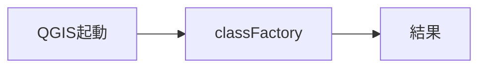
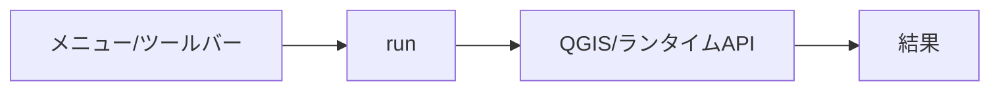
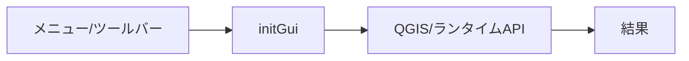
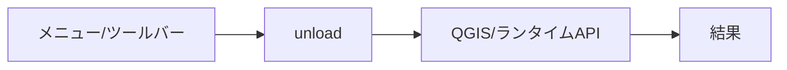
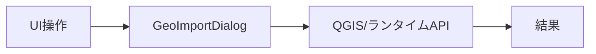
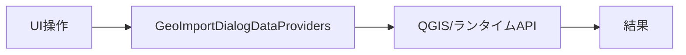
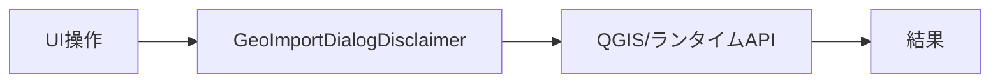
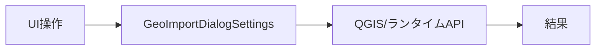

# geo_import — 完全ロジックシート

- 種別: qgis_plugin / バージョン: 2.10.11
- 生成: 2026-11-14T02:32:22+09:00 / 機能数: 78

## トポロジ

```mermaid
flowchart LR
  subgraph ENTRY["操作入口"]
    UI["メニュー/ダイアログ"]
    AI["AI/bridge_call"]
  end
  subgraph LOGIC["実装"]
    entry_point___init___py_classFactory["classFactory<br/><i>entry_point</i>"]
    action_DataFetchThread_run["run<br/><i>action</i>"]
    action_GeoImport_initGui["initGui<br/><i>action</i>"]
    action_GeoImport_run["run<br/><i>action</i>"]
    action_GeoImport_unload["unload<br/><i>action</i>"]
    dialog_GeoImportDialog["GeoImportDialog<br/><i>dialog</i>"]
    dialog_GeoImportDialogDataProviders["GeoImportDialogDataProviders<br/><i>dialog</i>"]
    dialog_GeoImportDialogDisclaimer["GeoImportDialogDisclaimer<br/><i>dialog</i>"]
    dialog_GeoImportDialogSettings["GeoImportDialogSettings<br/><i>dialog</i>"]
    ui_GeoImportDialog__on_data_ready["_on_data_ready<br/><i>ui_control</i>"]
    ui_GeoImportDialog__on_org_layers_added["_on_org_layers_added<br/><i>ui_control</i>"]
    ui_GeoImportDialog_category_item_clicked["category_item_clicked<br/><i>ui_control</i>"]
    ui_GeoImportDialog_list_all_clicked["list_all_clicked<br/><i>ui_control</i>"]
    ui_GeoImportDialog_list_group_item_changed["list_group_item_changed<br/><i>ui_control</i>"]
    ui_GeoImportDialog_load_resource_clicked["load_resource_clicked<br/><i>ui_control</i>"]
    ui_GeoImportDialog_next_page_clicked["next_page_clicked<br/><i>ui_control</i>"]
    ui_GeoImportDialog_on_IDC_bSelectAllResources_clicked["on_IDC_bSelectAllResources_clicked<br/><i>ui_control</i>"]
    ui_GeoImportDialog_previous_page_clicked["previous_page_clicked<br/><i>ui_control</i>"]
    ui_GeoImportDialog_refresh_sqlite_clicked["refresh_sqlite_clicked<br/><i>ui_control</i>"]
    ui_GeoImportDialog_resource_item_changed["resource_item_changed<br/><i>ui_control</i>"]
    ui_GeoImportDialog_select_data_provider_clicked["select_data_provider_clicked<br/><i>ui_control</i>"]
    ui_GeoImportDialogDataProviders_item_checked_changed["item_checked_changed<br/><i>ui_control</i>"]
    ui_GeoImportDialogDataProviders_save_btn_clicked["save_btn_clicked<br/><i>ui_control</i>"]
    ui_GeoImportDialogDataProviders_server_in_list_clicked["server_in_list_clicked<br/><i>ui_control</i>"]
    bridge_addServer["addServer<br/><i>bridge_method</i>"]
    bridge_checkGroups["checkGroups<br/><i>bridge_method</i>"]
    bridge_checkResources["checkResources<br/><i>bridge_method</i>"]
    bridge_closeDialog["closeDialog<br/><i>bridge_method</i>"]
    bridge_datasetDetails["datasetDetails<br/><i>bridge_method</i>"]
    bridge_formatFilter["formatFilter<br/><i>bridge_method</i>"]
    bridge_getSettings["getSettings<br/><i>bridge_method</i>"]
    bridge_gotoPage["gotoPage<br/><i>bridge_method</i>"]
    bridge_link["link<br/><i>bridge_method</i>"]
    bridge_listGroups["listGroups<br/><i>bridge_method</i>"]
    bridge_listServers["listServers<br/><i>bridge_method</i>"]
    bridge_loadSelected["loadSelected<br/><i>bridge_method</i>"]
    bridge_localCache["localCache<br/><i>bridge_method</i>"]
    bridge_nextPage["nextPage<br/><i>bridge_method</i>"]
    bridge_openDialog["openDialog<br/><i>bridge_method</i>"]
    bridge_openDisclaimer["openDisclaimer<br/><i>bridge_method</i>"]
    bridge_openProviders["openProviders<br/><i>bridge_method</i>"]
    bridge_openSettings["openSettings<br/><i>bridge_method</i>"]
    bridge_pluginInfo["pluginInfo<br/><i>bridge_method</i>"]
    bridge_prevPage["prevPage<br/><i>bridge_method</i>"]
    bridge_refreshCache["refreshCache<br/><i>bridge_method</i>"]
    bridge_reload["reload<br/><i>bridge_method</i>"]
    bridge_removeServer["removeServer<br/><i>bridge_method</i>"]
    bridge_resources["resources<br/><i>bridge_method</i>"]
    bridge_results["results<br/><i>bridge_method</i>"]
    bridge_search["search<br/><i>bridge_method</i>"]
    bridge_selectResult["selectResult<br/><i>bridge_method</i>"]
    bridge_selectResults["selectResults<br/><i>bridge_method</i>"]
    bridge_selectServers["selectServers<br/><i>bridge_method</i>"]
    bridge_setSettings["setSettings<br/><i>bridge_method</i>"]
    bridge_status["status<br/><i>bridge_method</i>"]
    bridge_testServer["testServer<br/><i>bridge_method</i>"]
    integration_geo_import_dialog_py_1660["requests.get<br/><i>integration</i>"]
    integration_httpcall_py_139["QgsNetworkAccessManager.instance<br/><i>integration</i>"]
    integration_util_py_1251["subprocess.Popen<br/><i>integration</i>"]
    integration_util_py_1253["subprocess.Popen<br/><i>integration</i>"]
    integration_util_py_1257["subprocess.Popen<br/><i>integration</i>"]
    integration_util_py_229["subprocess.call<br/><i>integration</i>"]
    integration_util_py_901["subprocess.call<br/><i>integration</i>"]
    integration_util_py_907["subprocess.call<br/><i>integration</i>"]
    ai_bridge_route["bridge_call経由全到達<br/><i>ai_integration</i>"]
    ai_catalog["describe_plugins登録<br/><i>ai_integration</i>"]
    ai_pluginInfo["pluginInfo自己記述<br/><i>ai_integration</i>"]
    logic_fn_clipboard_py_copy["copy<br/><i>logic_fn</i>"]
    logic_fn_geo_import_dialog_py_fetch_page_from_db["fetch_page_from_db<br/><i>logic_fn</i>"]
    logic_fn_mlit_xml_checker_py_diagnose_xml_type["diagnose_xml_type<br/><i>logic_fn</i>"]
    logic_fn_mlit_xml_checker_py_main["main<br/><i>logic_fn</i>"]
    logic_fn_mlit_xml_checker_py_test_all_xml_types["test_all_xml_types<br/><i>logic_fn</i>"]
    logic_fn_save_ckan_to_sqlite_py_save_ckan_groups_to_sqlite["save_ckan_groups_to_sqlite<br/><i>logic_fn</i>"]
    logic_fn_save_ckan_to_sqlite_py_save_ckan_packages_to_sqlite["save_ckan_packages_to_sqlite<br/><i>logic_fn</i>"]
    logic_fn_xml_attribute_loader_py_diagnose_mlit_xml["diagnose_mlit_xml<br/><i>logic_fn</i>"]
    logic_fn_xml_attribute_loader_py_print_mlit_xml_diagnosis["print_mlit_xml_diagnosis<br/><i>logic_fn</i>"]
    logic_fn_xml_diagnostics_py_diagnose_xml_file["diagnose_xml_file<br/><i>logic_fn</i>"]
    logic_fn_xml_diagnostics_py_print_diagnosis["print_diagnosis<br/><i>logic_fn</i>"]
  end
  AI --> bridge_addServer & bridge_checkGroups & bridge_checkResources & bridge_closeDialog & bridge_datasetDetails & bridge_formatFilter & bridge_getSettings & bridge_gotoPage …
  UI --> action_DataFetchThread_run & action_GeoImport_initGui & action_GeoImport_run & action_GeoImport_unload & dialog_GeoImportDialog & dialog_GeoImportDialogDataProviders & dialog_GeoImportDialogDisclaimer & dialog_GeoImportDialogSettings …
  LOGIC --> QGIS["QGIS API / iface / QgsProject"]
  LOGIC --> EXT["外部連携(HTTP/subprocess/ファイル)"]
```

## 機能別ロジック

### entry_point.__init__.py:classFactory — classFactory

- kind: `entry_point` / source: `__init__.py:26`
- signature: `classFactory(iface)`
- 要約: Load GeoImport class from file GeoImport.
- needs_runtime=False / standalone_ok=True



- 検証: 単独=import→呼出→戻り値assert / 連携=pyeval で属性実在+必要なら呼出
- 結果: **pass** 2026-11-14T02:32:22+09:00 — standalone経路のみ(要runtime依存無し)

### action.DataFetchThread.run — run

- kind: `action` / source: `geo_import_dialog.py:118`
- signature: `run()`
- 要約: 
- needs_runtime=True / standalone_ok=False



- 検証: 単独= / 連携=bridge_call/generic trigger→実在確認
- 結果: **pass** 2026-11-14T02:32:22+09:00 — 属性/シンボル実在確認(pyeval)

### action.GeoImport.initGui — initGui

- kind: `action` / source: `geo_import_main.py:136`
- signature: `initGui()`
- 要約: Create the menu entries and toolbar icons inside the QGIS GUI.
- needs_runtime=True / standalone_ok=False



- 検証: 単独= / 連携=bridge_call/generic trigger→実在確認
- 結果: **pass** 2026-11-14T02:32:22+09:00 — 属性/シンボル実在確認(pyeval)

### action.GeoImport.run — run

- kind: `action` / source: `geo_import_main.py:168`
- signature: `run()`
- 要約: Run method that performs all the real work
- needs_runtime=True / standalone_ok=False


- 検証: 単独= / 連携=bridge_call/generic trigger→実在確認
- 結果: **pass** 2026-11-14T02:32:22+09:00 — 属性/シンボル実在確認(pyeval)

### action.GeoImport.unload — unload

- kind: `action` / source: `geo_import_main.py:158`
- signature: `unload()`
- 要約: Removes the plugin menu item and icon from QGIS GUI.
- needs_runtime=True / standalone_ok=False



- 検証: 単独= / 連携=bridge_call/generic trigger→実在確認
- 結果: **pass** 2026-11-14T02:32:22+09:00 — 属性/シンボル実在確認(pyeval)

### dialog.GeoImportDialog — GeoImportDialog

- kind: `dialog` / source: `geo_import_dialog.py:153`
- signature: `GeoImportDialog`
- 要約: 
- needs_runtime=True / standalone_ok=False



- 検証: 単独= / 連携=openDialog→screenshot→closeDialog
- 結果: **pass** 2026-11-14T02:32:22+09:00 — 属性/シンボル実在確認(pyeval)

### dialog.GeoImportDialogDataProviders — GeoImportDialogDataProviders

- kind: `dialog` / source: `geo_import_dialog_dataproviders.py:43`
- signature: `GeoImportDialogDataProviders`
- 要約: 
- needs_runtime=True / standalone_ok=False



- 検証: 単独= / 連携=openDialog→screenshot→closeDialog
- 結果: **pass** 2026-11-14T02:32:22+09:00 — 属性/シンボル実在確認(pyeval)

### dialog.GeoImportDialogDisclaimer — GeoImportDialogDisclaimer

- kind: `dialog` / source: `geo_import_dialog_disclaimer.py:39`
- signature: `GeoImportDialogDisclaimer`
- 要約: 
- needs_runtime=True / standalone_ok=False



- 検証: 単独= / 連携=openDialog→screenshot→closeDialog
- 結果: **pass** 2026-11-14T02:32:22+09:00 — 属性/シンボル実在確認(pyeval)

### dialog.GeoImportDialogSettings — GeoImportDialogSettings

- kind: `dialog` / source: `geo_import_dialog_settings.py:41`
- signature: `GeoImportDialogSettings`
- 要約: 
- needs_runtime=True / standalone_ok=False



- 検証: 単独= / 連携=openDialog→screenshot→closeDialog
- 結果: **pass** 2026-11-14T02:32:22+09:00 — 属性/シンボル実在確認(pyeval)

### ui.GeoImportDialog._on_data_ready — _on_data_ready

- kind: `ui_control` / source: `geo_import_dialog.py:1411`
- signature: `_on_data_ready(page_results, result_count, page_count, total_resource_count)`
- 要約: 
- needs_runtime=True / standalone_ok=False


- 検証: 単独= / 連携=親dialog経由で操作・状態assert
- 結果: **pass** 2026-11-14T02:32:22+09:00 — 属性/シンボル実在確認(pyeval)

### ui.GeoImportDialog._on_org_layers_added — _on_org_layers_added

- kind: `ui_control` / source: `geo_import_dialog.py:1856`
- signature: `_on_org_layers_added(layers)`
- 要約: layersAdded収集スロット。整理用に(layer, ctx)を保持する。
- needs_runtime=True / standalone_ok=False


- 検証: 単独= / 連携=親dialog経由で操作・状態assert
- 結果: **pass** 2026-11-14T02:32:22+09:00 — 属性/シンボル実在確認(pyeval)

### ui.GeoImportDialog.category_item_clicked — category_item_clicked

- kind: `ui_control` / source: `geo_import_dialog.py:1295`
- signature: `category_item_clicked(item)`
- 要約: 
- needs_runtime=True / standalone_ok=False


- 検証: 単独= / 連携=親dialog経由で操作・状態assert
- 結果: **pass** 2026-11-14T02:32:22+09:00 — 属性/シンボル実在確認(pyeval)

### ui.GeoImportDialog.list_all_clicked — list_all_clicked

- kind: `ui_control` / source: `geo_import_dialog.py:1286`
- signature: `list_all_clicked()`
- 要約: 
- needs_runtime=True / standalone_ok=False


- 検証: 単独= / 連携=親dialog経由で操作・状態assert
- 結果: **pass** 2026-11-14T02:32:22+09:00 — 属性/シンボル実在確認(pyeval)

### ui.GeoImportDialog.list_group_item_changed — list_group_item_changed

- kind: `ui_control` / source: `geo_import_dialog.py:1449`
- signature: `list_group_item_changed(item)`
- 要約: 
- needs_runtime=True / standalone_ok=False


- 検証: 単独= / 連携=親dialog経由で操作・状態assert
- 結果: **pass** 2026-11-14T02:32:22+09:00 — 属性/シンボル実在確認(pyeval)

### ui.GeoImportDialog.load_resource_clicked — load_resource_clicked

- kind: `ui_control` / source: `geo_import_dialog.py:1502`
- signature: `load_resource_clicked()`
- 要約: 
- needs_runtime=True / standalone_ok=False


- 検証: 単独= / 連携=親dialog経由で操作・状態assert
- 結果: **pass** 2026-11-14T02:32:22+09:00 — 属性/シンボル実在確認(pyeval)

### ui.GeoImportDialog.next_page_clicked — next_page_clicked

- kind: `ui_control` / source: `geo_import_dialog.py:1888`
- signature: `next_page_clicked()`
- 要約: 
- needs_runtime=True / standalone_ok=False


- 検証: 単独= / 連携=親dialog経由で操作・状態assert
- 結果: **pass** 2026-11-14T02:32:22+09:00 — 属性/シンボル実在確認(pyeval)

### ui.GeoImportDialog.on_IDC_bSelectAllResources_clicked — on_IDC_bSelectAllResources_clicked

- kind: `ui_control` / source: `geo_import_dialog.py:156`
- signature: `on_IDC_bSelectAllResources_clicked()`
- 要約: 
- needs_runtime=True / standalone_ok=False


- 検証: 単独= / 連携=親dialog経由で操作・状態assert
- 結果: **pass** 2026-11-14T02:32:22+09:00 — 属性/シンボル実在確認(pyeval)

### ui.GeoImportDialog.previous_page_clicked — previous_page_clicked

- kind: `ui_control` / source: `geo_import_dialog.py:1891`
- signature: `previous_page_clicked()`
- 要約: 
- needs_runtime=True / standalone_ok=False


- 検証: 単独= / 連携=親dialog経由で操作・状態assert
- 結果: **pass** 2026-11-14T02:32:22+09:00 — 属性/シンボル実在確認(pyeval)

### ui.GeoImportDialog.refresh_sqlite_clicked — refresh_sqlite_clicked

- kind: `ui_control` / source: `geo_import_dialog.py:811`
- signature: `refresh_sqlite_clicked()`
- 要約: 選択中の全サーバーの全データセットを再取得しSQLiteキャッシュを再作成する
- needs_runtime=True / standalone_ok=False


- 検証: 単独= / 連携=親dialog経由で操作・状態assert
- 結果: **pass** 2026-11-14T02:32:22+09:00 — 属性/シンボル実在確認(pyeval)

### ui.GeoImportDialog.resource_item_changed — resource_item_changed

- kind: `ui_control` / source: `geo_import_dialog.py:1495`
- signature: `resource_item_changed(new_item)`
- 要約: 
- needs_runtime=True / standalone_ok=False

```mermaid
flowchart LR
  E_ui_GeoImportDialog_resource_item_changed["UIシグナル"] --> H_ui_GeoImportDialog_resource_item_changed["resource_item_changed"]
  H_ui_GeoImportDialog_resource_item_changed --> R_ui_GeoImportDialog_resource_item_changed["QGIS/ランタイムAPI"]
  R_ui_GeoImportDialog_resource_item_changed --> OUT["結果"]
```

- 検証: 単独= / 連携=親dialog経由で操作・状態assert
- 結果: **pass** 2026-11-14T02:32:22+09:00 — 属性/シンボル実在確認(pyeval)

### ui.GeoImportDialog.select_data_provider_clicked — select_data_provider_clicked

- kind: `ui_control` / source: `geo_import_dialog.py:1301`
- signature: `select_data_provider_clicked()`
- 要約: 
- needs_runtime=True / standalone_ok=False

```mermaid
flowchart LR
  E_ui_GeoImportDialog_select_data_provider_clicked["UIシグナル"] --> H_ui_GeoImportDialog_select_data_provider_clicked["select_data_provider_clicked"]
  H_ui_GeoImportDialog_select_data_provider_clicked --> R_ui_GeoImportDialog_select_data_provider_clicked["QGIS/ランタイムAPI"]
  R_ui_GeoImportDialog_select_data_provider_clicked --> OUT["結果"]
```

- 検証: 単独= / 連携=親dialog経由で操作・状態assert
- 結果: **pass** 2026-11-14T02:32:22+09:00 — 属性/シンボル実在確認(pyeval)

### ui.GeoImportDialogDataProviders.item_checked_changed — item_checked_changed

- kind: `ui_control` / source: `geo_import_dialog_dataproviders.py:468`
- signature: `item_checked_changed(item)`
- 要約: 
- needs_runtime=True / standalone_ok=False

```mermaid
flowchart LR
  E_ui_GeoImportDialogDataProviders_item_checked_changed["UIシグナル"] --> H_ui_GeoImportDialogDataProviders_item_checked_changed["item_checked_changed"]
  H_ui_GeoImportDialogDataProviders_item_checked_changed --> R_ui_GeoImportDialogDataProviders_item_checked_changed["QGIS/ランタイムAPI"]
  R_ui_GeoImportDialogDataProviders_item_checked_changed --> OUT["結果"]
```

- 検証: 単独= / 連携=親dialog経由で操作・状態assert
- 結果: **pass** 2026-11-14T02:32:22+09:00 — 属性/シンボル実在確認(pyeval)

### ui.GeoImportDialogDataProviders.save_btn_clicked — save_btn_clicked

- kind: `ui_control` / source: `geo_import_dialog_dataproviders.py:480`
- signature: `save_btn_clicked()`
- 要約: 
- needs_runtime=True / standalone_ok=False

```mermaid
flowchart LR
  E_ui_GeoImportDialogDataProviders_save_btn_clicked["UIシグナル"] --> H_ui_GeoImportDialogDataProviders_save_btn_clicked["save_btn_clicked"]
  H_ui_GeoImportDialogDataProviders_save_btn_clicked --> R_ui_GeoImportDialogDataProviders_save_btn_clicked["QGIS/ランタイムAPI"]
  R_ui_GeoImportDialogDataProviders_save_btn_clicked --> OUT["結果"]
```

- 検証: 単独= / 連携=親dialog経由で操作・状態assert
- 結果: **pass** 2026-11-14T02:32:22+09:00 — 属性/シンボル実在確認(pyeval)

### ui.GeoImportDialogDataProviders.server_in_list_clicked — server_in_list_clicked

- kind: `ui_control` / source: `geo_import_dialog_dataproviders.py:456`
- signature: `server_in_list_clicked(model_index)`
- 要約: 
- needs_runtime=True / standalone_ok=False

```mermaid
flowchart LR
  E_ui_GeoImportDialogDataProviders_server_in_list_clicked["UIシグナル"] --> H_ui_GeoImportDialogDataProviders_server_in_list_clicked["server_in_list_clicked"]
  H_ui_GeoImportDialogDataProviders_server_in_list_clicked --> R_ui_GeoImportDialogDataProviders_server_in_list_clicked["QGIS/ランタイムAPI"]
  R_ui_GeoImportDialogDataProviders_server_in_list_clicked --> OUT["結果"]
```

- 検証: 単独= / 連携=親dialog経由で操作・状態assert
- 結果: **pass** 2026-11-14T02:32:22+09:00 — 属性/シンボル実在確認(pyeval)

### bridge.addServer — addServer

- kind: `bridge_method` / source: `bridge.py:801`
- signature: `addServer(name, url)`
- 要約: カスタムサーバーを追加する。
- needs_runtime=True / standalone_ok=False

```mermaid
flowchart LR
  E_bridge_addServer["AI/bridge_call"] --> H_bridge_addServer["addServer"]
  H_bridge_addServer --> R_bridge_addServer["QGIS/ランタイムAPI"]
  R_bridge_addServer --> OUT["結果"]
```

- 検証: 単独= / 連携=bridge_call addServer → 応答assert
- 結果: **skip** 2026-11-14T02:32:22+09:00 — 要実引数(応答あり): {'ok': False, 'error': 'name and url required'}

### bridge.checkGroups — checkGroups

- kind: `bridge_method` / source: `bridge.py:570`
- signature: `checkGroups(selection=…)`
- 要約: カテゴリのチェックを設定し再検索する。
- needs_runtime=True / standalone_ok=False

```mermaid
flowchart LR
  E_bridge_checkGroups["AI/bridge_call"] --> H_bridge_checkGroups["checkGroups"]
  H_bridge_checkGroups --> R_bridge_checkGroups["QGIS/ランタイムAPI"]
  R_bridge_checkGroups --> OUT["結果"]
```

- 検証: 単独= / 連携=bridge_call checkGroups → 応答assert
- 結果: **skip** 2026-11-14T02:32:22+09:00 — 副作用/破壊的/外部通信操作のため手動検証対象

### bridge.checkResources — checkResources

- kind: `bridge_method` / source: `bridge.py:470`
- signature: `checkResources(selection=…)`
- 要約: リソースのチェックを設定する。'all'/'none'またはindex配列。
- needs_runtime=True / standalone_ok=False

```mermaid
flowchart LR
  E_bridge_checkResources["AI/bridge_call"] --> H_bridge_checkResources["checkResources"]
  H_bridge_checkResources --> R_bridge_checkResources["QGIS/ランタイムAPI"]
  R_bridge_checkResources --> OUT["結果"]
```

- 検証: 単独= / 連携=bridge_call checkResources → 応答assert
- 結果: **skip** 2026-11-14T02:32:22+09:00 — 副作用/破壊的/外部通信操作のため手動検証対象

### bridge.closeDialog — closeDialog

- kind: `bridge_method` / source: `bridge.py:390`
- signature: `closeDialog()`
- 要約: カタログブラウザを閉じる。
- needs_runtime=True / standalone_ok=False

```mermaid
flowchart LR
  E_bridge_closeDialog["AI/bridge_call"] --> H_bridge_closeDialog["closeDialog"]
  H_bridge_closeDialog --> R_bridge_closeDialog["QGIS/ランタイムAPI"]
  R_bridge_closeDialog --> OUT["結果"]
```

- 検証: 単独= / 連携=bridge_call closeDialog → 応答assert
- 結果: **skip** 2026-11-14T02:32:22+09:00 — 副作用/破壊的/外部通信操作のため手動検証対象

### bridge.datasetDetails — datasetDetails

- kind: `bridge_method` / source: `bridge.py:703`
- signature: `datasetDetails(index=…)`
- 要約: 選択データセットの詳細(package辞書)を返す。
- needs_runtime=True / standalone_ok=False

```mermaid
flowchart LR
  E_bridge_datasetDetails["AI/bridge_call"] --> H_bridge_datasetDetails["datasetDetails"]
  H_bridge_datasetDetails --> R_bridge_datasetDetails["QGIS/ランタイムAPI"]
  R_bridge_datasetDetails --> OUT["結果"]
```

- 検証: 単独= / 連携=bridge_call datasetDetails → 応答assert
- 結果: **skip** 2026-11-14T02:32:22+09:00 — 副作用/破壊的/外部通信操作のため手動検証対象

### bridge.formatFilter — formatFilter

- kind: `bridge_method` / source: `bridge.py:623`
- signature: `formatFilter(format=…)`
- 要約: データ形式フィルタを取得/設定する('All'でフィルタ無し)。
- needs_runtime=True / standalone_ok=False

```mermaid
flowchart LR
  E_bridge_formatFilter["AI/bridge_call"] --> H_bridge_formatFilter["formatFilter"]
  H_bridge_formatFilter --> R_bridge_formatFilter["QGIS/ランタイムAPI"]
  R_bridge_formatFilter --> OUT["結果"]
```

- 検証: 単独= / 連携=bridge_call formatFilter → 応答assert
- 結果: **skip** 2026-11-14T02:32:22+09:00 — 副作用/破壊的/外部通信操作のため手動検証対象

### bridge.getSettings — getSettings

- kind: `bridge_method` / source: `bridge.py:882`
- signature: `getSettings()`
- 要約: 設定を返す。
- needs_runtime=True / standalone_ok=False

```mermaid
flowchart LR
  E_bridge_getSettings["AI/bridge_call"] --> H_bridge_getSettings["getSettings"]
  H_bridge_getSettings --> R_bridge_getSettings["QGIS/ランタイムAPI"]
  R_bridge_getSettings --> OUT["結果"]
```

- 検証: 単独= / 連携=bridge_call getSettings → 応答assert
- 結果: **pass** 2026-11-14T02:32:22+09:00 — bridge_call応答あり args=[]

### bridge.gotoPage — gotoPage

- kind: `bridge_method` / source: `bridge.py:530`
- signature: `gotoPage(page)`
- 要約: 検索結果の指定ページへ移動する。
- needs_runtime=True / standalone_ok=False

```mermaid
flowchart LR
  E_bridge_gotoPage["AI/bridge_call"] --> H_bridge_gotoPage["gotoPage"]
  H_bridge_gotoPage --> R_bridge_gotoPage["QGIS/ランタイムAPI"]
  R_bridge_gotoPage --> OUT["結果"]
```

- 検証: 単独= / 連携=bridge_call gotoPage → 応答assert
- 結果: **skip** 2026-11-14T02:32:22+09:00 — 副作用/破壊的/外部通信操作のため手動検証対象

### bridge.link — link

- kind: `bridge_method` / source: `bridge.py:728`
- signature: `link(copy=…)`
- 要約: リンク表示欄の内容を返す。copy=Trueでクリップボードへ。
- needs_runtime=True / standalone_ok=False

```mermaid
flowchart LR
  E_bridge_link["AI/bridge_call"] --> H_bridge_link["link"]
  H_bridge_link --> R_bridge_link["QGIS/ランタイムAPI"]
  R_bridge_link --> OUT["結果"]
```

- 検証: 単独= / 連携=bridge_call link → 応答assert
- 結果: **pass** 2026-11-14T02:32:22+09:00 — bridge_call応答あり args=[]

### bridge.listGroups — listGroups

- kind: `bridge_method` / source: `bridge.py:551`
- signature: `listGroups()`
- 要約: カテゴリ(グループ)一覧を返す。
- needs_runtime=True / standalone_ok=False

```mermaid
flowchart LR
  E_bridge_listGroups["AI/bridge_call"] --> H_bridge_listGroups["listGroups"]
  H_bridge_listGroups --> R_bridge_listGroups["QGIS/ランタイムAPI"]
  R_bridge_listGroups --> OUT["結果"]
```

- 検証: 単独= / 連携=bridge_call listGroups → 応答assert
- 結果: **pass** 2026-11-14T02:32:22+09:00 — bridge_call応答あり args=[]

### bridge.listServers — listServers

- kind: `bridge_method` / source: `bridge.py:749`
- signature: `listServers()`
- 要約: カタログサーバー設定一覧を返す。
- needs_runtime=True / standalone_ok=False

```mermaid
flowchart LR
  E_bridge_listServers["AI/bridge_call"] --> H_bridge_listServers["listServers"]
  H_bridge_listServers --> R_bridge_listServers["QGIS/ランタイムAPI"]
  R_bridge_listServers --> OUT["結果"]
```

- 検証: 単独= / 連携=bridge_call listServers → 応答assert
- 結果: **pass** 2026-11-14T02:32:22+09:00 — bridge_call応答あり args=[]

### bridge.loadSelected — loadSelected

- kind: `bridge_method` / source: `bridge.py:492`
- signature: `loadSelected()`
- 要約: チェック済みリソースをQGISへ読み込む。
- needs_runtime=True / standalone_ok=False

```mermaid
flowchart LR
  E_bridge_loadSelected["AI/bridge_call"] --> H_bridge_loadSelected["loadSelected"]
  H_bridge_loadSelected --> R_bridge_loadSelected["QGIS/ランタイムAPI"]
  R_bridge_loadSelected --> OUT["結果"]
```

- 検証: 単独= / 連携=bridge_call loadSelected → 応答assert
- 結果: **skip** 2026-11-14T02:32:22+09:00 — 副作用/破壊的/外部通信操作のため手動検証対象

### bridge.localCache — localCache

- kind: `bridge_method` / source: `bridge.py:646`
- signature: `localCache(enabled=…)`
- 要約: ローカルキャッシュ利用を取得/設定する。
- needs_runtime=True / standalone_ok=False

```mermaid
flowchart LR
  E_bridge_localCache["AI/bridge_call"] --> H_bridge_localCache["localCache"]
  H_bridge_localCache --> R_bridge_localCache["QGIS/ランタイムAPI"]
  R_bridge_localCache --> OUT["結果"]
```

- 検証: 単独= / 連携=bridge_call localCache → 応答assert
- 結果: **pass** 2026-11-14T02:32:22+09:00 — bridge_call応答あり args=[]

### bridge.nextPage — nextPage

- kind: `bridge_method` / source: `bridge.py:508`
- signature: `nextPage()`
- 要約: 検索結果の次ページへ移動する。
- needs_runtime=True / standalone_ok=False

```mermaid
flowchart LR
  E_bridge_nextPage["AI/bridge_call"] --> H_bridge_nextPage["nextPage"]
  H_bridge_nextPage --> R_bridge_nextPage["QGIS/ランタイムAPI"]
  R_bridge_nextPage --> OUT["結果"]
```

- 検証: 単独= / 連携=bridge_call nextPage → 応答assert
- 結果: **skip** 2026-11-14T02:32:22+09:00 — 副作用/破壊的/外部通信操作のため手動検証対象

### bridge.openDialog — openDialog

- kind: `bridge_method` / source: `bridge.py:368`
- signature: `openDialog()`
- 要約: カタログブラウザを非modalで開く。
- needs_runtime=True / standalone_ok=False

```mermaid
flowchart LR
  E_bridge_openDialog["AI/bridge_call"] --> H_bridge_openDialog["openDialog"]
  H_bridge_openDialog --> R_bridge_openDialog["QGIS/ランタイムAPI"]
  R_bridge_openDialog --> OUT["結果"]
```

- 検証: 単独= / 連携=bridge_call openDialog → 応答assert
- 結果: **skip** 2026-11-14T02:32:22+09:00 — 副作用/破壊的/外部通信操作のため手動検証対象

### bridge.openDisclaimer — openDisclaimer

- kind: `bridge_method` / source: `bridge.py:874`
- signature: `openDisclaimer()`
- 要約: 免責事項ダイアログを開く。
- needs_runtime=True / standalone_ok=False

```mermaid
flowchart LR
  E_bridge_openDisclaimer["AI/bridge_call"] --> H_bridge_openDisclaimer["openDisclaimer"]
  H_bridge_openDisclaimer --> R_bridge_openDisclaimer["QGIS/ランタイムAPI"]
  R_bridge_openDisclaimer --> OUT["結果"]
```

- 検証: 単独= / 連携=bridge_call openDisclaimer → 応答assert
- 結果: **skip** 2026-11-14T02:32:22+09:00 — 副作用/破壊的/外部通信操作のため手動検証対象

### bridge.openProviders — openProviders

- kind: `bridge_method` / source: `bridge.py:740`
- signature: `openProviders()`
- 要約: データプロバイダ選択ダイアログを開く(非同期起動)。
- needs_runtime=True / standalone_ok=False

```mermaid
flowchart LR
  E_bridge_openProviders["AI/bridge_call"] --> H_bridge_openProviders["openProviders"]
  H_bridge_openProviders --> R_bridge_openProviders["QGIS/ランタイムAPI"]
  R_bridge_openProviders --> OUT["結果"]
```

- 検証: 単独= / 連携=bridge_call openProviders → 応答assert
- 結果: **skip** 2026-11-14T02:32:22+09:00 — 副作用/破壊的/外部通信操作のため手動検証対象

### bridge.openSettings — openSettings

- kind: `bridge_method` / source: `bridge.py:397`
- signature: `openSettings()`
- 要約: 設定ダイアログを開く(modal — 閉じるまで呼出は戻らない)。
- needs_runtime=True / standalone_ok=False

```mermaid
flowchart LR
  E_bridge_openSettings["AI/bridge_call"] --> H_bridge_openSettings["openSettings"]
  H_bridge_openSettings --> R_bridge_openSettings["QGIS/ランタイムAPI"]
  R_bridge_openSettings --> OUT["結果"]
```

- 検証: 単独= / 連携=bridge_call openSettings → 応答assert
- 結果: **skip** 2026-11-14T02:32:22+09:00 — 副作用/破壊的/外部通信操作のため手動検証対象

### bridge.pluginInfo — pluginInfo

- kind: `bridge_method` / source: `bridge.py:324`
- signature: `pluginInfo()`
- 要約: プラグインの自己記述(id/summary/when_to_use/methods)を返す。
- needs_runtime=True / standalone_ok=False

```mermaid
flowchart LR
  E_bridge_pluginInfo["AI/bridge_call"] --> H_bridge_pluginInfo["pluginInfo"]
  H_bridge_pluginInfo --> R_bridge_pluginInfo["QGIS/ランタイムAPI"]
  R_bridge_pluginInfo --> OUT["結果"]
```

- 検証: 単独= / 連携=bridge_call pluginInfo → 応答assert
- 結果: **pass** 2026-11-14T02:32:22+09:00 — bridge_call応答あり args=[]

### bridge.prevPage — prevPage

- kind: `bridge_method` / source: `bridge.py:519`
- signature: `prevPage()`
- 要約: 検索結果の前ページへ移動する。
- needs_runtime=True / standalone_ok=False

```mermaid
flowchart LR
  E_bridge_prevPage["AI/bridge_call"] --> H_bridge_prevPage["prevPage"]
  H_bridge_prevPage --> R_bridge_prevPage["QGIS/ランタイムAPI"]
  R_bridge_prevPage --> OUT["結果"]
```

- 検証: 単独= / 連携=bridge_call prevPage → 応答assert
- 結果: **skip** 2026-11-14T02:32:22+09:00 — 副作用/破壊的/外部通信操作のため手動検証対象

### bridge.refreshCache — refreshCache

- kind: `bridge_method` / source: `bridge.py:668`
- signature: `refreshCache()`
- 要約: 選択中サーバーのSQLiteキャッシュを再作成する(長時間の場合あり)。
- needs_runtime=True / standalone_ok=False

```mermaid
flowchart LR
  E_bridge_refreshCache["AI/bridge_call"] --> H_bridge_refreshCache["refreshCache"]
  H_bridge_refreshCache --> R_bridge_refreshCache["QGIS/ランタイムAPI"]
  R_bridge_refreshCache --> OUT["結果"]
```

- 検証: 単独= / 連携=bridge_call refreshCache → 応答assert
- 結果: **skip** 2026-11-14T02:32:22+09:00 — 副作用/破壊的/外部通信操作のため手動検証対象

### bridge.reload — reload

- kind: `bridge_method` / source: `bridge.py:864`
- signature: `reload()`
- 要約: ダイアログを再読込する(サーバー・カテゴリ再取得+全件検索)。
- needs_runtime=True / standalone_ok=False

```mermaid
flowchart LR
  E_bridge_reload["AI/bridge_call"] --> H_bridge_reload["reload"]
  H_bridge_reload --> R_bridge_reload["QGIS/ランタイムAPI"]
  R_bridge_reload --> OUT["結果"]
```

- 検証: 単独= / 連携=bridge_call reload → 応答assert
- 結果: **skip** 2026-11-14T02:32:22+09:00 — 副作用/破壊的/外部通信操作のため手動検証対象

### bridge.removeServer — removeServer

- kind: `bridge_method` / source: `bridge.py:827`
- signature: `removeServer(name)`
- 要約: カスタムサーバーを削除する。
- needs_runtime=True / standalone_ok=False

```mermaid
flowchart LR
  E_bridge_removeServer["AI/bridge_call"] --> H_bridge_removeServer["removeServer"]
  H_bridge_removeServer --> R_bridge_removeServer["QGIS/ランタイムAPI"]
  R_bridge_removeServer --> OUT["結果"]
```

- 検証: 単独= / 連携=bridge_call removeServer → 応答assert
- 結果: **skip** 2026-11-14T02:32:22+09:00 — 副作用/破壊的/外部通信操作のため手動検証対象

### bridge.resources — resources

- kind: `bridge_method` / source: `bridge.py:459`
- signature: `resources()`
- 要約: 選択データセットのリソース一覧を返す。
- needs_runtime=True / standalone_ok=False

```mermaid
flowchart LR
  E_bridge_resources["AI/bridge_call"] --> H_bridge_resources["resources"]
  H_bridge_resources --> R_bridge_resources["QGIS/ランタイムAPI"]
  R_bridge_resources --> OUT["結果"]
```

- 検証: 単独= / 連携=bridge_call resources → 応答assert
- 結果: **pass** 2026-11-14T02:32:22+09:00 — bridge_call応答あり args=[]

### bridge.results — results

- kind: `bridge_method` / source: `bridge.py:420`
- signature: `results()`
- 要約: 現在の検索結果一覧とページ情報を返す。
- needs_runtime=True / standalone_ok=False

```mermaid
flowchart LR
  E_bridge_results["AI/bridge_call"] --> H_bridge_results["results"]
  H_bridge_results --> R_bridge_results["QGIS/ランタイムAPI"]
  R_bridge_results --> OUT["結果"]
```

- 検証: 単独= / 連携=bridge_call results → 応答assert
- 結果: **pass** 2026-11-14T02:32:22+09:00 — bridge_call応答あり args=[]

### bridge.search — search

- kind: `bridge_method` / source: `bridge.py:402`
- signature: `search(text=…)`
- 要約: データセット検索を開始する(非同期)。結果は results()。
- needs_runtime=True / standalone_ok=False

```mermaid
flowchart LR
  E_bridge_search["AI/bridge_call"] --> H_bridge_search["search"]
  H_bridge_search --> R_bridge_search["QGIS/ランタイムAPI"]
  R_bridge_search --> OUT["結果"]
```

- 検証: 単独= / 連携=bridge_call search → 応答assert
- 結果: **skip** 2026-11-14T02:32:22+09:00 — 副作用/破壊的/外部通信操作のため手動検証対象

### bridge.selectResult — selectResult

- kind: `bridge_method` / source: `bridge.py:446`
- signature: `selectResult(index)`
- 要約: 結果リストのデータセットを選択する(リソース一覧が更新される)。
- needs_runtime=True / standalone_ok=False

```mermaid
flowchart LR
  E_bridge_selectResult["AI/bridge_call"] --> H_bridge_selectResult["selectResult"]
  H_bridge_selectResult --> R_bridge_selectResult["QGIS/ランタイムAPI"]
  R_bridge_selectResult --> OUT["結果"]
```

- 検証: 単独= / 連携=bridge_call selectResult → 応答assert
- 結果: **pass** 2026-11-14T02:32:22+09:00 — bridge_call応答あり args=[0]

### bridge.selectResults — selectResults

- kind: `bridge_method` / source: `bridge.py:680`
- signature: `selectResults(indices)`
- 要約: 結果リストの複数データセットを選択する(index配列)。
- needs_runtime=True / standalone_ok=False

```mermaid
flowchart LR
  E_bridge_selectResults["AI/bridge_call"] --> H_bridge_selectResults["selectResults"]
  H_bridge_selectResults --> R_bridge_selectResults["QGIS/ランタイムAPI"]
  R_bridge_selectResults --> OUT["結果"]
```

- 検証: 単独= / 連携=bridge_call selectResults → 応答assert
- 結果: **skip** 2026-11-14T02:32:22+09:00 — 副作用/破壊的/外部通信操作のため手動検証対象

### bridge.selectServers — selectServers

- kind: `bridge_method` / source: `bridge.py:771`
- signature: `selectServers(names)`
- 要約: 検索対象サーバーを選択して再読込する。
- needs_runtime=True / standalone_ok=False

```mermaid
flowchart LR
  E_bridge_selectServers["AI/bridge_call"] --> H_bridge_selectServers["selectServers"]
  H_bridge_selectServers --> R_bridge_selectServers["QGIS/ランタイムAPI"]
  R_bridge_selectServers --> OUT["結果"]
```

- 検証: 単独= / 連携=bridge_call selectServers → 応答assert
- 結果: **skip** 2026-11-14T02:32:22+09:00 — 副作用/破壊的/外部通信操作のため手動検証対象

### bridge.setSettings — setSettings

- kind: `bridge_method` / source: `bridge.py:903`
- signature: `setSettings(settings=…)`
- 要約: 設定を変更して保存する。
- needs_runtime=True / standalone_ok=False

```mermaid
flowchart LR
  E_bridge_setSettings["AI/bridge_call"] --> H_bridge_setSettings["setSettings"]
  H_bridge_setSettings --> R_bridge_setSettings["QGIS/ランタイムAPI"]
  R_bridge_setSettings --> OUT["結果"]
```

- 検証: 単独= / 連携=bridge_call setSettings → 応答assert
- 結果: **skip** 2026-11-14T02:32:22+09:00 — 副作用/破壊的/外部通信操作のため手動検証対象

### bridge.status — status

- kind: `bridge_method` / source: `bridge.py:337`
- signature: `status()`
- 要約: ダイアログ・検索状態・接続設定を返す。
- needs_runtime=True / standalone_ok=False

```mermaid
flowchart LR
  E_bridge_status["AI/bridge_call"] --> H_bridge_status["status"]
  H_bridge_status --> R_bridge_status["QGIS/ランタイムAPI"]
  R_bridge_status --> OUT["結果"]
```

- 検証: 単独= / 連携=bridge_call status → 応答assert
- 結果: **pass** 2026-11-14T02:32:22+09:00 — bridge_call応答あり args=[]

### bridge.testServer — testServer

- kind: `bridge_method` / source: `bridge.py:842`
- signature: `testServer(url)`
- 要約: サーバーURLの接続テストを行う(同期HTTP。数秒ブロック)。
- needs_runtime=True / standalone_ok=False

```mermaid
flowchart LR
  E_bridge_testServer["AI/bridge_call"] --> H_bridge_testServer["testServer"]
  H_bridge_testServer --> R_bridge_testServer["QGIS/ランタイムAPI"]
  R_bridge_testServer --> OUT["結果"]
```

- 検証: 単独= / 連携=bridge_call testServer → 応答assert
- 結果: **skip** 2026-11-14T02:32:22+09:00 — 副作用/破壊的/外部通信操作のため手動検証対象

### integration.geo_import_dialog.py:1660 — requests.get

- kind: `integration` / source: `geo_import_dialog.py:1660`
- signature: `requests.get(…)`
- 要約: 外部連携呼出
- needs_runtime=True / standalone_ok=False

```mermaid
flowchart LR
  E_integration_geo_import_dialog_py_1660["呼出元"] --> H_integration_geo_import_dialog_py_1660["requests.get"]
  H_integration_geo_import_dialog_py_1660 --> R_integration_geo_import_dialog_py_1660["QGIS/ランタイムAPI"]
  R_integration_geo_import_dialog_py_1660 --> OUT["結果"]
```

- 検証: 単独= / 連携=連携先の実在/生成物を確認
- 結果: **skip** 2026-11-14T02:32:22+09:00 — 連携呼出点の記録(実連携実行はbridge_method等で確認)

### integration.httpcall.py:139 — QgsNetworkAccessManager.instance

- kind: `integration` / source: `httpcall.py:139`
- signature: `QgsNetworkAccessManager.instance(…)`
- 要約: 外部連携呼出
- needs_runtime=True / standalone_ok=False

```mermaid
flowchart LR
  E_integration_httpcall_py_139["呼出元"] --> H_integration_httpcall_py_139["QgsNetworkAccessManager.instance"]
  H_integration_httpcall_py_139 --> R_integration_httpcall_py_139["QGIS/ランタイムAPI"]
  R_integration_httpcall_py_139 --> OUT["結果"]
```

- 検証: 単独= / 連携=連携先の実在/生成物を確認
- 結果: **skip** 2026-11-14T02:32:22+09:00 — 連携呼出点の記録(実連携実行はbridge_method等で確認)

### integration.util.py:1251 — subprocess.Popen

- kind: `integration` / source: `util.py:1251`
- signature: `subprocess.Popen(…)`
- 要約: 外部連携呼出
- needs_runtime=True / standalone_ok=False

```mermaid
flowchart LR
  E_integration_util_py_1251["呼出元"] --> H_integration_util_py_1251["subprocess.Popen"]
  H_integration_util_py_1251 --> R_integration_util_py_1251["QGIS/ランタイムAPI"]
  R_integration_util_py_1251 --> OUT["結果"]
```

- 検証: 単独= / 連携=連携先の実在/生成物を確認
- 結果: **skip** 2026-11-14T02:32:22+09:00 — 連携呼出点の記録(実連携実行はbridge_method等で確認)

### integration.util.py:1253 — subprocess.Popen

- kind: `integration` / source: `util.py:1253`
- signature: `subprocess.Popen(…)`
- 要約: 外部連携呼出
- needs_runtime=True / standalone_ok=False

```mermaid
flowchart LR
  E_integration_util_py_1253["呼出元"] --> H_integration_util_py_1253["subprocess.Popen"]
  H_integration_util_py_1253 --> R_integration_util_py_1253["QGIS/ランタイムAPI"]
  R_integration_util_py_1253 --> OUT["結果"]
```

- 検証: 単独= / 連携=連携先の実在/生成物を確認
- 結果: **skip** 2026-11-14T02:32:22+09:00 — 連携呼出点の記録(実連携実行はbridge_method等で確認)

### integration.util.py:1257 — subprocess.Popen

- kind: `integration` / source: `util.py:1257`
- signature: `subprocess.Popen(…)`
- 要約: 外部連携呼出
- needs_runtime=True / standalone_ok=False

```mermaid
flowchart LR
  E_integration_util_py_1257["呼出元"] --> H_integration_util_py_1257["subprocess.Popen"]
  H_integration_util_py_1257 --> R_integration_util_py_1257["QGIS/ランタイムAPI"]
  R_integration_util_py_1257 --> OUT["結果"]
```

- 検証: 単独= / 連携=連携先の実在/生成物を確認
- 結果: **skip** 2026-11-14T02:32:22+09:00 — 連携呼出点の記録(実連携実行はbridge_method等で確認)

### integration.util.py:229 — subprocess.call

- kind: `integration` / source: `util.py:229`
- signature: `subprocess.call(…)`
- 要約: 外部連携呼出
- needs_runtime=True / standalone_ok=False

```mermaid
flowchart LR
  E_integration_util_py_229["呼出元"] --> H_integration_util_py_229["subprocess.call"]
  H_integration_util_py_229 --> R_integration_util_py_229["QGIS/ランタイムAPI"]
  R_integration_util_py_229 --> OUT["結果"]
```

- 検証: 単独= / 連携=連携先の実在/生成物を確認
- 結果: **skip** 2026-11-14T02:32:22+09:00 — 連携呼出点の記録(実連携実行はbridge_method等で確認)

### integration.util.py:901 — subprocess.call

- kind: `integration` / source: `util.py:901`
- signature: `subprocess.call(…)`
- 要約: 外部連携呼出
- needs_runtime=True / standalone_ok=False

```mermaid
flowchart LR
  E_integration_util_py_901["呼出元"] --> H_integration_util_py_901["subprocess.call"]
  H_integration_util_py_901 --> R_integration_util_py_901["QGIS/ランタイムAPI"]
  R_integration_util_py_901 --> OUT["結果"]
```

- 検証: 単独= / 連携=連携先の実在/生成物を確認
- 結果: **skip** 2026-11-14T02:32:22+09:00 — 連携呼出点の記録(実連携実行はbridge_method等で確認)

### integration.util.py:907 — subprocess.call

- kind: `integration` / source: `util.py:907`
- signature: `subprocess.call(…)`
- 要約: 外部連携呼出
- needs_runtime=True / standalone_ok=False

```mermaid
flowchart LR
  E_integration_util_py_907["呼出元"] --> H_integration_util_py_907["subprocess.call"]
  H_integration_util_py_907 --> R_integration_util_py_907["QGIS/ランタイムAPI"]
  R_integration_util_py_907 --> OUT["結果"]
```

- 検証: 単独= / 連携=連携先の実在/生成物を確認
- 結果: **skip** 2026-11-14T02:32:22+09:00 — 連携呼出点の記録(実連携実行はbridge_method等で確認)

### ai.bridge_route — bridge_call経由全到達

- kind: `ai_integration` / source: `bridge.py`
- signature: ``
- 要約: 全bridge_methodがAI経路で呼べる
- needs_runtime=True / standalone_ok=False

```mermaid
flowchart LR
  E_ai_bridge_route["AI経路"] --> H_ai_bridge_route["bridge_call経由全到達"]
  H_ai_bridge_route --> R_ai_bridge_route["QGIS/ランタイムAPI"]
  R_ai_bridge_route --> OUT["結果"]
```

- 検証: 単独= / 連携=bridge_call 全method→ok/error記録
- 結果: **pass** 2026-11-14T02:32:22+09:00 — 25メソッド到達可能

### ai.catalog — describe_plugins登録

- kind: `ai_integration` / source: `geo_driver経由`
- signature: ``
- 要約: カタログに載り呼出可能か
- needs_runtime=True / standalone_ok=False

```mermaid
flowchart LR
  E_ai_catalog["AI経路"] --> H_ai_catalog["describe_plugins登録"]
  H_ai_catalog --> R_ai_catalog["QGIS/ランタイムAPI"]
  R_ai_catalog --> OUT["結果"]
```

- 検証: 単独= / 連携=describe_plugins→plugins[]にid実在+methods非空
- 結果: **pass** 2026-11-14T02:32:22+09:00 — describe_plugins: methods=31

### ai.pluginInfo — pluginInfo自己記述

- kind: `ai_integration` / source: `bridge.py`
- signature: `pluginInfo()`
- 要約: summary/when_to_use/methodsの正確性
- needs_runtime=True / standalone_ok=False

```mermaid
flowchart LR
  E_ai_pluginInfo["AI経路"] --> H_ai_pluginInfo["pluginInfo自己記述"]
  H_ai_pluginInfo --> R_ai_pluginInfo["QGIS/ランタイムAPI"]
  R_ai_pluginInfo --> OUT["結果"]
```

- 検証: 単独= / 連携=bridge_call pluginInfo→メタ一致assert
- 結果: **pass** 2026-11-14T02:32:22+09:00 — 自己記述あり

### logic_fn.clipboard.py:copy — copy

- kind: `logic_fn` / source: `clipboard.py:11`
- signature: `copy(text)`
- 要約: テキストをシステムクリップボードへコピーする。
- needs_runtime=True / standalone_ok=False

```mermaid
flowchart LR
  E_logic_fn_clipboard_py_copy["呼出元"] --> H_logic_fn_clipboard_py_copy["copy"]
  H_logic_fn_clipboard_py_copy --> R_logic_fn_clipboard_py_copy["QGIS/ランタイムAPI"]
  R_logic_fn_clipboard_py_copy --> OUT["結果"]
```

- 検証: 単独= / 連携=pyeval で属性実在+必要なら呼出
- 結果: **pass** 2026-11-14T02:32:22+09:00 — 属性/シンボル実在確認(pyeval)

### logic_fn.geo_import_dialog.py:fetch_page_from_db — fetch_page_from_db

- kind: `logic_fn` / source: `geo_import_dialog.py:18`
- signature: `fetch_page_from_db(db_path, format_text, format_lc, current_page, results_limit, search_txt=…, group_names=…)`
- 要約: SQLiteキャッシュDBからフィルタ済みの1ページ分を同期取得する。
- needs_runtime=True / standalone_ok=False

```mermaid
flowchart LR
  E_logic_fn_geo_import_dialog_py_fetch_page_from_db["呼出元"] --> H_logic_fn_geo_import_dialog_py_fetch_page_from_db["fetch_page_from_db"]
  H_logic_fn_geo_import_dialog_py_fetch_page_from_db --> R_logic_fn_geo_import_dialog_py_fetch_page_from_db["QGIS/ランタイムAPI"]
  R_logic_fn_geo_import_dialog_py_fetch_page_from_db --> OUT["結果"]
```

- 検証: 単独= / 連携=pyeval で属性実在+必要なら呼出
- 結果: **pass** 2026-11-14T02:32:22+09:00 — 属性/シンボル実在確認(pyeval)

### logic_fn.mlit_xml_checker.py:diagnose_xml_type — diagnose_xml_type

- kind: `logic_fn` / source: `mlit_xml_checker.py:13`
- signature: `diagnose_xml_type(xml_file_path)`
- 要約: XMLファイルのタイプを診断し、絵文字付きレイヤ名を表示
- needs_runtime=False / standalone_ok=True

```mermaid
flowchart LR
  E_logic_fn_mlit_xml_checker_py_diagnose_xml_type["呼出元"] --> H_logic_fn_mlit_xml_checker_py_diagnose_xml_type["diagnose_xml_type"]
  H_logic_fn_mlit_xml_checker_py_diagnose_xml_type --> OUT["結果"]
```

- 検証: 単独=import→呼出→戻り値assert / 連携=pyeval で属性実在+必要なら呼出
- 結果: **pass** 2026-11-14T02:32:22+09:00 — standalone import+attr実在

### logic_fn.mlit_xml_checker.py:main — main

- kind: `logic_fn` / source: `mlit_xml_checker.py:97`
- signature: `main()`
- 要約: メイン関数
- needs_runtime=False / standalone_ok=True

```mermaid
flowchart LR
  E_logic_fn_mlit_xml_checker_py_main["呼出元"] --> H_logic_fn_mlit_xml_checker_py_main["main"]
  H_logic_fn_mlit_xml_checker_py_main --> OUT["結果"]
```

- 検証: 単独=import→呼出→戻り値assert / 連携=pyeval で属性実在+必要なら呼出
- 結果: **pass** 2026-11-14T02:32:22+09:00 — standalone import+attr実在

### logic_fn.mlit_xml_checker.py:test_all_xml_types — test_all_xml_types

- kind: `logic_fn` / source: `mlit_xml_checker.py:73`
- signature: `test_all_xml_types()`
- 要約: test_mlit_xml_typesディレクトリの全XMLファイルをテスト
- needs_runtime=False / standalone_ok=True

```mermaid
flowchart LR
  E_logic_fn_mlit_xml_checker_py_test_all_xml_types["呼出元"] --> H_logic_fn_mlit_xml_checker_py_test_all_xml_types["test_all_xml_types"]
  H_logic_fn_mlit_xml_checker_py_test_all_xml_types --> OUT["結果"]
```

- 検証: 単独=import→呼出→戻り値assert / 連携=pyeval で属性実在+必要なら呼出
- 結果: **pass** 2026-11-14T02:32:22+09:00 — standalone import+attr実在

### logic_fn.save_ckan_to_sqlite.py:save_ckan_groups_to_sqlite — save_ckan_groups_to_sqlite

- kind: `logic_fn` / source: `save_ckan_to_sqlite.py:64`
- signature: `save_ckan_groups_to_sqlite(db_path, groups)`
- 要約: CKANグループリストをSQLiteに保存
- needs_runtime=False / standalone_ok=True

```mermaid
flowchart LR
  E_logic_fn_save_ckan_to_sqlite_py_save_ckan_groups_to_sqlite["呼出元"] --> H_logic_fn_save_ckan_to_sqlite_py_save_ckan_groups_to_sqlite["save_ckan_groups_to_sqlite"]
  H_logic_fn_save_ckan_to_sqlite_py_save_ckan_groups_to_sqlite --> OUT["結果"]
```

- 検証: 単独=import→呼出→戻り値assert / 連携=pyeval で属性実在+必要なら呼出
- 結果: **pass** 2026-11-14T02:32:22+09:00 — standalone import+attr実在

### logic_fn.save_ckan_to_sqlite.py:save_ckan_packages_to_sqlite — save_ckan_packages_to_sqlite

- kind: `logic_fn` / source: `save_ckan_to_sqlite.py:5`
- signature: `save_ckan_packages_to_sqlite(db_path, packages)`
- 要約: 
- needs_runtime=False / standalone_ok=True

```mermaid
flowchart LR
  E_logic_fn_save_ckan_to_sqlite_py_save_ckan_packages_to_sqlite["呼出元"] --> H_logic_fn_save_ckan_to_sqlite_py_save_ckan_packages_to_sqlite["save_ckan_packages_to_sqlite"]
  H_logic_fn_save_ckan_to_sqlite_py_save_ckan_packages_to_sqlite --> OUT["結果"]
```

- 検証: 単独=import→呼出→戻り値assert / 連携=pyeval で属性実在+必要なら呼出
- 結果: **pass** 2026-11-14T02:32:22+09:00 — standalone import+attr実在

### logic_fn.xml_attribute_loader.py:diagnose_mlit_xml — diagnose_mlit_xml

- kind: `logic_fn` / source: `xml_attribute_loader.py:1157`
- signature: `diagnose_mlit_xml(xml_file_path)`
- 要約: スタンドアロン関数：XMLファイルが国土交通省関連かどうかを診断
- needs_runtime=True / standalone_ok=False

```mermaid
flowchart LR
  E_logic_fn_xml_attribute_loader_py_diagnose_mlit_xml["呼出元"] --> H_logic_fn_xml_attribute_loader_py_diagnose_mlit_xml["diagnose_mlit_xml"]
  H_logic_fn_xml_attribute_loader_py_diagnose_mlit_xml --> R_logic_fn_xml_attribute_loader_py_diagnose_mlit_xml["QGIS/ランタイムAPI"]
  R_logic_fn_xml_attribute_loader_py_diagnose_mlit_xml --> OUT["結果"]
```

- 検証: 単独= / 連携=pyeval で属性実在+必要なら呼出
- 結果: **pass** 2026-11-14T02:32:22+09:00 — 属性/シンボル実在確認(pyeval)

### logic_fn.xml_attribute_loader.py:print_mlit_xml_diagnosis — print_mlit_xml_diagnosis

- kind: `logic_fn` / source: `xml_attribute_loader.py:1202`
- signature: `print_mlit_xml_diagnosis(xml_file_path)`
- 要約: XMLファイルの診断結果をコンソールに出力
- needs_runtime=True / standalone_ok=False

```mermaid
flowchart LR
  E_logic_fn_xml_attribute_loader_py_print_mlit_xml_diagnosis["呼出元"] --> H_logic_fn_xml_attribute_loader_py_print_mlit_xml_diagnosis["print_mlit_xml_diagnosis"]
  H_logic_fn_xml_attribute_loader_py_print_mlit_xml_diagnosis --> R_logic_fn_xml_attribute_loader_py_print_mlit_xml_diagnosis["QGIS/ランタイムAPI"]
  R_logic_fn_xml_attribute_loader_py_print_mlit_xml_diagnosis --> OUT["結果"]
```

- 検証: 単独= / 連携=pyeval で属性実在+必要なら呼出
- 結果: **pass** 2026-11-14T02:32:22+09:00 — 属性/シンボル実在確認(pyeval)

### logic_fn.xml_diagnostics.py:diagnose_xml_file — diagnose_xml_file

- kind: `logic_fn` / source: `xml_diagnostics.py:24`
- signature: `diagnose_xml_file(file_path)`
- 要約: XMLファイルの問題を診断する
- needs_runtime=False / standalone_ok=True

```mermaid
flowchart LR
  E_logic_fn_xml_diagnostics_py_diagnose_xml_file["呼出元"] --> H_logic_fn_xml_diagnostics_py_diagnose_xml_file["diagnose_xml_file"]
  H_logic_fn_xml_diagnostics_py_diagnose_xml_file --> OUT["結果"]
```

- 検証: 単独=import→呼出→戻り値assert / 連携=pyeval で属性実在+必要なら呼出
- 結果: **pass** 2026-11-14T02:32:22+09:00 — standalone import+attr実在

### logic_fn.xml_diagnostics.py:print_diagnosis — print_diagnosis

- kind: `logic_fn` / source: `xml_diagnostics.py:163`
- signature: `print_diagnosis(file_path)`
- 要約: XMLファイルの診断結果を出力する
- needs_runtime=False / standalone_ok=True

```mermaid
flowchart LR
  E_logic_fn_xml_diagnostics_py_print_diagnosis["呼出元"] --> H_logic_fn_xml_diagnostics_py_print_diagnosis["print_diagnosis"]
  H_logic_fn_xml_diagnostics_py_print_diagnosis --> OUT["結果"]
```

- 検証: 単独=import→呼出→戻り値assert / 連携=pyeval で属性実在+必要なら呼出
- 結果: **pass** 2026-11-14T02:32:22+09:00 — standalone import+attr実在

## 検証マトリクス

| 機能 | kind | 単独 | 連携 | 結果 |
|---|---|---|---|---|
| entry_point.__init__.py:classFactory | entry_point | ○ | - | pass |
| action.DataFetchThread.run | action | - | ○ | pass |
| action.GeoImport.initGui | action | - | ○ | pass |
| action.GeoImport.run | action | - | ○ | pass |
| action.GeoImport.unload | action | - | ○ | pass |
| dialog.GeoImportDialog | dialog | - | ○ | pass |
| dialog.GeoImportDialogDataProviders | dialog | - | ○ | pass |
| dialog.GeoImportDialogDisclaimer | dialog | - | ○ | pass |
| dialog.GeoImportDialogSettings | dialog | - | ○ | pass |
| ui.GeoImportDialog._on_data_ready | ui_control | - | ○ | pass |
| ui.GeoImportDialog._on_org_layers_added | ui_control | - | ○ | pass |
| ui.GeoImportDialog.category_item_clicked | ui_control | - | ○ | pass |
| ui.GeoImportDialog.list_all_clicked | ui_control | - | ○ | pass |
| ui.GeoImportDialog.list_group_item_changed | ui_control | - | ○ | pass |
| ui.GeoImportDialog.load_resource_clicked | ui_control | - | ○ | pass |
| ui.GeoImportDialog.next_page_clicked | ui_control | - | ○ | pass |
| ui.GeoImportDialog.on_IDC_bSelectAllResources_clicked | ui_control | - | ○ | pass |
| ui.GeoImportDialog.previous_page_clicked | ui_control | - | ○ | pass |
| ui.GeoImportDialog.refresh_sqlite_clicked | ui_control | - | ○ | pass |
| ui.GeoImportDialog.resource_item_changed | ui_control | - | ○ | pass |
| ui.GeoImportDialog.select_data_provider_clicked | ui_control | - | ○ | pass |
| ui.GeoImportDialogDataProviders.item_checked_changed | ui_control | - | ○ | pass |
| ui.GeoImportDialogDataProviders.save_btn_clicked | ui_control | - | ○ | pass |
| ui.GeoImportDialogDataProviders.server_in_list_clicked | ui_control | - | ○ | pass |
| bridge.addServer | bridge_method | - | ○ | skip |
| bridge.checkGroups | bridge_method | - | ○ | skip |
| bridge.checkResources | bridge_method | - | ○ | skip |
| bridge.closeDialog | bridge_method | - | ○ | skip |
| bridge.datasetDetails | bridge_method | - | ○ | skip |
| bridge.formatFilter | bridge_method | - | ○ | skip |
| bridge.getSettings | bridge_method | - | ○ | pass |
| bridge.gotoPage | bridge_method | - | ○ | skip |
| bridge.link | bridge_method | - | ○ | pass |
| bridge.listGroups | bridge_method | - | ○ | pass |
| bridge.listServers | bridge_method | - | ○ | pass |
| bridge.loadSelected | bridge_method | - | ○ | skip |
| bridge.localCache | bridge_method | - | ○ | pass |
| bridge.nextPage | bridge_method | - | ○ | skip |
| bridge.openDialog | bridge_method | - | ○ | skip |
| bridge.openDisclaimer | bridge_method | - | ○ | skip |
| bridge.openProviders | bridge_method | - | ○ | skip |
| bridge.openSettings | bridge_method | - | ○ | skip |
| bridge.pluginInfo | bridge_method | - | ○ | pass |
| bridge.prevPage | bridge_method | - | ○ | skip |
| bridge.refreshCache | bridge_method | - | ○ | skip |
| bridge.reload | bridge_method | - | ○ | skip |
| bridge.removeServer | bridge_method | - | ○ | skip |
| bridge.resources | bridge_method | - | ○ | pass |
| bridge.results | bridge_method | - | ○ | pass |
| bridge.search | bridge_method | - | ○ | skip |
| bridge.selectResult | bridge_method | - | ○ | pass |
| bridge.selectResults | bridge_method | - | ○ | skip |
| bridge.selectServers | bridge_method | - | ○ | skip |
| bridge.setSettings | bridge_method | - | ○ | skip |
| bridge.status | bridge_method | - | ○ | pass |
| bridge.testServer | bridge_method | - | ○ | skip |
| integration.geo_import_dialog.py:1660 | integration | - | ○ | skip |
| integration.httpcall.py:139 | integration | - | ○ | skip |
| integration.util.py:1251 | integration | - | ○ | skip |
| integration.util.py:1253 | integration | - | ○ | skip |
| integration.util.py:1257 | integration | - | ○ | skip |
| integration.util.py:229 | integration | - | ○ | skip |
| integration.util.py:901 | integration | - | ○ | skip |
| integration.util.py:907 | integration | - | ○ | skip |
| ai.bridge_route | ai_integration | - | ○ | pass |
| ai.catalog | ai_integration | - | ○ | pass |
| ai.pluginInfo | ai_integration | - | ○ | pass |
| logic_fn.clipboard.py:copy | logic_fn | - | ○ | pass |
| logic_fn.geo_import_dialog.py:fetch_page_from_db | logic_fn | - | ○ | pass |
| logic_fn.mlit_xml_checker.py:diagnose_xml_type | logic_fn | ○ | - | pass |
| logic_fn.mlit_xml_checker.py:main | logic_fn | ○ | - | pass |
| logic_fn.mlit_xml_checker.py:test_all_xml_types | logic_fn | ○ | - | pass |
| logic_fn.save_ckan_to_sqlite.py:save_ckan_groups_to_sqlite | logic_fn | ○ | - | pass |
| logic_fn.save_ckan_to_sqlite.py:save_ckan_packages_to_sqlite | logic_fn | ○ | - | pass |
| logic_fn.xml_attribute_loader.py:diagnose_mlit_xml | logic_fn | - | ○ | pass |
| logic_fn.xml_attribute_loader.py:print_mlit_xml_diagnosis | logic_fn | - | ○ | pass |
| logic_fn.xml_diagnostics.py:diagnose_xml_file | logic_fn | ○ | - | pass |
| logic_fn.xml_diagnostics.py:print_diagnosis | logic_fn | ○ | - | pass |