# geo_launcher — 完全ロジックシート

- 種別: qgis_plugin / バージョン: 1.1.2
- 生成: 2026-11-14T07:09:57+09:00 / 機能数: 47

## トポロジ

```mermaid
flowchart LR
  subgraph ENTRY["操作入口"]
    UI["メニュー/ダイアログ"]
    AI["AI/bridge_call"]
  end
  subgraph LOGIC["実装"]
    entry_point___init___py_classFactory["classFactory<br/><i>entry_point</i>"]
    action_plugin_initGui["initGui<br/><i>action</i>"]
    action_plugin_open_dialog["open_dialog<br/><i>action</i>"]
    action_plugin_unload["unload<br/><i>action</i>"]
    dialog_GeoLauncherDialog["GeoLauncherDialog<br/><i>dialog</i>"]
    dialog_GeoLauncherSettingsDialog["GeoLauncherSettingsDialog<br/><i>dialog</i>"]
    ui_GeoLauncherDialog__on_dl_progress["_on_dl_progress<br/><i>ui_control</i>"]
    ui_Installer__on_finished["_on_finished<br/><i>ui_control</i>"]
    ui_Installer__on_installer_done["_on_installer_done<br/><i>ui_control</i>"]
    ui_Installer__on_progress["_on_progress<br/><i>ui_control</i>"]
    ui_Installer__on_ready_read["_on_ready_read<br/><i>ui_control</i>"]
    bridge_getSettings["getSettings<br/><i>bridge_method</i>"]
    bridge_install["install<br/><i>bridge_method</i>"]
    bridge_installStatus["installStatus<br/><i>bridge_method</i>"]
    bridge_isInstalled["isInstalled<br/><i>bridge_method</i>"]
    bridge_launch["launch<br/><i>bridge_method</i>"]
    bridge_openDialog["openDialog<br/><i>bridge_method</i>"]
    bridge_openDocs["openDocs<br/><i>bridge_method</i>"]
    bridge_openSettings["openSettings<br/><i>bridge_method</i>"]
    bridge_pluginInfo["pluginInfo<br/><i>bridge_method</i>"]
    bridge_setSettings["setSettings<br/><i>bridge_method</i>"]
    bridge_status["status<br/><i>bridge_method</i>"]
    bridge_uninstall["uninstall<br/><i>bridge_method</i>"]
    integration_bridge_py_242["QDesktopServices.openUrl<br/><i>integration</i>"]
    integration_dialog_py_73["QDesktopServices.openUrl<br/><i>integration</i>"]
    integration_launcher_py_147["QgsNetworkAccessManager.instance<br/><i>integration</i>"]
    integration_launcher_py_268["QProcess<br/><i>integration</i>"]
    integration_launcher_py_48["QProcess<br/><i>integration</i>"]
    integration_launcher_py_80["QProcess.startDetached<br/><i>integration</i>"]
    integration_launcher_py_94["QProcess.startDetached<br/><i>integration</i>"]
    integration_launcher_py_95["QDesktopServices.openUrl<br/><i>integration</i>"]
    ai_bridge_route["bridge_call経由全到達<br/><i>ai_integration</i>"]
    ai_catalog["describe_plugins登録<br/><i>ai_integration</i>"]
    ai_pluginInfo["pluginInfo自己記述<br/><i>ai_integration</i>"]
    logic_fn_launcher_py_exe_version["exe_version<br/><i>logic_fn</i>"]
    logic_fn_launcher_py_find_uninstaller["find_uninstaller<br/><i>logic_fn</i>"]
    logic_fn_launcher_py_launch["launch<br/><i>logic_fn</i>"]
    logic_fn_launcher_py_launched_via_role["launched_via_role<br/><i>logic_fn</i>"]
    logic_fn_launcher_py_run_installer["run_installer<br/><i>logic_fn</i>"]
    logic_fn_launcher_py_uninstall["uninstall<br/><i>logic_fn</i>"]
    logic_fn_settings_py_current_settings["current_settings<br/><i>logic_fn</i>"]
    logic_fn_settings_py_detect_exe["detect_exe<br/><i>logic_fn</i>"]
    logic_fn_settings_py_exe_path["exe_path<br/><i>logic_fn</i>"]
    logic_fn_settings_py_save_settings["save_settings<br/><i>logic_fn</i>"]
    logic_fn_settings_py_set_exe_path["set_exe_path<br/><i>logic_fn</i>"]
    logic_fn_settings_py_set_silent_install["set_silent_install<br/><i>logic_fn</i>"]
    logic_fn_settings_py_silent_install["silent_install<br/><i>logic_fn</i>"]
  end
  AI --> bridge_getSettings & bridge_install & bridge_installStatus & bridge_isInstalled & bridge_launch & bridge_openDialog & bridge_openDocs & bridge_openSettings …
  UI --> action_plugin_initGui & action_plugin_open_dialog & action_plugin_unload & dialog_GeoLauncherDialog & dialog_GeoLauncherSettingsDialog & ui_GeoLauncherDialog__on_dl_progress & ui_Installer__on_finished & ui_Installer__on_installer_done …
  LOGIC --> QGIS["QGIS API / iface / QgsProject"]
  LOGIC --> EXT["外部連携(HTTP/subprocess/ファイル)"]
```

## 機能別ロジック

### entry_point.__init__.py:classFactory — classFactory

- kind: `entry_point` / source: `__init__.py:5`
- signature: `classFactory(iface)`
- 要約: 
- needs_runtime=False / standalone_ok=True

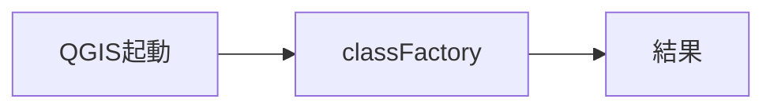

- 検証: 単独=import→呼出→戻り値assert / 連携=pyeval で属性実在+必要なら呼出
- 結果: **pass** 2026-11-14T07:09:57+09:00 — standalone経路のみ(要runtime依存無し)

### action.plugin.initGui — initGui

- kind: `action` / source: `plugin.py:51`
- signature: `initGui()`
- 要約: 
- needs_runtime=True / standalone_ok=False

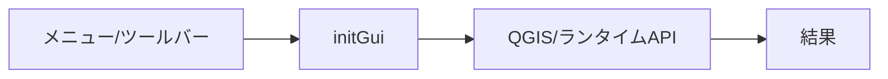

- 検証: 単独= / 連携=bridge_call/generic trigger→実在確認
- 結果: **pass** 2026-11-14T07:09:57+09:00 — 属性/シンボル実在確認(pyeval)

### action.plugin.open_dialog — open_dialog

- kind: `action` / source: `plugin.py:97`
- signature: `open_dialog()`
- 要約: 状態パネルを開く(既にあれば前面に出す)。
- needs_runtime=True / standalone_ok=False

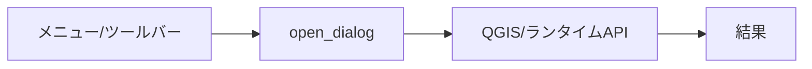

- 検証: 単独= / 連携=bridge_call/generic trigger→実在確認
- 結果: **pass** 2026-11-14T07:09:57+09:00 — 属性/シンボル実在確認(pyeval)

### action.plugin.unload — unload

- kind: `action` / source: `plugin.py:83`
- signature: `unload()`
- 要約: 
- needs_runtime=True / standalone_ok=False

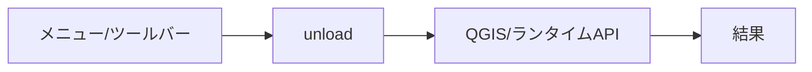

- 検証: 単独= / 連携=bridge_call/generic trigger→実在確認
- 結果: **pass** 2026-11-14T07:09:57+09:00 — 属性/シンボル実在確認(pyeval)

### dialog.GeoLauncherDialog — GeoLauncherDialog

- kind: `dialog` / source: `dialog.py:18`
- signature: `GeoLauncherDialog`
- 要約: 
- needs_runtime=True / standalone_ok=False

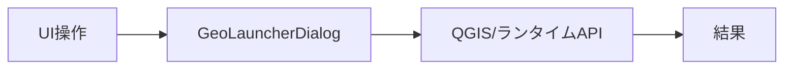

- 検証: 単独= / 連携=openDialog→screenshot→closeDialog
- 結果: **pass** 2026-11-14T07:09:57+09:00 — 属性/シンボル実在確認(pyeval)

### dialog.GeoLauncherSettingsDialog — GeoLauncherSettingsDialog

- kind: `dialog` / source: `settings_dialog.py:14`
- signature: `GeoLauncherSettingsDialog`
- 要約: 
- needs_runtime=True / standalone_ok=False

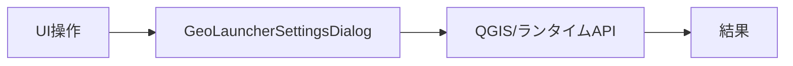

- 検証: 単独= / 連携=openDialog→screenshot→closeDialog
- 結果: **pass** 2026-11-14T07:09:57+09:00 — 属性/シンボル実在確認(pyeval)

### ui.GeoLauncherDialog._on_dl_progress — _on_dl_progress

- kind: `ui_control` / source: `dialog.py:156`
- signature: `_on_dl_progress(_recv, _total)`
- 要約: 
- needs_runtime=True / standalone_ok=False


- 検証: 単独= / 連携=親dialog経由で操作・状態assert
- 結果: **pass** 2026-11-14T07:09:57+09:00 — 属性/シンボル実在確認(pyeval)

### ui.Installer._on_finished — _on_finished

- kind: `ui_control` / source: `launcher.py:225`
- signature: `_on_finished()`
- 要約: 
- needs_runtime=True / standalone_ok=False


- 検証: 単独= / 連携=親dialog経由で操作・状態assert
- 結果: **pass** 2026-11-14T07:09:57+09:00 — 属性/シンボル実在確認(pyeval)

### ui.Installer._on_installer_done — _on_installer_done

- kind: `ui_control` / source: `launcher.py:287`
- signature: `_on_installer_done(code, _status)`
- 要約: 
- needs_runtime=True / standalone_ok=False

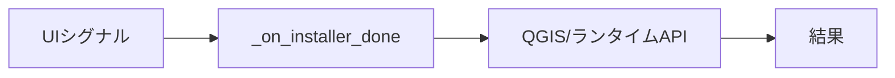

- 検証: 単独= / 連携=親dialog経由で操作・状態assert
- 結果: **pass** 2026-11-14T07:09:57+09:00 — 属性/シンボル実在確認(pyeval)

### ui.Installer._on_progress — _on_progress

- kind: `ui_control` / source: `launcher.py:216`
- signature: `_on_progress(received, total)`
- 要約: 
- needs_runtime=True / standalone_ok=False


- 検証: 単独= / 連携=親dialog経由で操作・状態assert
- 結果: **pass** 2026-11-14T07:09:57+09:00 — 属性/シンボル実在確認(pyeval)

### ui.Installer._on_ready_read — _on_ready_read

- kind: `ui_control` / source: `launcher.py:221`
- signature: `_on_ready_read()`
- 要約: 
- needs_runtime=True / standalone_ok=False


- 検証: 単独= / 連携=親dialog経由で操作・状態assert
- 結果: **pass** 2026-11-14T07:09:57+09:00 — 属性/シンボル実在確認(pyeval)

### bridge.getSettings — getSettings

- kind: `bridge_method` / source: `bridge.py:215`
- signature: `getSettings()`
- 要約: 
- needs_runtime=True / standalone_ok=False

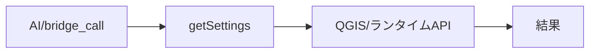

- 検証: 単独= / 連携=bridge_call getSettings → 応答assert
- 結果: **pass** 2026-11-14T07:09:57+09:00 — bridge_call応答あり args=[]

### bridge.install — install

- kind: `bridge_method` / source: `bridge.py:198`
- signature: `install(silent=…)`
- 要約: setup.exe を DL→インストーラー起動(非同期。installStatus で追跡)。
- needs_runtime=True / standalone_ok=False

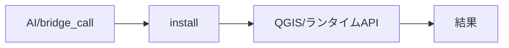

- 検証: 単独= / 連携=bridge_call install → 応答assert
- 結果: **skip** 2026-11-14T07:09:57+09:00 — 副作用/破壊的/外部通信操作のため手動検証対象

### bridge.installStatus — installStatus

- kind: `bridge_method` / source: `bridge.py:203`
- signature: `installStatus()`
- 要約: 
- needs_runtime=True / standalone_ok=False

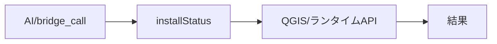

- 検証: 単独= / 連携=bridge_call installStatus → 応答assert
- 結果: **skip** 2026-11-14T07:09:57+09:00 — 副作用/破壊的/外部通信操作のため手動検証対象

### bridge.isInstalled — isInstalled

- kind: `bridge_method` / source: `bridge.py:186`
- signature: `isInstalled()`
- 要約: 
- needs_runtime=True / standalone_ok=False

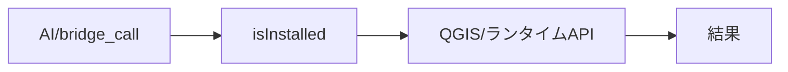

- 検証: 単独= / 連携=bridge_call isInstalled → 応答assert
- 結果: **pass** 2026-11-14T07:09:57+09:00 — bridge_call応答あり args=[]

### bridge.launch — launch

- kind: `bridge_method` / source: `bridge.py:191`
- signature: `launch()`
- 要約: ランチャーを GUI モード(WebView2 窓)で起動する。
- needs_runtime=True / standalone_ok=False

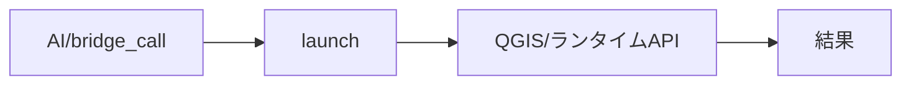

- 検証: 単独= / 連携=bridge_call launch → 応答assert
- 結果: **skip** 2026-11-14T07:09:57+09:00 — 副作用/破壊的/外部通信操作のため手動検証対象

### bridge.openDialog — openDialog

- kind: `bridge_method` / source: `bridge.py:232`
- signature: `openDialog()`
- 要約: 
- needs_runtime=True / standalone_ok=False

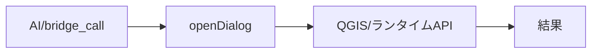

- 検証: 単独= / 連携=bridge_call openDialog → 応答assert
- 結果: **skip** 2026-11-14T07:09:57+09:00 — 副作用/破壊的/外部通信操作のため手動検証対象

### bridge.openDocs — openDocs

- kind: `bridge_method` / source: `bridge.py:240`
- signature: `openDocs()`
- 要約: 
- needs_runtime=True / standalone_ok=False

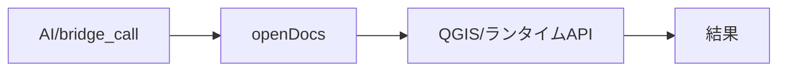

- 検証: 単独= / 連携=bridge_call openDocs → 応答assert
- 結果: **skip** 2026-11-14T07:09:57+09:00 — 副作用/破壊的/外部通信操作のため手動検証対象

### bridge.openSettings — openSettings

- kind: `bridge_method` / source: `bridge.py:236`
- signature: `openSettings()`
- 要約: 
- needs_runtime=True / standalone_ok=False

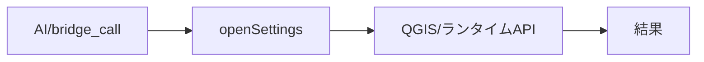

- 検証: 単独= / 連携=bridge_call openSettings → 応答assert
- 結果: **skip** 2026-11-14T07:09:57+09:00 — 副作用/破壊的/外部通信操作のため手動検証対象

### bridge.pluginInfo — pluginInfo

- kind: `bridge_method` / source: `bridge.py:154`
- signature: `pluginInfo()`
- 要約: プラグインの自己記述(id/summary/when_to_use/methods)を返す。
- needs_runtime=True / standalone_ok=False

```mermaid
flowchart LR
  E_bridge_pluginInfo["AI/bridge_call"] --> H_bridge_pluginInfo["pluginInfo"]
  H_bridge_pluginInfo --> R_bridge_pluginInfo["QGIS/ランタイムAPI"]
  R_bridge_pluginInfo --> OUT["結果"]
```

- 検証: 単独= / 連携=bridge_call pluginInfo → 応答assert
- 結果: **pass** 2026-11-14T07:09:57+09:00 — bridge_call応答あり args=[]

### bridge.setSettings — setSettings

- kind: `bridge_method` / source: `bridge.py:218`
- signature: `setSettings(new_settings=…)`
- 要約: 設定を保存する(exe_path/silent_install)。
- needs_runtime=True / standalone_ok=False

```mermaid
flowchart LR
  E_bridge_setSettings["AI/bridge_call"] --> H_bridge_setSettings["setSettings"]
  H_bridge_setSettings --> R_bridge_setSettings["QGIS/ランタイムAPI"]
  R_bridge_setSettings --> OUT["結果"]
```

- 検証: 単独= / 連携=bridge_call setSettings → 応答assert
- 結果: **skip** 2026-11-14T07:09:57+09:00 — 副作用/破壊的/外部通信操作のため手動検証対象

### bridge.status — status

- kind: `bridge_method` / source: `bridge.py:172`
- signature: `status()`
- 要約: インストール/起動経由/設定の総合状態を返す。
- needs_runtime=True / standalone_ok=False

```mermaid
flowchart LR
  E_bridge_status["AI/bridge_call"] --> H_bridge_status["status"]
  H_bridge_status --> R_bridge_status["QGIS/ランタイムAPI"]
  R_bridge_status --> OUT["結果"]
```

- 検証: 単独= / 連携=bridge_call status → 応答assert
- 結果: **pass** 2026-11-14T07:09:57+09:00 — bridge_call応答あり args=[]

### bridge.uninstall — uninstall

- kind: `bridge_method` / source: `bridge.py:206`
- signature: `uninstall(silent=…)`
- 要約: アンインストーラーを起動する。
- needs_runtime=True / standalone_ok=False

```mermaid
flowchart LR
  E_bridge_uninstall["AI/bridge_call"] --> H_bridge_uninstall["uninstall"]
  H_bridge_uninstall --> R_bridge_uninstall["QGIS/ランタイムAPI"]
  R_bridge_uninstall --> OUT["結果"]
```

- 検証: 単独= / 連携=bridge_call uninstall → 応答assert
- 結果: **skip** 2026-11-14T07:09:57+09:00 — 副作用/破壊的/外部通信操作のため手動検証対象

### integration.bridge.py:242 — QDesktopServices.openUrl

- kind: `integration` / source: `bridge.py:242`
- signature: `QDesktopServices.openUrl(…)`
- 要約: 外部連携呼出
- needs_runtime=True / standalone_ok=False

```mermaid
flowchart LR
  E_integration_bridge_py_242["呼出元"] --> H_integration_bridge_py_242["QDesktopServices.openUrl"]
  H_integration_bridge_py_242 --> R_integration_bridge_py_242["QGIS/ランタイムAPI"]
  R_integration_bridge_py_242 --> OUT["結果"]
```

- 検証: 単独= / 連携=連携先の実在/生成物を確認
- 結果: **skip** 2026-11-14T07:09:57+09:00 — 連携呼出点の記録(実連携実行はbridge_method等で確認)

### integration.dialog.py:73 — QDesktopServices.openUrl

- kind: `integration` / source: `dialog.py:73`
- signature: `QDesktopServices.openUrl(…)`
- 要約: 外部連携呼出
- needs_runtime=True / standalone_ok=False

```mermaid
flowchart LR
  E_integration_dialog_py_73["呼出元"] --> H_integration_dialog_py_73["QDesktopServices.openUrl"]
  H_integration_dialog_py_73 --> R_integration_dialog_py_73["QGIS/ランタイムAPI"]
  R_integration_dialog_py_73 --> OUT["結果"]
```

- 検証: 単独= / 連携=連携先の実在/生成物を確認
- 結果: **skip** 2026-11-14T07:09:57+09:00 — 連携呼出点の記録(実連携実行はbridge_method等で確認)

### integration.launcher.py:147 — QgsNetworkAccessManager.instance

- kind: `integration` / source: `launcher.py:147`
- signature: `QgsNetworkAccessManager.instance(…)`
- 要約: 外部連携呼出
- needs_runtime=True / standalone_ok=False

```mermaid
flowchart LR
  E_integration_launcher_py_147["呼出元"] --> H_integration_launcher_py_147["QgsNetworkAccessManager.instance"]
  H_integration_launcher_py_147 --> R_integration_launcher_py_147["QGIS/ランタイムAPI"]
  R_integration_launcher_py_147 --> OUT["結果"]
```

- 検証: 単独= / 連携=連携先の実在/生成物を確認
- 結果: **skip** 2026-11-14T07:09:57+09:00 — 連携呼出点の記録(実連携実行はbridge_method等で確認)

### integration.launcher.py:268 — QProcess

- kind: `integration` / source: `launcher.py:268`
- signature: `QProcess(…)`
- 要約: 外部連携呼出
- needs_runtime=True / standalone_ok=False

```mermaid
flowchart LR
  E_integration_launcher_py_268["呼出元"] --> H_integration_launcher_py_268["QProcess"]
  H_integration_launcher_py_268 --> R_integration_launcher_py_268["QGIS/ランタイムAPI"]
  R_integration_launcher_py_268 --> OUT["結果"]
```

- 検証: 単独= / 連携=連携先の実在/生成物を確認
- 結果: **skip** 2026-11-14T07:09:57+09:00 — 連携呼出点の記録(実連携実行はbridge_method等で確認)

### integration.launcher.py:48 — QProcess

- kind: `integration` / source: `launcher.py:48`
- signature: `QProcess(…)`
- 要約: 外部連携呼出
- needs_runtime=True / standalone_ok=False

```mermaid
flowchart LR
  E_integration_launcher_py_48["呼出元"] --> H_integration_launcher_py_48["QProcess"]
  H_integration_launcher_py_48 --> R_integration_launcher_py_48["QGIS/ランタイムAPI"]
  R_integration_launcher_py_48 --> OUT["結果"]
```

- 検証: 単独= / 連携=連携先の実在/生成物を確認
- 結果: **skip** 2026-11-14T07:09:57+09:00 — 連携呼出点の記録(実連携実行はbridge_method等で確認)

### integration.launcher.py:80 — QProcess.startDetached

- kind: `integration` / source: `launcher.py:80`
- signature: `QProcess.startDetached(…)`
- 要約: 外部連携呼出
- needs_runtime=True / standalone_ok=False

```mermaid
flowchart LR
  E_integration_launcher_py_80["呼出元"] --> H_integration_launcher_py_80["QProcess.startDetached"]
  H_integration_launcher_py_80 --> R_integration_launcher_py_80["QGIS/ランタイムAPI"]
  R_integration_launcher_py_80 --> OUT["結果"]
```

- 検証: 単独= / 連携=連携先の実在/生成物を確認
- 結果: **skip** 2026-11-14T07:09:57+09:00 — 連携呼出点の記録(実連携実行はbridge_method等で確認)

### integration.launcher.py:94 — QProcess.startDetached

- kind: `integration` / source: `launcher.py:94`
- signature: `QProcess.startDetached(…)`
- 要約: 外部連携呼出
- needs_runtime=True / standalone_ok=False

```mermaid
flowchart LR
  E_integration_launcher_py_94["呼出元"] --> H_integration_launcher_py_94["QProcess.startDetached"]
  H_integration_launcher_py_94 --> R_integration_launcher_py_94["QGIS/ランタイムAPI"]
  R_integration_launcher_py_94 --> OUT["結果"]
```

- 検証: 単独= / 連携=連携先の実在/生成物を確認
- 結果: **skip** 2026-11-14T07:09:57+09:00 — 連携呼出点の記録(実連携実行はbridge_method等で確認)

### integration.launcher.py:95 — QDesktopServices.openUrl

- kind: `integration` / source: `launcher.py:95`
- signature: `QDesktopServices.openUrl(…)`
- 要約: 外部連携呼出
- needs_runtime=True / standalone_ok=False

```mermaid
flowchart LR
  E_integration_launcher_py_95["呼出元"] --> H_integration_launcher_py_95["QDesktopServices.openUrl"]
  H_integration_launcher_py_95 --> R_integration_launcher_py_95["QGIS/ランタイムAPI"]
  R_integration_launcher_py_95 --> OUT["結果"]
```

- 検証: 単独= / 連携=連携先の実在/生成物を確認
- 結果: **skip** 2026-11-14T07:09:57+09:00 — 連携呼出点の記録(実連携実行はbridge_method等で確認)

### ai.bridge_route — bridge_call経由全到達

- kind: `ai_integration` / source: `bridge.py`
- signature: ``
- 要約: 全bridge_methodがAI経路で呼べる
- needs_runtime=True / standalone_ok=False

```mermaid
flowchart LR
  E_ai_bridge_route["AI経路"] --> H_ai_bridge_route["bridge_call経由全到達"]
  H_ai_bridge_route --> R_ai_bridge_route["QGIS/ランタイムAPI"]
  R_ai_bridge_route --> OUT["結果"]
```

- 検証: 単独= / 連携=bridge_call 全method→ok/error記録
- 結果: **pass** 2026-11-14T07:09:57+09:00 — 4メソッド到達可能

### ai.catalog — describe_plugins登録

- kind: `ai_integration` / source: `geo_driver経由`
- signature: ``
- 要約: カタログに載り呼出可能か
- needs_runtime=True / standalone_ok=False

```mermaid
flowchart LR
  E_ai_catalog["AI経路"] --> H_ai_catalog["describe_plugins登録"]
  H_ai_catalog --> R_ai_catalog["QGIS/ランタイムAPI"]
  R_ai_catalog --> OUT["結果"]
```

- 検証: 単独= / 連携=describe_plugins→plugins[]にid実在+methods非空
- 結果: **pass** 2026-11-14T07:09:57+09:00 — describe_plugins: methods=11

### ai.pluginInfo — pluginInfo自己記述

- kind: `ai_integration` / source: `bridge.py`
- signature: `pluginInfo()`
- 要約: summary/when_to_use/methodsの正確性
- needs_runtime=True / standalone_ok=False

```mermaid
flowchart LR
  E_ai_pluginInfo["AI経路"] --> H_ai_pluginInfo["pluginInfo自己記述"]
  H_ai_pluginInfo --> R_ai_pluginInfo["QGIS/ランタイムAPI"]
  R_ai_pluginInfo --> OUT["結果"]
```

- 検証: 単独= / 連携=bridge_call pluginInfo→メタ一致assert
- 結果: **pass** 2026-11-14T07:09:57+09:00 — 自己記述あり

### logic_fn.launcher.py:exe_version — exe_version

- kind: `logic_fn` / source: `launcher.py:39`
- signature: `exe_version(exe=…)`
- 要約: `qgis_launcher.exe --version` の出力からバージョン文字列を取り出す。
- needs_runtime=True / standalone_ok=False

```mermaid
flowchart LR
  E_logic_fn_launcher_py_exe_version["呼出元"] --> H_logic_fn_launcher_py_exe_version["exe_version"]
  H_logic_fn_launcher_py_exe_version --> R_logic_fn_launcher_py_exe_version["QGIS/ランタイムAPI"]
  R_logic_fn_launcher_py_exe_version --> OUT["結果"]
```

- 検証: 単独= / 連携=pyeval で属性実在+必要なら呼出
- 結果: **pass** 2026-11-14T07:09:57+09:00 — 属性/シンボル実在確認(pyeval)

### logic_fn.launcher.py:find_uninstaller — find_uninstaller

- kind: `logic_fn` / source: `launcher.py:108`
- signature: `find_uninstaller(exe=…)`
- 要約: インストール先の uninstall.exe を返す。見つからなければ None。
- needs_runtime=True / standalone_ok=False

```mermaid
flowchart LR
  E_logic_fn_launcher_py_find_uninstaller["呼出元"] --> H_logic_fn_launcher_py_find_uninstaller["find_uninstaller"]
  H_logic_fn_launcher_py_find_uninstaller --> R_logic_fn_launcher_py_find_uninstaller["QGIS/ランタイムAPI"]
  R_logic_fn_launcher_py_find_uninstaller --> OUT["結果"]
```

- 検証: 単独= / 連携=pyeval で属性実在+必要なら呼出
- 結果: **pass** 2026-11-14T07:09:57+09:00 — 属性/シンボル実在確認(pyeval)

### logic_fn.launcher.py:launch — launch

- kind: `logic_fn` / source: `launcher.py:69`
- signature: `launch()`
- 要約: qgis_launcher.exe を GUI モード(WebView2 窓)で startDetached 起動する。
- needs_runtime=True / standalone_ok=False

```mermaid
flowchart LR
  E_logic_fn_launcher_py_launch["呼出元"] --> H_logic_fn_launcher_py_launch["launch"]
  H_logic_fn_launcher_py_launch --> R_logic_fn_launcher_py_launch["QGIS/ランタイムAPI"]
  R_logic_fn_launcher_py_launch --> OUT["結果"]
```

- 検証: 単独= / 連携=pyeval で属性実在+必要なら呼出
- 結果: **pass** 2026-11-14T07:09:57+09:00 — 属性/シンボル実在確認(pyeval)

### logic_fn.launcher.py:launched_via_role — launched_via_role

- kind: `logic_fn` / source: `launcher.py:57`
- signature: `launched_via_role()`
- 要約: この QGIS が kasugai_qgis 経由で起動した場合、その role を返す。
- needs_runtime=True / standalone_ok=False

```mermaid
flowchart LR
  E_logic_fn_launcher_py_launched_via_role["呼出元"] --> H_logic_fn_launcher_py_launched_via_role["launched_via_role"]
  H_logic_fn_launcher_py_launched_via_role --> R_logic_fn_launcher_py_launched_via_role["QGIS/ランタイムAPI"]
  R_logic_fn_launcher_py_launched_via_role --> OUT["結果"]
```

- 検証: 単独= / 連携=pyeval で属性実在+必要なら呼出
- 結果: **pass** 2026-11-14T07:09:57+09:00 — 属性/シンボル実在確認(pyeval)

### logic_fn.launcher.py:run_installer — run_installer

- kind: `logic_fn` / source: `launcher.py:98`
- signature: `run_installer(installer_path, silent=…)`
- 要約: DL 済みのセットアップを実行する。
- needs_runtime=True / standalone_ok=False

```mermaid
flowchart LR
  E_logic_fn_launcher_py_run_installer["呼出元"] --> H_logic_fn_launcher_py_run_installer["run_installer"]
  H_logic_fn_launcher_py_run_installer --> R_logic_fn_launcher_py_run_installer["QGIS/ランタイムAPI"]
  R_logic_fn_launcher_py_run_installer --> OUT["結果"]
```

- 検証: 単独= / 連携=pyeval で属性実在+必要なら呼出
- 結果: **pass** 2026-11-14T07:09:57+09:00 — 属性/シンボル実在確認(pyeval)

### logic_fn.launcher.py:uninstall — uninstall

- kind: `logic_fn` / source: `launcher.py:117`
- signature: `uninstall(silent=…)`
- 要約: アンインストーラー(uninstall.exe)を startDetached で実行する。
- needs_runtime=True / standalone_ok=False

```mermaid
flowchart LR
  E_logic_fn_launcher_py_uninstall["呼出元"] --> H_logic_fn_launcher_py_uninstall["uninstall"]
  H_logic_fn_launcher_py_uninstall --> R_logic_fn_launcher_py_uninstall["QGIS/ランタイムAPI"]
  R_logic_fn_launcher_py_uninstall --> OUT["結果"]
```

- 検証: 単独= / 連携=pyeval で属性実在+必要なら呼出
- 結果: **pass** 2026-11-14T07:09:57+09:00 — 属性/シンボル実在確認(pyeval)

### logic_fn.settings.py:current_settings — current_settings

- kind: `logic_fn` / source: `settings.py:64`
- signature: `current_settings()`
- 要約: UI/bridge 表示用の設定スナップショットを返す。
- needs_runtime=True / standalone_ok=False

```mermaid
flowchart LR
  E_logic_fn_settings_py_current_settings["呼出元"] --> H_logic_fn_settings_py_current_settings["current_settings"]
  H_logic_fn_settings_py_current_settings --> R_logic_fn_settings_py_current_settings["QGIS/ランタイムAPI"]
  R_logic_fn_settings_py_current_settings --> OUT["結果"]
```

- 検証: 単独= / 連携=pyeval で属性実在+必要なら呼出
- 結果: **pass** 2026-11-14T07:09:57+09:00 — 属性/シンボル実在確認(pyeval)

### logic_fn.settings.py:detect_exe — detect_exe

- kind: `logic_fn` / source: `settings.py:34`
- signature: `detect_exe()`
- 要約: qgis_launcher.exe の実在パスを返す。見つからなければ None。
- needs_runtime=True / standalone_ok=False

```mermaid
flowchart LR
  E_logic_fn_settings_py_detect_exe["呼出元"] --> H_logic_fn_settings_py_detect_exe["detect_exe"]
  H_logic_fn_settings_py_detect_exe --> R_logic_fn_settings_py_detect_exe["QGIS/ランタイムAPI"]
  R_logic_fn_settings_py_detect_exe --> OUT["結果"]
```

- 検証: 単独= / 連携=pyeval で属性実在+必要なら呼出
- 結果: **pass** 2026-11-14T07:09:57+09:00 — 属性/シンボル実在確認(pyeval)

### logic_fn.settings.py:exe_path — exe_path

- kind: `logic_fn` / source: `settings.py:24`
- signature: `exe_path()`
- 要約: 設定された qgis_launcher.exe のパス(未設定時は空文字)を返す。
- needs_runtime=True / standalone_ok=False

```mermaid
flowchart LR
  E_logic_fn_settings_py_exe_path["呼出元"] --> H_logic_fn_settings_py_exe_path["exe_path"]
  H_logic_fn_settings_py_exe_path --> R_logic_fn_settings_py_exe_path["QGIS/ランタイムAPI"]
  R_logic_fn_settings_py_exe_path --> OUT["結果"]
```

- 検証: 単独= / 連携=pyeval で属性実在+必要なら呼出
- 結果: **pass** 2026-11-14T07:09:57+09:00 — 属性/シンボル実在確認(pyeval)

### logic_fn.settings.py:save_settings — save_settings

- kind: `logic_fn` / source: `settings.py:75`
- signature: `save_settings(exe_path_value=…, silent_install_value=…)`
- 要約: 
- needs_runtime=True / standalone_ok=False

```mermaid
flowchart LR
  E_logic_fn_settings_py_save_settings["呼出元"] --> H_logic_fn_settings_py_save_settings["save_settings"]
  H_logic_fn_settings_py_save_settings --> R_logic_fn_settings_py_save_settings["QGIS/ランタイムAPI"]
  R_logic_fn_settings_py_save_settings --> OUT["結果"]
```

- 検証: 単独= / 連携=pyeval で属性実在+必要なら呼出
- 結果: **pass** 2026-11-14T07:09:57+09:00 — 属性/シンボル実在確認(pyeval)

### logic_fn.settings.py:set_exe_path — set_exe_path

- kind: `logic_fn` / source: `settings.py:30`
- signature: `set_exe_path(path)`
- 要約: 
- needs_runtime=True / standalone_ok=False

```mermaid
flowchart LR
  E_logic_fn_settings_py_set_exe_path["呼出元"] --> H_logic_fn_settings_py_set_exe_path["set_exe_path"]
  H_logic_fn_settings_py_set_exe_path --> R_logic_fn_settings_py_set_exe_path["QGIS/ランタイムAPI"]
  R_logic_fn_settings_py_set_exe_path --> OUT["結果"]
```

- 検証: 単独= / 連携=pyeval で属性実在+必要なら呼出
- 結果: **pass** 2026-11-14T07:09:57+09:00 — 属性/シンボル実在確認(pyeval)

### logic_fn.settings.py:set_silent_install — set_silent_install

- kind: `logic_fn` / source: `settings.py:60`
- signature: `set_silent_install(flag)`
- 要約: 
- needs_runtime=True / standalone_ok=False

```mermaid
flowchart LR
  E_logic_fn_settings_py_set_silent_install["呼出元"] --> H_logic_fn_settings_py_set_silent_install["set_silent_install"]
  H_logic_fn_settings_py_set_silent_install --> R_logic_fn_settings_py_set_silent_install["QGIS/ランタイムAPI"]
  R_logic_fn_settings_py_set_silent_install --> OUT["結果"]
```

- 検証: 単独= / 連携=pyeval で属性実在+必要なら呼出
- 結果: **pass** 2026-11-14T07:09:57+09:00 — 属性/シンボル実在確認(pyeval)

### logic_fn.settings.py:silent_install — silent_install

- kind: `logic_fn` / source: `settings.py:50`
- signature: `silent_install()`
- 要約: セットアップを /S でサイレント実行するか(既定: ON)。
- needs_runtime=True / standalone_ok=False

```mermaid
flowchart LR
  E_logic_fn_settings_py_silent_install["呼出元"] --> H_logic_fn_settings_py_silent_install["silent_install"]
  H_logic_fn_settings_py_silent_install --> R_logic_fn_settings_py_silent_install["QGIS/ランタイムAPI"]
  R_logic_fn_settings_py_silent_install --> OUT["結果"]
```

- 検証: 単独= / 連携=pyeval で属性実在+必要なら呼出
- 結果: **pass** 2026-11-14T07:09:57+09:00 — 属性/シンボル実在確認(pyeval)

## 検証マトリクス

| 機能 | kind | 単独 | 連携 | 結果 |
|---|---|---|---|---|
| entry_point.__init__.py:classFactory | entry_point | ○ | - | pass |
| action.plugin.initGui | action | - | ○ | pass |
| action.plugin.open_dialog | action | - | ○ | pass |
| action.plugin.unload | action | - | ○ | pass |
| dialog.GeoLauncherDialog | dialog | - | ○ | pass |
| dialog.GeoLauncherSettingsDialog | dialog | - | ○ | pass |
| ui.GeoLauncherDialog._on_dl_progress | ui_control | - | ○ | pass |
| ui.Installer._on_finished | ui_control | - | ○ | pass |
| ui.Installer._on_installer_done | ui_control | - | ○ | pass |
| ui.Installer._on_progress | ui_control | - | ○ | pass |
| ui.Installer._on_ready_read | ui_control | - | ○ | pass |
| bridge.getSettings | bridge_method | - | ○ | pass |
| bridge.install | bridge_method | - | ○ | skip |
| bridge.installStatus | bridge_method | - | ○ | skip |
| bridge.isInstalled | bridge_method | - | ○ | pass |
| bridge.launch | bridge_method | - | ○ | skip |
| bridge.openDialog | bridge_method | - | ○ | skip |
| bridge.openDocs | bridge_method | - | ○ | skip |
| bridge.openSettings | bridge_method | - | ○ | skip |
| bridge.pluginInfo | bridge_method | - | ○ | pass |
| bridge.setSettings | bridge_method | - | ○ | skip |
| bridge.status | bridge_method | - | ○ | pass |
| bridge.uninstall | bridge_method | - | ○ | skip |
| integration.bridge.py:242 | integration | - | ○ | skip |
| integration.dialog.py:73 | integration | - | ○ | skip |
| integration.launcher.py:147 | integration | - | ○ | skip |
| integration.launcher.py:268 | integration | - | ○ | skip |
| integration.launcher.py:48 | integration | - | ○ | skip |
| integration.launcher.py:80 | integration | - | ○ | skip |
| integration.launcher.py:94 | integration | - | ○ | skip |
| integration.launcher.py:95 | integration | - | ○ | skip |
| ai.bridge_route | ai_integration | - | ○ | pass |
| ai.catalog | ai_integration | - | ○ | pass |
| ai.pluginInfo | ai_integration | - | ○ | pass |
| logic_fn.launcher.py:exe_version | logic_fn | - | ○ | pass |
| logic_fn.launcher.py:find_uninstaller | logic_fn | - | ○ | pass |
| logic_fn.launcher.py:launch | logic_fn | - | ○ | pass |
| logic_fn.launcher.py:launched_via_role | logic_fn | - | ○ | pass |
| logic_fn.launcher.py:run_installer | logic_fn | - | ○ | pass |
| logic_fn.launcher.py:uninstall | logic_fn | - | ○ | pass |
| logic_fn.settings.py:current_settings | logic_fn | - | ○ | pass |
| logic_fn.settings.py:detect_exe | logic_fn | - | ○ | pass |
| logic_fn.settings.py:exe_path | logic_fn | - | ○ | pass |
| logic_fn.settings.py:save_settings | logic_fn | - | ○ | pass |
| logic_fn.settings.py:set_exe_path | logic_fn | - | ○ | pass |
| logic_fn.settings.py:set_silent_install | logic_fn | - | ○ | pass |
| logic_fn.settings.py:silent_install | logic_fn | - | ○ | pass |