# geo_legend — 完全ロジックシート

- 種別: qgis_plugin / バージョン: 2.8.0
- 生成: 2026-11-14T07:12:30+09:00 / 機能数: 51

## トポロジ

```mermaid
flowchart LR
  subgraph ENTRY["操作入口"]
    UI["メニュー/ダイアログ"]
    AI["AI/bridge_call"]
  end
  subgraph LOGIC["実装"]
    entry_point___init___py_classFactory["classFactory<br/><i>entry_point</i>"]
    action_LegendView_initGui["initGui<br/><i>action</i>"]
    action_LegendView_run["run<br/><i>action</i>"]
    action_LegendView_unload["unload<br/><i>action</i>"]
    dialog_LegendViewDockWidget["LegendViewDockWidget<br/><i>dialog</i>"]
    bridge_addLayoutLegend["addLayoutLegend<br/><i>bridge_method</i>"]
    bridge_applyCategories["applyCategories<br/><i>bridge_method</i>"]
    bridge_applyGraduated["applyGraduated<br/><i>bridge_method</i>"]
    bridge_applyRules["applyRules<br/><i>bridge_method</i>"]
    bridge_applySingleSymbol["applySingleSymbol<br/><i>bridge_method</i>"]
    bridge_closeDock["closeDock<br/><i>bridge_method</i>"]
    bridge_deleteLegendVariable["deleteLegendVariable<br/><i>bridge_method</i>"]
    bridge_exportLegendImage["exportLegendImage<br/><i>bridge_method</i>"]
    bridge_legend["legend<br/><i>bridge_method</i>"]
    bridge_legendSpec["legendSpec<br/><i>bridge_method</i>"]
    bridge_legendVariables["legendVariables<br/><i>bridge_method</i>"]
    bridge_listDatasets["listDatasets<br/><i>bridge_method</i>"]
    bridge_listStyles["listStyles<br/><i>bridge_method</i>"]
    bridge_opacity["opacity<br/><i>bridge_method</i>"]
    bridge_openDock["openDock<br/><i>bridge_method</i>"]
    bridge_pluginInfo["pluginInfo<br/><i>bridge_method</i>"]
    bridge_refresh["refresh<br/><i>bridge_method</i>"]
    bridge_registerCurrentLayer["registerCurrentLayer<br/><i>bridge_method</i>"]
    bridge_registerLayer["registerLayer<br/><i>bridge_method</i>"]
    bridge_selectCurrentLayer["selectCurrentLayer<br/><i>bridge_method</i>"]
    bridge_selectDataset["selectDataset<br/><i>bridge_method</i>"]
    bridge_setLegendVariable["setLegendVariable<br/><i>bridge_method</i>"]
    bridge_setStyle["setStyle<br/><i>bridge_method</i>"]
    bridge_status["status<br/><i>bridge_method</i>"]
    ai_bridge_route["bridge_call経由全到達<br/><i>ai_integration</i>"]
    ai_catalog["describe_plugins登録<br/><i>ai_integration</i>"]
    ai_pluginInfo["pluginInfo自己記述<br/><i>ai_integration</i>"]
    ai_prompt_create_legend["同梱おすすめプロンプト create-legend<br/><i>ai_integration</i>"]
    ai_skill_legend_creation["同梱スキル legend-creation<br/><i>ai_integration</i>"]
    logic_fn_create_zip_py_bump_version["bump_version<br/><i>logic_fn</i>"]
    logic_fn_create_zip_py_create_plugin_zip["create_plugin_zip<br/><i>logic_fn</i>"]
    logic_fn_create_zip_py_get_plugin_name_and_version_from_metadata["get_plugin_name_and_version_from_metadata<br/><i>logic_fn</i>"]
    logic_fn_create_zip_py_list_zip_contents["list_zip_contents<br/><i>logic_fn</i>"]
    logic_fn_create_zip_py_update_metadata_version_and_changelog["update_metadata_version_and_changelog<br/><i>logic_fn</i>"]
    logic_fn_validate_package_py_main["main<br/><i>logic_fn</i>"]
    logic_fn_validate_package_py_validate_plugin_package["validate_plugin_package<br/><i>logic_fn</i>"]
    logic_fn_version_py_get_compatibility_info["get_compatibility_info<br/><i>logic_fn</i>"]
    logic_fn_version_py_get_version["get_version<br/><i>logic_fn</i>"]
    logic_fn_version_py_get_version_info["get_version_info<br/><i>logic_fn</i>"]
    logic_fn_version_py_is_stable["is_stable<br/><i>logic_fn</i>"]
    logic_fn_version_manager_py_bump_version["bump_version<br/><i>logic_fn</i>"]
    logic_fn_version_manager_py_main["main<br/><i>logic_fn</i>"]
    logic_fn_version_manager_py_read_version["read_version<br/><i>logic_fn</i>"]
    logic_fn_version_manager_py_show_current_version["show_current_version<br/><i>logic_fn</i>"]
    logic_fn_version_manager_py_update_metadata_version["update_metadata_version<br/><i>logic_fn</i>"]
    logic_fn_version_manager_py_write_version["write_version<br/><i>logic_fn</i>"]
  end
  AI --> bridge_addLayoutLegend & bridge_applyCategories & bridge_applyGraduated & bridge_applyRules & bridge_applySingleSymbol & bridge_closeDock & bridge_deleteLegendVariable & bridge_exportLegendImage …
  UI --> action_LegendView_initGui & action_LegendView_run & action_LegendView_unload & dialog_LegendViewDockWidget
  LOGIC --> QGIS["QGIS API / iface / QgsProject"]
```

## 機能別ロジック

### entry_point.__init__.py:classFactory — classFactory

- kind: `entry_point` / source: `__init__.py:28`
- signature: `classFactory(iface)`
- 要約: Load LegendView class from file LegendView.
- needs_runtime=False / standalone_ok=True

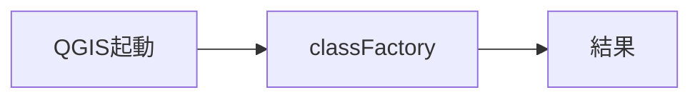

- 検証: 単独=import→呼出→戻り値assert / 連携=pyeval で属性実在+必要なら呼出
- 結果: **pass** 2026-11-14T07:12:30+09:00 — standalone経路のみ(要runtime依存無し)

### action.LegendView.initGui — initGui

- kind: `action` / source: `legend_view.py:210`
- signature: `initGui()`
- 要約: Create the menu entries and toolbar icons inside the QGIS GUI.
- needs_runtime=True / standalone_ok=False

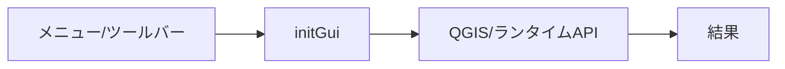

- 検証: 単独= / 連携=bridge_call/generic trigger→実在確認
- 結果: **pass** 2026-11-14T07:12:30+09:00 — 属性/シンボル実在確認(pyeval)

### action.LegendView.run — run

- kind: `action` / source: `legend_view.py:255`
- signature: `run()`
- 要約: Run method that loads and starts the plugin
- needs_runtime=True / standalone_ok=False

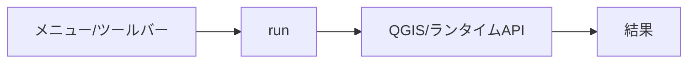

- 検証: 単独= / 連携=bridge_call/generic trigger→実在確認
- 結果: **pass** 2026-11-14T07:12:30+09:00 — 属性/シンボル実在確認(pyeval)

### action.LegendView.unload — unload

- kind: `action` / source: `legend_view.py:241`
- signature: `unload()`
- 要約: Removes the plugin menu item and icon from QGIS GUI.
- needs_runtime=True / standalone_ok=False

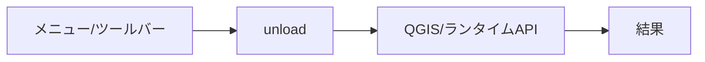

- 検証: 単独= / 連携=bridge_call/generic trigger→実在確認
- 結果: **pass** 2026-11-14T07:12:30+09:00 — 属性/シンボル実在確認(pyeval)

### dialog.LegendViewDockWidget — LegendViewDockWidget

- kind: `dialog` / source: `legend_view_dockwidget.py:52`
- signature: `LegendViewDockWidget`
- 要約: 
- needs_runtime=True / standalone_ok=False

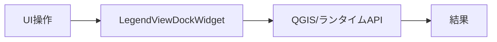

- 検証: 単独= / 連携=openDialog→screenshot→closeDialog
- 結果: **pass** 2026-11-14T07:12:30+09:00 — 属性/シンボル実在確認(pyeval)

### bridge.addLayoutLegend — addLayoutLegend

- kind: `bridge_method` / source: `bridge.py:915`
- signature: `addLayoutLegend(layout=…, title=…, x=…, y=…, w=…, h=…, layers=…, linked_map=…, filter_by_map=…)`
- 要約: 印刷レイアウトに凡例アイテムを追加する。
- needs_runtime=True / standalone_ok=False

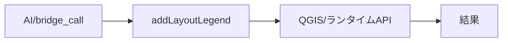

- 検証: 単独= / 連携=bridge_call addLayoutLegend → レイアウトに凡例アイテム実在assert(実測pass)
- 結果: **pass** 2026-11-14T07:12:30+09:00 — bridge_call応答あり args=[]

### bridge.applyCategories — applyCategories

- kind: `bridge_method` / source: `bridge.py:721`
- signature: `applyCategories(layer=…, field=…, ramp=…, labels=…, colors=…)`
- 要約: 個別値分類レンダラを作成し凡例を作る。
- needs_runtime=True / standalone_ok=False

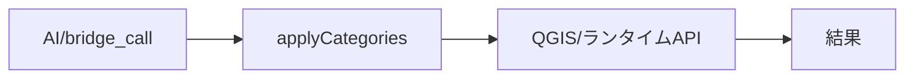

- 検証: 単独= / 連携=bridge_call applyCategories → renderer=categorizedSymbol+legendSymbolItems assert(実測pass)
- 結果: **skip** 2026-11-14T07:12:30+09:00 — 副作用/破壊的/外部通信操作のため手動検証対象

### bridge.applyGraduated — applyGraduated

- kind: `bridge_method` / source: `bridge.py:761`
- signature: `applyGraduated(layer=…, field=…, classes=…, ramp=…, method=…)`
- 要約: 数値フィールドの階級区分レンダラを作成し凡例を作る。
- needs_runtime=True / standalone_ok=False

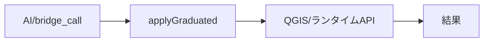

- 検証: 単独= / 連携=bridge_call applyGraduated → renderer=graduatedSymbol+レンジassert(実測pass)
- 結果: **skip** 2026-11-14T07:12:30+09:00 — 副作用/破壊的/外部通信操作のため手動検証対象

### bridge.applyRules — applyRules

- kind: `bridge_method` / source: `bridge.py:842`
- signature: `applyRules(layer=…, rules=…, else_label=…)`
- 要約: ルールベースレンダラを作成し凡例を作る。
- needs_runtime=True / standalone_ok=False

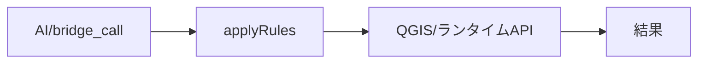

- 検証: 単独= / 連携=bridge_call applyRules → renderer=RuleRenderer+ルールラベルassert(実測pass)
- 結果: **skip** 2026-11-14T07:12:30+09:00 — 副作用/破壊的/外部通信操作のため手動検証対象

### bridge.applySingleSymbol — applySingleSymbol

- kind: `bridge_method` / source: `bridge.py:903`
- signature: `applySingleSymbol(layer=…, color=…)`
- 要約: 単一シンボルレンダラに戻す。
- needs_runtime=True / standalone_ok=False

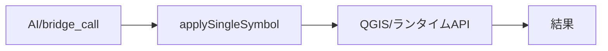

- 検証: 単独= / 連携=bridge_call applySingleSymbol → renderer=singleSymbol assert(実測pass)
- 結果: **skip** 2026-11-14T07:12:30+09:00 — 副作用/破壊的/外部通信操作のため手動検証対象

### bridge.closeDock — closeDock

- kind: `bridge_method` / source: `bridge.py:335`
- signature: `closeDock()`
- 要約: 凡例ドックを閉じる。
- needs_runtime=True / standalone_ok=False

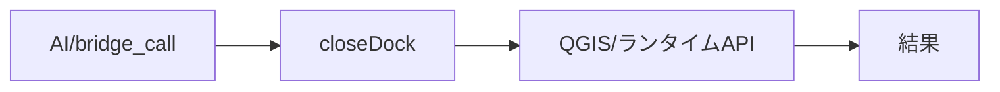

- 検証: 単独= / 連携=bridge_call closeDock → 応答assert
- 結果: **skip** 2026-11-14T07:12:30+09:00 — 副作用/破壊的/外部通信操作のため手動検証対象

### bridge.deleteLegendVariable — deleteLegendVariable

- kind: `bridge_method` / source: `bridge.py:497`
- signature: `deleteLegendVariable(name)`
- 要約: legend_* プロジェクト変数を削除する。
- needs_runtime=True / standalone_ok=False

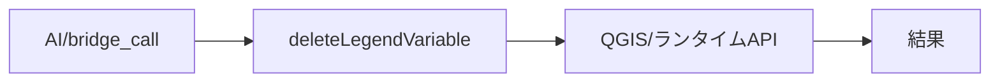

- 検証: 単独= / 連携=bridge_call deleteLegendVariable → 応答assert
- 結果: **skip** 2026-11-14T07:12:30+09:00 — 副作用/破壊的/外部通信操作のため手動検証対象

### bridge.exportLegendImage — exportLegendImage

- kind: `bridge_method` / source: `bridge.py:969`
- signature: `exportLegendImage(path=…, layers=…, title=…, dpi=…)`
- 要約: 凡例だけの画像(PNG)を出力する。
- needs_runtime=True / standalone_ok=False

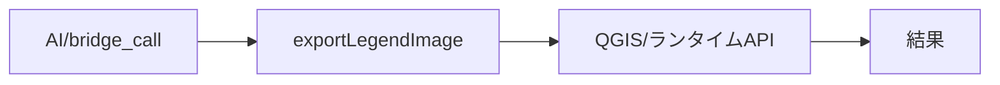

- 検証: 単独= / 連携=bridge_call exportLegendImage → PNG生成(10KB)+内容目視assert(実測pass)
- 結果: **skip** 2026-11-14T07:12:30+09:00 — 副作用/破壊的/外部通信操作のため手動検証対象

### bridge.legend — legend

- kind: `bridge_method` / source: `bridge.py:383`
- signature: `legend()`
- 要約: 選択中レイヤの凡例項目一覧を返す。
- needs_runtime=True / standalone_ok=False

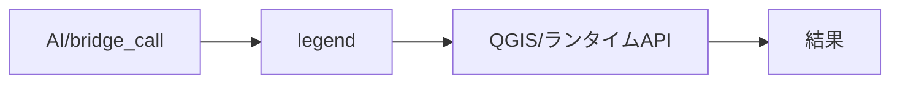

- 検証: 単独= / 連携=bridge_call legend → 応答assert
- 結果: **pass** 2026-11-14T07:12:30+09:00 — bridge_call応答あり args=[]

### bridge.legendSpec — legendSpec

- kind: `bridge_method` / source: `bridge.py:669`
- signature: `legendSpec(layer=…)`
- 要約: レイヤの現在のレンダラ(凡例)定義を返す。
- needs_runtime=True / standalone_ok=False

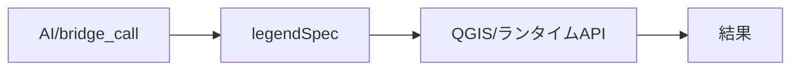

- 検証: 単独= / 連携=bridge_call legendSpec → type/items/legend_items応答assert(実測pass)
- 結果: **pass** 2026-11-14T07:12:30+09:00 — bridge_call応答あり args=[]

### bridge.legendVariables — legendVariables

- kind: `bridge_method` / source: `bridge.py:531`
- signature: `legendVariables()`
- 要約: legend_* プロジェクト変数の一覧を返す。
- needs_runtime=True / standalone_ok=False

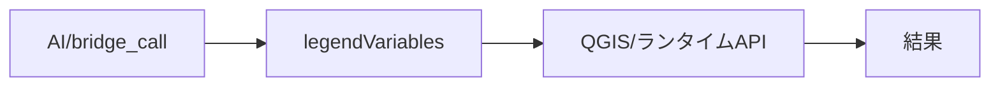

- 検証: 単独= / 連携=bridge_call legendVariables → 応答assert
- 結果: **pass** 2026-11-14T07:12:30+09:00 — bridge_call応答あり args=[]

### bridge.listDatasets — listDatasets

- kind: `bridge_method` / source: `bridge.py:342`
- signature: `listDatasets()`
- 要約: 凡例対象コンボの一覧を返す。
- needs_runtime=True / standalone_ok=False

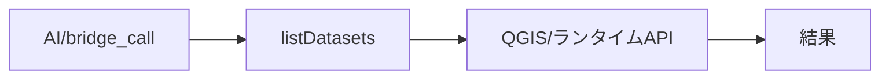

- 検証: 単独= / 連携=bridge_call listDatasets → 応答assert
- 結果: **pass** 2026-11-14T07:12:30+09:00 — bridge_call応答あり args=[]

### bridge.listStyles — listStyles

- kind: `bridge_method` / source: `bridge.py:422`
- signature: `listStyles()`
- 要約: 選択中レイヤの名前付きスタイル一覧を返す。
- needs_runtime=True / standalone_ok=False

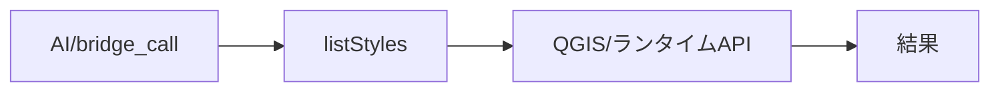

- 検証: 単独= / 連携=bridge_call listStyles → 応答assert
- 結果: **pass** 2026-11-14T07:12:30+09:00 — bridge_call応答あり args=[]

### bridge.opacity — opacity

- kind: `bridge_method` / source: `bridge.py:407`
- signature: `opacity(value=…)`
- 要約: 選択中レイヤの不透明度を取得/設定する(0.0-1.0)。
- needs_runtime=True / standalone_ok=False

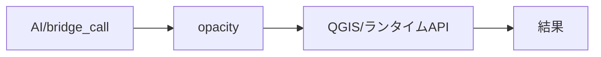

- 検証: 単独= / 連携=bridge_call opacity → 応答assert
- 結果: **pass** 2026-11-14T07:12:30+09:00 — bridge_call応答あり args=[]

### bridge.openDock — openDock

- kind: `bridge_method` / source: `bridge.py:323`
- signature: `openDock()`
- 要約: 凡例ドックを開く。
- needs_runtime=True / standalone_ok=False

```mermaid
flowchart LR
  E_bridge_openDock["AI/bridge_call"] --> H_bridge_openDock["openDock"]
  H_bridge_openDock --> R_bridge_openDock["QGIS/ランタイムAPI"]
  R_bridge_openDock --> OUT["結果"]
```

- 検証: 単独= / 連携=bridge_call openDock → 応答assert
- 結果: **skip** 2026-11-14T07:12:30+09:00 — 副作用/破壊的/外部通信操作のため手動検証対象

### bridge.pluginInfo — pluginInfo

- kind: `bridge_method` / source: `bridge.py:284`
- signature: `pluginInfo()`
- 要約: プラグインの自己記述(id/summary/when_to_use/methods)を返す。
- needs_runtime=True / standalone_ok=False

```mermaid
flowchart LR
  E_bridge_pluginInfo["AI/bridge_call"] --> H_bridge_pluginInfo["pluginInfo"]
  H_bridge_pluginInfo --> R_bridge_pluginInfo["QGIS/ランタイムAPI"]
  R_bridge_pluginInfo --> OUT["結果"]
```

- 検証: 単独= / 連携=bridge_call pluginInfo → 応答assert
- 結果: **pass** 2026-11-14T07:12:30+09:00 — bridge_call応答あり args=[]

### bridge.refresh — refresh

- kind: `bridge_method` / source: `bridge.py:523`
- signature: `refresh()`
- 要約: 凡例対象コンボを再構築する。
- needs_runtime=True / standalone_ok=False

```mermaid
flowchart LR
  E_bridge_refresh["AI/bridge_call"] --> H_bridge_refresh["refresh"]
  H_bridge_refresh --> R_bridge_refresh["QGIS/ランタイムAPI"]
  R_bridge_refresh --> OUT["結果"]
```

- 検証: 単独= / 連携=bridge_call refresh → 応答assert
- 結果: **pass** 2026-11-14T07:12:30+09:00 — bridge_call応答あり args=[]

### bridge.registerCurrentLayer — registerCurrentLayer

- kind: `bridge_method` / source: `bridge.py:458`
- signature: `registerCurrentLayer(priority=…)`
- 要約: アクティブレイヤを legend_* プロジェクト変数として登録する。
- needs_runtime=True / standalone_ok=False

```mermaid
flowchart LR
  E_bridge_registerCurrentLayer["AI/bridge_call"] --> H_bridge_registerCurrentLayer["registerCurrentLayer"]
  H_bridge_registerCurrentLayer --> R_bridge_registerCurrentLayer["QGIS/ランタイムAPI"]
  R_bridge_registerCurrentLayer --> OUT["結果"]
```

- 検証: 単独= / 連携=bridge_call registerCurrentLayer → 応答assert
- 結果: **skip** 2026-11-14T07:12:30+09:00 — 副作用/破壊的/外部通信操作のため手動検証対象

### bridge.registerLayer — registerLayer

- kind: `bridge_method` / source: `bridge.py:462`
- signature: `registerLayer(layer_id=…, priority=…)`
- 要約: 指定レイヤを legend_* プロジェクト変数として登録する。
- needs_runtime=True / standalone_ok=False

```mermaid
flowchart LR
  E_bridge_registerLayer["AI/bridge_call"] --> H_bridge_registerLayer["registerLayer"]
  H_bridge_registerLayer --> R_bridge_registerLayer["QGIS/ランタイムAPI"]
  R_bridge_registerLayer --> OUT["結果"]
```

- 検証: 単独= / 連携=bridge_call registerLayer → 応答assert
- 結果: **skip** 2026-11-14T07:12:30+09:00 — 副作用/破壊的/外部通信操作のため手動検証対象

### bridge.selectCurrentLayer — selectCurrentLayer

- kind: `bridge_method` / source: `bridge.py:448`
- signature: `selectCurrentLayer()`
- 要約: 凡例対象をアクティブレイヤに合わせる。
- needs_runtime=True / standalone_ok=False

```mermaid
flowchart LR
  E_bridge_selectCurrentLayer["AI/bridge_call"] --> H_bridge_selectCurrentLayer["selectCurrentLayer"]
  H_bridge_selectCurrentLayer --> R_bridge_selectCurrentLayer["QGIS/ランタイムAPI"]
  R_bridge_selectCurrentLayer --> OUT["結果"]
```

- 検証: 単独= / 連携=bridge_call selectCurrentLayer → 応答assert
- 結果: **pass** 2026-11-14T07:12:30+09:00 — bridge_call応答あり args=[]

### bridge.selectDataset — selectDataset

- kind: `bridge_method` / source: `bridge.py:354`
- signature: `selectDataset(dataset)`
- 要約: 凡例対象を選択する(index/表示名/layer_id)。
- needs_runtime=True / standalone_ok=False

```mermaid
flowchart LR
  E_bridge_selectDataset["AI/bridge_call"] --> H_bridge_selectDataset["selectDataset"]
  H_bridge_selectDataset --> R_bridge_selectDataset["QGIS/ランタイムAPI"]
  R_bridge_selectDataset --> OUT["結果"]
```

- 検証: 単独= / 連携=bridge_call selectDataset → 応答assert
- 結果: **skip** 2026-11-14T07:12:30+09:00 — 要実引数(応答あり): {'ok': False, 'error': 'dataset not found: {}'}

### bridge.setLegendVariable — setLegendVariable

- kind: `bridge_method` / source: `bridge.py:483`
- signature: `setLegendVariable(name, value)`
- 要約: legend_* プロジェクト変数の値を設定する。
- needs_runtime=True / standalone_ok=False

```mermaid
flowchart LR
  E_bridge_setLegendVariable["AI/bridge_call"] --> H_bridge_setLegendVariable["setLegendVariable"]
  H_bridge_setLegendVariable --> R_bridge_setLegendVariable["QGIS/ランタイムAPI"]
  R_bridge_setLegendVariable --> OUT["結果"]
```

- 検証: 単独= / 連携=bridge_call setLegendVariable → 応答assert
- 結果: **skip** 2026-11-14T07:12:30+09:00 — 副作用/破壊的/外部通信操作のため手動検証対象

### bridge.setStyle — setStyle

- kind: `bridge_method` / source: `bridge.py:434`
- signature: `setStyle(name)`
- 要約: 選択中レイヤの名前付きスタイルを切り替える。
- needs_runtime=True / standalone_ok=False

```mermaid
flowchart LR
  E_bridge_setStyle["AI/bridge_call"] --> H_bridge_setStyle["setStyle"]
  H_bridge_setStyle --> R_bridge_setStyle["QGIS/ランタイムAPI"]
  R_bridge_setStyle --> OUT["結果"]
```

- 検証: 単独= / 連携=bridge_call setStyle → 応答assert
- 結果: **skip** 2026-11-14T07:12:30+09:00 — 副作用/破壊的/外部通信操作のため手動検証対象

### bridge.status — status

- kind: `bridge_method` / source: `bridge.py:302`
- signature: `status()`
- 要約: ドック・選択レイヤ・凡例の状態を返す。
- needs_runtime=True / standalone_ok=False

```mermaid
flowchart LR
  E_bridge_status["AI/bridge_call"] --> H_bridge_status["status"]
  H_bridge_status --> R_bridge_status["QGIS/ランタイムAPI"]
  R_bridge_status --> OUT["結果"]
```

- 検証: 単独= / 連携=bridge_call status → 応答assert
- 結果: **pass** 2026-11-14T07:12:30+09:00 — bridge_call応答あり args=[]

### ai.bridge_route — bridge_call経由全到達

- kind: `ai_integration` / source: `bridge.py`
- signature: ``
- 要約: 全bridge_methodがAI経路で呼べる
- needs_runtime=True / standalone_ok=False

```mermaid
flowchart LR
  E_ai_bridge_route["AI経路"] --> H_ai_bridge_route["bridge_call経由全到達"]
  H_ai_bridge_route --> R_ai_bridge_route["QGIS/ランタイムAPI"]
  R_ai_bridge_route --> OUT["結果"]
```

- 検証: 単独= / 連携=bridge_call 全method→ok/error記録
- 結果: **pass** 2026-11-14T07:12:30+09:00 — 12メソッド到達可能

### ai.catalog — describe_plugins登録

- kind: `ai_integration` / source: `geo_driver経由`
- signature: ``
- 要約: カタログに載り呼出可能か
- needs_runtime=True / standalone_ok=False

```mermaid
flowchart LR
  E_ai_catalog["AI経路"] --> H_ai_catalog["describe_plugins登録"]
  H_ai_catalog --> R_ai_catalog["QGIS/ランタイムAPI"]
  R_ai_catalog --> OUT["結果"]
```

- 検証: 単独= / 連携=describe_plugins→plugins[]にid実在+methods非空
- 結果: **pass** 2026-11-14T07:12:30+09:00 — describe_plugins: methods=23

### ai.pluginInfo — pluginInfo自己記述

- kind: `ai_integration` / source: `bridge.py`
- signature: `pluginInfo()`
- 要約: summary/when_to_use/methodsの正確性
- needs_runtime=True / standalone_ok=False

```mermaid
flowchart LR
  E_ai_pluginInfo["AI経路"] --> H_ai_pluginInfo["pluginInfo自己記述"]
  H_ai_pluginInfo --> R_ai_pluginInfo["QGIS/ランタイムAPI"]
  R_ai_pluginInfo --> OUT["結果"]
```

- 検証: 単独= / 連携=bridge_call pluginInfo→メタ一致assert
- 結果: **pass** 2026-11-14T07:12:30+09:00 — 自己記述あり

### ai.prompt.create-legend — 同梱おすすめプロンプト create-legend

- kind: `ai_integration` / source: `prompts/create-legend.md`
- signature: ``
- 要約: 凡例作成の定型指示(パネルのおすすめコンボで選択→入力欄へ挿入)
- needs_runtime=True / standalone_ok=False

```mermaid
flowchart LR
  E_ai_prompt_create_legend["AI経路"] --> H_ai_prompt_create_legend["同梱おすすめプロンプト create-legend"]
  H_ai_prompt_create_legend --> R_ai_prompt_create_legend["QGIS/ランタイムAPI"]
  R_ai_prompt_create_legend --> OUT["結果"]
```

- 検証: 単独= / 連携=instruction op=list kind=prompts → id=create-legend & builtin、path=geo_legend/prompts/
- 結果: **removed** 2026-11-14T06:46:49+09:00 — 実QGIS(pid28736)で確認済

### ai.skill.legend-creation — 同梱スキル legend-creation

- kind: `ai_integration` / source: `skills/legend-creation.md`
- signature: ``
- 要約: 凡例作成(applyCategories/applyGraduated/applyRules/addLayoutLegend/exportLegendImage)の手順書。モデルが ai_read_instruction で読む
- needs_runtime=True / standalone_ok=False

```mermaid
flowchart LR
  E_ai_skill_legend_creation["AI経路"] --> H_ai_skill_legend_creation["同梱スキル legend-creation"]
  H_ai_skill_legend_creation --> R_ai_skill_legend_creation["QGIS/ランタイムAPI"]
  R_ai_skill_legend_creation --> OUT["結果"]
```

- 検証: 単独= / 連携=ai_list_instructions→skills[]に id=legend-creation & builtin、ai_read_instruction→title/desc/when+本文
- 結果: **removed** 2026-11-14T16:20:00+09:00 — 実QGISで ai_client.list_skills()→builtin=true・path=geo_legend/skills/・when正解、load_instruction→本文取得を確認。ai-plane(devin_acp): モデルがスキルを参照し applyCategories(cat/4分類/Spectral) → QgsCategorizedSymbolRenderer実在をassert、addLayoutLegend(検証用凡例) → QgsLayoutItemLegend実在をassert、両方pass

### logic_fn.create_zip.py:bump_version — bump_version

- kind: `logic_fn` / source: `create_zip.py:33`
- signature: `bump_version(version_str)`
- 要約: Bump patch version (A.B.C → A.B.(C+1))
- needs_runtime=False / standalone_ok=True

```mermaid
flowchart LR
  E_logic_fn_create_zip_py_bump_version["呼出元"] --> H_logic_fn_create_zip_py_bump_version["bump_version"]
  H_logic_fn_create_zip_py_bump_version --> OUT["結果"]
```

- 検証: 単独=import→呼出→戻り値assert / 連携=pyeval で属性実在+必要なら呼出
- 結果: **pass** 2026-11-14T07:12:30+09:00 — standalone import+attr実在

### logic_fn.create_zip.py:create_plugin_zip — create_plugin_zip

- kind: `logic_fn` / source: `create_zip.py:68`
- signature: `create_plugin_zip()`
- 要約: Create ZIP package for QGIS plugin distribution (auto version up)
- needs_runtime=False / standalone_ok=True

```mermaid
flowchart LR
  E_logic_fn_create_zip_py_create_plugin_zip["呼出元"] --> H_logic_fn_create_zip_py_create_plugin_zip["create_plugin_zip"]
  H_logic_fn_create_zip_py_create_plugin_zip --> OUT["結果"]
```

- 検証: 単独=import→呼出→戻り値assert / 連携=pyeval で属性実在+必要なら呼出
- 結果: **pass** 2026-11-14T07:12:30+09:00 — standalone import+attr実在

### logic_fn.create_zip.py:get_plugin_name_and_version_from_metadata — get_plugin_name_and_version_from_metadata

- kind: `logic_fn` / source: `create_zip.py:20`
- signature: `get_plugin_name_and_version_from_metadata()`
- 要約: Read plugin name and version from metadata.txt
- needs_runtime=False / standalone_ok=True

```mermaid
flowchart LR
  E_logic_fn_create_zip_py_get_plugin_name_and_version_from_metadata["呼出元"] --> H_logic_fn_create_zip_py_get_plugin_name_and_version_from_metadata["get_plugin_name_and_version_from_metadata"]
  H_logic_fn_create_zip_py_get_plugin_name_and_version_from_metadata --> OUT["結果"]
```

- 検証: 単独=import→呼出→戻り値assert / 連携=pyeval で属性実在+必要なら呼出
- 結果: **pass** 2026-11-14T07:12:30+09:00 — standalone import+attr実在

### logic_fn.create_zip.py:list_zip_contents — list_zip_contents

- kind: `logic_fn` / source: `create_zip.py:131`
- signature: `list_zip_contents(zip_name)`
- 要約: List contents of the created ZIP file for verification
- needs_runtime=False / standalone_ok=True

```mermaid
flowchart LR
  E_logic_fn_create_zip_py_list_zip_contents["呼出元"] --> H_logic_fn_create_zip_py_list_zip_contents["list_zip_contents"]
  H_logic_fn_create_zip_py_list_zip_contents --> OUT["結果"]
```

- 検証: 単独=import→呼出→戻り値assert / 連携=pyeval で属性実在+必要なら呼出
- 結果: **pass** 2026-11-14T07:12:30+09:00 — standalone import+attr実在

### logic_fn.create_zip.py:update_metadata_version_and_changelog — update_metadata_version_and_changelog

- kind: `logic_fn` / source: `create_zip.py:46`
- signature: `update_metadata_version_and_changelog(new_version)`
- 要約: Update version and prepend new changelog entry to metadata.txt
- needs_runtime=False / standalone_ok=True

```mermaid
flowchart LR
  E_logic_fn_create_zip_py_update_metadata_version_and_changelog["呼出元"] --> H_logic_fn_create_zip_py_update_metadata_version_and_changelog["update_metadata_version_and_changelog"]
  H_logic_fn_create_zip_py_update_metadata_version_and_changelog --> OUT["結果"]
```

- 検証: 単独=import→呼出→戻り値assert / 連携=pyeval で属性実在+必要なら呼出
- 結果: **pass** 2026-11-14T07:12:30+09:00 — standalone import+attr実在

### logic_fn.validate_package.py:main — main

- kind: `logic_fn` / source: `validate_package.py:160`
- signature: `main()`
- 要約: Main validation function
- needs_runtime=False / standalone_ok=True

```mermaid
flowchart LR
  E_logic_fn_validate_package_py_main["呼出元"] --> H_logic_fn_validate_package_py_main["main"]
  H_logic_fn_validate_package_py_main --> OUT["結果"]
```

- 検証: 単独=import→呼出→戻り値assert / 連携=pyeval で属性実在+必要なら呼出
- 結果: **pass** 2026-11-14T07:12:30+09:00 — standalone import+attr実在

### logic_fn.validate_package.py:validate_plugin_package — validate_plugin_package

- kind: `logic_fn` / source: `validate_package.py:13`
- signature: `validate_plugin_package(zip_path)`
- 要約: Validate a QGIS plugin ZIP package
- needs_runtime=False / standalone_ok=True

```mermaid
flowchart LR
  E_logic_fn_validate_package_py_validate_plugin_package["呼出元"] --> H_logic_fn_validate_package_py_validate_plugin_package["validate_plugin_package"]
  H_logic_fn_validate_package_py_validate_plugin_package --> OUT["結果"]
```

- 検証: 単独=import→呼出→戻り値assert / 連携=pyeval で属性実在+必要なら呼出
- 結果: **pass** 2026-11-14T07:12:30+09:00 — standalone import+attr実在

### logic_fn.version.py:get_compatibility_info — get_compatibility_info

- kind: `logic_fn` / source: `version.py:48`
- signature: `get_compatibility_info()`
- 要約: Get QGIS compatibility information
- needs_runtime=False / standalone_ok=True

```mermaid
flowchart LR
  E_logic_fn_version_py_get_compatibility_info["呼出元"] --> H_logic_fn_version_py_get_compatibility_info["get_compatibility_info"]
  H_logic_fn_version_py_get_compatibility_info --> OUT["結果"]
```

- 検証: 単独=import→呼出→戻り値assert / 連携=pyeval で属性実在+必要なら呼出
- 結果: **pass** 2026-11-14T07:12:30+09:00 — standalone import+attr実在

### logic_fn.version.py:get_version — get_version

- kind: `logic_fn` / source: `version.py:18`
- signature: `get_version()`
- 要約: Get the full version string
- needs_runtime=False / standalone_ok=True

```mermaid
flowchart LR
  E_logic_fn_version_py_get_version["呼出元"] --> H_logic_fn_version_py_get_version["get_version"]
  H_logic_fn_version_py_get_version --> OUT["結果"]
```

- 検証: 単独=import→呼出→戻り値assert / 連携=pyeval で属性実在+必要なら呼出
- 結果: **pass** 2026-11-14T07:12:30+09:00 — standalone import+attr実在

### logic_fn.version.py:get_version_info — get_version_info

- kind: `logic_fn` / source: `version.py:31`
- signature: `get_version_info()`
- 要約: Get version information as a dictionary
- needs_runtime=False / standalone_ok=True

```mermaid
flowchart LR
  E_logic_fn_version_py_get_version_info["呼出元"] --> H_logic_fn_version_py_get_version_info["get_version_info"]
  H_logic_fn_version_py_get_version_info --> OUT["結果"]
```

- 検証: 単独=import→呼出→戻り値assert / 連携=pyeval で属性実在+必要なら呼出
- 結果: **pass** 2026-11-14T07:12:30+09:00 — standalone import+attr実在

### logic_fn.version.py:is_stable — is_stable

- kind: `logic_fn` / source: `version.py:43`
- signature: `is_stable()`
- 要約: Check if this is a stable release
- needs_runtime=False / standalone_ok=True

```mermaid
flowchart LR
  E_logic_fn_version_py_is_stable["呼出元"] --> H_logic_fn_version_py_is_stable["is_stable"]
  H_logic_fn_version_py_is_stable --> OUT["結果"]
```

- 検証: 単独=import→呼出→戻り値assert / 連携=pyeval で属性実在+必要なら呼出
- 結果: **pass** 2026-11-14T07:12:30+09:00 — standalone import+attr実在

### logic_fn.version_manager.py:bump_version — bump_version

- kind: `logic_fn` / source: `version_manager.py:128`
- signature: `bump_version(component, prerelease=…)`
- 要約: Bump version component
- needs_runtime=False / standalone_ok=True

```mermaid
flowchart LR
  E_logic_fn_version_manager_py_bump_version["呼出元"] --> H_logic_fn_version_manager_py_bump_version["bump_version"]
  H_logic_fn_version_manager_py_bump_version --> OUT["結果"]
```

- 検証: 単独=import→呼出→戻り値assert / 連携=pyeval で属性実在+必要なら呼出
- 結果: **pass** 2026-11-14T07:12:30+09:00 — standalone import+attr実在

### logic_fn.version_manager.py:main — main

- kind: `logic_fn` / source: `version_manager.py:179`
- signature: `main()`
- 要約: Main version management function
- needs_runtime=False / standalone_ok=True

```mermaid
flowchart LR
  E_logic_fn_version_manager_py_main["呼出元"] --> H_logic_fn_version_manager_py_main["main"]
  H_logic_fn_version_manager_py_main --> OUT["結果"]
```

- 検証: 単独=import→呼出→戻り値assert / 連携=pyeval で属性実在+必要なら呼出
- 結果: **pass** 2026-11-14T07:12:30+09:00 — standalone import+attr実在

### logic_fn.version_manager.py:read_version — read_version

- kind: `logic_fn` / source: `version_manager.py:12`
- signature: `read_version()`
- 要約: Read current version from version.py
- needs_runtime=False / standalone_ok=True

```mermaid
flowchart LR
  E_logic_fn_version_manager_py_read_version["呼出元"] --> H_logic_fn_version_manager_py_read_version["read_version"]
  H_logic_fn_version_manager_py_read_version --> OUT["結果"]
```

- 検証: 単独=import→呼出→戻り値assert / 連携=pyeval で属性実在+必要なら呼出
- 結果: **pass** 2026-11-14T07:12:30+09:00 — standalone import+attr実在

### logic_fn.version_manager.py:show_current_version — show_current_version

- kind: `logic_fn` / source: `version_manager.py:161`
- signature: `show_current_version()`
- 要約: Display current version information
- needs_runtime=False / standalone_ok=True

```mermaid
flowchart LR
  E_logic_fn_version_manager_py_show_current_version["呼出元"] --> H_logic_fn_version_manager_py_show_current_version["show_current_version"]
  H_logic_fn_version_manager_py_show_current_version --> OUT["結果"]
```

- 検証: 単独=import→呼出→戻り値assert / 連携=pyeval で属性実在+必要なら呼出
- 結果: **pass** 2026-11-14T07:12:30+09:00 — standalone import+attr実在

### logic_fn.version_manager.py:update_metadata_version — update_metadata_version

- kind: `logic_fn` / source: `version_manager.py:109`
- signature: `update_metadata_version(version_string)`
- 要約: Update version in metadata.txt
- needs_runtime=False / standalone_ok=True

```mermaid
flowchart LR
  E_logic_fn_version_manager_py_update_metadata_version["呼出元"] --> H_logic_fn_version_manager_py_update_metadata_version["update_metadata_version"]
  H_logic_fn_version_manager_py_update_metadata_version --> OUT["結果"]
```

- 検証: 単独=import→呼出→戻り値assert / 連携=pyeval で属性実在+必要なら呼出
- 結果: **pass** 2026-11-14T07:12:30+09:00 — standalone import+attr実在

### logic_fn.version_manager.py:write_version — write_version

- kind: `logic_fn` / source: `version_manager.py:36`
- signature: `write_version(major, minor, patch, prerelease=…)`
- 要約: Write new version to version.py
- needs_runtime=False / standalone_ok=True

```mermaid
flowchart LR
  E_logic_fn_version_manager_py_write_version["呼出元"] --> H_logic_fn_version_manager_py_write_version["write_version"]
  H_logic_fn_version_manager_py_write_version --> OUT["結果"]
```

- 検証: 単独=import→呼出→戻り値assert / 連携=pyeval で属性実在+必要なら呼出
- 結果: **pass** 2026-11-14T07:12:30+09:00 — standalone import+attr実在

## 検証マトリクス

| 機能 | kind | 単独 | 連携 | 結果 |
|---|---|---|---|---|
| entry_point.__init__.py:classFactory | entry_point | ○ | - | pass |
| action.LegendView.initGui | action | - | ○ | pass |
| action.LegendView.run | action | - | ○ | pass |
| action.LegendView.unload | action | - | ○ | pass |
| dialog.LegendViewDockWidget | dialog | - | ○ | pass |
| bridge.addLayoutLegend | bridge_method | - | ○ | pass |
| bridge.applyCategories | bridge_method | - | ○ | skip |
| bridge.applyGraduated | bridge_method | - | ○ | skip |
| bridge.applyRules | bridge_method | - | ○ | skip |
| bridge.applySingleSymbol | bridge_method | - | ○ | skip |
| bridge.closeDock | bridge_method | - | ○ | skip |
| bridge.deleteLegendVariable | bridge_method | - | ○ | skip |
| bridge.exportLegendImage | bridge_method | - | ○ | skip |
| bridge.legend | bridge_method | - | ○ | pass |
| bridge.legendSpec | bridge_method | - | ○ | pass |
| bridge.legendVariables | bridge_method | - | ○ | pass |
| bridge.listDatasets | bridge_method | - | ○ | pass |
| bridge.listStyles | bridge_method | - | ○ | pass |
| bridge.opacity | bridge_method | - | ○ | pass |
| bridge.openDock | bridge_method | - | ○ | skip |
| bridge.pluginInfo | bridge_method | - | ○ | pass |
| bridge.refresh | bridge_method | - | ○ | pass |
| bridge.registerCurrentLayer | bridge_method | - | ○ | skip |
| bridge.registerLayer | bridge_method | - | ○ | skip |
| bridge.selectCurrentLayer | bridge_method | - | ○ | pass |
| bridge.selectDataset | bridge_method | - | ○ | skip |
| bridge.setLegendVariable | bridge_method | - | ○ | skip |
| bridge.setStyle | bridge_method | - | ○ | skip |
| bridge.status | bridge_method | - | ○ | pass |
| ai.bridge_route | ai_integration | - | ○ | pass |
| ai.catalog | ai_integration | - | ○ | pass |
| ai.pluginInfo | ai_integration | - | ○ | pass |
| ai.prompt.create-legend | ai_integration | - | ○ | removed |
| ai.skill.legend-creation | ai_integration | - | ○ | removed |
| logic_fn.create_zip.py:bump_version | logic_fn | ○ | - | pass |
| logic_fn.create_zip.py:create_plugin_zip | logic_fn | ○ | - | pass |
| logic_fn.create_zip.py:get_plugin_name_and_version_from_metadata | logic_fn | ○ | - | pass |
| logic_fn.create_zip.py:list_zip_contents | logic_fn | ○ | - | pass |
| logic_fn.create_zip.py:update_metadata_version_and_changelog | logic_fn | ○ | - | pass |
| logic_fn.validate_package.py:main | logic_fn | ○ | - | pass |
| logic_fn.validate_package.py:validate_plugin_package | logic_fn | ○ | - | pass |
| logic_fn.version.py:get_compatibility_info | logic_fn | ○ | - | pass |
| logic_fn.version.py:get_version | logic_fn | ○ | - | pass |
| logic_fn.version.py:get_version_info | logic_fn | ○ | - | pass |
| logic_fn.version.py:is_stable | logic_fn | ○ | - | pass |
| logic_fn.version_manager.py:bump_version | logic_fn | ○ | - | pass |
| logic_fn.version_manager.py:main | logic_fn | ○ | - | pass |
| logic_fn.version_manager.py:read_version | logic_fn | ○ | - | pass |
| logic_fn.version_manager.py:show_current_version | logic_fn | ○ | - | pass |
| logic_fn.version_manager.py:update_metadata_version | logic_fn | ○ | - | pass |
| logic_fn.version_manager.py:write_version | logic_fn | ○ | - | pass |