# geo_report — 完全ロジックシート

- 種別: qgis_plugin / バージョン: 2.9.8
- 生成: 2026-11-14T07:09:57+09:00 / 機能数: 43

## トポロジ

```mermaid
flowchart LR
  subgraph ENTRY["操作入口"]
    UI["メニュー/ダイアログ"]
    AI["AI/bridge_call"]
  end
  subgraph LOGIC["実装"]
    entry_point___init___py_classFactory["classFactory<br/><i>entry_point</i>"]
    action_GeoReport_initGui["initGui<br/><i>action</i>"]
    action_GeoReport_run["run<br/><i>action</i>"]
    action_GeoReport_unload["unload<br/><i>action</i>"]
    dialog_LayoutFileSelectDialog["LayoutFileSelectDialog<br/><i>dialog</i>"]
    dialog_LayoutSelectorDialog["LayoutSelectorDialog<br/><i>dialog</i>"]
    ui_GeoReport__on_dock_visibility_changed["_on_dock_visibility_changed<br/><i>ui_control</i>"]
    ui_LayoutFileSelectDialog_on_file_double_clicked["on_file_double_clicked<br/><i>ui_control</i>"]
    ui_LayoutFileSelectDialog_on_selection_changed["on_selection_changed<br/><i>ui_control</i>"]
    ui_LayoutSelectorDialog__on_layouts_changed["_on_layouts_changed<br/><i>ui_control</i>"]
    ui_LayoutSelectorDialog_on_item_selected["on_item_selected<br/><i>ui_control</i>"]
    ui_LayoutSelectorDialog_on_layout_selected["on_layout_selected<br/><i>ui_control</i>"]
    ui_LayoutSelectorDialog_on_property_changed["on_property_changed<br/><i>ui_control</i>"]
    ui_LayoutSelectorDialog_on_tab_changed["on_tab_changed<br/><i>ui_control</i>"]
    bridge_addStandardLayout["addStandardLayout<br/><i>bridge_method</i>"]
    bridge_closePanel["closePanel<br/><i>bridge_method</i>"]
    bridge_createLayout["createLayout<br/><i>bridge_method</i>"]
    bridge_duplicateLayout["duplicateLayout<br/><i>bridge_method</i>"]
    bridge_itemProperties["itemProperties<br/><i>bridge_method</i>"]
    bridge_layoutInfo["layoutInfo<br/><i>bridge_method</i>"]
    bridge_listItems["listItems<br/><i>bridge_method</i>"]
    bridge_listLayouts["listLayouts<br/><i>bridge_method</i>"]
    bridge_listPropertyFiles["listPropertyFiles<br/><i>bridge_method</i>"]
    bridge_listStandardLayouts["listStandardLayouts<br/><i>bridge_method</i>"]
    bridge_loadLayoutProperties["loadLayoutProperties<br/><i>bridge_method</i>"]
    bridge_manageLayouts["manageLayouts<br/><i>bridge_method</i>"]
    bridge_openLayoutManager["openLayoutManager<br/><i>bridge_method</i>"]
    bridge_openPanel["openPanel<br/><i>bridge_method</i>"]
    bridge_pluginInfo["pluginInfo<br/><i>bridge_method</i>"]
    bridge_printOptions["printOptions<br/><i>bridge_method</i>"]
    bridge_refresh["refresh<br/><i>bridge_method</i>"]
    bridge_removeLayout["removeLayout<br/><i>bridge_method</i>"]
    bridge_renameLayout["renameLayout<br/><i>bridge_method</i>"]
    bridge_saveLayoutProperties["saveLayoutProperties<br/><i>bridge_method</i>"]
    bridge_selectLayout["selectLayout<br/><i>bridge_method</i>"]
    bridge_setItemProperties["setItemProperties<br/><i>bridge_method</i>"]
    bridge_showPrintArea["showPrintArea<br/><i>bridge_method</i>"]
    bridge_status["status<br/><i>bridge_method</i>"]
    ai_bridge_route["bridge_call経由全到達<br/><i>ai_integration</i>"]
    ai_catalog["describe_plugins登録<br/><i>ai_integration</i>"]
    ai_pluginInfo["pluginInfo自己記述<br/><i>ai_integration</i>"]
    logic_fn___init___py_log_message["log_message<br/><i>logic_fn</i>"]
    logic_fn_plugin_py_log_message["log_message<br/><i>logic_fn</i>"]
  end
  AI --> bridge_addStandardLayout & bridge_closePanel & bridge_createLayout & bridge_duplicateLayout & bridge_itemProperties & bridge_layoutInfo & bridge_listItems & bridge_listLayouts …
  UI --> action_GeoReport_initGui & action_GeoReport_run & action_GeoReport_unload & dialog_LayoutFileSelectDialog & dialog_LayoutSelectorDialog & ui_GeoReport__on_dock_visibility_changed & ui_LayoutFileSelectDialog_on_file_double_clicked & ui_LayoutFileSelectDialog_on_selection_changed …
  LOGIC --> QGIS["QGIS API / iface / QgsProject"]
```

## 機能別ロジック

### entry_point.__init__.py:classFactory — classFactory

- kind: `entry_point` / source: `__init__.py:57`
- signature: `classFactory(iface)`
- 要約: Load GeoReport class from plugin.py.
- needs_runtime=True / standalone_ok=False

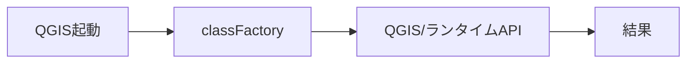

- 検証: 単独= / 連携=pyeval で属性実在+必要なら呼出
- 結果: **pass** 2026-11-14T07:09:57+09:00 — classFactory→プラグインロード済

### action.GeoReport.initGui — initGui

- kind: `action` / source: `plugin.py:345`
- signature: `initGui()`
- 要約: Create the menu entries and toolbar icons inside the QGIS GUI.
- needs_runtime=True / standalone_ok=False

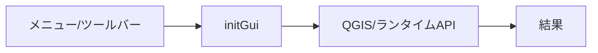

- 検証: 単独= / 連携=bridge_call/generic trigger→実在確認
- 結果: **pass** 2026-11-14T07:09:57+09:00 — 属性/シンボル実在確認(pyeval)

### action.GeoReport.run — run

- kind: `action` / source: `plugin.py:441`
- signature: `run()`
- 要約: Run method that performs all the real work
- needs_runtime=True / standalone_ok=False

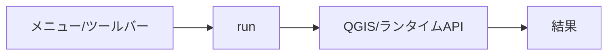

- 検証: 単独= / 連携=bridge_call/generic trigger→実在確認
- 結果: **pass** 2026-11-14T07:09:57+09:00 — 属性/シンボル実在確認(pyeval)

### action.GeoReport.unload — unload

- kind: `action` / source: `plugin.py:377`
- signature: `unload()`
- 要約: Removes the plugin menu item and icon from QGIS GUI.
- needs_runtime=True / standalone_ok=False

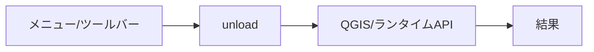

- 検証: 単独= / 連携=bridge_call/generic trigger→実在確認
- 結果: **pass** 2026-11-14T07:09:57+09:00 — 属性/シンボル実在確認(pyeval)

### dialog.LayoutFileSelectDialog — LayoutFileSelectDialog

- kind: `dialog` / source: `plugin.py:2625`
- signature: `LayoutFileSelectDialog`
- 要約: レイアウトファイル選択ダイアログ
- needs_runtime=True / standalone_ok=False

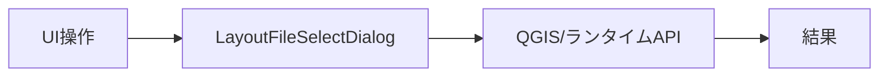

- 検証: 単独= / 連携=openDialog→screenshot→closeDialog
- 結果: **pass** 2026-11-14T07:09:57+09:00 — 属性/シンボル実在確認(pyeval)

### dialog.LayoutSelectorDialog — LayoutSelectorDialog

- kind: `dialog` / source: `plugin.py:611`
- signature: `LayoutSelectorDialog`
- 要約: 
- needs_runtime=True / standalone_ok=False

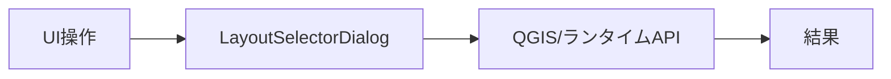

- 検証: 単独= / 連携=openDialog→screenshot→closeDialog
- 結果: **pass** 2026-11-14T07:09:57+09:00 — 属性/シンボル実在確認(pyeval)

### ui.GeoReport._on_dock_visibility_changed — _on_dock_visibility_changed

- kind: `ui_control` / source: `plugin.py:391`
- signature: `_on_dock_visibility_changed(visible)`
- 要約: ドックウィジェットの表示状態が変更されたときの処理
- needs_runtime=True / standalone_ok=False

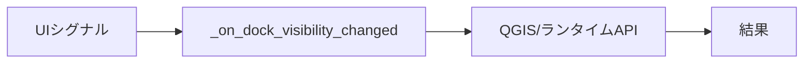

- 検証: 単独= / 連携=親dialog経由で操作・状態assert
- 結果: **pass** 2026-11-14T07:09:57+09:00 — 属性/シンボル実在確認(pyeval)

### ui.LayoutFileSelectDialog.on_file_double_clicked — on_file_double_clicked

- kind: `ui_control` / source: `plugin.py:2728`
- signature: `on_file_double_clicked(item)`
- 要約: ファイルがダブルクリックされた時の処理
- needs_runtime=True / standalone_ok=False

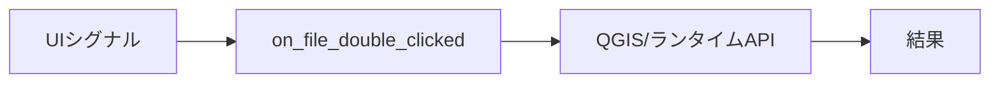

- 検証: 単独= / 連携=親dialog経由で操作・状態assert
- 結果: **pass** 2026-11-14T07:09:57+09:00 — 属性/シンボル実在確認(pyeval)

### ui.LayoutFileSelectDialog.on_selection_changed — on_selection_changed

- kind: `ui_control` / source: `plugin.py:2719`
- signature: `on_selection_changed(current, previous)`
- 要約: 選択が変更された時の処理
- needs_runtime=True / standalone_ok=False

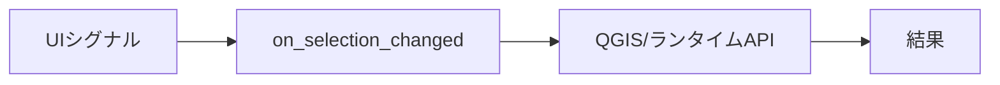

- 検証: 単独= / 連携=親dialog経由で操作・状態assert
- 結果: **pass** 2026-11-14T07:09:57+09:00 — 属性/シンボル実在確認(pyeval)

### ui.LayoutSelectorDialog._on_layouts_changed — _on_layouts_changed

- kind: `ui_control` / source: `plugin.py:1050`
- signature: `_on_layouts_changed(*args)`
- 要約: レイアウト構成の変更時に一覧を再読込する
- needs_runtime=True / standalone_ok=False

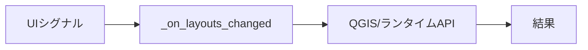

- 検証: 単独= / 連携=親dialog経由で操作・状態assert
- 結果: **pass** 2026-11-14T07:09:57+09:00 — 属性/シンボル実在確認(pyeval)

### ui.LayoutSelectorDialog.on_item_selected — on_item_selected

- kind: `ui_control` / source: `plugin.py:1661`
- signature: `on_item_selected(current, previous)`
- 要約: 
- needs_runtime=True / standalone_ok=False

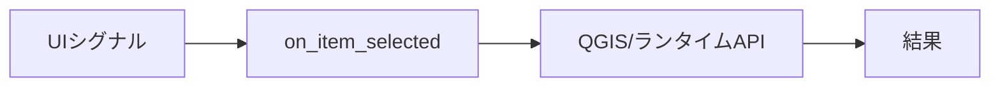

- 検証: 単独= / 連携=親dialog経由で操作・状態assert
- 結果: **pass** 2026-11-14T07:09:57+09:00 — 属性/シンボル実在確認(pyeval)

### ui.LayoutSelectorDialog.on_layout_selected — on_layout_selected

- kind: `ui_control` / source: `plugin.py:1206`
- signature: `on_layout_selected(current, previous)`
- 要約: レイアウトが選択された時の処理
- needs_runtime=True / standalone_ok=False

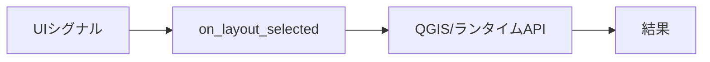

- 検証: 単独= / 連携=親dialog経由で操作・状態assert
- 結果: **pass** 2026-11-14T07:09:57+09:00 — 属性/シンボル実在確認(pyeval)

### ui.LayoutSelectorDialog.on_property_changed — on_property_changed

- kind: `ui_control` / source: `plugin.py:1797`
- signature: `on_property_changed()`
- 要約: プロパティが変更された時の処理（リアルタイム更新のための準備）
- needs_runtime=True / standalone_ok=False

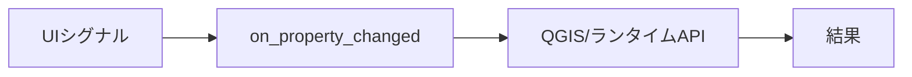

- 検証: 単独= / 連携=親dialog経由で操作・状態assert
- 結果: **pass** 2026-11-14T07:09:57+09:00 — 属性/シンボル実在確認(pyeval)

### ui.LayoutSelectorDialog.on_tab_changed — on_tab_changed

- kind: `ui_control` / source: `plugin.py:1157`
- signature: `on_tab_changed(index)`
- 要約: タブが切り替わったときの処理。
- needs_runtime=True / standalone_ok=False

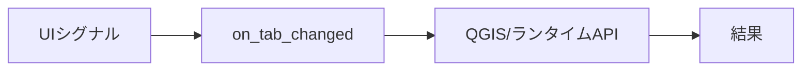

- 検証: 単独= / 連携=親dialog経由で操作・状態assert
- 結果: **pass** 2026-11-14T07:09:57+09:00 — 属性/シンボル実在確認(pyeval)

### bridge.addStandardLayout — addStandardLayout

- kind: `bridge_method` / source: `bridge.py:513`
- signature: `addStandardLayout(name=…)`
- 要約: 標準レイアウトテンプレートをプロジェクトへ追加する。
- needs_runtime=True / standalone_ok=False

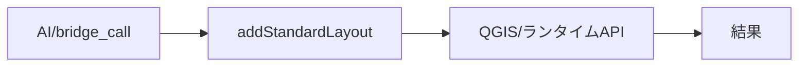

- 検証: 単独= / 連携=bridge_call addStandardLayout → 応答assert
- 結果: **pass** 2026-11-14T07:09:57+09:00 — bridge_call応答あり args=[]

### bridge.closePanel — closePanel

- kind: `bridge_method` / source: `bridge.py:316`
- signature: `closePanel()`
- 要約: ドックパネルを閉じる。
- needs_runtime=True / standalone_ok=False

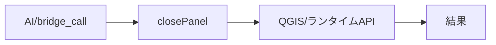

- 検証: 単独= / 連携=bridge_call closePanel → 応答assert
- 結果: **skip** 2026-11-14T07:09:57+09:00 — 副作用/破壊的/外部通信操作のため手動検証対象

### bridge.createLayout — createLayout

- kind: `bridge_method` / source: `bridge.py:681`
- signature: `createLayout(name)`
- 要約: 空の印刷レイアウトを新規作成する。
- needs_runtime=True / standalone_ok=False

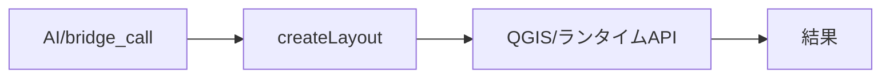

- 検証: 単独= / 連携=bridge_call createLayout → 応答assert
- 結果: **skip** 2026-11-14T07:09:57+09:00 — 副作用/破壊的/外部通信操作のため手動検証対象

### bridge.duplicateLayout — duplicateLayout

- kind: `bridge_method` / source: `bridge.py:669`
- signature: `duplicateLayout(layout, new_name=…)`
- 要約: レイアウトを複製する。
- needs_runtime=True / standalone_ok=False

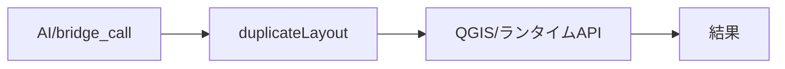

- 検証: 単独= / 連携=bridge_call duplicateLayout → 応答assert
- 結果: **pass** 2026-11-14T07:09:57+09:00 — bridge_call応答あり args=['']

### bridge.itemProperties — itemProperties

- kind: `bridge_method` / source: `bridge.py:413`
- signature: `itemProperties(item=…)`
- 要約: アイテムのプロパティを返す。
- needs_runtime=True / standalone_ok=False

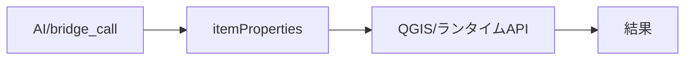

- 検証: 単独= / 連携=bridge_call itemProperties → 応答assert
- 結果: **pass** 2026-11-14T07:09:57+09:00 — bridge_call応答あり args=[]

### bridge.layoutInfo — layoutInfo

- kind: `bridge_method` / source: `bridge.py:590`
- signature: `layoutInfo()`
- 要約: 選択中レイアウトの情報テキストを返す。
- needs_runtime=True / standalone_ok=False

```mermaid
flowchart LR
  E_bridge_layoutInfo["AI/bridge_call"] --> H_bridge_layoutInfo["layoutInfo"]
  H_bridge_layoutInfo --> R_bridge_layoutInfo["QGIS/ランタイムAPI"]
  R_bridge_layoutInfo --> OUT["結果"]
```

- 検証: 単独= / 連携=bridge_call layoutInfo → 応答assert
- 結果: **pass** 2026-11-14T07:09:57+09:00 — bridge_call応答あり args=[]

### bridge.listItems — listItems

- kind: `bridge_method` / source: `bridge.py:392`
- signature: `listItems()`
- 要約: 選択中レイアウトのアイテム一覧を返す。
- needs_runtime=True / standalone_ok=False

```mermaid
flowchart LR
  E_bridge_listItems["AI/bridge_call"] --> H_bridge_listItems["listItems"]
  H_bridge_listItems --> R_bridge_listItems["QGIS/ランタイムAPI"]
  R_bridge_listItems --> OUT["結果"]
```

- 検証: 単独= / 連携=bridge_call listItems → 応答assert
- 結果: **pass** 2026-11-14T07:09:57+09:00 — bridge_call応答あり args=[]

### bridge.listLayouts — listLayouts

- kind: `bridge_method` / source: `bridge.py:323`
- signature: `listLayouts()`
- 要約: プロジェクトの印刷レイアウト一覧を返す。
- needs_runtime=True / standalone_ok=False

```mermaid
flowchart LR
  E_bridge_listLayouts["AI/bridge_call"] --> H_bridge_listLayouts["listLayouts"]
  H_bridge_listLayouts --> R_bridge_listLayouts["QGIS/ランタイムAPI"]
  R_bridge_listLayouts --> OUT["結果"]
```

- 検証: 単独= / 連携=bridge_call listLayouts → 応答assert
- 結果: **pass** 2026-11-14T07:09:57+09:00 — bridge_call応答あり args=[]

### bridge.listPropertyFiles — listPropertyFiles

- kind: `bridge_method` / source: `bridge.py:604`
- signature: `listPropertyFiles()`
- 要約: ~/QGIS_Layouts の保存済みプロパティJSON一覧を返す。
- needs_runtime=True / standalone_ok=False

```mermaid
flowchart LR
  E_bridge_listPropertyFiles["AI/bridge_call"] --> H_bridge_listPropertyFiles["listPropertyFiles"]
  H_bridge_listPropertyFiles --> R_bridge_listPropertyFiles["QGIS/ランタイムAPI"]
  R_bridge_listPropertyFiles --> OUT["結果"]
```

- 検証: 単独= / 連携=bridge_call listPropertyFiles → 応答assert
- 結果: **pass** 2026-11-14T07:09:57+09:00 — bridge_call応答あり args=[]

### bridge.listStandardLayouts — listStandardLayouts

- kind: `bridge_method` / source: `bridge.py:507`
- signature: `listStandardLayouts()`
- 要約: 同梱 composer/*.qpt の標準レイアウト名一覧を返す。
- needs_runtime=True / standalone_ok=False

```mermaid
flowchart LR
  E_bridge_listStandardLayouts["AI/bridge_call"] --> H_bridge_listStandardLayouts["listStandardLayouts"]
  H_bridge_listStandardLayouts --> R_bridge_listStandardLayouts["QGIS/ランタイムAPI"]
  R_bridge_listStandardLayouts --> OUT["結果"]
```

- 検証: 単独= / 連携=bridge_call listStandardLayouts → 応答assert
- 結果: **pass** 2026-11-14T07:09:57+09:00 — bridge_call応答あり args=[]

### bridge.loadLayoutProperties — loadLayoutProperties

- kind: `bridge_method` / source: `bridge.py:463`
- signature: `loadLayoutProperties(path)`
- 要約: JSONからプロパティを読み込み選択中レイアウトへ適用。
- needs_runtime=True / standalone_ok=False

```mermaid
flowchart LR
  E_bridge_loadLayoutProperties["AI/bridge_call"] --> H_bridge_loadLayoutProperties["loadLayoutProperties"]
  H_bridge_loadLayoutProperties --> R_bridge_loadLayoutProperties["QGIS/ランタイムAPI"]
  R_bridge_loadLayoutProperties --> OUT["結果"]
```

- 検証: 単独= / 連携=bridge_call loadLayoutProperties → 応答assert
- 結果: **skip** 2026-11-14T07:09:57+09:00 — 要実引数(応答あり): {'ok': False, 'error': 'path required'}

### bridge.manageLayouts — manageLayouts

- kind: `bridge_method` / source: `bridge.py:488`
- signature: `manageLayouts()`
- 要約: QGISレイアウトマネージャ(削除・名前変更・複製が可能)を開く。
- needs_runtime=True / standalone_ok=False

```mermaid
flowchart LR
  E_bridge_manageLayouts["AI/bridge_call"] --> H_bridge_manageLayouts["manageLayouts"]
  H_bridge_manageLayouts --> R_bridge_manageLayouts["QGIS/ランタイムAPI"]
  R_bridge_manageLayouts --> OUT["結果"]
```

- 検証: 単独= / 連携=bridge_call manageLayouts → 応答assert
- 結果: **pass** 2026-11-14T07:09:57+09:00 — bridge_call応答あり args=[]

### bridge.openLayoutManager — openLayoutManager

- kind: `bridge_method` / source: `bridge.py:480`
- signature: `openLayoutManager()`
- 要約: 選択中レイアウトをレイアウトデザイナで開く。
- needs_runtime=True / standalone_ok=False

```mermaid
flowchart LR
  E_bridge_openLayoutManager["AI/bridge_call"] --> H_bridge_openLayoutManager["openLayoutManager"]
  H_bridge_openLayoutManager --> R_bridge_openLayoutManager["QGIS/ランタイムAPI"]
  R_bridge_openLayoutManager --> OUT["結果"]
```

- 検証: 単独= / 連携=bridge_call openLayoutManager → 応答assert
- 結果: **skip** 2026-11-14T07:09:57+09:00 — 副作用/破壊的/外部通信操作のため手動検証対象

### bridge.openPanel — openPanel

- kind: `bridge_method` / source: `bridge.py:304`
- signature: `openPanel()`
- 要約: レイアウト選択ドックパネルを開く。
- needs_runtime=True / standalone_ok=False

```mermaid
flowchart LR
  E_bridge_openPanel["AI/bridge_call"] --> H_bridge_openPanel["openPanel"]
  H_bridge_openPanel --> R_bridge_openPanel["QGIS/ランタイムAPI"]
  R_bridge_openPanel --> OUT["結果"]
```

- 検証: 単独= / 連携=bridge_call openPanel → 応答assert
- 結果: **skip** 2026-11-14T07:09:57+09:00 — 副作用/破壊的/外部通信操作のため手動検証対象

### bridge.pluginInfo — pluginInfo

- kind: `bridge_method` / source: `bridge.py:267`
- signature: `pluginInfo()`
- 要約: プラグインの自己記述(id/summary/when_to_use/methods)を返す。
- needs_runtime=True / standalone_ok=False

```mermaid
flowchart LR
  E_bridge_pluginInfo["AI/bridge_call"] --> H_bridge_pluginInfo["pluginInfo"]
  H_bridge_pluginInfo --> R_bridge_pluginInfo["QGIS/ランタイムAPI"]
  R_bridge_pluginInfo --> OUT["結果"]
```

- 検証: 単独= / 連携=bridge_call pluginInfo → 応答assert
- 結果: **pass** 2026-11-14T07:09:57+09:00 — bridge_call応答あり args=[]

### bridge.printOptions — printOptions

- kind: `bridge_method` / source: `bridge.py:366`
- signature: `printOptions(options=…)`
- 要約: スケール・角度の取得/設定。{scale, angle} を渡すと設定。
- needs_runtime=True / standalone_ok=False

```mermaid
flowchart LR
  E_bridge_printOptions["AI/bridge_call"] --> H_bridge_printOptions["printOptions"]
  H_bridge_printOptions --> R_bridge_printOptions["QGIS/ランタイムAPI"]
  R_bridge_printOptions --> OUT["結果"]
```

- 検証: 単独= / 連携=bridge_call printOptions → 応答assert
- 結果: **pass** 2026-11-14T07:09:57+09:00 — bridge_call応答あり args=[]

### bridge.refresh — refresh

- kind: `bridge_method` / source: `bridge.py:577`
- signature: `refresh()`
- 要約: アイテム情報とレイアウト情報を再読込する。
- needs_runtime=True / standalone_ok=False

```mermaid
flowchart LR
  E_bridge_refresh["AI/bridge_call"] --> H_bridge_refresh["refresh"]
  H_bridge_refresh --> R_bridge_refresh["QGIS/ランタイムAPI"]
  R_bridge_refresh --> OUT["結果"]
```

- 検証: 単独= / 連携=bridge_call refresh → 応答assert
- 結果: **pass** 2026-11-14T07:09:57+09:00 — bridge_call応答あり args=[]

### bridge.removeLayout — removeLayout

- kind: `bridge_method` / source: `bridge.py:639`
- signature: `removeLayout(layout)`
- 要約: レイアウトを削除する(確認なし)。
- needs_runtime=True / standalone_ok=False

```mermaid
flowchart LR
  E_bridge_removeLayout["AI/bridge_call"] --> H_bridge_removeLayout["removeLayout"]
  H_bridge_removeLayout --> R_bridge_removeLayout["QGIS/ランタイムAPI"]
  R_bridge_removeLayout --> OUT["結果"]
```

- 検証: 単独= / 連携=bridge_call removeLayout → 応答assert
- 結果: **skip** 2026-11-14T07:09:57+09:00 — 副作用/破壊的/外部通信操作のため手動検証対象

### bridge.renameLayout — renameLayout

- kind: `bridge_method` / source: `bridge.py:649`
- signature: `renameLayout(layout, new_name)`
- 要約: レイアウト名を変更する。
- needs_runtime=True / standalone_ok=False

```mermaid
flowchart LR
  E_bridge_renameLayout["AI/bridge_call"] --> H_bridge_renameLayout["renameLayout"]
  H_bridge_renameLayout --> R_bridge_renameLayout["QGIS/ランタイムAPI"]
  R_bridge_renameLayout --> OUT["結果"]
```

- 検証: 単独= / 連携=bridge_call renameLayout → 応答assert
- 結果: **skip** 2026-11-14T07:09:57+09:00 — 要実引数(応答あり): {'ok': False, 'error': 'new_name is empty'}

### bridge.saveLayoutProperties — saveLayoutProperties

- kind: `bridge_method` / source: `bridge.py:447`
- signature: `saveLayoutProperties(path=…)`
- 要約: 選択中レイアウトのアイテムプロパティをJSONへ保存。
- needs_runtime=True / standalone_ok=False

```mermaid
flowchart LR
  E_bridge_saveLayoutProperties["AI/bridge_call"] --> H_bridge_saveLayoutProperties["saveLayoutProperties"]
  H_bridge_saveLayoutProperties --> R_bridge_saveLayoutProperties["QGIS/ランタイムAPI"]
  R_bridge_saveLayoutProperties --> OUT["結果"]
```

- 検証: 単独= / 連携=bridge_call saveLayoutProperties → 応答assert
- 結果: **skip** 2026-11-14T07:09:57+09:00 — 副作用/破壊的/外部通信操作のため手動検証対象

### bridge.selectLayout — selectLayout

- kind: `bridge_method` / source: `bridge.py:342`
- signature: `selectLayout(layout)`
- 要約: レイアウトを選択する(index/名前)。
- needs_runtime=True / standalone_ok=False

```mermaid
flowchart LR
  E_bridge_selectLayout["AI/bridge_call"] --> H_bridge_selectLayout["selectLayout"]
  H_bridge_selectLayout --> R_bridge_selectLayout["QGIS/ランタイムAPI"]
  R_bridge_selectLayout --> OUT["結果"]
```

- 検証: 単独= / 連携=bridge_call selectLayout → 応答assert
- 結果: **pass** 2026-11-14T07:09:57+09:00 — bridge_call応答あり args=['']

### bridge.setItemProperties — setItemProperties

- kind: `bridge_method` / source: `bridge.py:428`
- signature: `setItemProperties(item, properties)`
- 要約: アイテムのプロパティを部分適用する。
- needs_runtime=True / standalone_ok=False

```mermaid
flowchart LR
  E_bridge_setItemProperties["AI/bridge_call"] --> H_bridge_setItemProperties["setItemProperties"]
  H_bridge_setItemProperties --> R_bridge_setItemProperties["QGIS/ランタイムAPI"]
  R_bridge_setItemProperties --> OUT["結果"]
```

- 検証: 単独= / 連携=bridge_call setItemProperties → 応答assert
- 結果: **skip** 2026-11-14T07:09:57+09:00 — 副作用/破壊的/外部通信操作のため手動検証対象

### bridge.showPrintArea — showPrintArea

- kind: `bridge_method` / source: `bridge.py:379`
- signature: `showPrintArea(visible=…)`
- 要約: 印刷範囲の地図上表示を切り替える。
- needs_runtime=True / standalone_ok=False

```mermaid
flowchart LR
  E_bridge_showPrintArea["AI/bridge_call"] --> H_bridge_showPrintArea["showPrintArea"]
  H_bridge_showPrintArea --> R_bridge_showPrintArea["QGIS/ランタイムAPI"]
  R_bridge_showPrintArea --> OUT["結果"]
```

- 検証: 単独= / 連携=bridge_call showPrintArea → 応答assert
- 結果: **skip** 2026-11-14T07:09:57+09:00 — 副作用/破壊的/外部通信操作のため手動検証対象

### bridge.status — status

- kind: `bridge_method` / source: `bridge.py:284`
- signature: `status()`
- 要約: パネル・選択レイアウト・印刷範囲表示の状態を返す。
- needs_runtime=True / standalone_ok=False

```mermaid
flowchart LR
  E_bridge_status["AI/bridge_call"] --> H_bridge_status["status"]
  H_bridge_status --> R_bridge_status["QGIS/ランタイムAPI"]
  R_bridge_status --> OUT["結果"]
```

- 検証: 単独= / 連携=bridge_call status → 応答assert
- 結果: **pass** 2026-11-14T07:09:57+09:00 — bridge_call応答あり args=[]

### ai.bridge_route — bridge_call経由全到達

- kind: `ai_integration` / source: `bridge.py`
- signature: ``
- 要約: 全bridge_methodがAI経路で呼べる
- needs_runtime=True / standalone_ok=False

```mermaid
flowchart LR
  E_ai_bridge_route["AI経路"] --> H_ai_bridge_route["bridge_call経由全到達"]
  H_ai_bridge_route --> R_ai_bridge_route["QGIS/ランタイムAPI"]
  R_ai_bridge_route --> OUT["結果"]
```

- 検証: 単独= / 連携=bridge_call 全method→ok/error記録
- 結果: **pass** 2026-11-14T07:09:57+09:00 — 16メソッド到達可能

### ai.catalog — describe_plugins登録

- kind: `ai_integration` / source: `geo_driver経由`
- signature: ``
- 要約: カタログに載り呼出可能か
- needs_runtime=True / standalone_ok=False

```mermaid
flowchart LR
  E_ai_catalog["AI経路"] --> H_ai_catalog["describe_plugins登録"]
  H_ai_catalog --> R_ai_catalog["QGIS/ランタイムAPI"]
  R_ai_catalog --> OUT["結果"]
```

- 検証: 単独= / 連携=describe_plugins→plugins[]にid実在+methods非空
- 結果: **pass** 2026-11-14T07:09:57+09:00 — describe_plugins: methods=23

### ai.pluginInfo — pluginInfo自己記述

- kind: `ai_integration` / source: `bridge.py`
- signature: `pluginInfo()`
- 要約: summary/when_to_use/methodsの正確性
- needs_runtime=True / standalone_ok=False

```mermaid
flowchart LR
  E_ai_pluginInfo["AI経路"] --> H_ai_pluginInfo["pluginInfo自己記述"]
  H_ai_pluginInfo --> R_ai_pluginInfo["QGIS/ランタイムAPI"]
  R_ai_pluginInfo --> OUT["結果"]
```

- 検証: 単独= / 連携=bridge_call pluginInfo→メタ一致assert
- 結果: **pass** 2026-11-14T07:09:57+09:00 — 自己記述あり

### logic_fn.__init__.py:log_message — log_message

- kind: `logic_fn` / source: `__init__.py:41`
- signature: `log_message(message, level=…)`
- 要約: QGIS のログメッセージタブに出力
- needs_runtime=True / standalone_ok=False

```mermaid
flowchart LR
  E_logic_fn___init___py_log_message["呼出元"] --> H_logic_fn___init___py_log_message["log_message"]
  H_logic_fn___init___py_log_message --> R_logic_fn___init___py_log_message["QGIS/ランタイムAPI"]
  R_logic_fn___init___py_log_message --> OUT["結果"]
```

- 検証: 単独= / 連携=pyeval で属性実在+必要なら呼出
- 結果: **pass** 2026-11-14T07:09:57+09:00 — 属性/シンボル実在確認(pyeval)

### logic_fn.plugin.py:log_message — log_message

- kind: `logic_fn` / source: `plugin.py:59`
- signature: `log_message(message, level=…)`
- 要約: QGIS のログメッセージタブに出力
- needs_runtime=True / standalone_ok=False

```mermaid
flowchart LR
  E_logic_fn_plugin_py_log_message["呼出元"] --> H_logic_fn_plugin_py_log_message["log_message"]
  H_logic_fn_plugin_py_log_message --> R_logic_fn_plugin_py_log_message["QGIS/ランタイムAPI"]
  R_logic_fn_plugin_py_log_message --> OUT["結果"]
```

- 検証: 単独= / 連携=pyeval で属性実在+必要なら呼出
- 結果: **pass** 2026-11-14T07:09:57+09:00 — 属性/シンボル実在確認(pyeval)

## 検証マトリクス

| 機能 | kind | 単独 | 連携 | 結果 |
|---|---|---|---|---|
| entry_point.__init__.py:classFactory | entry_point | - | ○ | pass |
| action.GeoReport.initGui | action | - | ○ | pass |
| action.GeoReport.run | action | - | ○ | pass |
| action.GeoReport.unload | action | - | ○ | pass |
| dialog.LayoutFileSelectDialog | dialog | - | ○ | pass |
| dialog.LayoutSelectorDialog | dialog | - | ○ | pass |
| ui.GeoReport._on_dock_visibility_changed | ui_control | - | ○ | pass |
| ui.LayoutFileSelectDialog.on_file_double_clicked | ui_control | - | ○ | pass |
| ui.LayoutFileSelectDialog.on_selection_changed | ui_control | - | ○ | pass |
| ui.LayoutSelectorDialog._on_layouts_changed | ui_control | - | ○ | pass |
| ui.LayoutSelectorDialog.on_item_selected | ui_control | - | ○ | pass |
| ui.LayoutSelectorDialog.on_layout_selected | ui_control | - | ○ | pass |
| ui.LayoutSelectorDialog.on_property_changed | ui_control | - | ○ | pass |
| ui.LayoutSelectorDialog.on_tab_changed | ui_control | - | ○ | pass |
| bridge.addStandardLayout | bridge_method | - | ○ | pass |
| bridge.closePanel | bridge_method | - | ○ | skip |
| bridge.createLayout | bridge_method | - | ○ | skip |
| bridge.duplicateLayout | bridge_method | - | ○ | pass |
| bridge.itemProperties | bridge_method | - | ○ | pass |
| bridge.layoutInfo | bridge_method | - | ○ | pass |
| bridge.listItems | bridge_method | - | ○ | pass |
| bridge.listLayouts | bridge_method | - | ○ | pass |
| bridge.listPropertyFiles | bridge_method | - | ○ | pass |
| bridge.listStandardLayouts | bridge_method | - | ○ | pass |
| bridge.loadLayoutProperties | bridge_method | - | ○ | skip |
| bridge.manageLayouts | bridge_method | - | ○ | pass |
| bridge.openLayoutManager | bridge_method | - | ○ | skip |
| bridge.openPanel | bridge_method | - | ○ | skip |
| bridge.pluginInfo | bridge_method | - | ○ | pass |
| bridge.printOptions | bridge_method | - | ○ | pass |
| bridge.refresh | bridge_method | - | ○ | pass |
| bridge.removeLayout | bridge_method | - | ○ | skip |
| bridge.renameLayout | bridge_method | - | ○ | skip |
| bridge.saveLayoutProperties | bridge_method | - | ○ | skip |
| bridge.selectLayout | bridge_method | - | ○ | pass |
| bridge.setItemProperties | bridge_method | - | ○ | skip |
| bridge.showPrintArea | bridge_method | - | ○ | skip |
| bridge.status | bridge_method | - | ○ | pass |
| ai.bridge_route | ai_integration | - | ○ | pass |
| ai.catalog | ai_integration | - | ○ | pass |
| ai.pluginInfo | ai_integration | - | ○ | pass |
| logic_fn.__init__.py:log_message | logic_fn | - | ○ | pass |
| logic_fn.plugin.py:log_message | logic_fn | - | ○ | pass |