# geo_search — 完全ロジックシート

- 種別: qgis_plugin / バージョン: 4.4.10
- 生成: 2026-11-14T07:09:57+09:00 / 機能数: 74

## トポロジ

```mermaid
flowchart LR
  subgraph ENTRY["操作入口"]
    UI["メニュー/ダイアログ"]
    AI["AI/bridge_call"]
  end
  subgraph LOGIC["実装"]
    entry_point___init___py_classFactory["classFactory<br/><i>entry_point</i>"]
    action_SearchFeature_unload["unload<br/><i>action</i>"]
    action_SearchOwnerFeature_unload["unload<br/><i>action</i>"]
    action_SearchTextFeature_unload["unload<br/><i>action</i>"]
    action_SearchTibanFeature_unload["unload<br/><i>action</i>"]
    action_plugin_initGui["initGui<br/><i>action</i>"]
    action_plugin_run["run<br/><i>action</i>"]
    action_plugin_unload["unload<br/><i>action</i>"]
    dialog_ResultDialog["ResultDialog<br/><i>dialog</i>"]
    dialog_SearchDialog["SearchDialog<br/><i>dialog</i>"]
    dialog_SearchWidget["SearchWidget<br/><i>dialog</i>"]
    dialog_SettingsDialog["SettingsDialog<br/><i>dialog</i>"]
    ui_ResultDialog__on_tab_changed["_on_tab_changed<br/><i>ui_control</i>"]
    ui_plugin__on_additive_toggled["_on_additive_toggled<br/><i>ui_control</i>"]
    ui_plugin__on_map_themes_changed["_on_map_themes_changed<br/><i>ui_control</i>"]
    ui_plugin__on_theme_collection_changed["_on_theme_collection_changed<br/><i>ui_control</i>"]
    ui_plugin_on_group_changed["on_group_changed<br/><i>ui_control</i>"]
    ui_plugin_on_project_saved["on_project_saved<br/><i>ui_control</i>"]
    bridge_addTab["addTab<br/><i>bridge_method</i>"]
    bridge_addTabFromCurrentLayer["addTabFromCurrentLayer<br/><i>bridge_method</i>"]
    bridge_applyTheme["applyTheme<br/><i>bridge_method</i>"]
    bridge_closeDialog["closeDialog<br/><i>bridge_method</i>"]
    bridge_getSettings["getSettings<br/><i>bridge_method</i>"]
    bridge_listTabs["listTabs<br/><i>bridge_method</i>"]
    bridge_listThemes["listThemes<br/><i>bridge_method</i>"]
    bridge_loadUserTheme["loadUserTheme<br/><i>bridge_method</i>"]
    bridge_openDialog["openDialog<br/><i>bridge_method</i>"]
    bridge_openSettings["openSettings<br/><i>bridge_method</i>"]
    bridge_pluginInfo["pluginInfo<br/><i>bridge_method</i>"]
    bridge_reloadDialog["reloadDialog<br/><i>bridge_method</i>"]
    bridge_removeTab["removeTab<br/><i>bridge_method</i>"]
    bridge_resultDisplayMode["resultDisplayMode<br/><i>bridge_method</i>"]
    bridge_resultPage["resultPage<br/><i>bridge_method</i>"]
    bridge_results["results<br/><i>bridge_method</i>"]
    bridge_saveUserTheme["saveUserTheme<br/><i>bridge_method</i>"]
    bridge_search["search<br/><i>bridge_method</i>"]
    bridge_searchOptions["searchOptions<br/><i>bridge_method</i>"]
    bridge_selectTab["selectTab<br/><i>bridge_method</i>"]
    bridge_setSettings["setSettings<br/><i>bridge_method</i>"]
    bridge_setTabSetting["setTabSetting<br/><i>bridge_method</i>"]
    bridge_status["status<br/><i>bridge_method</i>"]
    bridge_suggest["suggest<br/><i>bridge_method</i>"]
    bridge_tabOptions["tabOptions<br/><i>bridge_method</i>"]
    bridge_tabSetting["tabSetting<br/><i>bridge_method</i>"]
    bridge_themeAdditive["themeAdditive<br/><i>bridge_method</i>"]
    bridge_zoom["zoom<br/><i>bridge_method</i>"]
    ai_bridge_route["bridge_call経由全到達<br/><i>ai_integration</i>"]
    ai_catalog["describe_plugins登録<br/><i>ai_integration</i>"]
    ai_pluginInfo["pluginInfo自己記述<br/><i>ai_integration</i>"]
    ai_prompt_search_features["同梱おすすめプロンプト search-features<br/><i>ai_integration</i>"]
    logic_fn_log_py_log_message["log_message<br/><i>logic_fn</i>"]
    logic_fn_theme_py_apply_legend_visibility["apply_legend_visibility<br/><i>logic_fn</i>"]
    logic_fn_theme_py_apply_theme["apply_theme<br/><i>logic_fn</i>"]
    logic_fn_theme_py_apply_user_theme["apply_user_theme<br/><i>logic_fn</i>"]
    logic_fn_theme_py_collect_visible_layer_reload["collect_visible_layer_reload<br/><i>logic_fn</i>"]
    logic_fn_theme_py_collect_visible_layer_snapshot["collect_visible_layer_snapshot<br/><i>logic_fn</i>"]
    logic_fn_theme_py_get_layer_legend_state["get_layer_legend_state<br/><i>logic_fn</i>"]
    logic_fn_theme_py_get_visible_layer_snapshot["get_visible_layer_snapshot<br/><i>logic_fn</i>"]
    logic_fn_theme_py_group_themes["group_themes<br/><i>logic_fn</i>"]
    logic_fn_theme_py_list_visible_layer_snapshots["list_visible_layer_snapshots<br/><i>logic_fn</i>"]
    logic_fn_theme_py_load_user_theme["load_user_theme<br/><i>logic_fn</i>"]
    logic_fn_theme_py_log_layer_legend_state["log_layer_legend_state<br/><i>logic_fn</i>"]
    logic_fn_theme_py_log_layer_legend_state_by_name["log_layer_legend_state_by_name<br/><i>logic_fn</i>"]
    logic_fn_theme_py_parse_theme_group["parse_theme_group<br/><i>logic_fn</i>"]
    logic_fn_theme_py_remove_temp_theme["remove_temp_theme<br/><i>logic_fn</i>"]
    logic_fn_theme_py_restore_temp_theme["restore_temp_theme<br/><i>logic_fn</i>"]
    logic_fn_theme_py_save_current_state_as_temp_theme["save_current_state_as_temp_theme<br/><i>logic_fn</i>"]
    logic_fn_theme_py_save_user_theme["save_user_theme<br/><i>logic_fn</i>"]
    logic_fn_utils_py_get_feature_by_id["get_feature_by_id<br/><i>logic_fn</i>"]
    logic_fn_utils_py_name2layer["name2layer<br/><i>logic_fn</i>"]
    logic_fn_utils_py_name2layers["name2layers<br/><i>logic_fn</i>"]
    logic_fn_utils_py_remove_entry_from_json_file["remove_entry_from_json_file<br/><i>logic_fn</i>"]
    logic_fn_utils_py_set_project_variable["set_project_variable<br/><i>logic_fn</i>"]
    logic_fn_utils_py_unique_values["unique_values<br/><i>logic_fn</i>"]
  end
  AI --> bridge_addTab & bridge_addTabFromCurrentLayer & bridge_applyTheme & bridge_closeDialog & bridge_getSettings & bridge_listTabs & bridge_listThemes & bridge_loadUserTheme …
  UI --> action_SearchFeature_unload & action_SearchOwnerFeature_unload & action_SearchTextFeature_unload & action_SearchTibanFeature_unload & action_plugin_initGui & action_plugin_run & action_plugin_unload & dialog_ResultDialog …
  LOGIC --> QGIS["QGIS API / iface / QgsProject"]
```

## 機能別ロジック

### entry_point.__init__.py:classFactory — classFactory

- kind: `entry_point` / source: `__init__.py:8`
- signature: `classFactory(iface)`
- 要約: 
- needs_runtime=False / standalone_ok=True

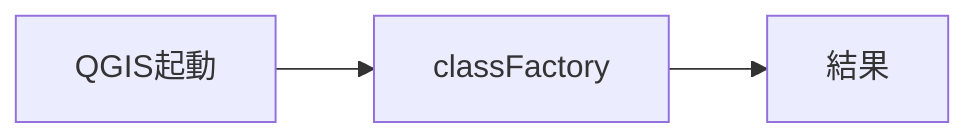

- 検証: 単独=import→呼出→戻り値assert / 連携=pyeval で属性実在+必要なら呼出
- 結果: **pass** 2026-11-14T07:09:57+09:00 — standalone経路のみ(要runtime依存無し)

### action.SearchFeature.unload — unload

- kind: `action` / source: `searchfeature.py:288`
- signature: `unload()`
- 要約: 
- needs_runtime=True / standalone_ok=False

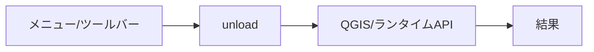

- 検証: 単独= / 連携=bridge_call/generic trigger→実在確認
- 結果: **pass** 2026-11-14T07:09:57+09:00 — 属性/シンボル実在確認(pyeval)

### action.SearchOwnerFeature.unload — unload

- kind: `action` / source: `searchfeature.py:2003`
- signature: `unload()`
- 要約: 
- needs_runtime=True / standalone_ok=False


- 検証: 単独= / 連携=bridge_call/generic trigger→実在確認
- 結果: **pass** 2026-11-14T07:09:57+09:00 — 属性/シンボル実在確認(pyeval)

### action.SearchTextFeature.unload — unload

- kind: `action` / source: `searchfeature.py:1386`
- signature: `unload()`
- 要約: 
- needs_runtime=True / standalone_ok=False


- 検証: 単独= / 連携=bridge_call/generic trigger→実在確認
- 結果: **pass** 2026-11-14T07:09:57+09:00 — 属性/シンボル実在確認(pyeval)

### action.SearchTibanFeature.unload — unload

- kind: `action` / source: `searchfeature.py:1843`
- signature: `unload()`
- 要約: 
- needs_runtime=True / standalone_ok=False


- 検証: 単独= / 連携=bridge_call/generic trigger→実在確認
- 結果: **pass** 2026-11-14T07:09:57+09:00 — 属性/シンボル実在確認(pyeval)

### action.plugin.initGui — initGui

- kind: `action` / source: `plugin.py:82`
- signature: `initGui()`
- 要約: 
- needs_runtime=True / standalone_ok=False

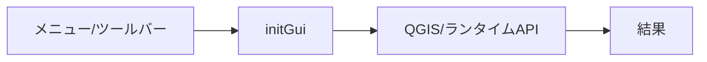

- 検証: 単独= / 連携=bridge_call/generic trigger→実在確認
- 結果: **pass** 2026-11-14T07:09:57+09:00 — 属性/シンボル実在確認(pyeval)

### action.plugin.run — run

- kind: `action` / source: `plugin.py:1444`
- signature: `run(state=…, layer=…, view_fields=…)`
- 要約: 検索ダイアログを表示する
- needs_runtime=True / standalone_ok=False

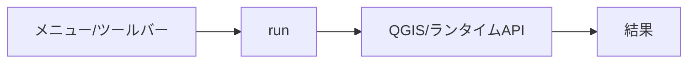

- 検証: 単独= / 連携=bridge_call/generic trigger→実在確認
- 結果: **pass** 2026-11-14T07:09:57+09:00 — 属性/シンボル実在確認(pyeval)

### action.plugin.unload — unload

- kind: `action` / source: `plugin.py:838`
- signature: `unload()`
- 要約: 
- needs_runtime=True / standalone_ok=False


- 検証: 単独= / 連携=bridge_call/generic trigger→実在確認
- 結果: **pass** 2026-11-14T07:09:57+09:00 — 属性/シンボル実在確認(pyeval)

### dialog.ResultDialog — ResultDialog

- kind: `dialog` / source: `resultdialog.py:15`
- signature: `ResultDialog`
- 要約: 
- needs_runtime=True / standalone_ok=False

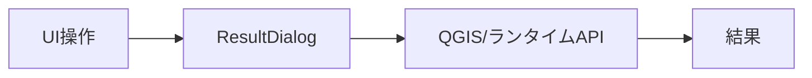

- 検証: 単独= / 連携=openDialog→screenshot→closeDialog
- 結果: **pass** 2026-11-14T07:09:57+09:00 — 属性/シンボル実在確認(pyeval)

### dialog.SearchDialog — SearchDialog

- kind: `dialog` / source: `searchdialog.py:29`
- signature: `SearchDialog`
- 要約: 
- needs_runtime=True / standalone_ok=False

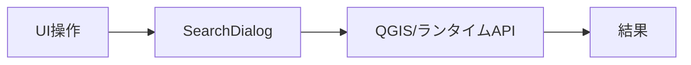

- 検証: 単独= / 連携=openDialog→screenshot→closeDialog
- 結果: **pass** 2026-11-14T07:09:57+09:00 — 属性/シンボル実在確認(pyeval)

### dialog.SearchWidget — SearchWidget

- kind: `dialog` / source: `widget/searchwidget.py:21`
- signature: `SearchWidget`
- 要約: 
- needs_runtime=True / standalone_ok=False

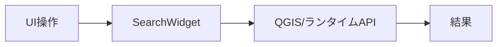

- 検証: 単独= / 連携=openDialog→screenshot→closeDialog
- 結果: **pass** 2026-11-14T07:09:57+09:00 — 属性/シンボル実在確認(pyeval)

### dialog.SettingsDialog — SettingsDialog

- kind: `dialog` / source: `settingsdialog.py:12`
- signature: `SettingsDialog`
- 要約: 
- needs_runtime=True / standalone_ok=False

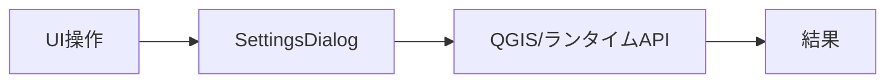

- 検証: 単独= / 連携=openDialog→screenshot→closeDialog
- 結果: **pass** 2026-11-14T07:09:57+09:00 — 属性/シンボル実在確認(pyeval)

### ui.ResultDialog._on_tab_changed — _on_tab_changed

- kind: `ui_control` / source: `resultdialog.py:965`
- signature: `_on_tab_changed(index)`
- 要約: 
- needs_runtime=True / standalone_ok=False

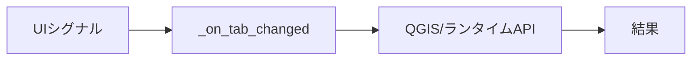

- 検証: 単独= / 連携=親dialog経由で操作・状態assert
- 結果: **pass** 2026-11-14T07:09:57+09:00 — 属性/シンボル実在確認(pyeval)

### ui.plugin._on_additive_toggled — _on_additive_toggled

- kind: `ui_control` / source: `plugin.py:353`
- signature: `_on_additive_toggled(checked)`
- 要約: Handler for additive_theme_action.toggled
- needs_runtime=True / standalone_ok=False

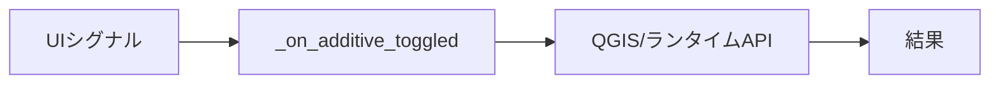

- 検証: 単独= / 連携=親dialog経由で操作・状態assert
- 結果: **pass** 2026-11-14T07:09:57+09:00 — 属性/シンボル実在確認(pyeval)

### ui.plugin._on_map_themes_changed — _on_map_themes_changed

- kind: `ui_control` / source: `plugin.py:806`
- signature: `_on_map_themes_changed(*args, **kwargs)`
- 要約: Wrapper for mapThemesChanged signal: log and delegate.
- needs_runtime=True / standalone_ok=False

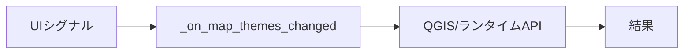

- 検証: 単独= / 連携=親dialog経由で操作・状態assert
- 結果: **pass** 2026-11-14T07:09:57+09:00 — 属性/シンボル実在確認(pyeval)

### ui.plugin._on_theme_collection_changed — _on_theme_collection_changed

- kind: `ui_control` / source: `plugin.py:822`
- signature: `_on_theme_collection_changed(*args, **kwargs)`
- 要約: Wrapper for legacy theme collection 'changed' signal.
- needs_runtime=True / standalone_ok=False

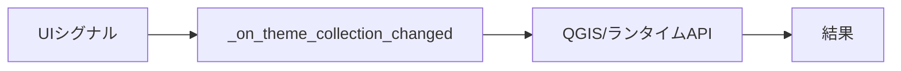

- 検証: 単独= / 連携=親dialog経由で操作・状態assert
- 結果: **pass** 2026-11-14T07:09:57+09:00 — 属性/シンボル実在確認(pyeval)

### ui.plugin.on_group_changed — on_group_changed

- kind: `ui_control` / source: `plugin.py:423`
- signature: `on_group_changed(index)`
- 要約: Called when user selects a group; filter themes accordingly.
- needs_runtime=True / standalone_ok=False

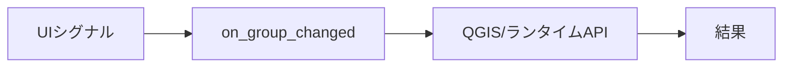

- 検証: 単独= / 連携=親dialog経由で操作・状態assert
- 結果: **pass** 2026-11-14T07:09:57+09:00 — 属性/シンボル実在確認(pyeval)

### ui.plugin.on_project_saved — on_project_saved

- kind: `ui_control` / source: `plugin.py:1624`
- signature: `on_project_saved()`
- 要約: プロジェクトが保存された時の処理
- needs_runtime=True / standalone_ok=False

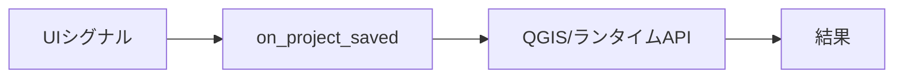

- 検証: 単独= / 連携=親dialog経由で操作・状態assert
- 結果: **pass** 2026-11-14T07:09:57+09:00 — 属性/シンボル実在確認(pyeval)

### bridge.addTab — addTab

- kind: `bridge_method` / source: `bridge.py:1517`
- signature: `addTab(config, target=…, rebuild=…)`
- 要約: 任意のタブ定義dictを検索タブとして追加する。
- needs_runtime=True / standalone_ok=False

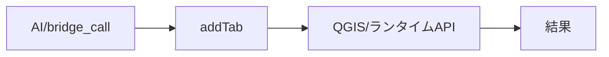

- 検証: 単独= / 連携=bridge_call addTab → 応答assert
- 結果: **skip** 2026-11-14T07:09:57+09:00 — 要実引数(応答あり): {'ok': False, 'error': 'config must be an object with Title'}

### bridge.addTabFromCurrentLayer — addTabFromCurrentLayer

- kind: `bridge_method` / source: `bridge.py:1250`
- signature: `addTabFromCurrentLayer(title=…, rebuild=…)`
- 要約: 現在のアクティブレイヤを検索タブとして追加する。
- needs_runtime=True / standalone_ok=False

```mermaid
flowchart LR
  E_bridge_addTabFromCurrentLayer["AI/bridge_call"] --> H_bridge_addTabFromCurrentLayer["addTabFromCurrentLayer"]
  H_bridge_addTabFromCurrentLayer --> R_bridge_addTabFromCurrentLayer["QGIS/ランタイムAPI"]
  R_bridge_addTabFromCurrentLayer --> OUT["結果"]
```

- 検証: 単独= / 連携=bridge_call addTabFromCurrentLayer → 応答assert
- 結果: **pass** 2026-11-14T07:09:57+09:00 — bridge_call応答あり args=[]

### bridge.applyTheme — applyTheme

- kind: `bridge_method` / source: `bridge.py:1041`
- signature: `applyTheme(name, additive=…)`
- 要約: マップテーマを適用する。additive指定時は追加表示モードも変更。
- needs_runtime=True / standalone_ok=False

```mermaid
flowchart LR
  E_bridge_applyTheme["AI/bridge_call"] --> H_bridge_applyTheme["applyTheme"]
  H_bridge_applyTheme --> R_bridge_applyTheme["QGIS/ランタイムAPI"]
  R_bridge_applyTheme --> OUT["結果"]
```

- 検証: 単独= / 連携=bridge_call applyTheme → 応答assert
- 結果: **skip** 2026-11-14T07:09:57+09:00 — 副作用/破壊的/外部通信操作のため手動検証対象

### bridge.closeDialog — closeDialog

- kind: `bridge_method` / source: `bridge.py:1644`
- signature: `closeDialog()`
- 要約: 
- needs_runtime=True / standalone_ok=False

```mermaid
flowchart LR
  E_bridge_closeDialog["AI/bridge_call"] --> H_bridge_closeDialog["closeDialog"]
  H_bridge_closeDialog --> R_bridge_closeDialog["QGIS/ランタイムAPI"]
  R_bridge_closeDialog --> OUT["結果"]
```

- 検証: 単独= / 連携=bridge_call closeDialog → 応答assert
- 結果: **skip** 2026-11-14T07:09:57+09:00 — 副作用/破壊的/外部通信操作のため手動検証対象

### bridge.getSettings — getSettings

- kind: `bridge_method` / source: `bridge.py:1143`
- signature: `getSettings()`
- 要約: 検索設定の由来(ファイル/プロジェクト変数/env)と値を返す。
- needs_runtime=True / standalone_ok=False

```mermaid
flowchart LR
  E_bridge_getSettings["AI/bridge_call"] --> H_bridge_getSettings["getSettings"]
  H_bridge_getSettings --> R_bridge_getSettings["QGIS/ランタイムAPI"]
  R_bridge_getSettings --> OUT["結果"]
```

- 検証: 単独= / 連携=bridge_call getSettings → 応答assert
- 結果: **pass** 2026-11-14T07:09:57+09:00 — bridge_call応答あり args=[]

### bridge.listTabs — listTabs

- kind: `bridge_method` / source: `bridge.py:635`
- signature: `listTabs()`
- 要約: 
- needs_runtime=True / standalone_ok=False

```mermaid
flowchart LR
  E_bridge_listTabs["AI/bridge_call"] --> H_bridge_listTabs["listTabs"]
  H_bridge_listTabs --> R_bridge_listTabs["QGIS/ランタイムAPI"]
  R_bridge_listTabs --> OUT["結果"]
```

- 検証: 単独= / 連携=bridge_call listTabs → 応答assert
- 結果: **pass** 2026-11-14T07:09:57+09:00 — bridge_call応答あり args=[]

### bridge.listThemes — listThemes

- kind: `bridge_method` / source: `bridge.py:1009`
- signature: `listThemes()`
- 要約: マップテーマ一覧・グループ・現在選択・追加表示モードを返す。
- needs_runtime=True / standalone_ok=False

```mermaid
flowchart LR
  E_bridge_listThemes["AI/bridge_call"] --> H_bridge_listThemes["listThemes"]
  H_bridge_listThemes --> R_bridge_listThemes["QGIS/ランタイムAPI"]
  R_bridge_listThemes --> OUT["結果"]
```

- 検証: 単独= / 連携=bridge_call listThemes → 応答assert
- 結果: **pass** 2026-11-14T07:09:57+09:00 — bridge_call応答あり args=[]

### bridge.loadUserTheme — loadUserTheme

- kind: `bridge_method` / source: `bridge.py:1130`
- signature: `loadUserTheme(path)`
- 要約: ユーザーテーマJSONを読み込んで現在のプロジェクトに適用する。
- needs_runtime=True / standalone_ok=False

```mermaid
flowchart LR
  E_bridge_loadUserTheme["AI/bridge_call"] --> H_bridge_loadUserTheme["loadUserTheme"]
  H_bridge_loadUserTheme --> R_bridge_loadUserTheme["QGIS/ランタイムAPI"]
  R_bridge_loadUserTheme --> OUT["結果"]
```

- 検証: 単独= / 連携=bridge_call loadUserTheme → 応答assert
- 結果: **skip** 2026-11-14T07:09:57+09:00 — 要実引数(応答あり): {'ok': False, 'error': 'failed to read user theme: '}

### bridge.openDialog — openDialog

- kind: `bridge_method` / source: `bridge.py:1636`
- signature: `openDialog()`
- 要約: 
- needs_runtime=True / standalone_ok=False

```mermaid
flowchart LR
  E_bridge_openDialog["AI/bridge_call"] --> H_bridge_openDialog["openDialog"]
  H_bridge_openDialog --> R_bridge_openDialog["QGIS/ランタイムAPI"]
  R_bridge_openDialog --> OUT["結果"]
```

- 検証: 単独= / 連携=bridge_call openDialog → 応答assert
- 結果: **skip** 2026-11-14T07:09:57+09:00 — 副作用/破壊的/外部通信操作のため手動検証対象

### bridge.openSettings — openSettings

- kind: `bridge_method` / source: `bridge.py:1393`
- signature: `openSettings()`
- 要約: 設定ダイアログを非modalで開く。
- needs_runtime=True / standalone_ok=False

```mermaid
flowchart LR
  E_bridge_openSettings["AI/bridge_call"] --> H_bridge_openSettings["openSettings"]
  H_bridge_openSettings --> R_bridge_openSettings["QGIS/ランタイムAPI"]
  R_bridge_openSettings --> OUT["結果"]
```

- 検証: 単独= / 連携=bridge_call openSettings → 応答assert
- 結果: **skip** 2026-11-14T07:09:57+09:00 — 副作用/破壊的/外部通信操作のため手動検証対象

### bridge.pluginInfo — pluginInfo

- kind: `bridge_method` / source: `bridge.py:578`
- signature: `pluginInfo()`
- 要約: プラグインの自己記述(id/summary/when_to_use/methods)を返す。
- needs_runtime=True / standalone_ok=False

```mermaid
flowchart LR
  E_bridge_pluginInfo["AI/bridge_call"] --> H_bridge_pluginInfo["pluginInfo"]
  H_bridge_pluginInfo --> R_bridge_pluginInfo["QGIS/ランタイムAPI"]
  R_bridge_pluginInfo --> OUT["結果"]
```

- 検証: 単独= / 連携=bridge_call pluginInfo → 応答assert
- 結果: **pass** 2026-11-14T07:09:57+09:00 — bridge_call応答あり args=[]

### bridge.reloadDialog — reloadDialog

- kind: `bridge_method` / source: `bridge.py:1211`
- signature: `reloadDialog(show=…)`
- 要約: 検索ダイアログを再構築する(設定・タブ変更の反映用)。
- needs_runtime=True / standalone_ok=False

```mermaid
flowchart LR
  E_bridge_reloadDialog["AI/bridge_call"] --> H_bridge_reloadDialog["reloadDialog"]
  H_bridge_reloadDialog --> R_bridge_reloadDialog["QGIS/ランタイムAPI"]
  R_bridge_reloadDialog --> OUT["結果"]
```

- 検証: 単独= / 連携=bridge_call reloadDialog → 応答assert
- 結果: **pass** 2026-11-14T07:09:57+09:00 — bridge_call応答あり args=[]

### bridge.removeTab — removeTab

- kind: `bridge_method` / source: `bridge.py:1303`
- signature: `removeTab(tab=…, rebuild=…)`
- 要約: 検索タブを設定ソースから削除し、ダイアログを再構築する。
- needs_runtime=True / standalone_ok=False

```mermaid
flowchart LR
  E_bridge_removeTab["AI/bridge_call"] --> H_bridge_removeTab["removeTab"]
  H_bridge_removeTab --> R_bridge_removeTab["QGIS/ランタイムAPI"]
  R_bridge_removeTab --> OUT["結果"]
```

- 検証: 単独= / 連携=bridge_call removeTab → 応答assert
- 結果: **skip** 2026-11-14T07:09:57+09:00 — 副作用/破壊的/外部通信操作のため手動検証対象

### bridge.resultDisplayMode — resultDisplayMode

- kind: `bridge_method` / source: `bridge.py:1622`
- signature: `resultDisplayMode(mode=…)`
- 要約: 結果ダイアログの表示モードを取得/設定する('table'/'form')。
- needs_runtime=True / standalone_ok=False

```mermaid
flowchart LR
  E_bridge_resultDisplayMode["AI/bridge_call"] --> H_bridge_resultDisplayMode["resultDisplayMode"]
  H_bridge_resultDisplayMode --> R_bridge_resultDisplayMode["QGIS/ランタイムAPI"]
  R_bridge_resultDisplayMode --> OUT["結果"]
```

- 検証: 単独= / 連携=bridge_call resultDisplayMode → 応答assert
- 結果: **pass** 2026-11-14T07:09:57+09:00 — bridge_call応答あり args=[]

### bridge.resultPage — resultPage

- kind: `bridge_method` / source: `bridge.py:1603`
- signature: `resultPage(page=…)`
- 要約: 結果ダイアログの表示ページを取得/設定する(1始まり)。
- needs_runtime=True / standalone_ok=False

```mermaid
flowchart LR
  E_bridge_resultPage["AI/bridge_call"] --> H_bridge_resultPage["resultPage"]
  H_bridge_resultPage --> R_bridge_resultPage["QGIS/ランタイムAPI"]
  R_bridge_resultPage --> OUT["結果"]
```

- 検証: 単独= / 連携=bridge_call resultPage → 応答assert
- 結果: **pass** 2026-11-14T07:09:57+09:00 — bridge_call応答あり args=[]

### bridge.results — results

- kind: `bridge_method` / source: `bridge.py:719`
- signature: `results(max_features=…)`
- 要約: 直近の検索結果を返す(再検索はしない)。
- needs_runtime=True / standalone_ok=False

```mermaid
flowchart LR
  E_bridge_results["AI/bridge_call"] --> H_bridge_results["results"]
  H_bridge_results --> R_bridge_results["QGIS/ランタイムAPI"]
  R_bridge_results --> OUT["結果"]
```

- 検証: 単独= / 連携=bridge_call results → 応答assert
- 結果: **pass** 2026-11-14T07:09:57+09:00 — bridge_call応答あり args=[]

### bridge.saveUserTheme — saveUserTheme

- kind: `bridge_method` / source: `bridge.py:1104`
- signature: `saveUserTheme(path=…)`
- 要約: 現在の表示状態をユーザーテーマJSON(.usertheme.json)に保存する。
- needs_runtime=True / standalone_ok=False

```mermaid
flowchart LR
  E_bridge_saveUserTheme["AI/bridge_call"] --> H_bridge_saveUserTheme["saveUserTheme"]
  H_bridge_saveUserTheme --> R_bridge_saveUserTheme["QGIS/ランタイムAPI"]
  R_bridge_saveUserTheme --> OUT["結果"]
```

- 検証: 単独= / 連携=bridge_call saveUserTheme → 応答assert
- 結果: **skip** 2026-11-14T07:09:57+09:00 — 副作用/破壊的/外部通信操作のため手動検証対象

### bridge.search — search

- kind: `bridge_method` / source: `bridge.py:670`
- signature: `search(query=…, tab=…, show=…, zoom=…, max_features=…, options=…)`
- 要約: 検索を実行する(検索ボタン押下と同じ show_features 経路)。
- needs_runtime=True / standalone_ok=False

```mermaid
flowchart LR
  E_bridge_search["AI/bridge_call"] --> H_bridge_search["search"]
  H_bridge_search --> R_bridge_search["QGIS/ランタイムAPI"]
  R_bridge_search --> OUT["結果"]
```

- 検証: 単独= / 連携=bridge_call search → 応答assert
- 結果: **pass** 2026-11-14T07:09:57+09:00 — bridge_call応答あり args=[]

### bridge.searchOptions — searchOptions

- kind: `bridge_method` / source: `bridge.py:842`
- signature: `searchOptions(options=…)`
- 要約: 検索オプションを取得/設定する(設定時は全タブへ適用)。
- needs_runtime=True / standalone_ok=False

```mermaid
flowchart LR
  E_bridge_searchOptions["AI/bridge_call"] --> H_bridge_searchOptions["searchOptions"]
  H_bridge_searchOptions --> R_bridge_searchOptions["QGIS/ランタイムAPI"]
  R_bridge_searchOptions --> OUT["結果"]
```

- 検証: 単独= / 連携=bridge_call searchOptions → 応答assert
- 結果: **pass** 2026-11-14T07:09:57+09:00 — bridge_call応答あり args=[]

### bridge.selectTab — selectTab

- kind: `bridge_method` / source: `bridge.py:654`
- signature: `selectTab(tab=…)`
- 要約: 
- needs_runtime=True / standalone_ok=False

```mermaid
flowchart LR
  E_bridge_selectTab["AI/bridge_call"] --> H_bridge_selectTab["selectTab"]
  H_bridge_selectTab --> R_bridge_selectTab["QGIS/ランタイムAPI"]
  R_bridge_selectTab --> OUT["結果"]
```

- 検証: 単独= / 連携=bridge_call selectTab → 応答assert
- 結果: **pass** 2026-11-14T07:09:57+09:00 — bridge_call応答あり args=[]

### bridge.setSettings — setSettings

- kind: `bridge_method` / source: `bridge.py:1176`
- signature: `setSettings(settings=…, rebuild=…)`
- 要約: geo_search_json(検索設定JSONのパス)を設定する。
- needs_runtime=True / standalone_ok=False

```mermaid
flowchart LR
  E_bridge_setSettings["AI/bridge_call"] --> H_bridge_setSettings["setSettings"]
  H_bridge_setSettings --> R_bridge_setSettings["QGIS/ランタイムAPI"]
  R_bridge_setSettings --> OUT["結果"]
```

- 検証: 単独= / 連携=bridge_call setSettings → 応答assert
- 結果: **skip** 2026-11-14T07:09:57+09:00 — 副作用/破壊的/外部通信操作のため手動検証対象

### bridge.setTabSetting — setTabSetting

- kind: `bridge_method` / source: `bridge.py:1450`
- signature: `setTabSetting(tab=…, config=…, rebuild=…)`
- 要約: 既存タブの設定JSONを更新して由来ソースへ書き戻す。
- needs_runtime=True / standalone_ok=False

```mermaid
flowchart LR
  E_bridge_setTabSetting["AI/bridge_call"] --> H_bridge_setTabSetting["setTabSetting"]
  H_bridge_setTabSetting --> R_bridge_setTabSetting["QGIS/ランタイムAPI"]
  R_bridge_setTabSetting --> OUT["結果"]
```

- 検証: 単独= / 連携=bridge_call setTabSetting → 応答assert
- 結果: **skip** 2026-11-14T07:09:57+09:00 — 副作用/破壊的/外部通信操作のため手動検証対象

### bridge.status — status

- kind: `bridge_method` / source: `bridge.py:601`
- signature: `status()`
- 要約: 
- needs_runtime=True / standalone_ok=False

```mermaid
flowchart LR
  E_bridge_status["AI/bridge_call"] --> H_bridge_status["status"]
  H_bridge_status --> R_bridge_status["QGIS/ランタイムAPI"]
  R_bridge_status --> OUT["結果"]
```

- 検証: 単独= / 連携=bridge_call status → 応答assert
- 結果: **pass** 2026-11-14T07:09:57+09:00 — bridge_call応答あり args=[]

### bridge.suggest — suggest

- kind: `bridge_method` / source: `bridge.py:973`
- signature: `suggest(tab=…, field=…, limit=…)`
- 要約: 検索フィールドのユニーク値一覧(サジェスト相当)を返す。
- needs_runtime=True / standalone_ok=False

```mermaid
flowchart LR
  E_bridge_suggest["AI/bridge_call"] --> H_bridge_suggest["suggest"]
  H_bridge_suggest --> R_bridge_suggest["QGIS/ランタイムAPI"]
  R_bridge_suggest --> OUT["結果"]
```

- 検証: 単独= / 連携=bridge_call suggest → 応答assert
- 結果: **pass** 2026-11-14T07:09:57+09:00 — bridge_call応答あり args=[]

### bridge.tabOptions — tabOptions

- kind: `bridge_method` / source: `bridge.py:882`
- signature: `tabOptions(tab=…, options=…)`
- 要約: タブ固有の検索コントロールを取得/設定する。
- needs_runtime=True / standalone_ok=False

```mermaid
flowchart LR
  E_bridge_tabOptions["AI/bridge_call"] --> H_bridge_tabOptions["tabOptions"]
  H_bridge_tabOptions --> R_bridge_tabOptions["QGIS/ランタイムAPI"]
  R_bridge_tabOptions --> OUT["結果"]
```

- 検証: 単独= / 連携=bridge_call tabOptions → 応答assert
- 結果: **pass** 2026-11-14T07:09:57+09:00 — bridge_call応答あり args=[]

### bridge.tabSetting — tabSetting

- kind: `bridge_method` / source: `bridge.py:1237`
- signature: `tabSetting(tab=…)`
- 要約: 検索タブの設定JSON(由来_source/_source_index含む)を返す。
- needs_runtime=True / standalone_ok=False

```mermaid
flowchart LR
  E_bridge_tabSetting["AI/bridge_call"] --> H_bridge_tabSetting["tabSetting"]
  H_bridge_tabSetting --> R_bridge_tabSetting["QGIS/ランタイムAPI"]
  R_bridge_tabSetting --> OUT["結果"]
```

- 検証: 単独= / 連携=bridge_call tabSetting → 応答assert
- 結果: **pass** 2026-11-14T07:09:57+09:00 — bridge_call応答あり args=[]

### bridge.themeAdditive — themeAdditive

- kind: `bridge_method` / source: `bridge.py:1082`
- signature: `themeAdditive(enabled=…)`
- 要約: テーマ適用の追加表示モードを取得/設定する。
- needs_runtime=True / standalone_ok=False

```mermaid
flowchart LR
  E_bridge_themeAdditive["AI/bridge_call"] --> H_bridge_themeAdditive["themeAdditive"]
  H_bridge_themeAdditive --> R_bridge_themeAdditive["QGIS/ランタイムAPI"]
  R_bridge_themeAdditive --> OUT["結果"]
```

- 検証: 単独= / 連携=bridge_call themeAdditive → 応答assert
- 結果: **pass** 2026-11-14T07:09:57+09:00 — bridge_call応答あり args=[]

### bridge.zoom — zoom

- kind: `bridge_method` / source: `bridge.py:732`
- signature: `zoom(feature_ids=…, tab_index=…)`
- 要約: 結果地物へズームする。feature_ids省略時はそのタブの全件。
- needs_runtime=True / standalone_ok=False

```mermaid
flowchart LR
  E_bridge_zoom["AI/bridge_call"] --> H_bridge_zoom["zoom"]
  H_bridge_zoom --> R_bridge_zoom["QGIS/ランタイムAPI"]
  R_bridge_zoom --> OUT["結果"]
```

- 検証: 単独= / 連携=bridge_call zoom → 応答assert
- 結果: **pass** 2026-11-14T07:09:57+09:00 — bridge_call応答あり args=[]

### ai.bridge_route — bridge_call経由全到達

- kind: `ai_integration` / source: `bridge.py`
- signature: ``
- 要約: 全bridge_methodがAI経路で呼べる
- needs_runtime=True / standalone_ok=False

```mermaid
flowchart LR
  E_ai_bridge_route["AI経路"] --> H_ai_bridge_route["bridge_call経由全到達"]
  H_ai_bridge_route --> R_ai_bridge_route["QGIS/ランタイムAPI"]
  R_ai_bridge_route --> OUT["結果"]
```

- 検証: 単独= / 連携=bridge_call 全method→ok/error記録
- 結果: **pass** 2026-11-14T07:09:57+09:00 — 20メソッド到達可能

### ai.catalog — describe_plugins登録

- kind: `ai_integration` / source: `geo_driver経由`
- signature: ``
- 要約: カタログに載り呼出可能か
- needs_runtime=True / standalone_ok=False

```mermaid
flowchart LR
  E_ai_catalog["AI経路"] --> H_ai_catalog["describe_plugins登録"]
  H_ai_catalog --> R_ai_catalog["QGIS/ランタイムAPI"]
  R_ai_catalog --> OUT["結果"]
```

- 検証: 単独= / 連携=describe_plugins→plugins[]にid実在+methods非空
- 結果: **pass** 2026-11-14T07:09:57+09:00 — describe_plugins: methods=27

### ai.pluginInfo — pluginInfo自己記述

- kind: `ai_integration` / source: `bridge.py`
- signature: `pluginInfo()`
- 要約: summary/when_to_use/methodsの正確性
- needs_runtime=True / standalone_ok=False

```mermaid
flowchart LR
  E_ai_pluginInfo["AI経路"] --> H_ai_pluginInfo["pluginInfo自己記述"]
  H_ai_pluginInfo --> R_ai_pluginInfo["QGIS/ランタイムAPI"]
  R_ai_pluginInfo --> OUT["結果"]
```

- 検証: 単独= / 連携=bridge_call pluginInfo→メタ一致assert
- 結果: **pass** 2026-11-14T07:09:57+09:00 — 自己記述あり

### ai.prompt.search-features — 同梱おすすめプロンプト search-features

- kind: `ai_integration` / source: `prompts/search-features.md`
- signature: ``
- 要約: 地物検索の定型指示(パネルのおすすめコンボで選択→入力欄へ挿入)
- needs_runtime=True / standalone_ok=False

```mermaid
flowchart LR
  E_ai_prompt_search_features["AI経路"] --> H_ai_prompt_search_features["同梱おすすめプロンプト search-features"]
  H_ai_prompt_search_features --> R_ai_prompt_search_features["QGIS/ランタイムAPI"]
  R_ai_prompt_search_features --> OUT["結果"]
```

- 検証: 単独= / 連携=instruction op=list kind=prompts → id=search-features & builtin、path=geo_search/prompts/
- 結果: **removed** 2026-11-14T06:46:49+09:00 — 実QGIS(pid28736)で確認済

### logic_fn.log.py:log_message — log_message

- kind: `logic_fn` / source: `log.py:11`
- signature: `log_message(message, tag=…, level=…)`
- 要約: QgsMessageLog.logMessage 相当。整数レベル可・失敗しても例外を投げない。
- needs_runtime=True / standalone_ok=False

```mermaid
flowchart LR
  E_logic_fn_log_py_log_message["呼出元"] --> H_logic_fn_log_py_log_message["log_message"]
  H_logic_fn_log_py_log_message --> R_logic_fn_log_py_log_message["QGIS/ランタイムAPI"]
  R_logic_fn_log_py_log_message --> OUT["結果"]
```

- 検証: 単独= / 連携=pyeval で属性実在+必要なら呼出
- 結果: **pass** 2026-11-14T07:09:57+09:00 — 属性/シンボル実在確認(pyeval)

### logic_fn.theme.py:apply_legend_visibility — apply_legend_visibility

- kind: `logic_fn` / source: `theme.py:1703`
- signature: `apply_legend_visibility(layer, legend_state, log_func=…, overwrite_all=…)`
- 要約: Apply visible-only legend flags from `legend_state` to `layer`.
- needs_runtime=True / standalone_ok=False

```mermaid
flowchart LR
  E_logic_fn_theme_py_apply_legend_visibility["呼出元"] --> H_logic_fn_theme_py_apply_legend_visibility["apply_legend_visibility"]
  H_logic_fn_theme_py_apply_legend_visibility --> R_logic_fn_theme_py_apply_legend_visibility["QGIS/ランタイムAPI"]
  R_logic_fn_theme_py_apply_legend_visibility --> OUT["結果"]
```

- 検証: 単独= / 連携=pyeval で属性実在+必要なら呼出
- 結果: **pass** 2026-11-14T07:09:57+09:00 — 属性/シンボル実在確認(pyeval)

### logic_fn.theme.py:apply_theme — apply_theme

- kind: `logic_fn` / source: `theme.py:387`
- signature: `apply_theme(theme_collection, theme_name, root, model, additive=…)`
- 要約: Apply a map theme via the provided theme_collection.
- needs_runtime=True / standalone_ok=False

```mermaid
flowchart LR
  E_logic_fn_theme_py_apply_theme["呼出元"] --> H_logic_fn_theme_py_apply_theme["apply_theme"]
  H_logic_fn_theme_py_apply_theme --> R_logic_fn_theme_py_apply_theme["QGIS/ランタイムAPI"]
  R_logic_fn_theme_py_apply_theme --> OUT["結果"]
```

- 検証: 単独= / 連携=pyeval で属性実在+必要なら呼出
- 結果: **pass** 2026-11-14T07:09:57+09:00 — 属性/シンボル実在確認(pyeval)

### logic_fn.theme.py:apply_user_theme — apply_user_theme

- kind: `logic_fn` / source: `theme.py:2095`
- signature: `apply_user_theme(data, overwrite_legend=…, project=…, log_func=…)`
- 要約: Apply a loaded user-theme dict to the current project.
- needs_runtime=True / standalone_ok=False

```mermaid
flowchart LR
  E_logic_fn_theme_py_apply_user_theme["呼出元"] --> H_logic_fn_theme_py_apply_user_theme["apply_user_theme"]
  H_logic_fn_theme_py_apply_user_theme --> R_logic_fn_theme_py_apply_user_theme["QGIS/ランタイムAPI"]
  R_logic_fn_theme_py_apply_user_theme --> OUT["結果"]
```

- 検証: 単独= / 連携=pyeval で属性実在+必要なら呼出
- 結果: **pass** 2026-11-14T07:09:57+09:00 — 属性/シンボル実在確認(pyeval)

### logic_fn.theme.py:collect_visible_layer_reload — collect_visible_layer_reload

- kind: `logic_fn` / source: `theme.py:1742`
- signature: `collect_visible_layer_reload(snapshot_name, project=…, root=…, tag=…, log_func=…)`
- 要約: Restore visible-layer state from an in-memory snapshot by making those
- needs_runtime=True / standalone_ok=False

```mermaid
flowchart LR
  E_logic_fn_theme_py_collect_visible_layer_reload["呼出元"] --> H_logic_fn_theme_py_collect_visible_layer_reload["collect_visible_layer_reload"]
  H_logic_fn_theme_py_collect_visible_layer_reload --> R_logic_fn_theme_py_collect_visible_layer_reload["QGIS/ランタイムAPI"]
  R_logic_fn_theme_py_collect_visible_layer_reload --> OUT["結果"]
```

- 検証: 単独= / 連携=pyeval で属性実在+必要なら呼出
- 結果: **pass** 2026-11-14T07:09:57+09:00 — 属性/シンボル実在確認(pyeval)

### logic_fn.theme.py:collect_visible_layer_snapshot — collect_visible_layer_snapshot

- kind: `logic_fn` / source: `theme.py:114`
- signature: `collect_visible_layer_snapshot(root, log_layer_legend_state_func=…, tag=…, snapshot_name=…)`
- 要約: Collect visible layers and optionally save a snapshot.
- needs_runtime=True / standalone_ok=False

```mermaid
flowchart LR
  E_logic_fn_theme_py_collect_visible_layer_snapshot["呼出元"] --> H_logic_fn_theme_py_collect_visible_layer_snapshot["collect_visible_layer_snapshot"]
  H_logic_fn_theme_py_collect_visible_layer_snapshot --> R_logic_fn_theme_py_collect_visible_layer_snapshot["QGIS/ランタイムAPI"]
  R_logic_fn_theme_py_collect_visible_layer_snapshot --> OUT["結果"]
```

- 検証: 単独= / 連携=pyeval で属性実在+必要なら呼出
- 結果: **pass** 2026-11-14T07:09:57+09:00 — 属性/シンボル実在確認(pyeval)

### logic_fn.theme.py:get_layer_legend_state — get_layer_legend_state

- kind: `logic_fn` / source: `theme.py:1469`
- signature: `get_layer_legend_state(layer)`
- 要約: レイヤの凡例（レジェンド）チェック状態を取得して構造化して返す。
- needs_runtime=True / standalone_ok=False

```mermaid
flowchart LR
  E_logic_fn_theme_py_get_layer_legend_state["呼出元"] --> H_logic_fn_theme_py_get_layer_legend_state["get_layer_legend_state"]
  H_logic_fn_theme_py_get_layer_legend_state --> R_logic_fn_theme_py_get_layer_legend_state["QGIS/ランタイムAPI"]
  R_logic_fn_theme_py_get_layer_legend_state --> OUT["結果"]
```

- 検証: 単独= / 連携=pyeval で属性実在+必要なら呼出
- 結果: **pass** 2026-11-14T07:09:57+09:00 — 属性/シンボル実在確認(pyeval)

### logic_fn.theme.py:get_visible_layer_snapshot — get_visible_layer_snapshot

- kind: `logic_fn` / source: `theme.py:1684`
- signature: `get_visible_layer_snapshot(name)`
- 要約: Return a previously saved visible-layer snapshot by name.
- needs_runtime=True / standalone_ok=False

```mermaid
flowchart LR
  E_logic_fn_theme_py_get_visible_layer_snapshot["呼出元"] --> H_logic_fn_theme_py_get_visible_layer_snapshot["get_visible_layer_snapshot"]
  H_logic_fn_theme_py_get_visible_layer_snapshot --> R_logic_fn_theme_py_get_visible_layer_snapshot["QGIS/ランタイムAPI"]
  R_logic_fn_theme_py_get_visible_layer_snapshot --> OUT["結果"]
```

- 検証: 単独= / 連携=pyeval で属性実在+必要なら呼出
- 結果: **pass** 2026-11-14T07:09:57+09:00 — 属性/シンボル実在確認(pyeval)

### logic_fn.theme.py:group_themes — group_themes

- kind: `logic_fn` / source: `theme.py:689`
- signature: `group_themes(theme_names)`
- 要約: テーマ名リストをグループ化して辞書で返す。
- needs_runtime=True / standalone_ok=False

```mermaid
flowchart LR
  E_logic_fn_theme_py_group_themes["呼出元"] --> H_logic_fn_theme_py_group_themes["group_themes"]
  H_logic_fn_theme_py_group_themes --> R_logic_fn_theme_py_group_themes["QGIS/ランタイムAPI"]
  R_logic_fn_theme_py_group_themes --> OUT["結果"]
```

- 検証: 単独= / 連携=pyeval で属性実在+必要なら呼出
- 結果: **pass** 2026-11-14T07:09:57+09:00 — 属性/シンボル実在確認(pyeval)

### logic_fn.theme.py:list_visible_layer_snapshots — list_visible_layer_snapshots

- kind: `logic_fn` / source: `theme.py:1695`
- signature: `list_visible_layer_snapshots()`
- 要約: Return the list of snapshot names currently stored in memory.
- needs_runtime=True / standalone_ok=False

```mermaid
flowchart LR
  E_logic_fn_theme_py_list_visible_layer_snapshots["呼出元"] --> H_logic_fn_theme_py_list_visible_layer_snapshots["list_visible_layer_snapshots"]
  H_logic_fn_theme_py_list_visible_layer_snapshots --> R_logic_fn_theme_py_list_visible_layer_snapshots["QGIS/ランタイムAPI"]
  R_logic_fn_theme_py_list_visible_layer_snapshots --> OUT["結果"]
```

- 検証: 単独= / 連携=pyeval で属性実在+必要なら呼出
- 結果: **pass** 2026-11-14T07:09:57+09:00 — 属性/シンボル実在確認(pyeval)

### logic_fn.theme.py:load_user_theme — load_user_theme

- kind: `logic_fn` / source: `theme.py:2078`
- signature: `load_user_theme(path)`
- 要約: Load a user-theme JSON file and return the parsed dict or None on error.
- needs_runtime=True / standalone_ok=False

```mermaid
flowchart LR
  E_logic_fn_theme_py_load_user_theme["呼出元"] --> H_logic_fn_theme_py_load_user_theme["load_user_theme"]
  H_logic_fn_theme_py_load_user_theme --> R_logic_fn_theme_py_load_user_theme["QGIS/ランタイムAPI"]
  R_logic_fn_theme_py_load_user_theme --> OUT["結果"]
```

- 検証: 単独= / 連携=pyeval で属性実在+必要なら呼出
- 結果: **pass** 2026-11-14T07:09:57+09:00 — 属性/シンボル実在確認(pyeval)

### logic_fn.theme.py:log_layer_legend_state — log_layer_legend_state

- kind: `logic_fn` / source: `theme.py:1588`
- signature: `log_layer_legend_state(layer, tag=…)`
- 要約: `get_layer_legend_state` の結果をログ出力する。
- needs_runtime=True / standalone_ok=False

```mermaid
flowchart LR
  E_logic_fn_theme_py_log_layer_legend_state["呼出元"] --> H_logic_fn_theme_py_log_layer_legend_state["log_layer_legend_state"]
  H_logic_fn_theme_py_log_layer_legend_state --> R_logic_fn_theme_py_log_layer_legend_state["QGIS/ランタイムAPI"]
  R_logic_fn_theme_py_log_layer_legend_state --> OUT["結果"]
```

- 検証: 単独= / 連携=pyeval で属性実在+必要なら呼出
- 結果: **pass** 2026-11-14T07:09:57+09:00 — 属性/シンボル実在確認(pyeval)

### logic_fn.theme.py:log_layer_legend_state_by_name — log_layer_legend_state_by_name

- kind: `logic_fn` / source: `theme.py:1642`
- signature: `log_layer_legend_state_by_name(layer_name, project=…, tag=…)`
- 要約: レイヤ名からレイヤを検索して凡例状態をログ出力するユーティリティ。
- needs_runtime=True / standalone_ok=False

```mermaid
flowchart LR
  E_logic_fn_theme_py_log_layer_legend_state_by_name["呼出元"] --> H_logic_fn_theme_py_log_layer_legend_state_by_name["log_layer_legend_state_by_name"]
  H_logic_fn_theme_py_log_layer_legend_state_by_name --> R_logic_fn_theme_py_log_layer_legend_state_by_name["QGIS/ランタイムAPI"]
  R_logic_fn_theme_py_log_layer_legend_state_by_name --> OUT["結果"]
```

- 検証: 単独= / 連携=pyeval で属性実在+必要なら呼出
- 結果: **pass** 2026-11-14T07:09:57+09:00 — 属性/シンボル実在確認(pyeval)

### logic_fn.theme.py:parse_theme_group — parse_theme_group

- kind: `logic_fn` / source: `theme.py:670`
- signature: `parse_theme_group(theme_name)`
- 要約: テーマ名からグループ名を抽出する。
- needs_runtime=True / standalone_ok=False

```mermaid
flowchart LR
  E_logic_fn_theme_py_parse_theme_group["呼出元"] --> H_logic_fn_theme_py_parse_theme_group["parse_theme_group"]
  H_logic_fn_theme_py_parse_theme_group --> R_logic_fn_theme_py_parse_theme_group["QGIS/ランタイムAPI"]
  R_logic_fn_theme_py_parse_theme_group --> OUT["結果"]
```

- 検証: 単独= / 連携=pyeval で属性実在+必要なら呼出
- 結果: **pass** 2026-11-14T07:09:57+09:00 — 属性/シンボル実在確認(pyeval)

### logic_fn.theme.py:remove_temp_theme — remove_temp_theme

- kind: `logic_fn` / source: `theme.py:324`
- signature: `remove_temp_theme(theme_collection, tmp_name, log_func=…)`
- 要約: Remove a temporary theme by name from the collection without applying it.
- needs_runtime=True / standalone_ok=False

```mermaid
flowchart LR
  E_logic_fn_theme_py_remove_temp_theme["呼出元"] --> H_logic_fn_theme_py_remove_temp_theme["remove_temp_theme"]
  H_logic_fn_theme_py_remove_temp_theme --> R_logic_fn_theme_py_remove_temp_theme["QGIS/ランタイムAPI"]
  R_logic_fn_theme_py_remove_temp_theme --> OUT["結果"]
```

- 検証: 単独= / 連携=pyeval で属性実在+必要なら呼出
- 結果: **pass** 2026-11-14T07:09:57+09:00 — 属性/シンボル実在確認(pyeval)

### logic_fn.theme.py:restore_temp_theme — restore_temp_theme

- kind: `logic_fn` / source: `theme.py:255`
- signature: `restore_temp_theme(theme_collection, tmp_name, root=…, model=…, log_func=…, short_func=…)`
- 要約: Apply (restore) a temporary theme by name without removing it.
- needs_runtime=True / standalone_ok=False

```mermaid
flowchart LR
  E_logic_fn_theme_py_restore_temp_theme["呼出元"] --> H_logic_fn_theme_py_restore_temp_theme["restore_temp_theme"]
  H_logic_fn_theme_py_restore_temp_theme --> R_logic_fn_theme_py_restore_temp_theme["QGIS/ランタイムAPI"]
  R_logic_fn_theme_py_restore_temp_theme --> OUT["結果"]
```

- 検証: 単独= / 連携=pyeval で属性実在+必要なら呼出
- 結果: **pass** 2026-11-14T07:09:57+09:00 — 属性/シンボル実在確認(pyeval)

### logic_fn.theme.py:save_current_state_as_temp_theme — save_current_state_as_temp_theme

- kind: `logic_fn` / source: `theme.py:30`
- signature: `save_current_state_as_temp_theme(theme_collection, tmp_name, root=…, model=…, log_func=…, summarize_func=…)`
- 要約: Create a theme object from the current project state and save it
- needs_runtime=True / standalone_ok=False

```mermaid
flowchart LR
  E_logic_fn_theme_py_save_current_state_as_temp_theme["呼出元"] --> H_logic_fn_theme_py_save_current_state_as_temp_theme["save_current_state_as_temp_theme"]
  H_logic_fn_theme_py_save_current_state_as_temp_theme --> R_logic_fn_theme_py_save_current_state_as_temp_theme["QGIS/ランタイムAPI"]
  R_logic_fn_theme_py_save_current_state_as_temp_theme --> OUT["結果"]
```

- 検証: 単独= / 連携=pyeval で属性実在+必要なら呼出
- 結果: **pass** 2026-11-14T07:09:57+09:00 — 属性/シンボル実在確認(pyeval)

### logic_fn.theme.py:save_user_theme — save_user_theme

- kind: `logic_fn` / source: `theme.py:2003`
- signature: `save_user_theme(path, snapshot=…, project=…, root=…)`
- 要約: Save a minimal "user theme" as JSON containing layer order/id/name,
- needs_runtime=True / standalone_ok=False

```mermaid
flowchart LR
  E_logic_fn_theme_py_save_user_theme["呼出元"] --> H_logic_fn_theme_py_save_user_theme["save_user_theme"]
  H_logic_fn_theme_py_save_user_theme --> R_logic_fn_theme_py_save_user_theme["QGIS/ランタイムAPI"]
  R_logic_fn_theme_py_save_user_theme --> OUT["結果"]
```

- 検証: 単独= / 連携=pyeval で属性実在+必要なら呼出
- 結果: **pass** 2026-11-14T07:09:57+09:00 — 属性/シンボル実在確認(pyeval)

### logic_fn.utils.py:get_feature_by_id — get_feature_by_id

- kind: `logic_fn` / source: `utils.py:44`
- signature: `get_feature_by_id(layer, feature_id)`
- 要約: 
- needs_runtime=True / standalone_ok=False

```mermaid
flowchart LR
  E_logic_fn_utils_py_get_feature_by_id["呼出元"] --> H_logic_fn_utils_py_get_feature_by_id["get_feature_by_id"]
  H_logic_fn_utils_py_get_feature_by_id --> R_logic_fn_utils_py_get_feature_by_id["QGIS/ランタイムAPI"]
  R_logic_fn_utils_py_get_feature_by_id --> OUT["結果"]
```

- 検証: 単独= / 連携=pyeval で属性実在+必要なら呼出
- 結果: **pass** 2026-11-14T07:09:57+09:00 — 属性/シンボル実在確認(pyeval)

### logic_fn.utils.py:name2layer — name2layer

- kind: `logic_fn` / source: `utils.py:15`
- signature: `name2layer(name)`
- 要約: 
- needs_runtime=True / standalone_ok=False

```mermaid
flowchart LR
  E_logic_fn_utils_py_name2layer["呼出元"] --> H_logic_fn_utils_py_name2layer["name2layer"]
  H_logic_fn_utils_py_name2layer --> R_logic_fn_utils_py_name2layer["QGIS/ランタイムAPI"]
  R_logic_fn_utils_py_name2layer --> OUT["結果"]
```

- 検証: 単独= / 連携=pyeval で属性実在+必要なら呼出
- 結果: **pass** 2026-11-14T07:09:57+09:00 — 属性/シンボル実在確認(pyeval)

### logic_fn.utils.py:name2layers — name2layers

- kind: `logic_fn` / source: `utils.py:22`
- signature: `name2layers(name)`
- 要約: 指定した名前の全てのレイヤを取得する
- needs_runtime=True / standalone_ok=False

```mermaid
flowchart LR
  E_logic_fn_utils_py_name2layers["呼出元"] --> H_logic_fn_utils_py_name2layers["name2layers"]
  H_logic_fn_utils_py_name2layers --> R_logic_fn_utils_py_name2layers["QGIS/ランタイムAPI"]
  R_logic_fn_utils_py_name2layers --> OUT["結果"]
```

- 検証: 単独= / 連携=pyeval で属性実在+必要なら呼出
- 結果: **pass** 2026-11-14T07:09:57+09:00 — 属性/シンボル実在確認(pyeval)

### logic_fn.utils.py:remove_entry_from_json_file — remove_entry_from_json_file

- kind: `logic_fn` / source: `utils.py:103`
- signature: `remove_entry_from_json_file(path, title=…, src_idx=…, container_key=…, parent=…, logger=…)`
- 要約: Remove an entry from a JSON file safely.
- needs_runtime=True / standalone_ok=False

```mermaid
flowchart LR
  E_logic_fn_utils_py_remove_entry_from_json_file["呼出元"] --> H_logic_fn_utils_py_remove_entry_from_json_file["remove_entry_from_json_file"]
  H_logic_fn_utils_py_remove_entry_from_json_file --> R_logic_fn_utils_py_remove_entry_from_json_file["QGIS/ランタイムAPI"]
  R_logic_fn_utils_py_remove_entry_from_json_file --> OUT["結果"]
```

- 検証: 単独= / 連携=pyeval で属性実在+必要なら呼出
- 結果: **pass** 2026-11-14T07:09:57+09:00 — 属性/シンボル実在確認(pyeval)

### logic_fn.utils.py:set_project_variable — set_project_variable

- kind: `logic_fn` / source: `utils.py:54`
- signature: `set_project_variable(project, key, value, group=…)`
- 要約: Robustly set a project-scoped variable across QGIS versions.
- needs_runtime=True / standalone_ok=False

```mermaid
flowchart LR
  E_logic_fn_utils_py_set_project_variable["呼出元"] --> H_logic_fn_utils_py_set_project_variable["set_project_variable"]
  H_logic_fn_utils_py_set_project_variable --> R_logic_fn_utils_py_set_project_variable["QGIS/ランタイムAPI"]
  R_logic_fn_utils_py_set_project_variable --> OUT["結果"]
```

- 検証: 単独= / 連携=pyeval で属性実在+必要なら呼出
- 結果: **pass** 2026-11-14T07:09:57+09:00 — 属性/シンボル実在確認(pyeval)

### logic_fn.utils.py:unique_values — unique_values

- kind: `logic_fn` / source: `utils.py:29`
- signature: `unique_values(layer, field_name)`
- 要約: 
- needs_runtime=True / standalone_ok=False

```mermaid
flowchart LR
  E_logic_fn_utils_py_unique_values["呼出元"] --> H_logic_fn_utils_py_unique_values["unique_values"]
  H_logic_fn_utils_py_unique_values --> R_logic_fn_utils_py_unique_values["QGIS/ランタイムAPI"]
  R_logic_fn_utils_py_unique_values --> OUT["結果"]
```

- 検証: 単独= / 連携=pyeval で属性実在+必要なら呼出
- 結果: **pass** 2026-11-14T07:09:57+09:00 — 属性/シンボル実在確認(pyeval)

## 検証マトリクス

| 機能 | kind | 単独 | 連携 | 結果 |
|---|---|---|---|---|
| entry_point.__init__.py:classFactory | entry_point | ○ | - | pass |
| action.SearchFeature.unload | action | - | ○ | pass |
| action.SearchOwnerFeature.unload | action | - | ○ | pass |
| action.SearchTextFeature.unload | action | - | ○ | pass |
| action.SearchTibanFeature.unload | action | - | ○ | pass |
| action.plugin.initGui | action | - | ○ | pass |
| action.plugin.run | action | - | ○ | pass |
| action.plugin.unload | action | - | ○ | pass |
| dialog.ResultDialog | dialog | - | ○ | pass |
| dialog.SearchDialog | dialog | - | ○ | pass |
| dialog.SearchWidget | dialog | - | ○ | pass |
| dialog.SettingsDialog | dialog | - | ○ | pass |
| ui.ResultDialog._on_tab_changed | ui_control | - | ○ | pass |
| ui.plugin._on_additive_toggled | ui_control | - | ○ | pass |
| ui.plugin._on_map_themes_changed | ui_control | - | ○ | pass |
| ui.plugin._on_theme_collection_changed | ui_control | - | ○ | pass |
| ui.plugin.on_group_changed | ui_control | - | ○ | pass |
| ui.plugin.on_project_saved | ui_control | - | ○ | pass |
| bridge.addTab | bridge_method | - | ○ | skip |
| bridge.addTabFromCurrentLayer | bridge_method | - | ○ | pass |
| bridge.applyTheme | bridge_method | - | ○ | skip |
| bridge.closeDialog | bridge_method | - | ○ | skip |
| bridge.getSettings | bridge_method | - | ○ | pass |
| bridge.listTabs | bridge_method | - | ○ | pass |
| bridge.listThemes | bridge_method | - | ○ | pass |
| bridge.loadUserTheme | bridge_method | - | ○ | skip |
| bridge.openDialog | bridge_method | - | ○ | skip |
| bridge.openSettings | bridge_method | - | ○ | skip |
| bridge.pluginInfo | bridge_method | - | ○ | pass |
| bridge.reloadDialog | bridge_method | - | ○ | pass |
| bridge.removeTab | bridge_method | - | ○ | skip |
| bridge.resultDisplayMode | bridge_method | - | ○ | pass |
| bridge.resultPage | bridge_method | - | ○ | pass |
| bridge.results | bridge_method | - | ○ | pass |
| bridge.saveUserTheme | bridge_method | - | ○ | skip |
| bridge.search | bridge_method | - | ○ | pass |
| bridge.searchOptions | bridge_method | - | ○ | pass |
| bridge.selectTab | bridge_method | - | ○ | pass |
| bridge.setSettings | bridge_method | - | ○ | skip |
| bridge.setTabSetting | bridge_method | - | ○ | skip |
| bridge.status | bridge_method | - | ○ | pass |
| bridge.suggest | bridge_method | - | ○ | pass |
| bridge.tabOptions | bridge_method | - | ○ | pass |
| bridge.tabSetting | bridge_method | - | ○ | pass |
| bridge.themeAdditive | bridge_method | - | ○ | pass |
| bridge.zoom | bridge_method | - | ○ | pass |
| ai.bridge_route | ai_integration | - | ○ | pass |
| ai.catalog | ai_integration | - | ○ | pass |
| ai.pluginInfo | ai_integration | - | ○ | pass |
| ai.prompt.search-features | ai_integration | - | ○ | removed |
| logic_fn.log.py:log_message | logic_fn | - | ○ | pass |
| logic_fn.theme.py:apply_legend_visibility | logic_fn | - | ○ | pass |
| logic_fn.theme.py:apply_theme | logic_fn | - | ○ | pass |
| logic_fn.theme.py:apply_user_theme | logic_fn | - | ○ | pass |
| logic_fn.theme.py:collect_visible_layer_reload | logic_fn | - | ○ | pass |
| logic_fn.theme.py:collect_visible_layer_snapshot | logic_fn | - | ○ | pass |
| logic_fn.theme.py:get_layer_legend_state | logic_fn | - | ○ | pass |
| logic_fn.theme.py:get_visible_layer_snapshot | logic_fn | - | ○ | pass |
| logic_fn.theme.py:group_themes | logic_fn | - | ○ | pass |
| logic_fn.theme.py:list_visible_layer_snapshots | logic_fn | - | ○ | pass |
| logic_fn.theme.py:load_user_theme | logic_fn | - | ○ | pass |
| logic_fn.theme.py:log_layer_legend_state | logic_fn | - | ○ | pass |
| logic_fn.theme.py:log_layer_legend_state_by_name | logic_fn | - | ○ | pass |
| logic_fn.theme.py:parse_theme_group | logic_fn | - | ○ | pass |
| logic_fn.theme.py:remove_temp_theme | logic_fn | - | ○ | pass |
| logic_fn.theme.py:restore_temp_theme | logic_fn | - | ○ | pass |
| logic_fn.theme.py:save_current_state_as_temp_theme | logic_fn | - | ○ | pass |
| logic_fn.theme.py:save_user_theme | logic_fn | - | ○ | pass |
| logic_fn.utils.py:get_feature_by_id | logic_fn | - | ○ | pass |
| logic_fn.utils.py:name2layer | logic_fn | - | ○ | pass |
| logic_fn.utils.py:name2layers | logic_fn | - | ○ | pass |
| logic_fn.utils.py:remove_entry_from_json_file | logic_fn | - | ○ | pass |
| logic_fn.utils.py:set_project_variable | logic_fn | - | ○ | pass |
| logic_fn.utils.py:unique_values | logic_fn | - | ○ | pass |