# geo_userfunc — 完全ロジックシート

- 種別: qgis_plugin / バージョン: 1.0.7
- 生成: 2026-11-14T02:32:22+09:00 / 機能数: 38

## トポロジ

```mermaid
flowchart LR
  subgraph ENTRY["操作入口"]
    UI["メニュー/ダイアログ"]
    AI["AI/bridge_call"]
  end
  subgraph LOGIC["実装"]
    entry_point___init___py_classFactory["classFactory<br/><i>entry_point</i>"]
    action_MacroRegistry_run["run<br/><i>action</i>"]
    action_plugin_initGui["initGui<br/><i>action</i>"]
    action_plugin_unload["unload<br/><i>action</i>"]
    dialog_GeoUserfuncManagerDialog["GeoUserfuncManagerDialog<br/><i>dialog</i>"]
    dialog__FunctionEditDialog["_FunctionEditDialog<br/><i>dialog</i>"]
    ui_GeoUserfuncManagerDialog__on_item_changed["_on_item_changed<br/><i>ui_control</i>"]
    ui_MacroRegistry_on_changed["on_changed<br/><i>ui_control</i>"]
    bridge_addSource["addSource<br/><i>bridge_method</i>"]
    bridge_deleteFunction["deleteFunction<br/><i>bridge_method</i>"]
    bridge_evalExpression["evalExpression<br/><i>bridge_method</i>"]
    bridge_fetchFromUrl["fetchFromUrl<br/><i>bridge_method</i>"]
    bridge_listFunctions["listFunctions<br/><i>bridge_method</i>"]
    bridge_listMacros["listMacros<br/><i>bridge_method</i>"]
    bridge_listSources["listSources<br/><i>bridge_method</i>"]
    bridge_openLibraryDir["openLibraryDir<br/><i>bridge_method</i>"]
    bridge_openManager["openManager<br/><i>bridge_method</i>"]
    bridge_pluginInfo["pluginInfo<br/><i>bridge_method</i>"]
    bridge_readFunction["readFunction<br/><i>bridge_method</i>"]
    bridge_reload["reload<br/><i>bridge_method</i>"]
    bridge_removeSource["removeSource<br/><i>bridge_method</i>"]
    bridge_run["run<br/><i>bridge_method</i>"]
    bridge_saveFunction["saveFunction<br/><i>bridge_method</i>"]
    bridge_setEnabled["setEnabled<br/><i>bridge_method</i>"]
    bridge_status["status<br/><i>bridge_method</i>"]
    bridge_updateFromUpstream["updateFromUpstream<br/><i>bridge_method</i>"]
    integration_bridge_py_488["QDesktopServices.openUrl<br/><i>integration</i>"]
    integration_manager_dialog_py_251["QDesktopServices.openUrl<br/><i>integration</i>"]
    ai_bridge_route["bridge_call経由全到達<br/><i>ai_integration</i>"]
    ai_catalog["describe_plugins登録<br/><i>ai_integration</i>"]
    ai_pluginInfo["pluginInfo自己記述<br/><i>ai_integration</i>"]
    logic_fn_functions_user_functions_py_closeProject["closeProject<br/><i>logic_fn</i>"]
    logic_fn_functions_user_functions_py_han2zen["han2zen<br/><i>logic_fn</i>"]
    logic_fn_functions_user_functions_py_openProject["openProject<br/><i>logic_fn</i>"]
    logic_fn_functions_user_functions_py_saveProject["saveProject<br/><i>logic_fn</i>"]
    logic_fn_functions_user_functions_py_zen2han["zen2han<br/><i>logic_fn</i>"]
    logic_fn_library_py_analyze_source["analyze_source<br/><i>logic_fn</i>"]
    logic_fn_library_py_library_dir["library_dir<br/><i>logic_fn</i>"]
  end
  AI --> bridge_addSource & bridge_deleteFunction & bridge_evalExpression & bridge_fetchFromUrl & bridge_listFunctions & bridge_listMacros & bridge_listSources & bridge_openLibraryDir …
  UI --> action_MacroRegistry_run & action_plugin_initGui & action_plugin_unload & dialog_GeoUserfuncManagerDialog & dialog__FunctionEditDialog & ui_GeoUserfuncManagerDialog__on_item_changed & ui_MacroRegistry_on_changed
  LOGIC --> QGIS["QGIS API / iface / QgsProject"]
  LOGIC --> EXT["外部連携(HTTP/subprocess/ファイル)"]
```

## 機能別ロジック

### entry_point.__init__.py:classFactory — classFactory

- kind: `entry_point` / source: `__init__.py:5`
- signature: `classFactory(iface)`
- 要約: 
- needs_runtime=False / standalone_ok=True

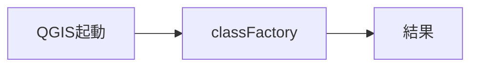

- 検証: 単独=import→呼出→戻り値assert / 連携=pyeval で属性実在+必要なら呼出
- 結果: **pass** 2026-11-14T02:32:22+09:00 — standalone経路のみ(要runtime依存無し)

### action.MacroRegistry.run — run

- kind: `action` / source: `registry.py:93`
- signature: `run(macro_id, context)`
- 要約: 登録マクロを実行して結果をdictで返す。
- needs_runtime=True / standalone_ok=False

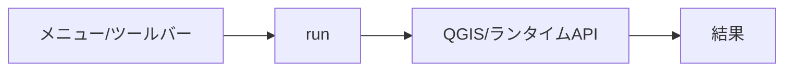

- 検証: 単独= / 連携=bridge_call/generic trigger→実在確認
- 結果: **pass** 2026-11-14T02:32:22+09:00 — 属性/シンボル実在確認(pyeval)

### action.plugin.initGui — initGui

- kind: `action` / source: `plugin.py:80`
- signature: `initGui()`
- 要約: 
- needs_runtime=True / standalone_ok=False

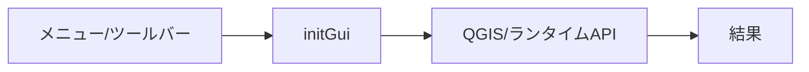

- 検証: 単独= / 連携=bridge_call/generic trigger→実在確認
- 結果: **pass** 2026-11-14T02:32:22+09:00 — 属性/シンボル実在確認(pyeval)

### action.plugin.unload — unload

- kind: `action` / source: `plugin.py:104`
- signature: `unload()`
- 要約: 
- needs_runtime=True / standalone_ok=False

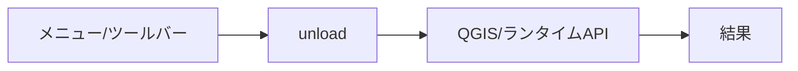

- 検証: 単独= / 連携=bridge_call/generic trigger→実在確認
- 結果: **pass** 2026-11-14T02:32:22+09:00 — 属性/シンボル実在確認(pyeval)

### dialog.GeoUserfuncManagerDialog — GeoUserfuncManagerDialog

- kind: `dialog` / source: `manager_dialog.py:84`
- signature: `GeoUserfuncManagerDialog`
- 要約: ユーザー関数ライブラリの管理ダイアログ。
- needs_runtime=True / standalone_ok=False

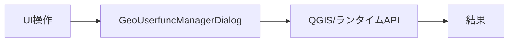

- 検証: 単独= / 連携=openDialog→screenshot→closeDialog
- 結果: **pass** 2026-11-14T02:32:22+09:00 — 属性/シンボル実在確認(pyeval)

### dialog._FunctionEditDialog — _FunctionEditDialog

- kind: `dialog` / source: `manager_dialog.py:41`
- signature: `_FunctionEditDialog`
- 要約: 1ファイルのソース編集ダイアログ(構文検証付き保存)。
- needs_runtime=True / standalone_ok=False

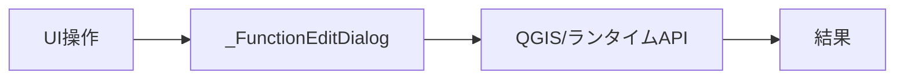

- 検証: 単独= / 連携=openDialog→screenshot→closeDialog
- 結果: **pass** 2026-11-14T02:32:22+09:00 — 属性/シンボル実在確認(pyeval)

### ui.GeoUserfuncManagerDialog._on_item_changed — _on_item_changed

- kind: `ui_control` / source: `manager_dialog.py:201`
- signature: `_on_item_changed(item)`
- 要約: 
- needs_runtime=True / standalone_ok=False

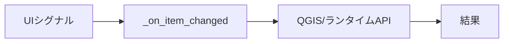

- 検証: 単独= / 連携=親dialog経由で操作・状態assert
- 結果: **pass** 2026-11-14T02:32:22+09:00 — 属性/シンボル実在確認(pyeval)

### ui.MacroRegistry.on_changed — on_changed

- kind: `ui_control` / source: `registry.py:112`
- signature: `on_changed(fn)`
- 要約: 登録内容が変わったとき呼ぶリスナを追加(UI同期用)。
- needs_runtime=True / standalone_ok=False


- 検証: 単独= / 連携=親dialog経由で操作・状態assert
- 結果: **pass** 2026-11-14T02:32:22+09:00 — 属性/シンボル実在確認(pyeval)

### bridge.addSource — addSource

- kind: `bridge_method` / source: `bridge.py:443`
- signature: `addSource(file, url)`
- 要約: sources.jsonへ更新元を追加する(ユーザdir側)。
- needs_runtime=True / standalone_ok=False

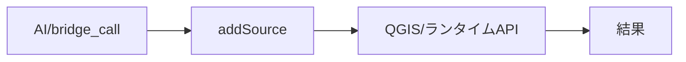

- 検証: 単独= / 連携=bridge_call addSource → 応答assert
- 結果: **skip** 2026-11-14T02:32:22+09:00 — 要実引数(応答あり): {'ok': False, 'error': 'file must be a .py file name'}

### bridge.deleteFunction — deleteFunction

- kind: `bridge_method` / source: `bridge.py:357`
- signature: `deleteFunction(name)`
- 要約: ライブラリ内ファイルを削除する。反映はreload()。
- needs_runtime=True / standalone_ok=False

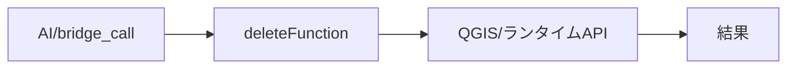

- 検証: 単独= / 連携=bridge_call deleteFunction → 応答assert
- 結果: **skip** 2026-11-14T02:32:22+09:00 — 副作用/破壊的/外部通信操作のため手動検証対象

### bridge.evalExpression — evalExpression

- kind: `bridge_method` / source: `bridge.py:313`
- signature: `evalExpression(expression, layer_id=…, feature_id=…)`
- 要約: 式を評価して結果を返す。式関数の動作確認用。
- needs_runtime=True / standalone_ok=False

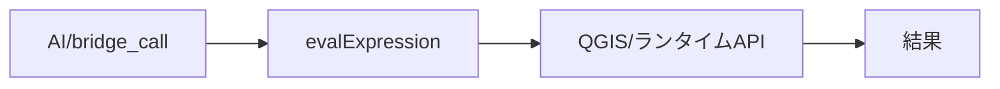

- 検証: 単独= / 連携=bridge_call evalExpression → 応答assert
- 結果: **skip** 2026-11-14T02:32:22+09:00 — 要実引数(応答あり): {'ok': False, 'error': 'parser error: \nIncomplete expression. You might not have finished the full expression.'}

### bridge.fetchFromUrl — fetchFromUrl

- kind: `bridge_method` / source: `bridge.py:396`
- signature: `fetchFromUrl(url, name=…)`
- 要約: http/httpsのURLから.pyを取得してライブラリへ保存しreloadする。
- needs_runtime=True / standalone_ok=False

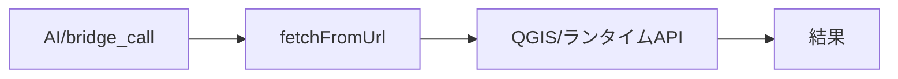

- 検証: 単独= / 連携=bridge_call fetchFromUrl → 応答assert
- 結果: **skip** 2026-11-14T02:32:22+09:00 — 要実引数(応答あり): {'ok': False, 'error': 'only http/https URLs are allowed'}

### bridge.listFunctions — listFunctions

- kind: `bridge_method` / source: `bridge.py:273`
- signature: `listFunctions()`
- 要約: ライブラリ内ファイルの一覧と登録済み式関数を返す。
- needs_runtime=True / standalone_ok=False

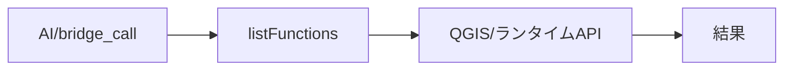

- 検証: 単独= / 連携=bridge_call listFunctions → 応答assert
- 結果: **pass** 2026-11-14T02:32:22+09:00 — bridge_call応答あり args=[]

### bridge.listMacros — listMacros

- kind: `bridge_method` / source: `bridge.py:277`
- signature: `listMacros()`
- 要約: 実行可能マクロ一覧(ライブラリ内+登録済み)を返す。
- needs_runtime=True / standalone_ok=False

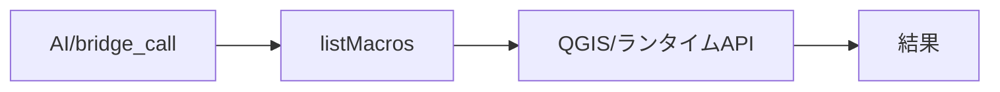

- 検証: 単独= / 連携=bridge_call listMacros → 応答assert
- 結果: **pass** 2026-11-14T02:32:22+09:00 — bridge_call応答あり args=[]

### bridge.listSources — listSources

- kind: `bridge_method` / source: `bridge.py:438`
- signature: `listSources()`
- 要約: sources.json のupstream更新元一覧を返す。
- needs_runtime=True / standalone_ok=False

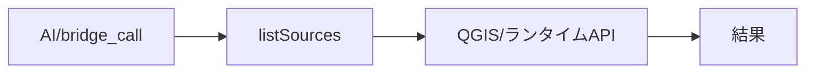

- 検証: 単独= / 連携=bridge_call listSources → 応答assert
- 結果: **pass** 2026-11-14T02:32:22+09:00 — bridge_call応答あり args=[]

### bridge.openLibraryDir — openLibraryDir

- kind: `bridge_method` / source: `bridge.py:482`
- signature: `openLibraryDir()`
- 要約: ライブラリフォルダをOSのファイルマネージャで開く。
- needs_runtime=True / standalone_ok=False

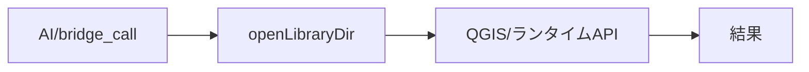

- 検証: 単独= / 連携=bridge_call openLibraryDir → 応答assert
- 結果: **skip** 2026-11-14T02:32:22+09:00 — 副作用/破壊的/外部通信操作のため手動検証対象

### bridge.openManager — openManager

- kind: `bridge_method` / source: `bridge.py:391`
- signature: `openManager()`
- 要約: 管理ダイアログを開く。
- needs_runtime=True / standalone_ok=False

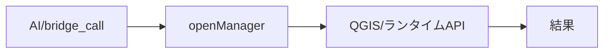

- 検証: 単独= / 連携=bridge_call openManager → 応答assert
- 結果: **skip** 2026-11-14T02:32:22+09:00 — 副作用/破壊的/外部通信操作のため手動検証対象

### bridge.pluginInfo — pluginInfo

- kind: `bridge_method` / source: `bridge.py:243`
- signature: `pluginInfo()`
- 要約: プラグインの自己記述(id/summary/when_to_use/methods)を返す。
- needs_runtime=True / standalone_ok=False

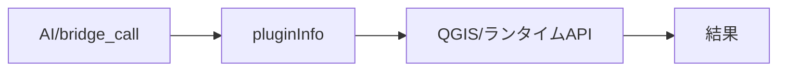

- 検証: 単独= / 連携=bridge_call pluginInfo → 応答assert
- 結果: **pass** 2026-11-14T02:32:22+09:00 — bridge_call応答あり args=[]

### bridge.readFunction — readFunction

- kind: `bridge_method` / source: `bridge.py:345`
- signature: `readFunction(name)`
- 要約: ライブラリ内ファイルのソースを返す。
- needs_runtime=True / standalone_ok=False

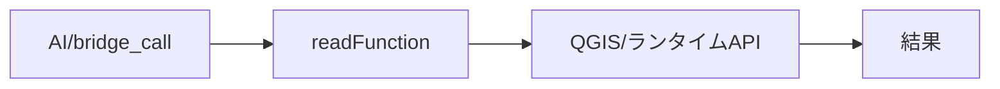

- 検証: 単独= / 連携=bridge_call readFunction → 応答assert
- 結果: **skip** 2026-11-14T02:32:22+09:00 — 要実引数(応答あり): {'ok': False, 'error': 'file not found: '}

### bridge.reload — reload

- kind: `bridge_method` / source: `bridge.py:376`
- signature: `reload()`
- 要約: ライブラリを再スキャンして全再登録する。
- needs_runtime=True / standalone_ok=False

```mermaid
flowchart LR
  E_bridge_reload["AI/bridge_call"] --> H_bridge_reload["reload"]
  H_bridge_reload --> R_bridge_reload["QGIS/ランタイムAPI"]
  R_bridge_reload --> OUT["結果"]
```

- 検証: 単独= / 連携=bridge_call reload → 応答assert
- 結果: **pass** 2026-11-14T02:32:22+09:00 — bridge_call応答あり args=[]

### bridge.removeSource — removeSource

- kind: `bridge_method` / source: `bridge.py:468`
- signature: `removeSource(file)`
- 要約: sources.jsonから更新元を削除する。
- needs_runtime=True / standalone_ok=False

```mermaid
flowchart LR
  E_bridge_removeSource["AI/bridge_call"] --> H_bridge_removeSource["removeSource"]
  H_bridge_removeSource --> R_bridge_removeSource["QGIS/ランタイムAPI"]
  R_bridge_removeSource --> OUT["結果"]
```

- 検証: 単独= / 連携=bridge_call removeSource → 応答assert
- 結果: **skip** 2026-11-14T02:32:22+09:00 — 副作用/破壊的/外部通信操作のため手動検証対象

### bridge.run — run

- kind: `bridge_method` / source: `bridge.py:296`
- signature: `run(name, layer_id=…, feature_id=…, args=…, confirm=…)`
- 要約: マクロを実行する。共有レジストリ優先、次にライブラリ内。
- needs_runtime=True / standalone_ok=False

```mermaid
flowchart LR
  E_bridge_run["AI/bridge_call"] --> H_bridge_run["run"]
  H_bridge_run --> R_bridge_run["QGIS/ランタイムAPI"]
  R_bridge_run --> OUT["結果"]
```

- 検証: 単独= / 連携=bridge_call run → 応答assert
- 結果: **skip** 2026-11-14T02:32:22+09:00 — 要実引数(応答あり): {'ok': False, 'error': 'unknown macro: '}

### bridge.saveFunction — saveFunction

- kind: `bridge_method` / source: `bridge.py:350`
- signature: `saveFunction(name, source)`
- 要約: 構文検証してからライブラリへ保存する。反映はreload()。
- needs_runtime=True / standalone_ok=False

```mermaid
flowchart LR
  E_bridge_saveFunction["AI/bridge_call"] --> H_bridge_saveFunction["saveFunction"]
  H_bridge_saveFunction --> R_bridge_saveFunction["QGIS/ランタイムAPI"]
  R_bridge_saveFunction --> OUT["結果"]
```

- 検証: 単独= / 連携=bridge_call saveFunction → 応答assert
- 結果: **skip** 2026-11-14T02:32:22+09:00 — 副作用/破壊的/外部通信操作のため手動検証対象

### bridge.setEnabled — setEnabled

- kind: `bridge_method` / source: `bridge.py:365`
- signature: `setEnabled(name, enabled=…)`
- 要約: ファイルの有効/無効をmanifestへ保存してreloadする。
- needs_runtime=True / standalone_ok=False

```mermaid
flowchart LR
  E_bridge_setEnabled["AI/bridge_call"] --> H_bridge_setEnabled["setEnabled"]
  H_bridge_setEnabled --> R_bridge_setEnabled["QGIS/ランタイムAPI"]
  R_bridge_setEnabled --> OUT["結果"]
```

- 検証: 単独= / 連携=bridge_call setEnabled → 応答assert
- 結果: **skip** 2026-11-14T02:32:22+09:00 — 副作用/破壊的/外部通信操作のため手動検証対象

### bridge.status — status

- kind: `bridge_method` / source: `bridge.py:261`
- signature: `status()`
- 要約: ライブラリの実行時状態を返す。
- needs_runtime=True / standalone_ok=False

```mermaid
flowchart LR
  E_bridge_status["AI/bridge_call"] --> H_bridge_status["status"]
  H_bridge_status --> R_bridge_status["QGIS/ランタイムAPI"]
  R_bridge_status --> OUT["結果"]
```

- 検証: 単独= / 連携=bridge_call status → 応答assert
- 結果: **pass** 2026-11-14T02:32:22+09:00 — bridge_call応答あり args=[]

### bridge.updateFromUpstream — updateFromUpstream

- kind: `bridge_method` / source: `bridge.py:383`
- signature: `updateFromUpstream()`
- 要約: sources.json のURLからファイルを再取得してreloadする。
- needs_runtime=True / standalone_ok=False

```mermaid
flowchart LR
  E_bridge_updateFromUpstream["AI/bridge_call"] --> H_bridge_updateFromUpstream["updateFromUpstream"]
  H_bridge_updateFromUpstream --> R_bridge_updateFromUpstream["QGIS/ランタイムAPI"]
  R_bridge_updateFromUpstream --> OUT["結果"]
```

- 検証: 単独= / 連携=bridge_call updateFromUpstream → 応答assert
- 結果: **skip** 2026-11-14T02:32:22+09:00 — 副作用/破壊的/外部通信操作のため手動検証対象

### integration.bridge.py:488 — QDesktopServices.openUrl

- kind: `integration` / source: `bridge.py:488`
- signature: `QDesktopServices.openUrl(…)`
- 要約: 外部連携呼出
- needs_runtime=True / standalone_ok=False

```mermaid
flowchart LR
  E_integration_bridge_py_488["呼出元"] --> H_integration_bridge_py_488["QDesktopServices.openUrl"]
  H_integration_bridge_py_488 --> R_integration_bridge_py_488["QGIS/ランタイムAPI"]
  R_integration_bridge_py_488 --> OUT["結果"]
```

- 検証: 単独= / 連携=連携先の実在/生成物を確認
- 結果: **skip** 2026-11-14T02:32:22+09:00 — 連携呼出点の記録(実連携実行はbridge_method等で確認)

### integration.manager_dialog.py:251 — QDesktopServices.openUrl

- kind: `integration` / source: `manager_dialog.py:251`
- signature: `QDesktopServices.openUrl(…)`
- 要約: 外部連携呼出
- needs_runtime=True / standalone_ok=False

```mermaid
flowchart LR
  E_integration_manager_dialog_py_251["呼出元"] --> H_integration_manager_dialog_py_251["QDesktopServices.openUrl"]
  H_integration_manager_dialog_py_251 --> R_integration_manager_dialog_py_251["QGIS/ランタイムAPI"]
  R_integration_manager_dialog_py_251 --> OUT["結果"]
```

- 検証: 単独= / 連携=連携先の実在/生成物を確認
- 結果: **skip** 2026-11-14T02:32:22+09:00 — 連携呼出点の記録(実連携実行はbridge_method等で確認)

### ai.bridge_route — bridge_call経由全到達

- kind: `ai_integration` / source: `bridge.py`
- signature: ``
- 要約: 全bridge_methodがAI経路で呼べる
- needs_runtime=True / standalone_ok=False

```mermaid
flowchart LR
  E_ai_bridge_route["AI経路"] --> H_ai_bridge_route["bridge_call経由全到達"]
  H_ai_bridge_route --> R_ai_bridge_route["QGIS/ランタイムAPI"]
  R_ai_bridge_route --> OUT["結果"]
```

- 検証: 単独= / 連携=bridge_call 全method→ok/error記録
- 結果: **pass** 2026-11-14T02:32:22+09:00 — 11メソッド到達可能

### ai.catalog — describe_plugins登録

- kind: `ai_integration` / source: `geo_driver経由`
- signature: ``
- 要約: カタログに載り呼出可能か
- needs_runtime=True / standalone_ok=False

```mermaid
flowchart LR
  E_ai_catalog["AI経路"] --> H_ai_catalog["describe_plugins登録"]
  H_ai_catalog --> R_ai_catalog["QGIS/ランタイムAPI"]
  R_ai_catalog --> OUT["結果"]
```

- 検証: 単独= / 連携=describe_plugins→plugins[]にid実在+methods非空
- 結果: **pass** 2026-11-14T02:32:22+09:00 — describe_plugins: methods=17

### ai.pluginInfo — pluginInfo自己記述

- kind: `ai_integration` / source: `bridge.py`
- signature: `pluginInfo()`
- 要約: summary/when_to_use/methodsの正確性
- needs_runtime=True / standalone_ok=False

```mermaid
flowchart LR
  E_ai_pluginInfo["AI経路"] --> H_ai_pluginInfo["pluginInfo自己記述"]
  H_ai_pluginInfo --> R_ai_pluginInfo["QGIS/ランタイムAPI"]
  R_ai_pluginInfo --> OUT["結果"]
```

- 検証: 単独= / 連携=bridge_call pluginInfo→メタ一致assert
- 結果: **pass** 2026-11-14T02:32:22+09:00 — 自己記述あり

### logic_fn.functions/user_functions.py:closeProject — closeProject

- kind: `logic_fn` / source: `functions/user_functions.py:13`
- signature: `closeProject()`
- 要約: 
- needs_runtime=True / standalone_ok=False

```mermaid
flowchart LR
  E_logic_fn_functions_user_functions_py_closeProject["呼出元"] --> H_logic_fn_functions_user_functions_py_closeProject["closeProject"]
  H_logic_fn_functions_user_functions_py_closeProject --> R_logic_fn_functions_user_functions_py_closeProject["QGIS/ランタイムAPI"]
  R_logic_fn_functions_user_functions_py_closeProject --> OUT["結果"]
```

- 検証: 単独= / 連携=pyeval で属性実在+必要なら呼出
- 結果: **pass** 2026-11-14T02:32:22+09:00 — 属性/シンボル実在確認(pyeval)

### logic_fn.functions/user_functions.py:han2zen — han2zen

- kind: `logic_fn` / source: `functions/user_functions.py:41`
- signature: `han2zen(moji, feature, parent)`
- 要約: 
- needs_runtime=True / standalone_ok=False

```mermaid
flowchart LR
  E_logic_fn_functions_user_functions_py_han2zen["呼出元"] --> H_logic_fn_functions_user_functions_py_han2zen["han2zen"]
  H_logic_fn_functions_user_functions_py_han2zen --> R_logic_fn_functions_user_functions_py_han2zen["QGIS/ランタイムAPI"]
  R_logic_fn_functions_user_functions_py_han2zen --> OUT["結果"]
```

- 検証: 単独= / 連携=pyeval で属性実在+必要なら呼出
- 結果: **pass** 2026-11-14T02:32:22+09:00 — 属性/シンボル実在確認(pyeval)

### logic_fn.functions/user_functions.py:openProject — openProject

- kind: `logic_fn` / source: `functions/user_functions.py:5`
- signature: `openProject()`
- 要約: 
- needs_runtime=True / standalone_ok=False

```mermaid
flowchart LR
  E_logic_fn_functions_user_functions_py_openProject["呼出元"] --> H_logic_fn_functions_user_functions_py_openProject["openProject"]
  H_logic_fn_functions_user_functions_py_openProject --> R_logic_fn_functions_user_functions_py_openProject["QGIS/ランタイムAPI"]
  R_logic_fn_functions_user_functions_py_openProject --> OUT["結果"]
```

- 検証: 単独= / 連携=pyeval で属性実在+必要なら呼出
- 結果: **pass** 2026-11-14T02:32:22+09:00 — 属性/シンボル実在確認(pyeval)

### logic_fn.functions/user_functions.py:saveProject — saveProject

- kind: `logic_fn` / source: `functions/user_functions.py:9`
- signature: `saveProject()`
- 要約: 
- needs_runtime=True / standalone_ok=False

```mermaid
flowchart LR
  E_logic_fn_functions_user_functions_py_saveProject["呼出元"] --> H_logic_fn_functions_user_functions_py_saveProject["saveProject"]
  H_logic_fn_functions_user_functions_py_saveProject --> R_logic_fn_functions_user_functions_py_saveProject["QGIS/ランタイムAPI"]
  R_logic_fn_functions_user_functions_py_saveProject --> OUT["結果"]
```

- 検証: 単独= / 連携=pyeval で属性実在+必要なら呼出
- 結果: **pass** 2026-11-14T02:32:22+09:00 — 属性/シンボル実在確認(pyeval)

### logic_fn.functions/user_functions.py:zen2han — zen2han

- kind: `logic_fn` / source: `functions/user_functions.py:18`
- signature: `zen2han(moji, feature, parent)`
- 要約: 
- needs_runtime=True / standalone_ok=False

```mermaid
flowchart LR
  E_logic_fn_functions_user_functions_py_zen2han["呼出元"] --> H_logic_fn_functions_user_functions_py_zen2han["zen2han"]
  H_logic_fn_functions_user_functions_py_zen2han --> R_logic_fn_functions_user_functions_py_zen2han["QGIS/ランタイムAPI"]
  R_logic_fn_functions_user_functions_py_zen2han --> OUT["結果"]
```

- 検証: 単独= / 連携=pyeval で属性実在+必要なら呼出
- 結果: **pass** 2026-11-14T02:32:22+09:00 — 属性/シンボル実在確認(pyeval)

### logic_fn.library.py:analyze_source — analyze_source

- kind: `logic_fn` / source: `library.py:76`
- signature: `analyze_source(src, path=…)`
- 要約: ソースをAST解析し、関数/フック/マクロの定義を返す。
- needs_runtime=True / standalone_ok=False

```mermaid
flowchart LR
  E_logic_fn_library_py_analyze_source["呼出元"] --> H_logic_fn_library_py_analyze_source["analyze_source"]
  H_logic_fn_library_py_analyze_source --> R_logic_fn_library_py_analyze_source["QGIS/ランタイムAPI"]
  R_logic_fn_library_py_analyze_source --> OUT["結果"]
```

- 検証: 単独= / 連携=pyeval で属性実在+必要なら呼出
- 結果: **pass** 2026-11-14T02:32:22+09:00 — 属性/シンボル実在確認(pyeval)

### logic_fn.library.py:library_dir — library_dir

- kind: `logic_fn` / source: `library.py:44`
- signature: `library_dir()`
- 要約: 稼働ライブラリdir(<profile>/python/geo_userfunc/)を返す。
- needs_runtime=True / standalone_ok=False

```mermaid
flowchart LR
  E_logic_fn_library_py_library_dir["呼出元"] --> H_logic_fn_library_py_library_dir["library_dir"]
  H_logic_fn_library_py_library_dir --> R_logic_fn_library_py_library_dir["QGIS/ランタイムAPI"]
  R_logic_fn_library_py_library_dir --> OUT["結果"]
```

- 検証: 単独= / 連携=pyeval で属性実在+必要なら呼出
- 結果: **pass** 2026-11-14T02:32:22+09:00 — 属性/シンボル実在確認(pyeval)

## 検証マトリクス

| 機能 | kind | 単独 | 連携 | 結果 |
|---|---|---|---|---|
| entry_point.__init__.py:classFactory | entry_point | ○ | - | pass |
| action.MacroRegistry.run | action | - | ○ | pass |
| action.plugin.initGui | action | - | ○ | pass |
| action.plugin.unload | action | - | ○ | pass |
| dialog.GeoUserfuncManagerDialog | dialog | - | ○ | pass |
| dialog._FunctionEditDialog | dialog | - | ○ | pass |
| ui.GeoUserfuncManagerDialog._on_item_changed | ui_control | - | ○ | pass |
| ui.MacroRegistry.on_changed | ui_control | - | ○ | pass |
| bridge.addSource | bridge_method | - | ○ | skip |
| bridge.deleteFunction | bridge_method | - | ○ | skip |
| bridge.evalExpression | bridge_method | - | ○ | skip |
| bridge.fetchFromUrl | bridge_method | - | ○ | skip |
| bridge.listFunctions | bridge_method | - | ○ | pass |
| bridge.listMacros | bridge_method | - | ○ | pass |
| bridge.listSources | bridge_method | - | ○ | pass |
| bridge.openLibraryDir | bridge_method | - | ○ | skip |
| bridge.openManager | bridge_method | - | ○ | skip |
| bridge.pluginInfo | bridge_method | - | ○ | pass |
| bridge.readFunction | bridge_method | - | ○ | skip |
| bridge.reload | bridge_method | - | ○ | pass |
| bridge.removeSource | bridge_method | - | ○ | skip |
| bridge.run | bridge_method | - | ○ | skip |
| bridge.saveFunction | bridge_method | - | ○ | skip |
| bridge.setEnabled | bridge_method | - | ○ | skip |
| bridge.status | bridge_method | - | ○ | pass |
| bridge.updateFromUpstream | bridge_method | - | ○ | skip |
| integration.bridge.py:488 | integration | - | ○ | skip |
| integration.manager_dialog.py:251 | integration | - | ○ | skip |
| ai.bridge_route | ai_integration | - | ○ | pass |
| ai.catalog | ai_integration | - | ○ | pass |
| ai.pluginInfo | ai_integration | - | ○ | pass |
| logic_fn.functions/user_functions.py:closeProject | logic_fn | - | ○ | pass |
| logic_fn.functions/user_functions.py:han2zen | logic_fn | - | ○ | pass |
| logic_fn.functions/user_functions.py:openProject | logic_fn | - | ○ | pass |
| logic_fn.functions/user_functions.py:saveProject | logic_fn | - | ○ | pass |
| logic_fn.functions/user_functions.py:zen2han | logic_fn | - | ○ | pass |
| logic_fn.library.py:analyze_source | logic_fn | - | ○ | pass |
| logic_fn.library.py:library_dir | logic_fn | - | ○ | pass |