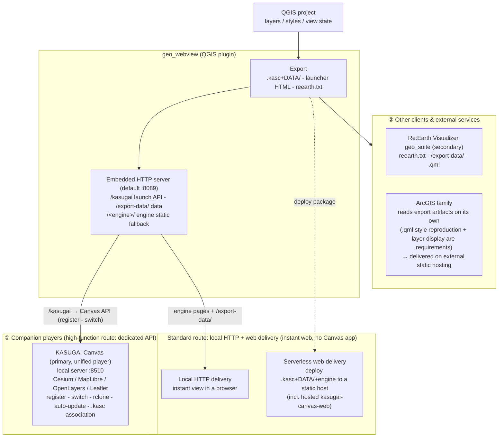

# geo_webview — Integration policy for external clients & services

[日本語: `INTEGRATION_JP.md`](INTEGRATION_JP.md)

Per-target integration policy of geo_webview. Detailed policy and
licensing notes are consolidated in this document; the READMEs carry
only summaries.

## Integration architecture

## Re:Earth Visualizer (geo_suite) policy

Re:Earth Visualizer is positioned as the **secondary, Cesium-based
player** alongside KASUGAI Canvas. geo_webview feeds it via `reearth.txt`
(inspector text) export plus `/export-data/` file and `.qml` style
delivery; the QML→Re:Earth translation runs client-side (a translator
bundled in geo_suite). 3D work is consolidated in the Cesium-based
clients — KASUGAI Canvas (primary) and Re:Earth Visualizer (secondary).

Client side (geo_suite): [ReEarth_GeoSuite
repository](https://github.com/yamamoto-ryuzo/ReEarth_GeoSuite). For the
`reearth.txt` output spec see [SPEC.md](SPEC.md).

## ArcGIS policy

**Summary**: ① **Running custom code on ArcGIS Online is impossible —
this system's features cannot be realized there** (the fundamental
premise). ② To build an equivalent of engines like Cesium on
ArcGIS — **the Canvas-side code assets cannot be reused (different
SDK), so development from scratch including data construction is
required** (3D presupposes the 3D Tiles→I3S conversion pipeline; live
3D Tiles URLs out of scope; only the `.kasc` spec and the same OSS
libraries can be carried over). ③ Running a custom WebGIS inside the
ArcGIS-managed environment requires Enterprise 11.0+ in-portal ExB
custom widgets — the only route; everything else follows the
external-hosting model and offers no significance for adoption.

### 1. ArcGIS Online cannot run custom code (fundamental premise)

**Running this system's features inside ArcGIS Online is functionally
impossible.** ArcGIS Online provides no mechanism to host or execute
custom code (JS apps, plugins, ExB custom widgets, etc.) and has no
plugin-extension path like Re:Earth's. ArcGIS integration therefore
follows the policy of *not* treating ArcGIS Online as an extension
target and instead **limiting integration to file handoff — reading is
left to the ArcGIS side's own SDK-based implementation**:

- **QGIS → ArcGIS**: the `.kasc`+`DATA/` output is handed over as files
  and read on the ArcGIS side by its own implementation (note: the
  plugin's own OGC services were removed in v3.29.0)

The reading side is required to provide a **reproduction (player)
implementation**:

- **`.qml` style carryover** (QGIS renderer → ArcGIS renderer
  translation) — the goal is not a data-only import that discards
  styles
- **Layer display features** — layer tree, visibility toggles,
  opacity, basemap switching, attribute popups, etc. **A minimal
  implementation is acceptable depending on the use case** (full
  parity with the other engines is not required)

#### What can and cannot be delivered on ArcGIS Online

Separating "delivery on Online" by what is being delivered:

| What to deliver | Possible on ArcGIS Online? |
|---|---|
| The `.kasc` player (the custom-code app itself) | **× No** — Online cannot host or execute custom code. External static hosting is required |
| The `.kasc`+`DATA/` file set itself | **× No** — Online has no arbitrary static-file hosting |
| **Data converted and published as AGOL services** | **○ Yes** — GeoJSON/CSV/shapefile/FileGDB → hosted feature layers, tiles → hosted tile layers, 3D → scene layers (I3S; 3D Tiles→I3S conversion needed). Published services can be delivered directly through AGOL's built-in web maps/scenes, Instant Apps, standard ExB widgets, Dashboards and StoryMaps. Requires a Creator-or-above user type (GIS Professional bundles the Pro license) plus storage/generation credits. Public sharing allows anonymous viewing outside the org |

However, the "convert and publish as AGOL services" route is **service
publication of data**, not `.kasc` playback — `.qml` styles do not
carry over and must be rebuilt on the AGOL/Pro side (for requirements
such as reproducing `.kasc` line types, themes and styles, the
external-host `.kasc` player route applies).

### 2. Building an equivalent — development from scratch including data construction

Building a `.kasc`+`DATA/` player on the ArcGIS side equivalent to the other engines (Cesium/MapLibre/OpenLayers/Leaflet) means **building a separate system from scratch — Canvas-side code assets cannot be reused because the SDK differs** (only the `.kasc` spec and the same OSS libraries can be carried over).

Note that **ArcGIS Maps SDK for JavaScript is a web-mapping library in
the same category as Leaflet/MapLibre/OpenLayers/CesiumJS** (Esri's
official SDK, WebGL-based; MapView=2D / SceneView=3D) — structurally it
is the equivalent of adding a fifth engine to the multi-engine lineup.
The differences are that it is not OSS (subject to Esri product terms;
attribution required) and that SceneView does not support OGC 3D Tiles
(I3S only).

#### Player implementation scope and `.kasc` line-type compatibility

Serverless delivery equal to Canvas presupposes the ArcGIS-side `.kasc`
player. Required implementation components:

| Component | Description |
|---|---|
| `.kasc` parser | Interpretation of the leading `kind:` token, `\|` field splitting, `on`/`off` and `key=value` options (authoritative spec: kasugai_canvas `.kasc` inspector spec = `web/shared/kasc.js`) |
| Reference resolution | Resolve relative paths such as `DATA/` against the `.kasc` URL |
| `.qml` → ArcGIS renderer translation | Map QGIS renderers (single symbol / categorized / graduated / rule-based) onto `SimpleRenderer`/`UniqueValueRenderer`/`ClassBreaksRenderer` + symbols — fill, line, marker, opacity, labels (`labelingInfo`). GPKG-embedded `layer_styles` (QML) goes through the same path |
| Data loaders | Per-line-type decode → FeatureLayer/GraphicsLayer (see table below) |
| Layer display UI | Layer list, visibility toggles, opacity, basemap switching, attribute popups (minimal implementation acceptable per use case) |
| `cam:` / `theme:` application | Camera → MapView/SceneView viewpoint; theme → visibility preset |
| Attribution | `attr=` source display (also an Esri requirement) |

Per-`.kasc` line-type feasibility on ArcGIS Maps SDK for JavaScript:

| `.kasc` line type | Feasibility |
|---|---|
| `geojson:` / `layer:` | ○ Native via GeoJSONLayer |
| `xyz:` / `base:` | ○ WebTileLayer (`{z}/{x}/{y}` templates; duplicated local tile trees work via static placement) |
| `wms:` | ○ WMSLayer |
| `wmts:` | ○ WMTSLayer |
| `gpkg:` | △ Not native → custom loader via sql.js (SQLite WASM) → GeoJSON (same approach as Canvas, reusable in JS; `table=`/`where=`/`layer_styles` handling also implemented here) |
| `geoparquet:` | △ Not native → decode via hyparquet etc. → GeoJSON |
| `flatgeobuf:` | △ Not native → official JS reader stream-decode → GeoJSON (same library as Canvas) |
| `duckdb:` / `sql:` | △ Not native → DuckDB-WASM SQL filtering → GeoJSON (same engine as Canvas; `bbox=auto` viewport-linked requery also implemented here) |
| `3dtiles:` | △ SceneView does not support OGC 3D Tiles (I3S SceneLayer only) → **handled via a 3D Tiles→I3S conversion pipeline** (adopted configuration below; live 3D Tiles URLs are out of scope) |
| `cam:` | ○ Implementable via viewpoint conversion |
| `theme:` | ○ Implementable as layer-visibility presets |
| `plugin:` / `cloud:` | — Canvas-specific features, out of scope (safe to ignore) |
| Common options | `\| off`, `attr=`, `style=QML`, `opacity=` are implementation targets; `render=`/`proxy=` are Canvas-specific |

In short, "**same delivery model, narrower reproduction coverage**" is
the accurate summary: the two implementation centers are the **QML→
ArcGIS translation** and the **native-format loaders (`gpkg:`/
`geoparquet:`/`flatgeobuf:`/`duckdb:`)**; 3D (`3dtiles:`) is handled
only via the I3S conversion pipeline.

#### Combinations needed for a Cesium-level implementation (adopted configuration)

Combinations for an "ArcGIS-flavored" implementation at Cesium parity
(i.e. including 3D). **The adopted configuration is the fully-ArcGIS
route**:

| Goal | Combination | Verdict |
|---|---|---|
| **Adopted configuration (max ArcGIS purity)** | **ArcGIS Maps SDK for JavaScript (MapView=2D / SceneView=3D) + 3D Tiles → I3S conversion pipeline** (loaders.gl tile-converter / ArcGIS Pro SLPK authoring) → SceneLayer | ○ Keeps everything inside a single ArcGIS stack. Conversion is mandatory; live-referenced 3D Tiles URLs (e.g. Google Photorealistic 3D Tiles) cannot be converted/redistributed and are out of scope |
| 2D only (`.kasc` playback without 3D) | ArcGIS Maps SDK for JavaScript (MapView) alone + custom `.kasc` loader / QML translation | ○ Viable if shipping only the 2D half of the adopted configuration first |
| Alternative (only if live 3D Tiles URL playback is required) | Hybrid: ArcGIS JS SDK (2D, UI, auth, services, renderers) + CesiumJS (3D Tiles rendering) | △ "ArcGIS-ness" comes from layers/auth/renderers; only the 3D Tiles drawing is delegated to CesiumJS (precedent: OL+Cesium two-pane `/map3d`). Excluded from the adopted configuration because it mixes a non-Esri library |

Key point: **SceneView cannot read OGC 3D Tiles, so the only
ArcGIS-native path to 3D is "3D Tiles → I3S conversion →
SceneLayer"**. Live-referenced 3D Tiles URLs are out of scope under
this configuration; the hybrid remains only as a fallback for that
specific need.

#### Licenses required per ArcGIS-side reading implementation

| Implementation | Required license / account |
|---|---|
| ArcGIS Pro add-in (.NET SDK) reads `.kasc`+`DATA/` | ArcGIS Pro license (Named User via Online org or Enterprise portal, or Single Use) |
| Custom web app (ArcGIS Maps SDK for JavaScript) reads it | The app can be hosted on any web server. For Esri location services / private content: an API key from ArcGIS Location Platform (formerly Developer account), or OAuth against an Online/Enterprise account |
| Experience Builder custom widget reads it | Develop with ExB Developer Edition (sign-in requires an Online or Enterprise account; Location Platform accounts do not support ExB). The finished app can run from your own web server even with an Online-only org |

#### Minimum licensing for a `.kasc` player implementation

The minimum licensing for building an ArcGIS-side player that reads and
reproduces `.kasc`+`DATA/` like the other engines (Cesium/MapLibre/
OpenLayers/Leaflet) is as follows — **all are free or low-cost**:

| Player implementation | Minimum license | Cost notes |
|---|---|---|
| Web player (ArcGIS Maps SDK for JavaScript) | An **ArcGIS Online org** or an **ArcGIS Location Platform account** (free sign-up) — no additional purchase for the SDK itself | Reading `.kasc`+`DATA/` (GeoJSON etc.) without Esri services/basemaps incurs no charges; an API key + pay-as-you-go billing (free tier exists) only applies when consuming Esri services |
| Native player (ArcGIS Maps SDK for Native Apps) | **Runtime Lite** license — free (a license string, or sign-in with a Viewer/Lite user type) | Free. Includes viewing maps, scenes, layers and packages in 2D/3D — sufficient for `.kasc` playback |
| Desktop integration (ArcGIS Pro add-in) | **ArcGIS Pro (Basic)** | Paid, but Basic is the lowest tier; Named User licensing can be issued via an Online org |

Every route still requires a custom implementation that reads `DATA/`
(GeoJSON, native tiles, etc.) and implements the QML→ArcGIS renderer
translation and layer display features, but for the web player route
the licensing barrier is effectively zero.

#### Where the implementation can be hosted

The implemented app **cannot run on ArcGIS Online — it must always be
hosted externally**. Registering it as an item in ArcGIS Online/Portal
is only a URL reference.

**Hosting options for the web player (ArcGIS Maps SDK for JavaScript)**
(all plain static hosting; parenthetical = precedent in this workspace):

- **GitHub Pages** — `https://<org>.github.io/<repo>/` (the same
  stable/unstable two-channel setup kasugai-canvas-web uses)
- **Cloudflare Pages / Workers** (kasugai_canvas deploy target)
- **Vercel** (ReEarth geo_suite site)
- **Netlify**
- **Your own web server** — Windows IIS / Apache / nginx (intranet-only
  publishing works too)
- **Object storage + CDN** — AWS S3+CloudFront / Google Cloud Storage /
  Azure Static Web Apps / Blob static site

Once built, the app can be registered in AGOL/Portal as a "Web App"
item (a URL reference) so the org can reach it.

**This is the same serverless delivery model as KASUGAI Canvas** — a
static app plus `.kasc`+`DATA/` on a static host, with data served from
the same origin. It presupposes the player implementation, and the
set of `.kasc` line types it can reproduce is constrained (GeoJSON/
CSV/XYZ/MVT natively; `gpkg:`/`geoparquet:`/`flatgeobuf:`/`duckdb:`
need custom loaders; `3dtiles:` needs I3S conversion since SceneView
does not support OGC 3D Tiles).

Delivery for the other implementation forms:

| Implementation | Where it can be delivered |
|---|---|
| Experience Builder app | Deploy the app bundle built with ExB Developer Edition to any host listed above. Only if custom widgets must be hosted *inside* the portal for org builders does ArcGIS Enterprise 11.0+ become necessary |
| ArcGIS Pro add-in | Distributed as an `.esriAddinX` file (file share, internal server, download link, etc.) |
| Native app (ArcGIS Maps SDK for Native Apps) | Desktop = installer distribution (MSI/MSIX, internal rollout), mobile = app stores / MDM |

The `.kasc`+`DATA/` consumed by the app is supplied either by this
plugin's `/export-data/` or any static host. **Placing the app and the
data on the same origin is the simplest setup** (cross-origin also
works with CORS enabled).

### 3. Running inside the ArcGIS-managed environment — Enterprise ExB only

**The only official route to run a custom WebGIS inside the ArcGIS-managed environment (Portal) is in-portal ExB custom widgets on Enterprise 11.0+** — Online has no such mechanism at all. This is the only case where ArcGIS Enterprise is actually required. Merely keeping everything inside the org's network boundary is different: placing the external-host `.kasc` player on the customer's intranet web server achieves that regardless (inside the security boundary, though not Esri-managed).

An externally-hosted app can still **look and behave as part of Online**:

- **Register it as a "Web App" item in AGOL/Portal** — the item is just
  a URL reference, but it appears in the org's content gallery and
  opens from there
- **AGOL OAuth sign-in** — let users sign in with their ArcGIS identity
  so the app can access org content/services with authentication
- **Embed it via URL inside ExB/StoryMaps/Dashboards** — load the
  external app as an element inside an AGOL-hosted experience

So while it has little value as a "fifth engine" of the multi-engine
lineup, building it up to this level of **org-integration** does let it
function as part of a customer's ArcGIS environment.

### (Appendix)  Cautions for ingesting ArcGIS services (`arcgis:` lines)

For reference: a plan exists to add `arcgis:` line types to `.kasc` so
that KASUGAI Canvas could ingest MapServer/ImageServer/FeatureServer/
SceneServer endpoints — but **licensing is a major challenge**. A REST
endpoint being technically readable and being licensed for use are two
different things:

- **Esri-hosted services (ArcGIS Online basemaps, location services,
  etc.)**: using them from non-Esri clients (CesiumJS, MapLibre, etc.
  are officially supported targets) requires an **ArcGIS Location
  Platform subscription** — every request must be authenticated with an
  API key/OAuth token under pay-as-you-go billing (free tier exists).
  Directly referencing endpoints without an API key violates the terms
  of use
- **Attribution**: apps using Esri services/data must display
  "Powered by Esri" and data-source attribution. Non-Esri libraries do
  not show this automatically — Canvas would need its own
  implementation
- **Content hosted by an ArcGIS Online org**: secured services require
  OAuth against that org. Even public services, Living Atlas content,
  and commercial data follow the content provider's terms of use
  (readable ≠ licensed)
- **Public services on ArcGIS Server / Enterprise**: your own org's
  services are covered by the Enterprise contract, but services
  published by third parties follow the publisher's terms (municipal
  and government REST services carry their own usage policies)

Implementing `arcgis:` lines therefore presupposes **an Esri Location
Platform contract or per-service terms review, plus implementations
for authentication (token management) and attribution display**.
