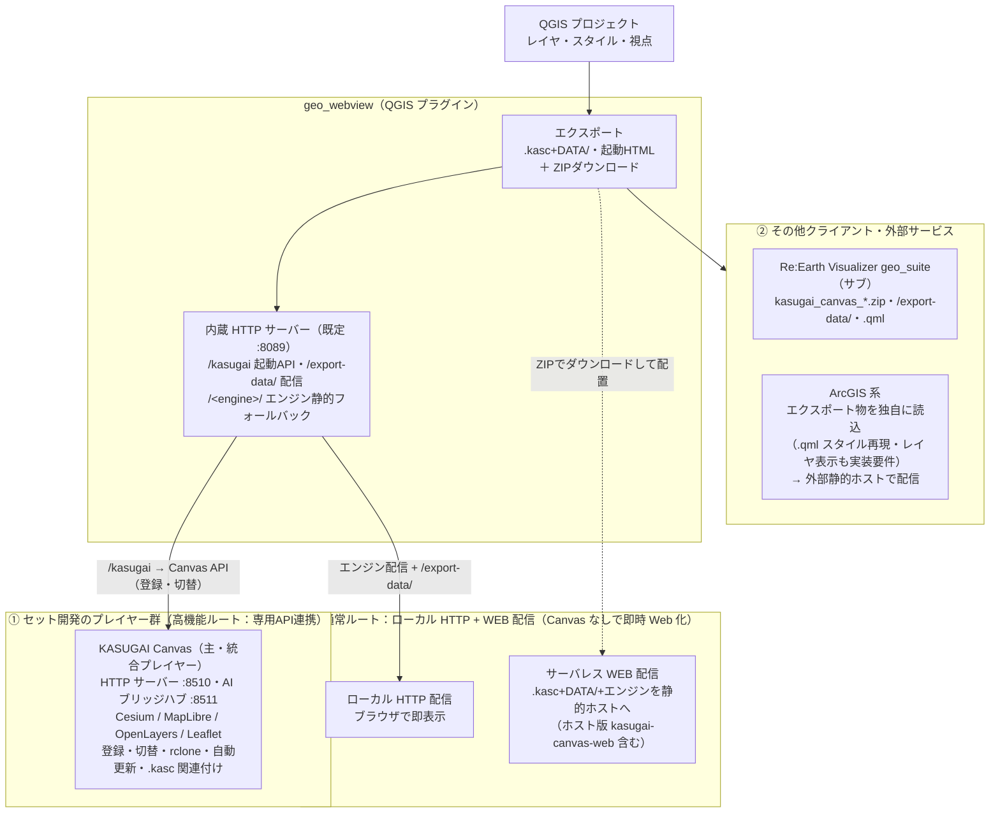

# geo_webview — 外部サービス・クライアント連携方針

[English: `INTEGRATION.md`](INTEGRATION.md)

geo_webview の連携先ごとの対応方針。詳細な方針とライセンス整理はこのドキュメントに集約し、README には概要のみを記載します。

## 連携構成図

## Re:Earth Visualizer（geo_suite）への対応方針

**まとめ**: Re:Earth Visualizer 側の対応は**別途開発のプラグイン（geo_suite）で対応**とする。geo_webview は供給側として `kasugai_canvas_*.zip`（パネルの ZIP ボタンや `index.html` からダウンロードするエクスポート一式。`qgis:` インスペクタ行が ZIP の URL で直接取り込む）と `/export-data/` 経由のファイル・`.qml` スタイルを出力し、取込は geo_suite 側が担う（3D 表現は Cesium ベースの KASUGAI Canvas が主）。

実装側（geo_suite）: [ReEarth_GeoSuite リポジトリ](https://github.com/yamamoto-ryuzo/ReEarth_GeoSuite)。`kasugai_canvas_*.zip` の出力仕様は [SPEC_JP.md](SPEC_JP.md) を参照。

## ArcGIS 系への対応方針

**まとめ**:

- ① ArcGIS Online 上ではカスタムコードを実行できず、本系統の機能は実現不可能
- ② Cesium 等のエンジンと同等品を作る場合 — Canvas 側のコード資産は SDK が異なり流用できないため、データ構築を含めて一からの開発が必要（3D は 3D Tiles→I3S 変換パイプライン経由が前提・ライブ 3D Tiles URL は対象外。参照できるのは `.kasc` 仕様と同一 OSS ライブラリのみ）
- ③ ArcGIS のセキュリティ（管理環境）内でカスタム WebGIS を動かすなら Enterprise 11.0+ の ExB カスタムウィジェットが唯一の経路 — それ以外はすべて外部ホスト前提のモデルとなり、導入の意義がない

### ① ArcGIS Online 上ではカスタムコードを実行できない

**ArcGIS Online 上で本系統の機能を動かすことは機能的に不可能です。** ArcGIS Online はカスタムコード（JS アプリ・プラグイン・ExB カスタムウィジェット等）をホスティング・実行する仕組みを持たず、Re:Earth のようなプラグイン拡張経路も存在しないためです。そのため ArcGIS 系との連携は「ArcGIS Online を拡張対象とせず、**ファイル受け渡しのみとし、読み込みは ArcGIS 側（SDK）の独自実装に委ねる**」方針とします。

- **QGIS → ArcGIS 側へ供給**: `.kasc`+`DATA/` 出力物をファイルとして受け渡し、ArcGIS 側が独自に読み込む（※プラグイン自身の OGC サービスは v3.29.0 で廃止）

読み込み側には**再現（プレイヤー）実装**を要件とします:

- **`.qml` スタイルの引き継ぎ**（QGIS レンダラ → ArcGIS renderer への変換）— 「スタイルは捨ててデータだけ取り込む」形は目指さない
- **レイヤ表示機能** — レイヤツリー・表示 ON/OFF・透過度・ベースマップ切替・属性ポップアップ等。**用途に応じて最小限の実装でもよい**（他エンジンとの完全な同等性は必須としない）

#### ArcGIS Online で配信できるもの・できないもの

「Online で配信」の対象を分けて整理します:

| 配信したいもの | ArcGIS Online で可能か |
|---|---|
| `.kasc` を読むプレイヤー（カスタムコードのアプリ本体） | **× 不可** — Online はカスタムコードをホスト・実行できない。外部静的ホスト必須 |
| `.kasc`+`DATA/` ファイル一式そのもの | **× 不可** — Online に任意の静的ファイルをホストする機能はない |
| **データを加工して AGOL サービスとして公開** | **○ 可能** — GeoJSON/CSV/Shapefile/FileGDB → ホストフィーチャレイヤ、タイル → ホストタイルレイヤ、3D → シーンレイヤ（I3S。3D Tiles→I3S 変換が必要）。公開したサービスは AGOL 内蔵の Webマップ/Webシーン・Instant Apps・ExB 標準ウィジェット・Dashboards・StoryMaps でそのまま配信できる。要 Creator 以上のユーザータイプ（GIS Professional なら Pro ライセンス込み）＋ストレージ・生成クレジット。公開共有で組織外の匿名閲覧も可 |

ただし「加工して AGOL サービス化」する経路は `.kasc` 再生ではなく**データのサービス化**であり、`.qml` スタイルは引き継げず AGOL/Pro 側で作り直しになります（`.kasc` の行種・テーマ・スタイル込みの再現を要件とする場合は、外部ホストの `.kasc` プレイヤー経路が該当します）。

### ② 同等品を作る場合 — データ構築を含めて一からの開発が必要

他エンジン（Cesium/MapLibre/OpenLayers/Leaflet）と同様の `.kasc`+`DATA/` プレイヤーを ArcGIS 側で実現する場合、**Canvas 側のコード資産は SDK が異なり流用できないため別システムを一から作る形**になります（参照できるのは `.kasc` 仕様と同一 OSS ライブラリのみ）。

なお **ArcGIS Maps SDK for JavaScript は Leaflet/MapLibre/OpenLayers/CesiumJS と同じカテゴリの Web 地図ライブラリ**（Esri 公式・WebGL ベース、MapView=2D / SceneView=3D）であり、構成としては「マルチエンジンに5番目のエンジンを追加する」のと同じ位置づけです。違いは OSS ではなく Esri 製品使用条件の範囲（帰属表示必須）である点と、SceneView が OGC 3D Tiles 非対応（I3S のみ）である点です。

#### プレイヤー実装のスコープと `.kasc` 行種の対応可否

Canvas と同じサーバレス配信は「ArcGIS 版 `.kasc` プレイヤーの実装」が前提です。必要な実装コンポーネント:

| コンポーネント | 内容 |
|---|---|
| `.kasc` パーサ | 行種（行頭 `種類:`）・`|` フィールド分割・`on`/`off`・`key=value` オプションの解釈（仕様の正本は kasugai_canvas の `.kasc` 設定仕様＝`web/shared/kasc.js`） |
| 参照解決 | `DATA/` 等の相対パスを `.kasc` の URL 基準で解決 |
| `.qml` → ArcGIS renderer 変換 | QGIS レンダラ（単一シンボル/分類/数量階級/ルールベース）を `SimpleRenderer`/`UniqueValueRenderer`/`ClassBreaksRenderer`＋シンボルへ写像。塗り・線・マーカー・透過・ラベル（`labelingInfo`）が対象。GPKG 埋め込みの `layer_styles`（QML）も同経路で適用 |
| データローダー | 行種ごとのデコード → FeatureLayer/GraphicsLayer 化（下表参照） |
| レイヤ表示 UI | レイヤリスト・表示 ON/OFF・透過・ベースマップ切替・属性ポップアップ（用途に応じ最小限可） |
| `cam:`/`theme:` 適用 | カメラ → MapView/SceneView の viewpoint、テーマ → 可視性プリセット |
| 出典表示 | `attr=` の attribution 表示（Esri の帰属要件でもある） |

`.kasc` 行種ごとの ArcGIS Maps SDK for JavaScript での実現性:

| `.kasc` 行種 | 実現性 |
|---|---|
| `geojson:` / `layer:` | ○ GeoJSONLayer でネイティブ読み込み |
| `xyz:` / `base:` | ○ WebTileLayer（`{z}/{x}/{y}` テンプレート。ローカルタイルツリー複製も静的配置で可） |
| `wms:` | ○ WMSLayer |
| `wmts:` | ○ WMTSLayer |
| `gpkg:` | △ ネイティブ非対応 → sql.js（SQLite WASM）の自前ローダーで GeoJSON 化（Canvas と同じ手法を JS で流用可。`table=`/`where=`/`layer_styles` の読み取りもここで実装） |
| `geoparquet:` | △ ネイティブ非対応 → hyparquet 等で自前デコード → GeoJSON 化 |
| `flatgeobuf:` | △ ネイティブ非対応 → 公式 JS リーダーでストリームデコード → GeoJSON 化（Canvas と同一ライブラリ） |
| `duckdb:` / `sql:` | △ ネイティブ非対応 → DuckDB-WASM で SQL 絞り込み → GeoJSON 化（Canvas と同一エンジン。`bbox=auto` の表示範囲連動再クエリも自前実装） |
| `3dtiles:` | △ SceneView は OGC 3D Tiles 非対応（I3S SceneLayer のみ）→ **3D Tiles→I3S 変換パイプラインで対応**（後述・採用構成。ライブ参照の 3D Tiles URL は対象外） |
| `cam:` | ○ viewpoint への変換で実装可 |
| `theme:` | ○ レイヤ可視性プリセットとして実装可 |
| `plugin:` / `cloud:` | — Canvas 固有機能のため対象外（無視してよい） |
| 共通オプション | `\| off`・`attr=`・`style=QML`・`opacity=` は実装対象。`render=`/`proxy=` は Canvas 固有 |

つまり「**配信方式は同一・再現面積が狭い**」が正確な整理で、実装の中心は **QML→ArcGIS 変換** と **ネイティブ形式ローダー（`gpkg:`/`geoparquet:`/`flatgeobuf:`/`duckdb:`）** の2点、3D（`3dtiles:`）は I3S 変換パイプライン経由でのみ対応します。

#### Cesium 並みの実装に必要な組み合わせ（採用構成）

「ArcGIS らしさを出しつつ Cesium 相当（3D 含む）」を目指す場合の組み合わせ。**採用構成は「完全 ArcGIS 構成」**とします:

| 目標 | 組み合わせ | 評価 |
|---|---|---|
| **採用構成（ArcGIS らしさ優先）** | **ArcGIS Maps SDK for JavaScript（MapView=2D / SceneView=3D）＋ 3D Tiles → I3S 変換パイプライン**（loaders.gl tile-converter / ArcGIS Pro の SLPK 作成）→ SceneLayer | ○ 完全 ArcGIS 構成で統一できる。変換工程が必須で、ライブ参照の 3D Tiles URL（Google Photorealistic 3D Tiles 等）は変換・再配布不可のため対象外 |
| 2D のみ（`.kasc` 再生・3D なし） | ArcGIS Maps SDK for JavaScript（MapView）単体 ＋ 自前 `.kasc` ローダー/QML 変換 | ○ 採用構成の2D側だけを先に切り出す場合。単体で「ArcGIS 版エンジン」として成立 |
| 代替案（3D Tiles のライブURL再現が必要な場合） | ArcGIS JS SDK（2D・UI・認証・サービス・レンダラ）＋ CesiumJS（3D Tiles 描画）のハイブリッド | △ 「ArcGIS らしさ」はレイヤ・認証・レンダラ側が担い、3D Tiles の表示だけ CesiumJS に委ねる（OL+Cesium 2画面の旧 `/map3d` が先例）。非 Esri ライブラリ混在のため採用構成からは外す |

要点: **SceneView は OGC 3D Tiles を読めないため、ArcGIS らしさを保つ3Dは「3D Tiles→I3S 変換→SceneLayer」のみ**です。ライブURL直参照の 3D Tiles はこの構成では対象外となり、どうしても必要な場合のみハイブリッドが代替案となります。

#### ArcGIS 側の読み込み実装形態ごとの必要ライセンス

| 実装形態 | 必要なライセンス・アカウント |
|---|---|
| ArcGIS Pro アドイン（.NET SDK）で `.kasc`+`DATA/` を読む | ArcGIS Pro ライセンス（Named User=Online 組織 or Enterprise ポータル、または Single Use） |
| ArcGIS Maps SDK for JavaScript のカスタム Web アプリで読む | アプリ本体は任意の Web サーバでホスト可能。Esri ロケーションサービス・プライベートコンテンツ利用時は ArcGIS Location Platform（旧 Developer アカウント）の API key、または Online/Enterprise アカウントの OAuth 認証 |
| Experience Builder カスタムウィジェットで読む | ExB Developer Edition で開発（サインインには Online or Enterprise アカウントが必要。Location Platform アカウントは ExB 非対応）。完成アプリは自前 Web サーバに配置すれば Online 組織でも運用可 |

#### `.kasc` プレイヤー実装の最小ライセンス

「他エンジン（Cesium/MapLibre/OpenLayers/Leaflet）と同様に `.kasc`+`DATA/` を読んで再現するプレイヤー」を ArcGIS 側で実装する場合の最小ライセンスは以下の通りで、**いずれも無償または低額**です。

| プレイヤー実装 | 最小ライセンス | 費用感 |
|---|---|---|
| Web プレイヤー（ArcGIS Maps SDK for JavaScript） | **ArcGIS Online 組織**または **ArcGIS Location Platform アカウント**（無料登録）のいずれかで SDK 自体の追加購入は不要 | `.kasc`+`DATA/`（GeoJSON 等）を読むだけ・Esri サービス/ベースマップを使わない構成なら課金なし。Esri サービス利用時のみ API key 必須＋従量課金（無料枠あり） |
| ネイティブプレイヤー（ArcGIS Maps SDK for Native Apps） | **Runtime Lite** ライセンス — 無償（ライセンス文字列の発行、または Viewer/Lite ユーザータイプのサインインで付与） | 無料。地図・シーン・レイヤ・パッケージの表示（2D/3D）を含むため `.kasc` 再生には十分 |
| デスクトップ連携（ArcGIS Pro アドイン） | **ArcGIS Pro（Basic）** | 有償だが最小構成は Basic で可。Named User は Online 組織でも発行可 |

いずれの経路でも `DATA/` の GeoJSON/ネイブラタイル等を読み、QML→ArcGIS レンダラ変換とレイヤ表示機能を自前で実装する必要がありますが、ライセンス上の障壁は Web プレイヤーなら実質ゼロです。

#### 配信先（実装したアプリをどこで配信するか）

実装したアプリ本体は **ArcGIS Online 上では動かせないため、必ず外部にホスト**します。ArcGIS Online/Portal へのアイテム登録は「外部 URL の参照」でしかありません。

**Web プレイヤー（ArcGIS Maps SDK for JavaScript）のホスト先候補**（いずれも静的配信で可。括弧内は本ワークスペース内の同型実績）:

- **GitHub Pages** — `https://<org>.github.io/<repo>/`（kasugai-canvas-web が stable/unstable の2チャンネル公開に使っている方式）
- **Cloudflare Pages / Workers**（kasugai_canvas のデプロイ先）
- **Vercel**（ReEarth geo_suite のサイト公開先）
- **Netlify**
- **自前 Web サーバ** — Windows IIS / Apache / nginx（社内イントラ限定公開も可）
- **オブジェクトストレージ＋CDN** — AWS S3+CloudFront / Google Cloud Storage / Azure Static Web Apps・Blob 静的サイト

完成後は AGOL/Portal の「Web アプリ」アイテムとして URL を登録すれば、組織内からも参照可能です。

**KASUGAI Canvas と同じサーバレス配信モデルが成立します** — 静的アプリ＋`.kasc`+`DATA/` を静的ホストに置くだけで、データも同一オリジンから供給できます（必要な実装と行種ごとの対応可否は前節「プレイヤー実装のスコープ」参照）。

その他の実装形態の配信先:

| 実装形態 | 配信先 |
|---|---|
| Experience Builder アプリ | ExB Developer Edition でビルドしたアプリ一式を上記と同じ任意ホストへ配置。カスタムウィジェット自体をポータル内にホストして組織のビルダーから使わせる場合のみ ArcGIS Enterprise 11.0+ が必要 |
| ArcGIS Pro アドイン | `.esriAddinX` ファイルとして配布（ファイル共有・社内サーバ・ダウンロードリンク等） |
| ネイティブアプリ（ArcGIS Maps SDK for Native Apps） | デスクトップ=インストーラー配布（MSI/MSIX・社内配置）、モバイル=アプリストア/MDM |

なおアプリが読む `.kasc`+`DATA/` の供給元は、本プラグインの `/export-data/` 配信または任意の静的ホストです。**アプリとデータを同一オリジンに置くのが最も設定が簡単**です（別オリジンでも CORS 許可で読めます）。

### ③ ArcGIS の管理環境内で動かすなら Enterprise ExB のみ

**Esri 管理環境（Portal）内で独自 WebGIS を公式に動かす経路は、Enterprise 11.0+ の Portal 内 ExB カスタムウィジェット以外の経路は存在しません**（Online にはその手段自体がない）。これが ArcGIS Enterprise が必要になる唯一のケースです。なお「組織のネットワーク境界内で完結する」だけなら、外部ホストの `.kasc` プレイヤーを顧客のイントラ Web サーバに置くだけで境界内に入ります（Esri 管理対象ではないがセキュリティ境界内）。

なお外部ホストのアプリでも「**Online と一体に見える**」形は作れます:

- **「Web アプリ」アイテムとして AGOL/Portal に登録** — 実体は外部 URL の参照だが、組織のコンテンツ一覧に表示されクリックで開く
- **AGOL OAuth サインイン** — アプリを ArcGIS identity でログインさせ、組織のコンテンツ・サービスへ認証付きでアクセス可能
- **ExB/StoryMaps/ダッシュボードへの URL 埋め込み** — AGOL 製アプリ内の要素として外部アプリを読み込む

つまり「マルチエンジンの5番目」としての価値は低いですが、**ArcGIS 組織と一体に見える連携**まで実装すれば、顧客の ArcGIS 環境の一部として使える形にはなります。

### （付録） ArcGIS サービス取り込み（`arcgis:` 系）の注意点

参考として、「KASUGAI Canvas 側に `.kasc` の `arcgis:` 行種を追加し MapServer/ImageServer/FeatureServer/SceneServer を取り込む」構想は存在しますが、**ライセンス面が大きな課題**です。REST エンドポイントが技術的に読めることと、ライセンス上利用できることは別問題です。

- **Esri ホストのサービス（ArcGIS Online のベースマップ・ロケーションサービス等）**: 非 Esri クライアント（CesiumJS・MapLibre 等は公式に対象認定済み）から利用するには **ArcGIS Location Platform サブスクリプション**が前提で、全リクエストを API key/OAuth トークンで認証し、従量課金（無料枠あり）に従う必要がある。API key なしでの直接参照は利用規約違反
- **帰属表示義務**: Esri のサービス・データを使うアプリは "Powered by Esri" およびデータソースの attribution 表示が必須。非 Esri ライブラリでは自動表示されないため Canvas 側での自前実装が必要
- **ArcGIS Online 組織のホストコンテンツ**: セキュアなサービスはその組織の OAuth 認証が必要。公開サービス・Living Atlas・商用データ等もコンテンツ提供者の利用条件に従う（読める≠使える）
- **ArcGIS Server / Enterprise の公開サービス**: 自組織のサービスは Enterprise 契約の範囲で利用可能。第三者が公開するサービスは公開者の利用条件に従う（自治体・官公庁の公開 REST サービスにも個別の利用規約がある）

このため `arcgis:` 系を実装する場合は、**Esri Location Platform 契約または対象サービスごとの利用条件確認に加え、認証（トークン管理）と帰属表示の実装が前提**となります。
