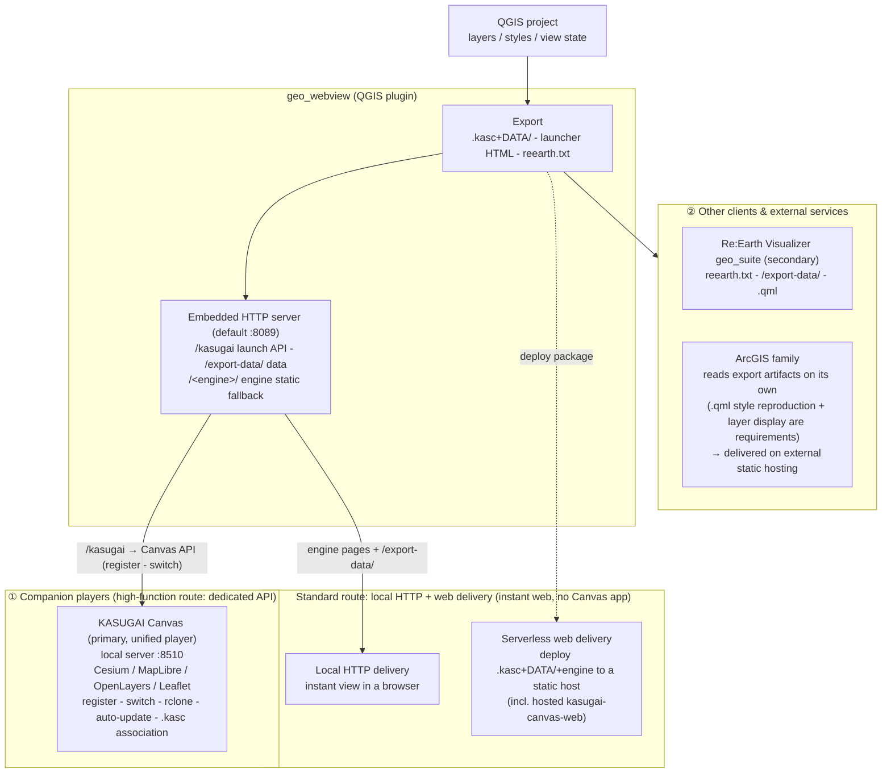

> **QGIS Live Harness のプラグイン** — [QGIS Live Harness](https://yamamoto-ryuzo.github.io/qgis_live_harness/) · [プラグイン一覧](https://yamamoto-ryuzo.github.io/qgis_live_harness/plugins.html) · [リポジトリ](https://github.com/yamamoto-ryuzo/qgis_live_harness)

# geo_webview — Serverless web distribution for QGIS (multi-engine)

[日本語版はこちら / Japanese: `README_JP.md`](README_JP.md)

> Part of the `geo_suite` project — a QGIS plugin that exports the open
> project as a `.kasc`+`DATA/` package playable on the KASUGAI Canvas
> multi-engine players (Cesium / MapLibre / OpenLayers / Leaflet).
> **Serverless delivery is the main feature**: the exported package runs on
> plain static hosting. A small embedded HTTP server supports export
> delivery, canvas sharing and permalink reception.

## Overview

geo_webview turns **QGIS into the serving side of web maps**. QGIS is the
ideal environment for editing GIS data and styles; this plugin carries that
result straight to the Web.

```
[QGIS project]   layers / .qml styles / layer tree / view / themes
      │  geo_webview exports to .kasc + DATA/
      ▼
[.kasc + DATA/ package]  + the engine itself (KASUGAI Canvas web/)
      │  playable on Cesium / MapLibre / OpenLayers / Leaflet
      ▼  deploy to static hosting
[Browser WebGIS]  ← serverless (no QGIS, no dedicated server)
```

- **Main feature — serverless delivery**: write the visible layers and QGIS
  styles to `.kasc`+`DATA/`, place the output folder together with the
  engine (KASUGAI Canvas `web/`) on any static host, and it works as a
  standalone WebGIS. No QGIS-side server is required for playback.
- **Supporting feature — embedded HTTP server**: the `/kasugai` export
  trigger, `/export-data/` static delivery of export artifacts,
  `/present`/`/screenshot` canvas sharing, permalink reception
  (`/qgis-map` + legacy `/wms` links → External Control navigation), and
  a static fallback that serves an installed KASUGAI Canvas `web/`.

### Multi-engine

The same `.kasc`+`DATA/` plays on four engines (switch via `?engine=` or
the emitted `<engine>.html` launcher pages):

| Engine | Role |
|---|---|
| **Cesium** (default) | Primary 3D engine: 3D Tiles, terrain, GeoJSON drape, Fly mode, AI chat |
| **MapLibre** | Fast 2D: `wms:`/`wmts:` lines, duckdb/sql queries, attribute UI, 6-tab panel |
| **OpenLayers** | General 2D: arbitrary CRS, rotation, `/present/state` follow mode |
| **Leaflet** | Lightweight 2D (functional subset of OpenLayers — no rotation/arbitrary CRS) |

The player system itself is **maintained in KASUGAI Canvas** — a
multi-engine WebGIS whose web part runs on static hosting while the EXE
side provides rclone, auto-update, file saving and `.kasc` association.
The plugin's built-in generated viewers (former `/qgis-map`, `/maplibre`,
`/map3d`) were removed in v3.24.0 — viewing is fully consolidated into
KASUGAI Canvas.

KASUGAI Canvas-side layout (`web/`):

```
web/
  index.html      engine-select redirect (?engine=cesium|maplibre|openlayers|leaflet, default cesium)
  cesium/         Cesium front (current app)
  maplibre/       MapLibre front (.kasc player implemented: all vector lines, wms:/wmts:, QML, duckdb/sql, attribute UI, 6-tab panel)
  openlayers/     OpenLayers front (same)
  shared/         engine-independent core (.kasc loader, decoders, i18n, QML compilers)
  projects/       project data (engine-independent)
    projects.json          project list manifest
    DATA/                  (optional) data shared by all projects (../DATA/ refs)
    <id>/                  project (multiple, keyed by id)
      kasugai_canvas.kasc  project settings
      DATA/                project-local data
```

The `.kasc`+`DATA/` geo_webview exports lands as one `projects/<id>/`
project, and relative references inside `.kasc` lines resolve against
`projects/<id>/`.

### Integration policy (supported clients)

geo_webview's integration policy consolidates the player into
**KASUGAI Canvas** — a multi-engine setup (Cesium + OpenLayers/MapLibre/
Leaflet fronts, implemented on the KASUGAI side; switch via `?engine=`) —
with **Re:Earth Visualizer as secondary**.

There are two delivery routes. The **high-function route** talks to a
running KASUGAI Canvas local server (default :8510) through its dedicated
API to register the project and switch the view. The **standard route**
relies on the embedded HTTP server (`/<engine>/` + `/export-data/`) and
serverless web delivery, giving instant web output without the Canvas app
(see "Playback routes (3-tier fallback)").

#### ① Companion players developed alongside geo_webview

The client that ingests data & styles exported/served from QGIS and plays
them as an independent WebGIS. geo_webview is being developed as the
QGIS-side delivery backend for this player.

| Target | Route | Integration |
|---|---|---|
| **KASUGAI Canvas** | `/kasugai` (`.kasc`+`DATA/`) | **Unified player (primary).** A standalone WebGIS app — geo_webview writes the QGIS layer tree as `.kasc`+`DATA/` (vectors + `.qml` styles) and registers it with a running KASUGAI local server, then switches the view. The panel `Export` button writes the project files only; `▶ Open` / `GET /kasugai?engine=` / the `kasugaiExport` bridge also register and launch a given engine — the same `.kasc`+`DATA/` plays on every engine. An EXE-installed copy also provides rclone, auto-update, file saving and `.kasc` association |

#### ② Other clients & external services

| Target | Route | Integration |
|---|---|---|
| **Re:Earth Visualizer (geo_suite)** | `reearth.txt` export + `/export-data/` | **Secondary** (Cesium-based like KASUGAI Canvas). See "Re:Earth Visualizer (geo_suite) policy" below |
| **ArcGIS family** | `.kasc`+`DATA/` file handoff → ArcGIS-side (SDK) custom implementation **delivered from any external static host** (GitHub Pages / Cloudflare / Vercel / own server, etc.; cannot run on ArcGIS Online) | See "ArcGIS policy" below |

#### Re:Earth Visualizer (geo_suite) policy

Re:Earth Visualizer is positioned as the **secondary, Cesium-based player**
alongside KASUGAI Canvas. geo_webview feeds it via `reearth.txt`
(inspector text) export plus `/export-data/` file and `.qml` style
delivery; the QML→Re:Earth translation runs client-side (a translator
bundled in geo_suite). 3D work is consolidated in the Cesium-based
clients — KASUGAI Canvas (primary) and Re:Earth Visualizer (secondary).

Details: [geo_webview integration policy (`INTEGRATION.md`)](INTEGRATION.md#reearth)

#### ArcGIS policy

**Running this system's features inside ArcGIS Online is functionally
impossible** (it provides no mechanism to host or execute custom code),
so ArcGIS integration is limited to **handing over the `.kasc`+`DATA/`
output as files for the ArcGIS side to read with its own
implementation**. The reading side is required to carry over `.qml`
styles and provide layer display features (a minimal implementation is
acceptable depending on the use case).

Minimum setup for delivery: **one static host (e.g. GitHub Pages —
free) + a `.kasc` player built on ArcGIS Maps SDK for JavaScript + an
ArcGIS Location Platform account (free sign-up) or an ArcGIS Online
org** — the same serverless delivery model as KASUGAI Canvas works.
Note that data *can* be delivered on Online itself if converted and
published as AGOL services — but that is a different model where `.qml`
styles must be rebuilt (what cannot run on Online is only the
custom-code app and the `.kasc` file set itself).

Details (reading-side requirements, licensing, minimum setup, and
cautions for `arcgis:` ingestion): [geo_webview integration policy
(`INTEGRATION.md`)](INTEGRATION.md#arcgis)

#### Integration architecture



## Serverless delivery flow

### 1. Export / launch

Use the top **"Web Distribution"** group in the panel.

| Action | Behaviour |
|---|---|
| `Engine:` combo | Launch engine selection (Cesium/MapLibre/OpenLayers/Leaflet; persisted in QSettings `kasugai_engine`) |
| `Export` button | **Files only** — writes `.kasc`+`DATA/` + `index.html` + per-engine launcher HTMLs (no launch) |
| `▶ Open` button | Export → register with Canvas → open the selected engine in a browser, in one step |
| `📁` button | Open the export folder in the file manager |

The same feature is available through APIs:

- `GET /kasugai?engine=<e>` — one-shot launch from external apps/scripts (JSON response)
- bridge `kasugaiExport(engine=...)` — AI control via Live Driver
- the "Import from QGIS" button of Canvas's `qgis-import` plugin — the reverse direction

### 2. Output

```
<out_dir>/                   # with a registered install: <install>/QGIS_projects/<project name>/
├─ kasugai_canvas.kasc       # layer tree, reference lines, cam:/theme:/bookmark: etc.
├─ index.html                # link list to the engine launcher pages
├─ cesium.html / maplibre.html / openlayers.html / leaflet.html  # launchers
├─ project.json              # {"title": ...}
├─ bookmarks.xml             # QGIS bookmarks (when emit_bookmarks)
└─ DATA/                     # GeoJSON(4326) / native-format copies / .qml / tiles etc.
```

See `SPEC_JP.md` §15 for the `.kasc` line generation rules (GPKG/GeoJSON/
GeoParquet/FlatGeobuf referenced natively, CSV/TSV as `duckdb:`, filtered
sources via `where=`, 3D Tiles as `3dtiles:`, bottom XYZ as `base:`, WMS
rasters as `wms:` lines, everything else converted to GeoJSON).

Each launcher HTML redirects to its engine with `?kasc=<this .kasc URL>`
and auto-detects the engine (`./ ../ ../../ /` in order; set `CANVAS_BASE`
inside the HTML for custom layouts).

### 3. Playback routes (3-tier fallback)

`▶ Open` / `/kasugai` / `kasugaiExport` report the source as `via`:

| `via` | Condition | Opened URL |
|---|---|---|
| `kasugai` | Canvas local server running (default port 8510) | `http://localhost:8510/<engine>/?project=<id>` |
| `qgis-http` | Canvas installed but not running | this server serves `<install>/web/` statically + `/export-data/` for data |
| `hosted` | Canvas not installed (needs internet) | hosted engine (kasugai-canvas-web / GitHub Pages, channel = `kasugai_hosted_channel` setting) + `/export-data/` |
| `null` | none available | export only (open the `.kasc` manually) |

### 4. Publishing serverlessly

**Uploading the export folder together with the engine (`web/` contents)
to the same static host gives you a serverless standalone web delivery**
(Canvas's `?kasc=` direct-load mode). The `.kasc`+`DATA/`+system bundle
can be cut out and distributed as a unit. A `reearth.txt` for Re:Earth
Visualizer can also be emitted.

## Embedded HTTP server (supporting feature)

A small HTTP server bound to the local machine/LAN that backs the export
workflow and lightweight sharing. It does **not** turn QGIS into a map
server — serverless `.kasc`+`DATA/` packages are the delivery unit.

| Endpoint | Content |
|---|---|
| `/kasugai` | `.kasc`+`DATA/` export + registration (`?engine=` selects the launch engine, `?install=1` fetches Canvas when missing) |
| `/export-data/<rel>` | Serves the latest export artifacts (.kasc+DATA/ etc.) |
| `/<engine>/` | Static fallback serving the installed KASUGAI Canvas `web/` |
| `/present` | Presentation page that window-shares the QGIS canvas via periodic `/screenshot` |
| `/screenshot` | PNG of the current canvas (rotation applied; `w`/`h` size params) |
| `/present/state` | Canvas state JSON (for Canvas follow mode) |
| `/received` | Received permalink history JSON |
| `/qgis-map` | Permalink path (no page returned — used for reception/navigation; legacy `/wms` permalinks are also accepted) |

## Permalinks & External Control (legacy features)

- Share the current map view (coordinates, scale, rotation, theme, layer state) as a URL
- With `External Control` enabled, received URLs automatically navigate the QGIS canvas
- Embed links in Office documents (Excel / PowerPoint); export high-resolution PNGs

## Network features

- External access diagnostics and firewall detection
- Automatic port configuration (Windows firewall rules helper)
- Flexible port range (supports 80–65535)
- Dynamic hostname resolution for external clients

## Quick start

### 1) Install

Place the plugin in your QGIS plugins folder, or install via the QGIS plugin manager.

Windows example path:

```
%APPDATA%\QGIS\QGIS3\profiles\default\python\plugins\geo_webview
```

### 2) Basic usage (serverless delivery)

1. Open a QGIS project (.qgs/.qgz)
2. Select `Web > geo_webview` from the menu to show the panel
3. Pick an `Engine:` and press `▶ Open` — export → register → browser launch in one step
4. To distribute, press `Export` and upload the output folder together with the engine (`web/`) to a static host

## Endpoint reference

| Path | Type | Content |
|---|---|---|
| `/kasugai` | JSON | Export & register to KASUGAI Canvas (`?engine=` selects the launch engine, `?install=1` fetches it when missing) |
| `/export-data/<rel>` | file | Serves export artifacts (.kasc/DATA/) |
| `/<engine>/` | HTML | Static fallback serving the installed Canvas `web/` |
| `/present` | HTML | Presentation window-share page |
| `/present/state` | JSON | Canvas state (follow mode) |
| `/screenshot` | PNG | Current canvas image |
| `/received` | JSON | Received permalink history |
| `/qgis-map` | permalink | Permalink path (no page returned — used for reception/navigation; legacy `/wms` permalinks are also accepted) |

## KASUGAI Canvas engine comparison

Feature comparison of the four KASUGAI Canvas engines (Cesium / OpenLayers / MapLibre / Leaflet). `—` = not supported, `△` = partial. All engines read the same `.kasc`+`DATA/` package (`?engine=` or the generated `<engine>.html`). Re:Earth geo_suite is a separate client (via `reearth.txt`) and is out of scope here; shared QGIS-side services are summarized at the end.

### Data ingestion & layer formats

| Feature | Cesium | OpenLayers | MapLibre | Leaflet |
|---|:-:|:-:|:-:|:-:|
| `.kasc`+`DATA/` ingestion | ✓ (`/kasugai` register + `?project=`) | ✓ | ✓ | ✓ |
| GeoJSON | ✓ (`geojson:`) | ✓ (`geojson:`/file) | ✓ (`geojson:`/file) | ✓ (`geojson:`) |
| GeoPackage | ✓ (`gpkg:` Worker, `bbox=auto` query) | ✓ (`gpkg:` sql.js Worker, `bbox=auto`) | ✓ (`gpkg:` sql.js Worker, `bbox=auto`) | △ |
| GeoParquet | ✓ (`geoparquet:`) | ✓ (`geoparquet:` hyparquet) | ✓ (`geoparquet:` hyparquet) | △ |
| FlatGeobuf | ✓ (`flatgeobuf:`) | ✓ (`flatgeobuf:`/`fgb:`) | ✓ (`flatgeobuf:`/`fgb:`) | ✓ (`fgb:`) |
| CSV/TSV | ✓ (`duckdb:`+`format=csv`, `lon=`/`lat=`/`geom=`) | ✓ (same) | ✓ (same) | △ |
| DuckDB/SQL query layer | ✓ (`duckdb:`/`sql:`, `:bbox` view-synced) | ✓ (same) | ✓ (same) | — |
| Layer filter (subsetString) | ✓ (`gpkg:`/`duckdb:` `where=` or GeoJSON bake) | ✓ (`where=`) | ✓ (`where=`) | △ (GeoJSON bake only) |
| 3D Tiles | ✓ (`3dtiles:`) | △ (deck.gl 2.5D top-down) | △ (deck.gl 2.5D top-down) | — (reported in layer list) |
| XYZ tiles & basemaps | ✓ (`xyz:`/`base:`) | ✓ (`xyz:`/`base:` overlay) | ✓ (`xyz:`/`base:` overlay) | ✓ (`xyz:`/`base:`) |
| WMS / WMTS raster | ✓ (`wms:`/`wmts:` — GetMap split into 256px tiles / normalized to `{z}/{x}/{y}` & KVP GetTile) | ✓ (`wms:`/`wmts:` lines) | ✓ (`wms:`/`wmts:` lines via Import panel) | △ (`xyz:` only) |
| QGIS styles (.qml) | ✓ (`style=`, client-side compile on entity & primitive paths) | — (default styling) | — (default styling) | — (default styling) |

※With external OGC servers, the `wms:`/`wmts:`/`xyz:` lines above can reference WMS rasters and external `/wfs` GeoJSON (geo_webview's own OGC services were removed in v3.29.0 — an external server is required).

### Layer management & display

| Feature | Cesium | OpenLayers | MapLibre | Leaflet |
|---|:-:|:-:|:-:|:-:|
| Layer list UI | ✓ | — | ✓ | — |
| Grouping (inherits layer tree) | ✓ | — | △ | — |
| Visibility on/off | ✓ | — | ✓ | — |
| Legend display | ✓ | — | — | — |
| SQL filter & interactive requery | ✓ (⏷ filter) | — | — | — |
| Render mode switch (`render=entity/primitive`) | ✓ | — | — | — |

### Search & attributes

| Feature | Cesium | OpenLayers | MapLibre | Leaflet |
|---|:-:|:-:|:-:|:-:|
| Address search | ✓ | — | — | — |
| Vector search | ✓ | — | — | — |
| Attribute / value list | ✓ (Attr panel, full query) | △ | △ | — |
| Info display | ✓ | — | — | — |

### View & navigation

| Feature | Cesium | OpenLayers | MapLibre | Leaflet |
|---|:-:|:-:|:-:|:-:|
| View carryover (`cam:`) | ✓ | ✓ | ✓ | ✓ |
| Rotation | ✓ (heading) | ✓ | ✓ | — |
| Arbitrary CRS | — | ✓ | — | — |
| Map themes | ✓ (`theme:` line + layer panel) | ✓ | ✓ | — |
| Camera presets & bookmarks | ✓ | — | ✓ | — |
| Terrain / Shadow | ✓ | — | — | — |
| GeoJSON 3D drape | ✓ (terrain / 3D Tiles / both) | — | — | — |
| Follow mode (QGIS canvas tracking) | — | ✓ (`/present/state`) | ✓ (`/present/state`) | ✓ (`/present/state`) |

### Presentation, sharing & external services

| Feature | Cesium | OpenLayers | MapLibre | Leaflet |
|---|:-:|:-:|:-:|:-:|
| Fly mode & route drawing | ✓ | — | — | — |
| Permalink & sharing | ✓ (`buildShareUrl`) | ✓ | ✓ | ✓ |
| Bidirectional nav (`/received`, External Control) | — | ✓ | ✓ | — |
| Google integration | ✓ (Google Maps Platform, Photorealistic 3D Tiles) | — | — | — |
| Screen-share presentation | — | ✓ (`/present`, `/screenshot`) | ✓ (same) | ✓ (same) |

### AI, extensibility & local integration (app-level — mostly the Cesium app)

| Feature | Cesium | OpenLayers | MapLibre | Leaflet |
|---|:-:|:-:|:-:|:-:|
| AI chat | ✓ (Gemini function calling, shared tool execution) | — | — | — |
| External agent control | ✓ (`/api/command` + bridge hub → Copilot/Devin/Antigravity) | — | — | — |
| MCP data source | ✓ (`/api/mcp` relay) | — | — | — |
| Plugin mechanism | ✓ (`PLUGIN/`, IndexedDB drafts, `.kasp`) | — | — | — |
| Cloud storage (rclone) | ✓ | — | — | — |
| Local save & offline delivery | ✓ (`/api/files`, `_local` workspace) | — | — | — |
| External project registration | ✓ (`.kasc` association, group manifests) | ✓ (via `?project=`) | ✓ (same) | ✓ (same) |
| i18n | 8 languages | △ | △ | △ |

### Common services provided by geo_webview

Services geo_webview provides to all engines above. The per-engine difference is only "ingestion path and representation"; QGIS-side services are shared.

| Common service | Cesium | OpenLayers | MapLibre | Leaflet |
|---|:-:|:-:|:-:|:-:|
| View carryover (center, scale, rotation) | ✓ (`cam:`) | ✓ | ✓ | ✓ |
| Tile lines (`xyz:`/`base:`/`wms:`/`wmts:`) | ✓ | ✓ | ✓ | △ (`xyz:`/`base:`) |
| Vector data (`DATA/` files) | ✓ | ✓ | ✓ | ✓ |
| QGIS styles (`.qml`) | ✓ (`style=`) | — | — | — |
| Layer list & visibility control | ✓ (on/off, groups) | — | ✓ | — |
| Query-type lines (`duckdb:`/`sql:`/`bbox=auto`) | — (not emitted) | — | — | — |
| Map themes | ✓ (`theme:` line) | ✓ | ✓ | — |
| Follow mode (`/present/state`) | — | ✓ | ✓ | ✓ |
| Project registration & view switch | ✓ (`/api/projects/register` + `switchProject`) | ✓ | ✓ | ✓ |

- **View carryover**: reproduce the specified view (`x,y,scale,rotation,crs` or `lat,lon,zoom`, permalink) in each engine; written as `cam:` lines in `.kasc`
- **Tile lines**: tile references are emitted as `.kasc` `xyz:`/`base:`/`wms:`/`wmts:` lines (external tile services; geo_webview's own tile serving was removed in v3.29.0)
- **Vector data**: visible layers are handed over as `DATA/` files (GPKG/GeoJSON/GeoParquet/FlatGeobuf as native references; reearth.txt writes `/export-data/` URLs)
- **Style carryover**: QGIS renderers are handed over as `.qml` files and compiled client-side (Cesium entity/primitive path, Re:Earth translator)
- **Query-type lines**: `/kasugai` emits query lines where the source allows — CSV/TSV (delimitedtext/ogr) → `duckdb:` (`format=`/`lon=`/`lat=`/`geom=`), filtered GPKG → `gpkg:`+`where=`, filtered Parquet → `duckdb:`+`format=parquet`+`where=`. `sql:` (arbitrary SELECT) is not emitted (no QGIS equivalent). 3D Tiles layers (`QgsTiledSceneLayer`) → `3dtiles:`; local XYZ templates (`file:///…/{z}/{x}/{y}.png`) are copied into `DATA/`. QGIS WMS raster layers (other than `type=xyz`) are emitted as `wms:` lines (`layers=`/`styles=`/`format=`), and Canvas splits GetMap into 256px tiles
- **Follow mode**: Canvas pages opened with `?follow`/`?present` (MapLibre/OpenLayers/Leaflet engines) poll `/present/state` and track QGIS canvas moves in real time (presentations / screen sharing)
- **Bidirectional navigation**: permalink reception (`/received`) and External Control allow client→QGIS view sharing; the reverse direction from KASUGAI is the `qgis-import` plugin calling `/kasugai` (ingest only — Canvas-side edits do not flow back to QGIS)

## Integration with geo_suite

`geo_webview` is developed as part of the `geo_suite` project.

- **geo_webview**: web distribution of QGIS projects (this plugin)
- **geo_suite**: client plugin running on Re:Earth Visualizer (viewing & editing)
- **Scenario**: QGIS + `geo_webview` serve data; `geo_suite` consumes it on mobile/desktop

Together they let you package a QGIS project into a distributable system for end users.

## System requirements

- QGIS 4.x / 3.x (Qt5/Qt6 compatible)
- Windows / macOS / Linux
- Python 3.7+
- Network: local network or localhost

## Common use cases

### Serverless WebGIS publishing (primary)

Export a QGIS project to `.kasc`+`DATA/` and deploy it together with the
engine bundle on static hosting (GitHub Pages, S3, an internal file
server, ...). You get a public web map with no always-on GIS server.

### Field data collection

Export QGIS data to `.kasc`+`DATA/` and deliver to field devices via file share or static hosting (geo_suite / KASUGAI Canvas).

### Internal map portal

Export to `.kasc`+`DATA/` and place it on an internal static host or shared folder — members view it in a browser.

### Emergency map server

Open the current project on the web immediately via `▶ Open`; share the canvas on a meeting screen via `/present`.

### Distributable project package

Bundle `.kasc`+`DATA/`+the Canvas engine for USB/file-share distribution,
or ship QGIS Portable + `geo_webview` + data for instant serving.

### 3D visualization & presentations

Hand off to KASUGAI Canvas (Cesium) via `▶ Open` for 3D review and
presentation material, or share the QGIS view on a meeting screen via `/present`.

## KASUGAI Canvas integration (details)

The `/kasugai` endpoint (or the panel `Export` button for file output
only, the `▶ Open` button, or the `kasugaiExport` bridge via Live Driver)
exports the QGIS project to KASUGAI Canvas — a multi-engine map app
(Cesium / OpenLayers / MapLibre / Leaflet).

```bash
curl "http://localhost:8089/kasugai?engine=openlayers"
# → {"ok":true,"url":"http://localhost:8510/?project=...&engine=openlayers","dir":"...","layers":N,"tiles":M,"engine":"openlayers"}
```

- Output: when the KASUGAI install location is registered in settings, projects are written to `<install>/QGIS_projects/<QGIS project name>/` (a dedicated folder kept separate from Canvas's own `projects/`); otherwise `<Documents>/kasugai_canvas_qgis` (`.kasc` + `DATA/`). Either way a running Canvas registers it as an external project
- GPKG/GeoJSON/GeoParquet/FlatGeobuf are referenced natively; other vectors are converted to GeoJSON (EPSG:4326)
- Each vector layer's QGIS style is bundled as `.qml` (compiled client-side — to Cesium rendering, and on the MapLibre/OpenLayers fronts too)
- WMS raster layers (non-`type=xyz`) are emitted as `wms:` lines (with `layers=`/`styles=`/`format=`); `wmts:` lines (RESTful templates, KVP GetTile) are also readable on the Canvas side
- The exported project opens on every engine via `?engine=cesium|maplibre|openlayers|leaflet` (`3dtiles:` lines render in 3D on Cesium/maplibre and top-down 2.5D via deck.gl on openlayers; leaflet lists them as unsupported rows on the info tab)
- Auto-registers and switches view on a running KASUGAI; `qgis-http`/`hosted` fallback or file-only output otherwise

See the "KASUGAI Canvas" section in `SPEC.md` for details.

## Office integration

### Excel

1. Generate a permalink in `geo_webview`
2. Insert hyperlink into an Excel cell
3. Click to jump the QGIS canvas to the location

### PowerPoint

1. Export a high-resolution PNG
2. Insert image into a slide
3. Attach a permalink to the image for interactive use during a presentation

## Development & customization

Repository layout (high level):

```
geo_webview/
├── plugin.py              # Main plugin
├── panel.py               # UI panel
├── panel_base.ui          # Panel layout (Qt Designer)
├── server_manager.py      # HTTP server & routing
├── kasugai_export.py      # KASUGAI Canvas integration (.kasc+DATA/ generation, registration, launch)
└── bridge.py              # AI/external control bridge
```

Read the technical details in `SPEC.md`.

Development steps:

1. Review `SPEC.md`
2. Inspect key modules
3. Test changes in QGIS
4. Iterate: change → test → commit

Translation support: English source strings with `i18n/<lang>.json` catalogs
(de, es, fr, hi, it, ja, pt, ru, zh). Edit the JSON directly —
untranslated strings fall back to English.

```bash
# list source strings not yet in the catalogs
python ../../scripts/i18n_tool.py check
```

## Security notes

⚠️ Important: This plugin is designed primarily for internal LAN use.

- Avoid publishing sensitive data publicly.
- For public exposure, add authentication and access control.
- With `External Control` enabled, external URLs can rewrite the QGIS view — use only on trusted networks.
- Configure firewalls appropriately and expose only minimal datasets.

## Roadmap & changelog

For the client integration strategy, see the [Integration architecture](#integration-architecture) diagram.

- ✅ Serverless delivery (`.kasc`+`DATA/` export + multi-engine playback)
- ⛔ OGC services (WMS/WMTS/WFS, /maplibre-style) removed in v3.29.0
- ✅ KASUGAI Canvas integration (with 3-tier fallback)
- ⏳ Deeper Re:Earth Visualizer (geo_suite) integration (currently via generic GeoJSON/XYZ/QML)
- ❌ Full vector tile server (use external services)

See `CHANGELOG.md` for details.

## License

GNU General Public License v3 (GPLv3)

See `LICENSE`.

## Disclaimer

This software was developed and tested on a personal machine. Use at your own risk; the author is not liable for damages resulting from use.
