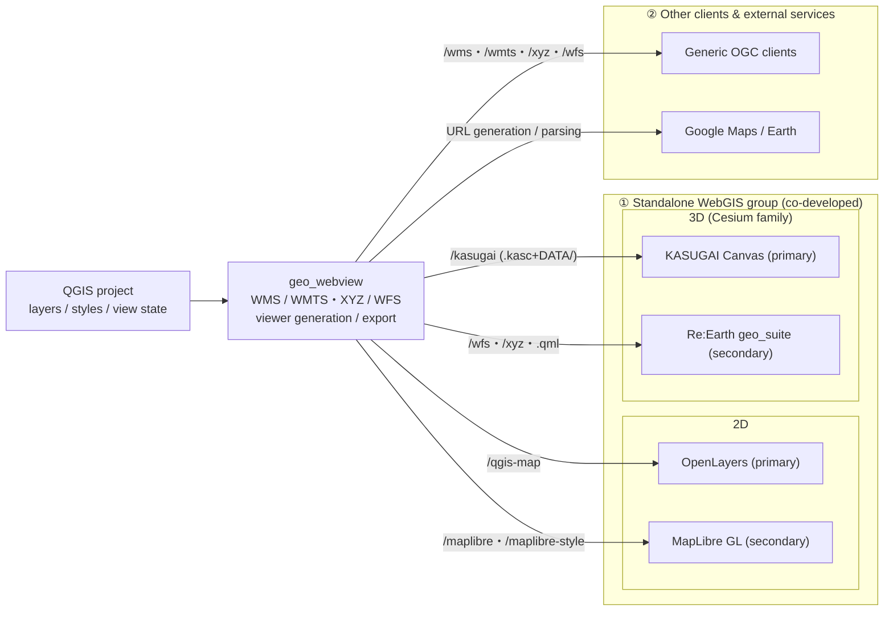

> **QGIS Live Harness のプラグイン** — [QGIS Live Harness](https://yamamoto-ryuzo.github.io/qgis_live_harness/) · [プラグイン一覧](https://yamamoto-ryuzo.github.io/qgis_live_harness/plugins.html) · [リポジトリ](https://github.com/yamamoto-ryuzo/qgis_live_harness)

# geo_webview — Turn QGIS into an OGC server and feed web maps

[日本語版はこちら / Japanese: `README_JP.md`](README_JP.md)

> Part of the `geo_suite` project — a lightweight QGIS plugin that turns a QGIS project into a WMS/WMTS/WFS OGC-compliant server and delivers data to web map clients.

## Overview

`geo_webview` connects QGIS and the Web. QGIS is the ideal environment for working with GIS data; this plugin turns QGIS into the **serving side (an OGC-compliant map server plus viewer generation)** and delivers data to various web map clients. No complex server setup is required: open a QGIS project and WMS, WMTS and WFS services plus web viewers are available immediately.

Typical uses:
- Sharing internal map data on a LAN
- Delivering data to mobile field apps
- Quickly standing up an emergency map server
- Packaging a QGIS project as a distributable map service


## Integration policy (supported clients)

geo_webview's integration policy divides clients into two groups and concentrates co-development on the standalone WebGIS group (①): **OpenLayers (primary) / MapLibre (secondary) for 2D, and KASUGAI Canvas (primary) / Re:Earth (secondary) for 3D**. Everything else is served through generic OGC output.

### ① Standalone WebGIS — companion clients developed alongside geo_webview

Each takes in data & styles exported/served from QGIS and runs as an independent WebGIS. geo_webview is being developed as the QGIS-side delivery backend for these WebGIS clients.

| Target | Route | Integration |
|---|---|---|
| **OpenLayers** | `/qgis-map` | **Primary target for 2D GIS.** Interactive HTML page backed by the WMS source — rotation / theme / arbitrary CRS support makes it the web equivalent of the QGIS canvas |
| **MapLibre GL** | `/maplibre` + `/maplibre-style` | **Secondary 2D GIS.** WMTS raster + WFS vector + auto-converted QGIS renderer styles (modern GL rendering) |
| **KASUGAI Canvas** | `/kasugai` | **Primary target for 3D GIS.** A standalone WebGIS app on the Cesium engine — writes the QGIS layer tree as `.kasc`+`DATA/` (vectors + `.qml` styles) and registers it with a running KASUGAI local server, then switches the view |
| **Re:Earth (geo_suite)** | Generic OGC output | **Secondary 3D GIS** (Cesium-based like KASUGAI Canvas). `/wfs` GeoJSON, `/xyz`/`/wmts` tiles and `.qml` styles are consumed client-side (geo_suite ships a QML→Re:Earth translator) |

Note: 3D work is consolidated in the Cesium-based clients — KASUGAI Canvas (primary) and Re:Earth (secondary). The built-in `/map3d` (OpenLayers+Cesium two-pane page) remains only as a lightweight preview and is not counted among the client group.

### ② Other clients & external services

| Target | Route | Integration |
|---|---|---|
| **Other OGC clients** | `/wms` `/wmts` `/xyz` `/wfs` | Any client that speaks WMS 1.3.0 / WMTS / XYZ / WFS 2.0 (QGIS, ArcGIS, web apps, ...) |
| **Google Maps / Google Earth** | URL generation & parsing | Generates Google Maps/Earth URLs from the current view and opens them in a browser; received Google URLs are parsed into QGIS navigation via External Control |

### Integration architecture (development direction)

The combination above is the development direction going forward.



Note: Leaflet is out of scope for 2D integration (cannot satisfy QGIS requirements such as rotation and arbitrary CRS; functionally a subset of OpenLayers. If a lightweight embed is ever needed, a thin page reading `/wms`/`/xyz` can be added later).

## Features of the client group

The matrix below inventories what each group-① client can do, organized around **KASUGAI Canvas** — the most developed client — as the reference axis. `—` = no equivalent, `△` = partial. The QGIS-side services that feed these clients are listed at the end.

### Data ingestion & layer formats

Clients fall into two ingestion types:

**Declared (file-specified)**: the client itself decodes a file in the specified format, given as a local path or URL — KASUGAI Canvas (`.kasc` lines like `gpkg:DATA/x.gpkg`) and Re:Earth (inspector lines like `geojson: URL`).

| Feature | KASUGAI Canvas | Re:Earth geo_suite |
|---|:-:|:-:|
| Ingestion route | `.kasc` + `DATA/` files (`/kasugai` export + `/api/projects/register`) | inspector lines; `/wfs` GeoJSON, `/xyz`, `.qml` from geo_webview |
| GeoJSON | ✓ (`geojson:`) | ✓ |
| GeoPackage | ✓ (`gpkg:` Worker, `bbox=auto` query) | — |
| GeoParquet | ✓ (`geoparquet:`) | — |
| FlatGeobuf | ✓ (`flatgeobuf:`) | — |
| DuckDB / SQL query layers | ✓ (`duckdb:` / `sql:`, `:bbox` viewport re-query) | ✓ (`duckdb:`, DuckDB-Wasm) |
| 3D Tiles | ✓ (`3dtiles:`) | ✓ |
| XYZ tiles / basemap | ✓ (`xyz:` / `base:`) | ✓ (basemap widget) |
| QGIS style (.qml) | ✓ (`style=`, compiled client-side to entity/primitive) | ✓ (QML→Re:Earth translator) |

**Served (protocol-defined)**: the server chooses the format and delivers it via an OGC protocol — MapLibre and OpenLayers; the client only receives what it is given.

| Feature | MapLibre (`/maplibre`) | OpenLayers (`/qgis-map`) |
|---|:-:|:-:|
| Ingestion route | WMTS raster + `/wfs` GeoJSON | `/wms` raster |
| Raster service | WMTS source | WMS source |
| Vector data | `/wfs` GeoJSON | — (GetFeatureInfo only) |
| QGIS style | `/maplibre-style` auto-convert | WMS server-side render |

### Layer management & display

| Feature | KASUGAI Canvas | Re:Earth geo_suite | MapLibre | OpenLayers |
|---|:-:|:-:|:-:|:-:|
| Layer list UI | ✓ | ✓ (layers-and-tiles-list) | ✓ | — |
| Groups (inherits layer tree) | ✓ | ✓ (group rules) | △ | — |
| Visibility on/off | ✓ | ✓ | ✓ | — |
| Legend | ✓ | ✓ | — | — |
| SQL filter / interactive re-query | ✓ | — | — | — |
| Render mode (`render=entity/primitive`) | ✓ | — | — | — |

### Search & attributes

| Feature | KASUGAI Canvas | Re:Earth geo_suite | MapLibre | OpenLayers |
|---|:-:|:-:|:-:|:-:|
| Address search | ✓ | ✓ | — | — |
| Vector search | ✓ | ✓ | — | — |
| Attribute / value list | ✓ (Attr panel, full-table query) | ✓ | — | △ (GetFeatureInfo) |
| Info display | ✓ | ✓ | — | — |

### View & navigation

| Feature | KASUGAI Canvas | Re:Earth geo_suite | MapLibre | OpenLayers |
|---|:-:|:-:|:-:|:-:|
| View handoff | `cam:` line in `.kasc` | `?lat=&lng=` query | `x,y,scale,rotation` | `x,y,scale,rotation,crs` |
| Rotation | ✓ (heading) | △ | ✓ | ✓ |
| Arbitrary CRS | — | — | — | ✓ |
| Map themes | — | — | ✓ | ✓ |
| Camera presets / bookmarks | ✓ | ✓ | ✓ | — |
| Terrain / Shadow | ✓ | ✓ | — | — |
| GeoJSON 3D drape | ✓ (terrain / 3D Tiles / both) | ✓ | — | — |
| Follow mode (tracks QGIS canvas) | — | — | ✓ (`/present/state`) | ✓ |

### Presentation, sharing & external services

| Feature | KASUGAI Canvas | Re:Earth geo_suite | MapLibre | OpenLayers |
|---|:-:|:-:|:-:|:-:|
| Fly mode / route drawing | ✓ | ✓ | — | — |
| Permalink / share | ✓ (`buildShareUrl`) | ✓ (query string only) | ✓ | ✓ |
| Bidirectional nav (`/received`, External Control) | — | — | ✓ | ✓ |
| Google integration | ✓ (Google Maps Platform, Photorealistic 3D Tiles) | ✓ (Google Earth link) | — | ✓ (URL generation/parsing) |
| Screen-share presentation | — | — | — | ✓ (`/present`, `/screenshot`) |

### AI, extensibility & local integration

| Feature | KASUGAI Canvas | Re:Earth geo_suite | MapLibre | OpenLayers |
|---|:-:|:-:|:-:|:-:|
| AI chat | ✓ (Gemini function calling, shared tool executor) | ✓ | — | — |
| External agent control | ✓ (`/api/command` + bridge hub → Copilot/Devin/Antigravity) | — | — | △ (Live Driver `kasugaiExport` bridge) |
| MCP data sources | ✓ (`/api/mcp` relay) | — | — | — |
| Plugin system | ✓ (`PLUGIN/`, IndexedDB drafts, `.kasp`) | (is itself a Re:Earth plugin) | — | — |
| Cloud storage (rclone) | ✓ | — | — | — |
| Local save / delivery localization | ✓ (`/api/files`, `_local` workspace) | — | — | — |
| External project registration | ✓ (`.kasc` association, group manifests) | — | — | — |
| i18n | 8 languages | 20 languages | — | — |

### Common QGIS-side services

Features geo_webview provides uniformly to feed the clients above. Per-client differences are only the ingestion route and representation format — the QGIS-side services are shared.

| Common service | KASUGAI Canvas | Re:Earth | MapLibre | OpenLayers |
|---|:-:|:-:|:-:|:-:|
| View handoff (center / scale / rotation) | ✓ (`cam:`) | △ (lat/lng) | ✓ | ✓ |
| Raster delivery (WMS / WMTS / XYZ) | `xyz:`/`base:` | XYZ | WMTS | WMS |
| Vector data | `DATA/` files (native ref or GeoJSON) | WFS/GeoJSON | WFS | — |
| QGIS style handoff | `.qml` (+ GPKG `layer_styles`) | `.qml` | Auto-convert | WMS render |
| Layer list & visibility | ✓ (on/off, groups) | ✓ | ✓ | — |
| Query-layer descriptors (`duckdb:`/`sql:`/`bbox=auto`) | — (not yet exported) | — | — | — |
| Map themes | — | — | ✓ | ✓ |
| Follow mode (`/present/state`) | — | — | ✓ | ✓ |
| Project registration & view switch | ✓ (`/api/projects/register` + `switchProject`) | — | — | — |

- **View handoff**: reproduces the specified view (`x,y,scale,rotation,crs`, `lat,lon,zoom`, or a permalink) in each client. For KASUGAI it is written as the `.kasc` `cam:` line
- **Raster delivery**: the map exactly as rendered by QGIS via WMS (`ANGLE` rotation supported) / WMTS / XYZ — used as base or overlay by each client
- **Vector data**: published layers (`WFSLayers`) served as GeoJSON — MapLibre & Re:Earth via `/wfs`, KASUGAI as files under `DATA/` (GPKG/GeoJSON/GeoParquet/FlatGeobuf are referenced natively without conversion)
- **Style handoff**: QGIS renderers converted per client — pixel-perfect via server-side WMS/tile rendering, `/maplibre-style` layer conversion for MapLibre, `.qml` files compiled client-side for KASUGAI & Re:Earth
- **Layer list & visibility**: `/wfs-layers` (JSON) is the common layer catalog; KASUGAI also inherits the layer-tree groups and on/off states
- **Query-layer descriptors**: KASUGAI Canvas's query-backed layer types (`duckdb:`/`sql:`, and `gpkg:` with `where=`/`bbox=auto`) are not yet emitted by `/kasugai` — exports currently produce file copies or full GeoJSON conversion only
- **Follow mode**: OL/MapLibre pages opened with `?follow`/`?present` poll `/present/state` and track the QGIS canvas in real time (presentation / screen-share)
- **Bidirectional navigation**: permalink ingestion (`/received`) plus External Control also share the view client→QGIS. The reverse path from KASUGAI is the `qgis-import` plugin, which calls `/kasugai` (import only — edits made in Canvas are not sent back to QGIS)

## Integration with geo_suite

`geo_webview` is developed as part of the `geo_suite` project.

- **geo_webview**: run QGIS as an OGC server (this plugin)
- **geo_suite**: client application running on Re:Earth (viewing & editing)
- **Scenario**: QGIS + `geo_webview` serve data; `geo_suite` consumes it on mobile/desktop

Together they let you package a QGIS project into a distributable system for end users.

## System requirements

- QGIS 3.x (Qt5/Qt6 compatible)
- Windows / macOS / Linux
- Python 3.7+
- Network: local network or localhost

## Main features

### 🗺️ Built-in web viewers

The server generates and serves the HTML itself — just open the URL.

| Endpoint | Content |
|---|---|
| `/qgis-map` | Interactive OpenLayers map; `x,y,scale,crs,rotation,theme` query params |
| `/maplibre` | MapLibre viewer with themes & bookmarks (v3.6.0), pitch toggle UI |
| `/map3d` | Synchronized OpenLayers(2D) + Cesium(3D) two-pane page (lightweight preview; KASUGAI Canvas is the primary 3D target) |
| `/present` | Presentation page that window-shares the QGIS canvas via periodic `/screenshot` |
| `/screenshot` | PNG of the current canvas (rotation applied; `w`/`h` size params) |


### 🌐 OGC services

#### WMS
- Serve a QGIS project as WMS 1.3.0
- `GetCapabilities` / `GetMap` / `GetFeatureInfo`
- Custom styles (SLD), `theme` parameter, `ANGLE` rotation support
- High-resolution image output (clamped, up to 4096 px)

#### WMTS / XYZ
- Tile delivery via `/wmts/{z}/{x}/{y}.png` and `/xyz/{z}/{x}/{y}.png`
- `GetCapabilities` supported; `tms=1` for TMS (flipped-Y) compatibility
- Identity-based cache separation (`?v=` for client-side cache busting)

#### WFS 2.0
- Vector data as GeoJSON / GML
- `GetCapabilities` / `GetFeature` / `DescribeFeatureType` / `GetStyles` (SLD)
- High-performance cache: repeated requests are dramatically faster

### 🔗 External app integrations

#### KASUGAI Canvas (Cesium)
- Panel `KASUGAI` button or `GET /kasugai` exports visible layers as a KASUGAI Canvas project (`.kasc` + `DATA/`)
- GPKG/GeoJSON/GeoParquet/FlatGeobuf referenced natively; other vectors converted to GeoJSON (EPSG:4326). Each layer's QGIS style is exported as `.qml`
- Registers the project with a running KASUGAI local server and switches its view
- Callable the other way from KASUGAI's `qgis-import` plugin (bidirectional)
- Controllable by AI via the `kasugaiExport` bridge through Live Driver

### 🔄 Permalinks & External Control

- Share the current map view (coordinates, scale, rotation, theme, layer state) as a URL
- With `External Control` enabled, received URLs automatically navigate the QGIS canvas
- Embed links in Office documents (Excel / PowerPoint); export high-resolution PNGs
- Google Maps / Google Earth: generate Google URLs from the current view and open in a browser; received Google URLs are parsed for navigation through the same mechanism (an example of external service integration)

### 📡 Network features (v3.5.0)

- External access diagnostics and firewall detection
- Automatic port configuration (Windows firewall rules helper)
- Flexible port range (supports 80–65535)
- Dynamic hostname resolution for external clients

### 🚀 Performance optimizations

WFS response cache (v3.4.0):

```
First request: 200ms → 70ms (3x faster)
Subsequent requests: 200ms → <5ms (≈40x faster)
1000 features: 1.5s → 500ms
10000 features: 15s → 5s
```

## Quick start

### 1) Install

Place the plugin in your QGIS plugins folder, or install via the QGIS plugin manager.

Windows example path:

```
%APPDATA%\QGIS\QGIS3\profiles\default\python\plugins\geo_webview
```

### 2) Basic usage

1. Open a QGIS project (.qgs/.qgz)
2. Select `Web > geo_webview` from the menu
3. The panel appears and an HTTP server starts automatically
4. Open the provided URL (e.g. `http://localhost:8089`)

### 3) Example OGC requests

WMS:

```
# GetCapabilities
http://localhost:8089/wms?SERVICE=WMS&REQUEST=GetCapabilities

# GetMap (example)
http://localhost:8089/wms?SERVICE=WMS&REQUEST=GetMap&LAYERS=mylayer&WIDTH=800&HEIGHT=600&BBOX=...
```

WMTS / XYZ:

```
# XYZ tile
http://localhost:8089/wmts/{z}/{x}/{y}.png

# GetCapabilities
http://localhost:8089/wmts?SERVICE=WMTS&REQUEST=GetCapabilities
```

WFS:

```
# GetCapabilities
http://localhost:8089/wfs?SERVICE=WFS&REQUEST=GetCapabilities

# GetFeature (GeoJSON)
http://localhost:8089/wfs?SERVICE=WFS&REQUEST=GetFeature&TYPENAME=mylayer&OUTPUTFORMAT=application/json
```

## Endpoint reference

| Path | Type | Content |
|---|---|---|
| `/qgis-map` | HTML | Interactive OpenLayers map (permalink) |
| `/maplibre` | HTML | MapLibre viewer |
| `/maplibre-style` | JSON | MapLibre style (`?typename=` per layer) |
| `/map3d` | HTML | OpenLayers + Cesium two-pane page (lightweight preview; KASUGAI Canvas is the primary 3D target) |
| `/present` | HTML | Presentation window-share page |
| `/screenshot` | PNG | Current canvas image |
| `/wms` | OGC | WMS 1.3.0 (GetCapabilities/GetMap/GetFeatureInfo) |
| `/wmts/{z}/{x}/{y}.png` | OGC | WMTS tile (GetCapabilities via `/wmts?...`) |
| `/xyz/{z}/{x}/{y}.png` | OGC | XYZ tile (WMTS alias) |
| `/wfs` | OGC | WFS 2.0 (GeoJSON/GML) |
| `/wfs-layers` | JSON | Published WFS layer list |
| `/kasugai` | JSON | Export & register to KASUGAI Canvas |
| `/received` | HTML | Received permalink history |

## Common use cases

### Field data collection

Serve QGIS data to mobile field teams via `geo_suite`.

### Internal map portal

Share project views on your LAN: `http://192.168.1.100:8089/qgis-map`

### Emergency map server

Quickly publish an existing QGIS project as a temporary server for disaster response.

### Distributable project package

Bundle QGIS Portable + `geo_webview` + data on a USB drive for easy distribution.

### 3D visualization & presentations

Hand off to KASUGAI Canvas (the primary 3D GIS target) via `/kasugai` for 3D review and presentation material, or share the QGIS view on a meeting screen via `/present`. For a quick check, the built-in lightweight 3D preview `/map3d` is also available.

## WFS details

Supported operations:

| Operation | Description | Output |
|---|---|---|
| GetCapabilities | Service & layer listing | XML |
| GetFeature | Retrieve features | GeoJSON / GML |
| DescribeFeatureType | Feature schema | XML |
| GetStyles | Style (SLD) | XML |

Parameters (examples):

```
SERVICE=WFS
REQUEST=GetFeature
VERSION=2.0.0
TYPENAME=layer_name
OUTPUTFORMAT=application/json
MAXFEATURES=100
BBOX=minx,miny,maxx,maxy
SRSNAME=EPSG:4326
```

Example usage (curl):

```
curl "http://localhost:8089/wfs?SERVICE=WFS&REQUEST=GetCapabilities"
curl "http://localhost:8089/wfs?SERVICE=WFS&REQUEST=GetFeature&TYPENAME=roads&OUTPUTFORMAT=application/json"
curl "http://localhost:8089/wfs?SERVICE=WFS&REQUEST=GetFeature&TYPENAME=buildings&BBOX=130,30,140,40"
```

## MapLibre integration

### Style conversion

QGIS renderers are converted to MapLibre layers (circle/line/fill) and data-driven styles where applicable.

Endpoints:

```
# Base WMTS-only style
http://localhost:8089/maplibre-style

# Layer-specific style + GeoJSON
http://localhost:8089/maplibre-style?typename=layer_name

# MapLibre viewer
http://localhost:8089/maplibre
```

Customization example (client-side):

```javascript
map.setStyle('http://localhost:8089/maplibre-style?typename=roads');
```

## KASUGAI Canvas integration

The `/kasugai` endpoint (or the panel `KASUGAI` button, or the `kasugaiExport` bridge via Live Driver) exports the QGIS project to KASUGAI Canvas, a Cesium-based 3D map app.

```bash
curl "http://localhost:8089/kasugai"
# → {"ok":true,"url":"http://localhost:8510/?project=...","dir":"...","layers":N,"tiles":M}
```

- Output: `<Documents>/kasugai_canvas_qgis` by default (`.kasc` + `DATA/`)
- GPKG/GeoJSON/GeoParquet/FlatGeobuf are referenced natively; other vectors are converted to GeoJSON (EPSG:4326)
- Each vector layer's QGIS style is bundled as `.qml` (KASUGAI compiles it to Cesium rendering)
- Auto-registers and switches view on a running KASUGAI; output only when not running

See the "KASUGAI Canvas" section in `SPEC.md` for details.

## Office integration

### Excel

1. Generate a permalink in `geo_webview`
2. Insert hyperlink into an Excel cell
3. Click to jump the QGIS canvas to the location

### PowerPoint

1. Export a high-resolution PNG
2. Insert image into a slide
3. Attach a permalink to the image for interactive use during a presentation

## Development & customization

Repository layout (high level):

```
geo_webview/
├── plugin.py              # Main plugin
├── panel.py               # UI panel
├── server_manager.py      # HTTP server & routing
├── wms_service.py         # WMS implementation
├── wmts_service.py        # WMTS/XYZ implementation
├── wfs_service.py         # WFS implementation
├── maplibre_generator.py  # MapLibre conversion
├── webmap_generator.py    # OpenLayers / OL+Cesium generation
├── kasugai_export.py      # KASUGAI Canvas integration
└── bridge.py              # AI/external control bridge
```

Read the technical details in `SPEC.md`.

Development steps:

1. Review `SPEC.md`
2. Inspect key modules
3. Test changes in QGIS
4. Iterate: change → test → commit

Translation support: English source strings with `i18n/<lang>.json` catalogs
(de, es, fr, hi, it, ja, pt, ru, zh). Edit the JSON directly —
untranslated strings fall back to English.

```bash
# list source strings not yet in the catalogs
python ../../scripts/i18n_tool.py check
```

## Security notes

⚠️ Important: This plugin is designed primarily for internal LAN use.

- Avoid publishing sensitive data publicly.
- For public exposure, add authentication and access control.
- With `External Control` enabled, external URLs can rewrite the QGIS view — use only on trusted networks.
- Configure firewalls appropriately and expose only minimal datasets.

## Roadmap & changelog

For the client integration strategy, see the [Integration architecture](#integration-architecture-development-direction) diagram.

- ✅ WMS/WMTS/WFS basics implemented
- ✅ Caching for performance
- ✅ MapLibre style conversion
- ✅ OL+Cesium 3D sync view & KASUGAI Canvas integration
- ⏳ Deeper Re:Earth (geo_suite) integration (currently via generic GeoJSON/XYZ/QML)
- ❌ Full vector tile server (use external services)

See `CHANGELOG.md` for details.

## License

GNU General Public License v3 (GPLv3)

See `LICENSE`.

## Disclaimer

This software was developed and tested on a personal machine. Use at your own risk; the author is not liable for damages resulting from use.

<p align="center">
  <a href="https://giphy.com/explore/free-gif" target="_blank">
    
  </a>
</p>
