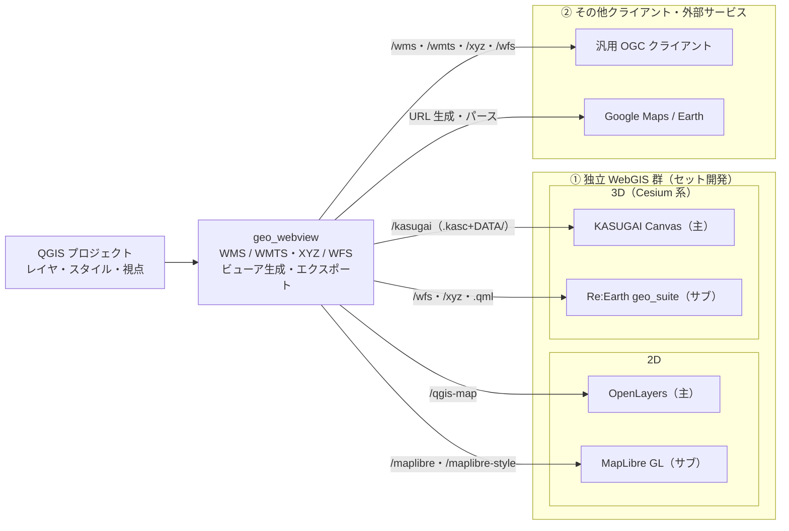

# geo_webview — QGIS を OGC サーバー化し Web 地図へ配信するプラグイン

> **[geo_suite](https://github.com/yamamoto-ryuzo/geo_suite)** の一部として開発  
> QGIS プロジェクトを WMS/WMTS/WFS の OGC 準拠サーバーに変換し、Web 地図クライアントへ配信する軽量プラグイン

## 概要

geo_webview は QGIS と Web を連携させるプラグインです。QGIS は GIS データを操作するのに最適な環境であり、このプラグインはその QGIS を **配信側（OGC 標準準拠の地図サーバー＋ビューア生成）に変換**して、各種 Web 地図クライアントへ供給します。複雑なサーバー構築不要で、QGIS を起動するだけで WMS、WMTS、WFS サービスと Web ビューアが利用可能になります。

**主な用途:**
- 社内 LAN での地図データ共有
- フィールド調査用モバイルアプリへのデータ配信
- 緊急時の臨時地図サーバー構築
- QGIS プロジェクトをそのまま配布可能な地図サービス化


## 連携方針（対応クライアント）

geo_webview の連携方針は、クライアントを2グループに分け、独立動作する WebGIS 群（①）に共同開発を集中することです。**2D は OpenLayers（主）/ MapLibre（副）、3D は KASUGAI Canvas（主）/ Re:Earth（副）**、それ以外は汎用 OGC 出力で供給します。

### ① 独立動作する WebGIS — geo_webview とセットで開発しているクライアント群

QGIS からエクスポート/配信されたデータ・スタイルを取り込み、それぞれ独立した WebGIS として動作します。geo_webview はこれらの WebGIS の QGIS 側受け皿（配信元）として開発を進めています。

| 連携先 | 経路 | 連携の形 |
|---|---|---|
| **OpenLayers** | `/qgis-map` | **2D GIS の主開発対象**。WMS ソースを参照する対話的 HTML を生成・配信（回転・テーマ・任意 CRS 対応で QGIS キャンバスの Web 等価物） |
| **MapLibre GL** | `/maplibre` + `/maplibre-style` | **2D GIS のサブ**。WMTS ラスタ + WFS ベクター + QGIS レンダラの自動変換スタイル（GL 描画のモダン表示） |
| **KASUGAI Canvas** | `/kasugai` | **3D GIS の主開発対象**。Cesium エンジン上の独立 WebGIS アプリへ、QGIS レイヤツリーを `.kasc`+`DATA/`（ベクター＋`.qml` スタイル）として出力し、起動中の KASUGAI へ外部プロジェクト登録・表示切替 |
| **Re:Earth（geo_suite）** | 汎用 OGC 出力 | **3D GIS のサブ**（KASUGAI Canvas と同じ Cesium ベース）。`/wfs` の GeoJSON・`/xyz`/`/wmts` タイル・`.qml` スタイルをクライアント側（geo_suite の QML→Re:Earth トランスレータ）が取り込む |

※3D 表現は Cesium ベースの KASUGAI Canvas（主）・Re:Earth（サブ）に集約して開発します。内蔵の `/map3d`（OpenLayers+Cesium 同期ページ）は簡易プレビューに留め、連携先クライアント群からは外しています。

### ② その他クライアント・外部サービス

| 連携先 | 経路 | 連携の形 |
|---|---|---|
| **その他 OGC クライアント** | `/wms` `/wmts` `/xyz` `/wfs` | WMS 1.3.0 / WMTS / XYZ / WFS 2.0 に対応する任意のクライアント（QGIS・ArcGIS・Web アプリ等） |
| **Google Maps / Google Earth** | URL 生成・パース | 現在の表示を Google Maps / Earth の URL として生成して外部ブラウザで開く。受信した Google 系 URL は External Control で QGIS ナビゲートへ変換 |

### 今後の開発方針（連携構成）

上記の組み合わせを今後の開発方針とします。



※Leaflet は 2D 連携の対象外とします（回転・任意 CRS など QGIS 要件を満たせず、機能は OpenLayers の下位互換。軽量埋め込みが必要になった場合のみ `/wms`・`/xyz` を読む薄いページとして後付け可能）。

## クライアント群の機能

①の WebGIS 群の各クライアントが持つ機能の一覧です。**KASUGAI Canvas**（最も開発が進んだクライアント）を基準軸に整理しています。`—` = 同等機能なし、`△` = 部分的対応。各クライアントへデータを供給する QGIS 側の共通サービスは末尾にまとめています。

### データ取り込み・レイヤー形式

クライアントは取り込み方で2つの型に分かれます:

**宣言型（ファイル指定）**: クライアント自身が、ローカルパスまたは URL で指定されたファイルを指定形式としてデコードして読む — KASUGAI Canvas（`.kasc` の `gpkg:DATA/x.gpkg` 等の行）と Re:Earth（インスペクターの `geojson: URL` 等の行）。

| 機能 | KASUGAI Canvas | Re:Earth geo_suite |
|---|:-:|:-:|
| 取り込み経路 | `.kasc` + `DATA/` ファイル（`/kasugai` エクスポート + `/api/projects/register`） | インスペクター行・geo_webview の `/wfs` GeoJSON・`/xyz`・`.qml` |
| GeoJSON | ✓（`geojson:`） | ✓ |
| GeoPackage | ✓（`gpkg:` Worker・`bbox=auto` クエリ） | — |
| GeoParquet | ✓（`geoparquet:`） | — |
| FlatGeobuf | ✓（`flatgeobuf:`） | — |
| DuckDB/SQL クエリレイヤー | ✓（`duckdb:`/`sql:`・`:bbox` 表示範囲連動） | ✓（`duckdb:`・DuckDB-Wasm） |
| 3D Tiles | ✓（`3dtiles:`） | ✓ |
| XYZ タイル・ベースマップ | ✓（`xyz:`/`base:`） | ✓（basemap-widget） |
| QGIS スタイル（.qml） | ✓（`style=`・entity/primitive 両経路でクライアント側コンパイル） | ✓（QML→Re:Earth トランスレータ） |

**サービス型（プロトコル定義）**: サーバーが形式を決めて OGC プロトコルで配信し、クライアントは受領するだけ — MapLibre と OpenLayers。

| 機能 | MapLibre (`/maplibre`) | OpenLayers (`/qgis-map`) |
|---|:-:|:-:|
| 取り込み経路 | WMTS ラスタ + `/wfs` GeoJSON | `/wms` ラスタ |
| ラスタ配信 | WMTS ソース | WMS ソース |
| ベクターデータ | `/wfs` GeoJSON | —（GetFeatureInfo のみ） |
| QGIS スタイル | `/maplibre-style` 自動変換 | WMS サーバー側描画 |

### レイヤー管理・表示

| 機能 | KASUGAI Canvas | Re:Earth geo_suite | MapLibre | OpenLayers |
|---|:-:|:-:|:-:|:-:|
| レイヤー一覧 UI | ✓ | ✓（layers-and-tiles-list） | ✓ | — |
| グループ化（レイヤーツリー継承） | ✓ | ✓（グループルール） | △ | — |
| 表示 on/off | ✓ | ✓ | ✓ | — |
| 凡例表示 | ✓ | ✓ | — | — |
| SQL フィルター・対話的再クエリ | ✓（⏷フィルター） | — | — | — |
| 描画方式切替（`render=entity/primitive`） | ✓ | — | — | — |

### 検索・属性

| 機能 | KASUGAI Canvas | Re:Earth geo_suite | MapLibre | OpenLayers |
|---|:-:|:-:|:-:|:-:|
| 住所検索 | ✓ | ✓ | — | — |
| ベクトル検索 | ✓ | ✓ | — | — |
| 属性・値一覧 | ✓（Attr パネル・全件クエリ） | ✓ | — | △（GetFeatureInfo） |
| Info 表示 | ✓ | ✓ | — | — |

### ビュー・ナビゲーション

| 機能 | KASUGAI Canvas | Re:Earth geo_suite | MapLibre | OpenLayers |
|---|:-:|:-:|:-:|:-:|
| 視点の引き継ぎ | `.kasc` の `cam:` 行 | `?lat=&lng=` クエリ | `x,y,scale,rotation` | `x,y,scale,rotation,crs` |
| 回転 | ✓（heading） | △ | ✓ | ✓ |
| 任意 CRS | — | — | — | ✓ |
| マップテーマ | — | — | ✓ | ✓ |
| カメラプリセット・ブックマーク | ✓ | ✓ | ✓ | — |
| Terrain / Shadow | ✓ | ✓ | — | — |
| GeoJSON 3D ドレープ | ✓（terrain / 3D Tiles / both） | ✓ | — | — |
| 追従モード（QGIS キャンバス追従） | — | — | ✓（`/present/state`） | ✓ |

### プレゼン・共有・外部サービス

| 機能 | KASUGAI Canvas | Re:Earth geo_suite | MapLibre | OpenLayers |
|---|:-:|:-:|:-:|:-:|
| Fly モード・ルート描画 | ✓ | ✓ | — | — |
| パーマリンク・共有 | ✓（`buildShareUrl`） | ✓（クエリ文字列のみ） | ✓ | ✓ |
| 双方向ナビ（`/received`・External Control） | — | — | ✓ | ✓ |
| Google 連携 | ✓（Google Maps Platform・Photorealistic 3D Tiles） | ✓（Google Earth 連携） | — | ✓（URL 生成・解析） |
| 画面共有プレゼン | — | — | — | ✓（`/present`・`/screenshot`） |

### AI・拡張・ローカル連携

| 機能 | KASUGAI Canvas | Re:Earth geo_suite | MapLibre | OpenLayers |
|---|:-:|:-:|:-:|:-:|
| AI チャット | ✓（Gemini function calling・ツール実行共通化） | ✓ | — | — |
| 外部エージェント制御 | ✓（`/api/command` + bridge hub → Copilot/Devin/Antigravity） | — | — | △（Live Driver の `kasugaiExport` bridge） |
| MCP データソース | ✓（`/api/mcp` 中継） | — | — | — |
| プラグイン機構 | ✓（`PLUGIN/`・IndexedDB 草稿・`.kasp`） | （自体が Re:Earth プラグイン） | — | — |
| クラウドストレージ（rclone） | ✓ | — | — | — |
| ローカル保存・納品用ローカル化 | ✓（`/api/files`・`_local` ワークスペース） | — | — | — |
| 外部プロジェクト登録 | ✓（`.kasc` 関連付け・群マニフェスト） | — | — | — |
| i18n | 8言語 | 20言語 | — | — |

### geo_webview が提供する共通サービス

上記クライアント群へ geo_webview が共通して提供する機能です。クライアントごとの差異は「取り込み経路と表現形式」だけで、QGIS 側の提供機能は共通化されています。

| 共通サービス | KASUGAI Canvas | Re:Earth | MapLibre | OpenLayers |
|---|:-:|:-:|:-:|:-:|
| 視点の引き継ぎ（中心・縮尺・回転） | ✓（`cam:`） | △（lat/lng） | ✓ | ✓ |
| ラスタ配信（WMS / WMTS / XYZ） | `xyz:`/`base:` | XYZ | WMTS | WMS |
| ベクターデータ | `DATA/` ファイル（ネイティブ参照 or GeoJSON 化） | WFS/GeoJSON | WFS | — |
| QGIS スタイルの引き継ぎ | `.qml`（+ GPKG `layer_styles`） | `.qml` | 自動変換 | WMS 描画 |
| レイヤ一覧・表示制御 | ✓（on/off・グループ） | ✓ | ✓ | — |
| クエリ系記述（`duckdb:`/`sql:`/`bbox=auto`） | —（未出力） | — | — | — |
| マップテーマ | — | — | ✓ | ✓ |
| 追従モード（`/present/state`） | — | — | ✓ | ✓ |
| プロジェクト登録・ビュー切替 | ✓（`/api/projects/register` + `switchProject`） | — | — | — |

- **視点の引き継ぎ**: `x,y,scale,rotation,crs`（または `lat,lon,zoom`、パーマリンク）で指定した表示状態を各クライアントで再現。KASUGAI では `.kasc` の `cam:` 行として書き出す
- **ラスタ配信**: QGIS の見た目そのままの地図画像を WMS（回転 `ANGLE` 対応）/ WMTS / XYZ で供給。各クライアントの背景・重ね合わせに利用
- **ベクターデータ**: 公開レイヤ（`WFSLayers`）を GeoJSON で供給。MapLibre・Re:Earth は `/wfs` 経由、KASUGAI は `DATA/` フォルダのファイルとして受け取る（GPKG/GeoJSON/GeoParquet/FlatGeobuf は変換せずネイティブ参照）
- **スタイル引き継ぎ**: QGIS レンダラを各クライアント形式へ変換 — WMS/タイルはサーバー側描画で見た目を完全再現、MapLibre は `/maplibre-style` でレイヤ変換、KASUGAI・Re:Earth は `.qml` を渡してクライアント側でコンパイル
- **レイヤ一覧・表示制御**: `/wfs-layers`（公開レイヤ JSON）を共通のレイヤカタログとして利用。KASUGAI ではレイヤツリーのグループ構成と on/off も引き継ぐ
- **クエリ系記述**: KASUGAI Canvas のクエリ系レイヤー（`duckdb:`/`sql:`、`where=`/`bbox=auto` 付き `gpkg:`）は `/kasugai` からまだ出力していない — 現行のエクスポートはファイル複製または GeoJSON 全件変換のみ
- **追従モード**: `?follow`/`?present` 付きで開いた OL/MapLibre ページは `/present/state` をポーリングし、QGIS キャンバスの移動にリアルタイム追従（プレゼン・画面共有用）
- **双方向ナビゲーション**: パーマリンク受信（`/received`）と External Control により、クライアント→QGIS 方向の視点共有も可能。KASUGAI からの逆方向は `qgis-import` プラグインが `/kasugai` を呼ぶ形（取り込みのみ — Canvas 側の編集結果は QGIS へ戻らない）

## geo_suite との連携

本プラグインは [geo_suite](https://github.com/yamamoto-ryuzo/geo_suite) プロジェクトの一部として開発されています。

- **geo_webview**: QGIS を OGC サーバーとして起動（本プラグイン）
- **geo_suite**: Re:Earth 上で動くクライアントアプリケーション（地図表示・編集）
- **シナリオ**: QGIS + geo_webview でデータ配信、geo_suite でモバイル/デスクトップから利用

両方を組み合わせることで、QGIS プロジェクトをそのままエンドユーザーに配布できるシステムを構築できます。

## 動作環境

- QGIS 3.x（Qt5 / Qt6 両対応）
- Windows / macOS / Linux
- ネットワーク環境: LAN またはローカルホスト
- Python 3.7 以上

## 主要機能

### 🗺️ 内蔵 Web ビューア

サーバー自体が HTML を生成してブラウザへ配信します。URL を開くだけで利用可能。

| エンドポイント | 内容 |
|---|---|
| `/qgis-map` | OpenLayers 対話地図。`x,y,scale,crs,rotation,theme` クエリで表示状態を指定可能 |
| `/maplibre` | MapLibre ビューア。テーマ・ブックマーク対応 (v3.6.0)、pitch 切替 UI 付き |
| `/map3d` | OpenLayers(2D) + Cesium(3D) の同期2画面（簡易プレビュー。3D の主開発対象は KASUGAI Canvas） |
| `/present` | プレゼン用ページ。`/screenshot` の定期更新で QGIS キャンバスをウィンドウ共有 |
| `/screenshot` | 現在のキャンバス表示の PNG（回転反映、`w`/`h` でサイズ指定可） |


### 🌐 OGC 標準サービス

#### WMS (Web Map Service)
- QGIS プロジェクトをそのまま WMS 1.3.0 として配信
- GetCapabilities / GetMap / GetFeatureInfo 対応
- カスタムスタイル（SLD）サポート、テーマ指定 (`theme`)、回転 (`ANGLE`) 対応
- 高解像度画像出力（最大 4096px）

#### WMTS / XYZ (タイル)
- `/wmts/{z}/{x}/{y}.png`・`/xyz/{z}/{x}/{y}.png` のタイル配信
- GetCapabilities 対応、`tms=1` で TMS（y 反転）互換
- identity ベースのキャッシュ分離（`?v=` でクライアント側キャッシュ制御）

#### WFS (Web Feature Service) 2.0
- ベクターデータを GeoJSON / GML で配信
- GetCapabilities / GetFeature / DescribeFeatureType / GetStyles（SLD）対応
- **高速キャッシュ機構**: 2回目以降のリクエストが40倍高速化

### � 外部アプリ連携

#### KASUGAI Canvas（Cesium）
- パネルの `KASUGAI` ボタンまたは `GET /kasugai` で、表示中レイヤを KASUGAI Canvas プロジェクト（`.kasc`+`DATA/`）として出力
- GPKG/GeoJSON/GeoParquet/FlatGeobuf はネイティブ参照、その他ベクターは GeoJSON(EPSG:4326) に変換。各レイヤの QGIS スタイルは `.qml` として出力
- 起動中の KASUGAI ローカルサーバーへ外部プロジェクト登録 → `switchProject` で表示切替
- KASUGAI 側の `qgis-import` プラグインからも同機能を呼び出し可能（双方向）
- AI からは Live Driver 経由の `kasugaiExport` ブリッジで制御可能

### 🔄 パーマリンク・External Control

- 現在の地図ビュー（座標・スケール・回転・テーマ・レイヤ状態）を URL で共有
- `External Control` を ON にすると、外部から受信した URL で QGIS の表示を自動ナビゲート
- Office ドキュメント（Excel / PowerPoint）への埋め込み、高解像度 PNG エクスポート
- Google Maps / Google Earth: 現在の表示から Google 系 URL を生成してブラウザで開く。受信した Google 系 URL のパースによるナビゲートもこの仕組みで処理（外部サービス連携の一例）

### 📡 ネットワーク機能 (v3.5.0)

- **外部アクセス診断**: 接続性チェック、ファイアウォール検出
- **自動ポート設定**: Windows ファイアウォールへの自動ルール追加
- **柔軟なポート設定**: 80-65535 の全範囲対応
- **動的ホスト名解決**: 外部デバイスからのアクセスに自動対応

### � パフォーマンス最適化

**WFS レスポンスキャッシュ (v3.4.0):**
```
初回リクエスト: 200ms → 70ms (3倍高速)
2回目以降:     200ms → <5ms (40倍高速!)
1000地物:     1.5秒 → 500ms
10000地物:    15秒 → 5秒
```

## クイックスタート

### 1. インストール

```bash
# QGIS プラグインディレクトリに配置
# Windows: %APPDATA%\QGIS\QGIS3\profiles\default\python\plugins\geo_webview
# macOS: ~/Library/Application Support/QGIS/QGIS3/profiles/default/python/plugins/geo_webview
# Linux: ~/.local/share/QGIS/QGIS3/profiles/default/python/plugins/geo_webview
```

または QGIS プラグインマネージャーからインストール可能です。

### 2. 基本的な使い方

1. QGIS でプロジェクト（.qgs/.qgz）を開く
2. メニューから「Web > geo_webview」を選択
3. パネルが表示され、自動的に HTTP サーバーが起動
4. 表示される URL（例: `http://localhost:8089`）でサービスにアクセス

### 3. OGC サービスの利用

**WMS サービス:**
```bash
# GetCapabilities
http://localhost:8089/wms?SERVICE=WMS&REQUEST=GetCapabilities

# GetMap
http://localhost:8089/wms?SERVICE=WMS&REQUEST=GetMap&LAYERS=mylayer&WIDTH=800&HEIGHT=600&BBOX=...
```

**WMTS サービス:**
```bash
# XYZ タイル
http://localhost:8089/wmts/{z}/{x}/{y}.png

# GetCapabilities
http://localhost:8089/wmts?SERVICE=WMTS&REQUEST=GetCapabilities
```

**WFS サービス:**
```bash
# GetCapabilities
http://localhost:8089/wfs?SERVICE=WFS&REQUEST=GetCapabilities

# GetFeature (GeoJSON)
http://localhost:8089/wfs?SERVICE=WFS&REQUEST=GetFeature&TYPENAME=mylayer&OUTPUTFORMAT=application/json
```

## エンドポイント一覧

| パス | 種別 | 内容 |
|---|---|---|
| `/qgis-map` | HTML | OpenLayers 対話地図（パーマリンク） |
| `/maplibre` | HTML | MapLibre ビューア |
| `/maplibre-style` | JSON | MapLibre スタイル（`?typename=` でレイヤ別） |
| `/map3d` | HTML | OpenLayers + Cesium 同期2画面（簡易プレビュー） |
| `/present` | HTML | プレゼン用ウィンドウ共有ページ |
| `/screenshot` | PNG | 現在のキャンバス画像 |
| `/wms` | OGC | WMS 1.3.0（GetCapabilities/GetMap/GetFeatureInfo） |
| `/wmts/{z}/{x}/{y}.png` | OGC | WMTS タイル（GetCapabilities も `/wmts?...` で） |
| `/xyz/{z}/{x}/{y}.png` | OGC | XYZ タイル（WMTS エイリアス） |
| `/wfs` | OGC | WFS 2.0（GeoJSON/GML） |
| `/wfs-layers` | JSON | 公開 WFS レイヤ一覧 |
| `/kasugai` | JSON | KASUGAI Canvas へエクスポート・登録 |
| `/received` | HTML | 受信パーマリンク履歴 |

## 主なユースケース

### 1. フィールド調査支援

QGIS で作成した地図データを、調査員のモバイル端末（geo_suite アプリ）にリアルタイム配信。

```
[本部 PC]
 └─ QGIS + geo_webview (WMS/WFS 配信)
      ↓
[フィールド]
 └─ モバイル端末 + geo_suite (データ受信・編集)
```

### 2. 社内地図ポータル

部署内の地図データを QGIS から配信し、各メンバーがブラウザで閲覧。

```bash
# 部署内 LAN で配信
http://192.168.1.100:8089/qgis-map
```

### 3. 緊急時の臨時地図サーバー

災害対応時、既存の QGIS プロジェクトを即座にサーバー化して情報共有。

### 4. プロジェクト配布パッケージ

QGIS Portable + geo_webview + データを USB メモリで配布し、受け取った人が即座にサーバーとして起動。

### 5. 3D 可視化・プレゼン

`/kasugai` で KASUGAI Canvas（3D GIS の主開発対象）へ持ち出して3D確認・プレゼン資料化、`/present` で会議画面に QGIS 表示を共有。手軽な確認には内蔵の簡易3Dプレビュー `/map3d` も利用可能。

## WFS 詳細仕様

### 対応オペレーション

| オペレーション | 説明 | 出力形式 |
|--------------|------|---------|
| GetCapabilities | サービス情報・レイヤー一覧 | XML |
| GetFeature | 地物データ取得 | GeoJSON / GML |
| DescribeFeatureType | スキーマ情報 | XML |
| GetStyles | スタイル情報（SLD） | XML |

### パラメータ

```bash
# 基本パラメータ
SERVICE=WFS          # 必須: "WFS"
REQUEST=GetFeature   # 必須: オペレーション名
VERSION=2.0.0        # オプション: デフォルト 2.0.0
TYPENAME=layer_name  # 必須: レイヤー名
OUTPUTFORMAT=application/json  # オプション: GeoJSON/GML

# フィルタリング
MAXFEATURES=100      # 最大地物数
BBOX=minx,miny,maxx,maxy  # 空間フィルタ
SRSNAME=EPSG:4326    # 座標系
```

### 使用例

```bash
# レイヤー一覧を取得
curl "http://localhost:8089/wfs?SERVICE=WFS&REQUEST=GetCapabilities"

# GeoJSON で地物を取得
curl "http://localhost:8089/wfs?SERVICE=WFS&REQUEST=GetFeature&TYPENAME=roads&OUTPUTFORMAT=application/json"

# 範囲指定で取得
curl "http://localhost:8089/wfs?SERVICE=WFS&REQUEST=GetFeature&TYPENAME=buildings&BBOX=130,30,140,40"

# スタイル情報を取得
curl "http://localhost:8089/wfs?SERVICE=WFS&REQUEST=GetStyles&TYPENAME=roads"
```

## MapLibre 連携

### スタイル自動変換

QGIS のレンダラ設定を MapLibre スタイルに自動変換:

- シンボルレンダラ → circle/line/fill レイヤ
- カテゴリ値レンダラ → データ駆動スタイル
- ルールベースレンダラ → フィルタ式変換

### エンドポイント

```bash
# ベーススタイル（WMTS のみ）
http://localhost:8089/maplibre-style

# レイヤー別スタイル（WFS + スタイル）
http://localhost:8089/maplibre-style?typename=layer_name

# MapLibre ビューア
http://localhost:8089/maplibre
```

### カスタマイズ

```javascript
// カスタム MapLibre スタイルの適用
map.setStyle('http://localhost:8089/maplibre-style?typename=roads');
```

## KASUGAI Canvas 連携

`/kasugai` エンドポイント（またはパネルの `KASUGAI` ボタン、Live Driver 経由の `kasugaiExport` ブリッジ）で、QGIS プロジェクトを KASUGAI Canvas（Cesium ベースの3D地図アプリ）へ送出します。

```bash
curl "http://localhost:8089/kasugai"
# → {"ok":true,"url":"http://localhost:8510/?project=...","dir":"...","layers":N,"tiles":M}
```

- 出力先: 既定 `<ドキュメント>/kasugai_canvas_qgis`（`.kasc` + `DATA/`）
- GPKG/GeoJSON/GeoParquet/FlatGeobuf はネイティブ参照、その他は GeoJSON(EPSG:4326) へ変換
- 各ベクターレイヤの QGIS スタイルを `.qml` として同梱（KASUGAI 側が Cesium 描画へコンパイル）
- 起動中の KASUGAI へ自動登録・表示切替（未起動時は出力のみ）

詳細は `SPEC_JP.md` の「KASUGAI Canvas 連携」節を参照。

## Office 連携

### Excel へのリンク埋め込み

1. geo_webview でパーマリンク生成
2. Excel セルにハイパーリンクとして設定
3. クリックで QGIS が該当箇所にジャンプ

### PowerPoint での活用

1. 高解像度 PNG をエクスポート
2. スライドに画像を挿入
3. 画像にパーマリンクを設定
4. プレゼン中にクリックで詳細表示

## 開発・カスタマイズ

### アーキテクチャ

```
geo_webview/
├── plugin.py              # メインプラグイン
├── panel.py               # UI パネル
├── server_manager.py      # HTTP サーバー管理・ルーティング
├── wms_service.py         # WMS 実装
├── wmts_service.py        # WMTS/XYZ 実装
├── wfs_service.py         # WFS 実装
├── maplibre_generator.py  # MapLibre 変換
├── webmap_generator.py    # OpenLayers / OL+Cesium 生成
├── kasugai_export.py      # KASUGAI Canvas 連携
└── bridge.py              # AI/外部制御用ブリッジ
```

### 詳細仕様

技術仕様の詳細は [`SPEC.md`](./SPEC.md) / [`SPEC_JP.md`](./SPEC_JP.md) を参照してください。

### 開発手順

1. [`SPEC.md`](./SPEC.md) で仕様を確認
2. 主要ファイルを把握
3. QGIS で動作確認
4. 変更 → テスト → コミットのサイクル

### 翻訳対応

ソース言語は英語。`i18n/<lang>.json` に9言語
(de, es, fr, hi, it, ja, pt, ru, zh)の翻訳カタログを持つ。
JSON を直接編集する。未登録の文字列は英語にフォールバック。

```bash
# カタログ未登録の文字列を検出
python ../../scripts/i18n_tool.py check
```

## セキュリティ注意事項

⚠️ **重要**: 本プラグインは社内 LAN での利用を前提としています。

- 機密データを含む場合は外部公開を避けてください
- 外部公開が必要な場合は認証・アクセス制御を実装してください
- `External Control` を有効にすると外部 URL で QGIS 表示が書き換わるため、信頼できるネットワーク内でのみ使用してください
- ファイアウォール設定を適切に行ってください
- 最小限のデータのみを公開してください

## 今後の開発方針

連携先クライアントの方針は [連携構成（今後の開発方針）](#今後の開発方針連携構成) の構成図を参照。

- ✅ WMS/WMTS/WFS の基本機能実装
- ✅ キャッシュ機構による高速化
- ✅ MapLibre スタイル自動変換
- ✅ OL+Cesium 3D 同期表示・KASUGAI Canvas 連携
- ⏳ Re:Earth（geo_suite）専用連携の強化（現状は汎用 GeoJSON/XYZ/QML 経由）
- ❌ ベクトルタイルサーバー（他サービス利用を推奨）

## バージョン履歴

- **v3.x**: geo_suite統合、OGC準拠サーバー化、10言語対応、KASUGAI Canvas 連携
- **v2.x**: WMTS/MapLibre対応
- **v1.x**: 基本機能（WMS/OpenLayers）

詳細: [`CHANGELOG.md`](./CHANGELOG.md)

## ライセンス

GNU General Public License version 3 (GPLv3)  
詳細: [LICENSE](./LICENSE)

## 免責事項

本システムは個人のPCで作成・テストされたものです。  
ご利用によるいかなる損害も責任を負いません。

<p align="center">
  <a href="https://giphy.com/explore/free-gif" target="_blank">
    
  </a>
</p>
