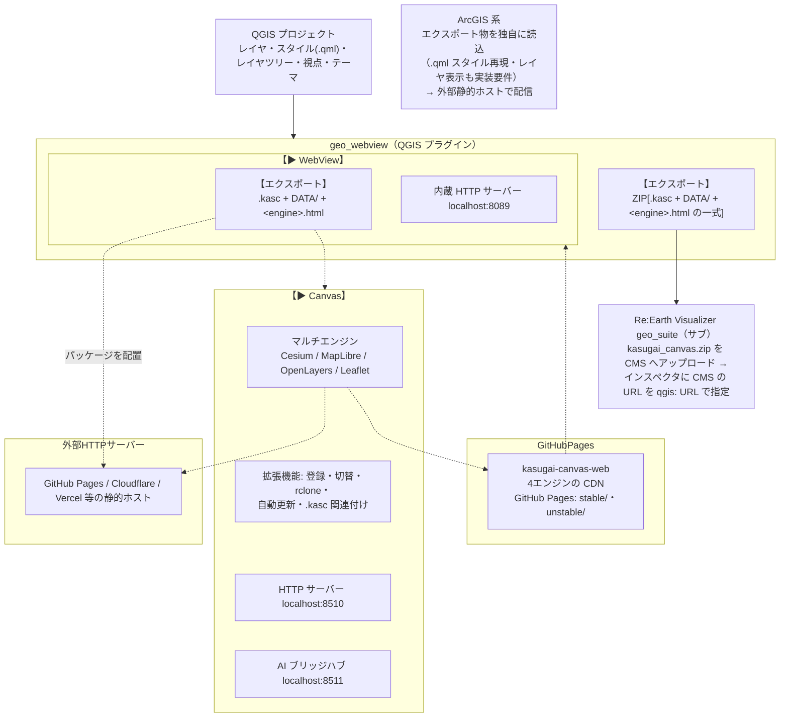

# geo_webview — QGIS をサーバレス Web 配信するプラグイン（マルチエンジン対応）

> **[geo_suite](https://github.com/yamamoto-ryuzo/geo_suite)** の一部として開発  
> 開いている QGIS プロジェクトを `.kasc`+`DATA/` パッケージに出力し、
> KASUGAI Canvas のマルチエンジン（Cesium / MapLibre / OpenLayers / Leaflet）
> で再生する QGIS プラグイン。出力物は静的ホスティングだけで配信できる
> **サーバレス構成が本体**であり、内蔵 HTTP サーバー（起動API・
> `/export-data/` 配信・画面共有・受領履歴）がそれを補助します。

[English README](README.md)

## 概要

geo_webview の役割は **「QGIS を Web 配信側に変える」** ことです。
GIS データの編集・スタイル設定は QGIS が最適な環境であり、このプラグインは
その成果をそのまま Web へ持ち出します。

```
[QGIS プロジェクト]  レイヤ・スタイル(.qml)・レイヤツリー・視点・テーマ
        │  geo_webview が .kasc + DATA/ へエクスポート
        ▼
[.kasc + DATA/ パッケージ]  + エンジン本体(KASUGAI Canvas web/)
        │  Cesium / MapLibre / OpenLayers / Leaflet で再生
        ▼  静的ホスティングへ配置
[ブラウザの WebGIS]  ← サーバーレス（QGIS・専用サーバー不要）
```

- **主機能 = サーバレス配信**: 表示中レイヤと QGIS スタイルを
  `.kasc`+`DATA/` に書き出し、エンジン（KASUGAI Canvas `web/`）と一緒に
  任意の静的ホストへ置くだけで WebGIS として配信できる。
  再生に QGIS 側サーバーは不要
- **補助 = 内蔵 HTTP サーバー**: `/kasugai` 起動 API、エクスポート物の
  `/export-data/` 配信、画面共有（`/present`・`/screenshot`）、
  受領履歴（`/received`）、Canvas `web/` の静的フォールバックを提供する。
  ※OGC サービス（WMS/WMTS/WFS）は v3.29.0 で廃止

### 連携構成図



### 機能

| &nbsp;&nbsp;&nbsp;&nbsp;&nbsp;&nbsp;パネルボタン&nbsp;&nbsp;&nbsp;&nbsp;&nbsp;&nbsp; | 動作 |
|---|---|
| 【エクスポート】 | `.kasc + DATA/ + <engine>.html + index.html + kasugai_canvas.zip` を出力。**ファイル出力のみ**、起動・登録は行わない |
| 【▶ WebView】 | ホスト版 `kasugai-canvas-web`（GitHub Pages CDN）のエンジンで開き、データは `:8089/export-data/` から供給。要インターネット・HTTP サーバー稼働（Canvas 未インストールでも可） |
| 【▶ Canvas】 | **エクスポート済み**のプロジェクトを稼働中の KASUGAI Canvas ローカルサーバー（:8510）へ登録・表示切替・ブラウザ起動。**エクスポートは行わない** — 未出力の場合は Export を先に実行するようメッセージで案内。Canvas 未検出時はボタンが **Install KASUGAI Canvas** 表示になり、セットアップ（.kasc 関連付けあり）/ ポータブルZIP を選んでバックグラウンドインストール後に起動 |

### マルチエンジン

同じ `.kasc`+`DATA/` を4つのエンジンで再生できます（`?engine=` または
出力される `<engine>.html` 起動ページで切替）:

| エンジン | 役割 |
|---|---|
| **Cesium**（既定） | 3D 主エンジン。3D Tiles・地形・GeoJSON ドレープ・Fly モード・AI チャット |
| **MapLibre** | 高速 2D。`wms:`/`wmts:` 行・duckdb/sql クエリ・属性 UI・6タブパネル |
| **OpenLayers** | 2D 汎用。任意 CRS・回転・`/present/state` 追従（プレゼン） |
| **Leaflet** | 軽量 2D（OpenLayers の機能サブセット。回転・任意 CRS なし） |

再生システム本体は **KASUGAI Canvas** 側で整備されています（マルチエンジン
WebGIS。Web 部分は静的配信で動作し、EXE 側が rclone・自動更新・
ファイル保存・`.kasc` 関連付けを担当）。プラグイン内蔵の生成 HTML
ビューア（旧 `/qgis-map`・`/maplibre`・`/map3d`）は v3.24.0 で廃止され、
閲覧は全て KASUGAI Canvas に一本化されました。

KASUGAI Canvas 側のレイアウト（`web/`）:

```
web/
  index.html      エンジン選択リダイレクト（?engine=cesium|maplibre|openlayers|leaflet、既定 cesium）
  cesium/         Cesium フロント（現行アプリ）
  maplibre/       MapLibre フロント（.kasc プレイヤー実装済み: 全ベクター行・wms:/wmts:・QML・duckdb/sql・属性UI・6タブパネル）
  openlayers/     OpenLayers フロント（同上）
  shared/         エンジン非依存コア（.kasc ローダー・デコーダー・i18n・QML コンパイラ）
  projects/       プロジェクトデータ（エンジン非依存）
    projects.json          プロジェクト一覧マニフェスト
    DATA/                  （任意）全プロジェクト共有データ（`../DATA/` 参照先）
    <id>/                  プロジェクト（id 単位で複数管理）
      kasugai_canvas.kasc  プロジェクト設定
      DATA/                プロジェクト専用データ
```

geo_webview が出力する `.kasc`+`DATA/` は `projects/<id>/` の1プロジェクトとして配置され、`.kasc` 行の相対参照は `projects/<id>/` を基準に解決されます。

### 連携方針（対応クライアント）

geo_webview の連携方針は、プレイヤーを **KASUGAI Canvas に一本化**
（Cesium・MapLibre・OpenLayers・Leaflet のマルチエンジン構成。
KASUGAI 側で統一開発済み・`?engine=` で切替）し、
**Re:Earth Visualizer をサブ**とすることです。

配信ルートは2系統です。**高機能ルート**は起動中の KASUGAI Canvas
ローカルサーバー（既定 :8510）の専用 API でプロジェクト登録・画面切替
まで行い、**通常ルート**は内蔵 HTTP サーバーとサーバレス Web 配信で
Canvas アプリなしでも即座に Web 化します
（「再生経路（3段フォールバック）」参照）。

#### ① セット開発のプレイヤー群

QGIS からエクスポート/配信されたデータ・スタイルを取り込んで再生するクライアント。geo_webview はこのプレイヤーの QGIS 側受け皿（配信元）として開発を進めています。

| 連携先 | 経路 | 連携の形 |
|---|---|---|
| **KASUGAI Canvas** | `/kasugai`（`.kasc`+`DATA/`） | **統合プレイヤー（主）**。QGIS レイヤツリーを `.kasc`+`DATA/`（ベクター＋`.qml` スタイル）として出力し、起動中の KASUGAI へ外部プロジェクト登録・表示切替。パネルの `Export` ボタンはファイル出力のみ、`▶ Open` / `GET /kasugai?engine=` / `kasugaiExport` ブリッジは登録・起動まで行い、同じ `.kasc`+`DATA/` を全エンジンで再生。EXE 込みインストールでは rclone・自動更新・ファイル保存・`.kasc` 関連付けも利用可 |

#### ② その他クライアント・外部サービス

| 連携先 | 経路 | 連携の形 |
|---|---|---|
| **Re:Earth Visualizer（geo_suite）** | `kasugai_canvas.zip`（`qgis:` インスペクタ行で取込）・`/export-data/` | **サブ**（KASUGAI Canvas と同じ Cesium ベース）。下記「Re:Earth Visualizer（geo_suite）への対応方針」参照 |
| **ArcGIS 系** | `.kasc`+`DATA/` ファイル受け渡し → ArcGIS 側（SDK）の独自実装を**外部静的ホストで配信**（GitHub Pages/Cloudflare/Vercel/自前サーバ等。ArcGIS Online 上では動作不可） | 下記「ArcGIS 系への対応方針」参照 |

#### Re:Earth Visualizer（geo_suite）への対応方針

Re:Earth Visualizer は **KASUGAI Canvas と同じ Cesium ベースのサブプレイヤー** として位置づけます。geo_webview は `kasugai_canvas.zip`（エクスポート一式）出力と `/export-data/` 経由のファイル・`.qml` スタイル配信で供給し、取込は geo_suite 側の `qgis:` インスペクタ行（ZIP の URL 指定）が担います。3D 表現は Cesium ベースの KASUGAI Canvas（主）・Re:Earth Visualizer（サブ）に集約して開発します。

詳細: [geo_webview 連携方針（`INTEGRATION_JP.md`）](INTEGRATION_JP.md#reearth)

#### ArcGIS 系への対応方針

- ① ArcGIS Online 上ではカスタムコードを実行できず、本系統の機能は実現不可能
- ② Cesium 等のエンジンと同等品を作る場合 — Canvas 側のコード資産は SDK が異なり流用できないため、データ構築を含めて一からの開発が必要（3D は 3D Tiles→I3S 変換パイプライン経由が前提・ライブ 3D Tiles URL は対象外。参照できるのは `.kasc` 仕様と同一 OSS ライブラリのみ）
- ③ ArcGIS のセキュリティ（管理環境）内でカスタム WebGIS を動かすなら Enterprise 11.0+ の ExB カスタムウィジェットが唯一の経路 — それ以外はすべて外部ホスト前提のモデルとなり、導入の意義がない

詳細（読み込み側要件・ライセンス形態・最小構成・`arcgis:` 取り込みの注意点）: [geo_webview 連携方針（`INTEGRATION_JP.md`）](INTEGRATION_JP.md#arcgis)

## サーバレス配信の流れ

### 1. エクスポート／起動

パネル最上段の「Web Distribution」グループで操作します。

保存行（Export＋保存先）と起動行（Engine選択＋▶ボタン）に分かれています。

| 操作 | 動作 |
|---|---|
| `Export` ボタン | `.kasc`+`DATA/`＋`index.html`＋エンジン別起動HTMLを**ファイル出力のみ**（起動なし） |
| 保存先フォルダ名 | 現在の出力先を中央省略で表示。クリックでフォルダ選択して変更。`↺` で既定（Canvas インストール先／ドキュメント）にリセット |
| `📁` ボタン | 出力フォルダをファイルマネージャで開く |
| `Engine:` コンボ | 起動エンジンを選択（Cesium/MapLibre/OpenLayers/Leaflet。選択は QSettings `kasugai_engine` に保存） |
| `▶ WebView` ボタン | エクスポート → ホスト版エンジン（GitHub Pages）でブラウザ起動まで一発実行（要 HTTP サーバー・インターネット） |
| `CDN:` コンボ | `▶ WebView` が使うホスト版チャンネル（`stable`/`unstable`/カスタムURL。QSettings `kasugai_hosted_channel` に保存） |
| `▶ Canvas` ボタン | **エクスポート済み**の `.kasc` を稼働中の Canvas（:8510）へ登録・ブラウザ起動（再エクスポートしない。未出力時は Export を促す）。Canvas 未検出時は Install ボタン化し、セットアップ/ポータブルZIP を選んでインストール→起動 |

API 経由でも同じ機能を呼べます:

- `GET /kasugai?engine=<e>` — 外部アプリ・スクリプトからの一発起動（JSON 応答）
- bridge `kasugaiExport(engine=...)` — Live Driver 経由の AI 制御
- KASUGAI Canvas 側 `qgis-import` プラグインの「QGISから取り込み」ボタン — 逆方向からの呼び出し

### 2. 出力物

```
<out_dir>/                   # KASUGAI 登録済みなら <install>/QGIS_projects/<プロジェクト名>/
├─ kasugai_canvas.kasc       # レイヤツリー・参照行・cam:/theme:/bookmark: 等
├─ index.html                # エンジン別起動ページへのリンク一覧
├─ cesium.html / maplibre.html / openlayers.html / leaflet.html  # 起動ページ
├─ project.json              # {"title": ...}
├─ bookmarks.xml             # QGIS ブックマーク（emit_bookmarks 時）
└─ DATA/                     # GeoJSON(4326) / ネイティブ形式複製 / .qml / タイル等
```

`.kasc` 行の生成規則の詳細は `SPEC_JP.md` §15 を参照（GPKG/GeoJSON/
GeoParquet/FlatGeobuf はネイティブ参照、CSV/TSV は `duckdb:`、
フィルタ付きは `where=`、3D Tiles は `3dtiles:`、XYZ 最下段は `base:`、
WMS ラスタは `wms:` 行、その他ベクターは GeoJSON 化）。

起動ページは `?kasc=<この.kascのURL>` 付きで対応エンジンへ転送し、
エンジン本体を `./ ../ ../../ /` の順に自動探索します（特殊配置は
HTML 内の `CANVAS_BASE` で指定）。

### 3. 再生経路（3段フォールバック）

`▶ Open`・`/kasugai`・`kasugaiExport` は応答の `via` で供給元を返します:

| `via` | 条件 | 開く URL |
|---|---|---|
| `kasugai` | Canvas ローカルサーバー（既定 port 8510）稼働 | `http://localhost:8510/<engine>/?project=<id>` |
| `qgis-http` | Canvas はインストール済みだが未起動 | 本サーバーが `<install>/web/` を静的配信＋`/export-data/` でデータ供給 |
| `hosted` | Canvas 未インストール（要インターネット） | ホスト版エンジン（kasugai-canvas-web / GitHub Pages、チャンネルは設定の `kasugai_hosted_channel`・パネルの `CDN:` コンボでも選択可）＋`/export-data/` |
| `null` | いずれも不可 | 出力のみ成功（`.kasc` を手動で開く） |

### 4. サーバレスとしての公開

出力フォルダとエンジン（`web/` の中身）を同じ静的サーバーへアップするだけで
**QGIS なしで動く単独 WebGIS** になります（Canvas の `?kasc=` 直読みモード）。
`.kasc`+`DATA/`+システム一式を切り出して配布単位とすることもできます。

## 内蔵 HTTP サーバー（補助機能）

QGIS 内で動く軽量 HTTP サーバー。配信パッケージのライブ参照と
起動 API の受け皿です（v3.29.0 で OGC サービスは廃止）。

| エンドポイント | 内容 |
|---|---|
| `/kasugai` | .kasc+DATA/ エクスポート＋Canvas 登録・起動（`?engine=`・`?install=1`） |
| `/export-data/<rel>` | 直近エクスポート物（.kasc/DATA/ 等）の配信 |
| `/<engine>/` | インストール済み KASUGAI Canvas `web/` の静的配信フォールバック |
| `/present` | プレゼン用ページ。OpenLayers ベースで QGIS キャンバスをウィンドウ共有（視聴者ごとの独立ズーム/パン/回転、キャンバス回転も再現） |
| `/present/state` | キャンバス状態 JSON（Canvas 側追従モード用） |
| `/screenshot` | 現在のキャンバス表示の PNG（回転反映、`w`/`h` でサイズ指定可。`extent`/`screen`/`bbox`/`rot` でズーム範囲描画、`X-Map-Extent`/`X-Map-Corners` 応答ヘッダ付き） |
| `/received` | 受領パーマリンク履歴 |


## パーマリンク・External Control（従来機能）

- 現在の地図ビュー（座標・スケール・回転・テーマ・レイヤ状態）を URL で共有
- `External Control` を ON にすると、外部から受信した URL で QGIS の表示を自動ナビゲート
- Office ドキュメント（Excel / PowerPoint）への埋め込み、高解像度 PNG エクスポート

## ネットワーク機能

- **外部アクセス診断**: 接続性チェック、ファイアウォール検出
- **自動ポート設定**: Windows ファイアウォールへの自動ルール追加
- **柔軟なポート設定**: 80-65535 の全範囲対応
- **動的ホスト名解決**: 外部デバイスからのアクセスに自動対応

## クイックスタート

### 1. インストール

```bash
# QGIS プラグインディレクトリに配置
# Windows: %APPDATA%\QGIS\QGIS3\profiles\default\python\plugins\geo_webview
# macOS: ~/Library/Application Support/QGIS/QGIS3/profiles/default/python/plugins/geo_webview
# Linux: ~/.local/share/QGIS/QGIS3/profiles/default/python/plugins/geo_webview
```

または QGIS プラグインマネージャーからインストール可能です。

### 2. 基本的な使い方（サーバレス配信）

1. QGIS でプロジェクト（.qgs/.qgz）を開く
2. メニューから「Web > geo_webview」を選択してパネルを表示
3. `Engine:` でエンジンを選び `▶ Open` — エクスポート→登録→ブラウザ起動まで実行される
4. 配布したい場合は `Export` で出力したフォルダをエンジン（`web/`）と一緒に静的ホストへアップ


## エンドポイント一覧

| パス | 種別 | 内容 |
|---|---|---|
| `/kasugai` | JSON | KASUGAI Canvas へエクスポート・登録（`?engine=` で起動エンジン、`?install=1` で未インストール時の取得） |
| `/export-data/<rel>` | file | エクスポート産物（.kasc/DATA/）の配信 |
| `/<engine>/` | HTML | インストール済み Canvas `web/` の静的配信フォールバック |
| `/present` | HTML | プレゼン用ウィンドウ共有ページ（OpenLayers。視聴者ごとの独立ズーム/回転対応） |
| `/present/state` | JSON | キャンバス状態（追従モード用） |
| `/screenshot` | PNG | 現在のキャンバス画像（`extent`/`screen`/`bbox`/`rot` でズーム範囲指定可） |
| `/received` | HTML | 受信パーマリンク履歴 |
| `/qgis-map` | permalink | パーマリンクのパス（ページは返さず受領記録・ナビゲートに使う） |

## KASUGAI Canvas エンジン比較

KASUGAI Canvas の4エンジン（Cesium / OpenLayers / MapLibre / Leaflet）の機能比較です。`—` = 非対応、`△` = 部分的対応。すべてのエンジンが同じ `.kasc`+`DATA/` パッケージを読みます（`?engine=` または出力される `<engine>.html` で切替）。Re:Earth geo_suite は別クライアント（`kasugai_canvas.zip` 経由）のため本表の対象外とし、QGIS 側の共通サービスは末尾にまとめています。

### データ取り込み・レイヤー形式

| 機能 | Cesium | OpenLayers | MapLibre | Leaflet |
|---|:-:|:-:|:-:|:-:|
| `.kasc`+`DATA/` 取り込み | ✓（`/kasugai` 登録 + `?project=`） | ✓ | ✓ | ✓ |
| GeoJSON | ✓（`geojson:`） | ✓（`geojson:`/ファイル） | ✓（`geojson:`/ファイル） | ✓（`geojson:`） |
| GeoPackage | ✓（`gpkg:` Worker・`bbox=auto` クエリ） | ✓（`gpkg:` sql.js Worker・`bbox=auto`） | ✓（`gpkg:` sql.js Worker・`bbox=auto`） | △ |
| GeoParquet | ✓（`geoparquet:`） | ✓（`geoparquet:` hyparquet） | ✓（`geoparquet:` hyparquet） | △ |
| FlatGeobuf | ✓（`flatgeobuf:`） | ✓（`flatgeobuf:`/`fgb:`） | ✓（`flatgeobuf:`/`fgb:`） | ✓（`fgb:`） |
| CSV/TSV | ✓（`duckdb:`+`format=csv`・`lon=`/`lat=`/`geom=`） | ✓（同左） | ✓（同左） | △ |
| DuckDB/SQL クエリレイヤー | ✓（`duckdb:`/`sql:`・`:bbox` 表示範囲連動） | ✓（同左） | ✓（同左） | — |
| レイヤフィルタ（subsetString） | ✓（`gpkg:`/`duckdb:` の `where=` または GeoJSON 焼き付け） | ✓（`where=`） | ✓（`where=`） | △（GeoJSON 焼き付けのみ） |
| 3D Tiles | ✓（`3dtiles:`） | △（deck.gl 2.5D 俯瞰） | △（deck.gl 2.5D 俯瞰） | —（非対応として一覧通知） |
| XYZ タイル・ベースマップ | ✓（`xyz:`/`base:`） | ✓（`xyz:`/`base:` オーバーレイ） | ✓（`xyz:`/`base:` オーバーレイ） | ✓（`xyz:`/`base:`） |
| WMS / WMTS ラスタ | ✓（`wms:`/`wmts:` — GetMap を 256px タイルへ分解 / `{z}/{x}/{y}`・KVP GetTile へ正規化） | ✓（`wms:`/`wmts:` 行） | ✓（`wms:`/`wmts:` 行を Import パネルで取込） | △（`xyz:` のみ） |
| QGIS スタイル（.qml） | ✓（`style=`＋GPKG 埋め込み layer_styles・entity/primitive 両経路） | ✓（クライアント側コンパイル `shared/qml-2d.js`） | ✓（同左） | ✓（同左） |

※外部 OGC サーバー併用時は、上表の `wms:`/`wmts:`/`xyz:` 行経由で WMS ラスタや外部 `/wfs` GeoJSON を参照可能（geo_webview 自身の OGC サービスは v3.29.0 で廃止済みのため、外部サーバーが前提）。

### レイヤー管理・表示

| 機能 | Cesium | OpenLayers | MapLibre | Leaflet |
|---|:-:|:-:|:-:|:-:|
| レイヤー一覧 UI | ✓ | ✓ | ✓ | ✓ |
| グループ化（レイヤーツリー継承） | ✓ | — | △ | — |
| 表示 on/off | ✓ | — | ✓ | — |
| 凡例表示 | ✓ | — | — | — |
| SQL フィルター・対話的再クエリ | ✓（⏷フィルター） | — | — | — |
| 描画方式切替（`render=entity/primitive`） | ✓ | — | — | — |

### 検索・属性

| 機能 | Cesium | OpenLayers | MapLibre | Leaflet |
|---|:-:|:-:|:-:|:-:|
| 住所検索 | ✓ | — | — | — |
| ベクトル検索 | ✓ | — | — | — |
| 属性・値一覧 | ✓（Attr パネル・全件クエリ） | △ | △ | — |
| Info 表示 | ✓ | — | — | — |

### ビュー・ナビゲーション

| 機能 | Cesium | OpenLayers | MapLibre | Leaflet |
|---|:-:|:-:|:-:|:-:|
| 視点の引き継ぎ（`cam:`） | ✓ | ✓ | ✓ | ✓ |
| 回転 | ✓（heading） | ✓ | ✓ | — |
| 任意 CRS | — | ✓ | — | — |
| マップテーマ | ✓（`theme:`行＋レイヤパネル選択） | ✓ | ✓ | — |
| カメラプリセット・ブックマーク | ✓ | — | ✓ | — |
| Terrain / Shadow | ✓ | — | — | — |
| GeoJSON 3D ドレープ | ✓（terrain / 3D Tiles / both） | — | — | — |
| 追従モード（QGIS キャンバス追従） | ✓（`/present/state`） | ✓（同左） | ✓（同左） | ✓（同左） |

### プレゼン・共有・外部サービス

| 機能 | Cesium | OpenLayers | MapLibre | Leaflet |
|---|:-:|:-:|:-:|:-:|
| Fly モード・ルート描画 | ✓ | — | — | — |
| パーマリンク・共有 | ✓（`buildShareUrl`） | ✓ | ✓ | ✓ |
| 双方向ナビ（`/received`・External Control） | — | ✓ | ✓ | — |
| Google 連携 | ✓（Google Maps Platform・Photorealistic 3D Tiles） | — | — | — |
| 画面共有プレゼン | — | ✓（`/present`・`/screenshot`） | ✓（同左） | ✓（同左） |

### AI・拡張・ローカル連携（アプリレベル。主に Cesium アプリ側の機能）

| 機能 | Cesium | OpenLayers | MapLibre | Leaflet |
|---|:-:|:-:|:-:|:-:|
| AI チャット | ✓（Gemini function calling・ツール実行共通化） | — | — | — |
| 外部エージェント制御 | ✓（`/api/command` + bridge hub → Copilot/Devin/Antigravity） | — | — | — |
| MCP データソース | ✓（`/api/mcp` 中継） | — | — | — |
| プラグイン機構 | ✓（`PLUGIN/`・IndexedDB 草稿・`.kasp`） | — | — | — |
| クラウドストレージ（rclone） | ✓ | — | — | — |
| ローカル保存・納品用ローカル化 | ✓（`/api/files`・`_local` ワークスペース） | — | — | — |
| 外部プロジェクト登録 | ✓（`.kasc` 関連付け・群マニフェスト） | ✓（`?project=` で利用） | ✓（同左） | ✓（同左） |
| i18n | 8言語 | △ | △ | △ |

### geo_webview が提供する共通サービス

上記エンジン群へ geo_webview が共通して提供する機能です。エンジンごとの差異は「取り込み経路と表現形式」だけで、QGIS 側の提供機能は共通化されています。

| 共通サービス | Cesium | OpenLayers | MapLibre | Leaflet |
|---|:-:|:-:|:-:|:-:|
| 視点の引き継ぎ（中心・縮尺・回転） | ✓（`cam:`） | ✓ | ✓ | ✓ |
| タイル行（`xyz:`/`base:`/`wms:`/`wmts:`） | ✓ | ✓ | ✓ | △（`xyz:`/`base:`） |
| ベクターデータ（`DATA/` ファイル） | ✓ | ✓ | ✓ | ✓ |
| QGIS スタイル（`.qml`） | ✓（`style=`） | ✓ | ✓ | ✓ |
| レイヤ一覧・表示制御 | ✓（on/off・グループ） | — | ✓ | — |
| クエリ系記述（`duckdb:`/`sql:`/`bbox=auto`） | —（未出力） | — | — | — |
| マップテーマ | ✓（`theme:`行） | ✓ | ✓ | — |
| 追従モード（`/present/state`） | ✓ | ✓ | ✓ | ✓ |
| プロジェクト登録・ビュー切替 | ✓（`/api/projects/register` + `switchProject`） | ✓ | ✓ | ✓ |

- **視点の引き継ぎ**: `x,y,scale,rotation,crs`（または `lat,lon,zoom`、パーマリンク）で指定した表示状態を各エンジンで再現。`.kasc` の `cam:` 行として書き出す
- **タイル行**: `.kasc` の `xyz:`/`base:`/`wms:`/`wmts:` 行としてタイル参照を引き継ぐ（外部タイルサービスを参照。geo_webview 自身のタイル配信は v3.29.0 で廃止）
- **ベクターデータ**: 表示中レイヤを `DATA/` フォルダのファイルとして受け渡す（GPKG/GeoJSON/GeoParquet/FlatGeobuf は変換せずネイティブ参照）
- **スタイル引き継ぎ**: QGIS レンダラを `.qml` ファイルとして受け渡し、クライアント側でコンパイル（Cesium の entity/primitive 経路・Re:Earth のトランスレータ）
- **クエリ系記述**: `/kasugai` はソースが許す範囲でクエリ系行を出力する — CSV/TSV（delimitedtext・ogr）は `duckdb:`（`format=`/`lon=`/`lat=`/`geom=`）、フィルタ付き GPKG は `gpkg:`+`where=`、フィルタ付き Parquet は `duckdb:`+`format=parquet`+`where=`。`sql:`（任意 SELECT）は QGIS に相当ソースが無いため出力しない。3D Tiles レイヤ（`QgsTiledSceneLayer`）は `3dtiles:`、ローカル XYZ テンプレート（`file:///…/{z}/{x}/{y}.png`）はタイルツリーごと `DATA/` へ複製。QGIS の WMS ラスタレイヤ（`type=xyz` 以外）は `wms:` 行（`layers=`/`styles=`/`format=` 付き）として出力し、Canvas 側が GetMap を 256px タイルへ分解して描画する
- **追従モード**: `?follow`/`?present` 付きで開いた Canvas ページ（Cesium 含む全4エンジン）は `/present/state` をポーリングし、QGIS キャンバスの移動にリアルタイム追従（プレゼン・画面共有用）
- **双方向ナビゲーション**: パーマリンク受信（`/received`）と External Control により、クライアント→QGIS 方向の視点共有も可能。KASUGAI からの逆方向は `qgis-import` プラグインが `/kasugai` を呼ぶ形（取り込みのみ — Canvas 側の編集結果は QGIS へ戻らない）

## geo_suite との連携

本プラグインは [geo_suite](https://github.com/yamamoto-ryuzo/geo_suite) プロジェクトの一部として開発されています。

- **geo_webview**: QGIS プロジェクトの Web 配信（本プラグイン）
- **geo_suite**: Re:Earth Visualizer 上で動くクライアントプラグイン（地図表示・編集）
- **シナリオ**: QGIS + geo_webview でデータ配信、geo_suite でモバイル/デスクトップから利用

両方を組み合わせることで、QGIS プロジェクトをそのままエンドユーザーに配布できるシステムを構築できます。

## 動作環境

- QGIS 4.x / 3.x（Qt5 / Qt6 両対応）
- Windows / macOS / Linux
- ネットワーク環境: LAN またはローカルホスト
- Python 3.7 以上

## 主なユースケース

### 1. サーバレス WebGIS 公開（主用途）

QGIS プロジェクトを `.kasc`+`DATA/` に出力し、エンジン一式とともに
静的ホスティング（GitHub Pages・S3・社内ファイルサーバー等）へ配置。
常時稼働する GIS サーバーなしで Web 地図を公開できます。

### 2. フィールド調査支援

QGIS で作成した地図データを `.kasc`+`DATA/` に出力し、
現場の端末へファイル共有・静的サーバー配信で届ける（geo_suite / KASUGAI Canvas で閲覧）。

### 3. 社内地図ポータル

部署内の地図データを `.kasc`+`DATA/` に出力し、社内の静的サーバー/共有フォルダへ配置して各メンバーがブラウザで閲覧。

### 4. 緊急時の即時共有

災害対応時、既存の QGIS プロジェクトを `▶ Open` で即座に Web 表示し、`/present` で会議画面に共有。

### 5. プロジェクト配布パッケージ

`.kasc`+`DATA/`+Canvas エンジン一式をまとめて USB/ファイル共有で配布、
または QGIS Portable + geo_webview + データを配布して即サーバー化。

### 6. 3D 可視化・プレゼン

`▶ Open` で KASUGAI Canvas（Cesium）へ持ち出して3D確認・プレゼン資料化、
`/present` で会議画面に QGIS 表示を共有。


## KASUGAI Canvas 連携（詳細）

`/kasugai` エンドポイント（またはファイル出力のみのパネル `Export` ボタン、
`▶ Open` ボタン、Live Driver 経由の `kasugaiExport` ブリッジ）で、
QGIS プロジェクトを KASUGAI Canvas（Cesium / OpenLayers / MapLibre /
Leaflet のマルチエンジン地図アプリ）へ送出します。

```bash
curl "http://localhost:8089/kasugai?engine=openlayers"
# → {"ok":true,"url":"http://localhost:8510/?project=...&engine=openlayers","dir":"...","layers":N,"tiles":M,"engine":"openlayers"}
```

- 出力先: KASUGAI インストール先を設定で登録済みなら `<install>/QGIS_projects/<QGISプロジェクト名>/` へ出力（Canvas 本体の `projects/` と分離した QGIS 連携専用フォルダ）。未登録なら既定 `<ドキュメント>/kasugai_canvas_qgis`（`.kasc` + `DATA/`）へ出力。いずれも起動中の Canvas には外部プロジェクトとして登録される
- GPKG/GeoJSON/GeoParquet/FlatGeobuf はネイティブ参照、その他は GeoJSON(EPSG:4326) へ変換
- 各ベクターレイヤの QGIS スタイルを `.qml` として同梱（KASUGAI 側が Cesium 描画へコンパイル。MapLibre/OpenLayers フロントでも QML をクライアント側コンパイルして適用）
- WMS ラスタレイヤ（`type=xyz` 以外）は `wms:` 行（`layers=`/`styles=`/`format=` オプション付き）として出力。`wmts:` 行（RESTful テンプレート・KVP GetTile）も Canvas 側で読み込み可能
- 出力プロジェクトは `?engine=cesium|maplibre|openlayers|leaflet` で全エンジンから開ける（`3dtiles:` 行は Cesium/maplibre が 3D 表示、openlayers は deck.gl で真俯瞰の 2.5D 表示。leaflet では情報タブに「未対応行」として明示）
- 起動中の KASUGAI へ自動登録・表示切替（未起動時は `qgis-http`/`hosted` フォールバックか出力のみ）

詳細は `SPEC_JP.md` の「KASUGAI Canvas 連携」節を参照。

## Office 連携

### Excel へのリンク埋め込み

1. geo_webview でパーマリンク生成
2. Excel セルにハイパーリンクとして設定
3. クリックで QGIS が該当箇所にジャンプ

### PowerPoint での活用

1. 高解像度 PNG をエクスポート
2. スライドに画像を挿入
3. 画像にパーマリンクを設定
4. プレゼン中にクリックで詳細表示

## 開発・カスタマイズ

### アーキテクチャ

```
geo_webview/
├── plugin.py              # メインプラグイン
├── panel.py               # UI パネル
├── panel_base.ui          # パネルレイアウト(Qt Designer)
├── server_manager.py      # HTTP サーバー管理・ルーティング（/kasugai・/export-data/・/present・/screenshot 等）
├── http_server.py         # HTTP 応答の低水準送信ユーティリティ
├── kasugai_export.py      # KASUGAI Canvas 連携（.kasc+DATA/ 生成・登録・起動）
├── scale_zoom.py          # スケール/ズーム換算
├── settings_dialog.py     # 設定ダイアログ
└── bridge.py              # AI/外部制御用ブリッジ
```

### 詳細仕様

技術仕様の詳細は [`SPEC.md`](./SPEC.md) / [`SPEC_JP.md`](./SPEC_JP.md) を参照してください。

### 開発手順

1. [`SPEC.md`](./SPEC.md) で仕様を確認
2. 主要ファイルを把握
3. QGIS で動作確認
4. 変更 → テスト → コミットのサイクル

### 翻訳対応

ソース言語は英語。`i18n/<lang>.json` に9言語
(de, es, fr, hi, it, ja, pt, ru, zh)の翻訳カタログを持つ。
JSON を直接編集する。未登録の文字列は英語にフォールバック。

```bash
# カタログ未登録の文字列を検出
python ../../scripts/i18n_tool.py check
```

## セキュリティ注意事項

⚠️ **重要**: 本プラグインは社内 LAN での利用を前提としています。

- 機密データを含む場合は外部公開を避けてください
- 外部公開が必要な場合は認証・アクセス制御を実装してください
- `External Control` を有効にすると外部 URL で QGIS 表示が書き換わるため、信頼できるネットワーク内でのみ使用してください
- ファイアウォール設定を適切に行ってください
- 最小限のデータのみを公開してください

## 今後の開発方針

連携先クライアントの方針は [連携構成図](#連携構成図) を参照。

- ✅ サーバレス配信（`.kasc`+`DATA/` エクスポート＋マルチエンジン再生）
- ⛔ OGC サービス（WMS/WMTS/WFS・/maplibre-style）は v3.29.0 で廃止
- ✅ KASUGAI Canvas 連携（3段フォールバック付き）
- ⏳ Re:Earth Visualizer（geo_suite）専用連携の強化（現状は汎用 GeoJSON/XYZ/QML 経由）
- ❌ ベクトルタイルサーバー（他サービス利用を推奨）

## バージョン履歴

- **v3.x**: geo_suite統合、OGC準拠サーバー化、10言語対応、KASUGAI Canvas 連携・サーバレス配信への一本化
- **v2.x**: WMTS/MapLibre対応
- **v1.x**: 基本機能（WMS/OpenLayers）

詳細: [`CHANGELOG.md`](./CHANGELOG.md)

## ライセンス

GNU General Public License version 3 (GPLv3)  
詳細: [LICENSE](./LICENSE)

## 免責事項

本システムは個人のPCで作成・テストされたものです。  
ご利用によるいかなる損害も責任を負いません。
