# geo_webview — 完全ロジックシート

- 種別: qgis_plugin / バージョン: 4.13.1
- 生成: 2026-11-14T02:32:22+09:00 / 機能数: 156

## トポロジ

```mermaid
flowchart LR
  subgraph ENTRY["操作入口"]
    UI["メニュー/ダイアログ"]
    AI["AI/bridge_call"]
  end
  subgraph LOGIC["実装"]
    entry_point___init___py_classFactory["classFactory<br/><i>entry_point</i>"]
    action_GeoWebView_initGui["initGui<br/><i>action</i>"]
    action_GeoWebView_open_dialog["open_dialog<br/><i>action</i>"]
    action_GeoWebView_run["run<br/><i>action</i>"]
    action_GeoWebView_unload["unload<br/><i>action</i>"]
    dialog_GeoWebViewPanel["GeoWebViewPanel<br/><i>dialog</i>"]
    dialog_SettingsDialog["SettingsDialog<br/><i>dialog</i>"]
    ui_GeoWebView__on_project_saved["_on_project_saved<br/><i>ui_control</i>"]
    ui_GeoWebView_handle_request_origin_changed["handle_request_origin_changed<br/><i>ui_control</i>"]
    ui_GeoWebView_on_check_access_clicked["on_check_access_clicked<br/><i>ui_control</i>"]
    ui_GeoWebView_on_copy_clicked_panel["on_copy_clicked_panel<br/><i>ui_control</i>"]
    ui_GeoWebView_on_engine_combo_changed["on_engine_combo_changed<br/><i>ui_control</i>"]
    ui_GeoWebView_on_generate_clicked_panel["on_generate_clicked_panel<br/><i>ui_control</i>"]
    ui_GeoWebView_on_hosted_combo_changed["on_hosted_combo_changed<br/><i>ui_control</i>"]
    ui_GeoWebView_on_kasugai_export_clicked["on_kasugai_export_clicked<br/><i>ui_control</i>"]
    ui_GeoWebView_on_kasugai_help_clicked["on_kasugai_help_clicked<br/><i>ui_control</i>"]
    ui_GeoWebView_on_kasugai_launch_clicked["on_kasugai_launch_clicked<br/><i>ui_control</i>"]
    ui_GeoWebView_on_kasugai_open_folder["on_kasugai_open_folder<br/><i>ui_control</i>"]
    ui_GeoWebView_on_kasugai_outdir_browse["on_kasugai_outdir_browse<br/><i>ui_control</i>"]
    ui_GeoWebView_on_kasugai_outdir_reset["on_kasugai_outdir_reset<br/><i>ui_control</i>"]
    ui_GeoWebView_on_kasugai_zip_clicked["on_kasugai_zip_clicked<br/><i>ui_control</i>"]
    ui_GeoWebView_on_navigate_clicked_panel["on_navigate_clicked_panel<br/><i>ui_control</i>"]
    ui_GeoWebView_on_present_clicked_panel["on_present_clicked_panel<br/><i>ui_control</i>"]
    ui_GeoWebView_on_received_selected["on_received_selected<br/><i>ui_control</i>"]
    ui_GeoWebView_on_save_theme_clicked_panel["on_save_theme_clicked_panel<br/><i>ui_control</i>"]
    ui_GeoWebView_on_standard_port_clicked["on_standard_port_clicked<br/><i>ui_control</i>"]
    ui_GeoWebViewPanel__on_copy_permalink_to_clipboard["_on_copy_permalink_to_clipboard<br/><i>ui_control</i>"]
    ui_GeoWebViewPanel__on_paste_from_clipboard["_on_paste_from_clipboard<br/><i>ui_control</i>"]
    ui_GeoWebViewPanel__on_visibility_changed["_on_visibility_changed<br/><i>ui_control</i>"]
    ui_GeoWebViewPanel_set_external_control_handler["set_external_control_handler<br/><i>ui_control</i>"]
    ui_GeoWebViewPanel_set_port_change_handler["set_port_change_handler<br/><i>ui_control</i>"]
    ui_GeoWebViewPanel_set_server_toggle_handler["set_server_toggle_handler<br/><i>ui_control</i>"]
    ui_GeoWebViewServerManager__on_cursor_xy["_on_cursor_xy<br/><i>ui_control</i>"]
    ui_LiveSyncController__on_layers_added["_on_layers_added<br/><i>ui_control</i>"]
    ui_LiveSyncController__on_project_read["_on_project_read<br/><i>ui_control</i>"]
    ui_LiveSyncController__on_selection_changed["_on_selection_changed<br/><i>ui_control</i>"]
    ui_LiveSyncController__on_structure["_on_structure<br/><i>ui_control</i>"]
    ui_SettingsDialog__basemap_groups_changed["_basemap_groups_changed<br/><i>ui_control</i>"]
    ui_SettingsDialog__hosted_channel_changed["_hosted_channel_changed<br/><i>ui_control</i>"]
    bridge_addFirewallRule["addFirewallRule<br/><i>bridge_method</i>"]
    bridge_applyTheme["applyTheme<br/><i>bridge_method</i>"]
    bridge_checkAccess["checkAccess<br/><i>bridge_method</i>"]
    bridge_closePanel["closePanel<br/><i>bridge_method</i>"]
    bridge_copyPermalink["copyPermalink<br/><i>bridge_method</i>"]
    bridge_deleteTheme["deleteTheme<br/><i>bridge_method</i>"]
    bridge_endpoints["endpoints<br/><i>bridge_method</i>"]
    bridge_externalControl["externalControl<br/><i>bridge_method</i>"]
    bridge_generatePermalink["generatePermalink<br/><i>bridge_method</i>"]
    bridge_getSettings["getSettings<br/><i>bridge_method</i>"]
    bridge_kasugaiExport["kasugaiExport<br/><i>bridge_method</i>"]
    bridge_listBookmarks["listBookmarks<br/><i>bridge_method</i>"]
    bridge_listThemes["listThemes<br/><i>bridge_method</i>"]
    bridge_liveAddFeatures["liveAddFeatures<br/><i>bridge_method</i>"]
    bridge_liveSyncFlush["liveSyncFlush<br/><i>bridge_method</i>"]
    bridge_liveSyncStart["liveSyncStart<br/><i>bridge_method</i>"]
    bridge_liveSyncStatus["liveSyncStatus<br/><i>bridge_method</i>"]
    bridge_liveSyncStop["liveSyncStop<br/><i>bridge_method</i>"]
    bridge_liveWriteback["liveWriteback<br/><i>bridge_method</i>"]
    bridge_macAuth["macAuth<br/><i>bridge_method</i>"]
    bridge_navigate["navigate<br/><i>bridge_method</i>"]
    bridge_navigateTo["navigateTo<br/><i>bridge_method</i>"]
    bridge_openExportFolder["openExportFolder<br/><i>bridge_method</i>"]
    bridge_openExternal["openExternal<br/><i>bridge_method</i>"]
    bridge_openPanel["openPanel<br/><i>bridge_method</i>"]
    bridge_openPresent["openPresent<br/><i>bridge_method</i>"]
    bridge_pluginInfo["pluginInfo<br/><i>bridge_method</i>"]
    bridge_receivedHistory["receivedHistory<br/><i>bridge_method</i>"]
    bridge_saveTheme["saveTheme<br/><i>bridge_method</i>"]
    bridge_serverStatus["serverStatus<br/><i>bridge_method</i>"]
    bridge_setPort["setPort<br/><i>bridge_method</i>"]
    bridge_setSettings["setSettings<br/><i>bridge_method</i>"]
    bridge_startServer["startServer<br/><i>bridge_method</i>"]
    bridge_status["status<br/><i>bridge_method</i>"]
    bridge_stopServer["stopServer<br/><i>bridge_method</i>"]
    registry_kasugai_export_py_register_kasugai_project["register_kasugai_project<br/><i>registry</i>"]
    integration_bridge_py_1337["QDesktopServices.openUrl<br/><i>integration</i>"]
    integration_bridge_py_360["QDesktopServices.openUrl<br/><i>integration</i>"]
    integration_bridge_py_362["webbrowser.open<br/><i>integration</i>"]
    integration_kasugai_export_py_4022["subprocess.Popen<br/><i>integration</i>"]
    integration_kasugai_export_py_4259["subprocess.Popen<br/><i>integration</i>"]
    integration_plugin_py_1387["QDesktopServices.openUrl<br/><i>integration</i>"]
    integration_plugin_py_1489["QDesktopServices.openUrl<br/><i>integration</i>"]
    integration_plugin_py_1503["QDesktopServices.openUrl<br/><i>integration</i>"]
    integration_plugin_py_1835["QDesktopServices.openUrl<br/><i>integration</i>"]
    integration_server_manager_py_1098["subprocess.check_output<br/><i>integration</i>"]
    integration_server_manager_py_1127["subprocess.check_output<br/><i>integration</i>"]
    integration_server_manager_py_1131["subprocess.check_output<br/><i>integration</i>"]
    integration_server_manager_py_1135["subprocess.check_output<br/><i>integration</i>"]
    integration_server_manager_py_2882["_socket.socket<br/><i>integration</i>"]
    integration_server_manager_py_2928["socket.socket<br/><i>integration</i>"]
    integration_server_manager_py_3006["socket.gethostname<br/><i>integration</i>"]
    integration_server_manager_py_3010["socket.getaddrinfo<br/><i>integration</i>"]
    integration_server_manager_py_3039["subprocess.run<br/><i>integration</i>"]
    integration_server_manager_py_3115["subprocess.run<br/><i>integration</i>"]
    integration_server_manager_py_313["socket.socket<br/><i>integration</i>"]
    integration_server_manager_py_316["server_socket.bind<br/><i>integration</i>"]
    integration_server_manager_py_317["server_socket.listen<br/><i>integration</i>"]
    integration_server_manager_py_318["server_socket.settimeout<br/><i>integration</i>"]
    integration_server_manager_py_3231["subprocess.run<br/><i>integration</i>"]
    integration_server_manager_py_3286["subprocess.run<br/><i>integration</i>"]
    integration_server_manager_py_3299["subprocess.run<br/><i>integration</i>"]
    ai_bridge_route["bridge_call経由全到達<br/><i>ai_integration</i>"]
    ai_catalog["describe_plugins登録<br/><i>ai_integration</i>"]
    ai_pluginInfo["pluginInfo自己記述<br/><i>ai_integration</i>"]
    logic_fn_http_server_py_cors_allowed_origin["cors_allowed_origin<br/><i>logic_fn</i>"]
    logic_fn_http_server_py_read_http_request["read_http_request<br/><i>logic_fn</i>"]
    logic_fn_http_server_py_send_binary_response["send_binary_response<br/><i>logic_fn</i>"]
    logic_fn_http_server_py_send_head_response["send_head_response<br/><i>logic_fn</i>"]
    logic_fn_http_server_py_send_http_response["send_http_response<br/><i>logic_fn</i>"]
    logic_fn_http_server_py_send_options_response["send_options_response<br/><i>logic_fn</i>"]
    logic_fn_http_server_py_set_request_origin["set_request_origin<br/><i>logic_fn</i>"]
    logic_fn_kasugai_export_py_build_export_zip["build_export_zip<br/><i>logic_fn</i>"]
    logic_fn_kasugai_export_py_build_hosted_view_url["build_hosted_view_url<br/><i>logic_fn</i>"]
    logic_fn_kasugai_export_py_build_kasugai_url["build_kasugai_url<br/><i>logic_fn</i>"]
    logic_fn_kasugai_export_py_build_local_view_url["build_local_view_url<br/><i>logic_fn</i>"]
    logic_fn_kasugai_export_py_default_install_dir["default_install_dir<br/><i>logic_fn</i>"]
    logic_fn_kasugai_export_py_default_output_dir["default_output_dir<br/><i>logic_fn</i>"]
    logic_fn_kasugai_export_py_detect_kasugai["detect_kasugai<br/><i>logic_fn</i>"]
    logic_fn_kasugai_export_py_detect_kasugai_install_dir["detect_kasugai_install_dir<br/><i>logic_fn</i>"]
    logic_fn_kasugai_export_py_ensure_kasugai_running["ensure_kasugai_running<br/><i>logic_fn</i>"]
    logic_fn_kasugai_export_py_existing_export["existing_export<br/><i>logic_fn</i>"]
    logic_fn_kasugai_export_py_export_kasugai_project["export_kasugai_project<br/><i>logic_fn</i>"]
    logic_fn_kasugai_export_py_export_zip_name["export_zip_name<br/><i>logic_fn</i>"]
    logic_fn_kasugai_export_py_find_kasugai_engine_dir["find_kasugai_engine_dir<br/><i>logic_fn</i>"]
    logic_fn_kasugai_export_py_find_kasugai_exe["find_kasugai_exe<br/><i>logic_fn</i>"]
    logic_fn_kasugai_export_py_find_kasugai_web_dir["find_kasugai_web_dir<br/><i>logic_fn</i>"]
    logic_fn_kasugai_export_py_get_hosted_channel["get_hosted_channel<br/><i>logic_fn</i>"]
    logic_fn_kasugai_export_py_get_kasugai_install_dir["get_kasugai_install_dir<br/><i>logic_fn</i>"]
    logic_fn_kasugai_export_py_get_kasugai_port["get_kasugai_port<br/><i>logic_fn</i>"]
    logic_fn_kasugai_export_py_get_output_dir["get_output_dir<br/><i>logic_fn</i>"]
    logic_fn_kasugai_export_py_hosted_engine_base["hosted_engine_base<br/><i>logic_fn</i>"]
    logic_fn_kasugai_export_py_install_kasugai["install_kasugai<br/><i>logic_fn</i>"]
    logic_fn_kasugai_export_py_install_kasugai_setup["install_kasugai_setup<br/><i>logic_fn</i>"]
    logic_fn_kasugai_export_py_kasugai_command["kasugai_command<br/><i>logic_fn</i>"]
    logic_fn_kasugai_export_py_kasugai_download_url["kasugai_download_url<br/><i>logic_fn</i>"]
    logic_fn_kasugai_export_py_kasugai_projects_dir["kasugai_projects_dir<br/><i>logic_fn</i>"]
    logic_fn_kasugai_export_py_kasugai_qgis_projects_dir["kasugai_qgis_projects_dir<br/><i>logic_fn</i>"]
    logic_fn_kasugai_export_py_kasugai_setup_url["kasugai_setup_url<br/><i>logic_fn</i>"]
    logic_fn_kasugai_export_py_last_export_dir["last_export_dir<br/><i>logic_fn</i>"]
    logic_fn_kasugai_export_py_launch_kasugai["launch_kasugai<br/><i>logic_fn</i>"]
    logic_fn_kasugai_export_py_normalize_engine["normalize_engine<br/><i>logic_fn</i>"]
    logic_fn_kasugai_export_py_open_kasc_with_association["open_kasc_with_association<br/><i>logic_fn</i>"]
    logic_fn_kasugai_export_py_preferred_output_dir["preferred_output_dir<br/><i>logic_fn</i>"]
    logic_fn_kasugai_export_py_project_dir_slug["project_dir_slug<br/><i>logic_fn</i>"]
    logic_fn_kasugai_export_py_set_output_dir["set_output_dir<br/><i>logic_fn</i>"]
    logic_fn_kasugai_export_py_wait_for_kasugai["wait_for_kasugai<br/><i>logic_fn</i>"]
    logic_fn_live_mcp_py_discover_payload["discover_payload<br/><i>logic_fn</i>"]
    logic_fn_live_mcp_py_driver_sessions["driver_sessions<br/><i>logic_fn</i>"]
    logic_fn_live_mcp_py_is_loopback_peer["is_loopback_peer<br/><i>logic_fn</i>"]
    logic_fn_live_mcp_py_pick_session["pick_session<br/><i>logic_fn</i>"]
    logic_fn_live_mcp_py_relay["relay<br/><i>logic_fn</i>"]
    logic_fn_live_mcp_py_request_header["request_header<br/><i>logic_fn</i>"]
    logic_fn_live_sync_py_live_enabled["live_enabled<br/><i>logic_fn</i>"]
    logic_fn_scale_zoom_py_estimate_scale_from_zoom["estimate_scale_from_zoom<br/><i>logic_fn</i>"]
    logic_fn_scale_zoom_py_estimate_zoom_from_scale["estimate_zoom_from_scale<br/><i>logic_fn</i>"]
    logic_fn_scale_zoom_py_estimate_zoom_from_scale_maplibre["estimate_zoom_from_scale_maplibre<br/><i>logic_fn</i>"]
  end
  AI --> bridge_addFirewallRule & bridge_applyTheme & bridge_checkAccess & bridge_closePanel & bridge_copyPermalink & bridge_deleteTheme & bridge_endpoints & bridge_externalControl …
  UI --> action_GeoWebView_initGui & action_GeoWebView_open_dialog & action_GeoWebView_run & action_GeoWebView_unload & dialog_GeoWebViewPanel & dialog_SettingsDialog & ui_GeoWebView__on_project_saved & ui_GeoWebView_handle_request_origin_changed …
  LOGIC --> QGIS["QGIS API / iface / QgsProject"]
  LOGIC --> EXT["外部連携(HTTP/subprocess/ファイル)"]
```

## 機能別ロジック

### entry_point.__init__.py:classFactory — classFactory

- kind: `entry_point` / source: `__init__.py:52`
- signature: `classFactory(iface)`
- 要約: geo_webviewプラグインのファクトリー関数
- needs_runtime=False / standalone_ok=True

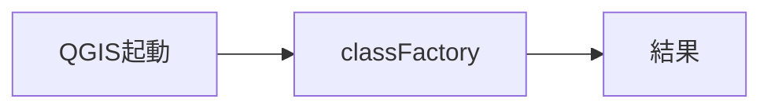

- 検証: 単独=import→呼出→戻り値assert / 連携=pyeval で属性実在+必要なら呼出
- 結果: **pass** 2026-11-14T02:32:22+09:00 — standalone経路のみ(要runtime依存無し)

### action.GeoWebView.initGui — initGui

- kind: `action` / source: `plugin.py:248`
- signature: `initGui()`
- 要約: プラグインのGUI要素を作成（プラグイン読み込み時に呼ばれる）
- needs_runtime=True / standalone_ok=False

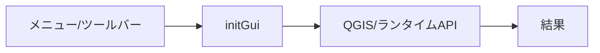

- 検証: 単独= / 連携=bridge_call/generic trigger→実在確認
- 結果: **pass** 2026-11-14T02:32:22+09:00 — 属性/シンボル実在確認(pyeval)

### action.GeoWebView.open_dialog — open_dialog

- kind: `action` / source: `plugin.py:339`
- signature: `open_dialog()`
- 要約: live driver の open_plugin から呼ばれる互換フック。
- needs_runtime=True / standalone_ok=False

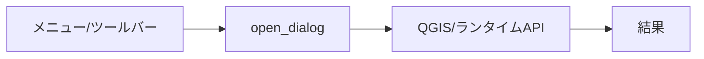

- 検証: 単独= / 連携=bridge_call/generic trigger→実在確認
- 結果: **pass** 2026-11-14T02:32:22+09:00 — 属性/シンボル実在確認(pyeval)

### action.GeoWebView.run — run

- kind: `action` / source: `plugin.py:349`
- signature: `run()`
- 要約: run() 互換エントリ: open_dialog と同じ(パネルを開く)。
- needs_runtime=True / standalone_ok=False

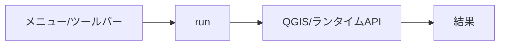

- 検証: 単独= / 連携=bridge_call/generic trigger→実在確認
- 結果: **pass** 2026-11-14T02:32:22+09:00 — 属性/シンボル実在確認(pyeval)

### action.GeoWebView.unload — unload

- kind: `action` / source: `plugin.py:776`
- signature: `unload()`
- 要約: プラグインのアンロード時の処理
- needs_runtime=True / standalone_ok=False

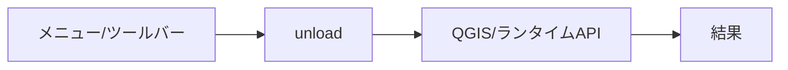

- 検証: 単独= / 連携=bridge_call/generic trigger→実在確認
- 結果: **pass** 2026-11-14T02:32:22+09:00 — 属性/シンボル実在確認(pyeval)

### dialog.GeoWebViewPanel — GeoWebViewPanel

- kind: `dialog` / source: `panel.py:43`
- signature: `GeoWebViewPanel`
- 要約: geo_webviewのパネルクラス
- needs_runtime=True / standalone_ok=False

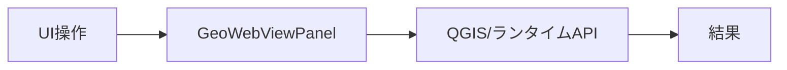

- 検証: 単独= / 連携=openDialog→screenshot→closeDialog
- 結果: **pass** 2026-11-14T02:32:22+09:00 — 属性/シンボル実在確認(pyeval)

### dialog.SettingsDialog — SettingsDialog

- kind: `dialog` / source: `settings_dialog.py:8`
- signature: `SettingsDialog`
- 要約: Settings dialog for KASUGAI Canvas integration configuration
- needs_runtime=True / standalone_ok=False

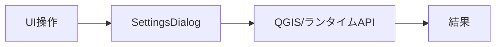

- 検証: 単独= / 連携=openDialog→screenshot→closeDialog
- 結果: **pass** 2026-11-14T02:32:22+09:00 — 属性/シンボル実在確認(pyeval)

### ui.GeoWebView._on_project_saved — _on_project_saved

- kind: `ui_control` / source: `plugin.py:314`
- signature: `_on_project_saved()`
- 要約: projectSaved フック。自動再エクスポートが有効なら再出力する。
- needs_runtime=True / standalone_ok=False

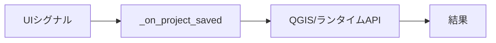

- 検証: 単独= / 連携=親dialog経由で操作・状態assert
- 結果: **pass** 2026-11-14T02:32:22+09:00 — 属性/シンボル実在確認(pyeval)

### ui.GeoWebView.handle_request_origin_changed — handle_request_origin_changed

- kind: `ui_control` / source: `plugin.py:115`
- signature: `handle_request_origin_changed(origin)`
- 要約: サーバから受け取った完全URLをパネルのlineEdit_navigateにセットする
- needs_runtime=True / standalone_ok=False

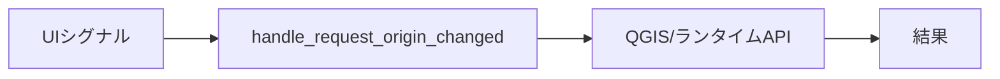

- 検証: 単独= / 連携=親dialog経由で操作・状態assert
- 結果: **pass** 2026-11-14T02:32:22+09:00 — 属性/シンボル実在確認(pyeval)

### ui.GeoWebView.on_check_access_clicked — on_check_access_clicked

- kind: `ui_control` / source: `plugin.py:1898`
- signature: `on_check_access_clicked()`
- 要約: 外部アクセス診断ボタンがクリックされた時の処理
- needs_runtime=True / standalone_ok=False

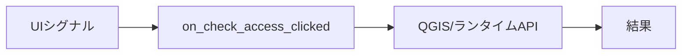

- 検証: 単独= / 連携=親dialog経由で操作・状態assert
- 結果: **pass** 2026-11-14T02:32:22+09:00 — 属性/シンボル実在確認(pyeval)

### ui.GeoWebView.on_copy_clicked_panel — on_copy_clicked_panel

- kind: `ui_control` / source: `plugin.py:1324`
- signature: `on_copy_clicked_panel()`
- 要約: パネル版：コピーボタンがクリックされた時の処理
- needs_runtime=True / standalone_ok=False

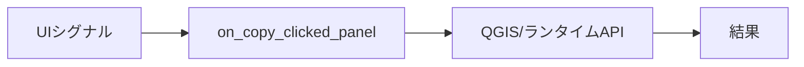

- 検証: 単独= / 連携=親dialog経由で操作・状態assert
- 結果: **pass** 2026-11-14T02:32:22+09:00 — 属性/シンボル実在確認(pyeval)

### ui.GeoWebView.on_engine_combo_changed — on_engine_combo_changed

- kind: `ui_control` / source: `plugin.py:1505`
- signature: `on_engine_combo_changed(index)`
- 要約: Web配信パネルのエンジン選択を QSettings に保存する。
- needs_runtime=True / standalone_ok=False

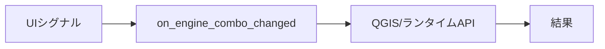

- 検証: 単独= / 連携=親dialog経由で操作・状態assert
- 結果: **pass** 2026-11-14T02:32:22+09:00 — 属性/シンボル実在確認(pyeval)

### ui.GeoWebView.on_generate_clicked_panel — on_generate_clicked_panel

- kind: `ui_control` / source: `plugin.py:1234`
- signature: `on_generate_clicked_panel()`
- 要約: パネル版：パーマリンク生成ボタンがクリックされた時の処理
- needs_runtime=True / standalone_ok=False

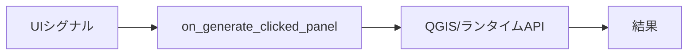

- 検証: 単独= / 連携=親dialog経由で操作・状態assert
- 結果: **pass** 2026-11-14T02:32:22+09:00 — 属性/シンボル実在確認(pyeval)

### ui.GeoWebView.on_hosted_combo_changed — on_hosted_combo_changed

- kind: `ui_control` / source: `plugin.py:1518`
- signature: `on_hosted_combo_changed(text)`
- 要約: Web配信パネルのCDN(ホスト版チャンネル)選択を QSettings に保存する。
- needs_runtime=True / standalone_ok=False


- 検証: 単独= / 連携=親dialog経由で操作・状態assert
- 結果: **pass** 2026-11-14T02:32:22+09:00 — 属性/シンボル実在確認(pyeval)

### ui.GeoWebView.on_kasugai_export_clicked — on_kasugai_export_clicked

- kind: `ui_control` / source: `plugin.py:1443`
- signature: `on_kasugai_export_clicked()`
- 要約: パネル版：KASUGAI エクスポートボタン — 表示中レイヤを
- needs_runtime=True / standalone_ok=False


- 検証: 単独= / 連携=親dialog経由で操作・状態assert
- 結果: **pass** 2026-11-14T02:32:22+09:00 — 属性/シンボル実在確認(pyeval)

### ui.GeoWebView.on_kasugai_help_clicked — on_kasugai_help_clicked

- kind: `ui_control` / source: `plugin.py:1501`
- signature: `on_kasugai_help_clicked()`
- 要約: ドキュメントサイト(GitHub Pages)をブラウザで開く。
- needs_runtime=True / standalone_ok=False

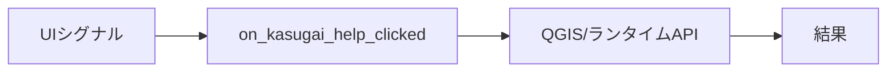

- 検証: 単独= / 連携=親dialog経由で操作・状態assert
- 結果: **pass** 2026-11-14T02:32:22+09:00 — 属性/シンボル実在確認(pyeval)

### ui.GeoWebView.on_kasugai_launch_clicked — on_kasugai_launch_clicked

- kind: `ui_control` / source: `plugin.py:1532`
- signature: `on_kasugai_launch_clicked(route=…)`
- 要約: パネル版：選択エンジンで エクスポート→登録→ブラウザ起動 まで
- needs_runtime=True / standalone_ok=False

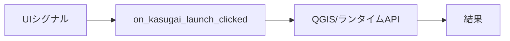

- 検証: 単独= / 連携=親dialog経由で操作・状態assert
- 結果: **pass** 2026-11-14T02:32:22+09:00 — 属性/シンボル実在確認(pyeval)

### ui.GeoWebView.on_kasugai_open_folder — on_kasugai_open_folder

- kind: `ui_control` / source: `plugin.py:1380`
- signature: `on_kasugai_open_folder()`
- 要約: KASUGAI 出力フォルダ(.kasc/DATA/<engine>.html/index.html が
- needs_runtime=True / standalone_ok=False

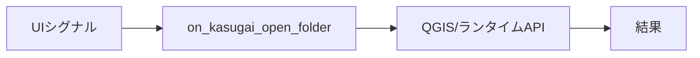

- 検証: 単独= / 連携=親dialog経由で操作・状態assert
- 結果: **pass** 2026-11-14T02:32:22+09:00 — 属性/シンボル実在確認(pyeval)

### ui.GeoWebView.on_kasugai_outdir_browse — on_kasugai_outdir_browse

- kind: `ui_control` / source: `plugin.py:1405`
- signature: `on_kasugai_outdir_browse()`
- 要約: 保存先表示のクリック — フォルダ選択でエクスポート出力先を変更。
- needs_runtime=True / standalone_ok=False

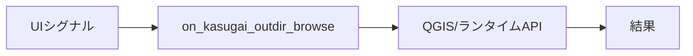

- 検証: 単独= / 連携=親dialog経由で操作・状態assert
- 結果: **pass** 2026-11-14T02:32:22+09:00 — 属性/シンボル実在確認(pyeval)

### ui.GeoWebView.on_kasugai_outdir_reset — on_kasugai_outdir_reset

- kind: `ui_control` / source: `plugin.py:1430`
- signature: `on_kasugai_outdir_reset()`
- 要約: 保存先を既定(Canvasインストール先/<ドキュメント>)に戻す。
- needs_runtime=True / standalone_ok=False

```mermaid
flowchart LR
  E_ui_GeoWebView_on_kasugai_outdir_reset["UIシグナル"] --> H_ui_GeoWebView_on_kasugai_outdir_reset["on_kasugai_outdir_reset"]
  H_ui_GeoWebView_on_kasugai_outdir_reset --> R_ui_GeoWebView_on_kasugai_outdir_reset["QGIS/ランタイムAPI"]
  R_ui_GeoWebView_on_kasugai_outdir_reset --> OUT["結果"]
```

- 検証: 単独= / 連携=親dialog経由で操作・状態assert
- 結果: **pass** 2026-11-14T02:32:22+09:00 — 属性/シンボル実在確認(pyeval)

### ui.GeoWebView.on_kasugai_zip_clicked — on_kasugai_zip_clicked

- kind: `ui_control` / source: `plugin.py:1475`
- signature: `on_kasugai_zip_clicked()`
- 要約: エクスポート物一式を kasugai_canvas.zip としてブラウザで
- needs_runtime=True / standalone_ok=False

```mermaid
flowchart LR
  E_ui_GeoWebView_on_kasugai_zip_clicked["UIシグナル"] --> H_ui_GeoWebView_on_kasugai_zip_clicked["on_kasugai_zip_clicked"]
  H_ui_GeoWebView_on_kasugai_zip_clicked --> R_ui_GeoWebView_on_kasugai_zip_clicked["QGIS/ランタイムAPI"]
  R_ui_GeoWebView_on_kasugai_zip_clicked --> OUT["結果"]
```

- 検証: 単独= / 連携=親dialog経由で操作・状態assert
- 結果: **pass** 2026-11-14T02:32:22+09:00 — 属性/シンボル実在確認(pyeval)

### ui.GeoWebView.on_navigate_clicked_panel — on_navigate_clicked_panel

- kind: `ui_control` / source: `plugin.py:1275`
- signature: `on_navigate_clicked_panel()`
- 要約: パネル版：ナビゲートボタンがクリックされた時の処理
- needs_runtime=True / standalone_ok=False

```mermaid
flowchart LR
  E_ui_GeoWebView_on_navigate_clicked_panel["UIシグナル"] --> H_ui_GeoWebView_on_navigate_clicked_panel["on_navigate_clicked_panel"]
  H_ui_GeoWebView_on_navigate_clicked_panel --> R_ui_GeoWebView_on_navigate_clicked_panel["QGIS/ランタイムAPI"]
  R_ui_GeoWebView_on_navigate_clicked_panel --> OUT["結果"]
```

- 検証: 単独= / 連携=親dialog経由で操作・状態assert
- 結果: **pass** 2026-11-14T02:32:22+09:00 — 属性/シンボル実在確認(pyeval)

### ui.GeoWebView.on_present_clicked_panel — on_present_clicked_panel

- kind: `ui_control` / source: `plugin.py:1819`
- signature: `on_present_clicked_panel()`
- 要約: プレゼンテーション共有ページ(/present)をブラウザで開く。
- needs_runtime=True / standalone_ok=False

```mermaid
flowchart LR
  E_ui_GeoWebView_on_present_clicked_panel["UIシグナル"] --> H_ui_GeoWebView_on_present_clicked_panel["on_present_clicked_panel"]
  H_ui_GeoWebView_on_present_clicked_panel --> R_ui_GeoWebView_on_present_clicked_panel["QGIS/ランタイムAPI"]
  R_ui_GeoWebView_on_present_clicked_panel --> OUT["結果"]
```

- 検証: 単独= / 連携=親dialog経由で操作・状態assert
- 結果: **pass** 2026-11-14T02:32:22+09:00 — 属性/シンボル実在確認(pyeval)

### ui.GeoWebView.on_received_selected — on_received_selected

- kind: `ui_control` / source: `plugin.py:1849`
- signature: `on_received_selected(index)`
- 要約: 受領履歴コンボの選択をナビゲート欄へコピーする。
- needs_runtime=True / standalone_ok=False

```mermaid
flowchart LR
  E_ui_GeoWebView_on_received_selected["UIシグナル"] --> H_ui_GeoWebView_on_received_selected["on_received_selected"]
  H_ui_GeoWebView_on_received_selected --> R_ui_GeoWebView_on_received_selected["QGIS/ランタイムAPI"]
  R_ui_GeoWebView_on_received_selected --> OUT["結果"]
```

- 検証: 単独= / 連携=親dialog経由で操作・状態assert
- 結果: **pass** 2026-11-14T02:32:22+09:00 — 属性/シンボル実在確認(pyeval)

### ui.GeoWebView.on_save_theme_clicked_panel — on_save_theme_clicked_panel

- kind: `ui_control` / source: `plugin.py:2209`
- signature: `on_save_theme_clicked_panel()`
- 要約: テーマ保存ボタン: 現在の表示状態をマップテーマとして保存
- needs_runtime=True / standalone_ok=False

```mermaid
flowchart LR
  E_ui_GeoWebView_on_save_theme_clicked_panel["UIシグナル"] --> H_ui_GeoWebView_on_save_theme_clicked_panel["on_save_theme_clicked_panel"]
  H_ui_GeoWebView_on_save_theme_clicked_panel --> R_ui_GeoWebView_on_save_theme_clicked_panel["QGIS/ランタイムAPI"]
  R_ui_GeoWebView_on_save_theme_clicked_panel --> OUT["結果"]
```

- 検証: 単独= / 連携=親dialog経由で操作・状態assert
- 結果: **pass** 2026-11-14T02:32:22+09:00 — 属性/シンボル実在確認(pyeval)

### ui.GeoWebView.on_standard_port_clicked — on_standard_port_clicked

- kind: `ui_control` / source: `plugin.py:2040`
- signature: `on_standard_port_clicked(port)`
- 要約: 標準ポートボタンがクリックされた時の処理
- needs_runtime=True / standalone_ok=False

```mermaid
flowchart LR
  E_ui_GeoWebView_on_standard_port_clicked["UIシグナル"] --> H_ui_GeoWebView_on_standard_port_clicked["on_standard_port_clicked"]
  H_ui_GeoWebView_on_standard_port_clicked --> R_ui_GeoWebView_on_standard_port_clicked["QGIS/ランタイムAPI"]
  R_ui_GeoWebView_on_standard_port_clicked --> OUT["結果"]
```

- 検証: 単独= / 連携=親dialog経由で操作・状態assert
- 結果: **pass** 2026-11-14T02:32:22+09:00 — 属性/シンボル実在確認(pyeval)

### ui.GeoWebViewPanel._on_copy_permalink_to_clipboard — _on_copy_permalink_to_clipboard

- kind: `ui_control` / source: `panel.py:590`
- signature: `_on_copy_permalink_to_clipboard()`
- 要約: lineEdit_permalink の内容をシステムクリップボードにコピーする
- needs_runtime=True / standalone_ok=False

```mermaid
flowchart LR
  E_ui_GeoWebViewPanel__on_copy_permalink_to_clipboard["UIシグナル"] --> H_ui_GeoWebViewPanel__on_copy_permalink_to_clipboard["_on_copy_permalink_to_clipboard"]
  H_ui_GeoWebViewPanel__on_copy_permalink_to_clipboard --> R_ui_GeoWebViewPanel__on_copy_permalink_to_clipboard["QGIS/ランタイムAPI"]
  R_ui_GeoWebViewPanel__on_copy_permalink_to_clipboard --> OUT["結果"]
```

- 検証: 単独= / 連携=親dialog経由で操作・状態assert
- 結果: **pass** 2026-11-14T02:32:22+09:00 — 属性/シンボル実在確認(pyeval)

### ui.GeoWebViewPanel._on_paste_from_clipboard — _on_paste_from_clipboard

- kind: `ui_control` / source: `panel.py:600`
- signature: `_on_paste_from_clipboard()`
- 要約: クリップボードからテキストを取得して lineEdit_navigate に貼り付ける
- needs_runtime=True / standalone_ok=False

```mermaid
flowchart LR
  E_ui_GeoWebViewPanel__on_paste_from_clipboard["UIシグナル"] --> H_ui_GeoWebViewPanel__on_paste_from_clipboard["_on_paste_from_clipboard"]
  H_ui_GeoWebViewPanel__on_paste_from_clipboard --> R_ui_GeoWebViewPanel__on_paste_from_clipboard["QGIS/ランタイムAPI"]
  R_ui_GeoWebViewPanel__on_paste_from_clipboard --> OUT["結果"]
```

- 検証: 単独= / 連携=親dialog経由で操作・状態assert
- 結果: **pass** 2026-11-14T02:32:22+09:00 — 属性/シンボル実在確認(pyeval)

### ui.GeoWebViewPanel._on_visibility_changed — _on_visibility_changed

- kind: `ui_control` / source: `panel.py:354`
- signature: `_on_visibility_changed(visible)`
- 要約: 
- needs_runtime=True / standalone_ok=False

```mermaid
flowchart LR
  E_ui_GeoWebViewPanel__on_visibility_changed["UIシグナル"] --> H_ui_GeoWebViewPanel__on_visibility_changed["_on_visibility_changed"]
  H_ui_GeoWebViewPanel__on_visibility_changed --> R_ui_GeoWebViewPanel__on_visibility_changed["QGIS/ランタイムAPI"]
  R_ui_GeoWebViewPanel__on_visibility_changed --> OUT["結果"]
```

- 検証: 単独= / 連携=親dialog経由で操作・状態assert
- 結果: **pass** 2026-11-14T02:32:22+09:00 — 属性/シンボル実在確認(pyeval)

### ui.GeoWebViewPanel.set_external_control_handler — set_external_control_handler

- kind: `ui_control` / source: `panel.py:565`
- signature: `set_external_control_handler(handler)`
- 要約: 外部制御トグルのハンドラを設定する
- needs_runtime=True / standalone_ok=False

```mermaid
flowchart LR
  E_ui_GeoWebViewPanel_set_external_control_handler["UIシグナル"] --> H_ui_GeoWebViewPanel_set_external_control_handler["set_external_control_handler"]
  H_ui_GeoWebViewPanel_set_external_control_handler --> R_ui_GeoWebViewPanel_set_external_control_handler["QGIS/ランタイムAPI"]
  R_ui_GeoWebViewPanel_set_external_control_handler --> OUT["結果"]
```

- 検証: 単独= / 連携=親dialog経由で操作・状態assert
- 結果: **pass** 2026-11-14T02:32:22+09:00 — 属性/シンボル実在確認(pyeval)

### ui.GeoWebViewPanel.set_port_change_handler — set_port_change_handler

- kind: `ui_control` / source: `panel.py:577`
- signature: `set_port_change_handler(handler)`
- 要約: ポート番号変更のハンドラを設定する
- needs_runtime=True / standalone_ok=False

```mermaid
flowchart LR
  E_ui_GeoWebViewPanel_set_port_change_handler["UIシグナル"] --> H_ui_GeoWebViewPanel_set_port_change_handler["set_port_change_handler"]
  H_ui_GeoWebViewPanel_set_port_change_handler --> R_ui_GeoWebViewPanel_set_port_change_handler["QGIS/ランタイムAPI"]
  R_ui_GeoWebViewPanel_set_port_change_handler --> OUT["結果"]
```

- 検証: 単独= / 連携=親dialog経由で操作・状態assert
- 結果: **pass** 2026-11-14T02:32:22+09:00 — 属性/シンボル実在確認(pyeval)

### ui.GeoWebViewPanel.set_server_toggle_handler — set_server_toggle_handler

- kind: `ui_control` / source: `panel.py:552`
- signature: `set_server_toggle_handler(handler)`
- 要約: 外部からトグルのハンドラを設定する
- needs_runtime=True / standalone_ok=False

```mermaid
flowchart LR
  E_ui_GeoWebViewPanel_set_server_toggle_handler["UIシグナル"] --> H_ui_GeoWebViewPanel_set_server_toggle_handler["set_server_toggle_handler"]
  H_ui_GeoWebViewPanel_set_server_toggle_handler --> R_ui_GeoWebViewPanel_set_server_toggle_handler["QGIS/ランタイムAPI"]
  R_ui_GeoWebViewPanel_set_server_toggle_handler --> OUT["結果"]
```

- 検証: 単独= / 連携=親dialog経由で操作・状態assert
- 結果: **pass** 2026-11-14T02:32:22+09:00 — 属性/シンボル実在確認(pyeval)

### ui.GeoWebViewServerManager._on_cursor_xy — _on_cursor_xy

- kind: `ui_control` / source: `server_manager.py:237`
- signature: `_on_cursor_xy(point)`
- 要約: キャンバス上のマウス移動(GUIスレッド)。最終位置を保持する。
- needs_runtime=True / standalone_ok=False

```mermaid
flowchart LR
  E_ui_GeoWebViewServerManager__on_cursor_xy["UIシグナル"] --> H_ui_GeoWebViewServerManager__on_cursor_xy["_on_cursor_xy"]
  H_ui_GeoWebViewServerManager__on_cursor_xy --> R_ui_GeoWebViewServerManager__on_cursor_xy["QGIS/ランタイムAPI"]
  R_ui_GeoWebViewServerManager__on_cursor_xy --> OUT["結果"]
```

- 検証: 単独= / 連携=親dialog経由で操作・状態assert
- 結果: **pass** 2026-11-14T02:32:22+09:00 — 属性/シンボル実在確認(pyeval)

### ui.LiveSyncController._on_layers_added — _on_layers_added

- kind: `ui_control` / source: `live_sync.py:251`
- signature: `_on_layers_added(layers)`
- 要約: 
- needs_runtime=True / standalone_ok=False

```mermaid
flowchart LR
  E_ui_LiveSyncController__on_layers_added["UIシグナル"] --> H_ui_LiveSyncController__on_layers_added["_on_layers_added"]
  H_ui_LiveSyncController__on_layers_added --> R_ui_LiveSyncController__on_layers_added["QGIS/ランタイムAPI"]
  R_ui_LiveSyncController__on_layers_added --> OUT["結果"]
```

- 検証: 単独= / 連携=親dialog経由で操作・状態assert
- 結果: **pass** 2026-11-14T02:32:22+09:00 — 属性/シンボル実在確認(pyeval)

### ui.LiveSyncController._on_project_read — _on_project_read

- kind: `ui_control` / source: `live_sync.py:256`
- signature: `_on_project_read(*args)`
- 要約: 
- needs_runtime=True / standalone_ok=False

```mermaid
flowchart LR
  E_ui_LiveSyncController__on_project_read["UIシグナル"] --> H_ui_LiveSyncController__on_project_read["_on_project_read"]
  H_ui_LiveSyncController__on_project_read --> R_ui_LiveSyncController__on_project_read["QGIS/ランタイムAPI"]
  R_ui_LiveSyncController__on_project_read --> OUT["結果"]
```

- 検証: 単独= / 連携=親dialog経由で操作・状態assert
- 結果: **pass** 2026-11-14T02:32:22+09:00 — 属性/シンボル実在確認(pyeval)

### ui.LiveSyncController._on_selection_changed — _on_selection_changed

- kind: `ui_control` / source: `live_sync.py:343`
- signature: `_on_selection_changed(*args)`
- 要約: ベクターレイヤの selectionChanged(GUIスレッド)。デバウンスして送信。
- needs_runtime=True / standalone_ok=False

```mermaid
flowchart LR
  E_ui_LiveSyncController__on_selection_changed["UIシグナル"] --> H_ui_LiveSyncController__on_selection_changed["_on_selection_changed"]
  H_ui_LiveSyncController__on_selection_changed --> R_ui_LiveSyncController__on_selection_changed["QGIS/ランタイムAPI"]
  R_ui_LiveSyncController__on_selection_changed --> OUT["結果"]
```

- 検証: 単独= / 連携=親dialog経由で操作・状態assert
- 結果: **pass** 2026-11-14T02:32:22+09:00 — 属性/シンボル実在確認(pyeval)

### ui.LiveSyncController._on_structure — _on_structure

- kind: `ui_control` / source: `live_sync.py:242`
- signature: `_on_structure(*args)`
- 要約: 
- needs_runtime=True / standalone_ok=False

```mermaid
flowchart LR
  E_ui_LiveSyncController__on_structure["UIシグナル"] --> H_ui_LiveSyncController__on_structure["_on_structure"]
  H_ui_LiveSyncController__on_structure --> R_ui_LiveSyncController__on_structure["QGIS/ランタイムAPI"]
  R_ui_LiveSyncController__on_structure --> OUT["結果"]
```

- 検証: 単独= / 連携=親dialog経由で操作・状態assert
- 結果: **pass** 2026-11-14T02:32:22+09:00 — 属性/シンボル実在確認(pyeval)

### ui.SettingsDialog._basemap_groups_changed — _basemap_groups_changed

- kind: `ui_control` / source: `settings_dialog.py:184`
- signature: `_basemap_groups_changed()`
- 要約: 追加のベースマップグループ名(カンマ区切り)を保存する。
- needs_runtime=True / standalone_ok=False

```mermaid
flowchart LR
  E_ui_SettingsDialog__basemap_groups_changed["UIシグナル"] --> H_ui_SettingsDialog__basemap_groups_changed["_basemap_groups_changed"]
  H_ui_SettingsDialog__basemap_groups_changed --> R_ui_SettingsDialog__basemap_groups_changed["QGIS/ランタイムAPI"]
  R_ui_SettingsDialog__basemap_groups_changed --> OUT["結果"]
```

- 検証: 単独= / 連携=親dialog経由で操作・状態assert
- 結果: **pass** 2026-11-14T02:32:22+09:00 — 属性/シンボル実在確認(pyeval)

### ui.SettingsDialog._hosted_channel_changed — _hosted_channel_changed

- kind: `ui_control` / source: `settings_dialog.py:190`
- signature: `_hosted_channel_changed(text)`
- 要約: ホスト版エンジンのチャンネル変更を保存する。
- needs_runtime=True / standalone_ok=False

```mermaid
flowchart LR
  E_ui_SettingsDialog__hosted_channel_changed["UIシグナル"] --> H_ui_SettingsDialog__hosted_channel_changed["_hosted_channel_changed"]
  H_ui_SettingsDialog__hosted_channel_changed --> R_ui_SettingsDialog__hosted_channel_changed["QGIS/ランタイムAPI"]
  R_ui_SettingsDialog__hosted_channel_changed --> OUT["結果"]
```

- 検証: 単独= / 連携=親dialog経由で操作・状態assert
- 結果: **pass** 2026-11-14T02:32:22+09:00 — 属性/シンボル実在確認(pyeval)

### bridge.addFirewallRule — addFirewallRule

- kind: `bridge_method` / source: `bridge.py:1366`
- signature: `addFirewallRule(port=…)`
- 要約: Windowsファイアウォールに受信ルールを追加する。
- needs_runtime=True / standalone_ok=False

```mermaid
flowchart LR
  E_bridge_addFirewallRule["AI/bridge_call"] --> H_bridge_addFirewallRule["addFirewallRule"]
  H_bridge_addFirewallRule --> R_bridge_addFirewallRule["QGIS/ランタイムAPI"]
  R_bridge_addFirewallRule --> OUT["結果"]
```

- 検証: 単独= / 連携=bridge_call addFirewallRule → 応答assert
- 結果: **skip** 2026-11-14T02:32:22+09:00 — 副作用/破壊的/外部通信操作のため手動検証対象

### bridge.applyTheme — applyTheme

- kind: `bridge_method` / source: `bridge.py:817`
- signature: `applyTheme(name)`
- 要約: マップテーマをレイヤツリーへ適用し、パネルコンボも同期する。
- needs_runtime=True / standalone_ok=False

```mermaid
flowchart LR
  E_bridge_applyTheme["AI/bridge_call"] --> H_bridge_applyTheme["applyTheme"]
  H_bridge_applyTheme --> R_bridge_applyTheme["QGIS/ランタイムAPI"]
  R_bridge_applyTheme --> OUT["結果"]
```

- 検証: 単独= / 連携=bridge_call applyTheme → 応答assert
- 結果: **skip** 2026-11-14T02:32:22+09:00 — 副作用/破壊的/外部通信操作のため手動検証対象

### bridge.checkAccess — checkAccess

- kind: `bridge_method` / source: `bridge.py:1143`
- signature: `checkAccess()`
- 要約: 外部アクセス診断(ファイアウォール含む)を実行し結果を返す。
- needs_runtime=True / standalone_ok=False

```mermaid
flowchart LR
  E_bridge_checkAccess["AI/bridge_call"] --> H_bridge_checkAccess["checkAccess"]
  H_bridge_checkAccess --> R_bridge_checkAccess["QGIS/ランタイムAPI"]
  R_bridge_checkAccess --> OUT["結果"]
```

- 検証: 単独= / 連携=bridge_call checkAccess → 応答assert
- 結果: **pass** 2026-11-14T02:32:22+09:00 — bridge_call応答あり args=[]

### bridge.closePanel — closePanel

- kind: `bridge_method` / source: `bridge.py:492`
- signature: `closePanel()`
- 要約: GeoWebViewドックパネルを隠す(インスタンスは保持)。
- needs_runtime=True / standalone_ok=False

```mermaid
flowchart LR
  E_bridge_closePanel["AI/bridge_call"] --> H_bridge_closePanel["closePanel"]
  H_bridge_closePanel --> R_bridge_closePanel["QGIS/ランタイムAPI"]
  R_bridge_closePanel --> OUT["結果"]
```

- 検証: 単独= / 連携=bridge_call closePanel → 応答assert
- 結果: **skip** 2026-11-14T02:32:22+09:00 — 副作用/破壊的/外部通信操作のため手動検証対象

### bridge.copyPermalink — copyPermalink

- kind: `bridge_method` / source: `bridge.py:678`
- signature: `copyPermalink()`
- 要約: 現在のパーマリンクをクリップボードへコピーする(未生成なら生成)。
- needs_runtime=True / standalone_ok=False

```mermaid
flowchart LR
  E_bridge_copyPermalink["AI/bridge_call"] --> H_bridge_copyPermalink["copyPermalink"]
  H_bridge_copyPermalink --> R_bridge_copyPermalink["QGIS/ランタイムAPI"]
  R_bridge_copyPermalink --> OUT["結果"]
```

- 検証: 単独= / 連携=bridge_call copyPermalink → 応答assert
- 結果: **pass** 2026-11-14T02:32:22+09:00 — bridge_call応答あり args=[]

### bridge.deleteTheme — deleteTheme

- kind: `bridge_method` / source: `bridge.py:868`
- signature: `deleteTheme(name)`
- 要約: マップテーマを削除する。
- needs_runtime=True / standalone_ok=False

```mermaid
flowchart LR
  E_bridge_deleteTheme["AI/bridge_call"] --> H_bridge_deleteTheme["deleteTheme"]
  H_bridge_deleteTheme --> R_bridge_deleteTheme["QGIS/ランタイムAPI"]
  R_bridge_deleteTheme --> OUT["結果"]
```

- 検証: 単独= / 連携=bridge_call deleteTheme → 応答assert
- 結果: **skip** 2026-11-14T02:32:22+09:00 — 副作用/破壊的/外部通信操作のため手動検証対象

### bridge.endpoints — endpoints

- kind: `bridge_method` / source: `bridge.py:1159`
- signature: `endpoints()`
- 要約: HTTPサーバが公開するエンドポイント一覧と基底URLを返す。
- needs_runtime=True / standalone_ok=False

```mermaid
flowchart LR
  E_bridge_endpoints["AI/bridge_call"] --> H_bridge_endpoints["endpoints"]
  H_bridge_endpoints --> R_bridge_endpoints["QGIS/ランタイムAPI"]
  R_bridge_endpoints --> OUT["結果"]
```

- 検証: 単独= / 連携=bridge_call endpoints → 応答assert
- 結果: **pass** 2026-11-14T02:32:22+09:00 — bridge_call応答あり args=[]

### bridge.externalControl — externalControl

- kind: `bridge_method` / source: `bridge.py:616`
- signature: `externalControl(enabled=…)`
- 要約: 外部制御モード(HTTP要求で自動ナビゲート)を取得/設定する。
- needs_runtime=True / standalone_ok=False

```mermaid
flowchart LR
  E_bridge_externalControl["AI/bridge_call"] --> H_bridge_externalControl["externalControl"]
  H_bridge_externalControl --> R_bridge_externalControl["QGIS/ランタイムAPI"]
  R_bridge_externalControl --> OUT["結果"]
```

- 検証: 単独= / 連携=bridge_call externalControl → 応答assert
- 結果: **pass** 2026-11-14T02:32:22+09:00 — bridge_call応答あり args=[]

### bridge.generatePermalink — generatePermalink

- kind: `bridge_method` / source: `bridge.py:636`
- signature: `generatePermalink(theme=…)`
- 要約: 現在の地図ビューからパーマリンクURLを生成する。
- needs_runtime=True / standalone_ok=False

```mermaid
flowchart LR
  E_bridge_generatePermalink["AI/bridge_call"] --> H_bridge_generatePermalink["generatePermalink"]
  H_bridge_generatePermalink --> R_bridge_generatePermalink["QGIS/ランタイムAPI"]
  R_bridge_generatePermalink --> OUT["結果"]
```

- 検証: 単独= / 連携=bridge_call generatePermalink → 応答assert
- 結果: **pass** 2026-11-14T02:32:22+09:00 — bridge_call応答あり args=[]

### bridge.getSettings — getSettings

- kind: `bridge_method` / source: `bridge.py:1213`
- signature: `getSettings()`
- 要約: 設定(出力先ディレクトリ・優先ポート)とバージョンを返す。
- needs_runtime=True / standalone_ok=False

```mermaid
flowchart LR
  E_bridge_getSettings["AI/bridge_call"] --> H_bridge_getSettings["getSettings"]
  H_bridge_getSettings --> R_bridge_getSettings["QGIS/ランタイムAPI"]
  R_bridge_getSettings --> OUT["結果"]
```

- 検証: 単独= / 連携=bridge_call getSettings → 応答assert
- 結果: **pass** 2026-11-14T02:32:22+09:00 — bridge_call応答あり args=[]

### bridge.kasugaiExport — kasugaiExport

- kind: `bridge_method` / source: `bridge.py:907`
- signature: `kasugaiExport(output_dir=…, open_app=…, native_formats=…, hidden_as_off=…, embed_gpkg_style=…, emit_themes=…, emit_bookmarks=…, emit_launchers=…, emit_zip=…, engine=…, install=…, route=…, use_existing=…, emit_atlas=…)`
- 要約: 表示中レイヤをKASUGAI Canvasプロジェクトとして出力・連携する。
- needs_runtime=True / standalone_ok=False

```mermaid
flowchart LR
  E_bridge_kasugaiExport["AI/bridge_call"] --> H_bridge_kasugaiExport["kasugaiExport"]
  H_bridge_kasugaiExport --> R_bridge_kasugaiExport["QGIS/ランタイムAPI"]
  R_bridge_kasugaiExport --> OUT["結果"]
```

- 検証: 単独= / 連携=bridge_call kasugaiExport → 応答assert
- 結果: **pass** 2026-11-14T02:32:22+09:00 — bridge_call応答あり args=[]

### bridge.listBookmarks — listBookmarks

- kind: `bridge_method` / source: `bridge.py:880`
- signature: `listBookmarks()`
- 要約: プロジェクト/ユーザブックマーク一覧(中心EPSG:3857)を返す。
- needs_runtime=True / standalone_ok=False

```mermaid
flowchart LR
  E_bridge_listBookmarks["AI/bridge_call"] --> H_bridge_listBookmarks["listBookmarks"]
  H_bridge_listBookmarks --> R_bridge_listBookmarks["QGIS/ランタイムAPI"]
  R_bridge_listBookmarks --> OUT["結果"]
```

- 検証: 単独= / 連携=bridge_call listBookmarks → 応答assert
- 結果: **pass** 2026-11-14T02:32:22+09:00 — bridge_call応答あり args=[]

### bridge.listThemes — listThemes

- kind: `bridge_method` / source: `bridge.py:800`
- signature: `listThemes()`
- 要約: マップテーマ一覧・パネルコンボの現在選択を返す。
- needs_runtime=True / standalone_ok=False

```mermaid
flowchart LR
  E_bridge_listThemes["AI/bridge_call"] --> H_bridge_listThemes["listThemes"]
  H_bridge_listThemes --> R_bridge_listThemes["QGIS/ランタイムAPI"]
  R_bridge_listThemes --> OUT["結果"]
```

- 検証: 単独= / 連携=bridge_call listThemes → 応答assert
- 結果: **pass** 2026-11-14T02:32:22+09:00 — bridge_call応答あり args=[]

### bridge.liveAddFeatures — liveAddFeatures

- kind: `bridge_method` / source: `bridge.py:1496`
- signature: `liveAddFeatures(name=…, geojson=…, replace=…)`
- 要約: GeoJSON をスクラッチ(memory)レイヤとしてプロジェクトへ
- needs_runtime=True / standalone_ok=False

```mermaid
flowchart LR
  E_bridge_liveAddFeatures["AI/bridge_call"] --> H_bridge_liveAddFeatures["liveAddFeatures"]
  H_bridge_liveAddFeatures --> R_bridge_liveAddFeatures["QGIS/ランタイムAPI"]
  R_bridge_liveAddFeatures --> OUT["結果"]
```

- 検証: 単独= / 連携=bridge_call liveAddFeatures → 応答assert
- 結果: **pass** 2026-11-14T02:32:22+09:00 — bridge_call応答あり args=[]

### bridge.liveSyncFlush — liveSyncFlush

- kind: `bridge_method` / source: `bridge.py:1472`
- signature: `liveSyncFlush()`
- 要約: 保留中の変更を即時差分エクスポート+通知する。
- needs_runtime=True / standalone_ok=False

```mermaid
flowchart LR
  E_bridge_liveSyncFlush["AI/bridge_call"] --> H_bridge_liveSyncFlush["liveSyncFlush"]
  H_bridge_liveSyncFlush --> R_bridge_liveSyncFlush["QGIS/ランタイムAPI"]
  R_bridge_liveSyncFlush --> OUT["結果"]
```

- 検証: 単独= / 連携=bridge_call liveSyncFlush → 応答assert
- 結果: **pass** 2026-11-14T02:32:22+09:00 — bridge_call応答あり args=[]

### bridge.liveSyncStart — liveSyncStart

- kind: `bridge_method` / source: `bridge.py:1446`
- signature: `liveSyncStart()`
- 要約: ライブ双方向連携を有効化して監視を開始する。
- needs_runtime=True / standalone_ok=False

```mermaid
flowchart LR
  E_bridge_liveSyncStart["AI/bridge_call"] --> H_bridge_liveSyncStart["liveSyncStart"]
  H_bridge_liveSyncStart --> R_bridge_liveSyncStart["QGIS/ランタイムAPI"]
  R_bridge_liveSyncStart --> OUT["結果"]
```

- 検証: 単独= / 連携=bridge_call liveSyncStart → 応答assert
- 結果: **pass** 2026-11-14T02:32:22+09:00 — bridge_call応答あり args=[]

### bridge.liveSyncStatus — liveSyncStatus

- kind: `bridge_method` / source: `bridge.py:1431`
- signature: `liveSyncStatus()`
- 要約: ライブ連携の状態を返す。
- needs_runtime=True / standalone_ok=False

```mermaid
flowchart LR
  E_bridge_liveSyncStatus["AI/bridge_call"] --> H_bridge_liveSyncStatus["liveSyncStatus"]
  H_bridge_liveSyncStatus --> R_bridge_liveSyncStatus["QGIS/ランタイムAPI"]
  R_bridge_liveSyncStatus --> OUT["結果"]
```

- 検証: 単独= / 連携=bridge_call liveSyncStatus → 応答assert
- 結果: **pass** 2026-11-14T02:32:22+09:00 — bridge_call応答あり args=[]

### bridge.liveSyncStop — liveSyncStop

- kind: `bridge_method` / source: `bridge.py:1461`
- signature: `liveSyncStop()`
- 要約: ライブ双方向連携を無効化して監視を停止する。
- needs_runtime=True / standalone_ok=False

```mermaid
flowchart LR
  E_bridge_liveSyncStop["AI/bridge_call"] --> H_bridge_liveSyncStop["liveSyncStop"]
  H_bridge_liveSyncStop --> R_bridge_liveSyncStop["QGIS/ランタイムAPI"]
  R_bridge_liveSyncStop --> OUT["結果"]
```

- 検証: 単独= / 連携=bridge_call liveSyncStop → 応答assert
- 結果: **skip** 2026-11-14T02:32:22+09:00 — 副作用/破壊的/外部通信操作のため手動検証対象

### bridge.liveWriteback — liveWriteback

- kind: `bridge_method` / source: `bridge.py:1479`
- signature: `liveWriteback(payload=…)`
- 要約: Canvas 側の表示/フィルタ/テーマ状態を QGIS プロジェクトへ
- needs_runtime=True / standalone_ok=False

```mermaid
flowchart LR
  E_bridge_liveWriteback["AI/bridge_call"] --> H_bridge_liveWriteback["liveWriteback"]
  H_bridge_liveWriteback --> R_bridge_liveWriteback["QGIS/ランタイムAPI"]
  R_bridge_liveWriteback --> OUT["結果"]
```

- 検証: 単独= / 連携=bridge_call liveWriteback → 応答assert
- 結果: **pass** 2026-11-14T02:32:22+09:00 — bridge_call応答あり args=[]

### bridge.macAuth — macAuth

- kind: `bridge_method` / source: `bridge.py:1392`
- signature: `macAuth(enabled=…, allowed=…)`
- 要約: MACアドレス認証を取得/設定する。
- needs_runtime=True / standalone_ok=False

```mermaid
flowchart LR
  E_bridge_macAuth["AI/bridge_call"] --> H_bridge_macAuth["macAuth"]
  H_bridge_macAuth --> R_bridge_macAuth["QGIS/ランタイムAPI"]
  R_bridge_macAuth --> OUT["結果"]
```

- 検証: 単独= / 連携=bridge_call macAuth → 応答assert
- 結果: **pass** 2026-11-14T02:32:22+09:00 — bridge_call応答あり args=[]

### bridge.navigate — navigate

- kind: `bridge_method` / source: `bridge.py:710`
- signature: `navigate(url)`
- 要約: パーマリンクURLから地図ビューを移動する(モーダル無し)。
- needs_runtime=True / standalone_ok=False

```mermaid
flowchart LR
  E_bridge_navigate["AI/bridge_call"] --> H_bridge_navigate["navigate"]
  H_bridge_navigate --> R_bridge_navigate["QGIS/ランタイムAPI"]
  R_bridge_navigate --> OUT["結果"]
```

- 検証: 単独= / 連携=bridge_call navigate → 応答assert
- 結果: **skip** 2026-11-14T02:32:22+09:00 — 要実引数(応答あり): {'ok': False, 'error': 'url required'}

### bridge.navigateTo — navigateTo

- kind: `bridge_method` / source: `bridge.py:767`
- signature: `navigateTo(x=…, y=…, lat=…, lon=…, scale=…, zoom=…, crs=…, rotation=…, theme=…)`
- 要約: 座標を直接指定して地図ビューを移動する。
- needs_runtime=True / standalone_ok=False

```mermaid
flowchart LR
  E_bridge_navigateTo["AI/bridge_call"] --> H_bridge_navigateTo["navigateTo"]
  H_bridge_navigateTo --> R_bridge_navigateTo["QGIS/ランタイムAPI"]
  R_bridge_navigateTo --> OUT["結果"]
```

- 検証: 単独= / 連携=bridge_call navigateTo → 応答assert
- 結果: **skip** 2026-11-14T02:32:22+09:00 — 要実引数(応答あり): {'ok': False, 'error': 'x/y or lat/lon required'}

### bridge.openExportFolder — openExportFolder

- kind: `bridge_method` / source: `bridge.py:1330`
- signature: `openExportFolder()`
- 要約: KASUGAI出力フォルダをOSのファイルマネージャで開く。
- needs_runtime=True / standalone_ok=False

```mermaid
flowchart LR
  E_bridge_openExportFolder["AI/bridge_call"] --> H_bridge_openExportFolder["openExportFolder"]
  H_bridge_openExportFolder --> R_bridge_openExportFolder["QGIS/ランタイムAPI"]
  R_bridge_openExportFolder --> OUT["結果"]
```

- 検証: 単独= / 連携=bridge_call openExportFolder → 応答assert
- 結果: **skip** 2026-11-14T02:32:22+09:00 — 副作用/破壊的/外部通信操作のため手動検証対象

### bridge.openExternal — openExternal

- kind: `bridge_method` / source: `bridge.py:890`
- signature: `openExternal(service)`
- 要約: KASUGAI Canvas を指定エンジンで起動する。
- needs_runtime=True / standalone_ok=False

```mermaid
flowchart LR
  E_bridge_openExternal["AI/bridge_call"] --> H_bridge_openExternal["openExternal"]
  H_bridge_openExternal --> R_bridge_openExternal["QGIS/ランタイムAPI"]
  R_bridge_openExternal --> OUT["結果"]
```

- 検証: 単独= / 連携=bridge_call openExternal → 応答assert
- 結果: **skip** 2026-11-14T02:32:22+09:00 — 副作用/破壊的/外部通信操作のため手動検証対象

### bridge.openPanel — openPanel

- kind: `bridge_method` / source: `bridge.py:474`
- signature: `openPanel()`
- 要約: GeoWebViewドックパネルを生成・表示する(冪等、トグルではない)。
- needs_runtime=True / standalone_ok=False

```mermaid
flowchart LR
  E_bridge_openPanel["AI/bridge_call"] --> H_bridge_openPanel["openPanel"]
  H_bridge_openPanel --> R_bridge_openPanel["QGIS/ランタイムAPI"]
  R_bridge_openPanel --> OUT["結果"]
```

- 検証: 単独= / 連携=bridge_call openPanel → 応答assert
- 結果: **skip** 2026-11-14T02:32:22+09:00 — 副作用/破壊的/外部通信操作のため手動検証対象

### bridge.openPresent — openPresent

- kind: `bridge_method` / source: `bridge.py:1341`
- signature: `openPresent()`
- 要約: キャンバス画面共有ページ(/present)をブラウザで開く。
- needs_runtime=True / standalone_ok=False

```mermaid
flowchart LR
  E_bridge_openPresent["AI/bridge_call"] --> H_bridge_openPresent["openPresent"]
  H_bridge_openPresent --> R_bridge_openPresent["QGIS/ランタイムAPI"]
  R_bridge_openPresent --> OUT["結果"]
```

- 検証: 単独= / 連携=bridge_call openPresent → 応答assert
- 結果: **skip** 2026-11-14T02:32:22+09:00 — 副作用/破壊的/外部通信操作のため手動検証対象

### bridge.pluginInfo — pluginInfo

- kind: `bridge_method` / source: `bridge.py:391`
- signature: `pluginInfo()`
- 要約: プラグインの自己記述(id/summary/when_to_use/methods)を返す。
- needs_runtime=True / standalone_ok=False

```mermaid
flowchart LR
  E_bridge_pluginInfo["AI/bridge_call"] --> H_bridge_pluginInfo["pluginInfo"]
  H_bridge_pluginInfo --> R_bridge_pluginInfo["QGIS/ランタイムAPI"]
  R_bridge_pluginInfo --> OUT["結果"]
```

- 検証: 単独= / 連携=bridge_call pluginInfo → 応答assert
- 結果: **pass** 2026-11-14T02:32:22+09:00 — bridge_call応答あり args=[]

### bridge.receivedHistory — receivedHistory

- kind: `bridge_method` / source: `bridge.py:1358`
- signature: `receivedHistory()`
- 要約: 受領パーマリンク履歴(最新10件)を返す。
- needs_runtime=True / standalone_ok=False

```mermaid
flowchart LR
  E_bridge_receivedHistory["AI/bridge_call"] --> H_bridge_receivedHistory["receivedHistory"]
  H_bridge_receivedHistory --> R_bridge_receivedHistory["QGIS/ランタイムAPI"]
  R_bridge_receivedHistory --> OUT["結果"]
```

- 検証: 単独= / 連携=bridge_call receivedHistory → 応答assert
- 結果: **pass** 2026-11-14T02:32:22+09:00 — bridge_call応答あり args=[]

### bridge.saveTheme — saveTheme

- kind: `bridge_method` / source: `bridge.py:843`
- signature: `saveTheme(name=…, overwrite=…)`
- 要約: 現在のレイヤツリー状態をマップテーマとして保存する。
- needs_runtime=True / standalone_ok=False

```mermaid
flowchart LR
  E_bridge_saveTheme["AI/bridge_call"] --> H_bridge_saveTheme["saveTheme"]
  H_bridge_saveTheme --> R_bridge_saveTheme["QGIS/ランタイムAPI"]
  R_bridge_saveTheme --> OUT["結果"]
```

- 検証: 単独= / 連携=bridge_call saveTheme → 応答assert
- 結果: **skip** 2026-11-14T02:32:22+09:00 — 副作用/破壊的/外部通信操作のため手動検証対象

### bridge.serverStatus — serverStatus

- kind: `bridge_method` / source: `bridge.py:505`
- signature: `serverStatus(deep=…)`
- 要約: HTTPサーバの稼働状態・ポート・URLを返す。
- needs_runtime=True / standalone_ok=False

```mermaid
flowchart LR
  E_bridge_serverStatus["AI/bridge_call"] --> H_bridge_serverStatus["serverStatus"]
  H_bridge_serverStatus --> R_bridge_serverStatus["QGIS/ランタイムAPI"]
  R_bridge_serverStatus --> OUT["結果"]
```

- 検証: 単独= / 連携=bridge_call serverStatus → 応答assert
- 結果: **pass** 2026-11-14T02:32:22+09:00 — bridge_call応答あり args=[]

### bridge.setPort — setPort

- kind: `bridge_method` / source: `bridge.py:572`
- signature: `setPort(port)`
- 要約: 優先ポートを設定する。起動中ならそのポートで再起動する。
- needs_runtime=True / standalone_ok=False

```mermaid
flowchart LR
  E_bridge_setPort["AI/bridge_call"] --> H_bridge_setPort["setPort"]
  H_bridge_setPort --> R_bridge_setPort["QGIS/ランタイムAPI"]
  R_bridge_setPort --> OUT["結果"]
```

- 検証: 単独= / 連携=bridge_call setPort → 応答assert
- 結果: **skip** 2026-11-14T02:32:22+09:00 — 副作用/破壊的/外部通信操作のため手動検証対象

### bridge.setSettings — setSettings

- kind: `bridge_method` / source: `bridge.py:1241`
- signature: `setSettings(settings=…)`
- 要約: 設定を変更する。
- needs_runtime=True / standalone_ok=False

```mermaid
flowchart LR
  E_bridge_setSettings["AI/bridge_call"] --> H_bridge_setSettings["setSettings"]
  H_bridge_setSettings --> R_bridge_setSettings["QGIS/ランタイムAPI"]
  R_bridge_setSettings --> OUT["結果"]
```

- 検証: 単独= / 連携=bridge_call setSettings → 応答assert
- 結果: **skip** 2026-11-14T02:32:22+09:00 — 副作用/破壊的/外部通信操作のため手動検証対象

### bridge.startServer — startServer

- kind: `bridge_method` / source: `bridge.py:530`
- signature: `startServer(port=…)`
- 要約: HTTPサーバを起動する。port指定時はそのポートを優先する。
- needs_runtime=True / standalone_ok=False

```mermaid
flowchart LR
  E_bridge_startServer["AI/bridge_call"] --> H_bridge_startServer["startServer"]
  H_bridge_startServer --> R_bridge_startServer["QGIS/ランタイムAPI"]
  R_bridge_startServer --> OUT["結果"]
```

- 検証: 単独= / 連携=bridge_call startServer → 応答assert
- 結果: **pass** 2026-11-14T02:32:22+09:00 — bridge_call応答あり args=[]

### bridge.status — status

- kind: `bridge_method` / source: `bridge.py:418`
- signature: `status()`
- 要約: パネル・サーバ・キャンバス・入出力欄の実行時状態を返す。
- needs_runtime=True / standalone_ok=False

```mermaid
flowchart LR
  E_bridge_status["AI/bridge_call"] --> H_bridge_status["status"]
  H_bridge_status --> R_bridge_status["QGIS/ランタイムAPI"]
  R_bridge_status --> OUT["結果"]
```

- 検証: 単独= / 連携=bridge_call status → 応答assert
- 結果: **pass** 2026-11-14T02:32:22+09:00 — bridge_call応答あり args=[]

### bridge.stopServer — stopServer

- kind: `bridge_method` / source: `bridge.py:563`
- signature: `stopServer()`
- 要約: HTTPサーバを停止する。
- needs_runtime=True / standalone_ok=False

```mermaid
flowchart LR
  E_bridge_stopServer["AI/bridge_call"] --> H_bridge_stopServer["stopServer"]
  H_bridge_stopServer --> R_bridge_stopServer["QGIS/ランタイムAPI"]
  R_bridge_stopServer --> OUT["結果"]
```

- 検証: 単独= / 連携=bridge_call stopServer → 応答assert
- 結果: **skip** 2026-11-14T02:32:22+09:00 — 副作用/破壊的/外部通信操作のため手動検証対象

### registry.kasugai_export.py:register_kasugai_project — register_kasugai_project

- kind: `registry` / source: `kasugai_export.py:3893`
- signature: `register_kasugai_project(kasc_path, port=…, engine=…)`
- 要約: POST /api/projects/register で.kascを外部プロジェクト登録する。
- needs_runtime=True / standalone_ok=False

```mermaid
flowchart LR
  E_registry_kasugai_export_py_register_kasugai_project["共有レジストリ"] --> H_registry_kasugai_export_py_register_kasugai_project["register_kasugai_project"]
  H_registry_kasugai_export_py_register_kasugai_project --> R_registry_kasugai_export_py_register_kasugai_project["QGIS/ランタイムAPI"]
  R_registry_kasugai_export_py_register_kasugai_project --> OUT["結果"]
```

- 検証: 単独= / 連携=pyeval で属性実在+必要なら呼出
- 結果: **pass** 2026-11-14T02:32:22+09:00 — 属性/シンボル実在確認(pyeval)

### integration.bridge.py:1337 — QDesktopServices.openUrl

- kind: `integration` / source: `bridge.py:1337`
- signature: `QDesktopServices.openUrl(…)`
- 要約: 外部連携呼出
- needs_runtime=True / standalone_ok=False

```mermaid
flowchart LR
  E_integration_bridge_py_1337["呼出元"] --> H_integration_bridge_py_1337["QDesktopServices.openUrl"]
  H_integration_bridge_py_1337 --> R_integration_bridge_py_1337["QGIS/ランタイムAPI"]
  R_integration_bridge_py_1337 --> OUT["結果"]
```

- 検証: 単独= / 連携=連携先の実在/生成物を確認
- 結果: **skip** 2026-11-14T02:32:22+09:00 — 連携呼出点の記録(実連携実行はbridge_method等で確認)

### integration.bridge.py:360 — QDesktopServices.openUrl

- kind: `integration` / source: `bridge.py:360`
- signature: `QDesktopServices.openUrl(…)`
- 要約: 外部連携呼出
- needs_runtime=True / standalone_ok=False

```mermaid
flowchart LR
  E_integration_bridge_py_360["呼出元"] --> H_integration_bridge_py_360["QDesktopServices.openUrl"]
  H_integration_bridge_py_360 --> R_integration_bridge_py_360["QGIS/ランタイムAPI"]
  R_integration_bridge_py_360 --> OUT["結果"]
```

- 検証: 単独= / 連携=連携先の実在/生成物を確認
- 結果: **skip** 2026-11-14T02:32:22+09:00 — 連携呼出点の記録(実連携実行はbridge_method等で確認)

### integration.bridge.py:362 — webbrowser.open

- kind: `integration` / source: `bridge.py:362`
- signature: `webbrowser.open(…)`
- 要約: 外部連携呼出
- needs_runtime=True / standalone_ok=False

```mermaid
flowchart LR
  E_integration_bridge_py_362["呼出元"] --> H_integration_bridge_py_362["webbrowser.open"]
  H_integration_bridge_py_362 --> R_integration_bridge_py_362["QGIS/ランタイムAPI"]
  R_integration_bridge_py_362 --> OUT["結果"]
```

- 検証: 単独= / 連携=連携先の実在/生成物を確認
- 結果: **skip** 2026-11-14T02:32:22+09:00 — 連携呼出点の記録(実連携実行はbridge_method等で確認)

### integration.kasugai_export.py:4022 — subprocess.Popen

- kind: `integration` / source: `kasugai_export.py:4022`
- signature: `subprocess.Popen(…)`
- 要約: 外部連携呼出
- needs_runtime=True / standalone_ok=False

```mermaid
flowchart LR
  E_integration_kasugai_export_py_4022["呼出元"] --> H_integration_kasugai_export_py_4022["subprocess.Popen"]
  H_integration_kasugai_export_py_4022 --> R_integration_kasugai_export_py_4022["QGIS/ランタイムAPI"]
  R_integration_kasugai_export_py_4022 --> OUT["結果"]
```

- 検証: 単独= / 連携=連携先の実在/生成物を確認
- 結果: **skip** 2026-11-14T02:32:22+09:00 — 連携呼出点の記録(実連携実行はbridge_method等で確認)

### integration.kasugai_export.py:4259 — subprocess.Popen

- kind: `integration` / source: `kasugai_export.py:4259`
- signature: `subprocess.Popen(…)`
- 要約: 外部連携呼出
- needs_runtime=True / standalone_ok=False

```mermaid
flowchart LR
  E_integration_kasugai_export_py_4259["呼出元"] --> H_integration_kasugai_export_py_4259["subprocess.Popen"]
  H_integration_kasugai_export_py_4259 --> R_integration_kasugai_export_py_4259["QGIS/ランタイムAPI"]
  R_integration_kasugai_export_py_4259 --> OUT["結果"]
```

- 検証: 単独= / 連携=連携先の実在/生成物を確認
- 結果: **skip** 2026-11-14T02:32:22+09:00 — 連携呼出点の記録(実連携実行はbridge_method等で確認)

### integration.plugin.py:1387 — QDesktopServices.openUrl

- kind: `integration` / source: `plugin.py:1387`
- signature: `QDesktopServices.openUrl(…)`
- 要約: 外部連携呼出
- needs_runtime=True / standalone_ok=False

```mermaid
flowchart LR
  E_integration_plugin_py_1387["呼出元"] --> H_integration_plugin_py_1387["QDesktopServices.openUrl"]
  H_integration_plugin_py_1387 --> R_integration_plugin_py_1387["QGIS/ランタイムAPI"]
  R_integration_plugin_py_1387 --> OUT["結果"]
```

- 検証: 単独= / 連携=連携先の実在/生成物を確認
- 結果: **skip** 2026-11-14T02:32:22+09:00 — 連携呼出点の記録(実連携実行はbridge_method等で確認)

### integration.plugin.py:1489 — QDesktopServices.openUrl

- kind: `integration` / source: `plugin.py:1489`
- signature: `QDesktopServices.openUrl(…)`
- 要約: 外部連携呼出
- needs_runtime=True / standalone_ok=False

```mermaid
flowchart LR
  E_integration_plugin_py_1489["呼出元"] --> H_integration_plugin_py_1489["QDesktopServices.openUrl"]
  H_integration_plugin_py_1489 --> R_integration_plugin_py_1489["QGIS/ランタイムAPI"]
  R_integration_plugin_py_1489 --> OUT["結果"]
```

- 検証: 単独= / 連携=連携先の実在/生成物を確認
- 結果: **skip** 2026-11-14T02:32:22+09:00 — 連携呼出点の記録(実連携実行はbridge_method等で確認)

### integration.plugin.py:1503 — QDesktopServices.openUrl

- kind: `integration` / source: `plugin.py:1503`
- signature: `QDesktopServices.openUrl(…)`
- 要約: 外部連携呼出
- needs_runtime=True / standalone_ok=False

```mermaid
flowchart LR
  E_integration_plugin_py_1503["呼出元"] --> H_integration_plugin_py_1503["QDesktopServices.openUrl"]
  H_integration_plugin_py_1503 --> R_integration_plugin_py_1503["QGIS/ランタイムAPI"]
  R_integration_plugin_py_1503 --> OUT["結果"]
```

- 検証: 単独= / 連携=連携先の実在/生成物を確認
- 結果: **skip** 2026-11-14T02:32:22+09:00 — 連携呼出点の記録(実連携実行はbridge_method等で確認)

### integration.plugin.py:1835 — QDesktopServices.openUrl

- kind: `integration` / source: `plugin.py:1835`
- signature: `QDesktopServices.openUrl(…)`
- 要約: 外部連携呼出
- needs_runtime=True / standalone_ok=False

```mermaid
flowchart LR
  E_integration_plugin_py_1835["呼出元"] --> H_integration_plugin_py_1835["QDesktopServices.openUrl"]
  H_integration_plugin_py_1835 --> R_integration_plugin_py_1835["QGIS/ランタイムAPI"]
  R_integration_plugin_py_1835 --> OUT["結果"]
```

- 検証: 単独= / 連携=連携先の実在/生成物を確認
- 結果: **skip** 2026-11-14T02:32:22+09:00 — 連携呼出点の記録(実連携実行はbridge_method等で確認)

### integration.server_manager.py:1098 — subprocess.check_output

- kind: `integration` / source: `server_manager.py:1098`
- signature: `subprocess.check_output(…)`
- 要約: 外部連携呼出
- needs_runtime=True / standalone_ok=False

```mermaid
flowchart LR
  E_integration_server_manager_py_1098["呼出元"] --> H_integration_server_manager_py_1098["subprocess.check_output"]
  H_integration_server_manager_py_1098 --> R_integration_server_manager_py_1098["QGIS/ランタイムAPI"]
  R_integration_server_manager_py_1098 --> OUT["結果"]
```

- 検証: 単独= / 連携=連携先の実在/生成物を確認
- 結果: **skip** 2026-11-14T02:32:22+09:00 — 連携呼出点の記録(実連携実行はbridge_method等で確認)

### integration.server_manager.py:1127 — subprocess.check_output

- kind: `integration` / source: `server_manager.py:1127`
- signature: `subprocess.check_output(…)`
- 要約: 外部連携呼出
- needs_runtime=True / standalone_ok=False

```mermaid
flowchart LR
  E_integration_server_manager_py_1127["呼出元"] --> H_integration_server_manager_py_1127["subprocess.check_output"]
  H_integration_server_manager_py_1127 --> R_integration_server_manager_py_1127["QGIS/ランタイムAPI"]
  R_integration_server_manager_py_1127 --> OUT["結果"]
```

- 検証: 単独= / 連携=連携先の実在/生成物を確認
- 結果: **skip** 2026-11-14T02:32:22+09:00 — 連携呼出点の記録(実連携実行はbridge_method等で確認)

### integration.server_manager.py:1131 — subprocess.check_output

- kind: `integration` / source: `server_manager.py:1131`
- signature: `subprocess.check_output(…)`
- 要約: 外部連携呼出
- needs_runtime=True / standalone_ok=False

```mermaid
flowchart LR
  E_integration_server_manager_py_1131["呼出元"] --> H_integration_server_manager_py_1131["subprocess.check_output"]
  H_integration_server_manager_py_1131 --> R_integration_server_manager_py_1131["QGIS/ランタイムAPI"]
  R_integration_server_manager_py_1131 --> OUT["結果"]
```

- 検証: 単独= / 連携=連携先の実在/生成物を確認
- 結果: **skip** 2026-11-14T02:32:22+09:00 — 連携呼出点の記録(実連携実行はbridge_method等で確認)

### integration.server_manager.py:1135 — subprocess.check_output

- kind: `integration` / source: `server_manager.py:1135`
- signature: `subprocess.check_output(…)`
- 要約: 外部連携呼出
- needs_runtime=True / standalone_ok=False

```mermaid
flowchart LR
  E_integration_server_manager_py_1135["呼出元"] --> H_integration_server_manager_py_1135["subprocess.check_output"]
  H_integration_server_manager_py_1135 --> R_integration_server_manager_py_1135["QGIS/ランタイムAPI"]
  R_integration_server_manager_py_1135 --> OUT["結果"]
```

- 検証: 単独= / 連携=連携先の実在/生成物を確認
- 結果: **skip** 2026-11-14T02:32:22+09:00 — 連携呼出点の記録(実連携実行はbridge_method等で確認)

### integration.server_manager.py:2882 — _socket.socket

- kind: `integration` / source: `server_manager.py:2882`
- signature: `_socket.socket(…)`
- 要約: 外部連携呼出
- needs_runtime=True / standalone_ok=False

```mermaid
flowchart LR
  E_integration_server_manager_py_2882["呼出元"] --> H_integration_server_manager_py_2882["_socket.socket"]
  H_integration_server_manager_py_2882 --> R_integration_server_manager_py_2882["QGIS/ランタイムAPI"]
  R_integration_server_manager_py_2882 --> OUT["結果"]
```

- 検証: 単独= / 連携=連携先の実在/生成物を確認
- 結果: **skip** 2026-11-14T02:32:22+09:00 — 連携呼出点の記録(実連携実行はbridge_method等で確認)

### integration.server_manager.py:2928 — socket.socket

- kind: `integration` / source: `server_manager.py:2928`
- signature: `socket.socket(…)`
- 要約: 外部連携呼出
- needs_runtime=True / standalone_ok=False

```mermaid
flowchart LR
  E_integration_server_manager_py_2928["呼出元"] --> H_integration_server_manager_py_2928["socket.socket"]
  H_integration_server_manager_py_2928 --> R_integration_server_manager_py_2928["QGIS/ランタイムAPI"]
  R_integration_server_manager_py_2928 --> OUT["結果"]
```

- 検証: 単独= / 連携=連携先の実在/生成物を確認
- 結果: **skip** 2026-11-14T02:32:22+09:00 — 連携呼出点の記録(実連携実行はbridge_method等で確認)

### integration.server_manager.py:3006 — socket.gethostname

- kind: `integration` / source: `server_manager.py:3006`
- signature: `socket.gethostname(…)`
- 要約: 外部連携呼出
- needs_runtime=True / standalone_ok=False

```mermaid
flowchart LR
  E_integration_server_manager_py_3006["呼出元"] --> H_integration_server_manager_py_3006["socket.gethostname"]
  H_integration_server_manager_py_3006 --> R_integration_server_manager_py_3006["QGIS/ランタイムAPI"]
  R_integration_server_manager_py_3006 --> OUT["結果"]
```

- 検証: 単独= / 連携=連携先の実在/生成物を確認
- 結果: **skip** 2026-11-14T02:32:22+09:00 — 連携呼出点の記録(実連携実行はbridge_method等で確認)

### integration.server_manager.py:3010 — socket.getaddrinfo

- kind: `integration` / source: `server_manager.py:3010`
- signature: `socket.getaddrinfo(…)`
- 要約: 外部連携呼出
- needs_runtime=True / standalone_ok=False

```mermaid
flowchart LR
  E_integration_server_manager_py_3010["呼出元"] --> H_integration_server_manager_py_3010["socket.getaddrinfo"]
  H_integration_server_manager_py_3010 --> R_integration_server_manager_py_3010["QGIS/ランタイムAPI"]
  R_integration_server_manager_py_3010 --> OUT["結果"]
```

- 検証: 単独= / 連携=連携先の実在/生成物を確認
- 結果: **skip** 2026-11-14T02:32:22+09:00 — 連携呼出点の記録(実連携実行はbridge_method等で確認)

### integration.server_manager.py:3039 — subprocess.run

- kind: `integration` / source: `server_manager.py:3039`
- signature: `subprocess.run(…)`
- 要約: 外部連携呼出
- needs_runtime=True / standalone_ok=False

```mermaid
flowchart LR
  E_integration_server_manager_py_3039["呼出元"] --> H_integration_server_manager_py_3039["subprocess.run"]
  H_integration_server_manager_py_3039 --> R_integration_server_manager_py_3039["QGIS/ランタイムAPI"]
  R_integration_server_manager_py_3039 --> OUT["結果"]
```

- 検証: 単独= / 連携=連携先の実在/生成物を確認
- 結果: **skip** 2026-11-14T02:32:22+09:00 — 連携呼出点の記録(実連携実行はbridge_method等で確認)

### integration.server_manager.py:3115 — subprocess.run

- kind: `integration` / source: `server_manager.py:3115`
- signature: `subprocess.run(…)`
- 要約: 外部連携呼出
- needs_runtime=True / standalone_ok=False

```mermaid
flowchart LR
  E_integration_server_manager_py_3115["呼出元"] --> H_integration_server_manager_py_3115["subprocess.run"]
  H_integration_server_manager_py_3115 --> R_integration_server_manager_py_3115["QGIS/ランタイムAPI"]
  R_integration_server_manager_py_3115 --> OUT["結果"]
```

- 検証: 単独= / 連携=連携先の実在/生成物を確認
- 結果: **skip** 2026-11-14T02:32:22+09:00 — 連携呼出点の記録(実連携実行はbridge_method等で確認)

### integration.server_manager.py:313 — socket.socket

- kind: `integration` / source: `server_manager.py:313`
- signature: `socket.socket(…)`
- 要約: 外部連携呼出
- needs_runtime=True / standalone_ok=False

```mermaid
flowchart LR
  E_integration_server_manager_py_313["呼出元"] --> H_integration_server_manager_py_313["socket.socket"]
  H_integration_server_manager_py_313 --> R_integration_server_manager_py_313["QGIS/ランタイムAPI"]
  R_integration_server_manager_py_313 --> OUT["結果"]
```

- 検証: 単独= / 連携=連携先の実在/生成物を確認
- 結果: **skip** 2026-11-14T02:32:22+09:00 — 連携呼出点の記録(実連携実行はbridge_method等で確認)

### integration.server_manager.py:316 — server_socket.bind

- kind: `integration` / source: `server_manager.py:316`
- signature: `server_socket.bind(…)`
- 要約: 外部連携呼出
- needs_runtime=True / standalone_ok=False

```mermaid
flowchart LR
  E_integration_server_manager_py_316["呼出元"] --> H_integration_server_manager_py_316["server_socket.bind"]
  H_integration_server_manager_py_316 --> R_integration_server_manager_py_316["QGIS/ランタイムAPI"]
  R_integration_server_manager_py_316 --> OUT["結果"]
```

- 検証: 単独= / 連携=連携先の実在/生成物を確認
- 結果: **skip** 2026-11-14T02:32:22+09:00 — 連携呼出点の記録(実連携実行はbridge_method等で確認)

### integration.server_manager.py:317 — server_socket.listen

- kind: `integration` / source: `server_manager.py:317`
- signature: `server_socket.listen(…)`
- 要約: 外部連携呼出
- needs_runtime=True / standalone_ok=False

```mermaid
flowchart LR
  E_integration_server_manager_py_317["呼出元"] --> H_integration_server_manager_py_317["server_socket.listen"]
  H_integration_server_manager_py_317 --> R_integration_server_manager_py_317["QGIS/ランタイムAPI"]
  R_integration_server_manager_py_317 --> OUT["結果"]
```

- 検証: 単独= / 連携=連携先の実在/生成物を確認
- 結果: **skip** 2026-11-14T02:32:22+09:00 — 連携呼出点の記録(実連携実行はbridge_method等で確認)

### integration.server_manager.py:318 — server_socket.settimeout

- kind: `integration` / source: `server_manager.py:318`
- signature: `server_socket.settimeout(…)`
- 要約: 外部連携呼出
- needs_runtime=True / standalone_ok=False

```mermaid
flowchart LR
  E_integration_server_manager_py_318["呼出元"] --> H_integration_server_manager_py_318["server_socket.settimeout"]
  H_integration_server_manager_py_318 --> R_integration_server_manager_py_318["QGIS/ランタイムAPI"]
  R_integration_server_manager_py_318 --> OUT["結果"]
```

- 検証: 単独= / 連携=連携先の実在/生成物を確認
- 結果: **skip** 2026-11-14T02:32:22+09:00 — 連携呼出点の記録(実連携実行はbridge_method等で確認)

### integration.server_manager.py:3231 — subprocess.run

- kind: `integration` / source: `server_manager.py:3231`
- signature: `subprocess.run(…)`
- 要約: 外部連携呼出
- needs_runtime=True / standalone_ok=False

```mermaid
flowchart LR
  E_integration_server_manager_py_3231["呼出元"] --> H_integration_server_manager_py_3231["subprocess.run"]
  H_integration_server_manager_py_3231 --> R_integration_server_manager_py_3231["QGIS/ランタイムAPI"]
  R_integration_server_manager_py_3231 --> OUT["結果"]
```

- 検証: 単独= / 連携=連携先の実在/生成物を確認
- 結果: **skip** 2026-11-14T02:32:22+09:00 — 連携呼出点の記録(実連携実行はbridge_method等で確認)

### integration.server_manager.py:3286 — subprocess.run

- kind: `integration` / source: `server_manager.py:3286`
- signature: `subprocess.run(…)`
- 要約: 外部連携呼出
- needs_runtime=True / standalone_ok=False

```mermaid
flowchart LR
  E_integration_server_manager_py_3286["呼出元"] --> H_integration_server_manager_py_3286["subprocess.run"]
  H_integration_server_manager_py_3286 --> R_integration_server_manager_py_3286["QGIS/ランタイムAPI"]
  R_integration_server_manager_py_3286 --> OUT["結果"]
```

- 検証: 単独= / 連携=連携先の実在/生成物を確認
- 結果: **skip** 2026-11-14T02:32:22+09:00 — 連携呼出点の記録(実連携実行はbridge_method等で確認)

### integration.server_manager.py:3299 — subprocess.run

- kind: `integration` / source: `server_manager.py:3299`
- signature: `subprocess.run(…)`
- 要約: 外部連携呼出
- needs_runtime=True / standalone_ok=False

```mermaid
flowchart LR
  E_integration_server_manager_py_3299["呼出元"] --> H_integration_server_manager_py_3299["subprocess.run"]
  H_integration_server_manager_py_3299 --> R_integration_server_manager_py_3299["QGIS/ランタイムAPI"]
  R_integration_server_manager_py_3299 --> OUT["結果"]
```

- 検証: 単独= / 連携=連携先の実在/生成物を確認
- 結果: **skip** 2026-11-14T02:32:22+09:00 — 連携呼出点の記録(実連携実行はbridge_method等で確認)

### ai.bridge_route — bridge_call経由全到達

- kind: `ai_integration` / source: `bridge.py`
- signature: ``
- 要約: 全bridge_methodがAI経路で呼べる
- needs_runtime=True / standalone_ok=False

```mermaid
flowchart LR
  E_ai_bridge_route["AI経路"] --> H_ai_bridge_route["bridge_call経由全到達"]
  H_ai_bridge_route --> R_ai_bridge_route["QGIS/ランタイムAPI"]
  R_ai_bridge_route --> OUT["結果"]
```

- 検証: 単独= / 連携=bridge_call 全method→ok/error記録
- 結果: **pass** 2026-11-14T02:32:22+09:00 — 22メソッド到達可能

### ai.catalog — describe_plugins登録

- kind: `ai_integration` / source: `geo_driver経由`
- signature: ``
- 要約: カタログに載り呼出可能か
- needs_runtime=True / standalone_ok=False

```mermaid
flowchart LR
  E_ai_catalog["AI経路"] --> H_ai_catalog["describe_plugins登録"]
  H_ai_catalog --> R_ai_catalog["QGIS/ランタイムAPI"]
  R_ai_catalog --> OUT["結果"]
```

- 検証: 単独= / 連携=describe_plugins→plugins[]にid実在+methods非空
- 結果: **pass** 2026-11-14T02:32:22+09:00 — describe_plugins: methods=34

### ai.pluginInfo — pluginInfo自己記述

- kind: `ai_integration` / source: `bridge.py`
- signature: `pluginInfo()`
- 要約: summary/when_to_use/methodsの正確性
- needs_runtime=True / standalone_ok=False

```mermaid
flowchart LR
  E_ai_pluginInfo["AI経路"] --> H_ai_pluginInfo["pluginInfo自己記述"]
  H_ai_pluginInfo --> R_ai_pluginInfo["QGIS/ランタイムAPI"]
  R_ai_pluginInfo --> OUT["結果"]
```

- 検証: 単独= / 連携=bridge_call pluginInfo→メタ一致assert
- 結果: **pass** 2026-11-14T02:32:22+09:00 — 自己記述あり

### logic_fn.http_server.py:cors_allowed_origin — cors_allowed_origin

- kind: `logic_fn` / source: `http_server.py:48`
- signature: `cors_allowed_origin(origin)`
- 要約: CORS で応答を読ませてよいオリジンか判定する。
- needs_runtime=False / standalone_ok=True

```mermaid
flowchart LR
  E_logic_fn_http_server_py_cors_allowed_origin["呼出元"] --> H_logic_fn_http_server_py_cors_allowed_origin["cors_allowed_origin"]
  H_logic_fn_http_server_py_cors_allowed_origin --> OUT["結果"]
```

- 検証: 単独=import→呼出→戻り値assert / 連携=pyeval で属性実在+必要なら呼出
- 結果: **pass** 2026-11-14T02:32:22+09:00 — standalone import+attr実在

### logic_fn.http_server.py:read_http_request — read_http_request

- kind: `logic_fn` / source: `http_server.py:88`
- signature: `read_http_request(conn, max_size=…, max_body=…)`
- 要約: Read raw HTTP request bytes from a connected socket.
- needs_runtime=False / standalone_ok=True

```mermaid
flowchart LR
  E_logic_fn_http_server_py_read_http_request["呼出元"] --> H_logic_fn_http_server_py_read_http_request["read_http_request"]
  H_logic_fn_http_server_py_read_http_request --> OUT["結果"]
```

- 検証: 単独=import→呼出→戻り値assert / 連携=pyeval で属性実在+必要なら呼出
- 結果: **pass** 2026-11-14T02:32:22+09:00 — standalone import+attr実在

### logic_fn.http_server.py:send_binary_response — send_binary_response

- kind: `logic_fn` / source: `http_server.py:166`
- signature: `send_binary_response(conn, status_code, reason, data, content_type, extra_headers=…)`
- 要約: Send a binary HTTP response (images, etc.).
- needs_runtime=False / standalone_ok=True

```mermaid
flowchart LR
  E_logic_fn_http_server_py_send_binary_response["呼出元"] --> H_logic_fn_http_server_py_send_binary_response["send_binary_response"]
  H_logic_fn_http_server_py_send_binary_response --> OUT["結果"]
```

- 検証: 単独=import→呼出→戻り値assert / 連携=pyeval で属性実在+必要なら呼出
- 結果: **pass** 2026-11-14T02:32:22+09:00 — standalone import+attr実在

### logic_fn.http_server.py:send_head_response — send_head_response

- kind: `logic_fn` / source: `http_server.py:229`
- signature: `send_head_response(conn, status_code, reason, content_length, content_type)`
- 要約: Send headers only for a HEAD request (no body).
- needs_runtime=False / standalone_ok=True

```mermaid
flowchart LR
  E_logic_fn_http_server_py_send_head_response["呼出元"] --> H_logic_fn_http_server_py_send_head_response["send_head_response"]
  H_logic_fn_http_server_py_send_head_response --> OUT["結果"]
```

- 検証: 単独=import→呼出→戻り値assert / 連携=pyeval で属性実在+必要なら呼出
- 結果: **pass** 2026-11-14T02:32:22+09:00 — standalone import+attr実在

### logic_fn.http_server.py:send_http_response — send_http_response

- kind: `logic_fn` / source: `http_server.py:132`
- signature: `send_http_response(conn, status_code, reason, body, content_type=…)`
- 要約: Send a minimal HTTP response (text or bytes).
- needs_runtime=False / standalone_ok=True

```mermaid
flowchart LR
  E_logic_fn_http_server_py_send_http_response["呼出元"] --> H_logic_fn_http_server_py_send_http_response["send_http_response"]
  H_logic_fn_http_server_py_send_http_response --> OUT["結果"]
```

- 検証: 単独=import→呼出→戻り値assert / 連携=pyeval で属性実在+必要なら呼出
- 結果: **pass** 2026-11-14T02:32:22+09:00 — standalone import+attr実在

### logic_fn.http_server.py:send_options_response — send_options_response

- kind: `logic_fn` / source: `http_server.py:194`
- signature: `send_options_response(conn)`
- 要約: CORS + Private Network Access プリフライト(OPTIONS)応答。
- needs_runtime=False / standalone_ok=True

```mermaid
flowchart LR
  E_logic_fn_http_server_py_send_options_response["呼出元"] --> H_logic_fn_http_server_py_send_options_response["send_options_response"]
  H_logic_fn_http_server_py_send_options_response --> OUT["結果"]
```

- 検証: 単独=import→呼出→戻り値assert / 連携=pyeval で属性実在+必要なら呼出
- 結果: **pass** 2026-11-14T02:32:22+09:00 — standalone import+attr実在

### logic_fn.http_server.py:set_request_origin — set_request_origin

- kind: `logic_fn` / source: `http_server.py:28`
- signature: `set_request_origin(origin)`
- 要約: 接続ハンドラが現在リクエストの Origin ヘッダを記録する。
- needs_runtime=False / standalone_ok=True

```mermaid
flowchart LR
  E_logic_fn_http_server_py_set_request_origin["呼出元"] --> H_logic_fn_http_server_py_set_request_origin["set_request_origin"]
  H_logic_fn_http_server_py_set_request_origin --> OUT["結果"]
```

- 検証: 単独=import→呼出→戻り値assert / 連携=pyeval で属性実在+必要なら呼出
- 結果: **pass** 2026-11-14T02:32:22+09:00 — standalone import+attr実在

### logic_fn.kasugai_export.py:build_export_zip — build_export_zip

- kind: `logic_fn` / source: `kasugai_export.py:3827`
- signature: `build_export_zip(out_dir=…)`
- 要約: エクスポート物一式を kasugai_canvas_<tag>.zip 相当の bytes で返す。
- needs_runtime=True / standalone_ok=False

```mermaid
flowchart LR
  E_logic_fn_kasugai_export_py_build_export_zip["呼出元"] --> H_logic_fn_kasugai_export_py_build_export_zip["build_export_zip"]
  H_logic_fn_kasugai_export_py_build_export_zip --> R_logic_fn_kasugai_export_py_build_export_zip["QGIS/ランタイムAPI"]
  R_logic_fn_kasugai_export_py_build_export_zip --> OUT["結果"]
```

- 検証: 単独= / 連携=pyeval で属性実在+必要なら呼出
- 結果: **pass** 2026-11-14T02:32:22+09:00 — 属性/シンボル実在確認(pyeval)

### logic_fn.kasugai_export.py:build_hosted_view_url — build_hosted_view_url

- kind: `logic_fn` / source: `kasugai_export.py:732`
- signature: `build_hosted_view_url(kasc_path, engine=…, port=…, channel=…)`
- 要約: ホスト版エンジン + geo_webviewサーバのデータ配信で .kasc を開くURL。
- needs_runtime=True / standalone_ok=False

```mermaid
flowchart LR
  E_logic_fn_kasugai_export_py_build_hosted_view_url["呼出元"] --> H_logic_fn_kasugai_export_py_build_hosted_view_url["build_hosted_view_url"]
  H_logic_fn_kasugai_export_py_build_hosted_view_url --> R_logic_fn_kasugai_export_py_build_hosted_view_url["QGIS/ランタイムAPI"]
  R_logic_fn_kasugai_export_py_build_hosted_view_url --> OUT["結果"]
```

- 検証: 単独= / 連携=pyeval で属性実在+必要なら呼出
- 結果: **pass** 2026-11-14T02:32:22+09:00 — 属性/シンボル実在確認(pyeval)

### logic_fn.kasugai_export.py:build_kasugai_url — build_kasugai_url

- kind: `logic_fn` / source: `kasugai_export.py:3875`
- signature: `build_kasugai_url(project_id, engine=…, port=…)`
- 要約: KASUGAI Canvas のプロジェクトURLを構築する。
- needs_runtime=True / standalone_ok=False

```mermaid
flowchart LR
  E_logic_fn_kasugai_export_py_build_kasugai_url["呼出元"] --> H_logic_fn_kasugai_export_py_build_kasugai_url["build_kasugai_url"]
  H_logic_fn_kasugai_export_py_build_kasugai_url --> R_logic_fn_kasugai_export_py_build_kasugai_url["QGIS/ランタイムAPI"]
  R_logic_fn_kasugai_export_py_build_kasugai_url --> OUT["結果"]
```

- 検証: 単独= / 連携=pyeval で属性実在+必要なら呼出
- 結果: **pass** 2026-11-14T02:32:22+09:00 — 属性/シンボル実在確認(pyeval)

### logic_fn.kasugai_export.py:build_local_view_url — build_local_view_url

- kind: `logic_fn` / source: `kasugai_export.py:3981`
- signature: `build_local_view_url(kasc_path, engine=…, port=…)`
- 要約: geo_webview の HTTP サーバ経由で .kasc を開くURLを組み立てる。
- needs_runtime=True / standalone_ok=False

```mermaid
flowchart LR
  E_logic_fn_kasugai_export_py_build_local_view_url["呼出元"] --> H_logic_fn_kasugai_export_py_build_local_view_url["build_local_view_url"]
  H_logic_fn_kasugai_export_py_build_local_view_url --> R_logic_fn_kasugai_export_py_build_local_view_url["QGIS/ランタイムAPI"]
  R_logic_fn_kasugai_export_py_build_local_view_url --> OUT["結果"]
```

- 検証: 単独= / 連携=pyeval で属性実在+必要なら呼出
- 結果: **pass** 2026-11-14T02:32:22+09:00 — 属性/シンボル実在確認(pyeval)

### logic_fn.kasugai_export.py:default_install_dir — default_install_dir

- kind: `logic_fn` / source: `kasugai_export.py:4122`
- signature: `default_install_dir()`
- 要約: 既定インストール先。インストーラ既定の C:\kasugai\kasugai_canvas
- needs_runtime=True / standalone_ok=False

```mermaid
flowchart LR
  E_logic_fn_kasugai_export_py_default_install_dir["呼出元"] --> H_logic_fn_kasugai_export_py_default_install_dir["default_install_dir"]
  H_logic_fn_kasugai_export_py_default_install_dir --> R_logic_fn_kasugai_export_py_default_install_dir["QGIS/ランタイムAPI"]
  R_logic_fn_kasugai_export_py_default_install_dir --> OUT["結果"]
```

- 検証: 単独= / 連携=pyeval で属性実在+必要なら呼出
- 結果: **pass** 2026-11-14T02:32:22+09:00 — 属性/シンボル実在確認(pyeval)

### logic_fn.kasugai_export.py:default_output_dir — default_output_dir

- kind: `logic_fn` / source: `kasugai_export.py:478`
- signature: `default_output_dir()`
- 要約: 既定出力先: <ドキュメント>/kasugai_canvas_qgis。
- needs_runtime=True / standalone_ok=False

```mermaid
flowchart LR
  E_logic_fn_kasugai_export_py_default_output_dir["呼出元"] --> H_logic_fn_kasugai_export_py_default_output_dir["default_output_dir"]
  H_logic_fn_kasugai_export_py_default_output_dir --> R_logic_fn_kasugai_export_py_default_output_dir["QGIS/ランタイムAPI"]
  R_logic_fn_kasugai_export_py_default_output_dir --> OUT["結果"]
```

- 検証: 単独= / 連携=pyeval で属性実在+必要なら呼出
- 結果: **pass** 2026-11-14T02:32:22+09:00 — 属性/シンボル実在確認(pyeval)

### logic_fn.kasugai_export.py:detect_kasugai — detect_kasugai

- kind: `logic_fn` / source: `kasugai_export.py:3860`
- signature: `detect_kasugai(port=…)`
- 要約: KASUGAIローカルサーバが稼働していればcapabilitiesを返す。
- needs_runtime=True / standalone_ok=False

```mermaid
flowchart LR
  E_logic_fn_kasugai_export_py_detect_kasugai["呼出元"] --> H_logic_fn_kasugai_export_py_detect_kasugai["detect_kasugai"]
  H_logic_fn_kasugai_export_py_detect_kasugai --> R_logic_fn_kasugai_export_py_detect_kasugai["QGIS/ランタイムAPI"]
  R_logic_fn_kasugai_export_py_detect_kasugai --> OUT["結果"]
```

- 検証: 単独= / 連携=pyeval で属性実在+必要なら呼出
- 結果: **pass** 2026-11-14T02:32:22+09:00 — 属性/シンボル実在確認(pyeval)

### logic_fn.kasugai_export.py:detect_kasugai_install_dir — detect_kasugai_install_dir

- kind: `logic_fn` / source: `kasugai_export.py:551`
- signature: `detect_kasugai_install_dir()`
- 要約: KASUGAI Canvas のインストール先を特定して返す（見つからなければ None）。
- needs_runtime=True / standalone_ok=False

```mermaid
flowchart LR
  E_logic_fn_kasugai_export_py_detect_kasugai_install_dir["呼出元"] --> H_logic_fn_kasugai_export_py_detect_kasugai_install_dir["detect_kasugai_install_dir"]
  H_logic_fn_kasugai_export_py_detect_kasugai_install_dir --> R_logic_fn_kasugai_export_py_detect_kasugai_install_dir["QGIS/ランタイムAPI"]
  R_logic_fn_kasugai_export_py_detect_kasugai_install_dir --> OUT["結果"]
```

- 検証: 単独= / 連携=pyeval で属性実在+必要なら呼出
- 結果: **pass** 2026-11-14T02:32:22+09:00 — 属性/シンボル実在確認(pyeval)

### logic_fn.kasugai_export.py:ensure_kasugai_running — ensure_kasugai_running

- kind: `logic_fn` / source: `kasugai_export.py:4069`
- signature: `ensure_kasugai_running(kasc_path=…, timeout=…, pump_events=…)`
- 要約: KASUGAI Canvas ローカルサーバを使える状態にして capabilities を返す。
- needs_runtime=True / standalone_ok=False

```mermaid
flowchart LR
  E_logic_fn_kasugai_export_py_ensure_kasugai_running["呼出元"] --> H_logic_fn_kasugai_export_py_ensure_kasugai_running["ensure_kasugai_running"]
  H_logic_fn_kasugai_export_py_ensure_kasugai_running --> R_logic_fn_kasugai_export_py_ensure_kasugai_running["QGIS/ランタイムAPI"]
  R_logic_fn_kasugai_export_py_ensure_kasugai_running --> OUT["結果"]
```

- 検証: 単独= / 連携=pyeval で属性実在+必要なら呼出
- 結果: **pass** 2026-11-14T02:32:22+09:00 — 属性/シンボル実在確認(pyeval)

### logic_fn.kasugai_export.py:existing_export — existing_export

- kind: `logic_fn` / source: `kasugai_export.py:640`
- signature: `existing_export(output_dir=…)`
- 要約: 既にエクスポート済みの ``kasugai_canvas.kasc`` を探す。
- needs_runtime=True / standalone_ok=False

```mermaid
flowchart LR
  E_logic_fn_kasugai_export_py_existing_export["呼出元"] --> H_logic_fn_kasugai_export_py_existing_export["existing_export"]
  H_logic_fn_kasugai_export_py_existing_export --> R_logic_fn_kasugai_export_py_existing_export["QGIS/ランタイムAPI"]
  R_logic_fn_kasugai_export_py_existing_export --> OUT["結果"]
```

- 検証: 単独= / 連携=pyeval で属性実在+必要なら呼出
- 結果: **pass** 2026-11-14T02:32:22+09:00 — 属性/シンボル実在確認(pyeval)

### logic_fn.kasugai_export.py:export_kasugai_project — export_kasugai_project

- kind: `logic_fn` / source: `kasugai_export.py:3119`
- signature: `export_kasugai_project(iface, out_dir=…, visible_only=…, native_formats=…, hidden_as_off=…, embed_gpkg_style=…, emit_themes=…, emit_bookmarks=…, emit_launchers=…, emit_zip=…, emit_atlas=…, changed=…, live_url=…)`
- 要約: レイヤツリーを KASUGAI Canvas プロジェクトとして出力する。
- needs_runtime=True / standalone_ok=False

```mermaid
flowchart LR
  E_logic_fn_kasugai_export_py_export_kasugai_project["呼出元"] --> H_logic_fn_kasugai_export_py_export_kasugai_project["export_kasugai_project"]
  H_logic_fn_kasugai_export_py_export_kasugai_project --> R_logic_fn_kasugai_export_py_export_kasugai_project["QGIS/ランタイムAPI"]
  R_logic_fn_kasugai_export_py_export_kasugai_project --> OUT["結果"]
```

- 検証: 単独= / 連携=pyeval で属性実在+必要なら呼出
- 結果: **pass** 2026-11-14T02:32:22+09:00 — 属性/シンボル実在確認(pyeval)

### logic_fn.kasugai_export.py:export_zip_name — export_zip_name

- kind: `logic_fn` / source: `kasugai_export.py:692`
- signature: `export_zip_name(channel=…)`
- 要約: エクスポートZIPのファイル名を返す。
- needs_runtime=True / standalone_ok=False

```mermaid
flowchart LR
  E_logic_fn_kasugai_export_py_export_zip_name["呼出元"] --> H_logic_fn_kasugai_export_py_export_zip_name["export_zip_name"]
  H_logic_fn_kasugai_export_py_export_zip_name --> R_logic_fn_kasugai_export_py_export_zip_name["QGIS/ランタイムAPI"]
  R_logic_fn_kasugai_export_py_export_zip_name --> OUT["結果"]
```

- 検証: 単独= / 連携=pyeval で属性実在+必要なら呼出
- 結果: **pass** 2026-11-14T02:32:22+09:00 — 属性/シンボル実在確認(pyeval)

### logic_fn.kasugai_export.py:find_kasugai_engine_dir — find_kasugai_engine_dir

- kind: `logic_fn` / source: `kasugai_export.py:3964`
- signature: `find_kasugai_engine_dir(engine=…)`
- 要約: インストール済みCanvas web/ 内の ``<engine>/`` ディレクトリを返す。
- needs_runtime=True / standalone_ok=False

```mermaid
flowchart LR
  E_logic_fn_kasugai_export_py_find_kasugai_engine_dir["呼出元"] --> H_logic_fn_kasugai_export_py_find_kasugai_engine_dir["find_kasugai_engine_dir"]
  H_logic_fn_kasugai_export_py_find_kasugai_engine_dir --> R_logic_fn_kasugai_export_py_find_kasugai_engine_dir["QGIS/ランタイムAPI"]
  R_logic_fn_kasugai_export_py_find_kasugai_engine_dir --> OUT["結果"]
```

- 検証: 単独= / 連携=pyeval で属性実在+必要なら呼出
- 結果: **pass** 2026-11-14T02:32:22+09:00 — 属性/シンボル実在確認(pyeval)

### logic_fn.kasugai_export.py:find_kasugai_exe — find_kasugai_exe

- kind: `logic_fn` / source: `kasugai_export.py:3925`
- signature: `find_kasugai_exe()`
- 要約: 起動可能な kasugai_canvas.exe のパスを返す（見つからなければ None）。
- needs_runtime=True / standalone_ok=False

```mermaid
flowchart LR
  E_logic_fn_kasugai_export_py_find_kasugai_exe["呼出元"] --> H_logic_fn_kasugai_export_py_find_kasugai_exe["find_kasugai_exe"]
  H_logic_fn_kasugai_export_py_find_kasugai_exe --> R_logic_fn_kasugai_export_py_find_kasugai_exe["QGIS/ランタイムAPI"]
  R_logic_fn_kasugai_export_py_find_kasugai_exe --> OUT["結果"]
```

- 検証: 単独= / 連携=pyeval で属性実在+必要なら呼出
- 結果: **pass** 2026-11-14T02:32:22+09:00 — 属性/シンボル実在確認(pyeval)

### logic_fn.kasugai_export.py:find_kasugai_web_dir — find_kasugai_web_dir

- kind: `logic_fn` / source: `kasugai_export.py:3941`
- signature: `find_kasugai_web_dir()`
- 要約: インストール済み KASUGAI Canvas の配信用 ``web/`` ディレクトリを返す。
- needs_runtime=True / standalone_ok=False

```mermaid
flowchart LR
  E_logic_fn_kasugai_export_py_find_kasugai_web_dir["呼出元"] --> H_logic_fn_kasugai_export_py_find_kasugai_web_dir["find_kasugai_web_dir"]
  H_logic_fn_kasugai_export_py_find_kasugai_web_dir --> R_logic_fn_kasugai_export_py_find_kasugai_web_dir["QGIS/ランタイムAPI"]
  R_logic_fn_kasugai_export_py_find_kasugai_web_dir --> OUT["結果"]
```

- 検証: 単独= / 連携=pyeval で属性実在+必要なら呼出
- 結果: **pass** 2026-11-14T02:32:22+09:00 — 属性/シンボル実在確認(pyeval)

### logic_fn.kasugai_export.py:get_hosted_channel — get_hosted_channel

- kind: `logic_fn` / source: `kasugai_export.py:683`
- signature: `get_hosted_channel()`
- 要約: QSettings の kasugai_hosted_channel(未設定は 'stable')を返す。
- needs_runtime=True / standalone_ok=False

```mermaid
flowchart LR
  E_logic_fn_kasugai_export_py_get_hosted_channel["呼出元"] --> H_logic_fn_kasugai_export_py_get_hosted_channel["get_hosted_channel"]
  H_logic_fn_kasugai_export_py_get_hosted_channel --> R_logic_fn_kasugai_export_py_get_hosted_channel["QGIS/ランタイムAPI"]
  R_logic_fn_kasugai_export_py_get_hosted_channel --> OUT["結果"]
```

- 検証: 単独= / 連携=pyeval で属性実在+必要なら呼出
- 結果: **pass** 2026-11-14T02:32:22+09:00 — 属性/シンボル実在確認(pyeval)

### logic_fn.kasugai_export.py:get_kasugai_install_dir — get_kasugai_install_dir

- kind: `logic_fn` / source: `kasugai_export.py:514`
- signature: `get_kasugai_install_dir()`
- 要約: QSettings の kasugai_install_path（KASUGAI Canvas インストール先）を返す。
- needs_runtime=True / standalone_ok=False

```mermaid
flowchart LR
  E_logic_fn_kasugai_export_py_get_kasugai_install_dir["呼出元"] --> H_logic_fn_kasugai_export_py_get_kasugai_install_dir["get_kasugai_install_dir"]
  H_logic_fn_kasugai_export_py_get_kasugai_install_dir --> R_logic_fn_kasugai_export_py_get_kasugai_install_dir["QGIS/ランタイムAPI"]
  R_logic_fn_kasugai_export_py_get_kasugai_install_dir --> OUT["結果"]
```

- 検証: 単独= / 連携=pyeval で属性実在+必要なら呼出
- 結果: **pass** 2026-11-14T02:32:22+09:00 — 属性/シンボル実在確認(pyeval)

### logic_fn.kasugai_export.py:get_kasugai_port — get_kasugai_port

- kind: `logic_fn` / source: `kasugai_export.py:664`
- signature: `get_kasugai_port()`
- 要約: QSettings の kasugai_port(未設定は8510)を返す。
- needs_runtime=True / standalone_ok=False

```mermaid
flowchart LR
  E_logic_fn_kasugai_export_py_get_kasugai_port["呼出元"] --> H_logic_fn_kasugai_export_py_get_kasugai_port["get_kasugai_port"]
  H_logic_fn_kasugai_export_py_get_kasugai_port --> R_logic_fn_kasugai_export_py_get_kasugai_port["QGIS/ランタイムAPI"]
  R_logic_fn_kasugai_export_py_get_kasugai_port --> OUT["結果"]
```

- 検証: 単独= / 連携=pyeval で属性実在+必要なら呼出
- 結果: **pass** 2026-11-14T02:32:22+09:00 — 属性/シンボル実在確認(pyeval)

### logic_fn.kasugai_export.py:get_output_dir — get_output_dir

- kind: `logic_fn` / source: `kasugai_export.py:494`
- signature: `get_output_dir()`
- 要約: QSettings の kasugai_output_path(空/'__default__'は既定)を返す。
- needs_runtime=True / standalone_ok=False

```mermaid
flowchart LR
  E_logic_fn_kasugai_export_py_get_output_dir["呼出元"] --> H_logic_fn_kasugai_export_py_get_output_dir["get_output_dir"]
  H_logic_fn_kasugai_export_py_get_output_dir --> R_logic_fn_kasugai_export_py_get_output_dir["QGIS/ランタイムAPI"]
  R_logic_fn_kasugai_export_py_get_output_dir --> OUT["結果"]
```

- 検証: 単独= / 連携=pyeval で属性実在+必要なら呼出
- 結果: **pass** 2026-11-14T02:32:22+09:00 — 属性/シンボル実在確認(pyeval)

### logic_fn.kasugai_export.py:hosted_engine_base — hosted_engine_base

- kind: `logic_fn` / source: `kasugai_export.py:717`
- signature: `hosted_engine_base(channel=…)`
- 要約: ホスト版エンジンのベースURL(末尾/付き)を返す。
- needs_runtime=True / standalone_ok=False

```mermaid
flowchart LR
  E_logic_fn_kasugai_export_py_hosted_engine_base["呼出元"] --> H_logic_fn_kasugai_export_py_hosted_engine_base["hosted_engine_base"]
  H_logic_fn_kasugai_export_py_hosted_engine_base --> R_logic_fn_kasugai_export_py_hosted_engine_base["QGIS/ランタイムAPI"]
  R_logic_fn_kasugai_export_py_hosted_engine_base --> OUT["結果"]
```

- 検証: 単独= / 連携=pyeval で属性実在+必要なら呼出
- 結果: **pass** 2026-11-14T02:32:22+09:00 — 属性/シンボル実在確認(pyeval)

### logic_fn.kasugai_export.py:install_kasugai — install_kasugai

- kind: `logic_fn` / source: `kasugai_export.py:4177`
- signature: `install_kasugai(dest_dir=…, progress_cb=…, cancel=…)`
- 要約: KASUGAI Canvas の配布ZIPをダウンロード・展開してインストール先を返す。
- needs_runtime=True / standalone_ok=False

```mermaid
flowchart LR
  E_logic_fn_kasugai_export_py_install_kasugai["呼出元"] --> H_logic_fn_kasugai_export_py_install_kasugai["install_kasugai"]
  H_logic_fn_kasugai_export_py_install_kasugai --> R_logic_fn_kasugai_export_py_install_kasugai["QGIS/ランタイムAPI"]
  R_logic_fn_kasugai_export_py_install_kasugai --> OUT["結果"]
```

- 検証: 単独= / 連携=pyeval で属性実在+必要なら呼出
- 結果: **pass** 2026-11-14T02:32:22+09:00 — 属性/シンボル実在確認(pyeval)

### logic_fn.kasugai_export.py:install_kasugai_setup — install_kasugai_setup

- kind: `logic_fn` / source: `kasugai_export.py:4235`
- signature: `install_kasugai_setup(wait=…, progress_cb=…, cancel=…)`
- 要約: NSIS セットアップをダウンロード・実行する通常インストール経路。
- needs_runtime=True / standalone_ok=False

```mermaid
flowchart LR
  E_logic_fn_kasugai_export_py_install_kasugai_setup["呼出元"] --> H_logic_fn_kasugai_export_py_install_kasugai_setup["install_kasugai_setup"]
  H_logic_fn_kasugai_export_py_install_kasugai_setup --> R_logic_fn_kasugai_export_py_install_kasugai_setup["QGIS/ランタイムAPI"]
  R_logic_fn_kasugai_export_py_install_kasugai_setup --> OUT["結果"]
```

- 検証: 単独= / 連携=pyeval で属性実在+必要なら呼出
- 結果: **pass** 2026-11-14T02:32:22+09:00 — 属性/シンボル実在確認(pyeval)

### logic_fn.kasugai_export.py:kasugai_command — kasugai_command

- kind: `logic_fn` / source: `kasugai_export.py:3913`
- signature: `kasugai_command(name, args=…, port=…)`
- 要約: POST /api/command でチャットツールをキューイング(ベストエフォート)。
- needs_runtime=True / standalone_ok=False

```mermaid
flowchart LR
  E_logic_fn_kasugai_export_py_kasugai_command["呼出元"] --> H_logic_fn_kasugai_export_py_kasugai_command["kasugai_command"]
  H_logic_fn_kasugai_export_py_kasugai_command --> R_logic_fn_kasugai_export_py_kasugai_command["QGIS/ランタイムAPI"]
  R_logic_fn_kasugai_export_py_kasugai_command --> OUT["結果"]
```

- 検証: 単独= / 連携=pyeval で属性実在+必要なら呼出
- 結果: **pass** 2026-11-14T02:32:22+09:00 — 属性/シンボル実在確認(pyeval)

### logic_fn.kasugai_export.py:kasugai_download_url — kasugai_download_url

- kind: `logic_fn` / source: `kasugai_export.py:4109`
- signature: `kasugai_download_url()`
- 要約: latest.json から配布ZIPのURLを返す（取得失敗時は既定URL）。
- needs_runtime=True / standalone_ok=False

```mermaid
flowchart LR
  E_logic_fn_kasugai_export_py_kasugai_download_url["呼出元"] --> H_logic_fn_kasugai_export_py_kasugai_download_url["kasugai_download_url"]
  H_logic_fn_kasugai_export_py_kasugai_download_url --> R_logic_fn_kasugai_export_py_kasugai_download_url["QGIS/ランタイムAPI"]
  R_logic_fn_kasugai_export_py_kasugai_download_url --> OUT["結果"]
```

- 検証: 単独= / 連携=pyeval で属性実在+必要なら呼出
- 結果: **pass** 2026-11-14T02:32:22+09:00 — 属性/シンボル実在確認(pyeval)

### logic_fn.kasugai_export.py:kasugai_projects_dir — kasugai_projects_dir

- kind: `logic_fn` / source: `kasugai_export.py:561`
- signature: `kasugai_projects_dir()`
- 要約: KASUGAI インストール先の projects/ ディレクトリを返す（未設定なら None）。
- needs_runtime=True / standalone_ok=False

```mermaid
flowchart LR
  E_logic_fn_kasugai_export_py_kasugai_projects_dir["呼出元"] --> H_logic_fn_kasugai_export_py_kasugai_projects_dir["kasugai_projects_dir"]
  H_logic_fn_kasugai_export_py_kasugai_projects_dir --> R_logic_fn_kasugai_export_py_kasugai_projects_dir["QGIS/ランタイムAPI"]
  R_logic_fn_kasugai_export_py_kasugai_projects_dir --> OUT["結果"]
```

- 検証: 単独= / 連携=pyeval で属性実在+必要なら呼出
- 結果: **pass** 2026-11-14T02:32:22+09:00 — 属性/シンボル実在確認(pyeval)

### logic_fn.kasugai_export.py:kasugai_qgis_projects_dir — kasugai_qgis_projects_dir

- kind: `logic_fn` / source: `kasugai_export.py:579`
- signature: `kasugai_qgis_projects_dir()`
- 要約: QGIS 連携プロジェクト専用の ``<install>/QGIS_projects/`` を返す。
- needs_runtime=True / standalone_ok=False

```mermaid
flowchart LR
  E_logic_fn_kasugai_export_py_kasugai_qgis_projects_dir["呼出元"] --> H_logic_fn_kasugai_export_py_kasugai_qgis_projects_dir["kasugai_qgis_projects_dir"]
  H_logic_fn_kasugai_export_py_kasugai_qgis_projects_dir --> R_logic_fn_kasugai_export_py_kasugai_qgis_projects_dir["QGIS/ランタイムAPI"]
  R_logic_fn_kasugai_export_py_kasugai_qgis_projects_dir --> OUT["結果"]
```

- 検証: 単独= / 連携=pyeval で属性実在+必要なら呼出
- 結果: **pass** 2026-11-14T02:32:22+09:00 — 属性/シンボル実在確認(pyeval)

### logic_fn.kasugai_export.py:kasugai_setup_url — kasugai_setup_url

- kind: `logic_fn` / source: `kasugai_export.py:4223`
- signature: `kasugai_setup_url()`
- 要約: 配布セットアップ(NSIS EXE)のURLを返す。
- needs_runtime=True / standalone_ok=False

```mermaid
flowchart LR
  E_logic_fn_kasugai_export_py_kasugai_setup_url["呼出元"] --> H_logic_fn_kasugai_export_py_kasugai_setup_url["kasugai_setup_url"]
  H_logic_fn_kasugai_export_py_kasugai_setup_url --> R_logic_fn_kasugai_export_py_kasugai_setup_url["QGIS/ランタイムAPI"]
  R_logic_fn_kasugai_export_py_kasugai_setup_url --> OUT["結果"]
```

- 検証: 単独= / 連携=pyeval で属性実在+必要なら呼出
- 結果: **pass** 2026-11-14T02:32:22+09:00 — 属性/シンボル実在確認(pyeval)

### logic_fn.kasugai_export.py:last_export_dir — last_export_dir

- kind: `logic_fn` / source: `kasugai_export.py:631`
- signature: `last_export_dir()`
- 要約: 直近のエクスポート出力先（/export-data/ の配信ルート）。
- needs_runtime=True / standalone_ok=False

```mermaid
flowchart LR
  E_logic_fn_kasugai_export_py_last_export_dir["呼出元"] --> H_logic_fn_kasugai_export_py_last_export_dir["last_export_dir"]
  H_logic_fn_kasugai_export_py_last_export_dir --> R_logic_fn_kasugai_export_py_last_export_dir["QGIS/ランタイムAPI"]
  R_logic_fn_kasugai_export_py_last_export_dir --> OUT["結果"]
```

- 検証: 単独= / 連携=pyeval で属性実在+必要なら呼出
- 結果: **pass** 2026-11-14T02:32:22+09:00 — 属性/シンボル実在確認(pyeval)

### logic_fn.kasugai_export.py:launch_kasugai — launch_kasugai

- kind: `logic_fn` / source: `kasugai_export.py:4006`
- signature: `launch_kasugai(kasc_path=…, open_browser=…)`
- 要約: kasugai_canvas.exe を起動する。起動要求に成功すれば True。
- needs_runtime=True / standalone_ok=False

```mermaid
flowchart LR
  E_logic_fn_kasugai_export_py_launch_kasugai["呼出元"] --> H_logic_fn_kasugai_export_py_launch_kasugai["launch_kasugai"]
  H_logic_fn_kasugai_export_py_launch_kasugai --> R_logic_fn_kasugai_export_py_launch_kasugai["QGIS/ランタイムAPI"]
  R_logic_fn_kasugai_export_py_launch_kasugai --> OUT["結果"]
```

- 検証: 単独= / 連携=pyeval で属性実在+必要なら呼出
- 結果: **pass** 2026-11-14T02:32:22+09:00 — 属性/シンボル実在確認(pyeval)

### logic_fn.kasugai_export.py:normalize_engine — normalize_engine

- kind: `logic_fn` / source: `kasugai_export.py:467`
- signature: `normalize_engine(engine)`
- 要約: engine 名を正規化。無効値は None を返す。
- needs_runtime=True / standalone_ok=False

```mermaid
flowchart LR
  E_logic_fn_kasugai_export_py_normalize_engine["呼出元"] --> H_logic_fn_kasugai_export_py_normalize_engine["normalize_engine"]
  H_logic_fn_kasugai_export_py_normalize_engine --> R_logic_fn_kasugai_export_py_normalize_engine["QGIS/ランタイムAPI"]
  R_logic_fn_kasugai_export_py_normalize_engine --> OUT["結果"]
```

- 検証: 単独= / 連携=pyeval で属性実在+必要なら呼出
- 結果: **pass** 2026-11-14T02:32:22+09:00 — 属性/シンボル実在確認(pyeval)

### logic_fn.kasugai_export.py:open_kasc_with_association — open_kasc_with_association

- kind: `logic_fn` / source: `kasugai_export.py:4053`
- signature: `open_kasc_with_association(kasc_path)`
- 要約: .kasc ファイル関連付け経由で Canvas 起動を要求する（Windows）。
- needs_runtime=True / standalone_ok=False

```mermaid
flowchart LR
  E_logic_fn_kasugai_export_py_open_kasc_with_association["呼出元"] --> H_logic_fn_kasugai_export_py_open_kasc_with_association["open_kasc_with_association"]
  H_logic_fn_kasugai_export_py_open_kasc_with_association --> R_logic_fn_kasugai_export_py_open_kasc_with_association["QGIS/ランタイムAPI"]
  R_logic_fn_kasugai_export_py_open_kasc_with_association --> OUT["結果"]
```

- 検証: 単独= / 連携=pyeval で属性実在+必要なら呼出
- 結果: **pass** 2026-11-14T02:32:22+09:00 — 属性/シンボル実在確認(pyeval)

### logic_fn.kasugai_export.py:preferred_output_dir — preferred_output_dir

- kind: `logic_fn` / source: `kasugai_export.py:596`
- signature: `preferred_output_dir(project_name=…)`
- 要約: QGIS 連携プロジェクトの出力先ディレクトリを決める。
- needs_runtime=True / standalone_ok=False

```mermaid
flowchart LR
  E_logic_fn_kasugai_export_py_preferred_output_dir["呼出元"] --> H_logic_fn_kasugai_export_py_preferred_output_dir["preferred_output_dir"]
  H_logic_fn_kasugai_export_py_preferred_output_dir --> R_logic_fn_kasugai_export_py_preferred_output_dir["QGIS/ランタイムAPI"]
  R_logic_fn_kasugai_export_py_preferred_output_dir --> OUT["結果"]
```

- 検証: 単独= / 連携=pyeval で属性実在+必要なら呼出
- 結果: **pass** 2026-11-14T02:32:22+09:00 — 属性/シンボル実在確認(pyeval)

### logic_fn.kasugai_export.py:project_dir_slug — project_dir_slug

- kind: `logic_fn` / source: `kasugai_export.py:657`
- signature: `project_dir_slug(name)`
- 要約: プロジェクト名から projects/<id>/ 用の安全なスラッグを作る。
- needs_runtime=True / standalone_ok=False

```mermaid
flowchart LR
  E_logic_fn_kasugai_export_py_project_dir_slug["呼出元"] --> H_logic_fn_kasugai_export_py_project_dir_slug["project_dir_slug"]
  H_logic_fn_kasugai_export_py_project_dir_slug --> R_logic_fn_kasugai_export_py_project_dir_slug["QGIS/ランタイムAPI"]
  R_logic_fn_kasugai_export_py_project_dir_slug --> OUT["結果"]
```

- 検証: 単独= / 連携=pyeval で属性実在+必要なら呼出
- 結果: **pass** 2026-11-14T02:32:22+09:00 — 属性/シンボル実在確認(pyeval)

### logic_fn.kasugai_export.py:set_output_dir — set_output_dir

- kind: `logic_fn` / source: `kasugai_export.py:506`
- signature: `set_output_dir(path)`
- 要約: パネル等で選択した出力先を QSettings に保存する。
- needs_runtime=True / standalone_ok=False

```mermaid
flowchart LR
  E_logic_fn_kasugai_export_py_set_output_dir["呼出元"] --> H_logic_fn_kasugai_export_py_set_output_dir["set_output_dir"]
  H_logic_fn_kasugai_export_py_set_output_dir --> R_logic_fn_kasugai_export_py_set_output_dir["QGIS/ランタイムAPI"]
  R_logic_fn_kasugai_export_py_set_output_dir --> OUT["結果"]
```

- 検証: 単独= / 連携=pyeval で属性実在+必要なら呼出
- 結果: **pass** 2026-11-14T02:32:22+09:00 — 属性/シンボル実在確認(pyeval)

### logic_fn.kasugai_export.py:wait_for_kasugai — wait_for_kasugai

- kind: `logic_fn` / source: `kasugai_export.py:4030`
- signature: `wait_for_kasugai(timeout=…, interval=…, pump_events=…)`
- 要約: 起動直後のローカルサーバ応答を待つ。応答があれば capabilities。
- needs_runtime=True / standalone_ok=False

```mermaid
flowchart LR
  E_logic_fn_kasugai_export_py_wait_for_kasugai["呼出元"] --> H_logic_fn_kasugai_export_py_wait_for_kasugai["wait_for_kasugai"]
  H_logic_fn_kasugai_export_py_wait_for_kasugai --> R_logic_fn_kasugai_export_py_wait_for_kasugai["QGIS/ランタイムAPI"]
  R_logic_fn_kasugai_export_py_wait_for_kasugai --> OUT["結果"]
```

- 検証: 単独= / 連携=pyeval で属性実在+必要なら呼出
- 結果: **pass** 2026-11-14T02:32:22+09:00 — 属性/シンボル実在確認(pyeval)

### logic_fn.live_mcp.py:discover_payload — discover_payload

- kind: `logic_fn` / source: `live_mcp.py:161`
- signature: `discover_payload(self_port)`
- 要約: GET /live/mcp-discover の応答JSONを返す。
- needs_runtime=False / standalone_ok=True

```mermaid
flowchart LR
  E_logic_fn_live_mcp_py_discover_payload["呼出元"] --> H_logic_fn_live_mcp_py_discover_payload["discover_payload"]
  H_logic_fn_live_mcp_py_discover_payload --> OUT["結果"]
```

- 検証: 単独=import→呼出→戻り値assert / 連携=pyeval で属性実在+必要なら呼出
- 結果: **pass** 2026-11-14T02:32:22+09:00 — standalone import+attr実在

### logic_fn.live_mcp.py:driver_sessions — driver_sessions

- kind: `logic_fn` / source: `live_mcp.py:66`
- signature: `driver_sessions()`
- 要約: レジストリを走査し Live Driver セッション候補を返す。
- needs_runtime=False / standalone_ok=True

```mermaid
flowchart LR
  E_logic_fn_live_mcp_py_driver_sessions["呼出元"] --> H_logic_fn_live_mcp_py_driver_sessions["driver_sessions"]
  H_logic_fn_live_mcp_py_driver_sessions --> OUT["結果"]
```

- 検証: 単独=import→呼出→戻り値assert / 連携=pyeval で属性実在+必要なら呼出
- 結果: **pass** 2026-11-14T02:32:22+09:00 — standalone import+attr実在

### logic_fn.live_mcp.py:is_loopback_peer — is_loopback_peer

- kind: `logic_fn` / source: `live_mcp.py:43`
- signature: `is_loopback_peer(ip)`
- 要約: TCP ピアの IP が loopback か判定する。
- needs_runtime=False / standalone_ok=True

```mermaid
flowchart LR
  E_logic_fn_live_mcp_py_is_loopback_peer["呼出元"] --> H_logic_fn_live_mcp_py_is_loopback_peer["is_loopback_peer"]
  H_logic_fn_live_mcp_py_is_loopback_peer --> OUT["結果"]
```

- 検証: 単独=import→呼出→戻り値assert / 連携=pyeval で属性実在+必要なら呼出
- 結果: **pass** 2026-11-14T02:32:22+09:00 — standalone import+attr実在

### logic_fn.live_mcp.py:pick_session — pick_session

- kind: `logic_fn` / source: `live_mcp.py:140`
- signature: `pick_session(timeout=…)`
- 要約: 生存確認できた最初のセッションを (base_url, token, entry) で返す。
- needs_runtime=False / standalone_ok=True

```mermaid
flowchart LR
  E_logic_fn_live_mcp_py_pick_session["呼出元"] --> H_logic_fn_live_mcp_py_pick_session["pick_session"]
  H_logic_fn_live_mcp_py_pick_session --> OUT["結果"]
```

- 検証: 単独=import→呼出→戻り値assert / 連携=pyeval で属性実在+必要なら呼出
- 結果: **pass** 2026-11-14T02:32:22+09:00 — standalone import+attr実在

### logic_fn.live_mcp.py:relay — relay

- kind: `logic_fn` / source: `live_mcp.py:193`
- signature: `relay(body, content_type=…, accept=…, session_id=…, protocol_version=…, timeout=…)`
- 要約: POST ボディを Live Driver の /mcp へ転送し応答を返す。
- needs_runtime=False / standalone_ok=True

```mermaid
flowchart LR
  E_logic_fn_live_mcp_py_relay["呼出元"] --> H_logic_fn_live_mcp_py_relay["relay"]
  H_logic_fn_live_mcp_py_relay --> OUT["結果"]
```

- 検証: 単独=import→呼出→戻り値assert / 連携=pyeval で属性実在+必要なら呼出
- 結果: **pass** 2026-11-14T02:32:22+09:00 — standalone import+attr実在

### logic_fn.live_mcp.py:request_header — request_header

- kind: `logic_fn` / source: `live_mcp.py:184`
- signature: `request_header(request_text, name)`
- 要約: 生のHTTPリクエストテキストから指定ヘッダ値を取り出す。
- needs_runtime=False / standalone_ok=True

```mermaid
flowchart LR
  E_logic_fn_live_mcp_py_request_header["呼出元"] --> H_logic_fn_live_mcp_py_request_header["request_header"]
  H_logic_fn_live_mcp_py_request_header --> OUT["結果"]
```

- 検証: 単独=import→呼出→戻り値assert / 連携=pyeval で属性実在+必要なら呼出
- 結果: **pass** 2026-11-14T02:32:22+09:00 — standalone import+attr実在

### logic_fn.live_sync.py:live_enabled — live_enabled

- kind: `logic_fn` / source: `live_sync.py:36`
- signature: `live_enabled()`
- 要約: ライブ双方向連携が有効か(QSettings)。
- needs_runtime=True / standalone_ok=False

```mermaid
flowchart LR
  E_logic_fn_live_sync_py_live_enabled["呼出元"] --> H_logic_fn_live_sync_py_live_enabled["live_enabled"]
  H_logic_fn_live_sync_py_live_enabled --> R_logic_fn_live_sync_py_live_enabled["QGIS/ランタイムAPI"]
  R_logic_fn_live_sync_py_live_enabled --> OUT["結果"]
```

- 検証: 単独= / 連携=pyeval で属性実在+必要なら呼出
- 結果: **pass** 2026-11-14T02:32:22+09:00 — 属性/シンボル実在確認(pyeval)

### logic_fn.scale_zoom.py:estimate_scale_from_zoom — estimate_scale_from_zoom

- kind: `logic_fn` / source: `scale_zoom.py:136`
- signature: `estimate_scale_from_zoom(zoom_level)`
- 要約: Estimate a scale denominator from a (possibly fractional) zoom level.
- needs_runtime=False / standalone_ok=True

```mermaid
flowchart LR
  E_logic_fn_scale_zoom_py_estimate_scale_from_zoom["呼出元"] --> H_logic_fn_scale_zoom_py_estimate_scale_from_zoom["estimate_scale_from_zoom"]
  H_logic_fn_scale_zoom_py_estimate_scale_from_zoom --> OUT["結果"]
```

- 検証: 単独=import→呼出→戻り値assert / 連携=pyeval で属性実在+必要なら呼出
- 結果: **pass** 2026-11-14T02:32:22+09:00 — standalone import+attr実在

### logic_fn.scale_zoom.py:estimate_zoom_from_scale — estimate_zoom_from_scale

- kind: `logic_fn` / source: `scale_zoom.py:84`
- signature: `estimate_zoom_from_scale(scale)`
- 要約: Estimate a continuous zoom level from a scale denominator.
- needs_runtime=False / standalone_ok=True

```mermaid
flowchart LR
  E_logic_fn_scale_zoom_py_estimate_zoom_from_scale["呼出元"] --> H_logic_fn_scale_zoom_py_estimate_zoom_from_scale["estimate_zoom_from_scale"]
  H_logic_fn_scale_zoom_py_estimate_zoom_from_scale --> OUT["結果"]
```

- 検証: 単独=import→呼出→戻り値assert / 連携=pyeval で属性実在+必要なら呼出
- 結果: **pass** 2026-11-14T02:32:22+09:00 — standalone import+attr実在

### logic_fn.scale_zoom.py:estimate_zoom_from_scale_maplibre — estimate_zoom_from_scale_maplibre

- kind: `logic_fn` / source: `scale_zoom.py:240`
- signature: `estimate_zoom_from_scale_maplibre(scale)`
- 要約: MapLibre-specific wrapper: duplicated implementation of
- needs_runtime=False / standalone_ok=True

```mermaid
flowchart LR
  E_logic_fn_scale_zoom_py_estimate_zoom_from_scale_maplibre["呼出元"] --> H_logic_fn_scale_zoom_py_estimate_zoom_from_scale_maplibre["estimate_zoom_from_scale_maplibre"]
  H_logic_fn_scale_zoom_py_estimate_zoom_from_scale_maplibre --> OUT["結果"]
```

- 検証: 単独=import→呼出→戻り値assert / 連携=pyeval で属性実在+必要なら呼出
- 結果: **pass** 2026-11-14T02:32:22+09:00 — standalone import+attr実在

## 検証マトリクス

| 機能 | kind | 単独 | 連携 | 結果 |
|---|---|---|---|---|
| entry_point.__init__.py:classFactory | entry_point | ○ | - | pass |
| action.GeoWebView.initGui | action | - | ○ | pass |
| action.GeoWebView.open_dialog | action | - | ○ | pass |
| action.GeoWebView.run | action | - | ○ | pass |
| action.GeoWebView.unload | action | - | ○ | pass |
| dialog.GeoWebViewPanel | dialog | - | ○ | pass |
| dialog.SettingsDialog | dialog | - | ○ | pass |
| ui.GeoWebView._on_project_saved | ui_control | - | ○ | pass |
| ui.GeoWebView.handle_request_origin_changed | ui_control | - | ○ | pass |
| ui.GeoWebView.on_check_access_clicked | ui_control | - | ○ | pass |
| ui.GeoWebView.on_copy_clicked_panel | ui_control | - | ○ | pass |
| ui.GeoWebView.on_engine_combo_changed | ui_control | - | ○ | pass |
| ui.GeoWebView.on_generate_clicked_panel | ui_control | - | ○ | pass |
| ui.GeoWebView.on_hosted_combo_changed | ui_control | - | ○ | pass |
| ui.GeoWebView.on_kasugai_export_clicked | ui_control | - | ○ | pass |
| ui.GeoWebView.on_kasugai_help_clicked | ui_control | - | ○ | pass |
| ui.GeoWebView.on_kasugai_launch_clicked | ui_control | - | ○ | pass |
| ui.GeoWebView.on_kasugai_open_folder | ui_control | - | ○ | pass |
| ui.GeoWebView.on_kasugai_outdir_browse | ui_control | - | ○ | pass |
| ui.GeoWebView.on_kasugai_outdir_reset | ui_control | - | ○ | pass |
| ui.GeoWebView.on_kasugai_zip_clicked | ui_control | - | ○ | pass |
| ui.GeoWebView.on_navigate_clicked_panel | ui_control | - | ○ | pass |
| ui.GeoWebView.on_present_clicked_panel | ui_control | - | ○ | pass |
| ui.GeoWebView.on_received_selected | ui_control | - | ○ | pass |
| ui.GeoWebView.on_save_theme_clicked_panel | ui_control | - | ○ | pass |
| ui.GeoWebView.on_standard_port_clicked | ui_control | - | ○ | pass |
| ui.GeoWebViewPanel._on_copy_permalink_to_clipboard | ui_control | - | ○ | pass |
| ui.GeoWebViewPanel._on_paste_from_clipboard | ui_control | - | ○ | pass |
| ui.GeoWebViewPanel._on_visibility_changed | ui_control | - | ○ | pass |
| ui.GeoWebViewPanel.set_external_control_handler | ui_control | - | ○ | pass |
| ui.GeoWebViewPanel.set_port_change_handler | ui_control | - | ○ | pass |
| ui.GeoWebViewPanel.set_server_toggle_handler | ui_control | - | ○ | pass |
| ui.GeoWebViewServerManager._on_cursor_xy | ui_control | - | ○ | pass |
| ui.LiveSyncController._on_layers_added | ui_control | - | ○ | pass |
| ui.LiveSyncController._on_project_read | ui_control | - | ○ | pass |
| ui.LiveSyncController._on_selection_changed | ui_control | - | ○ | pass |
| ui.LiveSyncController._on_structure | ui_control | - | ○ | pass |
| ui.SettingsDialog._basemap_groups_changed | ui_control | - | ○ | pass |
| ui.SettingsDialog._hosted_channel_changed | ui_control | - | ○ | pass |
| bridge.addFirewallRule | bridge_method | - | ○ | skip |
| bridge.applyTheme | bridge_method | - | ○ | skip |
| bridge.checkAccess | bridge_method | - | ○ | pass |
| bridge.closePanel | bridge_method | - | ○ | skip |
| bridge.copyPermalink | bridge_method | - | ○ | pass |
| bridge.deleteTheme | bridge_method | - | ○ | skip |
| bridge.endpoints | bridge_method | - | ○ | pass |
| bridge.externalControl | bridge_method | - | ○ | pass |
| bridge.generatePermalink | bridge_method | - | ○ | pass |
| bridge.getSettings | bridge_method | - | ○ | pass |
| bridge.kasugaiExport | bridge_method | - | ○ | pass |
| bridge.listBookmarks | bridge_method | - | ○ | pass |
| bridge.listThemes | bridge_method | - | ○ | pass |
| bridge.liveAddFeatures | bridge_method | - | ○ | pass |
| bridge.liveSyncFlush | bridge_method | - | ○ | pass |
| bridge.liveSyncStart | bridge_method | - | ○ | pass |
| bridge.liveSyncStatus | bridge_method | - | ○ | pass |
| bridge.liveSyncStop | bridge_method | - | ○ | skip |
| bridge.liveWriteback | bridge_method | - | ○ | pass |
| bridge.macAuth | bridge_method | - | ○ | pass |
| bridge.navigate | bridge_method | - | ○ | skip |
| bridge.navigateTo | bridge_method | - | ○ | skip |
| bridge.openExportFolder | bridge_method | - | ○ | skip |
| bridge.openExternal | bridge_method | - | ○ | skip |
| bridge.openPanel | bridge_method | - | ○ | skip |
| bridge.openPresent | bridge_method | - | ○ | skip |
| bridge.pluginInfo | bridge_method | - | ○ | pass |
| bridge.receivedHistory | bridge_method | - | ○ | pass |
| bridge.saveTheme | bridge_method | - | ○ | skip |
| bridge.serverStatus | bridge_method | - | ○ | pass |
| bridge.setPort | bridge_method | - | ○ | skip |
| bridge.setSettings | bridge_method | - | ○ | skip |
| bridge.startServer | bridge_method | - | ○ | pass |
| bridge.status | bridge_method | - | ○ | pass |
| bridge.stopServer | bridge_method | - | ○ | skip |
| registry.kasugai_export.py:register_kasugai_project | registry | - | ○ | pass |
| integration.bridge.py:1337 | integration | - | ○ | skip |
| integration.bridge.py:360 | integration | - | ○ | skip |
| integration.bridge.py:362 | integration | - | ○ | skip |
| integration.kasugai_export.py:4022 | integration | - | ○ | skip |
| integration.kasugai_export.py:4259 | integration | - | ○ | skip |
| integration.plugin.py:1387 | integration | - | ○ | skip |
| integration.plugin.py:1489 | integration | - | ○ | skip |
| integration.plugin.py:1503 | integration | - | ○ | skip |
| integration.plugin.py:1835 | integration | - | ○ | skip |
| integration.server_manager.py:1098 | integration | - | ○ | skip |
| integration.server_manager.py:1127 | integration | - | ○ | skip |
| integration.server_manager.py:1131 | integration | - | ○ | skip |
| integration.server_manager.py:1135 | integration | - | ○ | skip |
| integration.server_manager.py:2882 | integration | - | ○ | skip |
| integration.server_manager.py:2928 | integration | - | ○ | skip |
| integration.server_manager.py:3006 | integration | - | ○ | skip |
| integration.server_manager.py:3010 | integration | - | ○ | skip |
| integration.server_manager.py:3039 | integration | - | ○ | skip |
| integration.server_manager.py:3115 | integration | - | ○ | skip |
| integration.server_manager.py:313 | integration | - | ○ | skip |
| integration.server_manager.py:316 | integration | - | ○ | skip |
| integration.server_manager.py:317 | integration | - | ○ | skip |
| integration.server_manager.py:318 | integration | - | ○ | skip |
| integration.server_manager.py:3231 | integration | - | ○ | skip |
| integration.server_manager.py:3286 | integration | - | ○ | skip |
| integration.server_manager.py:3299 | integration | - | ○ | skip |
| ai.bridge_route | ai_integration | - | ○ | pass |
| ai.catalog | ai_integration | - | ○ | pass |
| ai.pluginInfo | ai_integration | - | ○ | pass |
| logic_fn.http_server.py:cors_allowed_origin | logic_fn | ○ | - | pass |
| logic_fn.http_server.py:read_http_request | logic_fn | ○ | - | pass |
| logic_fn.http_server.py:send_binary_response | logic_fn | ○ | - | pass |
| logic_fn.http_server.py:send_head_response | logic_fn | ○ | - | pass |
| logic_fn.http_server.py:send_http_response | logic_fn | ○ | - | pass |
| logic_fn.http_server.py:send_options_response | logic_fn | ○ | - | pass |
| logic_fn.http_server.py:set_request_origin | logic_fn | ○ | - | pass |
| logic_fn.kasugai_export.py:build_export_zip | logic_fn | - | ○ | pass |
| logic_fn.kasugai_export.py:build_hosted_view_url | logic_fn | - | ○ | pass |
| logic_fn.kasugai_export.py:build_kasugai_url | logic_fn | - | ○ | pass |
| logic_fn.kasugai_export.py:build_local_view_url | logic_fn | - | ○ | pass |
| logic_fn.kasugai_export.py:default_install_dir | logic_fn | - | ○ | pass |
| logic_fn.kasugai_export.py:default_output_dir | logic_fn | - | ○ | pass |
| logic_fn.kasugai_export.py:detect_kasugai | logic_fn | - | ○ | pass |
| logic_fn.kasugai_export.py:detect_kasugai_install_dir | logic_fn | - | ○ | pass |
| logic_fn.kasugai_export.py:ensure_kasugai_running | logic_fn | - | ○ | pass |
| logic_fn.kasugai_export.py:existing_export | logic_fn | - | ○ | pass |
| logic_fn.kasugai_export.py:export_kasugai_project | logic_fn | - | ○ | pass |
| logic_fn.kasugai_export.py:export_zip_name | logic_fn | - | ○ | pass |
| logic_fn.kasugai_export.py:find_kasugai_engine_dir | logic_fn | - | ○ | pass |
| logic_fn.kasugai_export.py:find_kasugai_exe | logic_fn | - | ○ | pass |
| logic_fn.kasugai_export.py:find_kasugai_web_dir | logic_fn | - | ○ | pass |
| logic_fn.kasugai_export.py:get_hosted_channel | logic_fn | - | ○ | pass |
| logic_fn.kasugai_export.py:get_kasugai_install_dir | logic_fn | - | ○ | pass |
| logic_fn.kasugai_export.py:get_kasugai_port | logic_fn | - | ○ | pass |
| logic_fn.kasugai_export.py:get_output_dir | logic_fn | - | ○ | pass |
| logic_fn.kasugai_export.py:hosted_engine_base | logic_fn | - | ○ | pass |
| logic_fn.kasugai_export.py:install_kasugai | logic_fn | - | ○ | pass |
| logic_fn.kasugai_export.py:install_kasugai_setup | logic_fn | - | ○ | pass |
| logic_fn.kasugai_export.py:kasugai_command | logic_fn | - | ○ | pass |
| logic_fn.kasugai_export.py:kasugai_download_url | logic_fn | - | ○ | pass |
| logic_fn.kasugai_export.py:kasugai_projects_dir | logic_fn | - | ○ | pass |
| logic_fn.kasugai_export.py:kasugai_qgis_projects_dir | logic_fn | - | ○ | pass |
| logic_fn.kasugai_export.py:kasugai_setup_url | logic_fn | - | ○ | pass |
| logic_fn.kasugai_export.py:last_export_dir | logic_fn | - | ○ | pass |
| logic_fn.kasugai_export.py:launch_kasugai | logic_fn | - | ○ | pass |
| logic_fn.kasugai_export.py:normalize_engine | logic_fn | - | ○ | pass |
| logic_fn.kasugai_export.py:open_kasc_with_association | logic_fn | - | ○ | pass |
| logic_fn.kasugai_export.py:preferred_output_dir | logic_fn | - | ○ | pass |
| logic_fn.kasugai_export.py:project_dir_slug | logic_fn | - | ○ | pass |
| logic_fn.kasugai_export.py:set_output_dir | logic_fn | - | ○ | pass |
| logic_fn.kasugai_export.py:wait_for_kasugai | logic_fn | - | ○ | pass |
| logic_fn.live_mcp.py:discover_payload | logic_fn | ○ | - | pass |
| logic_fn.live_mcp.py:driver_sessions | logic_fn | ○ | - | pass |
| logic_fn.live_mcp.py:is_loopback_peer | logic_fn | ○ | - | pass |
| logic_fn.live_mcp.py:pick_session | logic_fn | ○ | - | pass |
| logic_fn.live_mcp.py:relay | logic_fn | ○ | - | pass |
| logic_fn.live_mcp.py:request_header | logic_fn | ○ | - | pass |
| logic_fn.live_sync.py:live_enabled | logic_fn | - | ○ | pass |
| logic_fn.scale_zoom.py:estimate_scale_from_zoom | logic_fn | ○ | - | pass |
| logic_fn.scale_zoom.py:estimate_zoom_from_scale | logic_fn | ○ | - | pass |
| logic_fn.scale_zoom.py:estimate_zoom_from_scale_maplibre | logic_fn | ○ | - | pass |