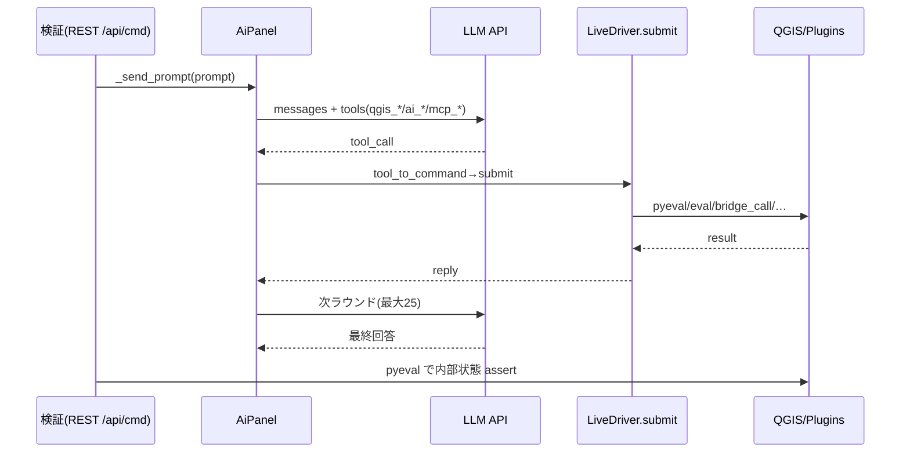

# geo_driver AIチャット — 制御面ロジックシート

- 生成: 2026-11-14T03:06:16+09:00
- scope: panel=30, plugin=428, qgis=1240

## 制御トポロジ

## 検証マトリクス

| id | scope | kind | tool | ai | result |
|---|---|---|---|---|---|
| `panel.send` | panel | panel_flow | untested | untested | untested |
| `panel.abort` | panel | panel_flow | untested | untested | untested |
| `panel.retry` | panel | panel_flow | untested | untested | untested |
| `panel.multi_chat` | panel | panel_flow | untested | untested | untested |
| `panel.attach_image` | panel | panel_flow | untested | untested | untested |
| `panel.confirm_mode` | panel | panel_flow | untested | untested | untested |
| `panel.provider_switch` | panel | panel_flow | untested | untested | untested |
| `panel.model_list` | panel | panel_flow | untested | untested | untested |
| `panel.export_chat` | panel | panel_flow | untested | untested | untested |
| `panel.cmd.agent` | panel | panel_cmd | untested | untested | untested |
| `panel.cmd.skill` | panel | panel_cmd | untested | untested | untested |
| `panel.cmd.help` | panel | panel_cmd | untested | untested | untested |
| `panel.instructions_dirs` | panel | panel_instr | untested | untested | untested |
| `panel.mcp_external` | panel | panel_mcp | untested | untested | untested |
| `panel.history_persist` | panel | panel_flow | untested | untested | untested |
| `panel.tool.qgis_pyeval` | panel | panel_tool | untested | untested | untested |
| `panel.tool.qgis_eval` | panel | panel_tool | untested | untested | untested |
| `panel.tool.qgis_screenshot` | panel | panel_tool | untested | untested | untested |
| `panel.tool.qgis_devreload` | panel | panel_tool | untested | untested | untested |
| `panel.tool.qgis_status` | panel | panel_tool | untested | untested | untested |
| `panel.tool.qgis_open_plugin` | panel | panel_tool | untested | untested | untested |
| `panel.tool.qgis_reload_plugin` | panel | panel_tool | untested | untested | untested |
| `panel.tool.qgis_bridge_call` | panel | panel_tool | untested | untested | untested |
| `panel.tool.qgis_describe_plugins` | panel | panel_tool | untested | untested | untested |
| `panel.tool.qgis_instruction` | panel | panel_tool | untested | untested | untested |
| `panel.tool.ai_list_instructions` | panel | panel_tool | untested | untested | untested |
| `panel.tool.ai_read_instruction` | panel | panel_tool | untested | untested | untested |
| `panel.tool.ai_save_instruction` | panel | panel_tool | untested | untested | untested |
| `panel.tool.ai_delete_instruction` | panel | panel_tool | untested | untested | untested |
| `panel.tool.ai_select_agent` | panel | panel_tool | untested | untested | untested |
| `plugin.geo_search.entry_point.__init__.py:classFactory` | plugin | entry_point | untested | untested | untested |
| `plugin.geo_search.action.SearchFeature.unload` | plugin | action | untested | untested | untested |
| `plugin.geo_search.action.SearchOwnerFeature.unload` | plugin | action | untested | untested | untested |
| `plugin.geo_search.action.SearchTextFeature.unload` | plugin | action | untested | untested | untested |
| `plugin.geo_search.action.SearchTibanFeature.unload` | plugin | action | untested | untested | untested |
| `plugin.geo_search.action.plugin.initGui` | plugin | action | untested | untested | untested |
| `plugin.geo_search.action.plugin.run` | plugin | action | untested | untested | untested |
| `plugin.geo_search.action.plugin.unload` | plugin | action | untested | untested | untested |
| `plugin.geo_search.dialog.ResultDialog` | plugin | dialog | untested | untested | untested |
| `plugin.geo_search.dialog.SearchDialog` | plugin | dialog | untested | untested | untested |
| `plugin.geo_search.dialog.SearchWidget` | plugin | dialog | untested | untested | untested |
| `plugin.geo_search.dialog.SettingsDialog` | plugin | dialog | untested | untested | untested |
| `plugin.geo_search.ui.ResultDialog._on_tab_changed` | plugin | ui_control | untested | untested | untested |
| `plugin.geo_search.ui.plugin._on_additive_toggled` | plugin | ui_control | untested | untested | untested |
| `plugin.geo_search.ui.plugin._on_map_themes_changed` | plugin | ui_control | untested | untested | untested |
| `plugin.geo_search.ui.plugin._on_theme_collection_changed` | plugin | ui_control | untested | untested | untested |
| `plugin.geo_search.ui.plugin.on_group_changed` | plugin | ui_control | untested | untested | untested |
| `plugin.geo_search.ui.plugin.on_project_saved` | plugin | ui_control | untested | untested | untested |
| `plugin.geo_search.bridge.addTab` | plugin | bridge_method | untested | untested | untested |
| `plugin.geo_search.bridge.addTabFromCurrentLayer` | plugin | bridge_method | untested | untested | untested |
| `plugin.geo_search.bridge.applyTheme` | plugin | bridge_method | untested | untested | untested |
| `plugin.geo_search.bridge.closeDialog` | plugin | bridge_method | untested | untested | untested |
| `plugin.geo_search.bridge.getSettings` | plugin | bridge_method | untested | untested | untested |
| `plugin.geo_search.bridge.listTabs` | plugin | bridge_method | untested | untested | untested |
| `plugin.geo_search.bridge.listThemes` | plugin | bridge_method | untested | untested | untested |
| `plugin.geo_search.bridge.loadUserTheme` | plugin | bridge_method | untested | untested | untested |
| `plugin.geo_search.bridge.openDialog` | plugin | bridge_method | untested | untested | untested |
| `plugin.geo_search.bridge.openSettings` | plugin | bridge_method | untested | untested | untested |
| `plugin.geo_search.bridge.pluginInfo` | plugin | bridge_method | untested | untested | untested |
| `plugin.geo_search.bridge.reloadDialog` | plugin | bridge_method | untested | untested | untested |
| `plugin.geo_search.bridge.removeTab` | plugin | bridge_method | untested | untested | untested |
| `plugin.geo_search.bridge.resultDisplayMode` | plugin | bridge_method | untested | untested | untested |
| `plugin.geo_search.bridge.resultPage` | plugin | bridge_method | untested | untested | untested |
| `plugin.geo_search.bridge.results` | plugin | bridge_method | untested | untested | untested |
| `plugin.geo_search.bridge.saveUserTheme` | plugin | bridge_method | untested | untested | untested |
| `plugin.geo_search.bridge.search` | plugin | bridge_method | untested | untested | untested |
| `plugin.geo_search.bridge.searchOptions` | plugin | bridge_method | untested | untested | untested |
| `plugin.geo_search.bridge.selectTab` | plugin | bridge_method | untested | untested | untested |
| `plugin.geo_search.bridge.setSettings` | plugin | bridge_method | untested | untested | untested |
| `plugin.geo_search.bridge.setTabSetting` | plugin | bridge_method | untested | untested | untested |
| `plugin.geo_search.bridge.status` | plugin | bridge_method | untested | untested | untested |
| `plugin.geo_search.bridge.suggest` | plugin | bridge_method | untested | untested | untested |
| `plugin.geo_search.bridge.tabOptions` | plugin | bridge_method | untested | untested | untested |
| `plugin.geo_search.bridge.tabSetting` | plugin | bridge_method | untested | untested | untested |
| `plugin.geo_search.bridge.themeAdditive` | plugin | bridge_method | untested | untested | untested |
| `plugin.geo_search.bridge.zoom` | plugin | bridge_method | untested | untested | untested |
| `plugin.geo_search.ai.bridge_route` | plugin | ai_integration | untested | untested | untested |
| `plugin.geo_search.ai.catalog` | plugin | ai_integration | untested | untested | untested |
| `plugin.geo_search.ai.pluginInfo` | plugin | ai_integration | untested | untested | untested |
| `plugin.geo_webview.entry_point.__init__.py:classFactory` | plugin | entry_point | untested | untested | untested |
| `plugin.geo_webview.action.GeoWebView.initGui` | plugin | action | untested | untested | untested |
| `plugin.geo_webview.action.GeoWebView.open_dialog` | plugin | action | untested | untested | untested |
| `plugin.geo_webview.action.GeoWebView.run` | plugin | action | untested | untested | untested |
| `plugin.geo_webview.action.GeoWebView.unload` | plugin | action | untested | untested | untested |
| `plugin.geo_webview.dialog.GeoWebViewPanel` | plugin | dialog | untested | untested | untested |
| `plugin.geo_webview.dialog.SettingsDialog` | plugin | dialog | untested | untested | untested |
| `plugin.geo_webview.ui.GeoWebView._on_project_saved` | plugin | ui_control | untested | untested | untested |
| `plugin.geo_webview.ui.GeoWebView.handle_request_origin_changed` | plugin | ui_control | untested | untested | untested |
| `plugin.geo_webview.ui.GeoWebView.on_check_access_clicked` | plugin | ui_control | untested | untested | untested |
| `plugin.geo_webview.ui.GeoWebView.on_copy_clicked_panel` | plugin | ui_control | untested | untested | untested |
| `plugin.geo_webview.ui.GeoWebView.on_engine_combo_changed` | plugin | ui_control | untested | untested | untested |
| `plugin.geo_webview.ui.GeoWebView.on_generate_clicked_panel` | plugin | ui_control | untested | untested | untested |
| `plugin.geo_webview.ui.GeoWebView.on_hosted_combo_changed` | plugin | ui_control | untested | untested | untested |
| `plugin.geo_webview.ui.GeoWebView.on_kasugai_export_clicked` | plugin | ui_control | untested | untested | untested |
| `plugin.geo_webview.ui.GeoWebView.on_kasugai_help_clicked` | plugin | ui_control | untested | untested | untested |
| `plugin.geo_webview.ui.GeoWebView.on_kasugai_launch_clicked` | plugin | ui_control | untested | untested | untested |
| `plugin.geo_webview.ui.GeoWebView.on_kasugai_open_folder` | plugin | ui_control | untested | untested | untested |
| `plugin.geo_webview.ui.GeoWebView.on_kasugai_outdir_browse` | plugin | ui_control | untested | untested | untested |
| `plugin.geo_webview.ui.GeoWebView.on_kasugai_outdir_reset` | plugin | ui_control | untested | untested | untested |
| `plugin.geo_webview.ui.GeoWebView.on_kasugai_zip_clicked` | plugin | ui_control | untested | untested | untested |
| `plugin.geo_webview.ui.GeoWebView.on_navigate_clicked_panel` | plugin | ui_control | untested | untested | untested |
| `plugin.geo_webview.ui.GeoWebView.on_present_clicked_panel` | plugin | ui_control | untested | untested | untested |
| `plugin.geo_webview.ui.GeoWebView.on_received_selected` | plugin | ui_control | untested | untested | untested |
| `plugin.geo_webview.ui.GeoWebView.on_save_theme_clicked_panel` | plugin | ui_control | untested | untested | untested |
| `plugin.geo_webview.ui.GeoWebView.on_standard_port_clicked` | plugin | ui_control | untested | untested | untested |
| `plugin.geo_webview.ui.GeoWebViewPanel._on_copy_permalink_to_clipboard` | plugin | ui_control | untested | untested | untested |
| `plugin.geo_webview.ui.GeoWebViewPanel._on_paste_from_clipboard` | plugin | ui_control | untested | untested | untested |
| `plugin.geo_webview.ui.GeoWebViewPanel._on_visibility_changed` | plugin | ui_control | untested | untested | untested |
| `plugin.geo_webview.ui.GeoWebViewPanel.set_external_control_handler` | plugin | ui_control | untested | untested | untested |
| `plugin.geo_webview.ui.GeoWebViewPanel.set_port_change_handler` | plugin | ui_control | untested | untested | untested |
| `plugin.geo_webview.ui.GeoWebViewPanel.set_server_toggle_handler` | plugin | ui_control | untested | untested | untested |
| `plugin.geo_webview.ui.GeoWebViewServerManager._on_cursor_xy` | plugin | ui_control | untested | untested | untested |
| `plugin.geo_webview.ui.LiveSyncController._on_layers_added` | plugin | ui_control | untested | untested | untested |
| `plugin.geo_webview.ui.LiveSyncController._on_project_read` | plugin | ui_control | untested | untested | untested |
| `plugin.geo_webview.ui.LiveSyncController._on_selection_changed` | plugin | ui_control | untested | untested | untested |
| `plugin.geo_webview.ui.LiveSyncController._on_structure` | plugin | ui_control | untested | untested | untested |
| `plugin.geo_webview.ui.SettingsDialog._basemap_groups_changed` | plugin | ui_control | untested | untested | untested |
| `plugin.geo_webview.ui.SettingsDialog._hosted_channel_changed` | plugin | ui_control | untested | untested | untested |
| `plugin.geo_webview.bridge.addFirewallRule` | plugin | bridge_method | untested | untested | untested |
| `plugin.geo_webview.bridge.applyTheme` | plugin | bridge_method | untested | untested | untested |
| `plugin.geo_webview.bridge.checkAccess` | plugin | bridge_method | untested | untested | untested |
| `plugin.geo_webview.bridge.closePanel` | plugin | bridge_method | untested | untested | untested |
| `plugin.geo_webview.bridge.copyPermalink` | plugin | bridge_method | untested | untested | untested |
| `plugin.geo_webview.bridge.deleteTheme` | plugin | bridge_method | untested | untested | untested |
| `plugin.geo_webview.bridge.endpoints` | plugin | bridge_method | untested | untested | untested |
| `plugin.geo_webview.bridge.externalControl` | plugin | bridge_method | untested | untested | untested |
| `plugin.geo_webview.bridge.generatePermalink` | plugin | bridge_method | untested | untested | untested |
| `plugin.geo_webview.bridge.getSettings` | plugin | bridge_method | untested | untested | untested |
| `plugin.geo_webview.bridge.kasugaiExport` | plugin | bridge_method | untested | untested | untested |
| `plugin.geo_webview.bridge.listBookmarks` | plugin | bridge_method | untested | untested | untested |
| `plugin.geo_webview.bridge.listThemes` | plugin | bridge_method | untested | untested | untested |
| `plugin.geo_webview.bridge.liveAddFeatures` | plugin | bridge_method | untested | untested | untested |
| `plugin.geo_webview.bridge.liveSyncFlush` | plugin | bridge_method | untested | untested | untested |
| `plugin.geo_webview.bridge.liveSyncStart` | plugin | bridge_method | untested | untested | untested |
| `plugin.geo_webview.bridge.liveSyncStatus` | plugin | bridge_method | untested | untested | untested |
| `plugin.geo_webview.bridge.liveSyncStop` | plugin | bridge_method | untested | untested | untested |
| `plugin.geo_webview.bridge.liveWriteback` | plugin | bridge_method | untested | untested | untested |
| `plugin.geo_webview.bridge.macAuth` | plugin | bridge_method | untested | untested | untested |
| `plugin.geo_webview.bridge.navigate` | plugin | bridge_method | untested | untested | untested |
| `plugin.geo_webview.bridge.navigateTo` | plugin | bridge_method | untested | untested | untested |
| `plugin.geo_webview.bridge.openExportFolder` | plugin | bridge_method | untested | untested | untested |
| `plugin.geo_webview.bridge.openExternal` | plugin | bridge_method | untested | untested | untested |
| `plugin.geo_webview.bridge.openPanel` | plugin | bridge_method | untested | untested | untested |
| `plugin.geo_webview.bridge.openPresent` | plugin | bridge_method | untested | untested | untested |
| `plugin.geo_webview.bridge.pluginInfo` | plugin | bridge_method | untested | untested | untested |
| `plugin.geo_webview.bridge.receivedHistory` | plugin | bridge_method | untested | untested | untested |
| `plugin.geo_webview.bridge.saveTheme` | plugin | bridge_method | untested | untested | untested |
| `plugin.geo_webview.bridge.serverStatus` | plugin | bridge_method | untested | untested | untested |
| `plugin.geo_webview.bridge.setPort` | plugin | bridge_method | untested | untested | untested |
| `plugin.geo_webview.bridge.setSettings` | plugin | bridge_method | untested | untested | untested |
| `plugin.geo_webview.bridge.startServer` | plugin | bridge_method | untested | untested | untested |
| `plugin.geo_webview.bridge.status` | plugin | bridge_method | untested | untested | untested |
| `plugin.geo_webview.bridge.stopServer` | plugin | bridge_method | untested | untested | untested |
| `plugin.geo_webview.registry.kasugai_export.py:register_kasugai_project` | plugin | registry | untested | untested | untested |
| `plugin.geo_webview.integration.bridge.py:1337` | plugin | integration | untested | untested | untested |
| `plugin.geo_webview.integration.bridge.py:360` | plugin | integration | untested | untested | untested |
| `plugin.geo_webview.integration.bridge.py:362` | plugin | integration | untested | untested | untested |
| `plugin.geo_webview.integration.kasugai_export.py:4022` | plugin | integration | untested | untested | untested |
| `plugin.geo_webview.integration.kasugai_export.py:4259` | plugin | integration | untested | untested | untested |
| `plugin.geo_webview.integration.plugin.py:1387` | plugin | integration | untested | untested | untested |
| `plugin.geo_webview.integration.plugin.py:1489` | plugin | integration | untested | untested | untested |
| `plugin.geo_webview.integration.plugin.py:1503` | plugin | integration | untested | untested | untested |
| `plugin.geo_webview.integration.plugin.py:1835` | plugin | integration | untested | untested | untested |
| `plugin.geo_webview.integration.server_manager.py:1098` | plugin | integration | untested | untested | untested |
| `plugin.geo_webview.integration.server_manager.py:1127` | plugin | integration | untested | untested | untested |
| `plugin.geo_webview.integration.server_manager.py:1131` | plugin | integration | untested | untested | untested |
| `plugin.geo_webview.integration.server_manager.py:1135` | plugin | integration | untested | untested | untested |
| `plugin.geo_webview.integration.server_manager.py:2882` | plugin | integration | untested | untested | untested |
| `plugin.geo_webview.integration.server_manager.py:2928` | plugin | integration | untested | untested | untested |
| `plugin.geo_webview.integration.server_manager.py:3006` | plugin | integration | untested | untested | untested |
| `plugin.geo_webview.integration.server_manager.py:3010` | plugin | integration | untested | untested | untested |
| `plugin.geo_webview.integration.server_manager.py:3039` | plugin | integration | untested | untested | untested |
| `plugin.geo_webview.integration.server_manager.py:3115` | plugin | integration | untested | untested | untested |
| `plugin.geo_webview.integration.server_manager.py:313` | plugin | integration | untested | untested | untested |
| `plugin.geo_webview.integration.server_manager.py:316` | plugin | integration | untested | untested | untested |
| `plugin.geo_webview.integration.server_manager.py:317` | plugin | integration | untested | untested | untested |
| `plugin.geo_webview.integration.server_manager.py:318` | plugin | integration | untested | untested | untested |
| `plugin.geo_webview.integration.server_manager.py:3231` | plugin | integration | untested | untested | untested |
| `plugin.geo_webview.integration.server_manager.py:3286` | plugin | integration | untested | untested | untested |
| `plugin.geo_webview.integration.server_manager.py:3299` | plugin | integration | untested | untested | untested |
| `plugin.geo_webview.ai.bridge_route` | plugin | ai_integration | untested | untested | untested |
| `plugin.geo_webview.ai.catalog` | plugin | ai_integration | untested | untested | untested |
| `plugin.geo_webview.ai.pluginInfo` | plugin | ai_integration | untested | untested | untested |
| `plugin.geo_report.entry_point.__init__.py:classFactory` | plugin | entry_point | untested | untested | untested |
| `plugin.geo_report.action.GeoReport.initGui` | plugin | action | untested | untested | untested |
| `plugin.geo_report.action.GeoReport.run` | plugin | action | untested | untested | untested |
| `plugin.geo_report.action.GeoReport.unload` | plugin | action | untested | untested | untested |
| `plugin.geo_report.dialog.LayoutFileSelectDialog` | plugin | dialog | untested | untested | untested |
| `plugin.geo_report.dialog.LayoutSelectorDialog` | plugin | dialog | untested | untested | untested |
| `plugin.geo_report.ui.GeoReport._on_dock_visibility_changed` | plugin | ui_control | untested | untested | untested |
| `plugin.geo_report.ui.LayoutFileSelectDialog.on_file_double_clicked` | plugin | ui_control | untested | untested | untested |
| `plugin.geo_report.ui.LayoutFileSelectDialog.on_selection_changed` | plugin | ui_control | untested | untested | untested |
| `plugin.geo_report.ui.LayoutSelectorDialog._on_layouts_changed` | plugin | ui_control | untested | untested | untested |
| `plugin.geo_report.ui.LayoutSelectorDialog.on_item_selected` | plugin | ui_control | untested | untested | untested |
| `plugin.geo_report.ui.LayoutSelectorDialog.on_layout_selected` | plugin | ui_control | untested | untested | untested |
| `plugin.geo_report.ui.LayoutSelectorDialog.on_property_changed` | plugin | ui_control | untested | untested | untested |
| `plugin.geo_report.ui.LayoutSelectorDialog.on_tab_changed` | plugin | ui_control | untested | untested | untested |
| `plugin.geo_report.bridge.addStandardLayout` | plugin | bridge_method | untested | untested | untested |
| `plugin.geo_report.bridge.closePanel` | plugin | bridge_method | untested | untested | untested |
| `plugin.geo_report.bridge.createLayout` | plugin | bridge_method | untested | untested | untested |
| `plugin.geo_report.bridge.duplicateLayout` | plugin | bridge_method | untested | untested | untested |
| `plugin.geo_report.bridge.itemProperties` | plugin | bridge_method | untested | untested | untested |
| `plugin.geo_report.bridge.layoutInfo` | plugin | bridge_method | untested | untested | untested |
| `plugin.geo_report.bridge.listItems` | plugin | bridge_method | untested | untested | untested |
| `plugin.geo_report.bridge.listLayouts` | plugin | bridge_method | untested | untested | untested |
| `plugin.geo_report.bridge.listPropertyFiles` | plugin | bridge_method | untested | untested | untested |
| `plugin.geo_report.bridge.listStandardLayouts` | plugin | bridge_method | untested | untested | untested |
| `plugin.geo_report.bridge.loadLayoutProperties` | plugin | bridge_method | untested | untested | untested |
| `plugin.geo_report.bridge.manageLayouts` | plugin | bridge_method | untested | untested | untested |
| `plugin.geo_report.bridge.openLayoutManager` | plugin | bridge_method | untested | untested | untested |
| `plugin.geo_report.bridge.openPanel` | plugin | bridge_method | untested | untested | untested |
| `plugin.geo_report.bridge.pluginInfo` | plugin | bridge_method | untested | untested | untested |
| `plugin.geo_report.bridge.printOptions` | plugin | bridge_method | untested | untested | untested |
| `plugin.geo_report.bridge.refresh` | plugin | bridge_method | untested | untested | untested |
| `plugin.geo_report.bridge.removeLayout` | plugin | bridge_method | untested | untested | untested |
| `plugin.geo_report.bridge.renameLayout` | plugin | bridge_method | untested | untested | untested |
| `plugin.geo_report.bridge.saveLayoutProperties` | plugin | bridge_method | untested | untested | untested |
| `plugin.geo_report.bridge.selectLayout` | plugin | bridge_method | untested | untested | untested |
| `plugin.geo_report.bridge.setItemProperties` | plugin | bridge_method | untested | untested | untested |
| `plugin.geo_report.bridge.showPrintArea` | plugin | bridge_method | untested | untested | untested |
| `plugin.geo_report.bridge.status` | plugin | bridge_method | untested | untested | untested |
| `plugin.geo_report.ai.bridge_route` | plugin | ai_integration | untested | untested | untested |
| `plugin.geo_report.ai.catalog` | plugin | ai_integration | untested | untested | untested |
| `plugin.geo_report.ai.pluginInfo` | plugin | ai_integration | untested | untested | untested |
| `plugin.geo_import.entry_point.__init__.py:classFactory` | plugin | entry_point | untested | untested | untested |
| `plugin.geo_import.action.DataFetchThread.run` | plugin | action | untested | untested | untested |
| `plugin.geo_import.action.GeoImport.initGui` | plugin | action | untested | untested | untested |
| `plugin.geo_import.action.GeoImport.run` | plugin | action | untested | untested | untested |
| `plugin.geo_import.action.GeoImport.unload` | plugin | action | untested | untested | untested |
| `plugin.geo_import.dialog.GeoImportDialog` | plugin | dialog | untested | untested | untested |
| `plugin.geo_import.dialog.GeoImportDialogDataProviders` | plugin | dialog | untested | untested | untested |
| `plugin.geo_import.dialog.GeoImportDialogDisclaimer` | plugin | dialog | untested | untested | untested |
| `plugin.geo_import.dialog.GeoImportDialogSettings` | plugin | dialog | untested | untested | untested |
| `plugin.geo_import.ui.GeoImportDialog._on_data_ready` | plugin | ui_control | untested | untested | untested |
| `plugin.geo_import.ui.GeoImportDialog._on_org_layers_added` | plugin | ui_control | untested | untested | untested |
| `plugin.geo_import.ui.GeoImportDialog.category_item_clicked` | plugin | ui_control | untested | untested | untested |
| `plugin.geo_import.ui.GeoImportDialog.list_all_clicked` | plugin | ui_control | untested | untested | untested |
| `plugin.geo_import.ui.GeoImportDialog.list_group_item_changed` | plugin | ui_control | untested | untested | untested |
| `plugin.geo_import.ui.GeoImportDialog.load_resource_clicked` | plugin | ui_control | untested | untested | untested |
| `plugin.geo_import.ui.GeoImportDialog.next_page_clicked` | plugin | ui_control | untested | untested | untested |
| `plugin.geo_import.ui.GeoImportDialog.on_IDC_bSelectAllResources_clicked` | plugin | ui_control | untested | untested | untested |
| `plugin.geo_import.ui.GeoImportDialog.previous_page_clicked` | plugin | ui_control | untested | untested | untested |
| `plugin.geo_import.ui.GeoImportDialog.refresh_sqlite_clicked` | plugin | ui_control | untested | untested | untested |
| `plugin.geo_import.ui.GeoImportDialog.resource_item_changed` | plugin | ui_control | untested | untested | untested |
| `plugin.geo_import.ui.GeoImportDialog.select_data_provider_clicked` | plugin | ui_control | untested | untested | untested |
| `plugin.geo_import.ui.GeoImportDialogDataProviders.item_checked_changed` | plugin | ui_control | untested | untested | untested |
| `plugin.geo_import.ui.GeoImportDialogDataProviders.save_btn_clicked` | plugin | ui_control | untested | untested | untested |
| `plugin.geo_import.ui.GeoImportDialogDataProviders.server_in_list_clicked` | plugin | ui_control | untested | untested | untested |
| `plugin.geo_import.bridge.addServer` | plugin | bridge_method | untested | untested | untested |
| `plugin.geo_import.bridge.checkGroups` | plugin | bridge_method | untested | untested | untested |
| `plugin.geo_import.bridge.checkResources` | plugin | bridge_method | untested | untested | untested |
| `plugin.geo_import.bridge.closeDialog` | plugin | bridge_method | untested | untested | untested |
| `plugin.geo_import.bridge.datasetDetails` | plugin | bridge_method | untested | untested | untested |
| `plugin.geo_import.bridge.formatFilter` | plugin | bridge_method | untested | untested | untested |
| `plugin.geo_import.bridge.getSettings` | plugin | bridge_method | untested | untested | untested |
| `plugin.geo_import.bridge.gotoPage` | plugin | bridge_method | untested | untested | untested |
| `plugin.geo_import.bridge.link` | plugin | bridge_method | untested | untested | untested |
| `plugin.geo_import.bridge.listGroups` | plugin | bridge_method | untested | untested | untested |
| `plugin.geo_import.bridge.listServers` | plugin | bridge_method | untested | untested | untested |
| `plugin.geo_import.bridge.loadSelected` | plugin | bridge_method | untested | untested | untested |
| `plugin.geo_import.bridge.localCache` | plugin | bridge_method | untested | untested | untested |
| `plugin.geo_import.bridge.nextPage` | plugin | bridge_method | untested | untested | untested |
| `plugin.geo_import.bridge.openDialog` | plugin | bridge_method | untested | untested | untested |
| `plugin.geo_import.bridge.openDisclaimer` | plugin | bridge_method | untested | untested | untested |
| `plugin.geo_import.bridge.openProviders` | plugin | bridge_method | untested | untested | untested |
| `plugin.geo_import.bridge.openSettings` | plugin | bridge_method | untested | untested | untested |
| `plugin.geo_import.bridge.pluginInfo` | plugin | bridge_method | untested | untested | untested |
| `plugin.geo_import.bridge.prevPage` | plugin | bridge_method | untested | untested | untested |
| `plugin.geo_import.bridge.refreshCache` | plugin | bridge_method | untested | untested | untested |
| `plugin.geo_import.bridge.reload` | plugin | bridge_method | untested | untested | untested |
| `plugin.geo_import.bridge.removeServer` | plugin | bridge_method | untested | untested | untested |
| `plugin.geo_import.bridge.resources` | plugin | bridge_method | untested | untested | untested |
| `plugin.geo_import.bridge.results` | plugin | bridge_method | untested | untested | untested |
| `plugin.geo_import.bridge.search` | plugin | bridge_method | untested | untested | untested |
| `plugin.geo_import.bridge.selectResult` | plugin | bridge_method | untested | untested | untested |
| `plugin.geo_import.bridge.selectResults` | plugin | bridge_method | untested | untested | untested |
| `plugin.geo_import.bridge.selectServers` | plugin | bridge_method | untested | untested | untested |
| `plugin.geo_import.bridge.setSettings` | plugin | bridge_method | untested | untested | untested |
| `plugin.geo_import.bridge.status` | plugin | bridge_method | untested | untested | untested |
| `plugin.geo_import.bridge.testServer` | plugin | bridge_method | untested | untested | untested |
| `plugin.geo_import.integration.geo_import_dialog.py:1660` | plugin | integration | untested | untested | untested |
| `plugin.geo_import.integration.httpcall.py:139` | plugin | integration | untested | untested | untested |
| `plugin.geo_import.integration.util.py:1251` | plugin | integration | untested | untested | untested |
| `plugin.geo_import.integration.util.py:1253` | plugin | integration | untested | untested | untested |
| `plugin.geo_import.integration.util.py:1257` | plugin | integration | untested | untested | untested |
| `plugin.geo_import.integration.util.py:229` | plugin | integration | untested | untested | untested |
| `plugin.geo_import.integration.util.py:901` | plugin | integration | untested | untested | untested |
| `plugin.geo_import.integration.util.py:907` | plugin | integration | untested | untested | untested |
| `plugin.geo_import.ai.bridge_route` | plugin | ai_integration | untested | untested | untested |
| `plugin.geo_import.ai.catalog` | plugin | ai_integration | untested | untested | untested |
| `plugin.geo_import.ai.pluginInfo` | plugin | ai_integration | untested | untested | untested |
| `plugin.geo_excel.entry_point.__init__.py:classFactory` | plugin | entry_point | untested | untested | untested |
| `plugin.geo_excel.action.plugin.initGui` | plugin | action | untested | untested | untested |
| `plugin.geo_excel.action.plugin.unload` | plugin | action | untested | untested | untested |
| `plugin.geo_excel.dialog.GeoExcelSettingsDialog` | plugin | dialog | untested | untested | untested |
| `plugin.geo_excel.bridge.applyDefaults` | plugin | bridge_method | untested | untested | untested |
| `plugin.geo_excel.bridge.checkExcel` | plugin | bridge_method | untested | untested | untested |
| `plugin.geo_excel.bridge.layerVariables` | plugin | bridge_method | untested | untested | untested |
| `plugin.geo_excel.bridge.listScripts` | plugin | bridge_method | untested | untested | untested |
| `plugin.geo_excel.bridge.openSettings` | plugin | bridge_method | untested | untested | untested |
| `plugin.geo_excel.bridge.pluginInfo` | plugin | bridge_method | untested | untested | untested |
| `plugin.geo_excel.bridge.regenerateTemplates` | plugin | bridge_method | untested | untested | untested |
| `plugin.geo_excel.bridge.run` | plugin | bridge_method | untested | untested | untested |
| `plugin.geo_excel.bridge.setLayerVariables` | plugin | bridge_method | untested | untested | untested |
| `plugin.geo_excel.bridge.setSettings` | plugin | bridge_method | untested | untested | untested |
| `plugin.geo_excel.bridge.settings` | plugin | bridge_method | untested | untested | untested |
| `plugin.geo_excel.bridge.status` | plugin | bridge_method | untested | untested | untested |
| `plugin.geo_excel.integration.bridge.py:284` | plugin | integration | untested | untested | untested |
| `plugin.geo_excel.integration.bridge.py:292` | plugin | integration | untested | untested | untested |
| `plugin.geo_excel.integration.bridge.py:334` | plugin | integration | untested | untested | untested |
| `plugin.geo_excel.integration.exportList.py:623` | plugin | integration | untested | untested | untested |
| `plugin.geo_excel.integration.exportSingle.py:974` | plugin | integration | untested | untested | untested |
| `plugin.geo_excel.integration.exportSingleBulk.py:1019` | plugin | integration | untested | untested | untested |
| `plugin.geo_excel.integration.settings.py:167` | plugin | integration | untested | untested | untested |
| `plugin.geo_excel.integration.settings.py:182` | plugin | integration | untested | untested | untested |
| `plugin.geo_excel.ai.bridge_route` | plugin | ai_integration | untested | untested | untested |
| `plugin.geo_excel.ai.catalog` | plugin | ai_integration | untested | untested | untested |
| `plugin.geo_excel.ai.pluginInfo` | plugin | ai_integration | untested | untested | untested |
| `plugin.geo_userfunc.entry_point.__init__.py:classFactory` | plugin | entry_point | untested | untested | untested |
| `plugin.geo_userfunc.action.MacroRegistry.run` | plugin | action | untested | untested | untested |
| `plugin.geo_userfunc.action.plugin.initGui` | plugin | action | untested | untested | untested |
| `plugin.geo_userfunc.action.plugin.unload` | plugin | action | untested | untested | untested |
| `plugin.geo_userfunc.dialog.GeoUserfuncManagerDialog` | plugin | dialog | untested | untested | untested |
| `plugin.geo_userfunc.dialog._FunctionEditDialog` | plugin | dialog | untested | untested | untested |
| `plugin.geo_userfunc.ui.GeoUserfuncManagerDialog._on_item_changed` | plugin | ui_control | untested | untested | untested |
| `plugin.geo_userfunc.ui.MacroRegistry.on_changed` | plugin | ui_control | untested | untested | untested |
| `plugin.geo_userfunc.bridge.addSource` | plugin | bridge_method | untested | untested | untested |
| `plugin.geo_userfunc.bridge.deleteFunction` | plugin | bridge_method | untested | untested | untested |
| `plugin.geo_userfunc.bridge.evalExpression` | plugin | bridge_method | untested | untested | untested |
| `plugin.geo_userfunc.bridge.fetchFromUrl` | plugin | bridge_method | untested | untested | untested |
| `plugin.geo_userfunc.bridge.listFunctions` | plugin | bridge_method | untested | untested | untested |
| `plugin.geo_userfunc.bridge.listMacros` | plugin | bridge_method | untested | untested | untested |
| `plugin.geo_userfunc.bridge.listSources` | plugin | bridge_method | untested | untested | untested |
| `plugin.geo_userfunc.bridge.openLibraryDir` | plugin | bridge_method | untested | untested | untested |
| `plugin.geo_userfunc.bridge.openManager` | plugin | bridge_method | untested | untested | untested |
| `plugin.geo_userfunc.bridge.pluginInfo` | plugin | bridge_method | untested | untested | untested |
| `plugin.geo_userfunc.bridge.readFunction` | plugin | bridge_method | untested | untested | untested |
| `plugin.geo_userfunc.bridge.reload` | plugin | bridge_method | untested | untested | untested |
| `plugin.geo_userfunc.bridge.removeSource` | plugin | bridge_method | untested | untested | untested |
| `plugin.geo_userfunc.bridge.run` | plugin | bridge_method | untested | untested | untested |
| `plugin.geo_userfunc.bridge.saveFunction` | plugin | bridge_method | untested | untested | untested |
| `plugin.geo_userfunc.bridge.setEnabled` | plugin | bridge_method | untested | untested | untested |
| `plugin.geo_userfunc.bridge.status` | plugin | bridge_method | untested | untested | untested |
| `plugin.geo_userfunc.bridge.updateFromUpstream` | plugin | bridge_method | untested | untested | untested |
| `plugin.geo_userfunc.integration.bridge.py:488` | plugin | integration | untested | untested | untested |
| `plugin.geo_userfunc.integration.manager_dialog.py:251` | plugin | integration | untested | untested | untested |
| `plugin.geo_userfunc.ai.bridge_route` | plugin | ai_integration | untested | untested | untested |
| `plugin.geo_userfunc.ai.catalog` | plugin | ai_integration | untested | untested | untested |
| `plugin.geo_userfunc.ai.pluginInfo` | plugin | ai_integration | untested | untested | untested |
| `plugin.geo_legend.entry_point.__init__.py:classFactory` | plugin | entry_point | untested | untested | untested |
| `plugin.geo_legend.action.LegendView.initGui` | plugin | action | untested | untested | untested |
| `plugin.geo_legend.action.LegendView.run` | plugin | action | untested | untested | untested |
| `plugin.geo_legend.action.LegendView.unload` | plugin | action | untested | untested | untested |
| `plugin.geo_legend.dialog.LegendViewDockWidget` | plugin | dialog | untested | untested | untested |
| `plugin.geo_legend.bridge.closeDock` | plugin | bridge_method | untested | untested | untested |
| `plugin.geo_legend.bridge.deleteLegendVariable` | plugin | bridge_method | untested | untested | untested |
| `plugin.geo_legend.bridge.legend` | plugin | bridge_method | untested | untested | untested |
| `plugin.geo_legend.bridge.legendVariables` | plugin | bridge_method | untested | untested | untested |
| `plugin.geo_legend.bridge.listDatasets` | plugin | bridge_method | untested | untested | untested |
| `plugin.geo_legend.bridge.listStyles` | plugin | bridge_method | untested | untested | untested |
| `plugin.geo_legend.bridge.opacity` | plugin | bridge_method | untested | untested | untested |
| `plugin.geo_legend.bridge.openDock` | plugin | bridge_method | untested | untested | untested |
| `plugin.geo_legend.bridge.pluginInfo` | plugin | bridge_method | untested | untested | untested |
| `plugin.geo_legend.bridge.refresh` | plugin | bridge_method | untested | untested | untested |
| `plugin.geo_legend.bridge.registerCurrentLayer` | plugin | bridge_method | untested | untested | untested |
| `plugin.geo_legend.bridge.registerLayer` | plugin | bridge_method | untested | untested | untested |
| `plugin.geo_legend.bridge.selectCurrentLayer` | plugin | bridge_method | untested | untested | untested |
| `plugin.geo_legend.bridge.selectDataset` | plugin | bridge_method | untested | untested | untested |
| `plugin.geo_legend.bridge.setLegendVariable` | plugin | bridge_method | untested | untested | untested |
| `plugin.geo_legend.bridge.setStyle` | plugin | bridge_method | untested | untested | untested |
| `plugin.geo_legend.bridge.status` | plugin | bridge_method | untested | untested | untested |
| `plugin.geo_legend.ai.bridge_route` | plugin | ai_integration | untested | untested | untested |
| `plugin.geo_legend.ai.catalog` | plugin | ai_integration | untested | untested | untested |
| `plugin.geo_legend.ai.pluginInfo` | plugin | ai_integration | untested | untested | untested |
| `plugin.geo_launcher.entry_point.__init__.py:classFactory` | plugin | entry_point | untested | untested | untested |
| `plugin.geo_launcher.action.plugin.initGui` | plugin | action | untested | untested | untested |
| `plugin.geo_launcher.action.plugin.open_dialog` | plugin | action | untested | untested | untested |
| `plugin.geo_launcher.action.plugin.unload` | plugin | action | untested | untested | untested |
| `plugin.geo_launcher.dialog.GeoLauncherDialog` | plugin | dialog | untested | untested | untested |
| `plugin.geo_launcher.dialog.GeoLauncherSettingsDialog` | plugin | dialog | untested | untested | untested |
| `plugin.geo_launcher.ui.GeoLauncherDialog._on_dl_progress` | plugin | ui_control | untested | untested | untested |
| `plugin.geo_launcher.ui.Installer._on_finished` | plugin | ui_control | untested | untested | untested |
| `plugin.geo_launcher.ui.Installer._on_installer_done` | plugin | ui_control | untested | untested | untested |
| `plugin.geo_launcher.ui.Installer._on_progress` | plugin | ui_control | untested | untested | untested |
| `plugin.geo_launcher.ui.Installer._on_ready_read` | plugin | ui_control | untested | untested | untested |
| `plugin.geo_launcher.bridge.getSettings` | plugin | bridge_method | untested | untested | untested |
| `plugin.geo_launcher.bridge.install` | plugin | bridge_method | untested | untested | untested |
| `plugin.geo_launcher.bridge.installStatus` | plugin | bridge_method | untested | untested | untested |
| `plugin.geo_launcher.bridge.isInstalled` | plugin | bridge_method | untested | untested | untested |
| `plugin.geo_launcher.bridge.launch` | plugin | bridge_method | untested | untested | untested |
| `plugin.geo_launcher.bridge.openDialog` | plugin | bridge_method | untested | untested | untested |
| `plugin.geo_launcher.bridge.openDocs` | plugin | bridge_method | untested | untested | untested |
| `plugin.geo_launcher.bridge.openSettings` | plugin | bridge_method | untested | untested | untested |
| `plugin.geo_launcher.bridge.pluginInfo` | plugin | bridge_method | untested | untested | untested |
| `plugin.geo_launcher.bridge.setSettings` | plugin | bridge_method | untested | untested | untested |
| `plugin.geo_launcher.bridge.status` | plugin | bridge_method | untested | untested | untested |
| `plugin.geo_launcher.bridge.uninstall` | plugin | bridge_method | untested | untested | untested |
| `plugin.geo_launcher.integration.bridge.py:242` | plugin | integration | untested | untested | untested |
| `plugin.geo_launcher.integration.dialog.py:73` | plugin | integration | untested | untested | untested |
| `plugin.geo_launcher.integration.launcher.py:147` | plugin | integration | untested | untested | untested |
| `plugin.geo_launcher.integration.launcher.py:268` | plugin | integration | untested | untested | untested |
| `plugin.geo_launcher.integration.launcher.py:48` | plugin | integration | untested | untested | untested |
| `plugin.geo_launcher.integration.launcher.py:80` | plugin | integration | untested | untested | untested |
| `plugin.geo_launcher.integration.launcher.py:94` | plugin | integration | untested | untested | untested |
| `plugin.geo_launcher.integration.launcher.py:95` | plugin | integration | untested | untested | untested |
| `plugin.geo_launcher.ai.bridge_route` | plugin | ai_integration | untested | untested | untested |
| `plugin.geo_launcher.ai.catalog` | plugin | ai_integration | untested | untested | untested |
| `plugin.geo_launcher.ai.pluginInfo` | plugin | ai_integration | untested | untested | untested |
| `plugin.geo_driver.entry_point.__init__.py:classFactory` | plugin | entry_point | untested | untested | untested |
| `plugin.geo_driver.action.GeoDriverPlugin.initGui` | plugin | action | untested | untested | untested |
| `plugin.geo_driver.action.GeoDriverPlugin.unload` | plugin | action | untested | untested | untested |
| `plugin.geo_driver.action._GenericBridge.openDialog` | plugin | action | untested | untested | untested |
| `plugin.geo_driver.action._GenericBridge.run` | plugin | action | untested | untested | untested |
| `plugin.geo_driver.dialog.AiPanel` | plugin | dialog | untested | untested | untested |
| `plugin.geo_driver.dialog._InstructionsDialog` | plugin | dialog | untested | untested | untested |
| `plugin.geo_driver.dialog._McpDialog` | plugin | dialog | untested | untested | untested |
| `plugin.geo_driver.ui.AiPanel._on_agent_activated` | plugin | ui_control | untested | untested | untested |
| `plugin.geo_driver.ui.AiPanel._on_agent_changed` | plugin | ui_control | untested | untested | untested |
| `plugin.geo_driver.ui.AiPanel._on_confirm` | plugin | ui_control | untested | untested | untested |
| `plugin.geo_driver.ui.AiPanel._on_destroyed` | plugin | ui_control | untested | untested | untested |
| `plugin.geo_driver.ui.AiPanel._on_model_activated` | plugin | ui_control | untested | untested | untested |
| `plugin.geo_driver.ui.AiPanel._on_model_text_changed` | plugin | ui_control | untested | untested | untested |
| `plugin.geo_driver.ui.AiPanel._on_models` | plugin | ui_control | untested | untested | untested |
| `plugin.geo_driver.ui.AiPanel._on_pasted_images` | plugin | ui_control | untested | untested | untested |
| `plugin.geo_driver.ui.AiPanel._on_provider_changed` | plugin | ui_control | untested | untested | untested |
| `plugin.geo_driver.ui.AiPanel._on_settings_toggled` | plugin | ui_control | untested | untested | untested |
| `plugin.geo_driver.ui.AiPanel._on_signin` | plugin | ui_control | untested | untested | untested |
| `plugin.geo_driver.ui.GeoDriverPlugin._on_toggle` | plugin | ui_control | untested | untested | untested |
| `plugin.geo_driver.bridge.deployMode` | plugin | bridge_method | untested | untested | untested |
| `plugin.geo_driver.bridge.hotReload` | plugin | bridge_method | untested | untested | untested |
| `plugin.geo_driver.bridge.layerOrgProfiles` | plugin | bridge_method | untested | untested | untested |
| `plugin.geo_driver.bridge.layerOrgRules` | plugin | bridge_method | untested | untested | untested |
| `plugin.geo_driver.bridge.listDevPlugins` | plugin | bridge_method | untested | untested | untested |
| `plugin.geo_driver.bridge.openAiPanel` | plugin | bridge_method | untested | untested | untested |
| `plugin.geo_driver.bridge.openConnInfo` | plugin | bridge_method | untested | untested | untested |
| `plugin.geo_driver.bridge.openDeployMode` | plugin | bridge_method | untested | untested | untested |
| `plugin.geo_driver.bridge.organizeLayers` | plugin | bridge_method | untested | untested | untested |
| `plugin.geo_driver.bridge.placeLayer` | plugin | bridge_method | untested | untested | untested |
| `plugin.geo_driver.bridge.pluginInfo` | plugin | bridge_method | untested | untested | untested |
| `plugin.geo_driver.bridge.remoteControl` | plugin | bridge_method | untested | untested | untested |
| `plugin.geo_driver.bridge.setLayerOrgProfile` | plugin | bridge_method | untested | untested | untested |
| `plugin.geo_driver.bridge.status` | plugin | bridge_method | untested | untested | untested |
| `plugin.geo_driver.registry.ai_client.py:register_extra_tools` | plugin | registry | untested | untested | untested |
| `plugin.geo_driver.integration.__init__.py:59` | plugin | integration | untested | untested | untested |
| `plugin.geo_driver.integration.ai_client.py:1741` | plugin | integration | untested | untested | untested |
| `plugin.geo_driver.integration.ai_client.py:1747` | plugin | integration | untested | untested | untested |
| `plugin.geo_driver.integration.ai_client.py:1764` | plugin | integration | untested | untested | untested |
| `plugin.geo_driver.integration.ai_client.py:1941` | plugin | integration | untested | untested | untested |
| `plugin.geo_driver.integration.ai_panel.py:2150` | plugin | integration | untested | untested | untested |
| `plugin.geo_driver.integration.ai_panel.py:459` | plugin | integration | untested | untested | untested |
| `plugin.geo_driver.integration.credential_store.py:153` | plugin | integration | untested | untested | untested |
| `plugin.geo_driver.integration.credential_store.py:180` | plugin | integration | untested | untested | untested |
| `plugin.geo_driver.integration.credential_store.py:68` | plugin | integration | untested | untested | untested |
| `plugin.geo_driver.integration.mcp_http.py:481` | plugin | integration | untested | untested | untested |
| `plugin.geo_driver.integration.mode_switch.py:225` | plugin | integration | untested | untested | untested |
| `plugin.geo_driver.ai.bridge_route` | plugin | ai_integration | untested | untested | untested |
| `plugin.geo_driver.ai.catalog` | plugin | ai_integration | untested | untested | untested |
| `plugin.geo_driver.ai.pluginInfo` | plugin | ai_integration | untested | untested | untested |
| `qgis.action.mActionNewProject` | qgis | qgis_action | untested | untested | untested |
| `qgis.action.mActionOpenProject` | qgis | qgis_action | untested | untested | untested |
| `qgis.action.SampleProjectFile_Q_sample_projects_Samp` | qgis | qgis_action | untested | untested | untested |
| `qgis.action.ProjectFile_Q_ProjectFiles_ProjectFile.q` | qgis | qgis_action | untested | untested | untested |
| `qgis.action.ProjectFile_C_qgis_launcher_ProjectFiles` | qgis | qgis_action | untested | untested | untested |
| `qgis.action.ProjectFile2_Q_ProjectFiles_ProjectFile2` | qgis | qgis_action | untested | untested | untested |
| `qgis.action.ProjectFile_C_github_yr-qgis-portable-la` | qgis | qgis_action | untested | untested | untested |
| `qgis.action.ProjectFile_C_QGIS_portable_ProjectFiles` | qgis | qgis_action | untested | untested | untested |
| `qgis.action.ProjectFile_C_Users_ryu_Box_QGIS_portabl` | qgis | qgis_action | untested | untested | untested |
| `qgis.action.ProjectFile_C_QGIS_portable2_ProjectFile` | qgis | qgis_action | untested | untested | untested |
| `qgis.action.ProjectFile_C_Users_ryu_OneDrive_E_EQGIS` | qgis | qgis_action | untested | untested | untested |
| `qgis.action.NewProjectFile_C_QGIS_portable_ProjectFi` | qgis | qgis_action | untested | untested | untested |
| `qgis.action.NewProjectFile_C_QGIS_E_ProjectFiles_New` | qgis | qgis_action | untested | untested | untested |
| `qgis.action.NewProjectFile_C_QGIS_ProjectFiles_NewPr` | qgis | qgis_action | untested | untested | untested |
| `qgis.action.Clear_List` | qgis | qgis_action | untested | untested | untested |
| `qgis.action.mActionCloseProject` | qgis | qgis_action | untested | untested | untested |
| `qgis.action.mActionSaveProject` | qgis | qgis_action | untested | untested | untested |
| `qgis.action.mActionSaveProjectAs` | qgis | qgis_action | untested | untested | untested |
| `qgis.action.mActionRevertProject` | qgis | qgis_action | untested | untested | untested |
| `qgis.action.mActionProjectProperties` | qgis | qgis_action | untested | untested | untested |
| `qgis.action.mActionSnappingOptions` | qgis | qgis_action | untested | untested | untested |
| `qgis.action.mActionSaveMapAsImage` | qgis | qgis_action | untested | untested | untested |
| `qgis.action.mActionSaveMapAsPdf` | qgis | qgis_action | untested | untested | untested |
| `qgis.action.mActionDxfExport` | qgis | qgis_action | untested | untested | untested |
| `qgis.action.mActionDwgImport` | qgis | qgis_action | untested | untested | untested |
| `qgis.action.mActionNewPrintLayout` | qgis | qgis_action | untested | untested | untested |
| `qgis.action.mActionNewReport` | qgis | qgis_action | untested | untested | untested |
| `qgis.action.mActionShowLayoutManager` | qgis | qgis_action | untested | untested | untested |
| `qgis.action.mActionExit` | qgis | qgis_action | untested | untested | untested |
| `qgis.action.mActionUndo` | qgis | qgis_action | untested | untested | untested |
| `qgis.action.mActionRedo` | qgis | qgis_action | untested | untested | untested |
| `qgis.action.mActionCutFeatures` | qgis | qgis_action | untested | untested | untested |
| `qgis.action.mActionCopyFeatures` | qgis | qgis_action | untested | untested | untested |
| `qgis.action.mActionPasteFeatures` | qgis | qgis_action | untested | untested | untested |
| `qgis.action.mActionPasteAsNewVector` | qgis | qgis_action | untested | untested | untested |
| `qgis.action.mActionPasteAsNewMemoryVector` | qgis | qgis_action | untested | untested | untested |
| `qgis.action.mActionDeleteSelected` | qgis | qgis_action | untested | untested | untested |
| `qgis.action.mActionSelectFeatures` | qgis | qgis_action | untested | untested | untested |
| `qgis.action.mActionSelectPolygon` | qgis | qgis_action | untested | untested | untested |
| `qgis.action.mActionSelectFreehand` | qgis | qgis_action | untested | untested | untested |
| `qgis.action.mActionSelectRadius` | qgis | qgis_action | untested | untested | untested |
| `qgis.action.mActionSelectByForm` | qgis | qgis_action | untested | untested | untested |
| `qgis.action.mActionSelectByExpression` | qgis | qgis_action | untested | untested | untested |
| `qgis.action.mActionDeselectAll` | qgis | qgis_action | untested | untested | untested |
| `qgis.action.mActionDeselectActiveLayer` | qgis | qgis_action | untested | untested | untested |
| `qgis.action.mActionReselect` | qgis | qgis_action | untested | untested | untested |
| `qgis.action.mActionSelectAll` | qgis | qgis_action | untested | untested | untested |
| `qgis.action.mActionInvertSelection` | qgis | qgis_action | untested | untested | untested |
| `qgis.action.mActionAddFeature` | qgis | qgis_action | untested | untested | untested |
| `qgis.action.mActionFormAnnotation` | qgis | qgis_action | untested | untested | untested |
| `qgis.action.mActionHtmlAnnotation` | qgis | qgis_action | untested | untested | untested |
| `qgis.action.mActionMultiEditAttributes` | qgis | qgis_action | untested | untested | untested |
| `qgis.action.mActionMergeFeatureAttributes` | qgis | qgis_action | untested | untested | untested |
| `qgis.action.mActionMoveFeature` | qgis | qgis_action | untested | untested | untested |
| `qgis.action.mActionMoveFeatureCopy` | qgis | qgis_action | untested | untested | untested |
| `qgis.action.mActionFeatureArray` | qgis | qgis_action | untested | untested | untested |
| `qgis.action.mActionRotateFeature` | qgis | qgis_action | untested | untested | untested |
| `qgis.action.mActionScaleFeature` | qgis | qgis_action | untested | untested | untested |
| `qgis.action.mActionSimplifyFeature` | qgis | qgis_action | untested | untested | untested |
| `qgis.action.mActionAddRing` | qgis | qgis_action | untested | untested | untested |
| `qgis.action.mActionAddPart` | qgis | qgis_action | untested | untested | untested |
| `qgis.action.mActionFillRing` | qgis | qgis_action | untested | untested | untested |
| `qgis.action.mActionDeleteRing` | qgis | qgis_action | untested | untested | untested |
| `qgis.action.mActionDeletePart` | qgis | qgis_action | untested | untested | untested |
| `qgis.action.mActionReshapeFeatures` | qgis | qgis_action | untested | untested | untested |
| `qgis.action.mActionOffsetCurve` | qgis | qgis_action | untested | untested | untested |
| `qgis.action.mActionChamferFillet` | qgis | qgis_action | untested | untested | untested |
| `qgis.action.mActionSplitFeatures` | qgis | qgis_action | untested | untested | untested |
| `qgis.action.mActionSplitParts` | qgis | qgis_action | untested | untested | untested |
| `qgis.action.mActionMergeFeatures` | qgis | qgis_action | untested | untested | untested |
| `qgis.action.mActionVertexTool` | qgis | qgis_action | untested | untested | untested |
| `qgis.action.mActionReverseLine` | qgis | qgis_action | untested | untested | untested |
| `qgis.action.mActionTrimExtendFeature` | qgis | qgis_action | untested | untested | untested |
| `qgis.action.mActionRotatePointSymbols` | qgis | qgis_action | untested | untested | untested |
| `qgis.action.mActionOffsetPointSymbol` | qgis | qgis_action | untested | untested | untested |
| `qgis.action.mActionNewMapCanvas` | qgis | qgis_action | untested | untested | untested |
| `qgis.action.mActionNew3DMapCanvas` | qgis | qgis_action | untested | untested | untested |
| `qgis.action.mActionNew3DMapCanvasGlobe` | qgis | qgis_action | untested | untested | untested |
| `qgis.action.mActionManage3DMapViews` | qgis | qgis_action | untested | untested | untested |
| `qgis.action.mActionPan` | qgis | qgis_action | untested | untested | untested |
| `qgis.action.mActionPanToSelected` | qgis | qgis_action | untested | untested | untested |
| `qgis.action.mActionZoomIn` | qgis | qgis_action | untested | untested | untested |
| `qgis.action.mActionZoomOut` | qgis | qgis_action | untested | untested | untested |
| `qgis.action.mActionTemporalController` | qgis | qgis_action | untested | untested | untested |
| `qgis.action.mActionElevationController` | qgis | qgis_action | untested | untested | untested |
| `qgis.action.mActionIdentify` | qgis | qgis_action | untested | untested | untested |
| `qgis.action.mActionMeasure` | qgis | qgis_action | untested | untested | untested |
| `qgis.action.mActionMeasureArea` | qgis | qgis_action | untested | untested | untested |
| `qgis.action.mActionMeasureBearing` | qgis | qgis_action | untested | untested | untested |
| `qgis.action.mActionMeasureAngle` | qgis | qgis_action | untested | untested | untested |
| `qgis.action.mActionStatisticalSummary` | qgis | qgis_action | untested | untested | untested |
| `qgis.action.mActionZoomFullExtent` | qgis | qgis_action | untested | untested | untested |
| `qgis.action.mActionZoomToSelected` | qgis | qgis_action | untested | untested | untested |
| `qgis.action.mActionZoomToLayers` | qgis | qgis_action | untested | untested | untested |
| `qgis.action.mActionZoomActualSize` | qgis | qgis_action | untested | untested | untested |
| `qgis.action.mActionZoomLast` | qgis | qgis_action | untested | untested | untested |
| `qgis.action.mActionZoomNext` | qgis | qgis_action | untested | untested | untested |
| `qgis.action.mActionDecorationGrid` | qgis | qgis_action | untested | untested | untested |
| `qgis.action.mActionDecorationScaleBar` | qgis | qgis_action | untested | untested | untested |
| `qgis.action.mActionDecorationImage` | qgis | qgis_action | untested | untested | untested |
| `qgis.action.mActionDecorationNorthArrow` | qgis | qgis_action | untested | untested | untested |
| `qgis.action.mActionDecorationTitle` | qgis | qgis_action | untested | untested | untested |
| `qgis.action.mActionDecorationCopyright` | qgis | qgis_action | untested | untested | untested |
| `qgis.action.mActionDecorationLayoutExtent` | qgis | qgis_action | untested | untested | untested |
| `qgis.action.mActionPreviewModeOff` | qgis | qgis_action | untested | untested | untested |
| `qgis.action.mActionPreviewModeMono` | qgis | qgis_action | untested | untested | untested |
| `qgis.action.mActionPreviewModeGrayscale` | qgis | qgis_action | untested | untested | untested |
| `qgis.action.mActionPreviewProtanope` | qgis | qgis_action | untested | untested | untested |
| `qgis.action.mActionPreviewDeuteranope` | qgis | qgis_action | untested | untested | untested |
| `qgis.action.mActionPreviewTritanope` | qgis | qgis_action | untested | untested | untested |
| `qgis.action.mActionMapTips` | qgis | qgis_action | untested | untested | untested |
| `qgis.action.mActionNewBookmark` | qgis | qgis_action | untested | untested | untested |
| `qgis.action.mActionShowBookmarks` | qgis | qgis_action | untested | untested | untested |
| `qgis.action.mActionShowBookmarkManager` | qgis | qgis_action | untested | untested | untested |
| `qgis.action.mActionDraw` | qgis | qgis_action | untested | untested | untested |
| `qgis.action.mActionShowAllLayers` | qgis | qgis_action | untested | untested | untested |
| `qgis.action.mActionHideAllLayers` | qgis | qgis_action | untested | untested | untested |
| `qgis.action.mActionShowSelectedLayers` | qgis | qgis_action | untested | untested | untested |
| `qgis.action.mActionHideSelectedLayers` | qgis | qgis_action | untested | untested | untested |
| `qgis.action.mActionToggleSelectedLayers` | qgis | qgis_action | untested | untested | untested |
| `qgis.action.mActionToggleSelectedLayersIndependently` | qgis | qgis_action | untested | untested | untested |
| `qgis.action.mActionHideDeselectedLayers` | qgis | qgis_action | untested | untested | untested |
| `qgis.action.AI` | qgis | qgis_action | untested | untested | untested |
| `qgis.action.GPS` | qgis | qgis_action | untested | untested | untested |
| `qgis.action.noname` | qgis | qgis_action | untested | untested | untested |
| `qgis.action.noname` | qgis | qgis_action | untested | untested | untested |
| `qgis.action.noname` | qgis | qgis_action | untested | untested | untested |
| `qgis.action.2` | qgis | qgis_action | untested | untested | untested |
| `qgis.action.noname` | qgis | qgis_action | untested | untested | untested |
| `qgis.action.noname` | qgis | qgis_action | untested | untested | untested |
| `qgis.action.noname` | qgis | qgis_action | untested | untested | untested |
| `qgis.action.noname` | qgis | qgis_action | untested | untested | untested |
| `qgis.action.noname` | qgis | qgis_action | untested | untested | untested |
| `qgis.action.noname` | qgis | qgis_action | untested | untested | untested |
| `qgis.action.noname` | qgis | qgis_action | untested | untested | untested |
| `qgis.action.noname` | qgis | qgis_action | untested | untested | untested |
| `qgis.action.noname` | qgis | qgis_action | untested | untested | untested |
| `qgis.action.noname` | qgis | qgis_action | untested | untested | untested |
| `qgis.action.noname` | qgis | qgis_action | untested | untested | untested |
| `qgis.action.noname` | qgis | qgis_action | untested | untested | untested |
| `qgis.action.noname` | qgis | qgis_action | untested | untested | untested |
| `qgis.action.noname` | qgis | qgis_action | untested | untested | untested |
| `qgis.action.WebView` | qgis | qgis_action | untested | untested | untested |
| `qgis.action.mActionToggleWebToolBar` | qgis | qgis_action | untested | untested | untested |
| `qgis.action.mActionToggleShapeDigitizeToolBar` | qgis | qgis_action | untested | untested | untested |
| `qgis.action.mActionToggleSnappingToolBar` | qgis | qgis_action | untested | untested | untested |
| `qgis.action.mActionToggleDataSourceManagerToolBar` | qgis | qgis_action | untested | untested | untested |
| `qgis.action.mActionToggleDatabaseToolBar` | qgis | qgis_action | untested | untested | untested |
| `qgis.action.mActionToggleDigitizeToolBar` | qgis | qgis_action | untested | untested | untested |
| `qgis.action.mActionToggleMapNavToolBar` | qgis | qgis_action | untested | untested | untested |
| `qgis.action.mActionTogglePluginToolBar` | qgis | qgis_action | untested | untested | untested |
| `qgis.action.mActionToggleFileToolBar` | qgis | qgis_action | untested | untested | untested |
| `qgis.action.mActionToggleVectorToolBar` | qgis | qgis_action | untested | untested | untested |
| `qgis.action.mActionToggleHelpToolBar` | qgis | qgis_action | untested | untested | untested |
| `qgis.action.mActionToggleMeshToolBar` | qgis | qgis_action | untested | untested | untested |
| `qgis.action.mActionToggleRasterToolBar` | qgis | qgis_action | untested | untested | untested |
| `qgis.action.mActionToggleLabelToolBar` | qgis | qgis_action | untested | untested | untested |
| `qgis.action.mActionToggleLayerToolBar` | qgis | qgis_action | untested | untested | untested |
| `qgis.action.mActionToggleAdvancedDigitizeToolBar` | qgis | qgis_action | untested | untested | untested |
| `qgis.action.mActionToggleSelectionToolBar` | qgis | qgis_action | untested | untested | untested |
| `qgis.action.mActionToggleAttributesToolBar` | qgis | qgis_action | untested | untested | untested |
| `qgis.action.mActionToggleAnnotationsToolBar` | qgis | qgis_action | untested | untested | untested |
| `qgis.action.GPS_Toolbar` | qgis | qgis_action | untested | untested | untested |
| `qgis.action.GeoSuite` | qgis | qgis_action | untested | untested | untested |
| `qgis.action.QFieldSync` | qgis | qgis_action | untested | untested | untested |
| `qgis.action.Search_Layers_Toolbar` | qgis | qgis_action | untested | untested | untested |
| `qgis.action.mActionToggleFullScreen` | qgis | qgis_action | untested | untested | untested |
| `qgis.action.mActionTogglePanelsVisibility` | qgis | qgis_action | untested | untested | untested |
| `qgis.action.mActionToggleMapOnly` | qgis | qgis_action | untested | untested | untested |
| `qgis.action.mActionDataSourceManager` | qgis | qgis_action | untested | untested | untested |
| `qgis.action.mActionNewGeoPackageLayer` | qgis | qgis_action | untested | untested | untested |
| `qgis.action.mActionNewVectorLayer` | qgis | qgis_action | untested | untested | untested |
| `qgis.action.mActionNewSpatiaLiteLayer` | qgis | qgis_action | untested | untested | untested |
| `qgis.action.mActionNewMemoryLayer` | qgis | qgis_action | untested | untested | untested |
| `qgis.action.mActionNewMeshLayer` | qgis | qgis_action | untested | untested | untested |
| `qgis.action.mActionNewGpxLayer` | qgis | qgis_action | untested | untested | untested |
| `qgis.action.mActionNewVirtualLayer` | qgis | qgis_action | untested | untested | untested |
| `qgis.action.mActionAddOgrLayer` | qgis | qgis_action | untested | untested | untested |
| `qgis.action.mActionAddRasterLayer` | qgis | qgis_action | untested | untested | untested |
| `qgis.action.mActionAddMeshLayer` | qgis | qgis_action | untested | untested | untested |
| `qgis.action.mActionAddDelimitedText` | qgis | qgis_action | untested | untested | untested |
| `qgis.action.mActionAddPgLayer` | qgis | qgis_action | untested | untested | untested |
| `qgis.action.mActionAddSpatiaLiteLayer` | qgis | qgis_action | untested | untested | untested |
| `qgis.action.mActionAddMssqlLayer` | qgis | qgis_action | untested | untested | untested |
| `qgis.action.mActionAddOracleLayer` | qgis | qgis_action | untested | untested | untested |
| `qgis.action.mActionAddHanaLayer` | qgis | qgis_action | untested | untested | untested |
| `qgis.action.mActionAddVirtualLayer` | qgis | qgis_action | untested | untested | untested |
| `qgis.action.mActionAddWmsLayer` | qgis | qgis_action | untested | untested | untested |
| `qgis.action.mActionAddXyzLayer` | qgis | qgis_action | untested | untested | untested |
| `qgis.action.mActionAddLayerSeparator` | qgis | qgis_action | untested | untested | untested |
| `qgis.action.mActionAddWcsLayer` | qgis | qgis_action | untested | untested | untested |
| `qgis.action.mActionAddWfsLayer` | qgis | qgis_action | untested | untested | untested |
| `qgis.action.mActionAddAfsLayer` | qgis | qgis_action | untested | untested | untested |
| `qgis.action.mActionAddVectorTileLayer` | qgis | qgis_action | untested | untested | untested |
| `qgis.action.mActionAddPointCloudLayer` | qgis | qgis_action | untested | untested | untested |
| `qgis.action.mActionAddGpsLayer` | qgis | qgis_action | untested | untested | untested |
| `qgis.action.mActionAddStacLayer` | qgis | qgis_action | untested | untested | untested |
| `qgis.action.mActionEmbedLayers` | qgis | qgis_action | untested | untested | untested |
| `qgis.action.mActionAddLayerDefinition` | qgis | qgis_action | untested | untested | untested |
| `qgis.action.mActionShowGeoreferencer` | qgis | qgis_action | untested | untested | untested |
| `qgis.action.mActionCopyStyle` | qgis | qgis_action | untested | untested | untested |
| `qgis.action.mActionPasteStyle` | qgis | qgis_action | untested | untested | untested |
| `qgis.action.mActionCopyLayer` | qgis | qgis_action | untested | untested | untested |
| `qgis.action.mActionPasteLayer` | qgis | qgis_action | untested | untested | untested |
| `qgis.action.mActionOpenTable` | qgis | qgis_action | untested | untested | untested |
| `qgis.action.mActionOpenTableSelected` | qgis | qgis_action | untested | untested | untested |
| `qgis.action.mActionOpenTableVisible` | qgis | qgis_action | untested | untested | untested |
| `qgis.action.mActionOpenTableEdited` | qgis | qgis_action | untested | untested | untested |
| `qgis.action.mActionToggleEditing` | qgis | qgis_action | untested | untested | untested |
| `qgis.action.mActionSaveLayerEdits` | qgis | qgis_action | untested | untested | untested |
| `qgis.action.mActionSaveEdits` | qgis | qgis_action | untested | untested | untested |
| `qgis.action.mActionRollbackEdits` | qgis | qgis_action | untested | untested | untested |
| `qgis.action.mActionCancelEdits` | qgis | qgis_action | untested | untested | untested |
| `qgis.action.mActionSaveAllEdits` | qgis | qgis_action | untested | untested | untested |
| `qgis.action.mActionRollbackAllEdits` | qgis | qgis_action | untested | untested | untested |
| `qgis.action.mActionCancelAllEdits` | qgis | qgis_action | untested | untested | untested |
| `qgis.action.mActionLayerSaveAs` | qgis | qgis_action | untested | untested | untested |
| `qgis.action.mActionSaveLayerDefinition` | qgis | qgis_action | untested | untested | untested |
| `qgis.action.mActionRemoveLayer` | qgis | qgis_action | untested | untested | untested |
| `qgis.action.mActionDuplicateLayer` | qgis | qgis_action | untested | untested | untested |
| `qgis.action.mActionSetLayerScaleVisibility` | qgis | qgis_action | untested | untested | untested |
| `qgis.action.mActionSetLayerCRS` | qgis | qgis_action | untested | untested | untested |
| `qgis.action.mActionSetProjectCRSFromLayer` | qgis | qgis_action | untested | untested | untested |
| `qgis.action.mActionLayerProperties` | qgis | qgis_action | untested | untested | untested |
| `qgis.action.mActionLayerSubsetString` | qgis | qgis_action | untested | untested | untested |
| `qgis.action.mActionLabeling` | qgis | qgis_action | untested | untested | untested |
| `qgis.action.mActionAddToOverview` | qgis | qgis_action | untested | untested | untested |
| `qgis.action.mActionAddAllToOverview` | qgis | qgis_action | untested | untested | untested |
| `qgis.action.mActionRemoveAllFromOverview` | qgis | qgis_action | untested | untested | untested |
| `qgis.action.mActionProfile_geo_custom` | qgis | qgis_action | untested | untested | untested |
| `qgis.action.mActionOpenActiveProfileFolder` | qgis | qgis_action | untested | untested | untested |
| `qgis.action.mActionNewProfile` | qgis | qgis_action | untested | untested | untested |
| `qgis.action.mActionStyleManager` | qgis | qgis_action | untested | untested | untested |
| `qgis.action.mActionCustomProjection` | qgis | qgis_action | untested | untested | untested |
| `qgis.action.mActionConfigureShortcuts` | qgis | qgis_action | untested | untested | untested |
| `qgis.action.mActionCustomization` | qgis | qgis_action | untested | untested | untested |
| `qgis.action.mActionOptions` | qgis | qgis_action | untested | untested | untested |
| `qgis.action.mActionManagePlugins` | qgis | qgis_action | untested | untested | untested |
| `qgis.action.mActionShowPythonDialog` | qgis | qgis_action | untested | untested | untested |
| `qgis.action....` | qgis | qgis_action | untested | untested | untested |
| `qgis.action.geo_import` | qgis | qgis_action | untested | untested | untested |
| `qgis.action.geo_import` | qgis | qgis_action | untested | untested | untested |
| `qgis.action.Kasugai_QGIS_Launcher` | qgis | qgis_action | untested | untested | untested |
| `qgis.action.noname` | qgis | qgis_action | untested | untested | untested |
| `qgis.action....` | qgis | qgis_action | untested | untested | untested |
| `qgis.action.noname` | qgis | qgis_action | untested | untested | untested |
| `qgis.action....` | qgis | qgis_action | untested | untested | untested |
| `qgis.action.noname` | qgis | qgis_action | untested | untested | untested |
| `qgis.action.noname` | qgis | qgis_action | untested | untested | untested |
| `qgis.action.noname` | qgis | qgis_action | untested | untested | untested |
| `qgis.action.geo_webview` | qgis | qgis_action | untested | untested | untested |
| `qgis.action.noname` | qgis | qgis_action | untested | untested | untested |
| `qgis.action.noname` | qgis | qgis_action | untested | untested | untested |
| `qgis.action.QFieldCloud` | qgis | qgis_action | untested | untested | untested |
| `qgis.action.noname` | qgis | qgis_action | untested | untested | untested |
| `qgis.action.QField` | qgis | qgis_action | untested | untested | untested |
| `qgis.action.QField` | qgis | qgis_action | untested | untested | untested |
| `qgis.action.noname` | qgis | qgis_action | untested | untested | untested |
| `qgis.action.noname` | qgis | qgis_action | untested | untested | untested |
| `qgis.action.AI` | qgis | qgis_action | untested | untested | untested |
| `qgis.action.localhost` | qgis | qgis_action | untested | untested | untested |
| `qgis.action.noname` | qgis | qgis_action | untested | untested | untested |
| `qgis.action.noname` | qgis | qgis_action | untested | untested | untested |
| `qgis.action.searchLayers` | qgis | qgis_action | untested | untested | untested |
| `qgis.action.searchLayersHelp` | qgis | qgis_action | untested | untested | untested |
| `qgis.action.StreetView` | qgis | qgis_action | untested | untested | untested |
| `qgis.action.noname` | qgis | qgis_action | untested | untested | untested |
| `qgis.action.geo_search` | qgis | qgis_action | untested | untested | untested |
| `qgis.action.mProcessingUserMenu_native_basicstatisticsforfields` | qgis | qgis_action | untested | untested | untested |
| `qgis.action.mProcessingUserMenu_native_countpointsinpolygon` | qgis | qgis_action | untested | untested | untested |
| `qgis.action.mProcessingUserMenu_native_lineintersections` | qgis | qgis_action | untested | untested | untested |
| `qgis.action.mProcessingUserMenu_native_listuniquevalues` | qgis | qgis_action | untested | untested | untested |
| `qgis.action.mProcessingUserMenu_native_meancoordinates` | qgis | qgis_action | untested | untested | untested |
| `qgis.action.mProcessingUserMenu_native_nearestneighbouranalysis` | qgis | qgis_action | untested | untested | untested |
| `qgis.action.mProcessingUserMenu_native_sumlinelengths` | qgis | qgis_action | untested | untested | untested |
| `qgis.action.mProcessingUserMenu_qgis_distancematrix` | qgis | qgis_action | untested | untested | untested |
| `qgis.action.mProcessingUserMenu_native_buffer` | qgis | qgis_action | untested | untested | untested |
| `qgis.action.mProcessingUserMenu_native_clip` | qgis | qgis_action | untested | untested | untested |
| `qgis.action.mProcessingUserMenu_native_convexhull` | qgis | qgis_action | untested | untested | untested |
| `qgis.action.mProcessingUserMenu_native_difference` | qgis | qgis_action | untested | untested | untested |
| `qgis.action.mProcessingUserMenu_native_dissolve` | qgis | qgis_action | untested | untested | untested |
| `qgis.action.mProcessingUserMenu_native_intersection` | qgis | qgis_action | untested | untested | untested |
| `qgis.action.mProcessingUserMenu_native_symmetricaldifference` | qgis | qgis_action | untested | untested | untested |
| `qgis.action.mProcessingUserMenu_native_union` | qgis | qgis_action | untested | untested | untested |
| `qgis.action.mProcessingUserMenu_qgis_eliminateselectedpolygons` | qgis | qgis_action | untested | untested | untested |
| `qgis.action.mProcessingUserMenu_native_centroids` | qgis | qgis_action | untested | untested | untested |
| `qgis.action.mProcessingUserMenu_native_checkvalidity` | qgis | qgis_action | untested | untested | untested |
| `qgis.action.mProcessingUserMenu_native_collect` | qgis | qgis_action | untested | untested | untested |
| `qgis.action.mProcessingUserMenu_native_delaunaytriangulation` | qgis | qgis_action | untested | untested | untested |
| `qgis.action.mProcessingUserMenu_native_densifygeometries` | qgis | qgis_action | untested | untested | untested |
| `qgis.action.mProcessingUserMenu_native_exportaddgeometrycolumns` | qgis | qgis_action | untested | untested | untested |
| `qgis.action.mProcessingUserMenu_native_extractvertices` | qgis | qgis_action | untested | untested | untested |
| `qgis.action.mProcessingUserMenu_native_multiparttosingleparts` | qgis | qgis_action | untested | untested | untested |
| `qgis.action.mProcessingUserMenu_native_polygonstolines` | qgis | qgis_action | untested | untested | untested |
| `qgis.action.mProcessingUserMenu_native_simplifygeometries` | qgis | qgis_action | untested | untested | untested |
| `qgis.action.mProcessingUserMenu_native_voronoipolygons` | qgis | qgis_action | untested | untested | untested |
| `qgis.action.mProcessingUserMenu_qgis_linestopolygons` | qgis | qgis_action | untested | untested | untested |
| `qgis.action.mProcessingUserMenu_native_creategrid` | qgis | qgis_action | untested | untested | untested |
| `qgis.action.mProcessingUserMenu_native_polygonfromlayerextent` | qgis | qgis_action | untested | untested | untested |
| `qgis.action.mProcessingUserMenu_native_randompointsinextent` | qgis | qgis_action | untested | untested | untested |
| `qgis.action.mProcessingUserMenu_native_randompointsinpolygons` | qgis | qgis_action | untested | untested | untested |
| `qgis.action.mProcessingUserMenu_native_randompointsonlines` | qgis | qgis_action | untested | untested | untested |
| `qgis.action.mProcessingUserMenu_native_randomselection` | qgis | qgis_action | untested | untested | untested |
| `qgis.action.mProcessingUserMenu_native_selectbylocation` | qgis | qgis_action | untested | untested | untested |
| `qgis.action.mProcessingUserMenu_native_selectwithindistance` | qgis | qgis_action | untested | untested | untested |
| `qgis.action.mProcessingUserMenu_qgis_randompointsinlayerbounds` | qgis | qgis_action | untested | untested | untested |
| `qgis.action.mProcessingUserMenu_qgis_randompointsinsidepolygons` | qgis | qgis_action | untested | untested | untested |
| `qgis.action.mProcessingUserMenu_qgis_randomselectionwithinsubsets` | qgis | qgis_action | untested | untested | untested |
| `qgis.action.mProcessingUserMenu_qgis_regularpoints` | qgis | qgis_action | untested | untested | untested |
| `qgis.action.mProcessingUserMenu_native_createspatialindex` | qgis | qgis_action | untested | untested | untested |
| `qgis.action.mProcessingUserMenu_native_joinattributesbylocation` | qgis | qgis_action | untested | untested | untested |
| `qgis.action.mProcessingUserMenu_native_mergevectorlayers` | qgis | qgis_action | untested | untested | untested |
| `qgis.action.mProcessingUserMenu_native_reprojectlayer` | qgis | qgis_action | untested | untested | untested |
| `qgis.action.mProcessingUserMenu_native_splitvectorlayer` | qgis | qgis_action | untested | untested | untested |
| `qgis.action.mActionShowRasterCalculator` | qgis | qgis_action | untested | untested | untested |
| `qgis.action.mProcessingUserMenu_gdal_aspect` | qgis | qgis_action | untested | untested | untested |
| `qgis.action.mProcessingUserMenu_gdal_fillnodata` | qgis | qgis_action | untested | untested | untested |
| `qgis.action.mProcessingUserMenu_gdal_gridaverage` | qgis | qgis_action | untested | untested | untested |
| `qgis.action.mProcessingUserMenu_gdal_griddatametrics` | qgis | qgis_action | untested | untested | untested |
| `qgis.action.mProcessingUserMenu_gdal_gridinversedistance` | qgis | qgis_action | untested | untested | untested |
| `qgis.action.mProcessingUserMenu_gdal_gridnearestneighbor` | qgis | qgis_action | untested | untested | untested |
| `qgis.action.mProcessingUserMenu_gdal_hillshade` | qgis | qgis_action | untested | untested | untested |
| `qgis.action.mProcessingUserMenu_gdal_nearblack` | qgis | qgis_action | untested | untested | untested |
| `qgis.action.mProcessingUserMenu_gdal_proximity` | qgis | qgis_action | untested | untested | untested |
| `qgis.action.mProcessingUserMenu_gdal_roughness` | qgis | qgis_action | untested | untested | untested |
| `qgis.action.mProcessingUserMenu_gdal_sieve` | qgis | qgis_action | untested | untested | untested |
| `qgis.action.mProcessingUserMenu_gdal_slope` | qgis | qgis_action | untested | untested | untested |
| `qgis.action.mProcessingUserMenu_gdal_tpitopographicpositionindex` | qgis | qgis_action | untested | untested | untested |
| `qgis.action.mProcessingUserMenu_gdal_triterrainruggednessindex` | qgis | qgis_action | untested | untested | untested |
| `qgis.action.mProcessingUserMenu_gdal_assignprojection` | qgis | qgis_action | untested | untested | untested |
| `qgis.action.mProcessingUserMenu_gdal_extractprojection` | qgis | qgis_action | untested | untested | untested |
| `qgis.action.mProcessingUserMenu_gdal_warpreproject` | qgis | qgis_action | untested | untested | untested |
| `qgis.action.mProcessingUserMenu_gdal_buildvirtualraster` | qgis | qgis_action | untested | untested | untested |
| `qgis.action.mProcessingUserMenu_gdal_gdalinfo` | qgis | qgis_action | untested | untested | untested |
| `qgis.action.mProcessingUserMenu_gdal_merge` | qgis | qgis_action | untested | untested | untested |
| `qgis.action.mProcessingUserMenu_gdal_overviews` | qgis | qgis_action | untested | untested | untested |
| `qgis.action.mProcessingUserMenu_gdal_tileindex` | qgis | qgis_action | untested | untested | untested |
| `qgis.action.mProcessingUserMenu_gdal_cliprasterbyextent` | qgis | qgis_action | untested | untested | untested |
| `qgis.action.mProcessingUserMenu_gdal_cliprasterbymasklayer` | qgis | qgis_action | untested | untested | untested |
| `qgis.action.mProcessingUserMenu_gdal_contour` | qgis | qgis_action | untested | untested | untested |
| `qgis.action.mProcessingUserMenu_gdal_pcttorgb` | qgis | qgis_action | untested | untested | untested |
| `qgis.action.mProcessingUserMenu_gdal_polygonize` | qgis | qgis_action | untested | untested | untested |
| `qgis.action.mProcessingUserMenu_gdal_rasterize` | qgis | qgis_action | untested | untested | untested |
| `qgis.action.mProcessingUserMenu_gdal_rgbtopct` | qgis | qgis_action | untested | untested | untested |
| `qgis.action.mProcessingUserMenu_gdal_translate` | qgis | qgis_action | untested | untested | untested |
| `qgis.action.mProcessingUserMenu_native_alignrasters` | qgis | qgis_action | untested | untested | untested |
| `qgis.action.mActionQueryHistory` | qgis | qgis_action | untested | untested | untested |
| `qgis.action.dbManager` | qgis | qgis_action | untested | untested | untested |
| `qgis.action.action_run` | qgis | qgis_action | untested | untested | untested |
| `qgis.action.action_help` | qgis | qgis_action | untested | untested | untested |
| `qgis.action.Qgis2threejsExporterEmb` | qgis | qgis_action | untested | untested | untested |
| `qgis.action.Qgis2threejsExporterBrw` | qgis | qgis_action | untested | untested | untested |
| `qgis.action.Qgis2threejsExporterWoP` | qgis | qgis_action | untested | untested | untested |
| `qgis.action.Create_web_map` | qgis | qgis_action | untested | untested | untested |
| `qgis.action.mActionShowMeshCalculator` | qgis | qgis_action | untested | untested | untested |
| `qgis.action.mActionReindexMesh` | qgis | qgis_action | untested | untested | untested |
| `qgis.action.Animate_Lines` | qgis | qgis_action | untested | untested | untested |
| `qgis.action.Animate_Location` | qgis | qgis_action | untested | untested | untested |
| `qgis.action.Animate_Sequence` | qgis | qgis_action | untested | untested | untested |
| `qgis.action.Animate_Zoom_and_Pan` | qgis | qgis_action | untested | untested | untested |
| `qgis.action.Attributes_Join_from_CSV_File` | qgis | qgis_action | untested | untested | untested |
| `qgis.action.Merge_Layers` | qgis | qgis_action | untested | untested | untested |
| `qgis.action.Spatial_Join` | qgis | qgis_action | untested | untested | untested |
| `qgis.action.Create_Buffers` | qgis | qgis_action | untested | untested | untested |
| `qgis.action.Create_Grid_Layer` | qgis | qgis_action | untested | untested | untested |
| `qgis.action.Hub_Lines_Distance` | qgis | qgis_action | untested | untested | untested |
| `qgis.action.Voronoi_Diagram` | qgis | qgis_action | untested | untested | untested |
| `qgis.action.Geocode_CSV_with_Web_Service` | qgis | qgis_action | untested | untested | untested |
| `qgis.action.Geocode_from_Street_Layer` | qgis | qgis_action | untested | untested | untested |
| `qgis.action.Reverse_Geocode` | qgis | qgis_action | untested | untested | untested |
| `qgis.action.Attributes_Export_to_CSV_File` | qgis | qgis_action | untested | untested | untested |
| `qgis.action.Geometry_Export_to_CSV_File` | qgis | qgis_action | untested | untested | untested |
| `qgis.action.Geometry_Import_from_CSV_File` | qgis | qgis_action | untested | untested | untested |
| `qgis.action.Google_Maps_KML_Export` | qgis | qgis_action | untested | untested | untested |
| `qgis.action.Change_Projection` | qgis | qgis_action | untested | untested | untested |
| `qgis.action.Convert_Geometry_Type` | qgis | qgis_action | untested | untested | untested |
| `qgis.action.Delete_Duplicate_Geometries` | qgis | qgis_action | untested | untested | untested |
| `qgis.action.Float_to_Text` | qgis | qgis_action | untested | untested | untested |
| `qgis.action.Gridify` | qgis | qgis_action | untested | untested | untested |
| `qgis.action.Sort` | qgis | qgis_action | untested | untested | untested |
| `qgis.action.Text_to_Float` | qgis | qgis_action | untested | untested | untested |
| `qgis.action.Search_Select` | qgis | qgis_action | untested | untested | untested |
| `qgis.action.toolboxAction` | qgis | qgis_action | untested | untested | untested |
| `qgis.action.modelerAction` | qgis | qgis_action | untested | untested | untested |
| `qgis.action.historyAction` | qgis | qgis_action | untested | untested | untested |
| `qgis.action.resultsViewer` | qgis | qgis_action | untested | untested | untested |
| `qgis.action.editInPlaceFeatures` | qgis | qgis_action | untested | untested | untested |
| `qgis.action.mActionHelpContents` | qgis | qgis_action | untested | untested | untested |
| `qgis.action.mActionHelpAPI` | qgis | qgis_action | untested | untested | untested |
| `qgis.action.mActionHelpPyQgisAPI` | qgis | qgis_action | untested | untested | untested |
| `qgis.action.mActionReportaBug` | qgis | qgis_action | untested | untested | untested |
| `qgis.action.mActionDonate` | qgis | qgis_action | untested | untested | untested |
| `qgis.action.mActionGetInvolved` | qgis | qgis_action | untested | untested | untested |
| `qgis.action.mActionNeedSupport` | qgis | qgis_action | untested | untested | untested |
| `qgis.action.mActionSponsors` | qgis | qgis_action | untested | untested | untested |
| `qgis.action.mActionQgisHomePage` | qgis | qgis_action | untested | untested | untested |
| `qgis.action.mActionCheckQgisVersion` | qgis | qgis_action | untested | untested | untested |
| `qgis.action.mActionAbout` | qgis | qgis_action | untested | untested | untested |
| `qgis.action.noname_noname` | qgis | qgis_action | untested | untested | untested |
| `qgis.action.noname_noname` | qgis | qgis_action | untested | untested | untested |
| `qgis.action.mActionAddLayers` | qgis | qgis_action | untested | untested | untested |
| `qgis.action.mActionRefresh` | qgis | qgis_action | untested | untested | untested |
| `qgis.action.mActionShowFilter` | qgis | qgis_action | untested | untested | untested |
| `qgis.action.mActionCollapse` | qgis | qgis_action | untested | untested | untested |
| `qgis.action.mActionPropertiesWidget` | qgis | qgis_action | untested | untested | untested |
| `qgis.action.noname_noname` | qgis | qgis_action | untested | untested | untested |
| `qgis.action.noname_noname` | qgis | qgis_action | untested | untested | untested |
| `qgis.action.Normal` | qgis | qgis_action | untested | untested | untested |
| `qgis.action.noname_noname` | qgis | qgis_action | untested | untested | untested |
| `qgis.action.noname_noname` | qgis | qgis_action | untested | untested | untested |
| `qgis.action.mFloaterAction` | qgis | qgis_action | untested | untested | untested |
| `qgis.action.mConstructionAction` | qgis | qgis_action | untested | untested | untested |
| `qgis.action.mEnableAction` | qgis | qgis_action | untested | untested | untested |
| `qgis.action.mConstructionModeAction` | qgis | qgis_action | untested | untested | untested |
| `qgis.action.mParallelAction` | qgis | qgis_action | untested | untested | untested |
| `qgis.action.mPerpendicularAction` | qgis | qgis_action | untested | untested | untested |
| `qgis.action.mToolsAction` | qgis | qgis_action | untested | untested | untested |
| `qgis.action.mSettingsAction` | qgis | qgis_action | untested | untested | untested |
| `qgis.action.Snapping_Priority` | qgis | qgis_action | untested | untested | untested |
| `qgis.action.Prioritize_Snapping_to_Features` | qgis | qgis_action | untested | untested | untested |
| `qgis.action.Prioritize_Snapping_to_Common_Angles` | qgis | qgis_action | untested | untested | untested |
| `qgis.action.noname_noname` | qgis | qgis_action | untested | untested | untested |
| `qgis.action.0.1_0.2_0.3_0.4_...` | qgis | qgis_action | untested | untested | untested |
| `qgis.action.0.5_1.0_1.5_2.0_...` | qgis | qgis_action | untested | untested | untested |
| `qgis.action.1.0_2.0_3.0_4.0_...` | qgis | qgis_action | untested | untested | untested |
| `qgis.action.5.0_10.0_15.0_20.0_...` | qgis | qgis_action | untested | untested | untested |
| `qgis.action.10.0_20.0_30.0_40.0_...` | qgis | qgis_action | untested | untested | untested |
| `qgis.action.15.0_30.0_45.0_60.0_...` | qgis | qgis_action | untested | untested | untested |
| `qgis.action.18.0_36.0_54.0_72.0_...` | qgis | qgis_action | untested | untested | untested |
| `qgis.action.22.5_45.0_67.5_90.0_...` | qgis | qgis_action | untested | untested | untested |
| `qgis.action.30.0_60.0_90.0_120.0_...` | qgis | qgis_action | untested | untested | untested |
| `qgis.action.45.0_90.0_135.0_180.0_...` | qgis | qgis_action | untested | untested | untested |
| `qgis.action.90.0_180.0_270.0_360.0_...` | qgis | qgis_action | untested | untested | untested |
| `qgis.action.Record_Construction_Guides` | qgis | qgis_action | untested | untested | untested |
| `qgis.action.Show_Construction_Guides` | qgis | qgis_action | untested | untested | untested |
| `qgis.action.Snap_to_Visible_Construction_Guides` | qgis | qgis_action | untested | untested | untested |
| `qgis.action.Clear_Construction_Guides` | qgis | qgis_action | untested | untested | untested |
| `qgis.action.Line_Extension` | qgis | qgis_action | untested | untested | untested |
| `qgis.action.X_Y_Point` | qgis | qgis_action | untested | untested | untested |
| `qgis.action.Show_Floater` | qgis | qgis_action | untested | untested | untested |
| `qgis.action.Show_Distance` | qgis | qgis_action | untested | untested | untested |
| `qgis.action.Show_Angle` | qgis | qgis_action | untested | untested | untested |
| `qgis.action.Show_XY_Coordinates` | qgis | qgis_action | untested | untested | untested |
| `qgis.action.Show_Z_Value` | qgis | qgis_action | untested | untested | untested |
| `qgis.action.Show_M_Value` | qgis | qgis_action | untested | untested | untested |
| `qgis.action.Show_Bearing_Azimuth` | qgis | qgis_action | untested | untested | untested |
| `qgis.action.Show_Common_Snapping_Angle` | qgis | qgis_action | untested | untested | untested |
| `qgis.action.Show_Area` | qgis | qgis_action | untested | untested | untested |
| `qgis.action.Hidden` | qgis | qgis_action | untested | untested | untested |
| `qgis.action.Show_Ellipsoidal_Area` | qgis | qgis_action | untested | untested | untested |
| `qgis.action.Show_Cartesian_Area` | qgis | qgis_action | untested | untested | untested |
| `qgis.action.Show_Total_Length_Perimeter` | qgis | qgis_action | untested | untested | untested |
| `qgis.action.Show_Ellipsoidal_Lengths` | qgis | qgis_action | untested | untested | untested |
| `qgis.action.Show_Cartesian_Lengths` | qgis | qgis_action | untested | untested | untested |
| `qgis.action.Show_Weight` | qgis | qgis_action | untested | untested | untested |
| `qgis.action.mActionZoomToLayer` | qgis | qgis_action | untested | untested | untested |
| `qgis.action.mActionLocalHistogramStretch` | qgis | qgis_action | untested | untested | untested |
| `qgis.action.mActionMoveLabel` | qgis | qgis_action | untested | untested | untested |
| `qgis.action.mActionRotateLabel` | qgis | qgis_action | untested | untested | untested |
| `qgis.action.mActionChangeLabelProperties` | qgis | qgis_action | untested | untested | untested |
| `qgis.action.mActionFullHistogramStretch` | qgis | qgis_action | untested | untested | untested |
| `qgis.action.actionActionCatchForCustomization` | qgis | qgis_action | untested | untested | untested |
| `qgis.action.mActionFeatureAction` | qgis | qgis_action | untested | untested | untested |
| `qgis.action.mActionPinLabels` | qgis | qgis_action | untested | untested | untested |
| `qgis.action.mActionShowPinnedLabels` | qgis | qgis_action | untested | untested | untested |
| `qgis.action.mActionNewBlankProject` | qgis | qgis_action | untested | untested | untested |
| `qgis.action.mActionLocalCumulativeCutStretch` | qgis | qgis_action | untested | untested | untested |
| `qgis.action.mActionFullCumulativeCutStretch` | qgis | qgis_action | untested | untested | untested |
| `qgis.action.mActionShowHideLabels` | qgis | qgis_action | untested | untested | untested |
| `qgis.action.mActionAllEdits` | qgis | qgis_action | untested | untested | untested |
| `qgis.action.mActionIncreaseBrightness` | qgis | qgis_action | untested | untested | untested |
| `qgis.action.mActionDecreaseBrightness` | qgis | qgis_action | untested | untested | untested |
| `qgis.action.mActionIncreaseContrast` | qgis | qgis_action | untested | untested | untested |
| `qgis.action.mActionDecreaseContrast` | qgis | qgis_action | untested | untested | untested |
| `qgis.action.mActionOpenFieldCalc` | qgis | qgis_action | untested | untested | untested |
| `qgis.action.mActionDiagramProperties` | qgis | qgis_action | untested | untested | untested |
| `qgis.action.mActionVertexToolActiveLayer` | qgis | qgis_action | untested | untested | untested |
| `qgis.action.mActionShowUnplacedLabels` | qgis | qgis_action | untested | untested | untested |
| `qgis.action.mActionDecreaseGamma` | qgis | qgis_action | untested | untested | untested |
| `qgis.action.mActionIncreaseGamma` | qgis | qgis_action | untested | untested | untested |
| `qgis.action.mActionDigitizeWithCurve` | qgis | qgis_action | untested | untested | untested |
| `qgis.action.mActionStreamDigitize` | qgis | qgis_action | untested | untested | untested |
| `qgis.action.mActionCreateAnnotationLayer` | qgis | qgis_action | untested | untested | untested |
| `qgis.action.mActionSelectAnnotation` | qgis | qgis_action | untested | untested | untested |
| `qgis.action.mActionModifyAnnotation` | qgis | qgis_action | untested | untested | untested |
| `qgis.action.mMainAnnotationLayerProperties` | qgis | qgis_action | untested | untested | untested |
| `qgis.action.mActionDigitizeWithSegment` | qgis | qgis_action | untested | untested | untested |
| `qgis.action.mActionDigitizeShape` | qgis | qgis_action | untested | untested | untested |
| `qgis.action.mActionDigitizeWithBezier` | qgis | qgis_action | untested | untested | untested |
| `qgis.action.mActionDigitizeWithNurbs` | qgis | qgis_action | untested | untested | untested |
| `qgis.action.mActionElevationProfile` | qgis | qgis_action | untested | untested | untested |
| `qgis.action.mActionManageElevationProfiles` | qgis | qgis_action | untested | untested | untested |
| `qgis.action.J` | qgis | qgis_action | untested | untested | untested |
| `qgis.action.R` | qgis | qgis_action | untested | untested | untested |
| `qgis.action.noname_noname` | qgis | qgis_action | untested | untested | untested |
| `qgis.action.noname_noname` | qgis | qgis_action | untested | untested | untested |
| `qgis.action.noname_noname` | qgis | qgis_action | untested | untested | untested |
| `qgis.action.noname_noname` | qgis | qgis_action | untested | untested | untested |
| `qgis.action.noname_noname` | qgis | qgis_action | untested | untested | untested |
| `qgis.action.Models` | qgis | qgis_action | untested | untested | untested |
| `qgis.action.V` | qgis | qgis_action | untested | untested | untested |
| `qgis.action.3D` | qgis | qgis_action | untested | untested | untested |
| `qgis.action.noname_noname` | qgis | qgis_action | untested | untested | untested |
| `qgis.action.D` | qgis | qgis_action | untested | untested | untested |
| `qgis.action.noname_noname` | qgis | qgis_action | untested | untested | untested |
| `qgis.action.noname_noname` | qgis | qgis_action | untested | untested | untested |
| `qgis.action.Data_Filtering` | qgis | qgis_action | untested | untested | untested |
| `qgis.action.Elevation_Profiles` | qgis | qgis_action | untested | untested | untested |
| `qgis.action.L` | qgis | qgis_action | untested | untested | untested |
| `qgis.action.noname_noname` | qgis | qgis_action | untested | untested | untested |
| `qgis.action.noname_noname` | qgis | qgis_action | untested | untested | untested |
| `qgis.action.noname_noname` | qgis | qgis_action | untested | untested | untested |
| `qgis.action.P` | qgis | qgis_action | untested | untested | untested |
| `qgis.action.H` | qgis | qgis_action | untested | untested | untested |
| `qgis.action.noname_noname` | qgis | qgis_action | untested | untested | untested |
| `qgis.action.S` | qgis | qgis_action | untested | untested | untested |
| `qgis.action.R_R` | qgis | qgis_action | untested | untested | untested |
| `qgis.action.Analysis` | qgis | qgis_action | untested | untested | untested |
| `qgis.action.Projections` | qgis | qgis_action | untested | untested | untested |
| `qgis.action.Miscellaneous` | qgis | qgis_action | untested | untested | untested |
| `qgis.action.Extraction` | qgis | qgis_action | untested | untested | untested |
| `qgis.action.Conversion` | qgis | qgis_action | untested | untested | untested |
| `qgis.action.O` | qgis | qgis_action | untested | untested | untested |
| `qgis.action.Analysis_Tools` | qgis | qgis_action | untested | untested | untested |
| `qgis.action.Geoprocessing_Tools` | qgis | qgis_action | untested | untested | untested |
| `qgis.action.G_eometry_Tools` | qgis | qgis_action | untested | untested | untested |
| `qgis.action.Research_Tools` | qgis | qgis_action | untested | untested | untested |
| `qgis.action.Data_Management_Tools` | qgis | qgis_action | untested | untested | untested |
| `qgis.action.E` | qgis | qgis_action | untested | untested | untested |
| `qgis.action.noname_noname` | qgis | qgis_action | untested | untested | untested |
| `qgis.action.noname_noname` | qgis | qgis_action | untested | untested | untested |
| `qgis.action.noname_noname` | qgis | qgis_action | untested | untested | untested |
| `qgis.action.noname_noname` | qgis | qgis_action | untested | untested | untested |
| `qgis.action.noname_noname` | qgis | qgis_action | untested | untested | untested |
| `qgis.action.M` | qgis | qgis_action | untested | untested | untested |
| `qgis.action.Database` | qgis | qgis_action | untested | untested | untested |
| `qgis.action.Web_W` | qgis | qgis_action | untested | untested | untested |
| `qgis.action.C` | qgis | qgis_action | untested | untested | untested |
| `qgis.action.ActionNewLayer` | qgis | qgis_action | untested | untested | untested |
| `qgis.action.ActionAddDbLayer` | qgis | qgis_action | untested | untested | untested |
| `qgis.action.mDigitizeModeToolButton` | qgis | qgis_action | untested | untested | untested |
| `qgis.action.ActionVertexTool` | qgis | qgis_action | untested | untested | untested |
| `qgis.action.ActionMoveFeatureTool` | qgis | qgis_action | untested | untested | untested |
| `qgis.action.ActionPointSymbolTools` | qgis | qgis_action | untested | untested | untested |
| `qgis.action.ActionFeatureAction` | qgis | qgis_action | untested | untested | untested |
| `qgis.action.ActionOpenTable` | qgis | qgis_action | untested | untested | untested |
| `qgis.action.ActionMeasure` | qgis | qgis_action | untested | untested | untested |
| `qgis.action.mModeAction` | qgis | qgis_action | untested | untested | untested |
| `qgis.action.mEditAdvancedConfigAction` | qgis | qgis_action | untested | untested | untested |
| `qgis.action.mTypeAction` | qgis | qgis_action | untested | untested | untested |
| `qgis.action.mToleranceAction` | qgis | qgis_action | untested | untested | untested |
| `qgis.action.mUnitAction` | qgis | qgis_action | untested | untested | untested |
| `qgis.action.mAvoidIntersectionsModeAction` | qgis | qgis_action | untested | untested | untested |
| `qgis.action.mSnappingWidget` | qgis | qgis_action | untested | untested | untested |
| `qgis.action.EnableSnappingAction` | qgis | qgis_action | untested | untested | untested |
| `qgis.action.noname_noname` | qgis | qgis_action | untested | untested | untested |
| `qgis.action.mAllowIntersectionsAction` | qgis | qgis_action | untested | untested | untested |
| `qgis.action.mAvoidIntersectionsCurrentLayerAction` | qgis | qgis_action | untested | untested | untested |
| `qgis.action.mAvoidIntersectionsLayersAction` | qgis | qgis_action | untested | untested | untested |
| `qgis.action.noname_noname` | qgis | qgis_action | untested | untested | untested |
| `qgis.action.mAllLayersAction` | qgis | qgis_action | untested | untested | untested |
| `qgis.action.mActiveLayerAction` | qgis | qgis_action | untested | untested | untested |
| `qgis.action.mAdvancedModeAction` | qgis | qgis_action | untested | untested | untested |
| `qgis.action.openDialogAction` | qgis | qgis_action | untested | untested | untested |
| `qgis.action.noname_noname` | qgis | qgis_action | untested | untested | untested |
| `qgis.action.noname_noname` | qgis | qgis_action | untested | untested | untested |
| `qgis.action.noname_noname` | qgis | qgis_action | untested | untested | untested |
| `qgis.action.noname_noname` | qgis | qgis_action | untested | untested | untested |
| `qgis.action.noname_noname` | qgis | qgis_action | untested | untested | untested |
| `qgis.action.noname_noname` | qgis | qgis_action | untested | untested | untested |
| `qgis.action.TopologicalEditingAction` | qgis | qgis_action | untested | untested | untested |
| `qgis.action.IntersectionSnappingAction` | qgis | qgis_action | untested | untested | untested |
| `qgis.action.EnableTracingAction` | qgis | qgis_action | untested | untested | untested |
| `qgis.action.tracingWidgetAction` | qgis | qgis_action | untested | untested | untested |
| `qgis.action.SelfSnappingAction` | qgis | qgis_action | untested | untested | untested |
| `qgis.action.shapeButtonAction` | qgis | qgis_action | untested | untested | untested |
| `qgis.action.Circular_string_by_radius` | qgis | qgis_action | untested | untested | untested |
| `qgis.action.ActionSelection` | qgis | qgis_action | untested | untested | untested |
| `qgis.action.ActionSelect` | qgis | qgis_action | untested | untested | untested |
| `qgis.action.ActionDeselection` | qgis | qgis_action | untested | untested | untested |
| `qgis.action.selectByToolButton` | qgis | qgis_action | untested | untested | untested |
| `qgis.action.meshEditToolButtonAction` | qgis | qgis_action | untested | untested | untested |
| `qgis.action.meshSelectToolButtonAction` | qgis | qgis_action | untested | untested | untested |
| `qgis.action.meshForceByLinesToolButton` | qgis | qgis_action | untested | untested | untested |
| `qgis.action.annotationLayerToolButtonAction` | qgis | qgis_action | untested | untested | untested |
| `qgis.action.ActionAnnotation` | qgis | qgis_action | untested | untested | untested |
| `qgis.action.Count` | qgis | qgis_action | untested | untested | untested |
| `qgis.action.Sum` | qgis | qgis_action | untested | untested | untested |
| `qgis.action.Mean` | qgis | qgis_action | untested | untested | untested |
| `qgis.action.Median` | qgis | qgis_action | untested | untested | untested |
| `qgis.action.noname_noname` | qgis | qgis_action | untested | untested | untested |
| `qgis.action.noname_noname` | qgis | qgis_action | untested | untested | untested |
| `qgis.action.noname_noname` | qgis | qgis_action | untested | untested | untested |
| `qgis.action.noname_noname` | qgis | qgis_action | untested | untested | untested |
| `qgis.action.Range` | qgis | qgis_action | untested | untested | untested |
| `qgis.action.Minority` | qgis | qgis_action | untested | untested | untested |
| `qgis.action.Majority` | qgis | qgis_action | untested | untested | untested |
| `qgis.action.Variety` | qgis | qgis_action | untested | untested | untested |
| `qgis.action.Q1` | qgis | qgis_action | untested | untested | untested |
| `qgis.action.Q3` | qgis | qgis_action | untested | untested | untested |
| `qgis.action.IQR` | qgis | qgis_action | untested | untested | untested |
| `qgis.action.NULL` | qgis | qgis_action | untested | untested | untested |
| `qgis.action.noname_noname` | qgis | qgis_action | untested | untested | untested |
| `qgis.action.noname_noname` | qgis | qgis_action | untested | untested | untested |
| `qgis.action.noname_noname` | qgis | qgis_action | untested | untested | untested |
| `qgis.action.U` | qgis | qgis_action | untested | untested | untested |
| `qgis.action.noname_noname` | qgis | qgis_action | untested | untested | untested |
| `qgis.action.noname_noname` | qgis | qgis_action | untested | untested | untested |
| `qgis.action.Copy` | qgis | qgis_action | untested | untested | untested |
| `qgis.action.noname_noname` | qgis | qgis_action | untested | untested | untested |
| `qgis.action.noname_noname` | qgis | qgis_action | untested | untested | untested |
| `qgis.action.noname_noname` | qgis | qgis_action | untested | untested | untested |
| `qgis.action.noname_noname` | qgis | qgis_action | untested | untested | untested |
| `qgis.action.Show_Broken_Layers_Only` | qgis | qgis_action | untested | untested | untested |
| `qgis.action.noname_noname` | qgis | qgis_action | untested | untested | untested |
| `qgis.action.noname_noname` | qgis | qgis_action | untested | untested | untested |
| `qgis.action.noname_noname` | qgis | qgis_action | untested | untested | untested |
| `qgis.action.noname_noname` | qgis | qgis_action | untested | untested | untested |
| `qgis.action.noname_noname` | qgis | qgis_action | untested | untested | untested |
| `qgis.action.noname_noname` | qgis | qgis_action | untested | untested | untested |
| `qgis.action.noname_noname` | qgis | qgis_action | untested | untested | untested |
| `qgis.action.noname_noname` | qgis | qgis_action | untested | untested | untested |
| `qgis.action.noname_noname` | qgis | qgis_action | untested | untested | untested |
| `qgis.action.noname_noname` | qgis | qgis_action | untested | untested | untested |
| `qgis.action.noname_noname` | qgis | qgis_action | untested | untested | untested |
| `qgis.action.mActionClear` | qgis | qgis_action | untested | untested | untested |
| `qgis.action.mActionRecord` | qgis | qgis_action | untested | untested | untested |
| `qgis.action.mActionShowSuccessful` | qgis | qgis_action | untested | untested | untested |
| `qgis.action.mActionShowTimeouts` | qgis | qgis_action | untested | untested | untested |
| `qgis.action.mActionSaveLog` | qgis | qgis_action | untested | untested | untested |
| `qgis.action.mActionShowCached` | qgis | qgis_action | untested | untested | untested |
| `qgis.action.mActionPyQgis` | qgis | qgis_action | untested | untested | untested |
| `qgis.action.mActionQt` | qgis | qgis_action | untested | untested | untested |
| `qgis.action.mActionOpenInBrowser` | qgis | qgis_action | untested | untested | untested |
| `qgis.action.noname_noname` | qgis | qgis_action | untested | untested | untested |
| `qgis.action.noname_noname` | qgis | qgis_action | untested | untested | untested |
| `qgis.action.noname_noname` | qgis | qgis_action | untested | untested | untested |
| `qgis.action.noname_noname` | qgis | qgis_action | untested | untested | untested |
| `qgis.action.noname_noname` | qgis | qgis_action | untested | untested | untested |
| `qgis.action.noname_noname` | qgis | qgis_action | untested | untested | untested |
| `qgis.action.noname_noname` | qgis | qgis_action | untested | untested | untested |
| `qgis.action.Show_Location_Marker` | qgis | qgis_action | untested | untested | untested |
| `qgis.action.Show_Bearing_Line` | qgis | qgis_action | untested | untested | untested |
| `qgis.action.Rotate_Map_to_Match_GPS_Direction` | qgis | qgis_action | untested | untested | untested |
| `qgis.action.Automatically_Add_Track_Vertices` | qgis | qgis_action | untested | untested | untested |
| `qgis.action.Automatically_Save_Added_Feature` | qgis | qgis_action | untested | untested | untested |
| `qgis.action.Time_Stamp_Destination` | qgis | qgis_action | untested | untested | untested |
| `qgis.action.Log_to_GeoPackage_Spatialite` | qgis | qgis_action | untested | untested | untested |
| `qgis.action.Log_NMEA_Sentences` | qgis | qgis_action | untested | untested | untested |
| `qgis.action.GPS_Settings` | qgis | qgis_action | untested | untested | untested |
| `qgis.action.mConnectAction` | qgis | qgis_action | untested | untested | untested |
| `qgis.action.mRecenterAction` | qgis | qgis_action | untested | untested | untested |
| `qgis.action.mDestinationLayerButtonAction` | qgis | qgis_action | untested | untested | untested |
| `qgis.action.mAddTrackVertexAction` | qgis | qgis_action | untested | untested | untested |
| `qgis.action.mCreateFeatureAction` | qgis | qgis_action | untested | untested | untested |
| `qgis.action.mResetFeatureAction` | qgis | qgis_action | untested | untested | untested |
| `qgis.action.mShowInfoAction` | qgis | qgis_action | untested | untested | untested |
| `qgis.action.mSettingsMenuAction` | qgis | qgis_action | untested | untested | untested |
| `qgis.action.Update_GPS_Information` | qgis | qgis_action | untested | untested | untested |
| `qgis.action.10` | qgis | qgis_action | untested | untested | untested |
| `qgis.action.noname_noname` | qgis | qgis_action | untested | untested | untested |
| `qgis.action.mActionPolygonAnnotation` | qgis | qgis_action | untested | untested | untested |
| `qgis.action.mActionLineAnnotation` | qgis | qgis_action | untested | untested | untested |
| `qgis.action.mActionMarkerAnnotation` | qgis | qgis_action | untested | untested | untested |
| `qgis.action.mActionTextAnnotationatPoint` | qgis | qgis_action | untested | untested | untested |
| `qgis.action.mActionTextAnnotationalongLine` | qgis | qgis_action | untested | untested | untested |
| `qgis.action.mActionTextAnnotationinRectangle` | qgis | qgis_action | untested | untested | untested |
| `qgis.action.mActionPictureAnnotation` | qgis | qgis_action | untested | untested | untested |
| `qgis.action.QGIS_Live_Driver` | qgis | qgis_action | untested | untested | untested |
| `qgis.action.noname_noname` | qgis | qgis_action | untested | untested | untested |
| `qgis.action.geo_excel` | qgis | qgis_action | untested | untested | untested |
| `qgis.action.geo_import_geo_import` | qgis | qgis_action | untested | untested | untested |
| `qgis.action.geo_launcher` | qgis | qgis_action | untested | untested | untested |
| `qgis.action.noname_noname` | qgis | qgis_action | untested | untested | untested |
| `qgis.action.geo_report` | qgis | qgis_action | untested | untested | untested |
| `qgis.action.noname_noname` | qgis | qgis_action | untested | untested | untested |
| `qgis.action.geo_userfunc` | qgis | qgis_action | untested | untested | untested |
| `qgis.action.geo_webview_geo_webview` | qgis | qgis_action | untested | untested | untested |
| `qgis.action.Layers_menu_from_project` | qgis | qgis_action | untested | untested | untested |
| `qgis.action.MOJXML_Loader` | qgis | qgis_action | untested | untested | untested |
| `qgis.action.PLATEAU_3D` | qgis | qgis_action | untested | untested | untested |
| `qgis.action.QFieldSync_QFieldSync` | qgis | qgis_action | untested | untested | untested |
| `qgis.action.Qgis2threejsExporter` | qgis | qgis_action | untested | untested | untested |
| `qgis.action.Qgis2threejs` | qgis | qgis_action | untested | untested | untested |
| `qgis.action.qgis2web` | qgis | qgis_action | untested | untested | untested |
| `qgis.action.Quick_DEM_for_JP` | qgis | qgis_action | untested | untested | untested |
| `qgis.action.Search_Layers` | qgis | qgis_action | untested | untested | untested |
| `qgis.action.StreetView_StreetView` | qgis | qgis_action | untested | untested | untested |
| `qgis.action.MetaSearch` | qgis | qgis_action | untested | untested | untested |
| `qgis.action.noname_noname` | qgis | qgis_action | untested | untested | untested |
| `qgis.action...._...` | qgis | qgis_action | untested | untested | untested |
| `qgis.action...._...` | qgis | qgis_action | untested | untested | untested |
| `qgis.action...._...` | qgis | qgis_action | untested | untested | untested |
| `qgis.action.noname_noname` | qgis | qgis_action | untested | untested | untested |
| `qgis.action...._...` | qgis | qgis_action | untested | untested | untested |
| `qgis.action...._...` | qgis | qgis_action | untested | untested | untested |
| `qgis.action...._...` | qgis | qgis_action | untested | untested | untested |
| `qgis.action...._...` | qgis | qgis_action | untested | untested | untested |
| `qgis.action.optionsAction` | qgis | qgis_action | untested | untested | untested |
| `qgis.action.mProcessingAlg_native_selectbylocation` | qgis | qgis_action | untested | untested | untested |
| `qgis.action.mProcessingAlg_native_selectwithindistance` | qgis | qgis_action | untested | untested | untested |
| `qgis.action.noname_noname` | qgis | qgis_action | untested | untested | untested |
| `qgis.action.mActionDigitizing` | qgis | qgis_action | untested | untested | untested |
| `qgis.action.ActionMeshSelectByPolygon` | qgis | qgis_action | untested | untested | untested |
| `qgis.action.ActionMeshSelectByExpression` | qgis | qgis_action | untested | untested | untested |
| `qgis.action.mActionSelectIsolatedVertices` | qgis | qgis_action | untested | untested | untested |
| `qgis.action.mActionSelectAllVertices` | qgis | qgis_action | untested | untested | untested |
| `qgis.action.mActionTransformCoordinates` | qgis | qgis_action | untested | untested | untested |
| `qgis.action.mActionForceByLines` | qgis | qgis_action | untested | untested | untested |
| `qgis.action.mWidgetActionForceByLine` | qgis | qgis_action | untested | untested | untested |
| `qgis.action.mWidgetActionDigitizing` | qgis | qgis_action | untested | untested | untested |
| `qgis.action.mActionRemoveVerticesFillingHole` | qgis | qgis_action | untested | untested | untested |
| `qgis.action.mActionDelaunayTriangulation` | qgis | qgis_action | untested | untested | untested |
| `qgis.action.mActionFacesRefinement` | qgis | qgis_action | untested | untested | untested |
| `qgis.action.mActionRemoveVerticesWithoutFillingHole` | qgis | qgis_action | untested | untested | untested |
| `qgis.action.mActionRemoveFaces` | qgis | qgis_action | untested | untested | untested |
| `qgis.action.mActionSplitFaces` | qgis | qgis_action | untested | untested | untested |
| `qgis.action.actionAdd` | qgis | qgis_action | untested | untested | untested |
| `qgis.action.actionDelete` | qgis | qgis_action | untested | untested | untested |
| `qgis.action.actionZoomTo` | qgis | qgis_action | untested | untested | untested |
| `qgis.action.actionExport` | qgis | qgis_action | untested | untested | untested |
| `qgis.action.actionImport` | qgis | qgis_action | untested | untested | untested |
| `qgis.proc.3d_tessellate` | qgis | qgis_processing | untested | untested | untested |
| `qgis.proc.gdal_aspect` | qgis | qgis_processing | untested | untested | untested |
| `qgis.proc.gdal_assignprojection` | qgis | qgis_processing | untested | untested | untested |
| `qgis.proc.gdal_buffervectors` | qgis | qgis_processing | untested | untested | untested |
| `qgis.proc.gdal_buildvirtualraster` | qgis | qgis_processing | untested | untested | untested |
| `qgis.proc.gdal_buildvirtualvector` | qgis | qgis_processing | untested | untested | untested |
| `qgis.proc.gdal_cliprasterbyextent` | qgis | qgis_processing | untested | untested | untested |
| `qgis.proc.gdal_cliprasterbymasklayer` | qgis | qgis_processing | untested | untested | untested |
| `qgis.proc.gdal_clipvectorbyextent` | qgis | qgis_processing | untested | untested | untested |
| `qgis.proc.gdal_clipvectorbypolygon` | qgis | qgis_processing | untested | untested | untested |
| `qgis.proc.gdal_colorrelief` | qgis | qgis_processing | untested | untested | untested |
| `qgis.proc.gdal_contour` | qgis | qgis_processing | untested | untested | untested |
| `qgis.proc.gdal_contour_polygon` | qgis | qgis_processing | untested | untested | untested |
| `qgis.proc.gdal_convertformat` | qgis | qgis_processing | untested | untested | untested |
| `qgis.proc.gdal_createcog` | qgis | qgis_processing | untested | untested | untested |
| `qgis.proc.gdal_dataset_identify` | qgis | qgis_processing | untested | untested | untested |
| `qgis.proc.gdal_dissolve` | qgis | qgis_processing | untested | untested | untested |
| `qgis.proc.gdal_executesql` | qgis | qgis_processing | untested | untested | untested |
| `qgis.proc.gdal_extractprojection` | qgis | qgis_processing | untested | untested | untested |
| `qgis.proc.gdal_fillnodata` | qgis | qgis_processing | untested | untested | untested |
| `qgis.proc.gdal_gdal2tiles` | qgis | qgis_processing | untested | untested | untested |
| `qgis.proc.gdal_gdal2xyz` | qgis | qgis_processing | untested | untested | untested |
| `qgis.proc.gdal_gdalinfo` | qgis | qgis_processing | untested | untested | untested |
| `qgis.proc.gdal_gridaverage` | qgis | qgis_processing | untested | untested | untested |
| `qgis.proc.gdal_griddatametrics` | qgis | qgis_processing | untested | untested | untested |
| `qgis.proc.gdal_gridinversedistance` | qgis | qgis_processing | untested | untested | untested |
| `qgis.proc.gdal_gridinversedistancenearestneighbor` | qgis | qgis_processing | untested | untested | untested |
| `qgis.proc.gdal_gridlinear` | qgis | qgis_processing | untested | untested | untested |
| `qgis.proc.gdal_gridnearestneighbor` | qgis | qgis_processing | untested | untested | untested |
| `qgis.proc.gdal_hillshade` | qgis | qgis_processing | untested | untested | untested |
| `qgis.proc.gdal_importvectorintopostgisdatabaseavailableconnections` | qgis | qgis_processing | untested | untested | untested |
| `qgis.proc.gdal_importvectorintopostgisdatabasenewconnection` | qgis | qgis_processing | untested | untested | untested |
| `qgis.proc.gdal_merge` | qgis | qgis_processing | untested | untested | untested |
| `qgis.proc.gdal_nearblack` | qgis | qgis_processing | untested | untested | untested |
| `qgis.proc.gdal_offsetcurve` | qgis | qgis_processing | untested | untested | untested |
| `qgis.proc.gdal_ogrinfo` | qgis | qgis_processing | untested | untested | untested |
| `qgis.proc.gdal_ogrinfojson` | qgis | qgis_processing | untested | untested | untested |
| `qgis.proc.gdal_onesidebuffer` | qgis | qgis_processing | untested | untested | untested |
| `qgis.proc.gdal_overviews` | qgis | qgis_processing | untested | untested | untested |
| `qgis.proc.gdal_pansharp` | qgis | qgis_processing | untested | untested | untested |
| `qgis.proc.gdal_pcttorgb` | qgis | qgis_processing | untested | untested | untested |
| `qgis.proc.gdal_pointsalonglines` | qgis | qgis_processing | untested | untested | untested |
| `qgis.proc.gdal_polygonize` | qgis | qgis_processing | untested | untested | untested |
| `qgis.proc.gdal_proximity` | qgis | qgis_processing | untested | untested | untested |
| `qgis.proc.gdal_rastercalculator` | qgis | qgis_processing | untested | untested | untested |
| `qgis.proc.gdal_rasterize` | qgis | qgis_processing | untested | untested | untested |
| `qgis.proc.gdal_rasterize_over` | qgis | qgis_processing | untested | untested | untested |
| `qgis.proc.gdal_rasterize_over_fixed_value` | qgis | qgis_processing | untested | untested | untested |
| `qgis.proc.gdal_rearrange_bands` | qgis | qgis_processing | untested | untested | untested |
| `qgis.proc.gdal_retile` | qgis | qgis_processing | untested | untested | untested |
| `qgis.proc.gdal_rgbtopct` | qgis | qgis_processing | untested | untested | untested |
| `qgis.proc.gdal_roughness` | qgis | qgis_processing | untested | untested | untested |
| `qgis.proc.gdal_sieve` | qgis | qgis_processing | untested | untested | untested |
| `qgis.proc.gdal_slope` | qgis | qgis_processing | untested | untested | untested |
| `qgis.proc.gdal_tileindex` | qgis | qgis_processing | untested | untested | untested |
| `qgis.proc.gdal_tpitopographicpositionindex` | qgis | qgis_processing | untested | untested | untested |
| `qgis.proc.gdal_translate` | qgis | qgis_processing | untested | untested | untested |
| `qgis.proc.gdal_triterrainruggednessindex` | qgis | qgis_processing | untested | untested | untested |
| `qgis.proc.gdal_viewshed` | qgis | qgis_processing | untested | untested | untested |
| `qgis.proc.gdal_warpreproject` | qgis | qgis_processing | untested | untested | untested |
| `qgis.proc.mojxmlloader_mojxmlloader` | qgis | qgis_processing | untested | untested | untested |
| `qgis.proc.native_addautoincrementalfield` | qgis | qgis_processing | untested | untested | untested |
| `qgis.proc.native_addfieldtoattributestable` | qgis | qgis_processing | untested | untested | untested |
| `qgis.proc.native_addhistorymetadata` | qgis | qgis_processing | untested | untested | untested |
| `qgis.proc.native_adduniquevalueindexfield` | qgis | qgis_processing | untested | untested | untested |
| `qgis.proc.native_addxyfields` | qgis | qgis_processing | untested | untested | untested |
| `qgis.proc.native_affinetransform` | qgis | qgis_processing | untested | untested | untested |
| `qgis.proc.native_aggregate` | qgis | qgis_processing | untested | untested | untested |
| `qgis.proc.native_alignrasters` | qgis | qgis_processing | untested | untested | untested |
| `qgis.proc.native_alignsingleraster` | qgis | qgis_processing | untested | untested | untested |
| `qgis.proc.native_angletonearest` | qgis | qgis_processing | untested | untested | untested |
| `qgis.proc.native_antimeridiansplit` | qgis | qgis_processing | untested | untested | untested |
| `qgis.proc.native_approximatemedialaxis` | qgis | qgis_processing | untested | untested | untested |
| `qgis.proc.native_arrayoffsetlines` | qgis | qgis_processing | untested | untested | untested |
| `qgis.proc.native_arraytranslatedfeatures` | qgis | qgis_processing | untested | untested | untested |
| `qgis.proc.native_aspect` | qgis | qgis_processing | untested | untested | untested |
| `qgis.proc.native_assignprojection` | qgis | qgis_processing | untested | untested | untested |
| `qgis.proc.native_atlaslayouttoimage` | qgis | qgis_processing | untested | untested | untested |
| `qgis.proc.native_atlaslayouttomultiplepdf` | qgis | qgis_processing | untested | untested | untested |
| `qgis.proc.native_atlaslayouttopdf` | qgis | qgis_processing | untested | untested | untested |
| `qgis.proc.native_b3dmtogltf` | qgis | qgis_processing | untested | untested | untested |
| `qgis.proc.native_basicstatisticsforfields` | qgis | qgis_processing | untested | untested | untested |
| `qgis.proc.native_batchnominatimgeocoder` | qgis | qgis_processing | untested | untested | untested |
| `qgis.proc.native_bookmarkstolayer` | qgis | qgis_processing | untested | untested | untested |
| `qgis.proc.native_boundary` | qgis | qgis_processing | untested | untested | untested |
| `qgis.proc.native_boundingboxes` | qgis | qgis_processing | untested | untested | untested |
| `qgis.proc.native_buffer` | qgis | qgis_processing | untested | untested | untested |
| `qgis.proc.native_bufferbym` | qgis | qgis_processing | untested | untested | untested |
| `qgis.proc.native_calculateexpression` | qgis | qgis_processing | untested | untested | untested |
| `qgis.proc.native_calculatevectoroverlaps` | qgis | qgis_processing | untested | untested | untested |
| `qgis.proc.native_categorizeusingstyle` | qgis | qgis_processing | untested | untested | untested |
| `qgis.proc.native_cellstackpercentile` | qgis | qgis_processing | untested | untested | untested |
| `qgis.proc.native_cellstackpercentrankfromrasterlayer` | qgis | qgis_processing | untested | untested | untested |
| `qgis.proc.native_cellstackpercentrankfromvalue` | qgis | qgis_processing | untested | untested | untested |
| `qgis.proc.native_cellstatistics` | qgis | qgis_processing | untested | untested | untested |
| `qgis.proc.native_centroids` | qgis | qgis_processing | untested | untested | untested |
| `qgis.proc.native_checkgeometryangle` | qgis | qgis_processing | untested | untested | untested |
| `qgis.proc.native_checkgeometryarea` | qgis | qgis_processing | untested | untested | untested |
| `qgis.proc.native_checkgeometrycontained` | qgis | qgis_processing | untested | untested | untested |
| `qgis.proc.native_checkgeometrydangle` | qgis | qgis_processing | untested | untested | untested |
| `qgis.proc.native_checkgeometrydegeneratepolygon` | qgis | qgis_processing | untested | untested | untested |
| `qgis.proc.native_checkgeometryduplicate` | qgis | qgis_processing | untested | untested | untested |
| `qgis.proc.native_checkgeometryduplicatenodes` | qgis | qgis_processing | untested | untested | untested |
| `qgis.proc.native_checkgeometryfollowboundaries` | qgis | qgis_processing | untested | untested | untested |
| `qgis.proc.native_checkgeometrygap` | qgis | qgis_processing | untested | untested | untested |
| `qgis.proc.native_checkgeometryhole` | qgis | qgis_processing | untested | untested | untested |
| `qgis.proc.native_checkgeometrylineintersection` | qgis | qgis_processing | untested | untested | untested |
| `qgis.proc.native_checkgeometrylinelayerintersection` | qgis | qgis_processing | untested | untested | untested |
| `qgis.proc.native_checkgeometrymissingvertex` | qgis | qgis_processing | untested | untested | untested |
| `qgis.proc.native_checkgeometrymultipart` | qgis | qgis_processing | untested | untested | untested |
| `qgis.proc.native_checkgeometryoverlap` | qgis | qgis_processing | untested | untested | untested |
| `qgis.proc.native_checkgeometrypointcoveredbyline` | qgis | qgis_processing | untested | untested | untested |
| `qgis.proc.native_checkgeometrypointinpolygon` | qgis | qgis_processing | untested | untested | untested |
| `qgis.proc.native_checkgeometrysegmentlength` | qgis | qgis_processing | untested | untested | untested |
| `qgis.proc.native_checkgeometryselfcontact` | qgis | qgis_processing | untested | untested | untested |
| `qgis.proc.native_checkgeometryselfintersection` | qgis | qgis_processing | untested | untested | untested |
| `qgis.proc.native_checkgeometrysliverpolygon` | qgis | qgis_processing | untested | untested | untested |
| `qgis.proc.native_checkvalidity` | qgis | qgis_processing | untested | untested | untested |
| `qgis.proc.native_climbalongline` | qgis | qgis_processing | untested | untested | untested |
| `qgis.proc.native_clip` | qgis | qgis_processing | untested | untested | untested |
| `qgis.proc.native_collect` | qgis | qgis_processing | untested | untested | untested |
| `qgis.proc.native_combinestyles` | qgis | qgis_processing | untested | untested | untested |
| `qgis.proc.native_concavehull` | qgis | qgis_processing | untested | untested | untested |
| `qgis.proc.native_concavehullbyfeature` | qgis | qgis_processing | untested | untested | untested |
| `qgis.proc.native_condition` | qgis | qgis_processing | untested | untested | untested |
| `qgis.proc.native_convertgeometrytype` | qgis | qgis_processing | untested | untested | untested |
| `qgis.proc.native_convertgpsdata` | qgis | qgis_processing | untested | untested | untested |
| `qgis.proc.native_convertgpxfeaturetype` | qgis | qgis_processing | untested | untested | untested |
| `qgis.proc.native_converttocurves` | qgis | qgis_processing | untested | untested | untested |
| `qgis.proc.native_convexhull` | qgis | qgis_processing | untested | untested | untested |
| `qgis.proc.native_copylayermetadata` | qgis | qgis_processing | untested | untested | untested |
| `qgis.proc.native_countpointsinpolygon` | qgis | qgis_processing | untested | untested | untested |
| `qgis.proc.native_coveragesimplify` | qgis | qgis_processing | untested | untested | untested |
| `qgis.proc.native_coverageunion` | qgis | qgis_processing | untested | untested | untested |
| `qgis.proc.native_coveragevalidate` | qgis | qgis_processing | untested | untested | untested |
| `qgis.proc.native_createattributeindex` | qgis | qgis_processing | untested | untested | untested |
| `qgis.proc.native_createconstantrasterlayer` | qgis | qgis_processing | untested | untested | untested |
| `qgis.proc.native_createdirectory` | qgis | qgis_processing | untested | untested | untested |
| `qgis.proc.native_creategrid` | qgis | qgis_processing | untested | untested | untested |
| `qgis.proc.native_createpointslayerfromtable` | qgis | qgis_processing | untested | untested | untested |
| `qgis.proc.native_createrandombinomialrasterlayer` | qgis | qgis_processing | untested | untested | untested |
| `qgis.proc.native_createrandomexponentialrasterlayer` | qgis | qgis_processing | untested | untested | untested |
| `qgis.proc.native_createrandomgammarasterlayer` | qgis | qgis_processing | untested | untested | untested |
| `qgis.proc.native_createrandomgeometricrasterlayer` | qgis | qgis_processing | untested | untested | untested |
| `qgis.proc.native_createrandomnegativebinomialrasterlayer` | qgis | qgis_processing | untested | untested | untested |
| `qgis.proc.native_createrandomnormalrasterlayer` | qgis | qgis_processing | untested | untested | untested |
| `qgis.proc.native_createrandompoissonrasterlayer` | qgis | qgis_processing | untested | untested | untested |
| `qgis.proc.native_createrandomuniformrasterlayer` | qgis | qgis_processing | untested | untested | untested |
| `qgis.proc.native_createspatialindex` | qgis | qgis_processing | untested | untested | untested |
| `qgis.proc.native_dbscanclustering` | qgis | qgis_processing | untested | untested | untested |
| `qgis.proc.native_definecurrentprojection` | qgis | qgis_processing | untested | untested | untested |
| `qgis.proc.native_delaunaytriangulation` | qgis | qgis_processing | untested | untested | untested |
| `qgis.proc.native_deletecolumn` | qgis | qgis_processing | untested | untested | untested |
| `qgis.proc.native_deleteduplicategeometries` | qgis | qgis_processing | untested | untested | untested |
| `qgis.proc.native_deleteholes` | qgis | qgis_processing | untested | untested | untested |
| `qgis.proc.native_densifygeometries` | qgis | qgis_processing | untested | untested | untested |
| `qgis.proc.native_densifygeometriesgivenaninterval` | qgis | qgis_processing | untested | untested | untested |
| `qgis.proc.native_detectvectorchanges` | qgis | qgis_processing | untested | untested | untested |
| `qgis.proc.native_difference` | qgis | qgis_processing | untested | untested | untested |
| `qgis.proc.native_dissolve` | qgis | qgis_processing | untested | untested | untested |
| `qgis.proc.native_distancetonearesthub` | qgis | qgis_processing | untested | untested | untested |
| `qgis.proc.native_downloadgpsdata` | qgis | qgis_processing | untested | untested | untested |
| `qgis.proc.native_downloadvectortiles` | qgis | qgis_processing | untested | untested | untested |
| `qgis.proc.native_dropgeometries` | qgis | qgis_processing | untested | untested | untested |
| `qgis.proc.native_dropmzvalues` | qgis | qgis_processing | untested | untested | untested |
| `qgis.proc.native_dtmslopebasedfilter` | qgis | qgis_processing | untested | untested | untested |
| `qgis.proc.native_dxfexport` | qgis | qgis_processing | untested | untested | untested |
| `qgis.proc.native_equaltofrequency` | qgis | qgis_processing | untested | untested | untested |
| `qgis.proc.native_explodehstorefield` | qgis | qgis_processing | untested | untested | untested |
| `qgis.proc.native_explodelines` | qgis | qgis_processing | untested | untested | untested |
| `qgis.proc.native_exportaddgeometrycolumns` | qgis | qgis_processing | untested | untested | untested |
| `qgis.proc.native_exportlayermetadata` | qgis | qgis_processing | untested | untested | untested |
| `qgis.proc.native_exportlayersinformation` | qgis | qgis_processing | untested | untested | untested |
| `qgis.proc.native_exportmeshedges` | qgis | qgis_processing | untested | untested | untested |
| `qgis.proc.native_exportmeshfaces` | qgis | qgis_processing | untested | untested | untested |
| `qgis.proc.native_exportmeshongrid` | qgis | qgis_processing | untested | untested | untested |
| `qgis.proc.native_exportmeshvertices` | qgis | qgis_processing | untested | untested | untested |
| `qgis.proc.native_exporttospreadsheet` | qgis | qgis_processing | untested | untested | untested |
| `qgis.proc.native_extendlines` | qgis | qgis_processing | untested | untested | untested |
| `qgis.proc.native_extenttolayer` | qgis | qgis_processing | untested | untested | untested |
| `qgis.proc.native_extractbinary` | qgis | qgis_processing | untested | untested | untested |
| `qgis.proc.native_extractbyattribute` | qgis | qgis_processing | untested | untested | untested |
| `qgis.proc.native_extractbyexpression` | qgis | qgis_processing | untested | untested | untested |
| `qgis.proc.native_extractbyextent` | qgis | qgis_processing | untested | untested | untested |
| `qgis.proc.native_extractbylocation` | qgis | qgis_processing | untested | untested | untested |
| `qgis.proc.native_extractlabels` | qgis | qgis_processing | untested | untested | untested |
| `qgis.proc.native_extractmvalues` | qgis | qgis_processing | untested | untested | untested |
| `qgis.proc.native_extractnetworkendpoints` | qgis | qgis_processing | untested | untested | untested |
| `qgis.proc.native_extractspecificvertices` | qgis | qgis_processing | untested | untested | untested |
| `qgis.proc.native_extractvertices` | qgis | qgis_processing | untested | untested | untested |
| `qgis.proc.native_extractwithindistance` | qgis | qgis_processing | untested | untested | untested |
| `qgis.proc.native_extractzvalues` | qgis | qgis_processing | untested | untested | untested |
| `qgis.proc.native_fieldcalculator` | qgis | qgis_processing | untested | untested | untested |
| `qgis.proc.native_filedownloader` | qgis | qgis_processing | untested | untested | untested |
| `qgis.proc.native_fillnodata` | qgis | qgis_processing | untested | untested | untested |
| `qgis.proc.native_fillsinkswangliu` | qgis | qgis_processing | untested | untested | untested |
| `qgis.proc.native_filter` | qgis | qgis_processing | untested | untested | untested |
| `qgis.proc.native_filterbygeometry` | qgis | qgis_processing | untested | untested | untested |
| `qgis.proc.native_filterlayersbytype` | qgis | qgis_processing | untested | untested | untested |
| `qgis.proc.native_filterverticesbym` | qgis | qgis_processing | untested | untested | untested |
| `qgis.proc.native_filterverticesbyz` | qgis | qgis_processing | untested | untested | untested |
| `qgis.proc.native_findprojection` | qgis | qgis_processing | untested | untested | untested |
| `qgis.proc.native_fixgeometries` | qgis | qgis_processing | untested | untested | untested |
| `qgis.proc.native_fixgeometryangle` | qgis | qgis_processing | untested | untested | untested |
| `qgis.proc.native_fixgeometryarea` | qgis | qgis_processing | untested | untested | untested |
| `qgis.proc.native_fixgeometrydeletefeatures` | qgis | qgis_processing | untested | untested | untested |
| `qgis.proc.native_fixgeometryduplicatenodes` | qgis | qgis_processing | untested | untested | untested |
| `qgis.proc.native_fixgeometrygap` | qgis | qgis_processing | untested | untested | untested |
| `qgis.proc.native_fixgeometryhole` | qgis | qgis_processing | untested | untested | untested |
| `qgis.proc.native_fixgeometrymissingvertex` | qgis | qgis_processing | untested | untested | untested |
| `qgis.proc.native_fixgeometrymultipart` | qgis | qgis_processing | untested | untested | untested |
| `qgis.proc.native_fixgeometryoverlap` | qgis | qgis_processing | untested | untested | untested |
| `qgis.proc.native_fixgeometryselfintersection` | qgis | qgis_processing | untested | untested | untested |
| `qgis.proc.native_flattenrelationships` | qgis | qgis_processing | untested | untested | untested |
| `qgis.proc.native_forceccw` | qgis | qgis_processing | untested | untested | untested |
| `qgis.proc.native_forcecw` | qgis | qgis_processing | untested | untested | untested |
| `qgis.proc.native_forcerhr` | qgis | qgis_processing | untested | untested | untested |
| `qgis.proc.native_fuzzifyrastergaussianmembership` | qgis | qgis_processing | untested | untested | untested |
| `qgis.proc.native_fuzzifyrasterlargemembership` | qgis | qgis_processing | untested | untested | untested |
| `qgis.proc.native_fuzzifyrasterlinearmembership` | qgis | qgis_processing | untested | untested | untested |
| `qgis.proc.native_fuzzifyrasternearmembership` | qgis | qgis_processing | untested | untested | untested |
| `qgis.proc.native_fuzzifyrasterpowermembership` | qgis | qgis_processing | untested | untested | untested |
| `qgis.proc.native_fuzzifyrastersmallmembership` | qgis | qgis_processing | untested | untested | untested |
| `qgis.proc.native_generateelevationprofileimage` | qgis | qgis_processing | untested | untested | untested |
| `qgis.proc.native_generatepointspixelcentroidsinsidepolygons` | qgis | qgis_processing | untested | untested | untested |
| `qgis.proc.native_geometrybyexpression` | qgis | qgis_processing | untested | untested | untested |
| `qgis.proc.native_gltftovector` | qgis | qgis_processing | untested | untested | untested |
| `qgis.proc.native_greaterthanfrequency` | qgis | qgis_processing | untested | untested | untested |
| `qgis.proc.native_highestpositioninrasterstack` | qgis | qgis_processing | untested | untested | untested |
| `qgis.proc.native_hillshade` | qgis | qgis_processing | untested | untested | untested |
| `qgis.proc.native_httprequest` | qgis | qgis_processing | untested | untested | untested |
| `qgis.proc.native_hublines` | qgis | qgis_processing | untested | untested | untested |
| `qgis.proc.native_importintopostgis` | qgis | qgis_processing | untested | untested | untested |
| `qgis.proc.native_importintospatialite` | qgis | qgis_processing | untested | untested | untested |
| `qgis.proc.native_importintospatialiteregistered` | qgis | qgis_processing | untested | untested | untested |
| `qgis.proc.native_importphotos` | qgis | qgis_processing | untested | untested | untested |
| `qgis.proc.native_interpolatepoint` | qgis | qgis_processing | untested | untested | untested |
| `qgis.proc.native_intersection` | qgis | qgis_processing | untested | untested | untested |
| `qgis.proc.native_joinattributesbylocation` | qgis | qgis_processing | untested | untested | untested |
| `qgis.proc.native_joinattributestable` | qgis | qgis_processing | untested | untested | untested |
| `qgis.proc.native_joinbylocationsummary` | qgis | qgis_processing | untested | untested | untested |
| `qgis.proc.native_joinbynearest` | qgis | qgis_processing | untested | untested | untested |
| `qgis.proc.native_keepnbiggestparts` | qgis | qgis_processing | untested | untested | untested |
| `qgis.proc.native_kmeansclustering` | qgis | qgis_processing | untested | untested | untested |
| `qgis.proc.native_layertobookmarks` | qgis | qgis_processing | untested | untested | untested |
| `qgis.proc.native_lessthanfrequency` | qgis | qgis_processing | untested | untested | untested |
| `qgis.proc.native_linedensity` | qgis | qgis_processing | untested | untested | untested |
| `qgis.proc.native_lineintersections` | qgis | qgis_processing | untested | untested | untested |
| `qgis.proc.native_linesubstring` | qgis | qgis_processing | untested | untested | untested |
| `qgis.proc.native_listuniquevalues` | qgis | qgis_processing | untested | untested | untested |
| `qgis.proc.native_loadlayer` | qgis | qgis_processing | untested | untested | untested |
| `qgis.proc.native_lowestpositioninrasterstack` | qgis | qgis_processing | untested | untested | untested |
| `qgis.proc.native_meancoordinates` | qgis | qgis_processing | untested | untested | untested |
| `qgis.proc.native_mergelines` | qgis | qgis_processing | untested | untested | untested |
| `qgis.proc.native_mergevectorlayers` | qgis | qgis_processing | untested | untested | untested |
| `qgis.proc.native_meshcontours` | qgis | qgis_processing | untested | untested | untested |
| `qgis.proc.native_meshexportcrosssection` | qgis | qgis_processing | untested | untested | untested |
| `qgis.proc.native_meshexporttimeseries` | qgis | qgis_processing | untested | untested | untested |
| `qgis.proc.native_meshrasterize` | qgis | qgis_processing | untested | untested | untested |
| `qgis.proc.native_minimumboundinggeometry` | qgis | qgis_processing | untested | untested | untested |
| `qgis.proc.native_minimumenclosingcircle` | qgis | qgis_processing | untested | untested | untested |
| `qgis.proc.native_modelerrastercalc` | qgis | qgis_processing | untested | untested | untested |
| `qgis.proc.native_modelervirtualrastercalc` | qgis | qgis_processing | untested | untested | untested |
| `qgis.proc.native_multidifference` | qgis | qgis_processing | untested | untested | untested |
| `qgis.proc.native_multiintersection` | qgis | qgis_processing | untested | untested | untested |
| `qgis.proc.native_multiparttosingleparts` | qgis | qgis_processing | untested | untested | untested |
| `qgis.proc.native_multiringconstantbuffer` | qgis | qgis_processing | untested | untested | untested |
| `qgis.proc.native_multiunion` | qgis | qgis_processing | untested | untested | untested |
| `qgis.proc.native_nearestneighbouranalysis` | qgis | qgis_processing | untested | untested | untested |
| `qgis.proc.native_offsetline` | qgis | qgis_processing | untested | untested | untested |
| `qgis.proc.native_openurl` | qgis | qgis_processing | untested | untested | untested |
| `qgis.proc.native_orderbyexpression` | qgis | qgis_processing | untested | untested | untested |
| `qgis.proc.native_orientedminimumboundingbox` | qgis | qgis_processing | untested | untested | untested |
| `qgis.proc.native_orthogonalize` | qgis | qgis_processing | untested | untested | untested |
| `qgis.proc.native_package` | qgis | qgis_processing | untested | untested | untested |
| `qgis.proc.native_pixelstopoints` | qgis | qgis_processing | untested | untested | untested |
| `qgis.proc.native_pixelstopolygons` | qgis | qgis_processing | untested | untested | untested |
| `qgis.proc.native_pointonsurface` | qgis | qgis_processing | untested | untested | untested |
| `qgis.proc.native_pointsalonglines` | qgis | qgis_processing | untested | untested | untested |
| `qgis.proc.native_pointstopath` | qgis | qgis_processing | untested | untested | untested |
| `qgis.proc.native_pointtolayer` | qgis | qgis_processing | untested | untested | untested |
| `qgis.proc.native_poleofinaccessibility` | qgis | qgis_processing | untested | untested | untested |
| `qgis.proc.native_polygonfromlayerextent` | qgis | qgis_processing | untested | untested | untested |
| `qgis.proc.native_polygonize` | qgis | qgis_processing | untested | untested | untested |
| `qgis.proc.native_polygonstolines` | qgis | qgis_processing | untested | untested | untested |
| `qgis.proc.native_postgisexecuteandloadsql` | qgis | qgis_processing | untested | untested | untested |
| `qgis.proc.native_postgisexecutesql` | qgis | qgis_processing | untested | untested | untested |
| `qgis.proc.native_printlayoutmapextenttolayer` | qgis | qgis_processing | untested | untested | untested |
| `qgis.proc.native_printlayouttoimage` | qgis | qgis_processing | untested | untested | untested |
| `qgis.proc.native_printlayouttopdf` | qgis | qgis_processing | untested | untested | untested |
| `qgis.proc.native_projectpointcartesian` | qgis | qgis_processing | untested | untested | untested |
| `qgis.proc.native_promotetomulti` | qgis | qgis_processing | untested | untested | untested |
| `qgis.proc.native_raiseexception` | qgis | qgis_processing | untested | untested | untested |
| `qgis.proc.native_raisemessage` | qgis | qgis_processing | untested | untested | untested |
| `qgis.proc.native_raisewarning` | qgis | qgis_processing | untested | untested | untested |
| `qgis.proc.native_randomextract` | qgis | qgis_processing | untested | untested | untested |
| `qgis.proc.native_randompointsinextent` | qgis | qgis_processing | untested | untested | untested |
| `qgis.proc.native_randompointsinpolygons` | qgis | qgis_processing | untested | untested | untested |
| `qgis.proc.native_randompointsonlines` | qgis | qgis_processing | untested | untested | untested |
| `qgis.proc.native_randomselection` | qgis | qgis_processing | untested | untested | untested |
| `qgis.proc.native_rasterbooleanand` | qgis | qgis_processing | untested | untested | untested |
| `qgis.proc.native_rastercalc` | qgis | qgis_processing | untested | untested | untested |
| `qgis.proc.native_rasterfeaturepreservingsmoothing` | qgis | qgis_processing | untested | untested | untested |
| `qgis.proc.native_rastergaussianblur` | qgis | qgis_processing | untested | untested | untested |
| `qgis.proc.native_rasterize` | qgis | qgis_processing | untested | untested | untested |
| `qgis.proc.native_rasterlayerproperties` | qgis | qgis_processing | untested | untested | untested |
| `qgis.proc.native_rasterlayerstatistics` | qgis | qgis_processing | untested | untested | untested |
| `qgis.proc.native_rasterlayeruniquevaluesreport` | qgis | qgis_processing | untested | untested | untested |
| `qgis.proc.native_rasterlayerzonalstats` | qgis | qgis_processing | untested | untested | untested |
| `qgis.proc.native_rasterlogicalor` | qgis | qgis_processing | untested | untested | untested |
| `qgis.proc.native_rasterminmax` | qgis | qgis_processing | untested | untested | untested |
| `qgis.proc.native_rasterrank` | qgis | qgis_processing | untested | untested | untested |
| `qgis.proc.native_rastersampling` | qgis | qgis_processing | untested | untested | untested |
| `qgis.proc.native_rastersurfacevolume` | qgis | qgis_processing | untested | untested | untested |
| `qgis.proc.native_reclassifybylayer` | qgis | qgis_processing | untested | untested | untested |
| `qgis.proc.native_reclassifybytable` | qgis | qgis_processing | untested | untested | untested |
| `qgis.proc.native_rectanglesovalsdiamonds` | qgis | qgis_processing | untested | untested | untested |
| `qgis.proc.native_refactorfields` | qgis | qgis_processing | untested | untested | untested |
| `qgis.proc.native_removeduplicatesbyattribute` | qgis | qgis_processing | untested | untested | untested |
| `qgis.proc.native_removeduplicatevertices` | qgis | qgis_processing | untested | untested | untested |
| `qgis.proc.native_removenullgeometries` | qgis | qgis_processing | untested | untested | untested |
| `qgis.proc.native_removepartsbyarea` | qgis | qgis_processing | untested | untested | untested |
| `qgis.proc.native_removepartsbylength` | qgis | qgis_processing | untested | untested | untested |
| `qgis.proc.native_renamelayer` | qgis | qgis_processing | untested | untested | untested |
| `qgis.proc.native_renametablefield` | qgis | qgis_processing | untested | untested | untested |
| `qgis.proc.native_repairshapefile` | qgis | qgis_processing | untested | untested | untested |
| `qgis.proc.native_reprojectlayer` | qgis | qgis_processing | untested | untested | untested |
| `qgis.proc.native_rescaleraster` | qgis | qgis_processing | untested | untested | untested |
| `qgis.proc.native_retainfields` | qgis | qgis_processing | untested | untested | untested |
| `qgis.proc.native_reverselinedirection` | qgis | qgis_processing | untested | untested | untested |
| `qgis.proc.native_rotatefeatures` | qgis | qgis_processing | untested | untested | untested |
| `qgis.proc.native_roundness` | qgis | qgis_processing | untested | untested | untested |
| `qgis.proc.native_roundrastervalues` | qgis | qgis_processing | untested | untested | untested |
| `qgis.proc.native_ruggednessindex` | qgis | qgis_processing | untested | untested | untested |
| `qgis.proc.native_savefeatures` | qgis | qgis_processing | untested | untested | untested |
| `qgis.proc.native_savelog` | qgis | qgis_processing | untested | untested | untested |
| `qgis.proc.native_saveselectedfeatures` | qgis | qgis_processing | untested | untested | untested |
| `qgis.proc.native_segmentizebymaxangle` | qgis | qgis_processing | untested | untested | untested |
| `qgis.proc.native_segmentizebymaxdistance` | qgis | qgis_processing | untested | untested | untested |
| `qgis.proc.native_selectbylocation` | qgis | qgis_processing | untested | untested | untested |
| `qgis.proc.native_selectwithindistance` | qgis | qgis_processing | untested | untested | untested |
| `qgis.proc.native_serviceareafromlayer` | qgis | qgis_processing | untested | untested | untested |
| `qgis.proc.native_serviceareafrompoint` | qgis | qgis_processing | untested | untested | untested |
| `qgis.proc.native_setlayerencoding` | qgis | qgis_processing | untested | untested | untested |
| `qgis.proc.native_setlayermetadata` | qgis | qgis_processing | untested | untested | untested |
| `qgis.proc.native_setlayerstyle` | qgis | qgis_processing | untested | untested | untested |
| `qgis.proc.native_setmetadatafields` | qgis | qgis_processing | untested | untested | untested |
| `qgis.proc.native_setmfromraster` | qgis | qgis_processing | untested | untested | untested |
| `qgis.proc.native_setmvalue` | qgis | qgis_processing | untested | untested | untested |
| `qgis.proc.native_setprojectvariable` | qgis | qgis_processing | untested | untested | untested |
| `qgis.proc.native_setzfromraster` | qgis | qgis_processing | untested | untested | untested |
| `qgis.proc.native_setzvalue` | qgis | qgis_processing | untested | untested | untested |
| `qgis.proc.native_shortestline` | qgis | qgis_processing | untested | untested | untested |
| `qgis.proc.native_shortestpathlayertopoint` | qgis | qgis_processing | untested | untested | untested |
| `qgis.proc.native_shortestpathpointtolayer` | qgis | qgis_processing | untested | untested | untested |
| `qgis.proc.native_shortestpathpointtopoint` | qgis | qgis_processing | untested | untested | untested |
| `qgis.proc.native_shpencodinginfo` | qgis | qgis_processing | untested | untested | untested |
| `qgis.proc.native_simplifygeometries` | qgis | qgis_processing | untested | untested | untested |
| `qgis.proc.native_singlesidedbuffer` | qgis | qgis_processing | untested | untested | untested |
| `qgis.proc.native_slope` | qgis | qgis_processing | untested | untested | untested |
| `qgis.proc.native_smoothgeometry` | qgis | qgis_processing | untested | untested | untested |
| `qgis.proc.native_snapgeometries` | qgis | qgis_processing | untested | untested | untested |
| `qgis.proc.native_snappointstogrid` | qgis | qgis_processing | untested | untested | untested |
| `qgis.proc.native_spatialiteexecutesql` | qgis | qgis_processing | untested | untested | untested |
| `qgis.proc.native_spatialiteexecutesqlregistered` | qgis | qgis_processing | untested | untested | untested |
| `qgis.proc.native_splitfeaturesbycharacter` | qgis | qgis_processing | untested | untested | untested |
| `qgis.proc.native_splitlinesbylength` | qgis | qgis_processing | untested | untested | untested |
| `qgis.proc.native_splitvectorlayer` | qgis | qgis_processing | untested | untested | untested |
| `qgis.proc.native_splitwithlines` | qgis | qgis_processing | untested | untested | untested |
| `qgis.proc.native_stdbscanclustering` | qgis | qgis_processing | untested | untested | untested |
| `qgis.proc.native_stringconcatenation` | qgis | qgis_processing | untested | untested | untested |
| `qgis.proc.native_stylefromproject` | qgis | qgis_processing | untested | untested | untested |
| `qgis.proc.native_subdivide` | qgis | qgis_processing | untested | untested | untested |
| `qgis.proc.native_sumlinelengths` | qgis | qgis_processing | untested | untested | untested |
| `qgis.proc.native_surfacetopolygon` | qgis | qgis_processing | untested | untested | untested |
| `qgis.proc.native_swapxy` | qgis | qgis_processing | untested | untested | untested |
| `qgis.proc.native_symmetricaldifference` | qgis | qgis_processing | untested | untested | untested |
| `qgis.proc.native_taperedbuffer` | qgis | qgis_processing | untested | untested | untested |
| `qgis.proc.native_tilesxyzdirectory` | qgis | qgis_processing | untested | untested | untested |
| `qgis.proc.native_tilesxyzmbtiles` | qgis | qgis_processing | untested | untested | untested |
| `qgis.proc.native_tinmeshcreation` | qgis | qgis_processing | untested | untested | untested |
| `qgis.proc.native_totalcurvature` | qgis | qgis_processing | untested | untested | untested |
| `qgis.proc.native_transect` | qgis | qgis_processing | untested | untested | untested |
| `qgis.proc.native_transectfixeddistance` | qgis | qgis_processing | untested | untested | untested |
| `qgis.proc.native_transferannotationsfrommain` | qgis | qgis_processing | untested | untested | untested |
| `qgis.proc.native_translategeometry` | qgis | qgis_processing | untested | untested | untested |
| `qgis.proc.native_truncatetable` | qgis | qgis_processing | untested | untested | untested |
| `qgis.proc.native_union` | qgis | qgis_processing | untested | untested | untested |
| `qgis.proc.native_updatelayermetadata` | qgis | qgis_processing | untested | untested | untested |
| `qgis.proc.native_uploadgpsdata` | qgis | qgis_processing | untested | untested | untested |
| `qgis.proc.native_validatenetwork` | qgis | qgis_processing | untested | untested | untested |
| `qgis.proc.native_virtualrastercalc` | qgis | qgis_processing | untested | untested | untested |
| `qgis.proc.native_voronoipolygons` | qgis | qgis_processing | untested | untested | untested |
| `qgis.proc.native_wedgebuffers` | qgis | qgis_processing | untested | untested | untested |
| `qgis.proc.native_writevectortiles_mbtiles` | qgis | qgis_processing | untested | untested | untested |
| `qgis.proc.native_writevectortiles_xyz` | qgis | qgis_processing | untested | untested | untested |
| `qgis.proc.native_zonalhistogram` | qgis | qgis_processing | untested | untested | untested |
| `qgis.proc.native_zonalminmaxpoint` | qgis | qgis_processing | untested | untested | untested |
| `qgis.proc.native_zonalstatistics` | qgis | qgis_processing | untested | untested | untested |
| `qgis.proc.native_zonalstatisticsfb` | qgis | qgis_processing | untested | untested | untested |
| `qgis.proc.pdal_assignprojection` | qgis | qgis_processing | untested | untested | untested |
| `qgis.proc.pdal_boundary` | qgis | qgis_processing | untested | untested | untested |
| `qgis.proc.pdal_classifyground` | qgis | qgis_processing | untested | untested | untested |
| `qgis.proc.pdal_clip` | qgis | qgis_processing | untested | untested | untested |
| `qgis.proc.pdal_compare` | qgis | qgis_processing | untested | untested | untested |
| `qgis.proc.pdal_convertformat` | qgis | qgis_processing | untested | untested | untested |
| `qgis.proc.pdal_createcopc` | qgis | qgis_processing | untested | untested | untested |
| `qgis.proc.pdal_density` | qgis | qgis_processing | untested | untested | untested |
| `qgis.proc.pdal_exportraster` | qgis | qgis_processing | untested | untested | untested |
| `qgis.proc.pdal_exportrastertin` | qgis | qgis_processing | untested | untested | untested |
| `qgis.proc.pdal_exportvector` | qgis | qgis_processing | untested | untested | untested |
| `qgis.proc.pdal_filter` | qgis | qgis_processing | untested | untested | untested |
| `qgis.proc.pdal_filternoiseradius` | qgis | qgis_processing | untested | untested | untested |
| `qgis.proc.pdal_filternoisestatistical` | qgis | qgis_processing | untested | untested | untested |
| `qgis.proc.pdal_heightabovegroundbynearestneighbor` | qgis | qgis_processing | untested | untested | untested |
| `qgis.proc.pdal_heightabovegroundtriangulation` | qgis | qgis_processing | untested | untested | untested |
| `qgis.proc.pdal_info` | qgis | qgis_processing | untested | untested | untested |
| `qgis.proc.pdal_merge` | qgis | qgis_processing | untested | untested | untested |
| `qgis.proc.pdal_reproject` | qgis | qgis_processing | untested | untested | untested |
| `qgis.proc.pdal_thinbydecimate` | qgis | qgis_processing | untested | untested | untested |
| `qgis.proc.pdal_thinbyradius` | qgis | qgis_processing | untested | untested | untested |
| `qgis.proc.pdal_tile` | qgis | qgis_processing | untested | untested | untested |
| `qgis.proc.pdal_transformpointcloud` | qgis | qgis_processing | untested | untested | untested |
| `qgis.proc.pdal_virtualpointcloud` | qgis | qgis_processing | untested | untested | untested |
| `qgis.proc.plateau_plugin_load_as_vector` | qgis | qgis_processing | untested | untested | untested |
| `qgis.proc.plateau_plugin_load_dem_as_mesh` | qgis | qgis_processing | untested | untested | untested |
| `qgis.proc.qgis_advancedpythonfieldcalculator` | qgis | qgis_processing | untested | untested | untested |
| `qgis.proc.qgis_barplot` | qgis | qgis_processing | untested | untested | untested |
| `qgis.proc.qgis_boxplot` | qgis | qgis_processing | untested | untested | untested |
| `qgis.proc.qgis_distancematrix` | qgis | qgis_processing | untested | untested | untested |
| `qgis.proc.qgis_distancetonearesthublinetohub` | qgis | qgis_processing | untested | untested | untested |
| `qgis.proc.qgis_distancetonearesthubpoints` | qgis | qgis_processing | untested | untested | untested |
| `qgis.proc.qgis_eliminateselectedpolygons` | qgis | qgis_processing | untested | untested | untested |
| `qgis.proc.qgis_executesql` | qgis | qgis_processing | untested | untested | untested |
| `qgis.proc.qgis_generatepointspixelcentroidsalongline` | qgis | qgis_processing | untested | untested | untested |
| `qgis.proc.qgis_heatmapkerneldensityestimation` | qgis | qgis_processing | untested | untested | untested |
| `qgis.proc.qgis_hypsometriccurves` | qgis | qgis_processing | untested | untested | untested |
| `qgis.proc.qgis_idwinterpolation` | qgis | qgis_processing | untested | untested | untested |
| `qgis.proc.qgis_knearestconcavehull` | qgis | qgis_processing | untested | untested | untested |
| `qgis.proc.qgis_linestopolygons` | qgis | qgis_processing | untested | untested | untested |
| `qgis.proc.qgis_meanandstandarddeviationplot` | qgis | qgis_processing | untested | untested | untested |
| `qgis.proc.qgis_pointsdisplacement` | qgis | qgis_processing | untested | untested | untested |
| `qgis.proc.qgis_polarplot` | qgis | qgis_processing | untested | untested | untested |
| `qgis.proc.qgis_randomextractwithinsubsets` | qgis | qgis_processing | untested | untested | untested |
| `qgis.proc.qgis_randompointsalongline` | qgis | qgis_processing | untested | untested | untested |
| `qgis.proc.qgis_randompointsinlayerbounds` | qgis | qgis_processing | untested | untested | untested |
| `qgis.proc.qgis_randompointsinsidepolygons` | qgis | qgis_processing | untested | untested | untested |
| `qgis.proc.qgis_randomselectionwithinsubsets` | qgis | qgis_processing | untested | untested | untested |
| `qgis.proc.qgis_rastercalculator` | qgis | qgis_processing | untested | untested | untested |
| `qgis.proc.qgis_rasterlayerhistogram` | qgis | qgis_processing | untested | untested | untested |
| `qgis.proc.qgis_rectanglesovalsdiamondsvariable` | qgis | qgis_processing | untested | untested | untested |
| `qgis.proc.qgis_regularpoints` | qgis | qgis_processing | untested | untested | untested |
| `qgis.proc.qgis_relief` | qgis | qgis_processing | untested | untested | untested |
| `qgis.proc.qgis_scatter3dplot` | qgis | qgis_processing | untested | untested | untested |
| `qgis.proc.qgis_selectbyattribute` | qgis | qgis_processing | untested | untested | untested |
| `qgis.proc.qgis_selectbyexpression` | qgis | qgis_processing | untested | untested | untested |
| `qgis.proc.qgis_setstyleforrasterlayer` | qgis | qgis_processing | untested | untested | untested |
| `qgis.proc.qgis_setstyleforvectorlayer` | qgis | qgis_processing | untested | untested | untested |
| `qgis.proc.qgis_statisticsbycategories` | qgis | qgis_processing | untested | untested | untested |
| `qgis.proc.qgis_texttofloat` | qgis | qgis_processing | untested | untested | untested |
| `qgis.proc.qgis_tininterpolation` | qgis | qgis_processing | untested | untested | untested |
| `qgis.proc.qgis_topologicalcoloring` | qgis | qgis_processing | untested | untested | untested |
| `qgis.proc.qgis_variabledistancebuffer` | qgis | qgis_processing | untested | untested | untested |
| `qgis.proc.qgis_vectorlayerhistogram` | qgis | qgis_processing | untested | untested | untested |
| `qgis.proc.qgis_vectorlayerscatterplot` | qgis | qgis_processing | untested | untested | untested |
| `qgis.proc.qgis2web_exportProject` | qgis | qgis_processing | untested | untested | untested |
| `qgis.proc.qgis2web_exportRasterLayer` | qgis | qgis_processing | untested | untested | untested |
| `qgis.proc.qgis2web_exportVectorLayer` | qgis | qgis_processing | untested | untested | untested |
| `qgis.proc.quickdemforjp_quickdemforjp` | qgis | qgis_processing | untested | untested | untested |
| `qgis.dock.LayerOrder` | qgis | qgis_dock | untested | untested | untested |
| `qgis.dock.Layers` | qgis | qgis_dock | untested | untested | untested |
| `qgis.dock.Browser` | qgis | qgis_dock | untested | untested | untested |
| `qgis.dock.AdvancedDigitizingTools` | qgis | qgis_dock | untested | untested | untested |
| `qgis.dock.Overview` | qgis | qgis_dock | untested | untested | untested |
| `qgis.dock.undo_redo_dock` | qgis | qgis_dock | untested | untested | untested |
| `qgis.dock.StatisticalSummaryDockWidget` | qgis | qgis_dock | untested | untested | untested |
| `qgis.dock.VertexEditor` | qgis | qgis_dock | untested | untested | untested |
| `qgis.dock.QgsGeometryValidationDockBase` | qgis | qgis_dock | untested | untested | untested |
| `qgis.dock.LayerStyling` | qgis | qgis_dock | untested | untested | untested |
| `qgis.dock.DevTools` | qgis | qgis_dock | untested | untested | untested |
| `qgis.dock.Temporal_Controller` | qgis | qgis_dock | untested | untested | untested |
| `qgis.dock.Browser2` | qgis | qgis_dock | untested | untested | untested |
| `qgis.dock.GPSInformation` | qgis | qgis_dock | untested | untested | untested |
| `qgis.dock.MessageLog` | qgis | qgis_dock | untested | untested | untested |
| `qgis.dock.ProcessingToolbox` | qgis | qgis_dock | untested | untested | untested |
| `qgis.dock.ResultsViewer` | qgis | qgis_dock | untested | untested | untested |
| `qgis.dock.theTileScaleDock` | qgis | qgis_dock | untested | untested | untested |
| `qgis.dock.GeoReportLayoutSelectorPanel` | qgis | qgis_dock | untested | untested | untested |
| `qgis.dock.BookmarksDockWidget` | qgis | qgis_dock | untested | untested | untested |
| `qgis.dock.GeoDriverAiPanel` | qgis | qgis_dock | untested | untested | untested |
| `qgis.api.project.title_getset` | qgis | qgis_api | untested | untested | untested |
| `qgis.api.project.crs_get` | qgis | qgis_api | untested | untested | untested |
| `qgis.api.project.layers_list` | qgis | qgis_api | untested | untested | untested |
| `qgis.api.layer.memory_add_remove` | qgis | qgis_api | untested | untested | untested |
| `qgis.api.canvas.zoom_full` | qgis | qgis_api | untested | untested | untested |
| `qgis.api.canvas.scale_set` | qgis | qgis_api | untested | untested | untested |
| `qgis.api.canvas.center_set` | qgis | qgis_api | untested | untested | untested |
| `qgis.api.expression.eval` | qgis | qgis_api | untested | untested | untested |
| `qgis.api.layertree.current_layer` | qgis | qgis_api | untested | untested | untested |
| `qgis.api.messagebar.push` | qgis | qgis_api | untested | untested | untested |
| `qgis.api.app.processing_registry` | qgis | qgis_api | untested | untested | untested |
| `qgis.api.bookmark.add_remove` | qgis | qgis_api | untested | untested | untested |
| `qgis.api.iface.newProject` | qgis | qgis_api | untested | untested | untested |
| `qgis.api.iface.openProject` | qgis | qgis_api | untested | untested | untested |
| `qgis.api.iface.addVectorLayer` | qgis | qgis_api | untested | untested | untested |
| `qgis.api.iface.addRasterLayer` | qgis | qgis_api | untested | untested | untested |
| `qgis.api.iface.activeLayer` | qgis | qgis_api | untested | untested | untested |
| `qgis.api.iface.actionPan` | qgis | qgis_api | untested | untested | untested |
| `qgis.api.iface.actionIdentify` | qgis | qgis_api | untested | untested | untested |
| `qgis.api.iface.actionSelect` | qgis | qgis_api | untested | untested | untested |
| `qgis.api.iface.actionZoomIn` | qgis | qgis_api | untested | untested | untested |
| `qgis.api.browser.dock_exists` | qgis | qgis_api | untested | untested | untested |
| `qgis.api.layertree.dock_toggle` | qgis | qgis_api | untested | untested | untested |
| `qgis.api.coord.transform` | qgis | qgis_api | untested | untested | untested |
| `qgis.api.edit.session_rollback` | qgis | qgis_api | untested | untested | untested |
| `qgis.api.mapcanvas.refresh` | qgis | qgis_api | untested | untested | untested |
| `qgis.api.project.write_read` | qgis | qgis_api | untested | untested | untested |
| `qgis.api.iface.mapTool` | qgis | qgis_api | untested | untested | untested |