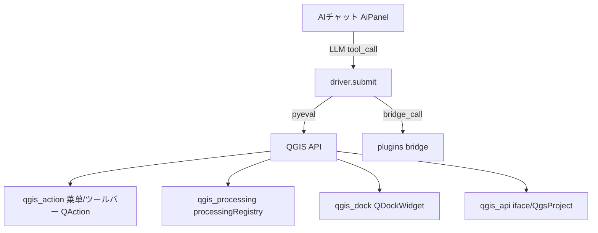

# QGIS 本体 — AI操作対象 ロジックシート

- 生成: 2026-11-14T04:24:13+09:00
- 機能数: 1240 qgis_action=722/ qgis_processing=469/ qgis_dock=21/ qgis_api=28

## トポロジ

## カテゴリ別機能一覧

### qgis_action (722件)

| id | name | check | result |
|---|---|---|---|
| `qgis.action.mActionNewProject` | 新規(N) | manual_only | skip |
| `qgis.action.mActionOpenProject` | 開く(O)... | manual_only | skip |
| `qgis.action.SampleProjectFile_Q_sample_projects_Samp` | SampleProjectFile (Q:\sample_projects\SampleProjectFile.qgs) | manual_only | skip |
| `qgis.action.ProjectFile_Q_ProjectFiles_ProjectFile.q` | ProjectFile (Q:\ProjectFiles\ProjectFile.qgs) | manual_only | skip |
| `qgis.action.ProjectFile_C_qgis_launcher_ProjectFiles` | ProjectFile (C:\qgis_launcher\ProjectFiles\ProjectFile.qgs) | manual_only | skip |
| `qgis.action.ProjectFile2_Q_ProjectFiles_ProjectFile2` | ProjectFile2 (Q:\ProjectFiles\ProjectFile2.qgs) | manual_only | skip |
| `qgis.action.ProjectFile_C_github_yr-qgis-portable-la` | ProjectFile (C:\github\yr-qgis-portable-launcher2\QGIS_portable\ProjectFiles\ProjectFile.qgs) | manual_only | skip |
| `qgis.action.ProjectFile_C_QGIS_portable_ProjectFiles` | ProjectFile (C:\QGIS_portable\ProjectFiles\ProjectFile.qgs) | manual_only | skip |
| `qgis.action.ProjectFile_C_Users_ryu_Box_QGIS_portabl` | ProjectFile (C:\Users\ryu\Box\QGIS_portable\ProjectFiles\ProjectFile.qgs) | manual_only | skip |
| `qgis.action.ProjectFile_C_QGIS_portable2_ProjectFile` | ProjectFile (C:\QGIS_portable2\ProjectFiles\ProjectFile.qgs) | manual_only | skip |
| `qgis.action.ProjectFile_C_Users_ryu_OneDrive_E_EQGIS` | ProjectFile (C:\Users\ryu\OneDrive\チE��クトッチEQGIS_portable\ProjectFiles\ProjectFile.qgs) | manual_only | skip |
| `qgis.action.NewProjectFile_C_QGIS_portable_ProjectFi` | NewProjectFile (C:\QGIS_portable\ProjectFiles\NewProjectFile.qgs) | manual_only | skip |
| `qgis.action.NewProjectFile_C_QGIS_E_ProjectFiles_New` | NewProjectFile (C:\QGIS配币E��\ProjectFiles\NewProjectFile.qgs) | manual_only | skip |
| `qgis.action.NewProjectFile_C_QGIS_ProjectFiles_NewPr` | NewProjectFile (C:\QGIS\ProjectFiles\NewProjectFile.qgs) | manual_only | skip |
| `qgis.action.Clear_List` | Clear List | manual_only | skip |
| `qgis.action.mActionCloseProject` | 閉じる | manual_only | skip |
| `qgis.action.mActionSaveProject` | ファイルに保存(S) | manual_only | skip |
| `qgis.action.mActionSaveProjectAs` | 名前をつけて保存(A)... | manual_only | skip |
| `qgis.action.mActionRevertProject` | 元に戻す... | manual_only | skip |
| `qgis.action.mActionProjectProperties` | プロパティ(P)... | exists_only | pass |
| `qgis.action.mActionSnappingOptions` | スナップオプション(S)... | manual_only | skip |
| `qgis.action.mActionSaveMapAsImage` | 地図を画像にエクスポート(I)... | manual_only | skip |
| `qgis.action.mActionSaveMapAsPdf` | 地図をPDFにエクスポート(P)... | manual_only | skip |
| `qgis.action.mActionDxfExport` | プロジェクトをDXFにエクスポート... | manual_only | skip |
| `qgis.action.mActionDwgImport` | DWG/DXFからレイヤをインポート... | manual_only | skip |
| `qgis.action.mActionNewPrintLayout` | 新規印刷レイアウト(P)... | manual_only | skip |
| `qgis.action.mActionNewReport` | 新規レポート(R)... | manual_only | skip |
| `qgis.action.mActionShowLayoutManager` | レイアウトマネージャ... | exists_only | pass |
| `qgis.action.mActionExit` | QGISを終了 | manual_only | skip |
| `qgis.action.mActionUndo` | 元に戻す(U) | exists_only | pass |
| `qgis.action.mActionRedo` | やり直す(R) | exists_only | pass |
| `qgis.action.mActionCutFeatures` | 地物を切り取り | exists_only | pass |
| `qgis.action.mActionCopyFeatures` | 地物をコピー | action_trigger | pass |
| `qgis.action.mActionPasteFeatures` | 地物を貼り付け | exists_only | pass |
| `qgis.action.mActionPasteAsNewVector` | 新規ベクタレイヤ... | manual_only | skip |
| `qgis.action.mActionPasteAsNewMemoryVector` | 一時スクラッチレイヤ... | manual_only | skip |
| `qgis.action.mActionDeleteSelected` | 選択した地物を削除 | manual_only | skip |
| `qgis.action.mActionSelectFeatures` | 地物を選択 | action_trigger | pass |
| `qgis.action.mActionSelectPolygon` | ポリゴンによる地物選択 | action_trigger | pass |
| `qgis.action.mActionSelectFreehand` | フリーハンドによる地物選択 | action_trigger | pass |
| `qgis.action.mActionSelectRadius` | 円による地物選択 | action_trigger | pass |
| `qgis.action.mActionSelectByForm` | 値による地物選択... | action_trigger | pass |
| `qgis.action.mActionSelectByExpression` | 式による地物選択... | action_trigger | pass |
| `qgis.action.mActionDeselectAll` | 全レイヤの選択を解除 | action_trigger | pass |
| `qgis.action.mActionDeselectActiveLayer` | アクティブレイヤの選択を解除 | action_trigger | pass |
| `qgis.action.mActionReselect` | 地物を再選択 | exists_only | pass |
| `qgis.action.mActionSelectAll` | すべての地物を選択 | action_trigger | pass |
| `qgis.action.mActionInvertSelection` | 地物選択を反転 | exists_only | pass |
| `qgis.action.mActionAddFeature` | 点地物を追加する | action_trigger | pass |
| `qgis.action.mActionFormAnnotation` | 注記フォーム | action_trigger | pass |
| `qgis.action.mActionHtmlAnnotation` | HTML注記 | action_trigger | pass |
| `qgis.action.mActionMultiEditAttributes` | 選択地物の属性変更 | exists_only | pass |
| `qgis.action.mActionMergeFeatureAttributes` | 選択地物の属性結合 | action_trigger | pass |
| `qgis.action.mActionMoveFeature` | 地物を移動 | action_trigger | pass |
| `qgis.action.mActionMoveFeatureCopy` | 地物をコピー/移動 | action_trigger | pass |
| `qgis.action.mActionFeatureArray` | Copy Features in an Array | action_trigger | pass |
| `qgis.action.mActionRotateFeature` | 地物を回転 | manual_only | skip |
| `qgis.action.mActionScaleFeature` | 地物をスケール | manual_only | skip |
| `qgis.action.mActionSimplifyFeature` | 地物を簡素化 | action_trigger | pass |
| `qgis.action.mActionAddRing` | リングを追加 | action_trigger | pass |
| `qgis.action.mActionAddPart` | 部分を追加 | action_trigger | pass |
| `qgis.action.mActionFillRing` | リングを充填 | action_trigger | pass |
| `qgis.action.mActionDeleteRing` | リングを削除 | manual_only | skip |
| `qgis.action.mActionDeletePart` | パートを削除 | manual_only | skip |
| `qgis.action.mActionReshapeFeatures` | 地物を変形 | action_trigger | pass |
| `qgis.action.mActionOffsetCurve` | 曲線をオフセット | action_trigger | pass |
| `qgis.action.mActionChamferFillet` | Add Chamfer / Fillet | action_trigger | pass |
| `qgis.action.mActionSplitFeatures` | 地物を分割 | action_trigger | pass |
| `qgis.action.mActionSplitParts` | パートを分割 | action_trigger | skip |
| `qgis.action.mActionMergeFeatures` | 選択地物を結合 | action_trigger | pass |
| `qgis.action.mActionVertexTool` | 頂点ツール(V) - 全レイヤ | action_trigger | pass |
| `qgis.action.mActionReverseLine` | 線の向きを反転 | action_trigger | pass |
| `qgis.action.mActionTrimExtendFeature` | 地物をトリム/延長 | action_trigger | pass |
| `qgis.action.mActionRotatePointSymbols` | 点のシンボルを回転 | action_trigger | skip |
| `qgis.action.mActionOffsetPointSymbol` | 点のシンボルをオフセット | action_trigger | skip |
| `qgis.action.mActionNewMapCanvas` | 新規マップビュー(M) | manual_only | skip |
| `qgis.action.mActionNew3DMapCanvas` | 新規3Dマップビュー | manual_only | skip |
| `qgis.action.mActionNew3DMapCanvasGlobe` | New 3D Globe View | exists_only | pass |
| `qgis.action.mActionManage3DMapViews` | Manage 3D Map Views… | exists_only | pass |
| `qgis.action.mActionPan` | 地図を移動 | action_trigger | pass |
| `qgis.action.mActionPanToSelected` | 選択部分にパン | action_trigger | pass |
| `qgis.action.mActionZoomIn` | 拡大 | action_trigger | pass |
| `qgis.action.mActionZoomOut` | 縮小 | action_trigger | pass |
| `qgis.action.mActionTemporalController` | 時系列コントローラ | action_trigger | pass |
| `qgis.action.mActionElevationController` | Elevation Controller | action_trigger | pass |
| `qgis.action.mActionIdentify` | 地物情報を表示 | action_trigger | pass |
| `qgis.action.mActionMeasure` | 線の長さを測る | action_trigger | pass |
| `qgis.action.mActionMeasureArea` | 面積を測る | action_trigger | pass |
| `qgis.action.mActionMeasureBearing` | 方位を測る | action_trigger | pass |
| `qgis.action.mActionMeasureAngle` | 角度を測る | action_trigger | pass |
| `qgis.action.mActionStatisticalSummary` | 統計サマリー | action_trigger | pass |
| `qgis.action.mActionZoomFullExtent` | 全域表示(F) | exists_only | pass |
| `qgis.action.mActionZoomToSelected` | 選択部分にズーム(S) | action_trigger | pass |
| `qgis.action.mActionZoomToLayers` | レイヤの領域にズーム(L) | action_trigger | pass |
| `qgis.action.mActionZoomActualSize` | ネイティブ解像度にズーム（100%） | exists_only | pass |
| `qgis.action.mActionZoomLast` | 前の領域へズーム | action_trigger | pass |
| `qgis.action.mActionZoomNext` | 次の表示領域にズーム | action_trigger | pass |
| `qgis.action.mActionDecorationGrid` | グリッド(G)... | manual_only | skip |
| `qgis.action.mActionDecorationScaleBar` | スケールバー(S)... | manual_only | skip |
| `qgis.action.mActionDecorationImage` | 画像(I)... | manual_only | skip |
| `qgis.action.mActionDecorationNorthArrow` | 方位記号(N)... | manual_only | skip |
| `qgis.action.mActionDecorationTitle` | タイトルラベル(T)... | manual_only | skip |
| `qgis.action.mActionDecorationCopyright` | 著作権ラベル(C)... | manual_only | skip |
| `qgis.action.mActionDecorationLayoutExtent` | レイアウト範囲(L)... | manual_only | skip |
| `qgis.action.mActionPreviewModeOff` | 通常（Normal） | action_trigger | pass |
| `qgis.action.mActionPreviewModeMono` | モノクロシミュレート（Monochrome） | action_trigger | pass |
| `qgis.action.mActionPreviewModeGrayscale` | 全色盲シミュレート（Achromatopsia） | action_trigger | pass |
| `qgis.action.mActionPreviewProtanope` | 赤色盲シミュレート（Protanope） | action_trigger | pass |
| `qgis.action.mActionPreviewDeuteranope` | 緑色盲シミュレート（Deuteranope） | action_trigger | pass |
| `qgis.action.mActionPreviewTritanope` | 黄青盲色シミュレート（Tritanopia） | action_trigger | pass |
| `qgis.action.mActionMapTips` | 地図のTipsを表示 | action_trigger | pass |
| `qgis.action.mActionNewBookmark` | 新規空間ブックマーク... | manual_only | skip |
| `qgis.action.mActionShowBookmarks` | 空間ブックマークを表示 | exists_only | pass |
| `qgis.action.mActionShowBookmarkManager` | 空間ブックマーク・マネージャを表示 | action_trigger | pass |
| `qgis.action.mActionDraw` | 再読み込み | exists_only | pass |
| `qgis.action.mActionShowAllLayers` | すべてのレイヤを表示 | exists_only | pass |
| `qgis.action.mActionHideAllLayers` | すべてのレイヤを隠す | exists_only | pass |
| `qgis.action.mActionShowSelectedLayers` | 選択レイヤを表示 | exists_only | pass |
| `qgis.action.mActionHideSelectedLayers` | 選択レイヤを隠す | exists_only | pass |
| `qgis.action.mActionToggleSelectedLayers` | 選択レイヤを切り替え | exists_only | pass |
| `qgis.action.mActionToggleSelectedLayersIndependently` | 選択レイヤを個別切り替え | exists_only | pass |
| `qgis.action.mActionHideDeselectedLayers` | 選択されてないレイヤを隠す | exists_only | pass |
| `qgis.action.AI` | AI アシスタント | action_trigger | pass |
| `qgis.action.GPS` | GPS情報 | action_trigger | pass |
| `qgis.action.noname` | タイルスケール | action_trigger | pass |
| `qgis.action.noname` | デバッグ開発ツール | action_trigger | pass |
| `qgis.action.noname` | ブラウザ | action_trigger | pass |
| `qgis.action.2` | ブラウザ | action_trigger | pass |
| `qgis.action.noname` | プロセシングツールボックス | action_trigger | pass |
| `qgis.action.noname` | レイヤ | action_trigger | pass |
| `qgis.action.noname` | レイヤスタイル | action_trigger | pass |
| `qgis.action.noname` | レイヤ順序 | action_trigger | pass |
| `qgis.action.noname` | ログメッセージ | action_trigger | pass |
| `qgis.action.noname` | 空間ブックマークマネージャ | action_trigger | pass |
| `qgis.action.noname` | 結果ビューア | action_trigger | pass |
| `qgis.action.noname` | 元に戻す/やり直す | action_trigger | pass |
| `qgis.action.noname` | 高度なデジタイズ | action_trigger | pass |
| `qgis.action.noname` | 時系列コントローラ | action_trigger | pass |
| `qgis.action.noname` | 全体図 | action_trigger | pass |
| `qgis.action.noname` | 頂点エディタ | action_trigger | pass |
| `qgis.action.noname` | 統計 | action_trigger | pass |
| `qgis.action.noname` | レポート | action_trigger | pass |
| `qgis.action.WebView` | WebView | action_trigger | pass |
| `qgis.action.mActionToggleWebToolBar` | Webツールバー | action_trigger | pass |
| `qgis.action.mActionToggleShapeDigitizeToolBar` | シェープデジタイジングツールバー | action_trigger | pass |
| `qgis.action.mActionToggleSnappingToolBar` | スナップツールバー | action_trigger | pass |
| `qgis.action.mActionToggleDataSourceManagerToolBar` | データソースマネージャツールバー | manual_only | skip |
| `qgis.action.mActionToggleDatabaseToolBar` | データベースツールバー | action_trigger | pass |
| `qgis.action.mActionToggleDigitizeToolBar` | デジタイジングツールバー | action_trigger | pass |
| `qgis.action.mActionToggleMapNavToolBar` | ナビゲーションツールバー | action_trigger | pass |
| `qgis.action.mActionTogglePluginToolBar` | プラグインツールバー | action_trigger | pass |
| `qgis.action.mActionToggleFileToolBar` | プロジェクトツールバー | action_trigger | pass |
| `qgis.action.mActionToggleVectorToolBar` | ベクタツールバー | action_trigger | pass |
| `qgis.action.mActionToggleHelpToolBar` | ヘルプツールバー | action_trigger | pass |
| `qgis.action.mActionToggleMeshToolBar` | メッシュデジタイジングツールバー | action_trigger | pass |
| `qgis.action.mActionToggleRasterToolBar` | ラスタツールバー | action_trigger | pass |
| `qgis.action.mActionToggleLabelToolBar` | ラベルツールバー | action_trigger | pass |
| `qgis.action.mActionToggleLayerToolBar` | レイヤ管理ツールバー | action_trigger | pass |
| `qgis.action.mActionToggleAdvancedDigitizeToolBar` | 高度なデジタイズツールバー | action_trigger | pass |
| `qgis.action.mActionToggleSelectionToolBar` | 選択ツールバー | action_trigger | pass |
| `qgis.action.mActionToggleAttributesToolBar` | 属性ツールバー | action_trigger | pass |
| `qgis.action.mActionToggleAnnotationsToolBar` | 注記ツールバー | action_trigger | pass |
| `qgis.action.GPS_Toolbar` | GPS Toolbar | action_trigger | pass |
| `qgis.action.GeoSuite` | GeoSuite | action_trigger | pass |
| `qgis.action.QFieldSync` | QFieldSyncツールバー | action_trigger | pass |
| `qgis.action.Search_Layers_Toolbar` | Search Layers Toolbar | action_trigger | pass |
| `qgis.action.mActionToggleFullScreen` | フルスクリーンモード切り替え(E) | exists_only | pass |
| `qgis.action.mActionTogglePanelsVisibility` | パネル表示を切り替え(V) | exists_only | pass |
| `qgis.action.mActionToggleMapOnly` | 地図のみ表示切り替え | exists_only | pass |
| `qgis.action.mActionDataSourceManager` | データソースマネージャ(D) | manual_only | skip |
| `qgis.action.mActionNewGeoPackageLayer` | 新規GeoPackageレイヤ... | manual_only | skip |
| `qgis.action.mActionNewVectorLayer` | 新規シェープファイルレイヤ... | manual_only | skip |
| `qgis.action.mActionNewSpatiaLiteLayer` | 新規SpatiaLiteレイヤ... | manual_only | skip |
| `qgis.action.mActionNewMemoryLayer` | 新規一時スクラッチレイヤ... | manual_only | skip |
| `qgis.action.mActionNewMeshLayer` | 新規メッシュレイヤ... | manual_only | skip |
| `qgis.action.mActionNewGpxLayer` | 新規GPXレイヤ... | manual_only | skip |
| `qgis.action.mActionNewVirtualLayer` | 新規仮想レイヤ... | manual_only | skip |
| `qgis.action.mActionAddOgrLayer` | ベクタレイヤを追加... | exists_only | pass |
| `qgis.action.mActionAddRasterLayer` | ラスタレイヤを追加... | exists_only | pass |
| `qgis.action.mActionAddMeshLayer` | メッシュレイヤを追加... | exists_only | pass |
| `qgis.action.mActionAddDelimitedText` | CSVテキストレイヤを追加... | exists_only | pass |
| `qgis.action.mActionAddPgLayer` | Add PostgreSQL Layer… | exists_only | pass |
| `qgis.action.mActionAddSpatiaLiteLayer` | SpatiaLiteレイヤを追加... | exists_only | pass |
| `qgis.action.mActionAddMssqlLayer` | MS SQLサーバーレイヤを追加... | exists_only | pass |
| `qgis.action.mActionAddOracleLayer` | Oracle Spatialレイヤを追加... | exists_only | pass |
| `qgis.action.mActionAddHanaLayer` | SAP HANA空間レイヤを追加... | exists_only | pass |
| `qgis.action.mActionAddVirtualLayer` | 仮想レイヤを追加/編集... | exists_only | pass |
| `qgis.action.mActionAddWmsLayer` | WMS/WMTSを追加... | exists_only | pass |
| `qgis.action.mActionAddXyzLayer` | XYZレイヤを追加... | exists_only | pass |
| `qgis.action.mActionAddLayerSeparator` | More Add Layer actions here | exists_only | pass |
| `qgis.action.mActionAddWcsLayer` | WCSレイヤを追加... | exists_only | pass |
| `qgis.action.mActionAddWfsLayer` | Add WFS / OGC API - Features Layer… | exists_only | pass |
| `qgis.action.mActionAddAfsLayer` | ArcGIS REST Serverレイヤを追加... | exists_only | pass |
| `qgis.action.mActionAddVectorTileLayer` | ベクタタイルレイヤを追加... | exists_only | pass |
| `qgis.action.mActionAddPointCloudLayer` | 点群レイヤを追加... | exists_only | pass |
| `qgis.action.mActionAddGpsLayer` | Add GPX Layer... | exists_only | pass |
| `qgis.action.mActionAddStacLayer` | Add Layer from STAC Catalog… | exists_only | pass |
| `qgis.action.mActionEmbedLayers` | レイヤとグループを埋め込む... | manual_only | skip |
| `qgis.action.mActionAddLayerDefinition` | レイヤ定義ファイルから追加... | exists_only | pass |
| `qgis.action.mActionShowGeoreferencer` | ジオリファレンサ... | exists_only | pass |
| `qgis.action.mActionCopyStyle` | スタイルをコピー | exists_only | pass |
| `qgis.action.mActionPasteStyle` | スタイルを貼り付け | exists_only | pass |
| `qgis.action.mActionCopyLayer` | レイヤをコピー | exists_only | pass |
| `qgis.action.mActionPasteLayer` | レイヤ/グループを貼り付け | exists_only | pass |
| `qgis.action.mActionOpenTable` | 属性テーブルを開く(A) | manual_only | skip |
| `qgis.action.mActionOpenTableSelected` | 属性テーブルを開く（選択地物） | manual_only | skip |
| `qgis.action.mActionOpenTableVisible` | 属性テーブルを開く（可視地物） | manual_only | skip |
| `qgis.action.mActionOpenTableEdited` | 属性テーブルを開く（編集済み地物） | manual_only | skip |
| `qgis.action.mActionToggleEditing` | 編集モードを切り替え(E) | action_trigger | pass |
| `qgis.action.mActionSaveLayerEdits` | レイヤ編集内容を保存 | manual_only | skip |
| `qgis.action.mActionSaveEdits` | 選択レイヤを保存 | manual_only | skip |
| `qgis.action.mActionRollbackEdits` | 選択レイヤをロールバック | exists_only | pass |
| `qgis.action.mActionCancelEdits` | 選択レイヤの編集キャンセル | exists_only | pass |
| `qgis.action.mActionSaveAllEdits` | 全レイヤを保存 | manual_only | skip |
| `qgis.action.mActionRollbackAllEdits` | 全レイヤをロールバック | exists_only | pass |
| `qgis.action.mActionCancelAllEdits` | 全レイヤ編集キャンセル | exists_only | pass |
| `qgis.action.mActionLayerSaveAs` | 名前をつけて保存(S)... | manual_only | skip |
| `qgis.action.mActionSaveLayerDefinition` | レイヤ定義ファイルとして保存... | manual_only | skip |
| `qgis.action.mActionRemoveLayer` | レイヤ/グループを削除 | manual_only | skip |
| `qgis.action.mActionDuplicateLayer` | レイヤを複製 | exists_only | pass |
| `qgis.action.mActionSetLayerScaleVisibility` | レイヤを表示するスケールを設定 | manual_only | skip |
| `qgis.action.mActionSetLayerCRS` | レイヤのCRSを設定 | manual_only | skip |
| `qgis.action.mActionSetProjectCRSFromLayer` | レイヤのCRSをプロジェクトに設定 | manual_only | skip |
| `qgis.action.mActionLayerProperties` | レイヤのプロパティ(P)... | exists_only | pass |
| `qgis.action.mActionLayerSubsetString` | フィルタ... | exists_only | pass |
| `qgis.action.mActionLabeling` | ラベル | manual_only | skip |
| `qgis.action.mActionAddToOverview` | 全体図に表示 | exists_only | pass |
| `qgis.action.mActionAddAllToOverview` | 全体図にすべて表示 | exists_only | pass |
| `qgis.action.mActionRemoveAllFromOverview` | 全体図からすべて隠す | manual_only | skip |
| `qgis.action.mActionProfile_geo_custom` | geo_custom | action_trigger | pass |
| `qgis.action.mActionOpenActiveProfileFolder` | アクティブなプロファイルフォルダを開く | manual_only | skip |
| `qgis.action.mActionNewProfile` | 新規プロファイル... | manual_only | skip |
| `qgis.action.mActionStyleManager` | スタイルマネージャ... | exists_only | pass |
| `qgis.action.mActionCustomProjection` | カスタム投影法... | exists_only | pass |
| `qgis.action.mActionConfigureShortcuts` | キーボードショートカット... | exists_only | pass |
| `qgis.action.mActionCustomization` | インタフェースのカスタマイズ... | exists_only | pass |
| `qgis.action.mActionOptions` | オプション(O)... | manual_only | skip |
| `qgis.action.mActionManagePlugins` | プラグインの管理とインストール... | manual_only | skip |
| `qgis.action.mActionShowPythonDialog` | Pythonコンソール | manual_only | skip |
| `qgis.action....` | 設定... | manual_only | pass |
| `qgis.action.geo_import` | geo_import | manual_only | skip |
| `qgis.action.geo_import` | geo_import 設定 | manual_only | skip |
| `qgis.action.Kasugai_QGIS_Launcher` | Kasugai QGIS Launcher | exists_only | pass |
| `qgis.action.noname` | ランチャーを開く | manual_only | pass |
| `qgis.action....` | 設定... | manual_only | pass |
| `qgis.action.noname` | レイアウト選択 | exists_only | pass |
| `qgis.action....` | ユーザー関数ライブラリ... | exists_only | pass |
| `qgis.action.noname` | 一覧帳票を出力 (アクティブレイヤ) | exists_only | pass |
| `qgis.action.noname` | 単票を出力 (選択地物) | exists_only | pass |
| `qgis.action.noname` | 単票を一括出力 (選択地物または全地物) | exists_only | pass |
| `qgis.action.geo_webview` | geo_webview | exists_only | pass |
| `qgis.action.noname` | プロジェクトのコンフィグ | exists_only | pass |
| `qgis.action.noname` | ヘルプ | exists_only | pass |
| `qgis.action.QFieldCloud` | QFieldCloudプロジェクト一覧 | exists_only | pass |
| `qgis.action.noname` | 現在のクラウドプロジェクトを同期する | exists_only | pass |
| `qgis.action.QField` | QFieldパッケージを作成 | exists_only | pass |
| `qgis.action.QField` | QFieldから同期 | exists_only | pass |
| `qgis.action.noname` | 現在のプロジェクトの構成 | exists_only | pass |
| `qgis.action.noname` | 設定 | manual_only | pass |
| `qgis.action.AI` | AI アシスタント | exists_only | pass |
| `qgis.action.localhost` | リモート制御 (localhostのみ) | manual_only | skip |
| `qgis.action.noname` | 接続情報 | exists_only | pass |
| `qgis.action.noname` | 配置モード | exists_only | pass |
| `qgis.action.searchLayers` | Search Layers | exists_only | pass |
| `qgis.action.searchLayersHelp` | Help | exists_only | pass |
| `qgis.action.StreetView` | StreetView | exists_only | pass |
| `qgis.action.noname` | 凡例 | exists_only | pass |
| `qgis.action.geo_search` | 地図検索 | exists_only | pass |
| `qgis.action.mProcessingUserMenu_native_basicstatisticsforfields` | Basic statistics for fields... | exists_only | pass |
| `qgis.action.mProcessingUserMenu_native_countpointsinpolygon` | ポリゴン内の点の数... | exists_only | pass |
| `qgis.action.mProcessingUserMenu_native_lineintersections` | 線の交差（intersect）... | exists_only | pass |
| `qgis.action.mProcessingUserMenu_native_listuniquevalues` | List unique values... | exists_only | pass |
| `qgis.action.mProcessingUserMenu_native_meancoordinates` | 加重平均座標（重心の平均）... | exists_only | pass |
| `qgis.action.mProcessingUserMenu_native_nearestneighbouranalysis` | 最近傍解析... | manual_only | skip |
| `qgis.action.mProcessingUserMenu_native_sumlinelengths` | 線長の合計... | exists_only | pass |
| `qgis.action.mProcessingUserMenu_qgis_distancematrix` | 距離行列（distance matrix）... | exists_only | pass |
| `qgis.action.mProcessingUserMenu_native_buffer` | バッファ（buffer）... | exists_only | pass |
| `qgis.action.mProcessingUserMenu_native_clip` | 切り抜く（clip）... | exists_only | pass |
| `qgis.action.mProcessingUserMenu_native_convexhull` | 凸包（convex hull）... | exists_only | pass |
| `qgis.action.mProcessingUserMenu_native_difference` | 差分（difference）... | exists_only | pass |
| `qgis.action.mProcessingUserMenu_native_dissolve` | 融合（dissolve）... | exists_only | pass |
| `qgis.action.mProcessingUserMenu_native_intersection` | 交差（intersect）... | exists_only | pass |
| `qgis.action.mProcessingUserMenu_native_symmetricaldifference` | 対称差（symmetrical difference）... | exists_only | pass |
| `qgis.action.mProcessingUserMenu_native_union` | 和集合（union）... | exists_only | pass |
| `qgis.action.mProcessingUserMenu_qgis_eliminateselectedpolygons` | 選択地物の隣接ポリゴンを融合（eliminate）... | exists_only | pass |
| `qgis.action.mProcessingUserMenu_native_centroids` | 重心... | exists_only | pass |
| `qgis.action.mProcessingUserMenu_native_checkvalidity` | Check validity... | exists_only | pass |
| `qgis.action.mProcessingUserMenu_native_collect` | シングルパートをマルチパートに集約... | exists_only | pass |
| `qgis.action.mProcessingUserMenu_native_delaunaytriangulation` | ドロネー三角分割... | exists_only | pass |
| `qgis.action.mProcessingUserMenu_native_densifygeometries` | 頂点を高密度化（個数ベース）... | exists_only | pass |
| `qgis.action.mProcessingUserMenu_native_exportaddgeometrycolumns` | Add geometry attributes... | manual_only | skip |
| `qgis.action.mProcessingUserMenu_native_extractvertices` | 頂点を抽出... | exists_only | pass |
| `qgis.action.mProcessingUserMenu_native_multiparttosingleparts` | マルチパートをシングルパートに変換... | exists_only | pass |
| `qgis.action.mProcessingUserMenu_native_polygonstolines` | ポリゴンを線に変換... | exists_only | pass |
| `qgis.action.mProcessingUserMenu_native_simplifygeometries` | 簡素化... | exists_only | pass |
| `qgis.action.mProcessingUserMenu_native_voronoipolygons` | Voronoi polygons... | exists_only | pass |
| `qgis.action.mProcessingUserMenu_qgis_linestopolygons` | 線をポリゴンに変換（lines to polygons）... | exists_only | pass |
| `qgis.action.mProcessingUserMenu_native_creategrid` | グリッドを作成... | exists_only | pass |
| `qgis.action.mProcessingUserMenu_native_polygonfromlayerextent` | レイヤ範囲を抽出... | exists_only | pass |
| `qgis.action.mProcessingUserMenu_native_randompointsinextent` | 指定範囲にランダム点群... | exists_only | pass |
| `qgis.action.mProcessingUserMenu_native_randompointsinpolygons` | ポリゴン内部にランダム点群（in）... | exists_only | pass |
| `qgis.action.mProcessingUserMenu_native_randompointsonlines` | 線の上のランダム点群... | exists_only | pass |
| `qgis.action.mProcessingUserMenu_native_randomselection` | Random selection... | exists_only | pass |
| `qgis.action.mProcessingUserMenu_native_selectbylocation` | 場所による選択... | exists_only | pass |
| `qgis.action.mProcessingUserMenu_native_selectwithindistance` | 一定距離以内の地物を選択... | exists_only | pass |
| `qgis.action.mProcessingUserMenu_qgis_randompointsinlayerbounds` | レイヤ領域にランダム点群... | exists_only | pass |
| `qgis.action.mProcessingUserMenu_qgis_randompointsinsidepolygons` | ポリゴン内部にランダム点群（inside）... | exists_only | pass |
| `qgis.action.mProcessingUserMenu_qgis_randomselectionwithinsubsets` | 地物のグループ別ランダム選択... | exists_only | pass |
| `qgis.action.mProcessingUserMenu_qgis_regularpoints` | 規則的点群（regular points）... | exists_only | pass |
| `qgis.action.mProcessingUserMenu_native_createspatialindex` | 空間インデックスを作成... | exists_only | pass |
| `qgis.action.mProcessingUserMenu_native_joinattributesbylocation` | 属性の空間結合... | exists_only | pass |
| `qgis.action.mProcessingUserMenu_native_mergevectorlayers` | ベクタレイヤをマージ... | exists_only | pass |
| `qgis.action.mProcessingUserMenu_native_reprojectlayer` | ベクタレイヤを再投影... | exists_only | pass |
| `qgis.action.mProcessingUserMenu_native_splitvectorlayer` | 属性でレイヤを分割... | exists_only | pass |
| `qgis.action.mActionShowRasterCalculator` | ラスタ計算機... | exists_only | pass |
| `qgis.action.mProcessingUserMenu_gdal_aspect` | 傾斜方位（aspect）... | exists_only | pass |
| `qgis.action.mProcessingUserMenu_gdal_fillnodata` | Fill NoData... | exists_only | pass |
| `qgis.action.mProcessingUserMenu_gdal_gridaverage` | グリッド（移動平均）... | exists_only | pass |
| `qgis.action.mProcessingUserMenu_gdal_griddatametrics` | グリッド（データメトリクス）... | exists_only | pass |
| `qgis.action.mProcessingUserMenu_gdal_gridinversedistance` | グリッド（累乗逆距離加重法）... | exists_only | pass |
| `qgis.action.mProcessingUserMenu_gdal_gridnearestneighbor` | グリッド（最近傍法）... | manual_only | skip |
| `qgis.action.mProcessingUserMenu_gdal_hillshade` | 陰影図（hillshade）... | exists_only | pass |
| `qgis.action.mProcessingUserMenu_gdal_nearblack` | 純黒化（near black）... | exists_only | pass |
| `qgis.action.mProcessingUserMenu_gdal_proximity` | 近接性（ラスタ距離）... | exists_only | pass |
| `qgis.action.mProcessingUserMenu_gdal_roughness` | 粗度（roughness）... | exists_only | pass |
| `qgis.action.mProcessingUserMenu_gdal_sieve` | ふるい... | exists_only | pass |
| `qgis.action.mProcessingUserMenu_gdal_slope` | 傾斜（slope）... | exists_only | pass |
| `qgis.action.mProcessingUserMenu_gdal_tpitopographicpositionindex` | TPI（Topographic Position Index）... | exists_only | pass |
| `qgis.action.mProcessingUserMenu_gdal_triterrainruggednessindex` | TRI（Terrain Ruggedness Index）... | exists_only | pass |
| `qgis.action.mProcessingUserMenu_gdal_assignprojection` | 投影法を設定... | manual_only | skip |
| `qgis.action.mProcessingUserMenu_gdal_extractprojection` | 投影法を抽出... | exists_only | pass |
| `qgis.action.mProcessingUserMenu_gdal_warpreproject` | 再投影（warp）... | exists_only | pass |
| `qgis.action.mProcessingUserMenu_gdal_buildvirtualraster` | 仮想ラスタを構築... | exists_only | pass |
| `qgis.action.mProcessingUserMenu_gdal_gdalinfo` | ラスタの情報... | exists_only | pass |
| `qgis.action.mProcessingUserMenu_gdal_merge` | 結合... | exists_only | pass |
| `qgis.action.mProcessingUserMenu_gdal_overviews` | 全体図を作成（ピラミッド）... | exists_only | pass |
| `qgis.action.mProcessingUserMenu_gdal_tileindex` | タイルインデックス... | exists_only | pass |
| `qgis.action.mProcessingUserMenu_gdal_cliprasterbyextent` | 範囲を指定してラスタを切り抜く... | exists_only | pass |
| `qgis.action.mProcessingUserMenu_gdal_cliprasterbymasklayer` | マスクレイヤでラスタを切り抜く... | exists_only | pass |
| `qgis.action.mProcessingUserMenu_gdal_contour` | 等高線... | exists_only | pass |
| `qgis.action.mProcessingUserMenu_gdal_pcttorgb` | PCTをRGBに変換... | exists_only | pass |
| `qgis.action.mProcessingUserMenu_gdal_polygonize` | ラスタをベクタ化（polygonize）... | exists_only | pass |
| `qgis.action.mProcessingUserMenu_gdal_rasterize` | ラスタライズ（ベクタをラスタ化）... | exists_only | pass |
| `qgis.action.mProcessingUserMenu_gdal_rgbtopct` | RGBをPCTに変換... | exists_only | pass |
| `qgis.action.mProcessingUserMenu_gdal_translate` | 形式変換（gdal_translate）... | exists_only | pass |
| `qgis.action.mProcessingUserMenu_native_alignrasters` | Align rasters... | exists_only | pass |
| `qgis.action.mActionQueryHistory` | Query History… | exists_only | pass |
| `qgis.action.dbManager` | DBマネージャ... | exists_only | pass |
| `qgis.action.action_run` | MetaSearch | exists_only | pass |
| `qgis.action.action_help` | Help | exists_only | pass |
| `qgis.action.Qgis2threejsExporterEmb` | Qgis2threejs Exporter | manual_only | skip |
| `qgis.action.Qgis2threejsExporterBrw` | Qgis2threejs Exporter (Browser Preview) | manual_only | skip |
| `qgis.action.Qgis2threejsExporterWoP` | Qgis2threejs Exporter (No Preview) | manual_only | skip |
| `qgis.action.Create_web_map` | Create web map | exists_only | pass |
| `qgis.action.mActionShowMeshCalculator` | メッシュ計算機... | exists_only | pass |
| `qgis.action.mActionReindexMesh` | 面と点を再インデックス化 | exists_only | pass |
| `qgis.action.Animate_Lines` | Animate Lines | exists_only | pass |
| `qgis.action.Animate_Location` | Animate Location | exists_only | pass |
| `qgis.action.Animate_Sequence` | Animate Sequence | exists_only | pass |
| `qgis.action.Animate_Zoom_and_Pan` | Animate Zoom and Pan | exists_only | pass |
| `qgis.action.Attributes_Join_from_CSV_File` | Attributes Join from CSV File | exists_only | pass |
| `qgis.action.Merge_Layers` | Merge Layers | exists_only | pass |
| `qgis.action.Spatial_Join` | Spatial Join | exists_only | pass |
| `qgis.action.Create_Buffers` | Create Buffers | exists_only | pass |
| `qgis.action.Create_Grid_Layer` | Create Grid Layer | exists_only | pass |
| `qgis.action.Hub_Lines_Distance` | Hub Lines / Distance | exists_only | pass |
| `qgis.action.Voronoi_Diagram` | Voronoi Diagram | exists_only | pass |
| `qgis.action.Geocode_CSV_with_Web_Service` | Geocode CSV with Web Service | exists_only | pass |
| `qgis.action.Geocode_from_Street_Layer` | Geocode from Street Layer | exists_only | pass |
| `qgis.action.Reverse_Geocode` | Reverse Geocode | exists_only | pass |
| `qgis.action.Attributes_Export_to_CSV_File` | Attributes Export to CSV File | manual_only | skip |
| `qgis.action.Geometry_Export_to_CSV_File` | Geometry Export to CSV File | manual_only | skip |
| `qgis.action.Geometry_Import_from_CSV_File` | Geometry Import from CSV File | manual_only | skip |
| `qgis.action.Google_Maps_KML_Export` | Google Maps KML Export | manual_only | skip |
| `qgis.action.Change_Projection` | Change Projection | exists_only | pass |
| `qgis.action.Convert_Geometry_Type` | Convert Geometry Type | exists_only | pass |
| `qgis.action.Delete_Duplicate_Geometries` | Delete Duplicate Geometries | manual_only | skip |
| `qgis.action.Float_to_Text` | Float to Text | exists_only | pass |
| `qgis.action.Gridify` | Gridify | exists_only | pass |
| `qgis.action.Sort` | Sort | exists_only | pass |
| `qgis.action.Text_to_Float` | Text to Float | exists_only | pass |
| `qgis.action.Search_Select` | Search / Select | exists_only | pass |
| `qgis.action.toolboxAction` | ツールボックス(T) | action_trigger | pass |
| `qgis.action.modelerAction` | Model Designer… | exists_only | pass |
| `qgis.action.historyAction` | 履歴(H)... | exists_only | pass |
| `qgis.action.resultsViewer` | 結果ビューア(R) | action_trigger | pass |
| `qgis.action.editInPlaceFeatures` | In-Place編集 | action_trigger | pass |
| `qgis.action.mActionHelpContents` | QGISヘルプ | exists_only | pass |
| `qgis.action.mActionHelpAPI` | C++ APIドキュメント | exists_only | pass |
| `qgis.action.mActionHelpPyQgisAPI` | PyQGIS APIドキュメント | exists_only | pass |
| `qgis.action.mActionReportaBug` | 問題を報告 | exists_only | pass |
| `qgis.action.mActionDonate` | QGISに寄付 | exists_only | pass |
| `qgis.action.mActionGetInvolved` | コミュニティに参加 | exists_only | pass |
| `qgis.action.mActionNeedSupport` | 有償サポートが必要ですか？ | exists_only | pass |
| `qgis.action.mActionSponsors` | QGIS維持会員 | exists_only | pass |
| `qgis.action.mActionQgisHomePage` | QGISのホームページ | exists_only | pass |
| `qgis.action.mActionCheckQgisVersion` | QGISのバージョン情報 | exists_only | pass |
| `qgis.action.mActionAbout` | QGISについて | manual_only | skip |
| `qgis.action.noname_noname` | フィルタ式を編集 | exists_only | pass |
| `qgis.action.noname_noname` | フィルタ式をクリア | exists_only | pass |
| `qgis.action.mActionAddLayers` | レイヤを追加 | exists_only | pass |
| `qgis.action.mActionRefresh` | 再読み込み | action_trigger | pass |
| `qgis.action.mActionShowFilter` | ブラウザのフィルタ | action_trigger | pass |
| `qgis.action.mActionCollapse` | すべて折りたたむ | exists_only | pass |
| `qgis.action.mActionPropertiesWidget` | プロパティを表示 | action_trigger | pass |
| `qgis.action.noname_noname` | 大・小文字を区別 | exists_only | pass |
| `qgis.action.noname_noname` | フィルタパターン文法 | exists_only | pass |
| `qgis.action.Normal` | 通常（Normal） | exists_only | pass |
| `qgis.action.noname_noname` | ワイルドカード | exists_only | pass |
| `qgis.action.noname_noname` | 正規表現 | exists_only | pass |
| `qgis.action.mFloaterAction` | Floater settings | action_trigger | skip |
| `qgis.action.mConstructionAction` | 作図 | action_trigger | skip |
| `qgis.action.mEnableAction` | mEnableAction | action_trigger | skip |
| `qgis.action.mConstructionModeAction` | mConstructionModeAction | action_trigger | skip |
| `qgis.action.mParallelAction` | mParallelAction | action_trigger | skip |
| `qgis.action.mPerpendicularAction` | mPerpendicularAction | action_trigger | skip |
| `qgis.action.mToolsAction` | mToolsAction | action_trigger | skip |
| `qgis.action.mSettingsAction` | mSettingsAction | manual_only | skip |
| `qgis.action.Snapping_Priority` | Snapping Priority | exists_only | pass |
| `qgis.action.Prioritize_Snapping_to_Features` | Prioritize Snapping to Features | exists_only | pass |
| `qgis.action.Prioritize_Snapping_to_Common_Angles` | Prioritize Snapping to Common Angles | exists_only | pass |
| `qgis.action.noname_noname` | 共通角にスナップしない | exists_only | pass |
| `qgis.action.0.1_0.2_0.3_0.4_...` | 0.1, 0.2, 0.3, 0.4°... | exists_only | pass |
| `qgis.action.0.5_1.0_1.5_2.0_...` | 0.5, 1.0, 1.5, 2.0°... | exists_only | pass |
| `qgis.action.1.0_2.0_3.0_4.0_...` | 1.0, 2.0, 3.0, 4.0°... | exists_only | pass |
| `qgis.action.5.0_10.0_15.0_20.0_...` | 5.0, 10.0, 15.0, 20.0°... | exists_only | pass |
| `qgis.action.10.0_20.0_30.0_40.0_...` | 10.0, 20.0, 30.0, 40.0°... | exists_only | pass |
| `qgis.action.15.0_30.0_45.0_60.0_...` | 15.0, 30.0, 45.0, 60.0°... | exists_only | pass |
| `qgis.action.18.0_36.0_54.0_72.0_...` | 18.0, 36.0, 54.0, 72.0°... | exists_only | pass |
| `qgis.action.22.5_45.0_67.5_90.0_...` | 22.5, 45.0, 67.5, 90.0°... | exists_only | pass |
| `qgis.action.30.0_60.0_90.0_120.0_...` | 30.0, 60.0, 90.0, 120.0°... | exists_only | pass |
| `qgis.action.45.0_90.0_135.0_180.0_...` | 45.0, 90.0, 135.0, 180.0°... | exists_only | pass |
| `qgis.action.90.0_180.0_270.0_360.0_...` | 90.0, 180.0, 270.0, 360.0°... | exists_only | pass |
| `qgis.action.Record_Construction_Guides` | Record Construction Guides | exists_only | pass |
| `qgis.action.Show_Construction_Guides` | Show Construction Guides | exists_only | pass |
| `qgis.action.Snap_to_Visible_Construction_Guides` | Snap to Visible Construction Guides | exists_only | pass |
| `qgis.action.Clear_Construction_Guides` | Clear Construction Guides | exists_only | pass |
| `qgis.action.Line_Extension` | Line Extension | exists_only | pass |
| `qgis.action.X_Y_Point` | X/Y Point | exists_only | pass |
| `qgis.action.Show_Floater` | Show Floater | exists_only | pass |
| `qgis.action.Show_Distance` | Show Distance | exists_only | pass |
| `qgis.action.Show_Angle` | Show Angle | exists_only | pass |
| `qgis.action.Show_XY_Coordinates` | Show XY Coordinates | exists_only | pass |
| `qgis.action.Show_Z_Value` | Show Z Value | exists_only | pass |
| `qgis.action.Show_M_Value` | Show M Value | exists_only | pass |
| `qgis.action.Show_Bearing_Azimuth` | Show Bearing/Azimuth | exists_only | pass |
| `qgis.action.Show_Common_Snapping_Angle` | Show Common Snapping Angle | exists_only | pass |
| `qgis.action.Show_Area` | Show Area | exists_only | pass |
| `qgis.action.Hidden` | Hidden | exists_only | pass |
| `qgis.action.Show_Ellipsoidal_Area` | Show Ellipsoidal Area | exists_only | pass |
| `qgis.action.Show_Cartesian_Area` | Show Cartesian Area | exists_only | pass |
| `qgis.action.Show_Total_Length_Perimeter` | Show Total Length/Perimeter | exists_only | pass |
| `qgis.action.Show_Ellipsoidal_Lengths` | Show Ellipsoidal Lengths | exists_only | pass |
| `qgis.action.Show_Cartesian_Lengths` | Show Cartesian Lengths | exists_only | pass |
| `qgis.action.Show_Weight` | Show Weight | exists_only | pass |
| `qgis.action.mActionZoomToLayer` | レイヤの領域にズーム(L) | action_trigger | pass |
| `qgis.action.mActionLocalHistogramStretch` | ヒストグラムを表示領域の値で引きのばす | exists_only | pass |
| `qgis.action.mActionMoveLabel` | ラベルとダイアグラム、引出し線を移動 | action_trigger | skip |
| `qgis.action.mActionRotateLabel` | ラベルを回転 | action_trigger | skip |
| `qgis.action.mActionChangeLabelProperties` | ラベルを変更 | action_trigger | skip |
| `qgis.action.mActionFullHistogramStretch` | ヒストグラムをデータセット全域の値で引きのばす | exists_only | pass |
| `qgis.action.actionActionCatchForCustomization` | mActionCatchForCustomization | exists_only | pass |
| `qgis.action.mActionFeatureAction` | 地物アクション | action_trigger | pass |
| `qgis.action.mActionPinLabels` | ラベルとダイアグラムの固定/解放 | manual_only | skip |
| `qgis.action.mActionShowPinnedLabels` | 固定されたラベル・ダイアグラム・引出し線の強調表示 | action_trigger | pass |
| `qgis.action.mActionNewBlankProject` | 新規空プロジェクト | manual_only | skip |
| `qgis.action.mActionLocalCumulativeCutStretch` | 表示範囲内でヒストグラムの累積的カットと引き伸ばし | exists_only | pass |
| `qgis.action.mActionFullCumulativeCutStretch` | レイヤ全体のヒストグラムの累積的カットと引き伸ばし | exists_only | pass |
| `qgis.action.mActionShowHideLabels` | ラベルとダイアグラムの表示非表示切り替え | action_trigger | skip |
| `qgis.action.mActionAllEdits` | 現在の編集 | exists_only | pass |
| `qgis.action.mActionIncreaseBrightness` | 明るくする | exists_only | pass |
| `qgis.action.mActionDecreaseBrightness` | 暗くする | exists_only | pass |
| `qgis.action.mActionIncreaseContrast` | コントラストを強くする | exists_only | pass |
| `qgis.action.mActionDecreaseContrast` | コントラストを弱くする | exists_only | pass |
| `qgis.action.mActionOpenFieldCalc` | フィールド計算機を開く... | manual_only | skip |
| `qgis.action.mActionDiagramProperties` | グラフのオプション | manual_only | skip |
| `qgis.action.mActionVertexToolActiveLayer` | 頂点ツール(V) - 現在のレイヤ | manual_only | skip |
| `qgis.action.mActionShowUnplacedLabels` | 未配置ラベルを表示 | action_trigger | pass |
| `qgis.action.mActionDecreaseGamma` | ガンマを小さく | exists_only | pass |
| `qgis.action.mActionIncreaseGamma` | ガンマを大きく | exists_only | pass |
| `qgis.action.mActionDigitizeWithCurve` | 曲線でデジタイズ | action_trigger | skip |
| `qgis.action.mActionStreamDigitize` | ストリーム・デジタイジング | action_trigger | skip |
| `qgis.action.mActionCreateAnnotationLayer` | 新規注記レイヤ | manual_only | skip |
| `qgis.action.mActionSelectAnnotation` | Select Annotations | action_trigger | pass |
| `qgis.action.mActionModifyAnnotation` | 注記を修正 | action_trigger | pass |
| `qgis.action.mMainAnnotationLayerProperties` | メイン注記レイヤの属性... | exists_only | pass |
| `qgis.action.mActionDigitizeWithSegment` | セグメントでデジタイズ | action_trigger | skip |
| `qgis.action.mActionDigitizeShape` | シェープをデジタイズ | action_trigger | skip |
| `qgis.action.mActionDigitizeWithBezier` | Digitize with Bézier Curve | action_trigger | skip |
| `qgis.action.mActionDigitizeWithNurbs` | Digitize with NURBS Curve | action_trigger | skip |
| `qgis.action.mActionElevationProfile` | New Elevation Profile | exists_only | pass |
| `qgis.action.mActionManageElevationProfiles` | Manage Elevation Profiles… | exists_only | pass |
| `qgis.action.J` | プロジェクト(J) | exists_only | pass |
| `qgis.action.R` | 最近のプロジェクト(R) | manual_only | skip |
| `qgis.action.noname_noname` | レイアウト | exists_only | pass |
| `qgis.action.noname_noname` | テンプレートから新規作成 | manual_only | pass |
| `qgis.action.noname_noname` | 保存 | manual_only | pass |
| `qgis.action.noname_noname` | 開く | manual_only | pass |
| `qgis.action.noname_noname` | インポートとエクスポート | manual_only | pass |
| `qgis.action.Models` | Models | exists_only | pass |
| `qgis.action.V` | ビュー(V) | exists_only | pass |
| `qgis.action.3D` | 3Dマップビュー | exists_only | pass |
| `qgis.action.noname_noname` | 計測 | exists_only | pass |
| `qgis.action.D` | 地図整飾(D) | exists_only | pass |
| `qgis.action.noname_noname` | プレビューモード | exists_only | pass |
| `qgis.action.noname_noname` | レイヤの可視性 | exists_only | pass |
| `qgis.action.Data_Filtering` | Data Filtering | exists_only | pass |
| `qgis.action.Elevation_Profiles` | Elevation Profiles | exists_only | pass |
| `qgis.action.L` | レイヤ(L) | exists_only | pass |
| `qgis.action.noname_noname` | レイヤを作成 | exists_only | pass |
| `qgis.action.noname_noname` | レイヤを追加 | exists_only | pass |
| `qgis.action.noname_noname` | 属性テーブルをフィルタ | exists_only | pass |
| `qgis.action.P` | プラグイン(P) | exists_only | pass |
| `qgis.action.H` | ヘルプ(H) | exists_only | pass |
| `qgis.action.noname_noname` | プラグイン | exists_only | pass |
| `qgis.action.S` | 設定(S) | manual_only | skip |
| `qgis.action.R_R` | ラスタ(R) | exists_only | pass |
| `qgis.action.Analysis` | Analysis | exists_only | pass |
| `qgis.action.Projections` | Projections | exists_only | pass |
| `qgis.action.Miscellaneous` | Miscellaneous | exists_only | pass |
| `qgis.action.Extraction` | Extraction | exists_only | pass |
| `qgis.action.Conversion` | Conversion | exists_only | pass |
| `qgis.action.O` | ベクタ(O) | exists_only | pass |
| `qgis.action.Analysis_Tools` | Analysis Tools | exists_only | pass |
| `qgis.action.Geoprocessing_Tools` | Geoprocessing Tools | exists_only | pass |
| `qgis.action.G_eometry_Tools` | Geometry Tools | exists_only | pass |
| `qgis.action.Research_Tools` | Research Tools | exists_only | pass |
| `qgis.action.Data_Management_Tools` | Data Management Tools | exists_only | pass |
| `qgis.action.E` | 編集(E) | exists_only | pass |
| `qgis.action.noname_noname` | 選択 | exists_only | pass |
| `qgis.action.noname_noname` | 新規レイヤに地物を貼り付け | manual_only | pass |
| `qgis.action.noname_noname` | 注記を追加 | exists_only | pass |
| `qgis.action.noname_noname` | 属性を編集 | exists_only | pass |
| `qgis.action.noname_noname` | ジオメトリを編集 | exists_only | pass |
| `qgis.action.M` | メッシュ(M) | exists_only | pass |
| `qgis.action.Database` | Database | exists_only | pass |
| `qgis.action.Web_W` | Web(W) | exists_only | pass |
| `qgis.action.C` | プロセシング(C) | exists_only | pass |
| `qgis.action.ActionNewLayer` | ActionNewLayer | exists_only | pass |
| `qgis.action.ActionAddDbLayer` | ActionAddDbLayer | exists_only | pass |
| `qgis.action.mDigitizeModeToolButton` | mDigitizeModeToolButton | exists_only | pass |
| `qgis.action.ActionVertexTool` | ActionVertexTool | exists_only | pass |
| `qgis.action.ActionMoveFeatureTool` | ActionMoveFeatureTool | exists_only | pass |
| `qgis.action.ActionPointSymbolTools` | ActionPointSymbolTools | exists_only | pass |
| `qgis.action.ActionFeatureAction` | ActionFeatureAction | exists_only | pass |
| `qgis.action.ActionOpenTable` | ActionOpenTable | exists_only | pass |
| `qgis.action.ActionMeasure` | ActionMeasure | exists_only | pass |
| `qgis.action.mModeAction` | mModeAction | exists_only | pass |
| `qgis.action.mEditAdvancedConfigAction` | mEditAdvancedConfigAction | exists_only | pass |
| `qgis.action.mTypeAction` | mTypeAction | exists_only | pass |
| `qgis.action.mToleranceAction` | mToleranceAction | exists_only | pass |
| `qgis.action.mUnitAction` | mUnitAction | exists_only | pass |
| `qgis.action.mAvoidIntersectionsModeAction` | mAvoidIntersectionsModeAction | exists_only | pass |
| `qgis.action.mSnappingWidget` | mSnappingWidget | exists_only | pass |
| `qgis.action.EnableSnappingAction` | スナップを切り替え | action_trigger | pass |
| `qgis.action.noname_noname` | 重なり禁止モードに設定 | manual_only | pass |
| `qgis.action.mAllowIntersectionsAction` | 重なりを許容 | exists_only | pass |
| `qgis.action.mAvoidIntersectionsCurrentLayerAction` | アクティブレイヤの重なりを禁止 | manual_only | skip |
| `qgis.action.mAvoidIntersectionsLayersAction` | 詳細設定に従う | manual_only | skip |
| `qgis.action.noname_noname` | スナッピングモードを設定する | manual_only | pass |
| `qgis.action.mAllLayersAction` | すべてのレイヤ | exists_only | pass |
| `qgis.action.mActiveLayerAction` | アクティブレイヤ | exists_only | pass |
| `qgis.action.mAdvancedModeAction` | 詳細構成 | exists_only | pass |
| `qgis.action.openDialogAction` | スナップオプションを開く... | manual_only | skip |
| `qgis.action.noname_noname` | 頂点 | action_trigger | pass |
| `qgis.action.noname_noname` | セグメント | action_trigger | pass |
| `qgis.action.noname_noname` | エリア | action_trigger | pass |
| `qgis.action.noname_noname` | 重心点 | action_trigger | pass |
| `qgis.action.noname_noname` | セグメントの中央 | action_trigger | pass |
| `qgis.action.noname_noname` | 線のエンドポイント | action_trigger | pass |
| `qgis.action.TopologicalEditingAction` | トポロジ編集 | action_trigger | pass |
| `qgis.action.IntersectionSnappingAction` | 交点でスナップ | action_trigger | skip |
| `qgis.action.EnableTracingAction` | トレースを有効にします | action_trigger | skip |
| `qgis.action.tracingWidgetAction` | tracingWidgetAction | exists_only | pass |
| `qgis.action.SelfSnappingAction` | 自己スナップ | action_trigger | skip |
| `qgis.action.shapeButtonAction` | shapeButtonAction | exists_only | pass |
| `qgis.action.Circular_string_by_radius` | Circular string by radius | exists_only | pass |
| `qgis.action.ActionSelection` | ActionSelection | exists_only | pass |
| `qgis.action.ActionSelect` | ActionSelect | exists_only | pass |
| `qgis.action.ActionDeselection` | ActionDeselection | exists_only | pass |
| `qgis.action.selectByToolButton` | selectByToolButton | exists_only | pass |
| `qgis.action.meshEditToolButtonAction` | meshEditToolButtonAction | exists_only | pass |
| `qgis.action.meshSelectToolButtonAction` | meshSelectToolButtonAction | exists_only | pass |
| `qgis.action.meshForceByLinesToolButton` | meshForceByLinesToolButton | exists_only | pass |
| `qgis.action.annotationLayerToolButtonAction` | annotationLayerToolButtonAction | exists_only | pass |
| `qgis.action.ActionAnnotation` | ActionAnnotation | exists_only | pass |
| `qgis.action.Count` | カウント（Count） | exists_only | pass |
| `qgis.action.Sum` | 合計（Sum） | exists_only | pass |
| `qgis.action.Mean` | 平均値（Mean） | exists_only | pass |
| `qgis.action.Median` | 中央値（Median） | exists_only | pass |
| `qgis.action.noname_noname` | 標準偏差 （母集団） | exists_only | pass |
| `qgis.action.noname_noname` | 標準偏差 （標本） | exists_only | pass |
| `qgis.action.noname_noname` | 最小 | exists_only | pass |
| `qgis.action.noname_noname` | 最大 | exists_only | pass |
| `qgis.action.Range` | 範囲（Range） | exists_only | pass |
| `qgis.action.Minority` | 最稀値（Minority） | exists_only | pass |
| `qgis.action.Majority` | 最頻値（Majority） | exists_only | pass |
| `qgis.action.Variety` | 種類（Variety） | exists_only | pass |
| `qgis.action.Q1` | 第１四分位（Q1） | exists_only | pass |
| `qgis.action.Q3` | 第３四分位（Q3） | exists_only | pass |
| `qgis.action.IQR` | 四分位範囲（IQR） | exists_only | pass |
| `qgis.action.NULL` | 欠落（NULL）値 | exists_only | pass |
| `qgis.action.noname_noname` | 選択したレイヤに従う | exists_only | pass |
| `qgis.action.noname_noname` | パネル | exists_only | pass |
| `qgis.action.noname_noname` | ツールバー | exists_only | pass |
| `qgis.action.U` | ユーザープロファイル(U) | exists_only | pass |
| `qgis.action.noname_noname` | 現在の編集 | exists_only | pass |
| `qgis.action.noname_noname` | 自動的にプロジェクトを開く | manual_only | pass |
| `qgis.action.Copy` | Copy | exists_only | pass |
| `qgis.action.noname_noname` | 頂点エディタを表示 | exists_only | pass |
| `qgis.action.noname_noname` | グループ追加 | exists_only | pass |
| `qgis.action.noname_noname` | コンテンツで凡例を絞り込む | exists_only | pass |
| `qgis.action.noname_noname` | プライベートレイヤを表示 | exists_only | pass |
| `qgis.action.Show_Broken_Layers_Only` | Show Broken Layers Only | exists_only | pass |
| `qgis.action.noname_noname` | レイヤスタイル | manual_only | pass |
| `qgis.action.noname_noname` | すべて展開する | exists_only | pass |
| `qgis.action.noname_noname` | すべて折りたたむ | exists_only | pass |
| `qgis.action.noname_noname` | ジオメトリ検証 | exists_only | pass |
| `qgis.action.noname_noname` | 名前で並べ替え | exists_only | pass |
| `qgis.action.noname_noname` | ダウンロード数で並べ替え | exists_only | pass |
| `qgis.action.noname_noname` | 投票数で並べ替え | exists_only | pass |
| `qgis.action.noname_noname` | 状態で並べ替え | exists_only | pass |
| `qgis.action.noname_noname` | 作成日時で並べ替え | exists_only | pass |
| `qgis.action.noname_noname` | 更新日時で並べ替え | exists_only | pass |
| `qgis.action.noname_noname` | すべて閉じる | manual_only | pass |
| `qgis.action.mActionClear` | クリア | exists_only | pass |
| `qgis.action.mActionRecord` | ログを保存する | manual_only | skip |
| `qgis.action.mActionShowSuccessful` | 完了リクエストを表示 | action_trigger | pass |
| `qgis.action.mActionShowTimeouts` | タイムアウトを表示 | action_trigger | pass |
| `qgis.action.mActionSaveLog` | ログを保存... | manual_only | skip |
| `qgis.action.mActionShowCached` | キャッシュにある応答を表示 | action_trigger | pass |
| `qgis.action.mActionPyQgis` | PyQGIS API Documentation | exists_only | pass |
| `qgis.action.mActionQt` | Qt API Documentation | exists_only | pass |
| `qgis.action.mActionOpenInBrowser` | Open in Web Browser | manual_only | skip |
| `qgis.action.noname_noname` | スナップスケールモードに設定 | manual_only | pass |
| `qgis.action.noname_noname` | 無効化 | exists_only | pass |
| `qgis.action.noname_noname` | グローバル | exists_only | pass |
| `qgis.action.noname_noname` | レイヤ単位 | exists_only | pass |
| `qgis.action.noname_noname` | 全範囲に設定 | manual_only | pass |
| `qgis.action.noname_noname` | プリセットのプロジェクト範囲に設定 | manual_only | pass |
| `qgis.action.noname_noname` | 単一レイヤ範囲に設定 | manual_only | pass |
| `qgis.action.Show_Location_Marker` | Show Location Marker | exists_only | pass |
| `qgis.action.Show_Bearing_Line` | Show Bearing Line | exists_only | pass |
| `qgis.action.Rotate_Map_to_Match_GPS_Direction` | Rotate Map to Match GPS Direction | exists_only | pass |
| `qgis.action.Automatically_Add_Track_Vertices` | Automatically Add Track Vertices | exists_only | pass |
| `qgis.action.Automatically_Save_Added_Feature` | Automatically Save Added Feature | manual_only | skip |
| `qgis.action.Time_Stamp_Destination` | Time Stamp Destination | exists_only | pass |
| `qgis.action.Log_to_GeoPackage_Spatialite` | Log to GeoPackage/Spatialite… | exists_only | pass |
| `qgis.action.Log_NMEA_Sentences` | Log NMEA Sentences… | exists_only | pass |
| `qgis.action.GPS_Settings` | GPS Settings… | exists_only | pass |
| `qgis.action.mConnectAction` | Connect GPS | action_trigger | pass |
| `qgis.action.mRecenterAction` | Recenter | manual_only | skip |
| `qgis.action.mDestinationLayerButtonAction` | mDestinationLayerButtonAction | exists_only | pass |
| `qgis.action.mAddTrackVertexAction` | Add Track Vertex | exists_only | pass |
| `qgis.action.mCreateFeatureAction` | Create Point Feature at Location | exists_only | pass |
| `qgis.action.mResetFeatureAction` | Reset Track | exists_only | pass |
| `qgis.action.mShowInfoAction` | Information | action_trigger | pass |
| `qgis.action.mSettingsMenuAction` | mSettingsMenuAction | exists_only | pass |
| `qgis.action.Update_GPS_Information` | Update GPS Information | exists_only | pass |
| `qgis.action.10` | 10秒間無視する | exists_only | pass |
| `qgis.action.noname_noname` | このセッションでは無視 | exists_only | pass |
| `qgis.action.mActionPolygonAnnotation` | Polygon Annotationを作成 | action_trigger | pass |
| `qgis.action.mActionLineAnnotation` | Line Annotationを作成 | action_trigger | pass |
| `qgis.action.mActionMarkerAnnotation` | Marker Annotationを作成 | action_trigger | pass |
| `qgis.action.mActionTextAnnotationatPoint` | Text Annotation at Pointを作成 | action_trigger | pass |
| `qgis.action.mActionTextAnnotationalongLine` | Text Annotation along Lineを作成 | action_trigger | pass |
| `qgis.action.mActionTextAnnotationinRectangle` | Text Annotation in Rectangleを作成 | action_trigger | pass |
| `qgis.action.mActionPictureAnnotation` | Picture Annotationを作成 | action_trigger | pass |
| `qgis.action.QGIS_Live_Driver` | QGIS Live Driver | exists_only | pass |
| `qgis.action.noname_noname` | ホットリロード | exists_only | pass |
| `qgis.action.geo_excel` | geo_excel | exists_only | pass |
| `qgis.action.geo_import_geo_import` | geo_import | manual_only | skip |
| `qgis.action.geo_launcher` | geo_launcher | exists_only | pass |
| `qgis.action.noname_noname` | レジェンドビュー | exists_only | pass |
| `qgis.action.geo_report` | geo_report | exists_only | pass |
| `qgis.action.noname_noname` | 地図検索 | exists_only | pass |
| `qgis.action.geo_userfunc` | geo_userfunc | exists_only | pass |
| `qgis.action.geo_webview_geo_webview` | geo_webview | exists_only | pass |
| `qgis.action.Layers_menu_from_project` | Layers menu from project | exists_only | pass |
| `qgis.action.MOJXML_Loader` | MOJXML Loader | exists_only | pass |
| `qgis.action.PLATEAU_3D` | PLATEAU 3D都市モデルを読み込む | exists_only | pass |
| `qgis.action.QFieldSync_QFieldSync` | QFieldSync | exists_only | pass |
| `qgis.action.Qgis2threejsExporter` | Qgis2threejs Exporter | manual_only | skip |
| `qgis.action.Qgis2threejs` | Qgis2threejs | exists_only | pass |
| `qgis.action.qgis2web` | qgis2web | exists_only | pass |
| `qgis.action.Quick_DEM_for_JP` | Quick DEM for JP | exists_only | pass |
| `qgis.action.Search_Layers` | Search Layers | exists_only | pass |
| `qgis.action.StreetView_StreetView` | StreetView | exists_only | pass |
| `qgis.action.MetaSearch` | MetaSearch | exists_only | pass |
| `qgis.action.noname_noname` | モデル | exists_only | pass |
| `qgis.action...._...` | 新規モデルを作成... | manual_only | pass |
| `qgis.action...._...` | 既存のモデルを開く... | manual_only | pass |
| `qgis.action...._...` | ツールボックスにモデルを追加... | exists_only | pass |
| `qgis.action.noname_noname` | スクリプト | exists_only | pass |
| `qgis.action...._...` | 新規スクリプトを作成... | manual_only | pass |
| `qgis.action...._...` | テンプレートからスクリプトを作成... | exists_only | pass |
| `qgis.action...._...` | 既存のスクリプトを開く... | manual_only | pass |
| `qgis.action...._...` | ツールボックスにスクリプトを追加... | exists_only | pass |
| `qgis.action.optionsAction` | オプション | manual_only | skip |
| `qgis.action.mProcessingAlg_native_selectbylocation` | 場所による選択 | exists_only | pass |
| `qgis.action.mProcessingAlg_native_selectwithindistance` | 一定距離以内の地物を選択 | exists_only | pass |
| `qgis.action.noname_noname` | 属性テーブルを表示 | exists_only | pass |
| `qgis.action.mActionDigitizing` | メッシュ要素をデジタイズ | action_trigger | skip |
| `qgis.action.ActionMeshSelectByPolygon` | ポリゴンによるメッシュ要素選択 | action_trigger | skip |
| `qgis.action.ActionMeshSelectByExpression` | 式によるメッシュ要素選択 | exists_only | pass |
| `qgis.action.mActionSelectIsolatedVertices` | Select Isolated Vertices | action_trigger | pass |
| `qgis.action.mActionSelectAllVertices` | Select All Vertices | action_trigger | pass |
| `qgis.action.mActionTransformCoordinates` | Transform Vertices Coordinates | action_trigger | skip |
| `qgis.action.mActionForceByLines` | 選択されたジオメトリで強制 | action_trigger | skip |
| `qgis.action.mWidgetActionForceByLine` | mWidgetActionForceByLine | exists_only | pass |
| `qgis.action.mWidgetActionDigitizing` | mWidgetActionDigitizing | exists_only | pass |
| `qgis.action.mActionRemoveVerticesFillingHole` | mActionRemoveVerticesFillingHole | exists_only | pass |
| `qgis.action.mActionDelaunayTriangulation` | 選択された頂点でドロネー三角網 | exists_only | pass |
| `qgis.action.mActionFacesRefinement` | 現在の面を修正 | exists_only | pass |
| `qgis.action.mActionRemoveVerticesWithoutFillingHole` | mActionRemoveVerticesWithoutFillingHole | exists_only | pass |
| `qgis.action.mActionRemoveFaces` | 現在の面を削除 | manual_only | skip |
| `qgis.action.mActionSplitFaces` | 現在の面を分割 | exists_only | pass |
| `qgis.action.actionAdd` | 追加 | exists_only | pass |
| `qgis.action.actionDelete` | 削除 | manual_only | skip |
| `qgis.action.actionZoomTo` | ズーム | exists_only | pass |
| `qgis.action.actionExport` | Export | manual_only | skip |
| `qgis.action.actionImport` | Import | manual_only | skip |

### qgis_processing (469件)

- provider `3d` (1件)
- provider `gdal` (59件)
- provider `mojxmlloader` (1件)
- provider `native` (339件)
- provider `pdal` (24件)
- provider `plateau_plugin` (2件)
- provider `qgis` (39件)
- provider `qgis2web` (3件)
- provider `quickdemforjp` (1件)

| id | name | check | result |
|---|---|---|---|
| `qgis.proc.3d_tessellate` | テッセレーション | proc_meta | pass |
| `qgis.proc.gdal_aspect` | 傾斜方位（aspect） | proc_meta | pass |
| `qgis.proc.gdal_assignprojection` | 投影法を設定 | proc_meta | pass |
| `qgis.proc.gdal_buffervectors` | バッファを作成 | proc_meta | pass |
| `qgis.proc.gdal_buildvirtualraster` | 仮想ラスタを構築 | proc_meta | pass |
| `qgis.proc.gdal_buildvirtualvector` | 仮想レイヤを構築 | proc_meta | pass |
| `qgis.proc.gdal_cliprasterbyextent` | 範囲を指定してラスタを切り抜く | proc_meta | pass |
| `qgis.proc.gdal_cliprasterbymasklayer` | マスクレイヤでラスタを切り抜く | proc_meta | pass |
| `qgis.proc.gdal_clipvectorbyextent` | 矩形領域で切り抜く | proc_meta | pass |
| `qgis.proc.gdal_clipvectorbypolygon` | マスクレイヤで切り抜く | proc_meta | pass |
| `qgis.proc.gdal_colorrelief` | 段彩図（color relief） | proc_meta | pass |
| `qgis.proc.gdal_contour` | 等高線 | proc_meta | pass |
| `qgis.proc.gdal_contour_polygon` | 等高線ポリゴン | proc_meta | pass |
| `qgis.proc.gdal_convertformat` | 形式変換 | proc_meta | pass |
| `qgis.proc.gdal_createcog` | Create Cloud Optimized GeoTIFF | proc_meta | pass |
| `qgis.proc.gdal_dataset_identify` | Dataset identification | proc_meta | pass |
| `qgis.proc.gdal_dissolve` | 融合（dissolve） | proc_meta | pass |
| `qgis.proc.gdal_executesql` | SQLを実行 | proc_meta | pass |
| `qgis.proc.gdal_extractprojection` | 投影法を抽出 | proc_meta | pass |
| `qgis.proc.gdal_fillnodata` | Fill NoData | proc_meta | pass |
| `qgis.proc.gdal_gdal2tiles` | タイルを生成（gdal2tiles） | proc_meta | pass |
| `qgis.proc.gdal_gdal2xyz` | ラスタ値をCSVで出力（gdal2xyz） | proc_meta | pass |
| `qgis.proc.gdal_gdalinfo` | ラスタの情報 | proc_meta | pass |
| `qgis.proc.gdal_gridaverage` | グリッド（移動平均） | proc_meta | pass |
| `qgis.proc.gdal_griddatametrics` | グリッド（データメトリクス） | proc_meta | pass |
| `qgis.proc.gdal_gridinversedistance` | グリッド（累乗逆距離加重法） | proc_meta | pass |
| `qgis.proc.gdal_gridinversedistancenearestneighbor` | グリッド（最近傍探索IDW） | proc_meta | pass |
| `qgis.proc.gdal_gridlinear` | グリッド（線形） | proc_meta | pass |
| `qgis.proc.gdal_gridnearestneighbor` | グリッド（最近傍法） | proc_meta | pass |
| `qgis.proc.gdal_hillshade` | 陰影図（hillshade） | proc_meta | pass |
| `qgis.proc.gdal_importvectorintopostgisdatabaseavailableconnections` | PostgreSQLへエクスポート（既存接続） | proc_meta | pass |
| `qgis.proc.gdal_importvectorintopostgisdatabasenewconnection` | PostgreSQLへエクスポート（新規接続） | proc_meta | pass |
| `qgis.proc.gdal_merge` | 結合 | proc_meta | pass |
| `qgis.proc.gdal_nearblack` | 純黒化（near black） | proc_meta | pass |
| `qgis.proc.gdal_offsetcurve` | 曲線をオフセット | proc_meta | pass |
| `qgis.proc.gdal_ogrinfo` | ベクタの情報 | proc_meta | pass |
| `qgis.proc.gdal_ogrinfojson` | Vector information (JSON) | proc_meta | pass |
| `qgis.proc.gdal_onesidebuffer` | 片側バッファを作成 | proc_meta | pass |
| `qgis.proc.gdal_overviews` | 全体図を作成（ピラミッド） | proc_meta | pass |
| `qgis.proc.gdal_pansharp` | 高解像度化（pansharpening） | proc_meta | pass |
| `qgis.proc.gdal_pcttorgb` | PCTをRGBに変換 | proc_meta | pass |
| `qgis.proc.gdal_pointsalonglines` | 出力レイヤ | proc_meta | pass |
| `qgis.proc.gdal_polygonize` | ラスタをベクタ化（polygonize） | proc_meta | pass |
| `qgis.proc.gdal_proximity` | 近接性（ラスタ距離） | proc_meta | pass |
| `qgis.proc.gdal_rastercalculator` | ラスタ計算機 | proc_meta | pass |
| `qgis.proc.gdal_rasterize` | ラスタライズ（ベクタをラスタ化） | proc_meta | pass |
| `qgis.proc.gdal_rasterize_over` | ラスタ化（属性で上書き） | proc_meta | pass |
| `qgis.proc.gdal_rasterize_over_fixed_value` | ラスタ化（固定値で上書き） | proc_meta | pass |
| `qgis.proc.gdal_rearrange_bands` | バンドを再構成 | proc_meta | pass |
| `qgis.proc.gdal_retile` | タイルを再タイル化 | proc_meta | pass |
| `qgis.proc.gdal_rgbtopct` | RGBをPCTに変換 | proc_meta | pass |
| `qgis.proc.gdal_roughness` | 粗度（roughness） | proc_meta | pass |
| `qgis.proc.gdal_sieve` | ふるい | proc_meta | pass |
| `qgis.proc.gdal_slope` | 傾斜（slope） | proc_meta | pass |
| `qgis.proc.gdal_tileindex` | タイルインデックス | proc_meta | pass |
| `qgis.proc.gdal_tpitopographicpositionindex` | TPI（Topographic Position Index） | proc_meta | pass |
| `qgis.proc.gdal_translate` | 形式変換（gdal_translate） | proc_meta | pass |
| `qgis.proc.gdal_triterrainruggednessindex` | TRI（Terrain Ruggedness Index） | proc_meta | pass |
| `qgis.proc.gdal_viewshed` | 見通し領域（viewshed） | proc_meta | pass |
| `qgis.proc.gdal_warpreproject` | 再投影（warp） | proc_meta | pass |
| `qgis.proc.mojxmlloader_mojxmlloader` | 地図XML/ZIPを読み込む | proc_meta | pass |
| `qgis.proc.native_addautoincrementalfield` | 自動インクリメント属性を追加 | proc_meta | pass |
| `qgis.proc.native_addfieldtoattributestable` | 属性テーブルに属性を追加 | proc_meta | pass |
| `qgis.proc.native_addhistorymetadata` | Add history metadata | proc_meta | pass |
| `qgis.proc.native_adduniquevalueindexfield` | 分類用ユニーク属性を追加 | proc_meta | pass |
| `qgis.proc.native_addxyfields` | X/Yフィールドを追加 | proc_meta | pass |
| `qgis.proc.native_affinetransform` | アフィン変換 | proc_meta | pass |
| `qgis.proc.native_aggregate` | 集計 | proc_meta | pass |
| `qgis.proc.native_alignrasters` | Align rasters | proc_meta | pass |
| `qgis.proc.native_alignsingleraster` | Align raster | proc_meta | pass |
| `qgis.proc.native_angletonearest` | 近接地物への回転角度 | proc_meta | pass |
| `qgis.proc.native_antimeridiansplit` | 180度経線で測地線を分割 | proc_meta | pass |
| `qgis.proc.native_approximatemedialaxis` | Approximate medial axis | proc_meta | pass |
| `qgis.proc.native_arrayoffsetlines` | オフセット線の配列 | proc_meta | pass |
| `qgis.proc.native_arraytranslatedfeatures` | 平行移動した地物の配列 | proc_meta | pass |
| `qgis.proc.native_aspect` | 傾斜方位（aspect） | proc_meta | pass |
| `qgis.proc.native_assignprojection` | 投影法を設定 | proc_meta | pass |
| `qgis.proc.native_atlaslayouttoimage` | 地図帳レイアウトを画像としてエクスポート | proc_meta | pass |
| `qgis.proc.native_atlaslayouttomultiplepdf` | 地図帳レイアウトを複数のPDFとしてエクスポート | proc_meta | pass |
| `qgis.proc.native_atlaslayouttopdf` | 地図帳レイアウトをPDFとしてエクスポート | proc_meta | pass |
| `qgis.proc.native_b3dmtogltf` | Convert B3DM to GLTF | proc_meta | pass |
| `qgis.proc.native_basicstatisticsforfields` | Basic statistics for fields | proc_meta | pass |
| `qgis.proc.native_batchnominatimgeocoder` | Nominatimジオコーディング | proc_meta | pass |
| `qgis.proc.native_bookmarkstolayer` | ブックマークをレイヤに変換 | proc_meta | pass |
| `qgis.proc.native_boundary` | トポロジカル境界 | proc_meta | pass |
| `qgis.proc.native_boundingboxes` | BBoxを出力 | proc_meta | pass |
| `qgis.proc.native_buffer` | バッファ（buffer） | proc_meta | pass |
| `qgis.proc.native_bufferbym` | 可変幅バッファ（M値使用） | proc_meta | pass |
| `qgis.proc.native_calculateexpression` | Calculate expression | proc_meta | pass |
| `qgis.proc.native_calculatevectoroverlaps` | 重なり分析 | proc_meta | pass |
| `qgis.proc.native_categorizeusingstyle` | 分類されたシンボルを作成 | proc_meta | pass |
| `qgis.proc.native_cellstackpercentile` | セルスタックパーセンタイル | proc_meta | pass |
| `qgis.proc.native_cellstackpercentrankfromrasterlayer` | セルスタック:ラスタ値のパーセントランク | proc_meta | pass |
| `qgis.proc.native_cellstackpercentrankfromvalue` | セルスタック:指定値のパーセントランク | proc_meta | pass |
| `qgis.proc.native_cellstatistics` | セル統計量 | proc_meta | pass |
| `qgis.proc.native_centroids` | 重心 | proc_meta | pass |
| `qgis.proc.native_checkgeometryangle` | Small angles | proc_meta | pass |
| `qgis.proc.native_checkgeometryarea` | Small polygons | proc_meta | pass |
| `qgis.proc.native_checkgeometrycontained` | Features inside polygon | proc_meta | pass |
| `qgis.proc.native_checkgeometrydangle` | Dangle-end lines | proc_meta | pass |
| `qgis.proc.native_checkgeometrydegeneratepolygon` | Degenerate polygons | proc_meta | pass |
| `qgis.proc.native_checkgeometryduplicate` | Duplicated geometries | proc_meta | pass |
| `qgis.proc.native_checkgeometryduplicatenodes` | Duplicated vertices | proc_meta | pass |
| `qgis.proc.native_checkgeometryfollowboundaries` | Polygons exceeding boundaries | proc_meta | pass |
| `qgis.proc.native_checkgeometrygap` | Small gaps | proc_meta | pass |
| `qgis.proc.native_checkgeometryhole` | Holes | proc_meta | pass |
| `qgis.proc.native_checkgeometrylineintersection` | Lines intersecting each other | proc_meta | pass |
| `qgis.proc.native_checkgeometrylinelayerintersection` | Lines intersecting other layer | proc_meta | pass |
| `qgis.proc.native_checkgeometrymissingvertex` | Missing vertices along borders | proc_meta | pass |
| `qgis.proc.native_checkgeometrymultipart` | Strictly multipart | proc_meta | pass |
| `qgis.proc.native_checkgeometryoverlap` | Overlaps | proc_meta | pass |
| `qgis.proc.native_checkgeometrypointcoveredbyline` | Points outside lines | proc_meta | pass |
| `qgis.proc.native_checkgeometrypointinpolygon` | Points outside polygons | proc_meta | pass |
| `qgis.proc.native_checkgeometrysegmentlength` | Small segments | proc_meta | pass |
| `qgis.proc.native_checkgeometryselfcontact` | Self-contacts | proc_meta | pass |
| `qgis.proc.native_checkgeometryselfintersection` | Self-intersections | proc_meta | pass |
| `qgis.proc.native_checkgeometrysliverpolygon` | Sliver polygons | proc_meta | pass |
| `qgis.proc.native_checkvalidity` | Check validity | proc_meta | pass |
| `qgis.proc.native_climbalongline` | Climb along line | proc_meta | pass |
| `qgis.proc.native_clip` | 切り抜く（clip） | proc_meta | pass |
| `qgis.proc.native_collect` | シングルパートをマルチパートに集約 | proc_meta | pass |
| `qgis.proc.native_combinestyles` | スタイルデータベースを統合 | proc_meta | pass |
| `qgis.proc.native_concavehull` | Concave hull (by layer) | proc_meta | pass |
| `qgis.proc.native_concavehullbyfeature` | Concave hull (by feature) | proc_meta | pass |
| `qgis.proc.native_condition` | 条件分け | proc_meta | pass |
| `qgis.proc.native_convertgeometrytype` | Convert geometry type | proc_meta | pass |
| `qgis.proc.native_convertgpsdata` | GPSデータを変換 | proc_meta | pass |
| `qgis.proc.native_convertgpxfeaturetype` | GPX地物型を変換 | proc_meta | pass |
| `qgis.proc.native_converttocurves` | 曲線ジオメトリに変換 | proc_meta | pass |
| `qgis.proc.native_convexhull` | 凸包（convex hull） | proc_meta | pass |
| `qgis.proc.native_copylayermetadata` | Copy layer metadata | proc_meta | pass |
| `qgis.proc.native_countpointsinpolygon` | ポリゴン内の点の数 | proc_meta | pass |
| `qgis.proc.native_coveragesimplify` | Simplify coverage | proc_meta | pass |
| `qgis.proc.native_coverageunion` | Dissolve coverage | proc_meta | pass |
| `qgis.proc.native_coveragevalidate` | Validate coverage | proc_meta | pass |
| `qgis.proc.native_createattributeindex` | 属性インデックスを作成 | proc_meta | pass |
| `qgis.proc.native_createconstantrasterlayer` | 定数ラスタを作成 | proc_meta | pass |
| `qgis.proc.native_createdirectory` | ディレクトリを作成 | proc_meta | pass |
| `qgis.proc.native_creategrid` | グリッドを作成 | proc_meta | pass |
| `qgis.proc.native_createpointslayerfromtable` | テーブルから点レイヤを作成 | proc_meta | pass |
| `qgis.proc.native_createrandombinomialrasterlayer` | 乱数ラスタを作成（二項分布） | proc_meta | pass |
| `qgis.proc.native_createrandomexponentialrasterlayer` | 乱数ラスタを作成（指数分布） | proc_meta | pass |
| `qgis.proc.native_createrandomgammarasterlayer` | 乱数ラスタを作成（ガンマ分布） | proc_meta | pass |
| `qgis.proc.native_createrandomgeometricrasterlayer` | 乱数ラスタを作成（幾何分布） | proc_meta | pass |
| `qgis.proc.native_createrandomnegativebinomialrasterlayer` | 乱数ラスタを作成（負の二項分布） | proc_meta | pass |
| `qgis.proc.native_createrandomnormalrasterlayer` | 乱数ラスタを作成（正規分布） | proc_meta | pass |
| `qgis.proc.native_createrandompoissonrasterlayer` | 乱数ラスタを作成（ポワソン分布） | proc_meta | pass |
| `qgis.proc.native_createrandomuniformrasterlayer` | 乱数ラスタを作成（一様分布） | proc_meta | pass |
| `qgis.proc.native_createspatialindex` | 空間インデックスを作成 | proc_meta | pass |
| `qgis.proc.native_dbscanclustering` | DBSCANクラスタリング | proc_meta | pass |
| `qgis.proc.native_definecurrentprojection` | Define projection | proc_meta | pass |
| `qgis.proc.native_delaunaytriangulation` | ドロネー三角分割 | proc_meta | pass |
| `qgis.proc.native_deletecolumn` | 属性を削除 | proc_meta | pass |
| `qgis.proc.native_deleteduplicategeometries` | 重複ジオメトリを削除 | proc_meta | pass |
| `qgis.proc.native_deleteholes` | 孔を削除 | proc_meta | pass |
| `qgis.proc.native_densifygeometries` | 頂点を高密度化（個数ベース） | proc_meta | pass |
| `qgis.proc.native_densifygeometriesgivenaninterval` | 間隔による高密度化 | proc_meta | pass |
| `qgis.proc.native_detectvectorchanges` | ベクタレイヤを比較 | proc_meta | pass |
| `qgis.proc.native_difference` | 差分（difference） | proc_meta | pass |
| `qgis.proc.native_dissolve` | 融合（dissolve） | proc_meta | pass |
| `qgis.proc.native_distancetonearesthub` | Distance to nearest hub | proc_meta | pass |
| `qgis.proc.native_downloadgpsdata` | GPSデータをデバイスからダウンロード | proc_meta | pass |
| `qgis.proc.native_downloadvectortiles` | Download vector tiles | proc_meta | pass |
| `qgis.proc.native_dropgeometries` | ジオメトリを削除 | proc_meta | pass |
| `qgis.proc.native_dropmzvalues` | M値/Z値を削除 | proc_meta | pass |
| `qgis.proc.native_dtmslopebasedfilter` | DTM filter (slope-based) | proc_meta | pass |
| `qgis.proc.native_dxfexport` | レイヤをDXFにエクスポート | proc_meta | pass |
| `qgis.proc.native_equaltofrequency` | ラスタスタックの値の一致頻度 | proc_meta | pass |
| `qgis.proc.native_explodehstorefield` | HStoreフィールドを展開 | proc_meta | pass |
| `qgis.proc.native_explodelines` | 線をセグメントに分解 | proc_meta | pass |
| `qgis.proc.native_exportaddgeometrycolumns` | Add geometry attributes | proc_meta | pass |
| `qgis.proc.native_exportlayermetadata` | Export layer metadata | proc_meta | pass |
| `qgis.proc.native_exportlayersinformation` | レイヤ情報をエクスポート | proc_meta | pass |
| `qgis.proc.native_exportmeshedges` | メッシュの辺をエクスポート | proc_meta | pass |
| `qgis.proc.native_exportmeshfaces` | メッシュの面をエクスポート | proc_meta | pass |
| `qgis.proc.native_exportmeshongrid` | グリッドメッシュをエクスポート | proc_meta | pass |
| `qgis.proc.native_exportmeshvertices` | メッシュの頂点をエクスポート | proc_meta | pass |
| `qgis.proc.native_exporttospreadsheet` | スプレッドシートへエクスポート | proc_meta | pass |
| `qgis.proc.native_extendlines` | 線の両端を延長 | proc_meta | pass |
| `qgis.proc.native_extenttolayer` | 範囲の矩形レイヤ | proc_meta | pass |
| `qgis.proc.native_extractbinary` | バイナリ属性を解凍 | proc_meta | pass |
| `qgis.proc.native_extractbyattribute` | 属性による抽出 | proc_meta | pass |
| `qgis.proc.native_extractbyexpression` | QGIS式による抽出 | proc_meta | pass |
| `qgis.proc.native_extractbyextent` | 矩形範囲で抽出 | proc_meta | pass |
| `qgis.proc.native_extractbylocation` | 場所による抽出 | proc_meta | pass |
| `qgis.proc.native_extractlabels` | ラベルを抽出 | proc_meta | pass |
| `qgis.proc.native_extractmvalues` | M値を抽出 | proc_meta | pass |
| `qgis.proc.native_extractnetworkendpoints` | Extract network end points | proc_meta | pass |
| `qgis.proc.native_extractspecificvertices` | 特定の点を抽出 | proc_meta | pass |
| `qgis.proc.native_extractvertices` | 頂点を抽出 | proc_meta | pass |
| `qgis.proc.native_extractwithindistance` | 一定距離以内の地物を抽出 | proc_meta | pass |
| `qgis.proc.native_extractzvalues` | Z値を抽出 | proc_meta | pass |
| `qgis.proc.native_fieldcalculator` | フィールド計算機 | proc_meta | pass |
| `qgis.proc.native_filedownloader` | Download file via HTTP(S) | proc_meta | pass |
| `qgis.proc.native_fillnodata` | NoDataのセルを埋める | proc_meta | pass |
| `qgis.proc.native_fillsinkswangliu` | Fill sinks (Wang & Liu) | proc_meta | pass |
| `qgis.proc.native_filter` | 地物フィルタ | proc_meta | pass |
| `qgis.proc.native_filterbygeometry` | ジオメトリ型でフィルタ | proc_meta | pass |
| `qgis.proc.native_filterlayersbytype` | 型によるフィルタ | proc_meta | pass |
| `qgis.proc.native_filterverticesbym` | M値で頂点をフィルタ | proc_meta | pass |
| `qgis.proc.native_filterverticesbyz` | Z値で頂点をフィルタ | proc_meta | pass |
| `qgis.proc.native_findprojection` | Find projection | proc_meta | pass |
| `qgis.proc.native_fixgeometries` | ジオメトリを修復 | proc_meta | pass |
| `qgis.proc.native_fixgeometryangle` | Delete small angles | proc_meta | pass |
| `qgis.proc.native_fixgeometryarea` | Fix small polygons | proc_meta | pass |
| `qgis.proc.native_fixgeometrydeletefeatures` | Delete features | proc_meta | pass |
| `qgis.proc.native_fixgeometryduplicatenodes` | Delete duplicated vertices | proc_meta | pass |
| `qgis.proc.native_fixgeometrygap` | Fill gaps | proc_meta | pass |
| `qgis.proc.native_fixgeometryhole` | Fill holes | proc_meta | pass |
| `qgis.proc.native_fixgeometrymissingvertex` | Add missing vertices along borders | proc_meta | pass |
| `qgis.proc.native_fixgeometrymultipart` | Convert to strictly multipart | proc_meta | pass |
| `qgis.proc.native_fixgeometryoverlap` | Delete overlaps | proc_meta | pass |
| `qgis.proc.native_fixgeometryselfintersection` | Split self-intersecting geometries | proc_meta | pass |
| `qgis.proc.native_flattenrelationships` | リレーションをフラット化 | proc_meta | pass |
| `qgis.proc.native_forceccw` | Force polygons counter-clockwise | proc_meta | pass |
| `qgis.proc.native_forcecw` | Force polygons clockwise | proc_meta | pass |
| `qgis.proc.native_forcerhr` | 右手ルールを強制 | proc_meta | pass |
| `qgis.proc.native_fuzzifyrastergaussianmembership` | ラスタのファジー化（gaussian membership） | proc_meta | pass |
| `qgis.proc.native_fuzzifyrasterlargemembership` | ラスタのファジー化（large membership） | proc_meta | pass |
| `qgis.proc.native_fuzzifyrasterlinearmembership` | ラスタのファジー化（linear membership） | proc_meta | pass |
| `qgis.proc.native_fuzzifyrasternearmembership` | ラスタのファジー化（near membership） | proc_meta | pass |
| `qgis.proc.native_fuzzifyrasterpowermembership` | ラスタのファジー化（power membership） | proc_meta | pass |
| `qgis.proc.native_fuzzifyrastersmallmembership` | ラスタのファジー化（small membership） | proc_meta | pass |
| `qgis.proc.native_generateelevationprofileimage` | Generate elevation profile image | proc_meta | pass |
| `qgis.proc.native_generatepointspixelcentroidsinsidepolygons` | ポリゴン内のピクセル中心点 | proc_meta | pass |
| `qgis.proc.native_geometrybyexpression` | 式によるジオメトリ | proc_meta | pass |
| `qgis.proc.native_gltftovector` | Convert GLTF to vector features | proc_meta | pass |
| `qgis.proc.native_greaterthanfrequency` | ラスタスタックの値の超過頻度 | proc_meta | pass |
| `qgis.proc.native_highestpositioninrasterstack` | ラスタスタックの最大値の位置 | proc_meta | pass |
| `qgis.proc.native_hillshade` | 陰影図（hillshade） | proc_meta | pass |
| `qgis.proc.native_httprequest` | HTTP(S) POST/GET request | proc_meta | pass |
| `qgis.proc.native_hublines` | ハブ＆スポーク図 | proc_meta | pass |
| `qgis.proc.native_importintopostgis` | Export to PostgreSQL | proc_meta | pass |
| `qgis.proc.native_importintospatialite` | Export to SpatiaLite | proc_meta | pass |
| `qgis.proc.native_importintospatialiteregistered` | Export to SpatiaLite (registered) | proc_meta | pass |
| `qgis.proc.native_importphotos` | ジオタグ（位置情報）付きの写真 | proc_meta | pass |
| `qgis.proc.native_interpolatepoint` | 線上の指定距離点 | proc_meta | pass |
| `qgis.proc.native_intersection` | 交差（intersect） | proc_meta | pass |
| `qgis.proc.native_joinattributesbylocation` | 属性の空間結合 | proc_meta | pass |
| `qgis.proc.native_joinattributestable` | 属性テーブルで結合（table join） | proc_meta | pass |
| `qgis.proc.native_joinbylocationsummary` | Join attributes by location (summary) | proc_meta | pass |
| `qgis.proc.native_joinbynearest` | 属性の最近傍結合 | proc_meta | pass |
| `qgis.proc.native_keepnbiggestparts` | Keep N biggest parts | proc_meta | pass |
| `qgis.proc.native_kmeansclustering` | K平均クラスタリング | proc_meta | pass |
| `qgis.proc.native_layertobookmarks` | レイヤをブックマークに変換 | proc_meta | pass |
| `qgis.proc.native_lessthanfrequency` | ラスタスタックの値の過小頻度 | proc_meta | pass |
| `qgis.proc.native_linedensity` | 線密度 | proc_meta | pass |
| `qgis.proc.native_lineintersections` | 線の交差（intersect） | proc_meta | pass |
| `qgis.proc.native_linesubstring` | 線の一部を切り出し | proc_meta | pass |
| `qgis.proc.native_listuniquevalues` | List unique values | proc_meta | pass |
| `qgis.proc.native_loadlayer` | レイヤをプロジェクトに読み込む | proc_meta | pass |
| `qgis.proc.native_lowestpositioninrasterstack` | ラスタスタックの最小値の位置 | proc_meta | pass |
| `qgis.proc.native_meancoordinates` | 加重平均座標（重心の平均） | proc_meta | pass |
| `qgis.proc.native_mergelines` | 線をシングルパート化 | proc_meta | pass |
| `qgis.proc.native_mergevectorlayers` | ベクタレイヤをマージ | proc_meta | pass |
| `qgis.proc.native_meshcontours` | 等高線をエクスポート | proc_meta | pass |
| `qgis.proc.native_meshexportcrosssection` | メッシュの線上の断面データセットをエクスポート | proc_meta | pass |
| `qgis.proc.native_meshexporttimeseries` | メッシュの時系列データ値をエクスポート | proc_meta | pass |
| `qgis.proc.native_meshrasterize` | メッシュデータをラスタライズ | proc_meta | pass |
| `qgis.proc.native_minimumboundinggeometry` | Minimum bounding geometry | proc_meta | pass |
| `qgis.proc.native_minimumenclosingcircle` | 最小包含円 | proc_meta | pass |
| `qgis.proc.native_modelerrastercalc` | Raster calculator | proc_meta | pass |
| `qgis.proc.native_modelervirtualrastercalc` | Raster calculator (virtual) | proc_meta | pass |
| `qgis.proc.native_multidifference` | 差分（difference、複数レイヤ） | proc_meta | pass |
| `qgis.proc.native_multiintersection` | 交差（intersect、複数レイヤ） | proc_meta | pass |
| `qgis.proc.native_multiparttosingleparts` | マルチパートをシングルパートに変換 | proc_meta | pass |
| `qgis.proc.native_multiringconstantbuffer` | 多重リングバッファ | proc_meta | pass |
| `qgis.proc.native_multiunion` | 和集合（union、複数レイヤ） | proc_meta | pass |
| `qgis.proc.native_nearestneighbouranalysis` | 最近傍解析 | proc_meta | pass |
| `qgis.proc.native_offsetline` | オフセット線 | proc_meta | pass |
| `qgis.proc.native_openurl` | Open file or URL | proc_meta | pass |
| `qgis.proc.native_orderbyexpression` | 式による並べ替え | proc_meta | pass |
| `qgis.proc.native_orientedminimumboundingbox` | 最小の回転長方形 | proc_meta | pass |
| `qgis.proc.native_orthogonalize` | ジオメトリを直交化 | proc_meta | pass |
| `qgis.proc.native_package` | レイヤをGeoPackage化 | proc_meta | pass |
| `qgis.proc.native_pixelstopoints` | ラスタをベクタ化（pixels to points） | proc_meta | pass |
| `qgis.proc.native_pixelstopolygons` | ラスタをベクタ化（pixels to polygons） | proc_meta | pass |
| `qgis.proc.native_pointonsurface` | 内部保証点（point on surface） | proc_meta | pass |
| `qgis.proc.native_pointsalonglines` | ジオメトリに沿った等間隔点群 | proc_meta | pass |
| `qgis.proc.native_pointstopath` | 点を線に変換 | proc_meta | pass |
| `qgis.proc.native_pointtolayer` | 点からレイヤを作成 | proc_meta | pass |
| `qgis.proc.native_poleofinaccessibility` | 到達不能極（PIA） | proc_meta | pass |
| `qgis.proc.native_polygonfromlayerextent` | レイヤ範囲を抽出 | proc_meta | pass |
| `qgis.proc.native_polygonize` | ポリゴン化（polygonize） | proc_meta | pass |
| `qgis.proc.native_polygonstolines` | ポリゴンを線に変換 | proc_meta | pass |
| `qgis.proc.native_postgisexecuteandloadsql` | PostgreSQL execute and load SQL | proc_meta | pass |
| `qgis.proc.native_postgisexecutesql` | PostgreSQLを実行 | proc_meta | pass |
| `qgis.proc.native_printlayoutmapextenttolayer` | 印刷レイアウト領域を作成 | proc_meta | pass |
| `qgis.proc.native_printlayouttoimage` | レイアウトを画像としてエクスポート | proc_meta | pass |
| `qgis.proc.native_printlayouttopdf` | レイアウトをPDFとしてエクスポート | proc_meta | pass |
| `qgis.proc.native_projectpointcartesian` | 投影点（デカルト座標） | proc_meta | pass |
| `qgis.proc.native_promotetomulti` | マルチパートに強制変換 | proc_meta | pass |
| `qgis.proc.native_raiseexception` | 例外発生 | proc_meta | pass |
| `qgis.proc.native_raisemessage` | メッセージを表示 | proc_meta | pass |
| `qgis.proc.native_raisewarning` | 警告メッセージ出力 | proc_meta | pass |
| `qgis.proc.native_randomextract` | ランダム抽出 | proc_meta | pass |
| `qgis.proc.native_randompointsinextent` | 指定範囲にランダム点群 | proc_meta | pass |
| `qgis.proc.native_randompointsinpolygons` | ポリゴン内部にランダム点群（in） | proc_meta | pass |
| `qgis.proc.native_randompointsonlines` | 線の上のランダム点群 | proc_meta | pass |
| `qgis.proc.native_randomselection` | Random selection | proc_meta | pass |
| `qgis.proc.native_rasterbooleanand` | 複数ラスタのAND論理値 | proc_meta | pass |
| `qgis.proc.native_rastercalc` | Raster calculator | proc_meta | pass |
| `qgis.proc.native_rasterfeaturepreservingsmoothing` | Feature preserving DEM smoothing | proc_meta | pass |
| `qgis.proc.native_rastergaussianblur` | Gaussian blur | proc_meta | pass |
| `qgis.proc.native_rasterize` | 地図をラスタ化 | proc_meta | pass |
| `qgis.proc.native_rasterlayerproperties` | ラスタレイヤのプロパティ | proc_meta | pass |
| `qgis.proc.native_rasterlayerstatistics` | ラスタレイヤの統計量 | proc_meta | pass |
| `qgis.proc.native_rasterlayeruniquevaluesreport` | ラスタレイヤのユニーク値 | proc_meta | pass |
| `qgis.proc.native_rasterlayerzonalstats` | ゾーン統計量（ラスタ） | proc_meta | pass |
| `qgis.proc.native_rasterlogicalor` | 複数ラスタのOR論理値 | proc_meta | pass |
| `qgis.proc.native_rasterminmax` | Raster minimum/maximum | proc_meta | pass |
| `qgis.proc.native_rasterrank` | Raster rank | proc_meta | pass |
| `qgis.proc.native_rastersampling` | ベクタレイヤにラスタ値を付加 | proc_meta | pass |
| `qgis.proc.native_rastersurfacevolume` | ラスタのサーフェス体積 | proc_meta | pass |
| `qgis.proc.native_reclassifybylayer` | 属性テーブルによる再分類 | proc_meta | pass |
| `qgis.proc.native_reclassifybytable` | 区分表で再分類 | proc_meta | pass |
| `qgis.proc.native_rectanglesovalsdiamonds` | 長方形・楕円・ダイヤモンド | proc_meta | pass |
| `qgis.proc.native_refactorfields` | 属性をリファクタリング | proc_meta | pass |
| `qgis.proc.native_removeduplicatesbyattribute` | 属性値重複を削除 | proc_meta | pass |
| `qgis.proc.native_removeduplicatevertices` | 重複する頂点を削除 | proc_meta | pass |
| `qgis.proc.native_removenullgeometries` | NULLジオメトリを削除 | proc_meta | pass |
| `qgis.proc.native_removepartsbyarea` | Remove parts by area | proc_meta | pass |
| `qgis.proc.native_removepartsbylength` | Remove parts by length | proc_meta | pass |
| `qgis.proc.native_renamelayer` | レイヤ名を変更 | proc_meta | pass |
| `qgis.proc.native_renametablefield` | 属性名を変更 | proc_meta | pass |
| `qgis.proc.native_repairshapefile` | シェープファイルを修復 | proc_meta | pass |
| `qgis.proc.native_reprojectlayer` | ベクタレイヤを再投影 | proc_meta | pass |
| `qgis.proc.native_rescaleraster` | ラスタ値を線形変換（rescale） | proc_meta | pass |
| `qgis.proc.native_retainfields` | 属性を選択保持 | proc_meta | pass |
| `qgis.proc.native_reverselinedirection` | 線の向きを反転 | proc_meta | pass |
| `qgis.proc.native_rotatefeatures` | ジオメトリを回転 | proc_meta | pass |
| `qgis.proc.native_roundness` | 丸み係数（roundness） | proc_meta | pass |
| `qgis.proc.native_roundrastervalues` | ラスタ値を四捨五入 | proc_meta | pass |
| `qgis.proc.native_ruggednessindex` | 地形起伏指数（TRI） | proc_meta | pass |
| `qgis.proc.native_savefeatures` | ベクタ地物をファイルに保存 | proc_meta | pass |
| `qgis.proc.native_savelog` | ログをファイルに保存 | proc_meta | pass |
| `qgis.proc.native_saveselectedfeatures` | 選択した地物を抽出 | proc_meta | pass |
| `qgis.proc.native_segmentizebymaxangle` | 曲線をセグメント化（角度） | proc_meta | pass |
| `qgis.proc.native_segmentizebymaxdistance` | 曲線をセグメント化（距離） | proc_meta | pass |
| `qgis.proc.native_selectbylocation` | 場所による選択 | proc_meta | pass |
| `qgis.proc.native_selectwithindistance` | 一定距離以内の地物を選択 | proc_meta | pass |
| `qgis.proc.native_serviceareafromlayer` | サービスエリア（始点レイヤ） | proc_meta | pass |
| `qgis.proc.native_serviceareafrompoint` | サービスエリア（始点を指定） | proc_meta | pass |
| `qgis.proc.native_setlayerencoding` | レイヤの文字コードを設定 | proc_meta | pass |
| `qgis.proc.native_setlayermetadata` | Set layer metadata | proc_meta | pass |
| `qgis.proc.native_setlayerstyle` | レイヤスタイルを設定 | proc_meta | pass |
| `qgis.proc.native_setmetadatafields` | Set metadata fields | proc_meta | pass |
| `qgis.proc.native_setmfromraster` | ドレープ（ラスタ値をM値に代入） | proc_meta | pass |
| `qgis.proc.native_setmvalue` | M値を設定 | proc_meta | pass |
| `qgis.proc.native_setprojectvariable` | プロジェクト変数を設定 | proc_meta | pass |
| `qgis.proc.native_setzfromraster` | ドレープ（ラスタ値をZ値に代入） | proc_meta | pass |
| `qgis.proc.native_setzvalue` | Z値を設定 | proc_meta | pass |
| `qgis.proc.native_shortestline` | 地物間の最短線 | proc_meta | pass |
| `qgis.proc.native_shortestpathlayertopoint` | 最短経路（始点レイヤから指定終点） | proc_meta | pass |
| `qgis.proc.native_shortestpathpointtolayer` | 最短経路（指定始点から終点レイヤ） | proc_meta | pass |
| `qgis.proc.native_shortestpathpointtopoint` | 最短経路（指定始点から指定終点） | proc_meta | pass |
| `qgis.proc.native_shpencodinginfo` | シェープファイルの文字コードを抽出 | proc_meta | pass |
| `qgis.proc.native_simplifygeometries` | 簡素化 | proc_meta | pass |
| `qgis.proc.native_singlesidedbuffer` | 片側バッファを作成 | proc_meta | pass |
| `qgis.proc.native_slope` | 傾斜（slope） | proc_meta | pass |
| `qgis.proc.native_smoothgeometry` | スムージング | proc_meta | pass |
| `qgis.proc.native_snapgeometries` | ジオメトリをレイヤにスナップ | proc_meta | pass |
| `qgis.proc.native_snappointstogrid` | 点をグリッドにスナップ | proc_meta | pass |
| `qgis.proc.native_spatialiteexecutesql` | SpatiaLiteを実行 | proc_meta | pass |
| `qgis.proc.native_spatialiteexecutesqlregistered` | SpatiaLiteで実行（登録済みDB） | proc_meta | pass |
| `qgis.proc.native_splitfeaturesbycharacter` | 文字で地物を分割 | proc_meta | pass |
| `qgis.proc.native_splitlinesbylength` | 最大長で線を切断 | proc_meta | pass |
| `qgis.proc.native_splitvectorlayer` | 属性でレイヤを分割 | proc_meta | pass |
| `qgis.proc.native_splitwithlines` | 線で分割（split with lines） | proc_meta | pass |
| `qgis.proc.native_stdbscanclustering` | ST-DBSCANクラスタリング | proc_meta | pass |
| `qgis.proc.native_stringconcatenation` | 文字列連結 | proc_meta | pass |
| `qgis.proc.native_stylefromproject` | スタイルデータベースを作成 | proc_meta | pass |
| `qgis.proc.native_subdivide` | ジオメトリを空間分割 | proc_meta | pass |
| `qgis.proc.native_sumlinelengths` | 線長の合計 | proc_meta | pass |
| `qgis.proc.native_surfacetopolygon` | Surface to polygon | proc_meta | pass |
| `qgis.proc.native_swapxy` | 座標のXY入れ替え | proc_meta | pass |
| `qgis.proc.native_symmetricaldifference` | 対称差（symmetrical difference） | proc_meta | pass |
| `qgis.proc.native_taperedbuffer` | 先細りバッファ | proc_meta | pass |
| `qgis.proc.native_tilesxyzdirectory` | Generate XYZ tiles (Directory) | proc_meta | pass |
| `qgis.proc.native_tilesxyzmbtiles` | Generate XYZ tiles (MBTiles) | proc_meta | pass |
| `qgis.proc.native_tinmeshcreation` | TINメッシュを作成 | proc_meta | pass |
| `qgis.proc.native_totalcurvature` | Total curvature | proc_meta | pass |
| `qgis.proc.native_transect` | トランセクト | proc_meta | pass |
| `qgis.proc.native_transectfixeddistance` | Transect (fixed distance) | proc_meta | pass |
| `qgis.proc.native_transferannotationsfrommain` | メインレイヤの注記を転送 | proc_meta | pass |
| `qgis.proc.native_translategeometry` | 平行移動（translate） | proc_meta | pass |
| `qgis.proc.native_truncatetable` | 全地物を削除 | proc_meta | pass |
| `qgis.proc.native_union` | 和集合（union） | proc_meta | pass |
| `qgis.proc.native_updatelayermetadata` | Update layer metadata | proc_meta | pass |
| `qgis.proc.native_uploadgpsdata` | GPSデータをデバイスにアップロード | proc_meta | pass |
| `qgis.proc.native_validatenetwork` | Validate network | proc_meta | pass |
| `qgis.proc.native_virtualrastercalc` | Raster calculator (virtual) | proc_meta | pass |
| `qgis.proc.native_voronoipolygons` | Voronoi polygons | proc_meta | pass |
| `qgis.proc.native_wedgebuffers` | 楔型バッファを作成 | proc_meta | pass |
| `qgis.proc.native_writevectortiles_mbtiles` | ベクタタイルを書き出し（MBTiles） | proc_meta | pass |
| `qgis.proc.native_writevectortiles_xyz` | ベクタタイルを書き出し（XYZ） | proc_meta | pass |
| `qgis.proc.native_zonalhistogram` | ゾーンヒストグラム | proc_meta | pass |
| `qgis.proc.native_zonalminmaxpoint` | Zonal minimum/maximum point | proc_meta | pass |
| `qgis.proc.native_zonalstatistics` | ゾーン統計量（in place） | proc_meta | pass |
| `qgis.proc.native_zonalstatisticsfb` | ゾーン統計量（ベクタ） | proc_meta | pass |
| `qgis.proc.pdal_assignprojection` | 投影法を設定 | proc_meta | pass |
| `qgis.proc.pdal_boundary` | トポロジカル境界 | proc_meta | pass |
| `qgis.proc.pdal_classifyground` | Classify ground points | proc_meta | pass |
| `qgis.proc.pdal_clip` | Clip point cloud | proc_meta | pass |
| `qgis.proc.pdal_compare` | Compare point clouds | proc_meta | pass |
| `qgis.proc.pdal_convertformat` | Convert point cloud format | proc_meta | pass |
| `qgis.proc.pdal_createcopc` | Create COPC | proc_meta | pass |
| `qgis.proc.pdal_density` | Point cloud density | proc_meta | pass |
| `qgis.proc.pdal_exportraster` | Export point cloud to raster | proc_meta | pass |
| `qgis.proc.pdal_exportrastertin` | Export point cloud to raster (using triangulation) | proc_meta | pass |
| `qgis.proc.pdal_exportvector` | Export point cloud to vector | proc_meta | pass |
| `qgis.proc.pdal_filter` | Filter point cloud | proc_meta | pass |
| `qgis.proc.pdal_filternoiseradius` | Filter noise (using radius) | proc_meta | pass |
| `qgis.proc.pdal_filternoisestatistical` | Filter noise | proc_meta | pass |
| `qgis.proc.pdal_heightabovegroundbynearestneighbor` | Height above ground | proc_meta | pass |
| `qgis.proc.pdal_heightabovegroundtriangulation` | Height above ground (using triangulation) | proc_meta | pass |
| `qgis.proc.pdal_info` | Point cloud information | proc_meta | pass |
| `qgis.proc.pdal_merge` | Merge point cloud | proc_meta | pass |
| `qgis.proc.pdal_reproject` | Reproject point cloud | proc_meta | pass |
| `qgis.proc.pdal_thinbydecimate` | Thin (by skipping points) | proc_meta | pass |
| `qgis.proc.pdal_thinbyradius` | Thin (by sampling radius) | proc_meta | pass |
| `qgis.proc.pdal_tile` | Create tiles from point cloud | proc_meta | pass |
| `qgis.proc.pdal_transformpointcloud` | Transform point cloud | proc_meta | pass |
| `qgis.proc.pdal_virtualpointcloud` | Build virtual point cloud (VPC) | proc_meta | pass |
| `qgis.proc.plateau_plugin_load_as_vector` | PLATEAU 3D都市モデルを読み込む | proc_meta | pass |
| `qgis.proc.plateau_plugin_load_dem_as_mesh` | PLATEAU 地形モデルをメッシュとして読み込む | proc_meta | pass |
| `qgis.proc.qgis_advancedpythonfieldcalculator` | Pythonフィールド計算機 | proc_meta | pass |
| `qgis.proc.qgis_barplot` | ベクタレイヤの棒グラフ | proc_meta | pass |
| `qgis.proc.qgis_boxplot` | ベクタレイヤのボックスプロット | proc_meta | pass |
| `qgis.proc.qgis_distancematrix` | 距離行列（distance matrix） | proc_meta | pass |
| `qgis.proc.qgis_distancetonearesthublinetohub` | 最寄りのハブの距離（ハブへの線） | proc_meta | pass |
| `qgis.proc.qgis_distancetonearesthubpoints` | 最寄りのハブの距離 | proc_meta | pass |
| `qgis.proc.qgis_eliminateselectedpolygons` | 選択地物の隣接ポリゴンを融合（eliminate） | proc_meta | pass |
| `qgis.proc.qgis_executesql` | SQLを実行 | proc_meta | pass |
| `qgis.proc.qgis_generatepointspixelcentroidsalongline` | 線に沿ったピクセル中心点 | proc_meta | pass |
| `qgis.proc.qgis_heatmapkerneldensityestimation` | ヒートマップ（カーネル密度推定） | proc_meta | pass |
| `qgis.proc.qgis_hypsometriccurves` | 高度面積曲線（hypsometric） | proc_meta | pass |
| `qgis.proc.qgis_idwinterpolation` | IDW内挿（逆距離加重法） | proc_meta | pass |
| `qgis.proc.qgis_knearestconcavehull` | 凹包（k近傍法） | proc_meta | pass |
| `qgis.proc.qgis_linestopolygons` | 線をポリゴンに変換（lines to polygons） | proc_meta | pass |
| `qgis.proc.qgis_meanandstandarddeviationplot` | テーブルの平均・標準偏差のプロット | proc_meta | pass |
| `qgis.proc.qgis_pointsdisplacement` | 点の重なり回避（point displacement） | proc_meta | pass |
| `qgis.proc.qgis_polarplot` | ベクタレイヤの極座標プロット | proc_meta | pass |
| `qgis.proc.qgis_randomextractwithinsubsets` | 地物のグループ別ランダム抽出 | proc_meta | pass |
| `qgis.proc.qgis_randompointsalongline` | 線に沿ったランダム点群 | proc_meta | pass |
| `qgis.proc.qgis_randompointsinlayerbounds` | レイヤ領域にランダム点群 | proc_meta | pass |
| `qgis.proc.qgis_randompointsinsidepolygons` | ポリゴン内部にランダム点群（inside） | proc_meta | pass |
| `qgis.proc.qgis_randomselectionwithinsubsets` | 地物のグループ別ランダム選択 | proc_meta | pass |
| `qgis.proc.qgis_rastercalculator` | Raster calculator | proc_meta | pass |
| `qgis.proc.qgis_rasterlayerhistogram` | ラスタレイヤのヒストグラム | proc_meta | pass |
| `qgis.proc.qgis_rectanglesovalsdiamondsvariable` | 長方形・楕円・ダイヤモンド（可変） | proc_meta | pass |
| `qgis.proc.qgis_regularpoints` | 規則的点群（regular points） | proc_meta | pass |
| `qgis.proc.qgis_relief` | 段彩図（relief） | proc_meta | pass |
| `qgis.proc.qgis_scatter3dplot` | ベクタレイヤの3D散布図 | proc_meta | pass |
| `qgis.proc.qgis_selectbyattribute` | 属性による選択 | proc_meta | pass |
| `qgis.proc.qgis_selectbyexpression` | QGIS式による選択 | proc_meta | pass |
| `qgis.proc.qgis_setstyleforrasterlayer` | ラスタレイヤのスタイル設定 | proc_meta | pass |
| `qgis.proc.qgis_setstyleforvectorlayer` | ベクタレイヤのスタイル設定 | proc_meta | pass |
| `qgis.proc.qgis_statisticsbycategories` | 属性の基本統計量（レイヤ出力） | proc_meta | pass |
| `qgis.proc.qgis_texttofloat` | 文字列を浮動小数点に変換 | proc_meta | pass |
| `qgis.proc.qgis_tininterpolation` | TIN内挿（不整三角網） | proc_meta | pass |
| `qgis.proc.qgis_topologicalcoloring` | トポロジーによる塗り分け | proc_meta | pass |
| `qgis.proc.qgis_variabledistancebuffer` | 可変距離バッファ | proc_meta | pass |
| `qgis.proc.qgis_vectorlayerhistogram` | ベクタレイヤのヒストグラム | proc_meta | pass |
| `qgis.proc.qgis_vectorlayerscatterplot` | ベクタレイヤの散布図 | proc_meta | pass |
| `qgis.proc.qgis2web_exportProject` | Export project | proc_meta | pass |
| `qgis.proc.qgis2web_exportRasterLayer` | Export raster layer | proc_meta | pass |
| `qgis.proc.qgis2web_exportVectorLayer` | Export vector layer | proc_meta | pass |
| `qgis.proc.quickdemforjp_quickdemforjp` | XMLファイルからDEMを読み込む | proc_meta | pass |

### qgis_dock (21件)

| id | name | check | result |
|---|---|---|---|
| `qgis.dock.LayerOrder` | レイヤ順序 | dock_toggle | pass |
| `qgis.dock.Layers` | レイヤ | dock_toggle | pass |
| `qgis.dock.Browser` | ブラウザ | dock_toggle | pass |
| `qgis.dock.AdvancedDigitizingTools` | 高度なデジタイズ | dock_toggle | pass |
| `qgis.dock.Overview` | 全体図 | dock_toggle | pass |
| `qgis.dock.undo_redo_dock` | 元に戻す/やり直す | dock_toggle | pass |
| `qgis.dock.StatisticalSummaryDockWidget` | 統計 | dock_toggle | pass |
| `qgis.dock.VertexEditor` | 頂点エディタ | dock_toggle | pass |
| `qgis.dock.QgsGeometryValidationDockBase` | ジオメトリ検証 | dock_toggle | pass |
| `qgis.dock.LayerStyling` | レイヤスタイル | dock_toggle | pass |
| `qgis.dock.DevTools` | デバッグ開発ツール | dock_toggle | pass |
| `qgis.dock.Temporal_Controller` | 時系列コントローラ | dock_toggle | pass |
| `qgis.dock.Browser2` | ブラウザ(2) | dock_toggle | pass |
| `qgis.dock.GPSInformation` | GPS情報 | dock_toggle | pass |
| `qgis.dock.MessageLog` | ログメッセージ | dock_toggle | pass |
| `qgis.dock.ProcessingToolbox` | プロセシングツールボックス | dock_toggle | pass |
| `qgis.dock.ResultsViewer` | 結果ビューア | dock_toggle | pass |
| `qgis.dock.theTileScaleDock` | タイルスケール | dock_toggle | pass |
| `qgis.dock.GeoReportLayoutSelectorPanel` | レポート | dock_toggle | pass |
| `qgis.dock.BookmarksDockWidget` | 空間ブックマークマネージャ | dock_toggle | pass |
| `qgis.dock.GeoDriverAiPanel` | AI アシスタント | dock_toggle | pass |

### qgis_api (28件)

| id | name | check | result |
|---|---|---|---|
| `qgis.api.project.title_getset` | プロジェクトタイトル取得・設定 | pyeval_assert | pass |
| `qgis.api.project.crs_get` | プロジェクトCRS取得 | pyeval_assert | pass |
| `qgis.api.project.layers_list` | レイヤ一覧取得 | pyeval_assert | pass |
| `qgis.api.layer.memory_add_remove` | メモリレイヤ追加・削除 | pyeval_assert | pass |
| `qgis.api.canvas.zoom_full` | キャンバス全体ズーム | pyeval_assert | pass |
| `qgis.api.canvas.scale_set` | キャンバス縮尺設定 | pyeval_assert | pass |
| `qgis.api.canvas.center_set` | 地図中心の移動 | pyeval_assert | pass |
| `qgis.api.expression.eval` | 式エンジン評価 | pyeval_assert | pass |
| `qgis.api.layertree.current_layer` | レイヤツリー currentLayer 取得 | pyeval_assert | pass |
| `qgis.api.messagebar.push` | メッセージバー通知 | pyeval_assert | pass |
| `qgis.api.app.processing_registry` | Processing レジストリアクセス | pyeval_assert | pass |
| `qgis.api.bookmark.add_remove` | ブックマーク追加・削除 | pyeval_assert | pass |
| `qgis.api.iface.newProject` | 新規プロジェクト作成 | manual_only | skip |
| `qgis.api.iface.openProject` | プロジェクトを開く | manual_only | skip |
| `qgis.api.iface.addVectorLayer` | ベクタレイヤ追加(ファイル) | manual_only | skip |
| `qgis.api.iface.addRasterLayer` | ラスタレイヤ追加(ファイル) | manual_only | skip |
| `qgis.api.iface.activeLayer` | アクティブレイヤ取得 | pyeval_assert | pass |
| `qgis.api.iface.actionPan` | pan ツール切替 | pyeval_assert | pass |
| `qgis.api.iface.actionIdentify` | 地物識別ツール切替 | pyeval_assert | pass |
| `qgis.api.iface.actionSelect` | 地物選択ツール切替 | pyeval_assert | pass |
| `qgis.api.iface.actionZoomIn` | ズームインツール | pyeval_assert | pass |
| `qgis.api.browser.dock_exists` | ブラウザパネルの存在 | pyeval_assert | pass |
| `qgis.api.layertree.dock_toggle` | レイヤパネルの表示切替 | pyeval_assert | pass |
| `qgis.api.coord.transform` | 座標変換(EPSG:4326→3857) | pyeval_assert | pass |
| `qgis.api.edit.session_rollback` | 編集セッション開始/ロールバック | pyeval_assert | pass |
| `qgis.api.mapcanvas.refresh` | キャンバス再描画 | pyeval_assert | pass |
| `qgis.api.project.write_read` | プロジェクト変数の書込み/読込み | pyeval_assert | pass |
| `qgis.api.iface.mapTool` | 地図ツール状態取得 | pyeval_assert | pass |
