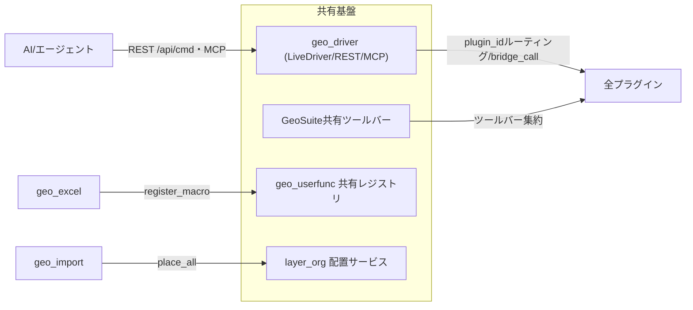

# qgis_live_harness — リポジトリ横断ロジックシート

- 生成: 2026-11-14T07:12:38+09:00
- コンポーネント: geo_driver, geo_excel, geo_import, geo_launcher, geo_legend, geo_report, geo_search, geo_userfunc, geo_webview

## プラグイン間連携

